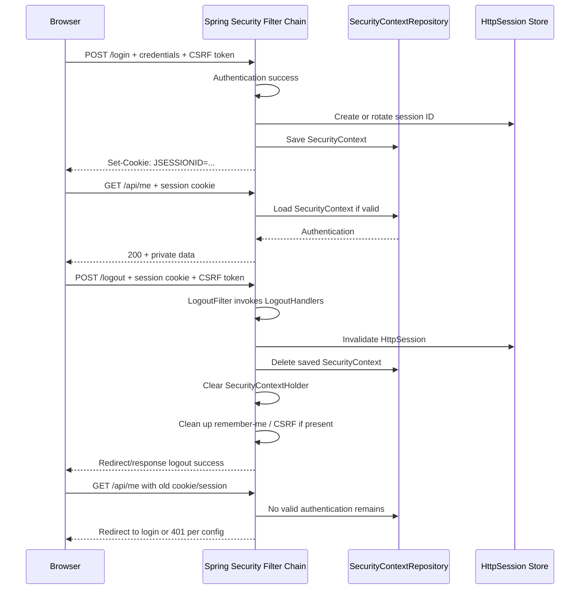

# Logout Must Handle Related Context, Sessions, and Cookies

> **Topic:** Spring Security – fundamentals / **Login and Logout**. The focus is secure logout in **Spring MVC/Servlet** applications using `HttpSession`, security context, and cookies. Examples use Java 17, Spring Boot 3.5.0, Spring Security 6.x, MockMvc, and Spring Security Test. Systems using WebFlux, OAuth2/OIDC, or stateless JWTs are distinguished separately; do not treat Servlet guidance as a one-size-fits-all solution for every authentication style.

## 1. Learning outcomes

After this lesson, you can:

1. Explain why "logging out" is not merely switching the UI to a logged-out state or deleting one cookie.
2. Distinguish `Authentication`, `SecurityContext`, `SecurityContextHolder`, `SecurityContextRepository`, `HttpSession`, `JSESSIONID`, remember-me tokens, CSRF tokens, and access/refresh tokens.
3. Understand the default logout flow coordinated by `LogoutFilter`, and the roles of `LogoutHandler`, `SecurityContextLogoutHandler`, `CsrfLogoutHandler`, and `LogoutSuccessHandler`.
4. Customize logout with `HttpSecurity.logout(...)` without dropping context/session cleanup steps.
5. Understand why POST logout should be protected by CSRF when browsers automatically send authentication cookies.
6. Delete cookies properly (name, Path, Domain, Secure, SameSite), and recognize limitations when cookies are managed by servlet containers/proxies.
7. Write real logout tests: session state is invalidated, private endpoints are no longer accessible via the old session, CSRF errors do not accidentally log users out, and other sessions are unaffected unless policy dictates.
8. Identify components that must be revoked **separately** when remember-me, SSO, distributed Spring Session, JWTs, or refresh tokens are enabled.

## 2. What must logout actually terminate?

Suppose Alice logs in on a browser. Spring Security has stored her authenticated identity and authorities in a security context; the context may be persisted in an HTTP session referenced by the browser via a session cookie.

If you only update the frontend:

```javascript
// WRONG if treated as complete logout:
localStorage.removeItem("userProfile");
window.location.href = "/login";
```

then the browser can still send a valid session cookie to the server. A new request to `/api/me` can still be authenticated as before. Similarly, if the frontend only deletes the cookie without invalidating the session on the server, a leaked copy of the cookie ID can continue working until the session expires (depending on session store design).

Proper server-side logout must address **the actual state used to authenticate requests**:

| Component | Effect | Requirement at logout |
| --- | --- | --- |
| `Authentication` | Identity and authorities of current request | No longer used after logout |
| `SecurityContextHolder` | Where Spring Security accesses the current request thread's context | Clear current context |
| `SecurityContextRepository` | Mechanism persisting/restoring context across requests | Remove saved context; avoid re-restoring after logout |
| `HttpSession` | Server-side session, often storing security context | Invalidate current session if session-based |
| `JSESSIONID` or `SESSION` | Cookie pointing to the container/Spring Session session | Becomes invalid once session is invalidated; clear browser cookie properly |
| Remember-me cookie/token | Can re-authenticate without entering password | Clean up/revoke per configured remember-me type |
| CSRF token | Proves state-changing requests come from a valid client | Clear old session's token; issue new token when needed |
| Custom app cookies | E.g., UI preferences, identity-linked data | Delete cookies covered by logout policy; do not delete unrelated cookies blindly |
| Access/refresh token | OAuth2/JWT credentials if used by the system | Needs separate revocation strategy; session logout does not revoke all tokens automatically |
| Other sessions/SSO | May exist on other devices or applications | Requires explicit logout-all/SSO requirements and mechanisms |

**Key takeaway:** If the backend no longer accepts the old session ID, the cookie still appearing in the browser does not mean the session remains authenticated. Conversely, if the backend still accepts an old token or session, displaying "logged out" in the UI has no security value.

## 3. Login–logout lifecycle diagram



The last line does not necessarily return `401`: applications using **form login** typically redirect **302 to `/login`**, whereas pure HTTP Basic or Bearer-token APIs usually use 401 when valid credentials are absent. Tests must follow the actual contract rather than concluding from a single status code.

## 4. How does Spring Security handle standard logout?

### 4.1. `LogoutFilter` is the default entry point

In Spring Security Servlet, `LogoutFilter` detects requests matching the logout URL/matcher (by default typically `/logout`) and runs a chain of `LogoutHandler`s before calling `LogoutSuccessHandler`.

With the default configuration where CSRF is enabled:

- `GET /logout` typically displays a confirmation page that provides the CSRF token;
- `POST /logout` **with a valid CSRF token** actually performs logout;
- After cleaning up state, the default form-login flow typically redirects to `/login?logout`.

When CSRF is disabled, GET logout behavior can differ. Do not extrapolate from the example when an application uses custom matchers, OAuth2, or a different filter chain.

### 4.2. State-cleaning handlers

Spring Security provides components with distinct responsibilities:

| Component | Function |
| --- | --- |
| `SecurityContextLogoutHandler` | Invalidates `HttpSession` (by default), clears authentication, and cleans up the current context and matching context repository |
| `CsrfLogoutHandler` | Clears the old CSRF token in the CSRF token repository so a new session does not reuse it |
| `RememberMeServices` when configured | Performs remember-me cleanup associated with logout |
| `LogoutSuccessEventPublishingLogoutHandler` | Publishes logout success events so other parts of the system can observe them |
| `CookieClearingLogoutHandler` | Instructs the client to delete specified cookies via response headers |
| `HeaderWriterLogoutHandler` | Writes headers such as `Clear-Site-Data` according to configuration |
| `LogoutSuccessHandler` | Decides the final response: redirect, status, or post-logout handling |

`LogoutHandler` is designed for cleanup work; handlers should not throw unchecked exceptions that abort the cleanup chain. For systems that must call a remote service to revoke tokens, clearly define error handling, timeouts, and monitoring; never silently claim logout succeeded completely if a critical revocation source failed.

**Order matters:** Standard handlers clean up state first, and only then does the success handler run to write the response. A custom logout endpoint created in a controller does not automatically inherit all of this machinery if you only invoke a single statement.

### 4.3. Security context and session are not one variable

`SecurityContextHolder.clearContext()` only clears the context bound to the current request thread per the holder strategy. It is **not equivalent** to deleting the context stored in the session repository.

`request.getSession().invalidate()` destroys the HTTP session, yet custom code calling only that can still miss necessary cleanup on the security context, remember-me, or CSRF. The simplest, least error-prone approach is to **use the standard logout DSL**.

Therefore, do not create a `@PostMapping("/logout")` like this:

```java
// WRONG: only changes UI/response without performing logout.
@PostMapping("/logout")
public String fakeLogout() {
    return "logged out";
}
```

If a custom endpoint is strictly required, it must invoke the appropriate logout components and configure authorization/CSRF properly; Spring Security documentation recommends leveraging the DSL instead of reimplementing every step manually.

## 5. Runnable Spring Boot 3.5.0 example: login, logout, and testing

Example objective: build an MVC app with form login, security context stored in `HttpSession`, a private API `/api/me`, standard logout via `POST /logout`, and a confirmation page `/logged-out`.

The configuration **does not disable CSRF** and **does not bypass the Spring Security filter chain**. Remember-me is not enabled in this demo to stay focused on security context/session; section 9 explains how to handle it when added.

### 5.1. File structure

```text
logout-state-demo/
├── pom.xml
└── src/
    ├── main/
    │   ├── java/demo/logout/
    │   │   ├── LogoutStateApplication.java
    │   │   ├── SecurityConfig.java
    │   │   └── AccountController.java
    │   └── resources/application.properties
    └── test/java/demo/logout/
        └── LogoutFlowTest.java
```

Requires JDK 17+, Maven 3.9+. Place only one `@SpringBootApplication` in package `demo.logout`. The example uses a single-JVM app with Servlet container sessions; multi-node deployments need an appropriate session store design.

### 5.2. `pom.xml`

```xml
<?xml version="1.0" encoding="UTF-8"?>
<project xmlns="http://maven.apache.org/POM/4.0.0"
         xmlns:xsi="http://www.w3.org/2001/XMLSchema-instance"
         xsi:schemaLocation="http://maven.apache.org/POM/4.0.0 https://maven.apache.org/xsd/maven-4.0.0.xsd">
    <modelVersion>4.0.0</modelVersion>
    <parent>
        <groupId>org.springframework.boot</groupId>
        <artifactId>spring-boot-starter-parent</artifactId>
        <version>3.5.0</version>
        <relativePath/>
    </parent>
    <groupId>demo</groupId>
    <artifactId>logout-state-demo</artifactId>
    <version>0.0.1-SNAPSHOT</version>
    <properties>
        <java.version>17</java.version>
    </properties>
    <dependencies>
        <dependency>
            <groupId>org.springframework.boot</groupId>
            <artifactId>spring-boot-starter-web</artifactId>
        </dependency>
        <dependency>
            <groupId>org.springframework.boot</groupId>
            <artifactId>spring-boot-starter-security</artifactId>
        </dependency>
        <dependency>
            <groupId>org.springframework.boot</groupId>
            <artifactId>spring-boot-starter-test</artifactId>
            <scope>test</scope>
        </dependency>
        <dependency>
            <groupId>org.springframework.security</groupId>
            <artifactId>spring-security-test</artifactId>
            <scope>test</scope>
        </dependency>
    </dependencies>
    <build>
        <plugins>
            <plugin>
                <groupId>org.springframework.boot</groupId>
                <artifactId>spring-boot-maven-plugin</artifactId>
            </plugin>
        </plugins>
    </build>
</project>
```

Pinning the Spring Boot Maven dependency at `3.5.0` keeps the example reproducible; production environments must use supported, patched releases compatible with the system.

### 5.3. Startup class

`src/main/java/demo/logout/LogoutStateApplication.java`:

```java
package demo.logout;

import org.springframework.boot.SpringApplication;
import org.springframework.boot.autoconfigure.SpringBootApplication;

@SpringBootApplication
public class LogoutStateApplication {
    public static void main(String[] args) {
        SpringApplication.run(LogoutStateApplication.class, args);
    }
}
```

### 5.4. Security configuration

`src/main/java/demo/logout/SecurityConfig.java`:

```java
package demo.logout;

import org.springframework.context.annotation.Bean;
import org.springframework.context.annotation.Configuration;
import org.springframework.security.config.Customizer;
import org.springframework.security.config.annotation.web.configuration.EnableWebSecurity;
import org.springframework.security.config.annotation.web.builders.HttpSecurity;
import org.springframework.security.core.userdetails.User;
import org.springframework.security.core.userdetails.UserDetails;
import org.springframework.security.core.userdetails.UserDetailsService;
import org.springframework.security.crypto.factory.PasswordEncoderFactories;
import org.springframework.security.crypto.password.PasswordEncoder;
import org.springframework.security.provisioning.InMemoryUserDetailsManager;
import org.springframework.security.web.SecurityFilterChain;

@Configuration
@EnableWebSecurity
public class SecurityConfig {

    @Bean
    SecurityFilterChain securityFilterChain(HttpSecurity http)
            throws Exception {
        return http
            .authorizeHttpRequests(auth -> auth
                .requestMatchers("/login", "/logged-out", "/error")
                    .permitAll()
                .requestMatchers("/api/**").authenticated()
                .anyRequest().denyAll()
            )
            .formLogin(Customizer.withDefaults())
            .logout(logout -> logout
                .logoutUrl("/logout")
                .invalidateHttpSession(true)
                .clearAuthentication(true)
                .logoutSuccessUrl("/logged-out")
                // Use only for app-managed cookies when needed:
                .deleteCookies("custom-app-cookie")
            )
            .build();
    }

    @Bean
    PasswordEncoder passwordEncoder() {
        return PasswordEncoderFactories
            .createDelegatingPasswordEncoder();
    }

    @Bean
    UserDetailsService users(PasswordEncoder passwordEncoder) {
        UserDetails alice = User.withUsername("alice")
            .password(passwordEncoder.encode("alice-demo"))
            .roles("USER")
            .build();
        return new InMemoryUserDetailsManager(alice);
    }
}
```

Explanation:

1. `requestMatchers("/api/**").authenticated()` requires login for all private APIs.
2. `formLogin(...)` uses the default form-login flow; Spring Security provides `/login` when no custom page exists.
3. `logoutUrl("/logout")` defines the request that triggers `LogoutFilter`. When CSRF is enabled, execute logout via `POST` with a valid CSRF token.
4. `invalidateHttpSession(true)` and `clearAuthentication(true)` state the logout intent explicitly; these are also sensible defaults of `SecurityContextLogoutHandler`.
5. `logoutSuccessUrl("/logged-out")` redirects to the public endpoint after the handlers run.
6. `deleteCookies("custom-app-cookie")` only illustrates a **custom cookie** managed by the application, not a requirement to invalidate `HttpSession`. The demo never sets this cookie, so the declaration does not affect login/logout security.
7. Default CSRF **remains enabled**. Never call `csrf.disable()` just to make `POST /logout` easier to test.
8. Passwords are encoded with `DelegatingPasswordEncoder`. Static users and passwords are for demo only; production requires a proper identity management system and secure secrets.

**Why not add a `@PostMapping("/logout")` controller?** `LogoutFilter` is responsible for intercepting the URL and running cleanup. A controller at the same path may never be invoked because the filter handles the request before MVC. In Spring Security 6.x, `LogoutFilter` sits before `AuthorizationFilter`; thus `/logout` normally does not need an explicit `permitAll` rule in request authorization.

### 5.5. Controller

`src/main/java/demo/logout/AccountController.java`:

```java
package demo.logout;

import java.util.Map;
import org.springframework.security.core.Authentication;
import org.springframework.web.bind.annotation.GetMapping;
import org.springframework.web.bind.annotation.RestController;

@RestController
public class AccountController {

    @GetMapping("/api/me")
    public Map<String, String> me(Authentication authentication) {
        return Map.of("username", authentication.getName());
    }

    @GetMapping("/logged-out")
    public String loggedOut() {
        return "signed-out";
    }
}
```

`me` only succeeds after HTTP security verifies authentication. `loggedOut` does not access any old context and returns no private data.

### 5.6. Session/cookie configuration for local environments

`src/main/resources/application.properties`:

```properties
server.servlet.session.timeout=20m
server.servlet.session.cookie.http-only=true
server.servlet.session.cookie.same-site=lax
```

For production **behind HTTPS**, you can add:

```properties
server.servlet.session.cookie.secure=true
server.servlet.session.cookie.http-only=true
server.servlet.session.cookie.same-site=lax
server.servlet.session.timeout=20m
```

**Do not enable `Secure=true` over local HTTP and then assume cookies are broken**, because browsers only send Secure cookies over secure connections. In production, configure TLS and reverse proxies properly so the application recognizes secure requests. `SameSite` is only one layer reducing cross-site risk; it does not replace CSRF tokens. `HttpOnly` does not prevent every kind of XSS; it only restricts scripts from reading the cookie.

## 6. Testing Spring Security logout with MockMvc

Create `src/test/java/demo/logout/LogoutFlowTest.java`:

```java
package demo.logout;

import org.junit.jupiter.api.Test;
import org.springframework.beans.factory.annotation.Autowired;
import org.springframework.boot.test.autoconfigure.web.servlet.AutoConfigureMockMvc;
import org.springframework.boot.test.context.SpringBootTest;
import org.springframework.mock.web.MockHttpSession;
import org.springframework.test.web.servlet.MockMvc;
import org.springframework.test.web.servlet.MvcResult;

import static org.assertj.core.api.Assertions.assertThat;
import static org.springframework.security.test.web.servlet.request.SecurityMockMvcRequestBuilders.formLogin;
import static org.springframework.security.test.web.servlet.request.SecurityMockMvcRequestPostProcessors.csrf;
import static org.springframework.security.test.web.servlet.response.SecurityMockMvcResultMatchers.authenticated;
import static org.springframework.test.web.servlet.request.MockMvcRequestBuilders.get;
import static org.springframework.test.web.servlet.request.MockMvcRequestBuilders.post;
import static org.springframework.test.web.servlet.result.MockMvcResultMatchers.jsonPath;
import static org.springframework.test.web.servlet.result.MockMvcResultMatchers.redirectedUrl;
import static org.springframework.test.web.servlet.result.MockMvcResultMatchers.status;

@SpringBootTest
@AutoConfigureMockMvc
class LogoutFlowTest {

    @Autowired
    MockMvc mvc;

    private MockHttpSession login() throws Exception {
        MvcResult result = mvc.perform(
                formLogin().user("alice").password("alice-demo"))
            .andExpect(authenticated())
            .andReturn();

        MockHttpSession session = (MockHttpSession)
            result.getRequest().getSession(false);

        assertThat(session).isNotNull();
        return session;
    }

    @Test
    void currentSessionIsInvalidatedAfterLogout() throws Exception {
        MockHttpSession session = login();

        mvc.perform(get("/api/me").session(session))
            .andExpect(status().isOk())
            .andExpect(jsonPath("$.username").value("alice"));

        mvc.perform(post("/logout")
                .session(session)
                .with(csrf()))
            .andExpect(status().is3xxRedirection())
            .andExpect(redirectedUrl("/logged-out"));

        assertThat(session.isInvalid()).isTrue();

        // Do not pass the invalidated old session into the MockMvc request
        // because MockHttpSession is no longer a valid session.
        mvc.perform(get("/api/me"))
            .andExpect(status().is3xxRedirection());
    }

    @Test
    void missingCsrfCannotLogOutUser() throws Exception {
        MockHttpSession session = login();

        mvc.perform(post("/logout").session(session))
            .andExpect(status().isForbidden());

        assertThat(session.isInvalid()).isFalse();

        mvc.perform(get("/api/me").session(session))
            .andExpect(status().isOk())
            .andExpect(jsonPath("$.username").value("alice"));
    }

    @Test
    void loggingOutOneSessionDoesNotInvalidateAnother() throws Exception {
        MockHttpSession browserA = login();
        MockHttpSession browserB = login();

        assertThat(browserA.getId()).isNotEqualTo(browserB.getId());

        mvc.perform(post("/logout")
                .session(browserA)
                .with(csrf()))
            .andExpect(status().is3xxRedirection());

        assertThat(browserA.isInvalid()).isTrue();

        mvc.perform(get("/api/me").session(browserB))
            .andExpect(status().isOk())
            .andExpect(jsonPath("$.username").value("alice"));
    }

    @Test
    void anonymousCannotAccessPrivateApi() throws Exception {
        mvc.perform(get("/api/me"))
            .andExpect(status().is3xxRedirection());
    }
}
```

### 6.1. Why are these tests important?

- **Real login in MockMvc:** `formLogin()` authenticates through Spring Security's form-login flow, rather than using `@WithMockUser` and mistakenly assuming a session was saved by a login handler.
- **Guaranteeing server-side logout:** `session.isInvalid()` proves `MockHttpSession` is marked invalidated. This differs from merely asserting the response contains "logged out."
- **Checking private areas:** `/api/me` cannot be accessed once no valid session/credential remains.
- **CSRF as a precondition:** POST logout without a token returns 403 and the session must stay alive. Checking only status 403 without checking session state does not prove the logic is right.
- **Not logging out all devices automatically:** two logins create two independent sessions; logging out browser A does not invalidate browser B. A "log out all devices" feature requires a dedicated revoke-all design.
- **Note on testing real cookies:** MockMvc does not perfectly emulate all browser/servlet container behavior for `Set-Cookie`, Path, Domain, and Secure. When testing cookie deletion thoroughly, run integration tests through a real HTTP server/proxy.

Run:

```bash
mvn test
mvn spring-boot:run
```

If the code and environment match the configuration above, **all four test methods** are expected to pass. This is an expected result inferred from source code; this lesson **does not claim Maven was executed with observed results**.

### 6.2. Manual testing with a browser

1. Open `http://localhost:8080/login`, log in as `alice` / `alice-demo`.
2. Visit `/api/me` to confirm the response contains the username.
3. Open the logout confirmation page at `/logout` if using the default flow; the logout form contains the CSRF token provided by Spring Security.
4. Submit a valid POST logout. The browser redirects to `/logged-out`.
5. Visit `/api/me` again without logging in. The application must redirect to login; no old data is returned.
6. Repeat with two browser profiles or two separate cookie jars to verify logging out one session does not destroy the other under default policy.

Do not simulate this by **only hitting GET `/logout` and assuming that performs logout** when CSRF is enabled. With `curl`, manage the cookie jar and CSRF token properly; `curl -i /logout` does not prove logout actually occurred.

## 7. Distinguishing clearing context, invalidating session, and deleting cookies

### 7.1. Clearing only `SecurityContextHolder` may be insufficient

A commonly seen snippet:

```java
SecurityContextHolder.clearContext();
```

This is an **illustrative statement** that must be inside a class/method with proper imports. It can clear the context on the current thread, yet **does not guarantee** the session is destroyed or the repository no longer holds the context. If another request reloads the context from an existing session, the user can become authenticated again from the old state.

### 7.2. Invalidating only the session may miss remember-me

```java
request.getSession(false).invalidate();
```

This is an **illustrative snippet, do not use verbatim**: `getSession(false)` can return `null`; the user might also have a remember-me cookie that creates a new authentication after the old session is destroyed. Moreover, manually invalidating the session can skip cleaning up the current context and CSRF repository.

For a custom endpoint when strictly required, Spring Security documentation suggests calling `SecurityContextLogoutHandler`. Still, review how related logout handlers integrate if the app also enables remember-me/custom tokens so standard behavior is not degraded.

### 7.3. Deleting only the cookie may not revoke server state

For a browser to delete a cookie, the response must set a cookie with the matching **name, Path, and Domain** of the original cookie, with `Max-Age=0` or a past Expires date:

```http
Set-Cookie: JSESSIONID=; Path=/; Max-Age=0; HttpOnly
```

This is only a **header example**, not exact configuration for every app. If the original cookie used `Path=/myapp` or `Domain=example.com`, the response must match that scope to clear the right cookie. Secure context and browser policies also apply. Spring Security's `deleteCookies(...)` is implemented via a cookie-clearing handler with path assumptions; it is **not** a guarantee of deleting every cookie across all servlet containers/proxies. Test in the real deployment environment.

On the other hand, even when the browser no longer has the old cookie, **a copy of the session ID on another device or in leaked logs** can still grant access if the server-side session was not invalidated. Therefore, **server-side invalidation is the core step** of session-based logout.

### 7.4. No need to delete every cookie on the same domain

An application might have:

- Session cookie `JSESSIONID` or `SESSION`;
- Remember-me cookie;
- CSRF cookie;
- UI preference cookies;
- Cookies for other applications on the same domain.

Wiping all cookies with broad headers can break SSO or unrelated products. Explicitly inventory which cookies are **credentials**, which hold sensitive data, and which should be deleted by logout policy. With multiple apps on the same domain, carefully evaluate Path/Domain before using site-wide deletion.

## 8. `Clear-Site-Data`: capabilities and limits

Spring Security provides `HeaderWriterLogoutHandler` paired with `ClearSiteDataHeaderWriter` to emit the header:

```http
Clear-Site-Data: "cookies"
```

**Alternative** or additional configuration example inside `SecurityConfig`:

```java
import org.springframework.security.web.authentication.logout.HeaderWriterLogoutHandler;
import org.springframework.security.web.header.writers.ClearSiteDataHeaderWriter;
import org.springframework.security.web.header.writers.ClearSiteDataHeaderWriter.Directive;

// Place when building SecurityFilterChain:
HeaderWriterLogoutHandler clearCookies =
    new HeaderWriterLogoutHandler(
        new ClearSiteDataHeaderWriter(Directive.COOKIES));

http.logout(logout -> logout.addLogoutHandler(clearCookies));
```

This is an **illustrative configuration snippet**, not a standalone Java file: integrate it properly into your application's `HttpSecurity` builder without creating a duplicate chain.

You can use `Directive.ALL` to ask the browser to clear more storage types, yet its blast radius is broad and can affect other products on the same site. Browsers and versions determine header support; never rely on it as the sole guarantee. The header acts client-side and **does not replace server-side session invalidation**. Test over HTTPS with real browsers, inspecting cookies/storage before and after before deciding the scope.

## 9. Remember-me: a source of automatic re-login after logout

### 9.1. Why must remember-me be considered separately?

When "Remember me" is enabled, the browser can retain a **remember-me cookie** longer than the session. If the server only invalidates `HttpSession`, the next request can still auto-authenticate using the valid remember-me credential.

Spring Security supports hash-based remember-me and persistent-token remember-me with a token repository. `RememberMeServices` implementations integrate with standard logout to clean up related state.

**Distinction to keep clear:** cleaning remember-me **for the current request** does not mean all remember-me tokens across every device have been invalidated. With persistent tokens, revocation scope depends on token store design and product policy.

### 9.2. Remember-me config must stay consistent with logout

When enabling remember-me:

```java
// Illustration inside HttpSecurity DSL, not the runnable demo in section 5.
http.rememberMe(remember -> remember
    .userDetailsService(userDetailsService)
    .key(rememberMeSigningKey)
);
```

This **configuration snippet depends on variables** `userDetailsService` and `rememberMeSigningKey` and is not a standalone runnable class. The secret must have high entropy, be consistent across nodes, and be stored via a secret manager; never hardcode it in source.

Test:

1. Log in with the remember-me option actually submitted.
2. Confirm that when the session expires while the remember-me cookie remains valid, the app auto-authenticates per policy.
3. Log out via `LogoutFilter`.
4. Retry using the cleaned-up remember-me cookie; it must not automatically log back in after logout.
5. If a logout-all feature exists, revoke by account/device in the remember-me token store, not merely by deleting the current cookie.

With hash-based tokens, centralized invalidation may require rotating the key or changing the password depending on policy, affecting many sessions/accounts. With persistent tokens, token records can be revoked by username/series in the server-side store to satisfy business needs. Never implement manual token deletion without verifying ownership.

## 10. CSRF and the significance of POST logout

### 10.1. Why is GET logout risky?

If an external site can make a user's browser send a GET request to the logout URL, an attacker can cause **logout CSRF**: forcing the user out or disrupting workflows. Logout is a security state change, so **GET should not be used arbitrarily as a state-changing action**.

When CSRF is enabled, Spring Security requires POST logout with a valid CSRF token by default. The HTML form template generated by Spring Security includes this token:

```html
<form method="post" action="/logout">
    <input type="hidden" name="_csrf" value="TOKEN_FROM_SERVER">
    <button type="submit">Sign out</button>
</form>
```

This is an **illustrative template**; never use the literal `TOKEN_FROM_SERVER` in a real application. Spring MVC/Thymeleaf has mechanisms to read the CSRF token from the request and render it; parameter/header names depend on `CsrfTokenRepository`.

### 10.2. Testing missing CSRF is not a test of logout success

```java
mvc.perform(post("/logout").session(session))
    .andExpect(status().isForbidden());
```

That snippet only proves the **CSRF filter** rejects requests lacking a token, not that the logout handler ran. To test logout, you need:

```java
mvc.perform(post("/logout")
        .session(session)
        .with(csrf()))
    .andExpect(status().is3xxRedirection());
```

Then verify the session is invalidated and requests using the old identity cannot access private data. That is why the test suite in section 6 checks **both cases**.

### 10.3. Single-page applications

SPAs using cookie-based authentication must manage CSRF tokens after login/logout because the token can be cleared or rotated along with the session. Do not try to reuse a CSRF token from a logged-out session and conclude the backend is broken. When designing cookie repositories (`CookieCsrfTokenRepository`) or session repositories, synchronize the flow for obtaining a new token, especially when the client does not reload the page.

CORS and SameSite serve different goals; **neither replaces full CSRF protection on its own**. If an API is genuinely stateless and only accepts Bearer tokens from headers explicitly sent by JavaScript, evaluate CSRF against that specific threat model rather than copying defaults blindly.

## 11. Custom LogoutSuccessHandler and LogoutHandler

### 11.1. Redirect or HTTP 204?

Traditional web apps usually want a redirect:

```java
.logout(logout -> logout
    .logoutSuccessUrl("/logged-out")
)
```

REST APIs/SPAs may want a no-content status:

```java
import org.springframework.security.web.authentication.logout.HttpStatusReturningLogoutSuccessHandler;

// Configuration inside HttpSecurity DSL:
.logout(logout -> logout
    .logoutSuccessHandler(
        new HttpStatusReturningLogoutSuccessHandler(
            org.springframework.http.HttpStatus.NO_CONTENT))
)
```

This is an **alternative** configuration to the demo's redirect flow; do not enable both success behaviors on the same chain. Changing only the success response handler does not skip context/session cleanup; the DSL still coordinates standard handlers unless you disable them.

### 11.2. Custom cleanup and failure modes

You may need to delete an application cookie, revoke a refresh token, terminate a session in an auxiliary system, or emit an audit event. If an operation is *mandatory* to consider logout successful, define error handling, bounded retries, idempotency, and audit data. `LogoutHandler` in Spring Security is designed for cleanup and should not throw exceptions that break the security cleanup pipeline.

Do not place complex, slow, error-prone logic directly inside the logout filter without managing timeouts. An OAuth2 system may require a revocation call to the authorization server or back-channel logout; those operations need dedicated policies for reliability and state consistency.

If building a custom `LogoutSuccessHandler`, ensure it **never returns a false success response** before mandatory revocations succeed. Distinguish "local logout completed" from "all sessions/tokens across external systems revoked."

## 12. Logging out the current session vs. logout-all

Default logout scopes to the **current session**. A user may still have valid sessions on a phone, another browser profile, or another computer:

```text
Alice:
  Laptop A -> session S1
  Phone B  -> session S2
  Tablet C -> session S3

POST /logout on Laptop A
  -> invalidates S1
  -> S2, S3 are not automatically revoked
```

To "log out of all devices," build dedicated API/logic with these constraints:

- Find all sessions belonging to the **current principal**, never trusting a `userId` sent in the request.
- Invalidate them in the session store or mark sessions expired with checks on subsequent requests.
- Across multiple nodes, use a shared registry/session store (e.g., Spring Session with Redis), not a per-JVM in-memory list.
- Also revoke remember-me and refresh tokens if present.
- Handle concurrent logins/revocation races; for urgent revocation, use a server-checked security version or epoch.
- For privileged accounts, consider recent authentication/MFA before logout-all or credential changes.
- Write secure audit logs without logging raw session IDs, cookies, or tokens.

Never expose raw session identifiers in a "logged-in devices" API. A session ID can act as a bearer credential; if the UI needs to select a session, use a separate public handle mapped server-side and verify ownership before revoking.

## 13. Spring Session, Redis, and servlet containers

### 13.1. Where are sessions stored?

In a basic MVC app, `HttpSession` may live in servlet container memory. When scaling to multiple nodes, logging out on node A cannot be assumed to revoke copies on node B unless the system has a shared session store or proper synchronization.

Spring Session can store sessions in Redis/JDBC and changes how session IDs are issued, queried, and expired. A common cookie name with Spring Session is `SESSION` instead of `JSESSIONID`, depending on configuration. Therefore:

- **Do not hardcode** the assumption that every deployment uses `JSESSIONID`.
- **Do not just delete the cookie** and forget to invalidate the session in the shared repository.
- Test the flow when logging out through a load balancer and sending the next request to a different node.
- Define session store cleanup policies: TTL, principal index, expiration events, duplicate sessions, races, and network failures.
- Do not fail open when the revocation check store is unavailable for sensitive resources.

### 13.2. Illustrative configuration for Spring Session Redis

An application can use the Spring Session Redis starter matching Spring Boot, a running Redis server, and secure connection settings. Example:

```xml
<!-- Example additional dependency for Redis deployment; do not apply to local demo without running Redis. -->
<dependency>
    <groupId>org.springframework.boot</groupId>
    <artifactId>spring-boot-starter-session-data-redis</artifactId>
</dependency>
```

```properties
spring.data.redis.host=redis.internal.example
spring.data.redis.port=6379
spring.session.redis.namespace=myapp:session
server.servlet.session.timeout=20m
```

The host above is **illustrative only**. With real Redis, configure authentication/TLS, namespace, eviction policy, TTL, serialization, and availability monitoring. Integration tests must run across at least two instances/backends if the goal is guaranteeing cluster-wide revocation.

## 14. JWT, OAuth2, and OIDC: local logout does not equal token revocation

This is critical when a product combines session cookies with SSO login or Bearer-token APIs.

### 14.1. Stateless JWT

If a resource server validates JWTs solely by signature, issuer, audience, and `exp`, then **clearing `SecurityContext` or invalidating `HttpSession` in another web app does not automatically invalidate already-issued JWTs**.

Example of a JWT valid for 20 minutes:

```text
12:00 -> Authorization server issues JWT valid until 12:20
12:05 -> User logs out, client deletes local token
12:06 -> Copy of old token still exists on another device
12:07 -> Resource server checks only signature and exp
         -> May continue accepting old JWT until 12:20
```

Options to meet revocation needs:

- Short-lived access tokens narrow the exposure window, yet **do not** guarantee immediate logout.
- Revoke refresh tokens so no new access tokens can be obtained, though old access JWTs may still remain valid.
- Check a denylist by `jti` or a security version/epoch on every request.
- Use opaque token introspection or stateful validation so the server knows a token was revoked.
- In distributed systems, define SLAs for cache/revocation propagation delay and network failure scenarios.

### 14.2. OAuth2 Login and OIDC

An application can log in via an OpenID Provider (IdP) and then create a **local session** to hold authentication:

```text
Browser -> Spring Security app (local session)
        -> Identity Provider (SSO session)
        -> Other OAuth2 clients / resource servers
```

Logging out of the local session **does not necessarily** log out at the IdP or other applications. When the product requires full SSO logout, implement standard/IdP-supported mechanisms such as:

- RP-initiated logout / OIDC client-initiated logout;
- front-channel or back-channel logout if supported by the parties;
- revoking appropriate OAuth2 tokens/authorized clients;
- verifying callbacks, state, redirect URIs, and that the logout event was actually processed.

Spring Security provides `OidcClientInitiatedLogoutSuccessHandler` for OIDC client-initiated logout under appropriate conditions. **Do not assume redirecting the browser to the app's login page ends the SSO session**. Depending on the provider, the user may log right back in because the SSO session is still active.

### 14.3. HTTP Basic

If the app uses HTTP Basic, browsers/clients may keep sending the `Authorization: Basic ...` header on new requests even after the local session is destroyed. Session-based logout **cannot invalidate still-valid passwords/credentials**. Define client policies to clear credentials and, when needed, change passwords or disable accounts.

## 15. Common mistakes

| Mistake | Consequence | Correct approach |
| --- | --- | --- |
| Frontend only redirects to `/login` | Session/token may still be valid | Logout must have server-side revocation |
| Calling only `SecurityContextHolder.clearContext()` | Context stored in session/repository may remain | Use `LogoutFilter` + standard handlers |
| Calling only `request.getSession().invalidate()` | May miss remember-me and context cleanup | Use the logout DSL or integrate full handlers |
| Deleting `JSESSIONID` in browser is enough | Server session may remain; copied cookie still works | Invalidate server session first |
| Writing custom `@PostMapping("/logout")` without `SecurityContextLogoutHandler` | User may remain authenticated on next request | Use standard DSL or call appropriate handlers |
| Using GET to perform logout state changes with cookie auth | Increases logout CSRF risk | POST with a valid CSRF token |
| Dropping CSRF just to test POST logout | Leaves forged-request vulnerability | Use `with(csrf())` in MockMvc |
| Asserting only the "logged out" response | Session/context might not be cleared | Assert session invalidated and private API denied |
| Deleting cookie with mismatched Path/Domain | Old cookie stays in browser | Check real Set-Cookie and match cookie scope |
| Using `Clear-Site-Data: "all"` casually | Wipes cache/storage for unrelated data too | Evaluate scope and browser support |
| Forgetting remember-me | Browser can auto-authenticate again | Clean up/revoke remember-me per implementation |
| Describing current-session logout as logout-all-devices | Other sessions remain valid | Build a dedicated logout-all mechanism |
| Ignoring JWTs issued before logout | Access token stays valid until `exp` | Short TTL, denylist/introspection/version per SLA |
| Testing only one node with Redis sessions | Misses cross-node revocation bugs | Test through load balancer / multi-node |
| Logging full `Cookie` or Authorization headers | Credential leakage | Redact IDs/tokens, log safe audit metadata |
| Assuming destroying a session cancels an in-flight request | Already-authorized work can finish | Check permissions at sensitive business/commit steps |

## 16. Code review and testing checklist

### 16.1. Security context and session checklist

- [ ] Logout actually flows through `LogoutFilter` or a fully implemented handler pipeline, not just a controller returning a message.
- [ ] `SecurityContextHolder` and `SecurityContextRepository` do not retain reusable authentication after logout.
- [ ] Current `HttpSession` is invalidated when policy calls for session-based logout.
- [ ] Tested that a new request with the old session/cookie cannot read private data.
- [ ] Request body input is never trusted to decide someone else's session to revoke.
- [ ] If remember-me is present, tested that the session does not auto-login again with the old remember-me token.
- [ ] With multiple instances, tested logout across different nodes.
- [ ] Defined policy for concurrent active requests around revocation time.

### 16.2. Cookie, CSRF, and browser checklist

- [ ] Session cookies use `Secure` over HTTPS, `HttpOnly`, and appropriate `SameSite`.
- [ ] Cookies are deleted using matching name and Path/Domain scope.
- [ ] POST logout has CSRF protection if browsers auto-send credentials.
- [ ] A 403 from missing CSRF is not mistaken for logout handler success.
- [ ] Logout success returns no private data or session IDs.
- [ ] If using `Clear-Site-Data`, scope fits the app and browser support was tested.
- [ ] SPAs know how to fetch a fresh CSRF token after login/logout.
- [ ] Raw cookies/Authorization tokens are never written to logs or audits.

### 16.3. Token and ecosystem checklist

- [ ] Identified the authentication mechanism in use: form session, Basic, remember-me, OAuth2/OIDC, or JWT.
- [ ] For remember-me, distinguished current logout from revoking all tokens.
- [ ] For JWTs, do not promise instant access-token revocation if the resource server only checks `exp`.
- [ ] For OIDC, clearly defined local logout, IdP logout, and logout at other relying parties.
- [ ] On password change, lost device, or account lock, have appropriately scoped revocation policies.
- [ ] Tests cover multi-device logout, races, role changes, and leaked tokens/sessions proportionate to risk.
- [ ] Audit logging records actor, timestamp, logout type, and outcome; never put credentials in logs.

## 17. Knowledge self-check

**1. Why is merely redirecting the UI to the login page not considered logout?**  
Because the session or token may still be accepted by the server and the browser still sends the old credentials.

**2. What does `SecurityContextLogoutHandler` do?**  
Clears authentication/security context, cleans up the corresponding context repository, and invalidates the HTTP session per configuration; it is the foundational component of Servlet logout.

**3. When CSRF is enabled, does GET `/logout` necessarily log the user out?**  
No. Typically GET shows a confirmation page; POST with a CSRF token actually executes logout.

**4. If POST logout returns 302 from the server, does that prove the session was deleted?**  
Not yet. Verify session/context state and confirm requests with old credentials cannot access private APIs.

**5. Are `HttpSession.invalidate()` and `deleteCookies("JSESSIONID")` the same?**  
No. One invalidates server-side state while the other asks the browser to delete a cookie; to stay secure you must understand the role and limits of both.

**6. Why must remember-me be considered separately?**  
Because a remember-me token can outlive the session; if not properly revoked, the browser automatically re-authenticates.

**7. Does logging out on a laptop automatically log out on a phone?**  
Not under default current-session logout; it requires a dedicated policy and revoke-all mechanism.

**8. Why can an old access JWT still call APIs even after the refresh token is revoked?**  
Because a resource server checking only signature/`exp` will continue accepting an unexpired token without a denylist/introspection/version check.

**9. When using Spring Session, is the cookie name guaranteed to be `JSESSIONID`?**  
No. It may be `SESSION` or another configured name; confirm from actual responses/browsers.

**10. Why does a hand-written `@PostMapping("/logout")` require caution?**  
Because it can bypass `LogoutFilter` and standard cleanup handlers, leaving context, remember-me, or CSRF tokens active.

## 18. References

- [Spring Security — Handling Logouts](https://docs.spring.io/spring-security/reference/servlet/authentication/logout.html): `LogoutFilter`, `SecurityContextLogoutHandler`, CSRF, logout success, cookie deletion, and `Clear-Site-Data`.
- [Spring Security — Session Management](https://docs.spring.io/spring-security/reference/servlet/authentication/session-management.html): `HttpSession` lifecycle, session fixation, and session invalidation.
- [Spring Security — CSRF](https://docs.spring.io/spring-security/reference/servlet/exploits/csrf.html): token state, logout requests, and testing CSRF.
- [Spring Security — Remember-Me Authentication](https://docs.spring.io/spring-security/reference/servlet/authentication/rememberme.html): tokens/cookies capable of automatic re-login.
- [Spring Security — Testing Logout](https://docs.spring.io/spring-security/reference/servlet/test/mockmvc/authentication.html): MockMvc, `formLogin`, `logout()`, and authentication testing.
- [Spring Session — Spring Security Integration](https://docs.spring.io/spring-session/reference/spring-security.html): shared session stores and logout/concurrent session integration.
- [OWASP Session Management Cheat Sheet](https://cheatsheetseries.owasp.org/cheatsheets/Session_Management_Cheat_Sheet.html): session ID management, cookies, logout, and session expiration.
