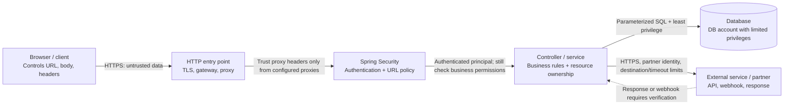

# Trust Boundaries Between Browser, Application, Database, and External Services

## Lesson Objectives

In a web system, a request travels from the browser to the application; the application in turn queries the database and calls external services. Each leg carries different data, identities, and privileges. If the application assumes by default that data having passed one layer is safe, attacker-controlled input can cross a boundary and turn into an SQL statement, data access, an internal HTTP request, or a privileged action.

This lesson helps you:

1. Identify a **trust boundary** and distinguish it from network, process, service, or Java class boundaries.
2. Map the data flow across **browser → application → database → external services**, identifying where authentication, authorization, data validation, and privilege limits belong.
3. Explain vulnerabilities such as **IDOR/BOLA, SQL injection, CSRF, SSRF, and misplaced trust in third-party data** through one common root cause: crossing a boundary without verification.
4. Understand how Spring Security protects the **HTTP → application** boundary and why controls are still needed in controllers/services, the data layer, and when calling external services.
5. Practice with Spring Boot, Spring Security, and JDBC to verify that one user cannot read another user's data simply by changing the ID in the URL.

Examples use **Java 17, Spring Boot 3.x, Spring MVC/Servlet, and Spring Security 6.x**; the security thinking principles still apply across other stacks.

## 1. What Is a Trust Boundary?

A **trust boundary** is the point where data, a request, or control passes from one party with one set of security assumptions to another party with a different set of security assumptions. Across that boundary, the receiving side **must verify the necessary conditions itself** before using the data or performing an action.

For example, the application has authenticated user `alice`. The browser sends:

```http
GET /api/orders/200
Authorization: Basic <credentials>
```

Here there are at least two independent questions:

- **Authentication:** who does this request truly represent?
- **Authorization:** does that person have permission to view order `200`?

Successful authentication does **not** prove the user owns every order whose ID can be guessed. Passing from client-sent data to a query authorized to read the database is itself crossing a trust boundary.

A useful rule of thumb: **"Sent by the browser," "over HTTPS," "already in the database," "returned by a partner," and "authenticated" are never synonymous with "fully trusted."**

### How Does a Boundary Differ from a Network Zone?

Network segmentation (`browser` on the Internet, application in a private network, database in a separate subnet) helps protect the system. However, trust boundaries still exist **inside the very same application**: JSON payload data may parse into a valid DTO yet still fail conditions to update a balance; a service method may be called from two controllers with different privilege levels; data already stored in a table may contain malicious HTML if rendered raw.

**There is no single absolute "trusted/untrusted" level for every purpose.** A username obtained from a server-managed authenticated session is more trustworthy than a user-filled username; yet that username does not automatically grant admin privileges. An SQL result truly comes from the database, yet string values inside it still need encoding when output to HTML.

## 2. Map of Boundaries in a Web Application



The diagram shows a conceptual flow. In Spring MVC running on Servlet, security filters sit inside the servlet filter chain before `DispatcherServlet` invokes a controller; gateway/proxy placement, filter order, and service separation depend on implementation.

| Boundary | Data/Control Crossing | Receiver Must Check | Risk If Wrongly Trusted |
| --- | --- | --- | --- |
| Browser → application | URL, ID, cookie, token, JSON, file upload, HTTP headers | Identity, resource permissions, format, size, CSRF when applicable | IDOR/BOLA, privilege escalation, malicious data, CSRF |
| Reverse proxy → application | `Forwarded`, `X-Forwarded-For`, hostname, protocol | Accept metadata only from trusted proxies, configure proxy chain properly | Source IP spoofing, incorrect redirect generation, bypassing IP-based limits |
| Application → database | Queries and DB connection account | Parameterized queries, query privileges, user/tenant data scoping | SQL injection, over-scoped reads, bulk deletion/modification |
| Database → application/HTML | Stored data, possibly user-entered | Business rules, output-context encoding, content limits | Stored XSS, context mismatch, data exposure |
| Application → external service | URL, request, API key, personal data | Exact endpoint, TLS verification, egress rights, timeouts, send only needed fields | SSRF, token/PII leakage, calling internal systems |
| External service → application | JSON, status, redirect, webhook | Signature or proper authentication mechanism, schema, size, freshness/replay | Spoofed data, wrongful privilege grant, duplicate transaction execution |

Boundaries needing protection depend on **who controls the data or action** and **what new privileges the data is about to exercise**. That is the core question of threat modeling.

## 3. Browser → Application: Users Can Alter Everything They Send

### 3.1. The Frontend Is Not a Trusted Permission Enforcer

A form may hide the "Delete" button, lock the `role` input, use JavaScript to validate amounts, or allow selecting only certain IDs. Yet a user can still modify requests using DevTools, curl, scripts, or a custom client.

Dangerous example:

```json
{
  "orderId": 200,
  "owner": "alice",
  "role": "ADMIN",
  "price": 0
}
```

Never treat `owner`, `role`, or `price` fields in the body as business truth. The server must obtain identity from the authentication mechanism, look up permissions from a trusted source, and recompute server-owned values. Browser-side checks improve user experience but do not replace server-side checks.

### 3.2. HTTPS, CORS, CSRF, and XSS Solve Different Problems

| Mechanism | What Does It Protect Against? | What Does It Not Replace? |
| --- | --- | --- |
| **HTTPS/TLS** | Reduces eavesdropping and tampering in transit; authenticates the endpoint when certificates are properly verified | Does not prove request content is valid or the user is allowed to perform the action |
| **Authentication** | Identifies the request, e.g., session, HTTP Basic, bearer token | Does not automatically decide whose resources can be read/modified |
| **Authorization** | Allows or denies actions by permission, object, tenant, context | Does not automatically prevent SQL injection, XSS, or SSRF |
| **CORS** | Controls which origins the browser allows to read responses via cross-origin JS, under specific rules | Not a firewall; curl/other servers are not blocked by browser CORS; insufficient for authorization |
| **CSRF protection** | Reduces the risk of another website triggering actions using credentials attached automatically by the browser, especially session cookies | Does not replace XSS protection or authorization |
| **Output encoding / CSP** | Reduces the risk of malicious scripts executing when displaying data, layering XSS defenses | Does not replace API permission checks or CSRF |

Example: an SPA uses a session cookie to update a shipping address. Browsers typically attach matching cookies automatically with requests; therefore the server must consider CSRF risk for state-changing actions. Cookie `SameSite` helps, but should not be treated as a default reason to strip CSRF protection. If an attacker exploits XSS on the same origin, they can perform many actions within the user's session context; CORS does not stop same-origin XSS.

With bearer tokens explicitly sent in headers, the CSRF model differs from automatic cookies, though how the browser stores/sends tokens and supporting flows must still be evaluated. Never disable CSRF by default just because an API uses JSON.

### 3.3. Which Entry Point Does Spring Security Protect?

For **Spring MVC/Servlet** applications:

```text
Client
  -> Servlet container
  -> DelegatingFilterProxy / FilterChainProxy
  -> SecurityFilterChain (authentication, request authorization, CSRF, ...)
  -> DispatcherServlet
  -> Controller
  -> Service
```

Spring Security creates/maintains `Authentication` in the security context and evaluates rules like `authenticated()`, `hasRole(...)`, or `hasAuthority(...)`. **URL access control** is vital yet insufficient when permissions depend on actual IDs in the database.

Example:

```java
.requestMatchers("/api/orders/**").authenticated()
```

This requires login, yet still lets an authenticated user **try any ID**. The Service must verify that the user has a valid relationship with that order; the most reliable approach is typically combining ownership/tenant conditions directly inside data queries or enforcing permissions through a business policy.

A server may avoid disclosing whether another person's ID exists by returning `404 Not Found` for both "does not exist" and "does not belong to caller." Choosing `403` vs `404` is an API policy decision; what matters is **never returning unauthorized data**.

## 4. Application → Database: Connection Privileges vs. User Privileges

An application connects to the database using a **service account**. This account usually has read/write privileges across many rows, whereas an end user should only touch a tiny subset. If the application uses connection privileges to run a query by client-supplied ID, it can become a **confused deputy**: a component holding privileges that acts on a caller's behalf without checking whether the caller is authorized.

### 4.1. Preventing SQL Injection with Parameterized Queries

**Wrong: concatenating input into SQL**

```java
String sql = "SELECT id, label FROM purchase_orders WHERE id = " + idFromRequest;
```

If input is uncontrolled, user-entered characters can become SQL syntax. Data-type validation helps, but the fundamental defense is **parameter binding**:

```java
jdbcTemplate.query(
    "SELECT id, label FROM purchase_orders WHERE id = ? AND owner_username = ?",
    (rs, row) -> new OrderView(rs.getLong("id"), rs.getString("label")),
    requestedId,
    authenticatedUsername
);
```

`?` separates data from statement structure. The `owner_username = ?` condition **adds scope control**: even if an attacker knows someone else's ID, the query does not return that row. Two mechanisms solve two different risks: parameterization stops SQL injection; ownership/tenant checks stop unauthorized access.

For table/column names or sort order where SQL parameters cannot bind, use an allowlist mapping valid values to static identifiers. Never concatenate arbitrary client strings into `ORDER BY` or table names.

### 4.2. Databases Can Hold Untrusted Data

Being stored in the DB does not mean it is safe to render straight onto a webpage. For example, a user-entered note containing HTML/script. If the frontend grabs that string and assigns it to `innerHTML`, it can create **stored XSS**. Use safe text rendering and context-aware output encoding; when HTML rendering is unavoidable, apply an appropriate sanitizer.

Similarly, DB content from import jobs, partner syncs, or legacy users should not be automatically trusted as permissions, commands, or configuration. The data's origin and sink determine the required checks.

### 4.3. Limiting DB Privileges and Query Scope

Additional defense layers:

- Use separate accounts per application/environment, granting only necessary privileges; never use a DBA account for web runtime.
- Apply `WHERE owner_id = ?` or `tenant_id = ?` to every scoped query; for complex systems, consider DB row-level security as an extra layer, configured and tested separately.
- Cap record counts/page sizes, query timeouts, upload volumes, and stored procedure call rights.
- Place the DB in an access-controlled network; enable TLS when connecting over paths needing protection.
- Never put DB passwords in source code, JSON responses, or logs; use a secret manager or proper secure configuration mechanism.
- Audit sensitive operations while avoiding logging passwords, tokens, or unnecessary personal data.

**Input validation**, **SQL parameterization**, **authorization**, and **DB least privilege** must work together; one layer cannot replace the others.

## 5. Application → External Services: Outbound Calls Are Also a Trust Boundary

An application may have access to internal networks, cloud metadata services, databases, or partner APIs. If a public endpoint lets a user control the URL the server will fetch, the server's network privileges can be abused to call destinations the client is not allowed to reach: **server-side request forgery (SSRF)**.

### 5.1. Faulty Example and Remediation Direction

**Dangerous:** taking a client-sent URL and letting the server fetch it directly.

```java
// Design flaw illustration: do not use in production systems.
String target = request.getParameter("url");
String body = httpClient.send(
    HttpRequest.newBuilder(URI.create(target)).GET().build(),
    HttpResponse.BodyHandlers.ofString()
).body();
```

`localhost` URLs are not the only danger. Redirects, DNS rebinding, private IP addresses, IPv6, encoding tricks, and unintended resource schemes can all bypass naive string checks.

Safer design direction:

1. Predefine **allowed destinations** in server config; the client chooses a business code like `carrier=partnerA`, not an arbitrary hostname or URL.
2. Do not automatically follow redirects to out-of-scope targets; validate scheme, host, port, resolved IP addresses, and redirects according to real needs.
3. Use **HTTPS** and verify certificates; if the partner requires it, use proper client authentication (API key, OAuth2 client credentials, mTLS).
4. Set timeouts, response size limits, and retry limits. Retrying state-changing operations requires idempotency analysis.
5. Enforce network egress rules so the process cannot connect to sensitive services beyond its needs; do not rely solely on URL checks in code.
6. Treat returned data as third-party input: parse against a schema, bound lengths/types, and never turn partner fields into arbitrary roles/SQL/file paths.
7. Send only the minimum data the partner needs; never forward the user's raw `Authorization` header or session cookies to partners.

### 5.2. Java 17 Client Example with Fixed Destination

The following is a **standalone illustrative class for outbound transport** that compiles with Java 17; the domain `partner.example` is only a documentation placeholder, so there is no real service to call. In production systems, add egress/DNS policies, partner authentication, response limits, and content parsing/validation.

```java
import java.io.IOException;
import java.net.URI;
import java.net.http.HttpClient;
import java.net.http.HttpRequest;
import java.net.http.HttpResponse;
import java.time.Duration;

public final class PartnerClient {
    private final URI endpoint = URI.create("https://partner.example/api/status");
    private final HttpClient client = HttpClient.newBuilder()
            .connectTimeout(Duration.ofSeconds(3))
            .followRedirects(HttpClient.Redirect.NEVER)
            .build();

    public String getStatus() throws IOException, InterruptedException {
        HttpRequest request = HttpRequest.newBuilder(endpoint)
                .timeout(Duration.ofSeconds(5))
                .header("Accept", "application/json")
                .GET()
                .build();

        HttpResponse<String> response =
                client.send(request, HttpResponse.BodyHandlers.ofString());

        if (response.statusCode() != 200) {
            throw new IOException("Partner unavailable");
        }
        return response.body(); // Unverified input schema/size limits!
    }
}
```

This class **does not take URLs from user requests**, disables automatic redirects, and enforces timeouts. Still, it is **not a complete production client**: `ofString()` can read huge responses into memory; you need body size limits, Content-Type/schema checks, error handling, partner authentication, and egress policy. Status `200` only says the HTTP request succeeded at the protocol level, not that the partner data is truthful.

### 5.3. External Service → Application: Webhooks Are Also Requests from Another Party

Suppose a payment gateway calls `POST /webhooks/payment` with a payload reporting "paid." Never update order status just because JSON contains `status=PAID`.

Verify whether the endpoint enforces the exact authentication mechanism defined by the partner (e.g., HMAC signature over the **raw body** with a dedicated secret); check timestamps and guard against replays/duplicates; reconcile transaction ID, currency, amount, status, and merchant against internal records. Perform idempotent updates, log appropriate audits, and check event ordering/late arrivals. Never take parameters from the webhook to skip these reconciliations.

For webhooks, `permitAll()` when bypassing regular user login requirements **does not mean** "unauthenticated": the webhook handler itself must still verify source identity and payload integrity using an appropriate mechanism. Never use `Origin` or IP alone as absolute proof of the sender.

## 6. Runnable Example: Authenticate at HTTP, Scope Data at DB

Goal: logged-in user `alice` can view her own record, yet **cannot** view `bob`'s record even when knowing the exact ID. This example implements the **browser → Spring Security → Spring MVC → database** boundary slice using in-memory H2. External services were covered separately in Section 5 because real partner endpoints require contracts, credentials, and separate network environments.

The config uses HTTP Basic for easy testing with curl, **not session cookies managed by a real frontend**. It implements only a `GET` endpoint and keeps default CSRF; since no state-changing requests are created, the example does not need to disable CSRF. Test passwords and H2 are for local learning only.

### 6.1. Project Structure

```text
trust-boundary-demo/
├── pom.xml
└── src/main/
    ├── java/com/example/boundary/
    │   ├── DemoApplication.java
    │   ├── SecurityConfig.java
    │   └── OrderController.java
    └── resources/
        ├── application.properties
        ├── schema.sql
        └── data.sql
```

### 6.2. Maven `pom.xml`

```xml
<project xmlns="http://maven.apache.org/POM/4.0.0"
         xmlns:xsi="http://www.w3.org/2001/XMLSchema-instance"
         xsi:schemaLocation="http://maven.apache.org/POM/4.0.0 https://maven.apache.org/xsd/maven-4.0.0.xsd">
    <modelVersion>4.0.0</modelVersion>
    <parent>
        <groupId>org.springframework.boot</groupId>
        <artifactId>spring-boot-starter-parent</artifactId>
        <version>3.5.0</version>
        <relativePath/>
    </parent>
    <groupId>com.example</groupId>
    <artifactId>trust-boundary-demo</artifactId>
    <version>1.0.0</version>
    <properties>
        <java.version>17</java.version>
    </properties>
    <dependencies>
        <dependency>
            <groupId>org.springframework.boot</groupId>
            <artifactId>spring-boot-starter-web</artifactId>
        </dependency>
        <dependency>
            <groupId>org.springframework.boot</groupId>
            <artifactId>spring-boot-starter-security</artifactId>
        </dependency>
        <dependency>
            <groupId>org.springframework.boot</groupId>
            <artifactId>spring-boot-starter-jdbc</artifactId>
        </dependency>
        <dependency>
            <groupId>com.h2database</groupId>
            <artifactId>h2</artifactId>
            <scope>runtime</scope>
        </dependency>
    </dependencies>
    <build>
        <plugins>
            <plugin>
                <groupId>org.springframework.boot</groupId>
                <artifactId>spring-boot-maven-plugin</artifactId>
            </plugin>
        </plugins>
    </build>
</project>
```

Spring Boot manages compatible dependency versions via the parent/BOM. Version `3.5.0` is a Boot 3.x reference point for this example; in real deployments choose a supported patched release. The example uses Spring MVC/Servlet, not the corresponding reactive WebFlux APIs.

### 6.3. `DemoApplication.java`

```java
package com.example.boundary;

import org.springframework.boot.SpringApplication;
import org.springframework.boot.autoconfigure.SpringBootApplication;

@SpringBootApplication
public class DemoApplication {
    public static void main(String[] args) {
        SpringApplication.run(DemoApplication.class, args);
    }
}
```

### 6.4. `SecurityConfig.java`

```java
package com.example.boundary;

import org.springframework.context.annotation.Bean;
import org.springframework.context.annotation.Configuration;
import org.springframework.http.HttpMethod;
import org.springframework.security.config.Customizer;
import org.springframework.security.config.annotation.web.builders.HttpSecurity;
import org.springframework.security.config.annotation.web.configurers.AbstractHttpConfigurer;
import org.springframework.security.core.userdetails.User;
import org.springframework.security.core.userdetails.UserDetailsService;
import org.springframework.security.crypto.bcrypt.BCryptPasswordEncoder;
import org.springframework.security.crypto.password.PasswordEncoder;
import org.springframework.security.provisioning.InMemoryUserDetailsManager;
import org.springframework.security.web.SecurityFilterChain;

@Configuration(proxyBeanMethods = false)
public class SecurityConfig {
    @Bean
    SecurityFilterChain securityFilterChain(HttpSecurity http) throws Exception {
        http
            .authorizeHttpRequests(auth -> auth
                .requestMatchers(HttpMethod.GET, "/api/orders/**").authenticated()
                .anyRequest().denyAll()
            )
            .httpBasic(Customizer.withDefaults())
            .formLogin(AbstractHttpConfigurer::disable);
        return http.build();
    }

    @Bean
    PasswordEncoder passwordEncoder() {
        return new BCryptPasswordEncoder();
    }

    @Bean
    UserDetailsService users(PasswordEncoder encoder) {
        return new InMemoryUserDetailsManager(
            User.withUsername("alice")
                .password(encoder.encode("alice-password"))
                .roles("USER").build(),
            User.withUsername("bob")
                .password(encoder.encode("bob-password"))
                .roles("USER").build()
        );
    }
}
```

At the HTTP boundary, Spring Security verifies credentials and provides `Authentication`. The `authenticated()` rule answers "is the user logged in?". No rule yet confirms "who owns this order"; that step lives in the database query. `anyRequest().denyAll()` prevents accidentally exposing an endpoint outside the specified paths.

Never use hardcoded accounts and unencrypted HTTP Basic at the application layer in production systems; use an appropriate login flow and HTTPS, with proper secret management. `BCryptPasswordEncoder` is used here to show not storing plaintext passwords in `UserDetails`.

### 6.5. `OrderController.java`

```java
package com.example.boundary;

import java.util.List;

import org.springframework.http.ResponseEntity;
import org.springframework.jdbc.core.JdbcTemplate;
import org.springframework.security.core.Authentication;
import org.springframework.web.bind.annotation.GetMapping;
import org.springframework.web.bind.annotation.PathVariable;
import org.springframework.web.bind.annotation.RestController;

@RestController
public class OrderController {
    private final JdbcTemplate jdbc;

    public OrderController(JdbcTemplate jdbc) {
        this.jdbc = jdbc;
    }

    @GetMapping("/api/orders/{id}")
    public ResponseEntity<OrderView> getOrder(
            @PathVariable long id,
            Authentication authentication) {

        String currentUser = authentication.getName();

        List<OrderView> results = jdbc.query(
            """
            SELECT id, label
            FROM purchase_orders
            WHERE id = ? AND owner_username = ?
            """,
            (rs, rowNum) -> new OrderView(
                rs.getLong("id"),
                rs.getString("label")
            ),
            id,
            currentUser
        );

        if (results.isEmpty()) {
            return ResponseEntity.notFound().build();
        }
        return ResponseEntity.ok(results.get(0));
    }

    public record OrderView(long id, String label) {}
}
```

**Three things to pay attention to in this code:**

1. `id` from the URL is client-controlled input; Spring only parses it into a `long`, **not** proving the client has rights to that ID.
2. `currentUser` comes from `Authentication` established by the Security filter after authentication. Never read username from arbitrary query parameters or request bodies.
3. The SQL statement uses two parameters, including `owner_username`, to **scope rows right at data retrieval**. The response only includes the needed `id` and `label`; it does not expose internal fields like `owner_username` or unnecessary DB structure.

If the ID does not exist **or** belongs to someone else, the response is `404`. This is an intentional choice to avoid revealing ownership or record existence. In real applications, permission policies can be more complex (owner, delegate, admin, tenant, order status) and must be defined and tested at the business layer.

### 6.6. `application.properties`, `schema.sql`, and `data.sql`

`application.properties`:

```properties
spring.datasource.url=jdbc:h2:mem:boundary_demo;DB_CLOSE_DELAY=-1
spring.datasource.driver-class-name=org.h2.Driver
spring.datasource.username=sa
spring.datasource.password=
spring.sql.init.mode=always
```

`schema.sql`:

```sql
CREATE TABLE purchase_orders (
    id BIGINT PRIMARY KEY,
    owner_username VARCHAR(60) NOT NULL,
    label VARCHAR(120) NOT NULL
);
```

`data.sql`:

```sql
INSERT INTO purchase_orders (id, owner_username, label)
VALUES
    (100, 'alice', 'Alice order'),
    (200, 'bob', 'Bob order');
```

Spring Boot initializes H2 from these two SQL files in `resources` per this configuration. The `sa` account and in-memory database aid learning; for production databases configure a least-privilege connection account, network controls, and secret management.

### 6.7. Running and Testing Across Boundaries

JDK 17+ and Maven are required; from the `trust-boundary-demo` directory run:

```bash
mvn spring-boot:run
```

Open another terminal (on PowerShell use `curl.exe` instead of the `curl` alias):

```bash
curl -i http://localhost:8080/api/orders/100
curl -i -u alice:alice-password http://localhost:8080/api/orders/100
curl -i -u alice:alice-password http://localhost:8080/api/orders/200
curl -i -u bob:bob-password http://localhost:8080/api/orders/200
curl -i -u alice:wrong-password http://localhost:8080/api/orders/100
```

| API Call | Expected Status | What It Proves |
| --- | --- | --- |
| No credentials, `GET /api/orders/100` | `401 Unauthorized` | Spring Security protects the HTTP boundary |
| Alice reads ID `100` | `200 OK`, JSON `{"id":100,"label":"Alice order"}` | Authenticated and authorized to read Alice's row |
| Alice reads ID `200` | `404 Not Found` | Valid login still cannot bypass ownership in SQL |
| Bob reads ID `200` | `200 OK`, JSON `{"id":200,"label":"Bob order"}` | Same endpoint, access depends on current identity |
| Alice uses wrong password | `401 Unauthorized` | Fails authentication |

The `200` or `404` codes shown in the table are expected with the exact configuration files in this lesson; other HTTP headers may vary by environment. The example uses only `GET`, so do not conclude from this lesson that CSRF or write operations are fully covered.

Try one change **only in your learning environment**: remove `AND owner_username = ?` along with the `currentUser` argument in the SQL statement, restart, and have Alice read ID `200`. Then the query only filters by ID and can return Bob's order. That difference proves `authenticated()` in the filter is **insufficient** to protect multi-user resources. After testing, restore the ownership condition.

## 7. Before–After Scenarios When Crossing Boundaries

### Scenario A: Client Claims Admin Privileges

**Before:** backend receives JSON `{"role":"ADMIN"}` and writes it directly to the user table because the frontend hid the role field. **Boundary error:** browser data is treated as an authorization decision.

**After:** the endpoint derives the caller from the security context; only server policy (e.g., an admin workflow checking `hasAuthority(...)`, privileges, and audit) decides role assignment. Public DTOs omit fields clients are not allowed to choose.

### Scenario B: Reading Another Account's Info

**Before:** `GET /api/accounts/42` only requires `authenticated()`, and the service runs `SELECT * WHERE id = 42`. **Boundary error:** the DB account can read every row; the end user does not hold equivalent permission.

**After:** check ownership/tenant in the service and query; if using `@PreAuthorize`, ensure method security is actually enabled with `@EnableMethodSecurity` and calls pass through the proxy. Never treat annotations as a substitute for query scoping in other access flows.

### Scenario C: Server Fetches an Arbitrary URL

**Before:** `POST /preview` takes any `url`, and the backend uses its internal network access to fetch it. **Boundary error:** a client without internal network access controls a component that has it.

**After:** accept only server-defined IDs or endpoint codes; restrict redirects, URL/IP/port, and egress config; cap returned data; never forward sessions/tokens to unknown hosts.

### Scenario D: Trusting Payment Status from a Webhook

**Before:** a request sending `{"orderId":100,"paid":true}` suffices to mark payment complete. **Boundary error:** JSON from the Internet is granted privilege to alter financial state.

**After:** verify the webhook signature per partner contract, prevent replays, look up the actual transaction, reconcile amount/currency/order, and process idempotently. User login and webhook verification are two distinct identity mechanisms.

## 8. How to Identify and Protect Boundaries in Design

When designing a feature, trace data from source to action:

1. **Who can create or alter the data?** User, browser, proxy, scheduler, DB operator, partner system, or queue? "Data from an internal system" still requires checking the writer's privileges.
2. **What will the data be used for?** Rendering, searching, deciding roles, building SQL, picking URLs, invoking commands, updating transactions, sending to partners?
3. **What extra privileges does the receiver hold over the sender?** Broad DB connection, server secrets, internal network, admin rights, or payment execution capability.
4. **Which authentication and authorization points verify this?** Spring Security URL rules, method security, ownership/tenant policy, server-side data, webhook signatures, client authentication.
5. **Which input and output handling controls are needed?** Type/length/allowlist validation, parameterized SQL, escaping, upload limits, response schemas, timeouts, and bounded responses.
6. **If one layer is bypassed, what limits the damage?** DB least privilege, network segmentation/egress, quotas, audit, rate limiting, transaction checks.
7. **How to verify with negative tests?** User A tries B's ID; invalid credentials; write request missing CSRF token under cookies; special SQL payloads; malformed partner schema response; duplicate/forged-signature webhook.

A concise threat model for an API can be tabulated:

| Asset | Data Path | What Attacker Can Control | Protection Policy | Negative Test |
| --- | --- | --- | --- | --- |
| Orders | Browser → API → DB | `orderId`, body, headers | Authenticated principal + owner/tenant query | Alice cannot read Bob's order |
| Session | Browser → API | Cookies and cross-site requests | Proper cookie attributes + session-model CSRF | POST missing token is rejected |
| Database | API → DB | Client filter/sort values | Parameter binding + identifier allowlist + DB privileges | Injection payload does not alter SQL syntax |
| Internal network | API → partner | Request code or URL if poorly designed | Fixed destination + egress + timeouts | Cannot specify loopback/internal URL |
| Payment status | Partner → webhook → DB | Payload and call frequency | Signature verification + event/idempotency check | Spoofed/duplicate webhook creates no new payment |

This table is not an exhaustive checklist for every system; it helps pinpoint **untrusted sources, privileged targets, and where checks belong**.

## 9. Common Misconceptions

1. **"HTTPS makes the client trustworthy."** HTTPS primarily protects the transport channel and authenticates the endpoint. A user can intentionally send malicious input over a completely valid HTTPS connection.
2. **"Being logged in means any ID can be accessed."** Login confirms the caller, not ownership of every record. This is a frequent root cause of IDOR/BOLA.
3. **"CORS stops outsiders from calling the API."** CORS is a browser rule enforced when reading cross-origin responses; other servers or curl can still send requests. APIs must still authenticate and authorize.
4. **"Database data is cleaner than client data."** Stored data may originate from clients themselves, imported files, or partners; handle it according to its sink, especially when outputting to HTML.
5. **"Parameterized SQL blocks all data leakage."** It prevents injection into SQL syntax; you must still filter by owner/tenant and restrict database privileges.
6. **"An internal server can safely call any URL."** The server may have network access far beyond the client; client-controlled URLs or redirects can cause SSRF.
7. **"The partner returned HTTP 200 so the result is right."** You must verify partner identity, schema, content, trust scope, and business rules.
8. **"Spring Security protects all boundaries for the application."** Spring Security handles many authn/authz mechanisms; business code must still prevent wrong-owner/tenant access, SQL injection, SSRF, and invalid returned data.
9. **"Disabling a frontend button suffices to block an action."** Clients can craft requests directly. The backend must verify permissions at the time the action runs.
10. **"In a private network, service-to-service auth can be skipped."** A private network is one defense layer; service identity, permissions, proxy config, and data trust still need system-level controls.

## 10. Self-Check Questions

**Question 1.** User Alice is logged in; why might `GET /api/orders/200` still need to be denied?  
**Explanation:** `authenticated()` only guarantees an identity exists; permission for a specific order must come from an ownership/tenant policy or valid role.

**Question 2.** If SQL already uses `?` placeholders, is Alice automatically blocked from viewing Bob's data?  
**Explanation:** No. Placeholders stop data from becoming SQL syntax, while the permission policy needs a condition such as `owner_username = ?` or an equivalent authorization step.

**Question 3.** If an API only allows CORS from `https://app.example`, can a curl program on another machine still send requests?  
**Explanation:** Yes. CORS does not replace authentication or firewalls; it is a browser-enforced mechanism for specific cross-origin scenarios.

**Question 4.** A client sends a URL for the backend to fetch an image; which boundary is notable?  
**Explanation:** Client input is being used to drive an outbound HTTP request carrying the server's network privileges. Destinations, redirects, DNS/egress, and response sizes must be controlled to mitigate SSRF.

**Question 5.** Why does a webhook with a valid signature still need business checks?  
**Explanation:** A signature verifies a source/integrity property per contract; it does not guarantee `orderId`, `amount`, `currency`, status, and event order match the application's records.

**Question 6.** Is using `@PreAuthorize` enough to remove tenant conditions from all queries?  
**Explanation:** Do not assume so. Annotation permissions must be enabled and invoked along the right call path; scoping queries by tenant/owner and DB least privilege reduce risk in other flows.

## Conclusion

**A trust boundary appears whenever data or requests enter a component with new privileges.** In Spring MVC applications, Spring Security authenticates and applies policies at the HTTP entry point; controllers/services verify business permissions per resource; the database layer enforces parameterized queries and least privilege; and outbound calls to or inbound data from external services must control endpoints, identities, data, timeouts, and business impact. Good design does not ask "has the data already passed through my system?", it asks **"who controls this data, what privileges is it about to exercise, and what check proves the action is allowed?"**