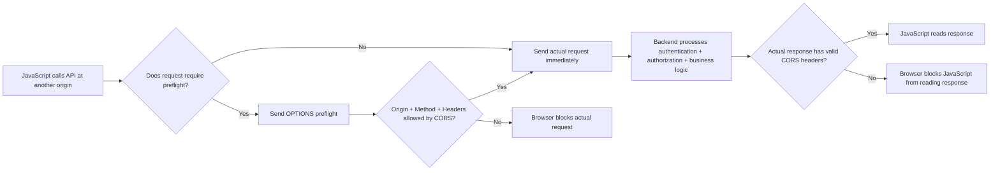
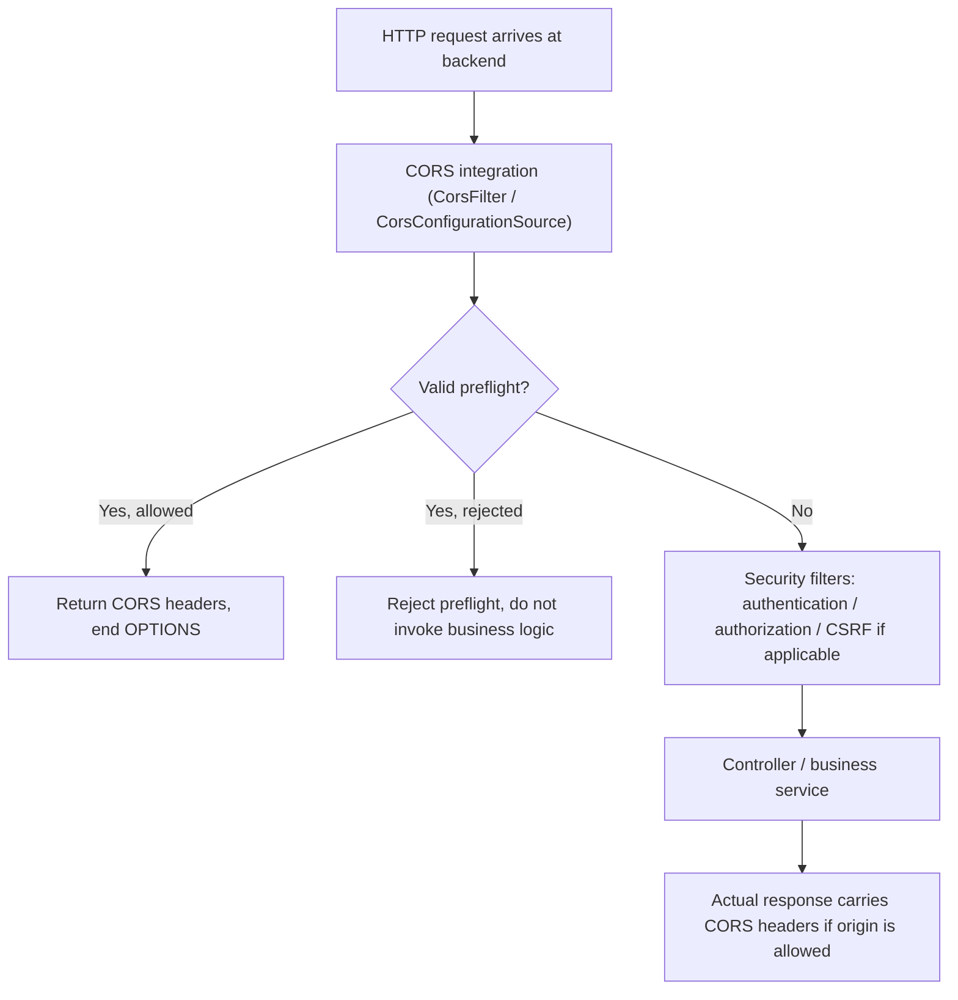

# Distinguishing Direct Requests from OPTIONS Preflight

> **Context:** Spring Security – fundamentals / **CORS**. This lesson distinguishes cross-origin requests that the browser sends **directly** from requests that require sending an **OPTIONS preflight** first, and then applies this in Spring MVC and Spring Security. Examples use Java 17, Spring Boot 3.5.0, Spring Security 6.x, MockMvc, and a frontend page running on another port. Fixed tokens in the demo are for **localhost** only and must not be deployed to production.

## 1. Objectives

After this lesson, you will be able to:

1. Determine whether a request is **cross-origin** based on **scheme, hostname, and port**, not merely the domain name.
2. Distinguish CORS requests **sent directly** (often called *simple requests*) from **preflighted** requests, and understand that both are still subject to CORS checks for JavaScript.
3. Identify the three preflight headers: `Origin`, `Access-Control-Request-Method`, and `Access-Control-Request-Headers`.
4. Read preflight responses containing `Access-Control-Allow-Origin`, `Access-Control-Allow-Methods`, `Access-Control-Allow-Headers`, and `Access-Control-Max-Age`.
5. Understand why preflight **is not a business request**, does not carry session cookies/Authorization from the main request, and does not require authentication.
6. Understand the order of processing CORS before Spring Security authentication/authorization; know why **OPTIONS 401/302** can break the frontend.
7. Distinguish between **rejected preflight**, **actual request returning 401/403**, **actual response missing CORS headers**, and **network errors**.
8. Configure `CorsConfigurationSource`, `SecurityFilterChain.cors(...)`, and properly scoped origins/methods/headers.
9. Test the flow with MockMvc, curl, and a real browser without mistakenly believing curl enforces browser policy.
10. Avoid using CORS as a replacement for authentication, authorization, or CSRF.

## 2. First: What is cross-origin?

An **origin** is a tuple of three components:

```text
scheme + hostname + port
```

For example, for a page running at `http://localhost:3000`:

| Target URL | Same origin as page? | Why |
| --- | --- | --- |
| `http://localhost:3000/api` | Yes | Same scheme, host, and port |
| `http://localhost:8080/api` | **No** | Different port |
| `https://localhost:3000/api` | **No** | Different scheme |
| `http://127.0.0.1:3000/api` | **No** | Different host |
| `http://localhost:3000/another/path` | Yes | Path is not part of origin comparison |
| `https://api.example.test` from `https://app.example.test` | **No** | Different subdomain/hostname |

**Cross-origin differs from cross-site.** A request can be **cross-origin yet same-site**, such as two subdomains or two ports belonging to the same site. CORS is based on **origin**; `SameSite` cookie attributes are based on the **site** concept with its own rules. Do not conflate them.

When JavaScript calls `fetch()` or `XMLHttpRequest` to another origin, the browser enforces the **Cross-Origin Resource Sharing (CORS)** model. The server decides which origins/methods/headers are allowed via **response headers**; the browser checks them and decides whether JavaScript may access the result.

**CORS is a browser-enforced mechanism.** An HTTP client such as curl, Postman, or a Java backend can send requests without being bound by browser CORS policy. Thus CORS cannot replace authentication or authorization checks on the backend.

## 3. Two easily confused paths

### 3.1. Cross-origin requests sent directly

For example, JavaScript running from `http://localhost:3000`:

```javascript
const response = await fetch("http://localhost:8080/api/public", {
  method: "GET",
  credentials: "omit"
});
console.log(await response.json());
```

For a `GET` with no unusual request headers, the browser typically **sends the GET directly to the server**, without sending `OPTIONS` first. The request includes the `Origin` header for CORS context.

```http
GET /api/public HTTP/1.1
Host: localhost:8080
Origin: http://localhost:3000
Accept: */*
```

If the origin is allowed, the response may be:

```http
HTTP/1.1 200 OK
Access-Control-Allow-Origin: http://localhost:3000
Content-Type: application/json

{"service":"cors-demo"}
```

JavaScript reads the JSON successfully. If the server **does not** send an appropriate `Access-Control-Allow-Origin`, the browser prevents JavaScript from reading the response, **even though the GET was actually sent**.

Crucially: **“no preflight” does not mean “skip CORS”.** It only means the browser does not need to ask permission beforehand; it still **checks the actual request's response** under CORS.

### 3.2. Requests requiring an OPTIONS preflight first

Suppose the frontend wants to call a JSON POST with a Bearer token:

```javascript
const response = await fetch("http://localhost:8080/api/messages", {
  method: "POST",
  credentials: "omit",
  headers: {
    "Authorization": "Bearer local-write-token",
    "Content-Type": "application/json",
    "X-Request-ID": "browser-demo-1"
  },
  body: JSON.stringify({ text: "Hello" })
});
console.log(response.status, await response.json());
```

The `Authorization`, `X-Request-ID`, and `Content-Type: application/json` headers make this request require a **preflight** when sent cross-origin. The browser sends an `OPTIONS` request to **ask** the server before sending the actual POST.

```http
OPTIONS /api/messages HTTP/1.1
Host: localhost:8080
Origin: http://localhost:3000
Access-Control-Request-Method: POST
Access-Control-Request-Headers: authorization,content-type,x-request-id
```

If the CORS policy permits it, the server may reply:

```http
HTTP/1.1 200 OK
Access-Control-Allow-Origin: http://localhost:3000
Access-Control-Allow-Methods: GET,POST
Access-Control-Allow-Headers: authorization,content-type,x-request-id
Access-Control-Max-Age: 600
Vary: Origin
Vary: Access-Control-Request-Method
Vary: Access-Control-Request-Headers
```

After the preflight check succeeds, the browser sends the **actual POST**:

```http
POST /api/messages HTTP/1.1
Host: localhost:8080
Origin: http://localhost:3000
Authorization: Bearer local-write-token
Content-Type: application/json
X-Request-ID: browser-demo-1

{"text":"Hello"}
```

The business response must still include appropriate CORS headers, for example:

```http
HTTP/1.1 200 OK
Access-Control-Allow-Origin: http://localhost:3000
Access-Control-Expose-Headers: X-Demo-Receipt
X-Demo-Receipt: accepted-1
Content-Type: application/json

{"actor":"demo-writer","text":"Hello","number":1}
```

**A successful preflight does not guarantee the POST will succeed.** The actual request must still pass authentication (valid token), authorization (matching scope/role/owner), validation, and business logic. Without a token, the actual POST may return **401** even though the preceding preflight returned **200**.

### 3.3. Comparison diagram



That final branch is where many people get confused: for a **directly sent** request, the server **may have already executed side effects** before the browser blocks JavaScript from reading the response. That is why CORS **is not** CSRF protection.

## 4. Conditions that cause the browser to preflight

For typical cross-origin `fetch`/XHR calls, requests that need no preflight must meet **CORS-safelisted** conditions. The list below is a practical summary; there are additional details on header value/size limits and browser-specific cases in the Fetch Standard.

### 4.1. Method

Typical CORS-safelisted methods:

- `GET`;
- `HEAD`;
- `POST`.

`PUT`, `PATCH`, `DELETE`, and other methods typically trigger preflight when used cross-origin. **OPTIONS** itself can also be an actual method sent by a client, not automatically a preflight; check the characteristic headers.

### 4.2. Headers

Some commonly seen safelisted request headers:

- `Accept`;
- `Accept-Language`;
- `Content-Language`;
- `Content-Type` **only with safelisted MIME types** and corresponding value constraints;
- Certain qualifying `Range` cases.

Three common `Content-Type` values **do not by themselves make a POST require preflight**:

```text
application/x-www-form-urlencoded
multipart/form-data
text/plain
```

Conversely, `application/json` is not among those three content types, so a **cross-origin JSON POST** normally requires preflight.

Non-safelisted headers such as:

```text
Authorization
X-Request-ID
X-Requested-With
X-CSRF-TOKEN
```

typically trigger preflight. `Content-Type: application/json` alone is also enough to trigger it, even with no other custom headers.

Browsers may automatically add certain system headers that are not controlled by JavaScript code; do not overly simplify this as “any header present triggers preflight”. You must consider which headers are **CORS-unsafe request-header names** per the Fetch standard.

### 4.3. Decision table

| Request from `http://localhost:3000` to `http://localhost:8080` | Preflight expected? | Reason |
| --- | --- | --- |
| GET, no custom header | **No** | Safelisted method/headers |
| GET with `Authorization: Bearer ...` | **Yes** | Authorization is not safelisted |
| HEAD, no custom header | **No** | Safelisted |
| POST, `Content-Type: application/x-www-form-urlencoded` | **No** | Standard form type |
| POST, `Content-Type: text/plain` | **No** | Safelisted type |
| POST, `Content-Type: multipart/form-data` from standard browser form | Usually **no** | Safelisted MIME type, if no other triggers exist |
| POST, `Content-Type: application/json` | **Yes** | JSON is not a safelisted Content-Type |
| POST with `X-Request-ID` | **Yes** | Custom header |
| PUT/PATCH/DELETE | **Yes** | Non-safelisted method |
| GET with `credentials: "include"`, no unsafe headers added | **Not solely because of credentials** | Cookies are governed by separate browser policies |
| POST with `Authorization` and `Content-Type: application/json` | **Yes** | Either alone suffices to trigger it |
| **Same-origin** PUT | **Not a CORS preflight** | Not a cross-origin CORS request |
| curl sending JSON POST | **Does not auto-generate preflight** | curl is not a browser |
| OPTIONS with `Origin` and `Access-Control-Request-Method` | **Represents a preflight** | Both headers specify the intended method |

**Important:** Requiring preflight does not mean “dangerous request”; not requiring preflight does not prove “safe request”. A form POST with `application/x-www-form-urlencoded` can easily modify sensitive data without preflight.

## 5. Distinguishing `Origin`, `Access-Control-Request-*`, and `Access-Control-Allow-*`

### 5.1. Headers in the actual request

- `Origin`: origin of the page sending the request; browser-controlled in a CORS context.
- `Authorization`: token/credential for the actual request if used by the client.
- `Content-Type`: body format of the actual request.
- Other business headers: trace ID, idempotency key, etc.

The actual request **does not naturally carry** `Access-Control-Request-Method`; that header is used in the **preflight permission inquiry**, not in ordinary business commands.

### 5.2. Headers in OPTIONS preflight

| Header | Sent by whom? | Meaning |
| --- | --- | --- |
| `Origin` | Browser | Source requesting access |
| `Access-Control-Request-Method` | Browser | Method of the request **about to be sent**, e.g. POST |
| `Access-Control-Request-Headers` | Browser if needed | List of non-safelisted header names the actual request plans to use |

A preflight request **contains no business body**, **carries no access token in `Authorization`**, and under the standard CORS model **sends no cookies/session credentials** of the actual request. Therefore **preflight must never require successful login**. Token and role checks must happen on the **actual request**.

A preflight with `Access-Control-Request-Headers: authorization` is only **asking permission to send the Authorization header** in the next step; it **does not prove a valid token** and does not mean OPTIONS is authenticated.

### 5.3. Headers in the preflight response

| Header | Purpose |
| --- | --- |
| `Access-Control-Allow-Origin` | Allowed origin; can be a specific origin or `*` where permitted |
| `Access-Control-Allow-Methods` | Allowed **actual HTTP methods**, e.g. POST |
| `Access-Control-Allow-Headers` | Request headers allowed for use on the actual request |
| `Access-Control-Max-Age` | Duration the browser may cache the preflight result (subject to browser caps) |
| `Access-Control-Allow-Credentials` | Allows the browser to accept a credentialed cross-origin response when `true` with a specific origin |
| `Vary` | Informs HTTP caches that the response can differ by Origin/Requested Method/Requested Headers |

**Common trap:** Having `Access-Control-Allow-Methods: POST` in a preflight response is right; it is **not mandatory** to list `OPTIONS` there. The browser is asking “may I send POST?”, not “does the server allow OPTIONS as a business action?”.

### 5.4. Headers in the actual response

The actual response typically needs `Access-Control-Allow-Origin` so JavaScript can read it. If the client uses an allowed credentials mode, `Access-Control-Allow-Credentials: true` and a specific origin are needed. For custom response headers, `Access-Control-Expose-Headers` determines which non-safelisted headers JavaScript may read:

```http
Access-Control-Allow-Origin: http://localhost:3000
Access-Control-Expose-Headers: X-Demo-Receipt
X-Demo-Receipt: accepted-1
```

Do not confuse `Access-Control-Allow-Headers` (allowed request headers) with `Access-Control-Expose-Headers` (response headers JavaScript may read).

## 6. Four independent questions when checking a cross-origin request

1. **Is the Origin allowed by the CORS policy?** If not, the browser prevents JavaScript from accessing the response; if the request needs preflight, the actual request is normally **not sent**.
2. **Are the method and request headers allowed by the CORS policy?** Especially critical during preflight; e.g. a policy allowing only GET will reject `Access-Control-Request-Method: DELETE`.
3. **Does the actual request authenticate validly?** Bearer/JWT/session/HTTP Basic is checked per security config. A 200 preflight does not answer this question.
4. **Does the user/client have permission for the operation and resource?** Scope/role/owner/tenant is checked on the backend. An allowed origin does not automatically grant write permissions.

Example:

```text
Preflight: 200 OK
  -> origin/method/header allowed

Actual POST: 401 Unauthorized
  -> missing/invalid access token

Actual POST: 403 Forbidden
  -> valid token but lacks permission
     (or blocked by CSRF if it is a cookie-auth request without a CSRF token)

Actual POST: 200 OK
  -> request passed CORS + business checks
```

If an actual response returns 401/403 yet **lacks appropriate CORS headers**, browser JavaScript may see only a CORS error instead of reading the status/body. CORS configuration should also apply to error responses so the frontend can handle login/permission errors accurately.

## 7. CORS must be processed before Spring Security

Spring Security explicitly states: **CORS must be processed before security checks** because a typical preflight **has no `JSESSIONID` cookie**. If the server applies authentication to OPTIONS before CORS, it may return 401 or redirect 302 to `/login`, stopping the browser before the actual POST reaches the backend.

Desired processing flow:



### 7.1. Proper configuration in Spring MVC + Spring Security

In Spring Security 6.x on the Servlet stack, the standard setup is:

```java
http.cors(org.springframework.security.config.Customizer.withDefaults());
```

Along with a Spring-managed `UrlBasedCorsConfigurationSource`, or properly integrated Spring MVC CORS. This ensures preflight passes through CORS processing before auth. When using multiple `SecurityFilterChain` beans, verify that the matched chain actually integrates CORS; do not assume placing `@CrossOrigin` on a controller suffices if a filter rejects the request beforehand.

### 7.2. Why `permitAll OPTIONS` alone is not enough

Example:

```java
// NOT a complete CORS configuration:
.requestMatchers(org.springframework.http.HttpMethod.OPTIONS, "/**")
.permitAll()
```

This rule only addresses **HTTP authorization**. It **does not** specify which origins are allowed, which methods/headers the browser may use, nor does it emit the required response headers. It can let OPTIONS pass authorization while the frontend still fails preflight due to missing `Access-Control-Allow-Origin` or `Access-Control-Allow-Headers`.

Conversely, having a proper CORS policy **does not mean every actual request gets permitAll**; actual requests still require authentication/authorization.

### 7.3. `@CrossOrigin` and `CorsConfigurationSource`

`@CrossOrigin` can suit small MVC applications when policies are controller/method-specific. However, in applications using Spring Security, filter-chain processing can run **before a request reaches the controller**. Proper CORS integration between Spring MVC and Spring Security is essential.

A `CorsConfigurationSource` is valuable for enforcing a consistent policy across an API area rather than scattering overlapping origin configs across controllers. Avoid simultaneously creating multiple `CorsFilter` beans or combining global and conflicting controller policies unless you understand the framework's precedence order.

## 8. Java 17 lab: direct GET vs preflighted POST

This example creates a **stateless Spring MVC API accepting only Bearer tokens** for write operations. CORS allows the frontend at `http://localhost:3000` to call the API at `http://localhost:8080`.

Three endpoints:

- `GET /api/public`: public; a cross-origin GET without custom headers is typically sent directly by the browser.
- `POST /api/public/echo` with `text/plain`: public, writes no data; illustrates a safelisted POST that can be sent directly.
- `POST /api/messages` with `application/json`, `Authorization`, and `X-Request-ID`: triggers OPTIONS preflight; the actual POST requires `SCOPE_messages.write` and increments a simulated counter.

**Security boundary:** The introspector bean in this demo accepts only a fixed string `local-write-token`; it is **not** a real Authorization Server or token system. Run only on localhost to learn CORS/Spring Security; never deploy mock tokens or hardcoded secrets to production.

### 8.1. Project structure

```text
cors-preflight-demo/
├── pom.xml
├── frontend/
│   └── index.html
└── src/
    ├── main/java/demo/cors/
    │   ├── CorsPreflightApplication.java
    │   ├── SecurityConfig.java
    │   └── ApiController.java
    └── test/java/demo/cors/
        └── CorsPreflightTest.java
```

### 8.2. Maven `pom.xml`

```xml
<?xml version="1.0" encoding="UTF-8"?>
<project xmlns="http://maven.apache.org/POM/4.0.0"
         xmlns:xsi="http://www.w3.org/2001/XMLSchema-instance"
         xsi:schemaLocation="http://maven.apache.org/POM/4.0.0 https://maven.apache.org/xsd/maven-4.0.0.xsd">
  <modelVersion>4.0.0</modelVersion>
  <parent>
    <groupId>org.springframework.boot</groupId>
    <artifactId>spring-boot-starter-parent</artifactId>
    <version>3.5.0</version>
    <relativePath/>
  </parent>
  <groupId>demo</groupId>
  <artifactId>cors-preflight-demo</artifactId>
  <version>0.0.1-SNAPSHOT</version>
  <properties>
    <java.version>17</java.version>
  </properties>
  <dependencies>
    <dependency>
      <groupId>org.springframework.boot</groupId>
      <artifactId>spring-boot-starter-web</artifactId>
    </dependency>
    <dependency>
      <groupId>org.springframework.boot</groupId>
      <artifactId>spring-boot-starter-oauth2-resource-server</artifactId>
    </dependency>
    <dependency>
      <groupId>org.springframework.boot</groupId>
      <artifactId>spring-boot-starter-test</artifactId>
      <scope>test</scope>
    </dependency>
    <dependency>
      <groupId>org.springframework.security</groupId>
      <artifactId>spring-security-test</artifactId>
      <scope>test</scope>
    </dependency>
  </dependencies>
  <build>
    <plugins>
      <plugin>
        <groupId>org.springframework.boot</groupId>
        <artifactId>spring-boot-maven-plugin</artifactId>
      </plugin>
    </plugins>
  </build>
</project>
```

### 8.3. Main class

`src/main/java/demo/cors/CorsPreflightApplication.java`:

```java
package demo.cors;

import org.springframework.boot.SpringApplication;
import org.springframework.boot.autoconfigure.SpringBootApplication;

@SpringBootApplication
public class CorsPreflightApplication {
    public static void main(String[] args) {
        SpringApplication.run(CorsPreflightApplication.class, args);
    }
}
```

### 8.4. `SecurityConfig.java` — explicit CORS configuration

`src/main/java/demo/cors/SecurityConfig.java`:

```java
package demo.cors;

import java.util.List;
import java.util.Map;

import org.springframework.context.annotation.Bean;
import org.springframework.context.annotation.Configuration;
import org.springframework.http.HttpMethod;
import org.springframework.security.config.Customizer;
import org.springframework.security.config.annotation.web.configuration.EnableWebSecurity;
import org.springframework.security.config.annotation.web.builders.HttpSecurity;
import org.springframework.security.config.http.SessionCreationPolicy;
import org.springframework.security.core.authority.SimpleGrantedAuthority;
import org.springframework.security.oauth2.core.DefaultOAuth2AuthenticatedPrincipal;
import org.springframework.security.oauth2.server.resource.introspection.BadOpaqueTokenException;
import org.springframework.security.oauth2.server.resource.introspection.OpaqueTokenIntrospector;
import org.springframework.security.web.SecurityFilterChain;
import org.springframework.web.cors.CorsConfiguration;
import org.springframework.web.cors.UrlBasedCorsConfigurationSource;

@Configuration
@EnableWebSecurity
public class SecurityConfig {

    @Bean
    UrlBasedCorsConfigurationSource corsConfigurationSource() {
        CorsConfiguration cors = new CorsConfiguration();

        // Must match scheme + hostname + port exactly.
        cors.setAllowedOrigins(List.of("http://localhost:3000"));

        // These are the ACTUAL request methods.
        // No need to add OPTIONS just because the browser sends preflight.
        cors.setAllowedMethods(List.of("GET", "POST"));

        cors.setAllowedHeaders(List.of(
            "Authorization", "Content-Type", "X-Request-ID"));

        // Allow JavaScript to read only this custom header.
        cors.setExposedHeaders(List.of("X-Demo-Receipt"));

        // The demo does not use cookies/sessions or automatic credentials.
        cors.setAllowCredentials(false);
        cors.setMaxAge(600L);

        UrlBasedCorsConfigurationSource source =
            new UrlBasedCorsConfigurationSource();
        source.registerCorsConfiguration("/api/**", cors);
        return source;
    }

    @Bean
    SecurityFilterChain securityFilterChain(HttpSecurity http)
            throws Exception {
        return http
            .cors(Customizer.withDefaults())
            .sessionManagement(session -> session
                .sessionCreationPolicy(SessionCreationPolicy.STATELESS))
            // Exempt CSRF only for the two demo POSTs that do not accept browser cookies.
            // DO NOT copy this exemption to session-cookie APIs.
            .csrf(csrf -> csrf
                .ignoringRequestMatchers(
                    "/api/messages", "/api/public/echo"))
            .authorizeHttpRequests(auth -> auth
                .requestMatchers(HttpMethod.GET, "/api/public")
                    .permitAll()
                .requestMatchers(HttpMethod.POST, "/api/public/echo")
                    .permitAll()
                .requestMatchers(HttpMethod.POST, "/api/messages")
                    .hasAuthority("SCOPE_messages.write")
                .anyRequest().denyAll()
            )
            .oauth2ResourceServer(oauth2 -> oauth2
                .opaqueToken(Customizer.withDefaults()))
            .build();
    }

    @Bean
    OpaqueTokenIntrospector demoIntrospector() {
        return token -> {
            if (!"local-write-token".equals(token)) {
                throw new BadOpaqueTokenException(
                    "Token inactive in local demo");
            }
            return new DefaultOAuth2AuthenticatedPrincipal(
                "demo-writer",
                Map.of(
                    "sub", "demo-writer",
                    "scope", "messages.write"
                ),
                List.of(new SimpleGrantedAuthority(
                    "SCOPE_messages.write"))
            );
        };
    }
}
```

**Step-by-step explanation:**

1. `UrlBasedCorsConfigurationSource` limits CORS to `/api/**`. We do not need to open every path just because the website has a frontend.
2. `setAllowedOrigins` uses a **specific origin**, avoiding confusion between `localhost:3000` and `localhost:8080`.
3. `setAllowedMethods` permits actual GET and POST; **OPTIONS does not need** to appear in `Access-Control-Allow-Methods` for OPTIONS preflight to be handled.
4. `setAllowedHeaders` allows `Authorization`, `Content-Type`, and `X-Request-ID`, which the browser reports in `Access-Control-Request-Headers`.
5. `setExposedHeaders` lets JavaScript read `X-Demo-Receipt` from the actual response. This is not request-header permission.
6. `setAllowCredentials(false)` because the demo uses `fetch(...credentials: "omit")` and only sends an explicit Bearer header; the server does not rely on session cookies. If a real product needs cross-origin cookies, the configuration will **differ**, requiring both CSRF and cookie/credential policies.
7. `cors(Customizer.withDefaults())` integrates CORS with Spring Security; valid preflight is processed before auth.
8. `STATELESS` and `opaqueToken(...)` define authentication for actual Bearer token requests on the write API. The introspector bean is a **local simulation** and must be replaced with a valid AS/introspection or JWT decoder in real use.
9. `csrf.ignoringRequestMatchers` is scoped to **the two demo endpoints** that are Bearer-only/do not auto-send cookies. If any route begins accepting session cookies or browser-sent HTTP Basic, CSRF protection must be evaluated and applied accordingly. Avoid app-wide `csrf.disable()` to fix preflight errors.
10. `anyRequest().denyAll()` continues protecting disallowed paths; CORS does not replace authorization.

### 8.5. Controller: observing whether operations execute

`src/main/java/demo/cors/ApiController.java`:

```java
package demo.cors;

import java.util.Map;
import java.util.concurrent.atomic.AtomicInteger;

import org.springframework.http.ResponseEntity;
import org.springframework.security.core.Authentication;
import org.springframework.web.bind.annotation.GetMapping;
import org.springframework.web.bind.annotation.PostMapping;
import org.springframework.web.bind.annotation.RequestBody;
import org.springframework.web.bind.annotation.RequestMapping;
import org.springframework.web.bind.annotation.RestController;

@RestController
@RequestMapping("/api")
public class ApiController {

    private final AtomicInteger counter = new AtomicInteger();

    @GetMapping("/public")
    public Map<String, String> publicInfo() {
        return Map.of("service", "cors-demo");
    }

    @PostMapping(path = "/public/echo",
                 consumes = "text/plain")
    public Map<String, String> echo(@RequestBody String text) {
        return Map.of("echo", text);
    }

    @PostMapping(path = "/messages",
                 consumes = "application/json")
    public ResponseEntity<Map<String, Object>> accept(
            @RequestBody Message message,
            Authentication authentication) {
        int number = counter.incrementAndGet();

        return ResponseEntity.ok()
            .header("X-Demo-Receipt", "accepted-" + number)
            .body(Map.of(
                "actor", authentication.getName(),
                "text", message.text(),
                "number", number
            ));
    }

    // Observed in tests: OPTIONS must not increment the counter.
    int acceptedCount() {
        return counter.get();
    }

    void resetCount() {
        counter.set(0);
    }

    public record Message(String text) {
    }
}
```

The demo uses an **in-memory counter**, creating no real records and handling no real assets. `/api/public/echo` simply echoes the string with no server-side side effect. `/api/messages` is where a valid actual POST increments the counter; preflight must never invoke this method.

**Trap:** If CORS preflight succeeds while the actual POST lacks a Bearer token, the counter must not increment. CORS does not “log anyone in”; the `messages.write` scope remains an independent condition.

### 8.6. HTML frontend for observing in Developer Tools

`frontend/index.html`:

```html
<!doctype html>
<html lang="en">
<head>
  <meta charset="UTF-8">
  <title>CORS direct vs preflight</title>
</head>
<body>
  <h1>CORS: direct requests and OPTIONS preflight</h1>
  <p>Frontend: http://localhost:3000;
     API: http://localhost:8080</p>

  <button id="direct-get">Direct GET</button>
  <button id="direct-post">Direct text/plain POST</button>
  <button id="preflight-post">Preflighted JSON POST</button>
  <pre id="output"></pre>

  <script>
    const base = "http://localhost:8080";
    const output = document.getElementById("output");

    async function show(promise) {
      try {
        const response = await promise;
        const text = await response.text();
        output.textContent =
          "HTTP " + response.status + "\n" +
          text + "\nreceipt=" +
          (response.headers.get("X-Demo-Receipt") || "(none)");
      } catch (error) {
        output.textContent =
          "Browser did not expose response: " + String(error);
      }
    }

    document.getElementById("direct-get").onclick = () =>
      show(fetch(base + "/api/public", {
        method: "GET",
        credentials: "omit"
      }));

    document.getElementById("direct-post").onclick = () =>
      show(fetch(base + "/api/public/echo", {
        method: "POST",
        credentials: "omit",
        headers: { "Content-Type": "text/plain" },
        body: "Hello from frontend"
      }));

    document.getElementById("preflight-post").onclick = () =>
      show(fetch(base + "/api/messages", {
        method: "POST",
        credentials: "omit",
        headers: {
          "Authorization": "Bearer local-write-token",
          "Content-Type": "application/json",
          "X-Request-ID": "frontend-demo-1"
        },
        body: JSON.stringify({ text: "Hello from POST" })
      }));
  </script>
</body>
</html>
```

**Security:** `local-write-token` is a hardcoded simulation string visible in the browser, strictly for learning on localhost. In real systems, JavaScript must never hold confidential client secrets; Bearer tokens must come from an appropriate authorization flow and be protected according to the threat model. Do not copy sample frontend code to production.

### 8.7. Running the two origins

From the project root directory:

```bash
mvn test
mvn spring-boot:run
```

In another terminal in the same directory:

```bash
python -m http.server 3000 --directory frontend
```

If your OS uses `python3` instead of `python`, adjust the command accordingly. Open `http://localhost:3000` in a **real browser**, open Developer Tools → Network, and try the three buttons:

- **Direct GET:** observe GET `/api/public`, normally with no OPTIONS.
- **text/plain POST:** observe POST `/api/public/echo` without preflight under safelisted request conditions.
- **JSON POST with Authorization:** observe OPTIONS `/api/messages` followed by POST `/api/messages`; preflight carries no bearer token, actual POST carries the token.

If you do not see OPTIONS on a second or third click after calling it once, check the **preflight cache** and Developer Tools; do not assume the browser skipped CORS. Browsers can cache preflight results according to `Access-Control-Max-Age` and their own limits. To compare cleanly, open a fresh browser profile or configure DevTools as needed, and check Network filters.

### 8.8. Why are the two POSTs handled differently?

Both have `method="POST"` in `fetch`, yet:

```text
POST /api/public/echo:
  Content-Type = text/plain
  custom header = none
  -> safelisted request in the example
  -> no preflight needed

POST /api/messages:
  Content-Type = application/json
  Authorization = Bearer ...
  X-Request-ID = ...
  -> request is no longer safelisted
  -> browser preflights before actual POST
```

**Do not infer that text/plain POST is safer from a business perspective.** It only differs in CORS mechanics. A safelisted POST still requires authentication/authorization/CSRF when browser auto-sent credentials and sensitive data are involved.

## 9. Integration testing with MockMvc

Create `src/test/java/demo/cors/CorsPreflightTest.java`:

```java
package demo.cors;

import org.junit.jupiter.api.BeforeEach;
import org.junit.jupiter.api.Test;
import org.springframework.beans.factory.annotation.Autowired;
import org.springframework.boot.test.autoconfigure.web.servlet.AutoConfigureMockMvc;
import org.springframework.boot.test.context.SpringBootTest;
import org.springframework.http.HttpHeaders;
import org.springframework.http.MediaType;
import org.springframework.test.web.servlet.MockMvc;

import static org.hamcrest.Matchers.containsString;
import static org.assertj.core.api.Assertions.assertThat;
import static org.springframework.test.web.servlet.request.MockMvcRequestBuilders.get;
import static org.springframework.test.web.servlet.request.MockMvcRequestBuilders.options;
import static org.springframework.test.web.servlet.request.MockMvcRequestBuilders.post;
import static org.springframework.test.web.servlet.result.MockMvcResultMatchers.header;
import static org.springframework.test.web.servlet.result.MockMvcResultMatchers.jsonPath;
import static org.springframework.test.web.servlet.result.MockMvcResultMatchers.status;

@SpringBootTest
@AutoConfigureMockMvc
class CorsPreflightTest {

    private static final String FRONTEND = "http://localhost:3000";

    @Autowired MockMvc mvc;
    @Autowired ApiController controller;

    @BeforeEach
    void resetCounter() {
        controller.resetCount();
    }

    @Test
    void simpleGetReturnsAllowOriginWithoutAnOptionsRequest()
            throws Exception {
        mvc.perform(get("/api/public")
                .header(HttpHeaders.ORIGIN, FRONTEND))
            .andExpect(status().isOk())
            .andExpect(header().string(
                HttpHeaders.ACCESS_CONTROL_ALLOW_ORIGIN, FRONTEND))
            .andExpect(jsonPath("$.service").value("cors-demo"));
    }

    @Test
    void safelistedPostStillReceivesCorsResponse()
            throws Exception {
        mvc.perform(post("/api/public/echo")
                .header(HttpHeaders.ORIGIN, FRONTEND)
                .contentType(MediaType.TEXT_PLAIN)
                .content("hello"))
            .andExpect(status().isOk())
            .andExpect(header().string(
                HttpHeaders.ACCESS_CONTROL_ALLOW_ORIGIN, FRONTEND))
            .andExpect(jsonPath("$.echo").value("hello"));
    }

    @Test
    void preflightIsAcceptedWithoutBearerTokenOrCookies()
            throws Exception {
        mvc.perform(options("/api/messages")
                .header(HttpHeaders.ORIGIN, FRONTEND)
                .header(HttpHeaders.ACCESS_CONTROL_REQUEST_METHOD, "POST")
                .header(HttpHeaders.ACCESS_CONTROL_REQUEST_HEADERS,
                    "authorization,content-type,x-request-id"))
            .andExpect(status().isOk())
            .andExpect(header().string(
                HttpHeaders.ACCESS_CONTROL_ALLOW_ORIGIN, FRONTEND))
            .andExpect(header().string(
                HttpHeaders.ACCESS_CONTROL_ALLOW_METHODS,
                containsString("POST")))
            .andExpect(header().exists(
                HttpHeaders.ACCESS_CONTROL_ALLOW_HEADERS))
            .andExpect(header().doesNotExist(
                HttpHeaders.ACCESS_CONTROL_ALLOW_CREDENTIALS));

        assertThat(controller.acceptedCount()).isZero();
    }

    @Test
    void foreignOriginCannotPassPreflight() throws Exception {
        mvc.perform(options("/api/messages")
                .header(HttpHeaders.ORIGIN, "http://evil.example.test")
                .header(HttpHeaders.ACCESS_CONTROL_REQUEST_METHOD, "POST")
                .header(HttpHeaders.ACCESS_CONTROL_REQUEST_HEADERS,
                    "authorization,content-type"))
            .andExpect(status().isForbidden())
            .andExpect(header().doesNotExist(
                HttpHeaders.ACCESS_CONTROL_ALLOW_ORIGIN));

        assertThat(controller.acceptedCount()).isZero();
    }

    @Test
    void unsupportedHeaderCannotPassPreflight() throws Exception {
        mvc.perform(options("/api/messages")
                .header(HttpHeaders.ORIGIN, FRONTEND)
                .header(HttpHeaders.ACCESS_CONTROL_REQUEST_METHOD, "POST")
                .header(HttpHeaders.ACCESS_CONTROL_REQUEST_HEADERS,
                    "x-not-allowed"))
            .andExpect(status().isForbidden());

        assertThat(controller.acceptedCount()).isZero();
    }

    @Test
    void actualPostNeedsAuthenticationEvenWhenCorsIsAllowed()
            throws Exception {
        mvc.perform(post("/api/messages")
                .header(HttpHeaders.ORIGIN, FRONTEND)
                .contentType(MediaType.APPLICATION_JSON)
                .content("{\"text\":\"hello\"}"))
            .andExpect(status().isUnauthorized())
            .andExpect(header().string(
                HttpHeaders.ACCESS_CONTROL_ALLOW_ORIGIN, FRONTEND));

        assertThat(controller.acceptedCount()).isZero();
    }

    @Test
    void actualPostWithTokenAndScopeRunsBusinessCode()
            throws Exception {
        mvc.perform(post("/api/messages")
                .header(HttpHeaders.ORIGIN, FRONTEND)
                .header(HttpHeaders.AUTHORIZATION,
                    "Bearer local-write-token")
                .header("X-Request-ID", "test-1")
                .contentType(MediaType.APPLICATION_JSON)
                .content("{\"text\":\"hello\"}"))
            .andExpect(status().isOk())
            .andExpect(header().string(
                HttpHeaders.ACCESS_CONTROL_ALLOW_ORIGIN, FRONTEND))
            .andExpect(header().string(
                HttpHeaders.ACCESS_CONTROL_EXPOSE_HEADERS,
                containsString("X-Demo-Receipt")))
            .andExpect(header().string(
                "X-Demo-Receipt", "accepted-1"))
            .andExpect(jsonPath("$.actor").value("demo-writer"))
            .andExpect(jsonPath("$.text").value("hello"))
            .andExpect(jsonPath("$.number").value(1));

        assertThat(controller.acceptedCount()).isEqualTo(1);
    }

    @Test
    void directHttpClientWithoutOriginStillNeedsAuth()
            throws Exception {
        mvc.perform(post("/api/messages")
                .contentType(MediaType.APPLICATION_JSON)
                .content("{\"text\":\"hello\"}"))
            .andExpect(status().isUnauthorized())
            .andExpect(header().doesNotExist(
                HttpHeaders.ACCESS_CONTROL_ALLOW_ORIGIN));

        assertThat(controller.acceptedCount()).isZero();
    }
}
```

### 9.1. What do the tests prove?

- **Direct CORS:** GET and `text/plain` POST can return responses with Allow-Origin without the test sending OPTIONS first. **MockMvc is not a browser**, so the test only verifies the server handles requests/responses properly; the browser decides preflight.
- **Preflight:** Valid OPTIONS is handled **without a Bearer token** and without invoking the write controller (counter stays 0).
- **Unknown origin or disallowed header:** preflight is rejected, business logic does not run.
- **Actual authentication:** an allowed preflight does not grant permission to an actual POST lacking a token; actual POST returns 401 while still including CORS response headers so the frontend can read the error result.
- **Actual authorization:** a valid demo token with the right scope executes POST and increments the counter.
- **Request without Origin:** an ordinary HTTP client is not subject to browser CORS policy, yet still must authenticate when calling a private API.

**Note:** MockMvc requests do not automatically generate an OPTIONS followed by a POST like a browser does. Each test here sends **one** request defined by the test. To verify preflight generation order, use a real browser or a browser automation tool.

### 9.2. Expected results

| Test | Expected HTTP | Counter after request |
| --- | --- | --- |
| Public GET from allowed origin | 200 | 0 |
| Public text/plain POST | 200 | 0 |
| Valid preflight without token | 200 | 0 |
| Preflight with unknown origin | 403 | 0 |
| Preflight with disallowed header | 403 | 0 |
| Actual JSON POST without token | 401 | 0 |
| Actual JSON POST with demo Bearer | 200 | 1 |
| POST without Origin and without token | 401 | 0 |

These are **expected results when running the exact source code**, not Maven stdout executed in this lesson. The code provides the full structure to create the project; when applying it to another environment, inspect framework versions and custom error/entry-point handlers before changing assertions.

## 10. Using curl to inspect CORS headers, without mistaking curl for a browser

### 10.1. Direct request

```bash
curl -i http://localhost:8080/api/public \
  -H "Origin: http://localhost:3000"
```

Inspect the `Access-Control-Allow-Origin` header and JSON response. curl **does not** check whether a browser would allow reading the response; it only prints the headers.

### 10.2. Simulating preflight

```bash
curl -i -X OPTIONS http://localhost:8080/api/messages \
  -H "Origin: http://localhost:3000" \
  -H "Access-Control-Request-Method: POST" \
  -H "Access-Control-Request-Headers: authorization,content-type,x-request-id"
```

On Windows PowerShell, you may need `curl.exe` instead of the `curl` alias; use line-continuation syntax appropriate for your shell. Expected output includes `Access-Control-Allow-Origin`, `Access-Control-Allow-Methods` containing POST, matching `Access-Control-Allow-Headers`, `Access-Control-Max-Age`, and HTTP 200.

**This is only curl simulating an OPTIONS request**; curl does not automatically generate preflight when you send a JSON POST.

### 10.3. Sending the actual POST separately

```bash
curl -i -X POST http://localhost:8080/api/messages \
  -H "Origin: http://localhost:3000" \
  -H "Authorization: Bearer local-write-token" \
  -H "Content-Type: application/json" \
  -H "X-Request-ID: curl-1" \
  --data '{"text":"hello"}'
```

Expected result is HTTP 200 and JSON body. If Authorization is omitted, actual request expects 401. curl **still sends the POST**, even if you never ran OPTIONS and even if the origin is not accepted by the server. This proves CORS is not a defense layer against arbitrary clients.

### 10.4. OPTIONS command without preflight headers

```bash
curl -i -X OPTIONS http://localhost:8080/api/messages
```

This is a **plain HTTP OPTIONS** request, not a browser CORS preflight, because `Origin` and `Access-Control-Request-Method` are absent. It may be handled differently by the server/router/security. Do not use “curl OPTIONS returned 401/403” as proof that real browser preflight failed if you did not reproduce the preflight headers.

## 11. Preflight caching

Browsers can store successful preflight results according to `Access-Control-Max-Age`:

```http
Access-Control-Max-Age: 600
```

Meaning: the browser can reuse the preflight decision for an allowed period, subject to cache-key rules and browser caps. This **is not** business response caching, nor does it keep access tokens from expiring.

Debugging implications:

- The first call shows OPTIONS then POST; subsequent calls may show only POST.
- Changing the backend CORS policy while the browser still uses cached preflight within its limit: test with a fresh browser context/wait for cache expiry instead of concluding the backend ignored your config.
- Caching allowed methods/headers does not mean the user retains permission: **actual POST still checks authentication/authorization every time**.
- When policy varies by Origin, ensure responses include appropriate `Vary` headers so shared proxies/CDNs do not serve the wrong headers.
- Do not treat `Access-Control-Max-Age` as an authentication or session lifetime.

## 12. Credentialed CORS: cookies are a separate issue

The example above intentionally uses `credentials: "omit"` and the backend only accepts a Bearer token on the actual request, so `setAllowCredentials(false)` is appropriate. However, many applications use session cookies with an SPA on another origin.

An **illustrative** configuration (do not paste verbatim into the Bearer-only demo) might look like:

```java
CorsConfiguration config = new CorsConfiguration();
config.setAllowedOrigins(List.of("https://app.example.test"));
config.setAllowedMethods(List.of("GET", "POST", "PUT", "DELETE"));
config.setAllowedHeaders(List.of("Content-Type", "X-CSRF-TOKEN"));
config.setAllowCredentials(true);
```

This is a **configuration snippet**, not a standalone class; it needs imports, a CorsConfigurationSource bean, HTTPS, cookie policy, and corresponding CSRF integration.

When the frontend wants to send cross-origin cookies:

```javascript
await fetch("https://api.example.test/account", {
  method: "POST",
  credentials: "include",
  headers: {
    "Content-Type": "application/json",
    "X-CSRF-TOKEN": csrfTokenFromServer
  },
  body: JSON.stringify({ displayName: "Alice" })
});
```

You **must** account for all of the following:

1. `credentials: "include"` controls whether the browser sends cookies/credentials on cross-origin fetches, yet cookies still depend on `SameSite`, `Secure`, Path/Domain, and third-party cookie policies.
2. The server needs `Access-Control-Allow-Credentials: true` and `Access-Control-Allow-Origin` **matching a specific origin**, never wildcard `*` with credentialed responses.
3. **Preflight still carries no session cookies**; do not require OPTIONS to be authenticated.
4. **Actual POST carrying cookies** still needs a CSRF token if cookies are automatically sent by the browser. CORS **does not** replace CSRF protection.
5. Allowing an origin to read sensitive responses carries its own risk: do not broaden origins to all subdomains or `*` when handling credentialed user data.
6. `SameSite=Lax` restricts many cross-site cookie flows; yet **same-site does not mean same-origin**, so CSRF must still be properly designed.

If a request only changes `credentials: "omit"` to `"include"` while method and headers remain safelisted, this **does not by itself trigger preflight**. However, CORS response requirements become stricter, and cookies may be sent by the browser on the actual request if policy allows.

## 13. CORS is not authentication, authorization, or CSRF

### 13.1. The Origin header does not establish identity

A non-browser client can spoof `Origin`:

```bash
curl -i http://localhost:8080/api/public \
  -H "Origin: http://localhost:3000"
```

Therefore the backend must not treat “Origin is in the allowlist” as proof that the request comes from an authorized user. Browser origin filtering controls **JavaScript access to responses**, not identity or scopes.

### 13.2. CORS does not prevent all side effects

A safelisted POST (such as a urlencoded HTML form) can travel **directly** to the server before the browser evaluates the response. If the server relies on auto-sent cookies without CSRF protection, an external site can trigger the action. Even if the browser blocks the response, **the business operation may already have occurred**.

Independent layers are required:

- Authentication: who is the actor?
- Authorization: what may the actor do on which resource?
- CSRF protection: with browser cookie auth, does a state-changing request carry a valid token/intentional proof?
- CORS: which origin's JavaScript may issue requests with which characteristics and read which responses?

### 13.3. Preflight is not “login first”

OPTIONS preflight is not where JWTs or passwords are checked. If a login filter redirects `OPTIONS /api/messages` to `/login`, the browser cannot proceed to the actual POST. Instead of `permitAll("/**")` or disabling security entirely, configure CORS at the right layer and keep authentication rules on the actual endpoints.

## 14. Common errors and how to isolate them

| Symptom | Possible cause | How to verify |
| --- | --- | --- |
| OPTIONS 401 | Authentication handles preflight before CORS | Check `http.cors()`, filter order, CORS source |
| OPTIONS 302 to `/login` | Preflight treated as an unauthenticated browser session request | CORS must handle OPTIONS before form login |
| OPTIONS 403 and body “Invalid CORS request” | Origin, method, or header not in allowlist | Compare the three preflight headers against config |
| OPTIONS 200 but browser does not send POST | Missing Allow-Methods/Allow-Headers/Allow-Origin or credentials mismatch | Inspect Network response headers and console |
| OPTIONS 200, POST 401 | Preflight valid but actual request unauthenticated | Check Bearer/session credentials on actual request |
| OPTIONS 200, POST 403 | Actual request lacks permission, CSRF, or business policy | Separate role/scope, CSRF, custom filters |
| GET returns 200 in server logs yet JS reports CORS | Actual response missing Allow-Origin/credential headers | Check actual response, reverse proxy |
| text/plain POST shows no OPTIONS | Safelisted request | Normal, yet CORS response headers are still required |
| application/json POST has OPTIONS | Non-safelisted Content-Type | Normal |
| Adding `Authorization` to GET causes OPTIONS | Authorization header is not safelisted | Normal |
| No OPTIONS seen the second time | Preflight cache | Check `Access-Control-Max-Age` and browser |
| Only curl succeeds, browser fails | curl does not enforce CORS | Test with a browser and exact Origin |
| `Access-Control-Allow-Origin: *` + credentials | Browsers reject credentialed wildcards | List specific origins |
| `Access-Control-Allow-Headers` has Authorization yet POST 401 | Allowed to send header ≠ valid token | Check actual authentication |
| `Access-Control-Allow-Methods` lacks OPTIONS | Not necessarily wrong | Lists methods of the actual request |
| Missing `Access-Control-Expose-Headers` | JS cannot read custom response header | Add header to exposed headers, don't open unrestricted |
| API uses `@CrossOrigin` yet OPTIONS still 401 | Request blocked before MVC | Integrate CORS in Spring Security filter |
| Added `OPTIONS /** permitAll` yet browser still errors | Missing actual CORS response headers | Configure CorsConfigurationSource |
| `mode: "no-cors"` “stops error” yet JS cannot read body | Opaque response, does not grant CORS permission | Enable proper CORS on server |
| Only allowed `http://localhost:3000` while frontend uses `127.0.0.1` | Origin mismatch | Match exact scheme/host/port |
| Proxy/CDN cache serves wrong Allow-Origin | Missing Vary/response policy on proxy | Check `Vary`, cache key, trusted forwarding headers |
| Client sends request without `Origin` and gets 401 | Not a CORS error | Check actual authentication |
| OPTIONS returns 405 from nginx/gateway | Proxy does not forward or handle preflight | Check gateway config in front of Spring |

### 14.1. Debugging steps in the Network tab

1. Identify the **origin of the running page** (scheme + hostname + port).
2. Identify the **request URL** (any redirects? correct path?).
3. Inspect the JavaScript **method and request headers**; determine whether it is a preflighted request.
4. If OPTIONS is present, open it and check `Origin`, `Access-Control-Request-Method`, `Access-Control-Request-Headers`, status, and allow headers in the reply.
5. If OPTIONS fails, the backend may **never have received the actual request**. Do not edit the POST controller before fixing the CORS failure.
6. If OPTIONS passes, open the **actual GET/POST** and inspect 401/403/500 along with response CORS headers; authentication and business logic are separate steps.
7. Check cookies/session/Authorization **on the actual request**; do not look for credentials inside OPTIONS.
8. Check `Vary`, preflight cache, gateway, and proxy. Reproduce in the browser after fixing.
9. Run regression tests: unknown origin, unknown header, disallowed method, actual missing token, and allowed actual request.

### 14.2. When the server logs no OPTIONS

Seeing no OPTIONS has several possible explanations:

- The request **needs no preflight**, e.g. a simple GET.
- The browser **is using the preflight cache**.
- The request is **same-origin**.
- A proxy, CDN, or gateway **handles OPTIONS before the backend**.
- Developer Tools is filtering out preflight requests.
- Browser/network policy blocked the request before it reached the app.

Do not assume “CORS is disabled”. Examine **Browser Network + gateway logs + backend logs** together when investigating.

## 15. Security and code review checklist

- [ ] Compute cross-origin accurately from scheme + hostname + port; do not confuse site with origin.
- [ ] Know which requests are safelisted and which require preflight due to method/header/content type.
- [ ] Preflight is processed before authentication; OPTIONS must not require `JSESSIONID`/Bearer token.
- [ ] CORS source covers the right path scope, with minimal allowed origins/methods/headers.
- [ ] Do not use `OPTIONS permitAll` as a substitute for CORS configuration.
- [ ] Do not enable `Access-Control-Allow-Credentials: true` together with wildcard origin `*`.
- [ ] Do not accept arbitrary origins from requests if the app has sensitive data/cookies.
- [ ] Actual requests still enforce authentication, authorization, and CSRF when browser cookie auth is present.
- [ ] All error responses for allowed origins carry appropriate CORS headers.
- [ ] Preflight causes no side effects and does not route request bodies to business controllers.
- [ ] Do not use GET for state changes merely because GET skips preflight.
- [ ] Test allowed and rejected preflight origins/methods/headers.
- [ ] Test actual requests with missing token, invalid token, missing scope, and object permissions.
- [ ] Test direct non-preflighted requests still receive CORS response headers.
- [ ] Verify `Access-Control-Expose-Headers` for custom response headers that must be read.
- [ ] Verify `Access-Control-Max-Age`, `Vary`, and cache behavior through proxies/CDNs.
- [ ] Do not mix conflicting CORS configs across controllers, MVC, Security, and reverse proxies.
- [ ] For session-cookie APIs and SPAs, design `credentials`, `SameSite`, `Secure`, and CSRF tokens in sync.
- [ ] Do not disable Spring Security, CSRF, or authentication just to “clear CORS errors”.

## 16. Self-check questions

**1. Why is a GET from `localhost:3000` to `localhost:8080` cross-origin?**  
Because the ports differ; an origin consists of scheme, hostname, and port.

**2. Is a GET with no custom headers always preceded by OPTIONS?**  
No. It is usually sent directly in CORS, yet the actual response must still pass CORS checks.

**3. What makes a JSON POST different from a form-urlencoded POST?**  
`application/json` is not a safelisted Content-Type; `application/x-www-form-urlencoded` can be safelisted if no other triggers exist.

**4. Can adding `Authorization` to a GET trigger preflight?**  
Yes. `Authorization` is a non-safelisted request header.

**5. Why does OPTIONS preflight not carry a Bearer token?**  
It only asks the server whether the actual method/headers from this origin are allowed. Only the actual request carries the token and gets authenticated.

**6. If preflight returns 200, is the POST guaranteed to return 200?**  
No. The actual POST is still subject to authentication, authorization, validation, CSRF if applicable, and business logic.

**7. Does `Access-Control-Allow-Methods` need to list OPTIONS for preflight to succeed?**  
Not necessarily. That header lists allowed **actual HTTP methods** such as POST; OPTIONS is the method used to inquire.

**8. If a GET caused a side effect and then the browser reported a CORS error, did the data change?**  
It may have changed. CORS blocks JavaScript from reading the response; it does not roll back side effects of the actual request.

**9. Does curl sending a JSON POST automatically send OPTIONS?**  
No. curl does not execute the browser preflight algorithm; to test OPTIONS you must send it manually with the proper headers.

**10. When using cross-origin cookies with `credentials: "include"`, can `Access-Control-Allow-Origin: *` be used?**  
Not for credentialed browser responses. A specific origin must be allowed and `Access-Control-Allow-Credentials` handled properly.

**11. Does CORS replace CSRF?**  
No. A cookie-auth form POST can be sent directly from the browser before CORS responses are checked; separate CSRF protection is required.

**12. If you see OPTIONS 401, what should the first fix check be?**  
Check CORS integration and filter order in Spring Security/gateway so preflight is processed before auth; do not drop security globally.

**13. Does `Access-Control-Request-Headers: authorization` on OPTIONS prove the token is authorized for the API?**  
No. It only asks whether the browser may *send that header* on the actual request; tokens/roles are checked separately by the backend.

**14. What does `Access-Control-Max-Age` affect?**  
The browser may cache the preflight decision so subsequent requests skip resending OPTIONS; it does not cache or extend authentication.

**15. Why is trying `mode: "no-cors"` not a proper CORS fix?**  
Because the browser normally returns an opaque response, restricts headers/methods, and prevents JavaScript from reading the body; the server needs a proper CORS policy.

## 17. Official references

- [MDN — Cross-Origin Resource Sharing (CORS)](https://developer.mozilla.org/en-US/docs/Web/HTTP/Guides/CORS): safelisted requests, preflight, request/response headers, credentials, and practical examples.
- [MDN — Preflight request](https://developer.mozilla.org/en-US/docs/Glossary/Preflight_request): role of `OPTIONS`, `Access-Control-Request-Method`, `Access-Control-Request-Headers`, and preflight cache.
- [WHATWG Fetch Standard](https://fetch.spec.whatwg.org/): CORS algorithm, CORS-safelisted request-header, preflight, and credentials mode.
- [Spring Security — Servlet CORS](https://docs.spring.io/spring-security/reference/servlet/integrations/cors.html): handling CORS before security, `CorsFilter`, `CorsConfigurationSource`.
- [Spring Framework — CORS for Spring MVC](https://docs.spring.io/spring-framework/reference/web/webmvc-cors.html): `CorsConfiguration`, `@CrossOrigin`, global configuration, origins/credentials/methods.
- [Spring Framework 6.2 — CorsConfiguration API](https://docs.spring.io/spring-framework/docs/6.2.0/javadoc-api/org/springframework/web/cors/CorsConfiguration.html): `setAllowedOrigins`, `setAllowedHeaders`, `setMaxAge`, `setAllowCredentials`.
- [Spring Security — HTTP Authorization](https://docs.spring.io/spring-security/reference/servlet/authorization/authorize-http-requests.html): authentication/authorization independent of CORS.
- [OWASP — Cross-Site Request Forgery Prevention](https://cheatsheetseries.owasp.org/cheatsheets/Cross-Site_Request_Forgery_Prevention_Cheat_Sheet.html): why CORS and SameSite do not replace CSRF protection.
