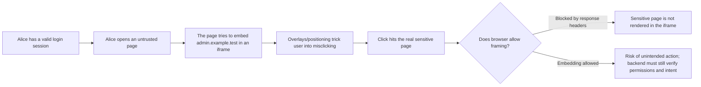
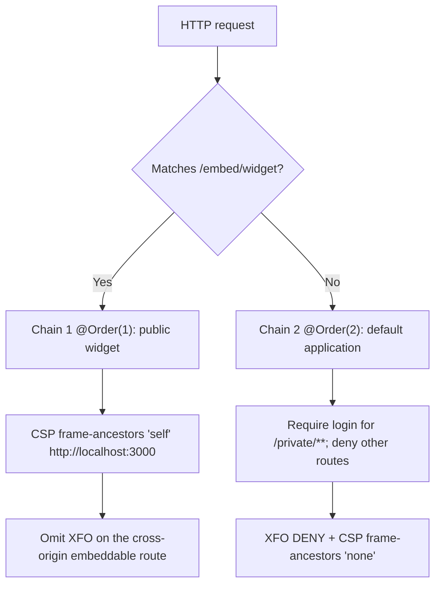

# X-Frame-Options, CSP frame-ancestors, and clickjacking defense

> **Context:** Spring Security – fundamentals / **Browser Protection**. This lesson explains why sensitive HTML pages must not be arbitrarily embedded by other websites, how to configure **`X-Frame-Options`** and **`Content-Security-Policy: frame-ancestors`**, and how to test **clickjacking** defenses in Spring Security Servlet. Examples use **Java 17, Spring Boot 3.5.0, Spring Security 6.x, Maven, JUnit 5, and MockMvc**. Granting embedding permission to an external iframe is a **controlled exception**, not a default setup.

## 1. Learning objectives

After this lesson, you will be able to:

1. Describe clickjacking (UI redress): tricking a user into interacting with a real page that is embedded or overlaid inside an attacker's interface.
2. Understand why **authentication, authorization, and CSRF** alone do not eliminate all clickjacking risks.
3. Choose appropriately between `X-Frame-Options: DENY`, `SAMEORIGIN`, and CSP `frame-ancestors 'none'`, `'self'`, or a list of trusted origins.
4. Distinguish `frame-ancestors` from `frame-src` and understand checking **all ancestors** in nested iframes.
5. Explain precedence rules between **enforced** CSP `frame-ancestors` and `X-Frame-Options`, along with older browser limitations.
6. Configure Spring Security `HttpSecurity.headers(...)` to protect sensitive pages; design an exception **only for a public widget page** instead of disabling protection system-wide.
7. Properly test **HTTP response headers**, route accessibility, and iframe behavior in a **real browser**—without inferring success from HTTP 200 alone.
8. Spot misconfigurations such as `ALLOW-FROM`, `<meta>` tags instead of HTTP headers, `frame-src` instead of `frame-ancestors`, overly broad CSPs, or proxy header overrides.
9. Distinguish anti-framing defenses from authentication, per-object authorization, CSRF, SameSite, CSP script sources, and sensitive transaction confirmation.

## 2. What is clickjacking?

**Clickjacking** (also called a **UI redress attack**) exploits how users view and interact with interfaces. An attacker builds an innocent-looking page, embeds the real target page in an `iframe`, and manipulates position, opacity, size, or overlays so the user unwittingly clicks a control on the real page.

Imagine Alice is logged into an internal admin portal at `https://admin.example.test`. An external site could try embedding the "Grant permission to another user" screen in an iframe and trick Alice into clicking the real button while she thinks she is clicking "Claim reward".



Crucial points:

- The embedded sensitive page is the **real page**. If the browser has an eligible session cookie, the backend may treat requests from the iframe as authenticated requests.
- The attacker **does not need to read HTML** inside the iframe under the Same-Origin Policy. Controlling cursor placement, visual focus, or clicks is still a viable goal.
- `SameSite` cookies can limit cross-site cookie sending, but **do not** cover all cases (such as same-site cross-origin environments, cookie-less flows, or other UI redress techniques).
- CSRF tokens protect many **state-changing requests** from cross-site forgery. However, if the user physically clicks a form or button on the **real page inside an iframe**, that form can include a valid CSRF token. Thus CSRF and anti-clickjacking are **two independent defense layers**.
- Even a read-only page can pose risks if sensitive content is blended into someone else's UI or abused via side-channel techniques; do not protect only pages with POST buttons.

**Anti-framing goal:** prevent browsers from **rendering the target page inside an unauthorized frame**. This is not a way to block API calls from curl/Postman or replace server-side permission checks.

## 3. Who is responsible for sending the header?

Distinguish the two websites:

```text
Website A: https://attacker.example
  <iframe src="https://admin.example.test/account/security"></iframe>

Website B: https://admin.example.test/account/security
  Returns sensitive HTML along with response security headers
```

**Page B's own response** must send `X-Frame-Options` or CSP `frame-ancestors` to tell the browser **who may embed B**. Putting a CSP on page A does not protect B. Sending the header only on `/login` while omitting `/account/security` is also insufficient.

Anti-framing configuration must apply to **every HTML document needing protection**, including login, account, admin, consent, payment/transfer, error pages containing sensitive details, and post-redirect responses. For SPAs, check the **HTML document shell** and anywhere the browser loads real UI—not just JSON responses.

A same-origin request opened **directly in a top-level tab** is not an embedding action. These headers primarily restrict embedding contexts like `iframe`/`frame` (and per spec, CSP `frame-ancestors` also applies to `object`/`embed`).

## 4. `X-Frame-Options`: a long-standing, simple mechanism

`X-Frame-Options` (XFO) is an HTTP **response header** telling the browser whether a page may be displayed inside a frame.

### 4.1. `DENY`

```http
HTTP/1.1 200 OK
Content-Type: text/html
X-Frame-Options: DENY
```

Meaning: **no website may embed** the document, not even another page on the **same origin**. Suitable for login, payment, permission management, or any page with no genuine need to be framed.

### 4.2. `SAMEORIGIN`

```http
X-Frame-Options: SAMEORIGIN
```

Practical meaning: allows embedding only when the browser's **same-origin** conditions are satisfied. This does not mean "same site", "same root domain", or "same company"; differing schemes, hostnames, or ports mean different origins.

For example, `https://app.example.test` is not permitted to embed `https://admin.example.test` merely because both end in `example.test`. `SAMEORIGIN` does not support an arbitrary multi-origin allowlist.

With nested frames, XFO `SAMEORIGIN` implementations historically varied across browsers/versions, so do not rely on it as a subtle mechanism for complex cross-origin embedding. For complex embedding needs, choose CSP `frame-ancestors` and test on supported browsers.

### 4.3. `ALLOW-FROM uri` is obsolete

You may encounter legacy configurations:

```http
X-Frame-Options: ALLOW-FROM https://partner.example.test
```

**Do not use this in modern designs.** `ALLOW-FROM` is obsolete and not reliably supported by modern browsers. A browser that does not recognize the value may fail to enforce the blocking policy you thought you configured.

Nor is there valid XFO syntax like:

```http
X-Frame-Options: SAMEORIGIN https://partner.example.test
```

XFO is not meant for listing multiple origins. For exceptions, use CSP `frame-ancestors`.

### 4.4. It is an HTTP header, not an HTML meta tag

**Wrong:**

```html
<meta http-equiv="X-Frame-Options" content="DENY">
```

Browsers do not enforce XFO from that meta tag. The header must appear in the document's **HTTP response**, emitted by Spring Security, the web server, or a trusted reverse proxy.

## 5. CSP `frame-ancestors`: modern and flexible policy

**Content Security Policy (CSP)** lets a site declare permitted sources across many contexts. The `frame-ancestors` directive defines **which parent/ancestor origins may embed this document**.

### 5.1. Blocking all frames

```http
Content-Security-Policy: frame-ancestors 'none'
```

Equivalent in goal to `X-Frame-Options: DENY`. The `'none'` keyword requires single quotes under CSP syntax. This is recommended for documents that should never be embedded.

### 5.2. Same origin only

```http
Content-Security-Policy: frame-ancestors 'self'
```

Allows framing only when ancestors match the document's own origin. `'self'` requires single quotes. Use when an internal dashboard legitimately embeds same-origin UI while external sites must not control frame contexts.

### 5.3. Allowing one or a few trusted origins

```http
Content-Security-Policy: frame-ancestors 'self' https://portal.example.test
```

The document may be embedded by its own origin and `https://portal.example.test`, provided **every ancestor** is in the allowlist. There is no need—and it is unsafe—to enable all subdomains automatically when only one portal is approved.

An expanded multi-party example:

```http
Content-Security-Policy: frame-ancestors 'self' https://portal.example.test https://reports.partner.example
```

Origins in examples are hypothetical. In production, the list must come from **approved integration requirements** with clear owners, scope, and tests. Never copy a client-supplied origin header straight into a CSP header to build a "dynamic" response; that can turn the allowlist into a policy permitting the attacker themselves.

### 5.4. Why check **all ancestors**, not just the immediate parent?

CSP `frame-ancestors` requires **every enclosing parent browsing context** to match the source list.

Example:

```text
TOP:   https://evil.example
  |
  +--> IFRAME: https://portal.example.test
         |
         +--> IFRAME: https://app.example.test/embed/widget
```

Even if the widget permits `'self' https://portal.example.test`, it is still blocked in the hierarchy above because the **top ancestor** `https://evil.example` is not permitted, despite the immediate parent being the valid portal. This is much stronger than application-level `Referer` or `window.parent` checks.

For legitimate designs using nested frames, account for every possible ancestor origin. Never widen the allowlist blindly just to "fix a blocked iframe" without knowing who is framing the UI.

### 5.5. `frame-ancestors` DIFFERS from `frame-src`

This is a very common mistake:

| Directive | What question does it answer? | Placed on which document? |
| --- | --- | --- |
| `frame-ancestors` | **Who may embed this page?** | Response of the **embedded** page |
| `frame-src` | **Where may this page load iframes from?** | Response of the **embedding** page |
| `child-src` | Restricts certain child content sources per CSP, with fallback links to other directives | Response of the page hosting child resources |
| `default-src` | Fallback for certain fetch directives | Does NOT act as fallback for `frame-ancestors` |

Example:

```http
Content-Security-Policy: frame-src https://trusted-widget.example
```

This states **which widgets the document may embed**; it does **not** stop unfamiliar sites from embedding this document itself.

Conversely:

```http
Content-Security-Policy: frame-ancestors 'none'
```

prevents the document from being embedded, yet **does not restrict** iframes loaded by the document itself.

### 5.6. No fallback from `default-src`

The following looks strict yet **does not block the page from being embedded** via CSP alone:

```http
Content-Security-Policy: default-src 'none'
```

Because `frame-ancestors` **does not fall back** to `default-src`. To defend against clickjacking with CSP, declare it **explicitly**:

```http
Content-Security-Policy: default-src 'none'; frame-ancestors 'none'
```

Do not apply `default-src 'none'` across an entire app from this snippet before completing allowlists for your app's scripts/styles/fonts/images; content-loading directives must follow your dedicated CSP policy.

### 5.7. Do not declare via `<meta>`

**Wrong:**

```html
<meta http-equiv="Content-Security-Policy"
      content="frame-ancestors 'none'">
```

`frame-ancestors` **is not supported in meta-delivered CSP**. It must be sent via an HTTP response header:

```http
Content-Security-Policy: frame-ancestors 'none'
```

Additionally, `frame-ancestors` **does not function as an active monitoring directive in a report-only policy** per CSP rules in practice: never rely on `Content-Security-Policy-Report-Only: frame-ancestors ...` to protect a page. Use an **enforcing** `Content-Security-Policy` and verify frame behavior in real browsers.

## 6. When using both XFO and CSP, which policy wins?

In modern browsers, when a response carries an **enforced CSP `frame-ancestors`**, the standard requires browsers to **ignore `X-Frame-Options`** when deciding whether framing is allowed. However, older browsers did not follow this rule, so the two headers should be designed **without conflict** wherever possible.

| XFO | Enforced CSP `frame-ancestors` | Target behavior and notes |
| --- | --- | --- |
| `DENY` | `'none'` | **Recommended** for pages never to be embedded; consistent policy |
| `SAMEORIGIN` | `'self'` | Appropriate when same-origin embedding is genuinely required |
| `DENY` | `'self'` | Modern browsers may allow same-origin; older browsers may block via XFO |
| `SAMEORIGIN` | `'none'` | Modern browsers block all; older browsers might allow same-origin |
| **Omit XFO** | `'self' https://portal.example.test` | For dedicated embeddable routes; depends on browser CSP support |
| **Omit both** | **None** | No reliable frame-header protection layer |

**Practical rules:**

1. Account/admin/login/consent/payment pages **that must not be embedded**: configure `X-Frame-Options: DENY` **and** `Content-Security-Policy: frame-ancestors 'none'`.
2. Pages needing **internal same-origin** embedding: consider XFO `SAMEORIGIN` with CSP `'self'` when functional requirements are clear.
3. A **public widget** that must be embedded on an approved external origin: use a CSP allowlist **only on the widget route**; XFO `DENY`/`SAMEORIGIN` cannot express cross-origin exceptions. You may need to omit XFO on that route, accept the browser support boundary, and test separately.
4. Never disable all HTTP security headers just to make one iframe integration work.

## 7. What does Spring Security support by default?

Spring Security **Servlet** adds by default:

```http
X-Frame-Options: DENY
```

to HTTP responses passing through the security filter chain. This protects pages **that should not be embedded** quite well. However, Spring Security **does not add a complete CSP** by default because applications must decide their own resource policies and embedding requirements.

Other default security response headers include `X-Content-Type-Options`, `Cache-Control`, and HSTS over HTTPS. Do not lose them by disabling all headers just to change XFO.

### 7.1. Explicit XFO `DENY` configuration

Inside a `SecurityFilterChain` bean:

```java
http.headers(headers -> headers
    .frameOptions(frame -> frame.deny())
);
```

This is a **DSL snippet**, not a standalone Java file. `deny()` instructs clients not to allow framing of the HTML.

### 7.2. Explicit XFO `SAMEORIGIN` configuration

```java
http.headers(headers -> headers
    .frameOptions(frame -> frame.sameOrigin())
);
```

Use only when functionally required and after testing permitted iframes. Do not use `SAMEORIGIN` out of habit for every sensitive page; if no iframe is needed, `DENY` is simpler and safer.

### 7.3. Configuring CSP `frame-ancestors`

```java
http.headers(headers -> headers
    .contentSecurityPolicy(csp -> csp
        .policyDirectives("frame-ancestors 'none'"))
);
```

In Spring Security 6.x, `policyDirectives(...)` sets the `Content-Security-Policy` value specified by the application. Do not assume this snippet sets `script-src`, `style-src`, `object-src`, `connect-src`, or other directives: it sets only **one** anti-framing directive.

### 7.4. Setting both on sensitive pages

```java
http.headers(headers -> headers
    .frameOptions(frame -> frame.deny())
    .contentSecurityPolicy(csp -> csp
        .policyDirectives("frame-ancestors 'none'"))
);
```

This is the typical configuration for pages that must not be embedded. Preserve the remaining default headers; avoid calling `headers.disable()` or `defaultsDisabled()` without clear justification.

### 7.5. What if the app uses WebFlux?

The Servlet code above uses `HttpSecurity` and `SecurityFilterChain`. WebFlux uses `ServerHttpSecurity` and `SecurityWebFilterChain`, with a different frame-options configuration API (such as `mode(...)`). Never copy Servlet configuration verbatim into WebFlux assuming it will compile or behave identically.

## 8. Reproducible Java 17 project: block dashboard, allow widget embedding only

### 8.1. Problem statement

An application at `http://localhost:8080` exposes:

- `GET /private/dashboard`: UI **only for authenticated users**, **strictly forbidden from framing**.
- `GET /embed/widget`: a **public, read-only** HTML widget allowed to be embedded by its own origin or the **approved portal** `http://localhost:3000`.
- Any other uncontracted URLs are denied by policy.

Define two explicitly ordered `SecurityFilterChain` beans:



**Note:** Two chains represent **deliberately different per-path policies**, not a recommendation to create a separate chain per endpoint. In larger systems, the same goal can be achieved via reverse proxy / per-route security header architecture, provided it is tested and leaves no protection gaps.

### 8.2. File structure

```text
frame-headers-demo/
├── pom.xml
├── embedder/
│   └── index.html
└── src/
    ├── main/
    │   └── java/demo/frame/
    │       ├── FrameHeadersApplication.java
    │       ├── SecurityConfig.java
    │       └── PageController.java
    └── test/java/demo/frame/
        └── FrameHeadersTest.java
```

Requires JDK 17+ and Maven 3.9+. Spring Boot `3.5.0` is used as a fixed demo version; before production deployment, update to a supported patch version and audit dependencies and security policies.

### 8.3. `pom.xml`

```xml
<?xml version="1.0" encoding="UTF-8"?>
<project xmlns="http://maven.apache.org/POM/4.0.0"
         xmlns:xsi="http://www.w3.org/2001/XMLSchema-instance"
         xsi:schemaLocation="http://maven.apache.org/POM/4.0.0 https://maven.apache.org/xsd/maven-4.0.0.xsd">
    <modelVersion>4.0.0</modelVersion>
    <parent>
        <groupId>org.springframework.boot</groupId>
        <artifactId>spring-boot-starter-parent</artifactId>
        <version>3.5.0</version>
        <relativePath/>
    </parent>
    <groupId>demo</groupId>
    <artifactId>frame-headers-demo</artifactId>
    <version>0.0.1-SNAPSHOT</version>
    <properties>
        <java.version>17</java.version>
    </properties>
    <dependencies>
        <dependency>
            <groupId>org.springframework.boot</groupId>
            <artifactId>spring-boot-starter-web</artifactId>
        </dependency>
        <dependency>
            <groupId>org.springframework.boot</groupId>
            <artifactId>spring-boot-starter-security</artifactId>
        </dependency>
        <dependency>
            <groupId>org.springframework.boot</groupId>
            <artifactId>spring-boot-starter-test</artifactId>
            <scope>test</scope>
        </dependency>
        <dependency>
            <groupId>org.springframework.security</groupId>
            <artifactId>spring-security-test</artifactId>
            <scope>test</scope>
        </dependency>
    </dependencies>
    <build>
        <plugins>
            <plugin>
                <groupId>org.springframework.boot</groupId>
                <artifactId>spring-boot-maven-plugin</artifactId>
            </plugin>
        </plugins>
    </build>
</project>
```

### 8.4. Entry point

`src/main/java/demo/frame/FrameHeadersApplication.java`:

```java
package demo.frame;

import org.springframework.boot.SpringApplication;
import org.springframework.boot.autoconfigure.SpringBootApplication;

@SpringBootApplication
public class FrameHeadersApplication {
    public static void main(String[] args) {
        SpringApplication.run(FrameHeadersApplication.class, args);
    }
}
```

### 8.5. `SecurityConfig.java`: two chains with different header policies

`src/main/java/demo/frame/SecurityConfig.java`:

```java
package demo.frame;

import org.springframework.context.annotation.Bean;
import org.springframework.context.annotation.Configuration;
import org.springframework.core.annotation.Order;
import org.springframework.security.config.annotation.web.configuration.EnableWebSecurity;
import org.springframework.security.config.annotation.web.builders.HttpSecurity;
import org.springframework.security.core.userdetails.User;
import org.springframework.security.core.userdetails.UserDetails;
import org.springframework.security.core.userdetails.UserDetailsService;
import org.springframework.security.crypto.factory.PasswordEncoderFactories;
import org.springframework.security.crypto.password.PasswordEncoder;
import org.springframework.security.provisioning.InMemoryUserDetailsManager;
import org.springframework.security.web.SecurityFilterChain;

@Configuration
@EnableWebSecurity
public class SecurityConfig {

    @Bean
    @Order(1)
    SecurityFilterChain widgetChain(HttpSecurity http) throws Exception {
        return http
            // Only for the public widget that needs external iframe embedding.
            .securityMatcher("/embed/widget")
            .authorizeHttpRequests(auth -> auth
                .anyRequest().permitAll())
            .headers(headers -> headers
                // Prevent XFO DENY/SAMEORIGIN from blocking a cross-origin portal.
                // Disable only XFO in this chain, do NOT disable all headers.
                .frameOptions(frame -> frame.disable())
                .contentSecurityPolicy(csp -> csp
                    .policyDirectives(
                        "frame-ancestors 'self' http://localhost:3000"))
            )
            .build();
    }

    @Bean
    @Order(2)
    SecurityFilterChain appChain(HttpSecurity http) throws Exception {
        return http
            .authorizeHttpRequests(auth -> auth
                .requestMatchers("/error").permitAll()
                .requestMatchers("/private/**").authenticated()
                .anyRequest().denyAll())
            .formLogin(form -> form.permitAll())
            .headers(headers -> headers
                .frameOptions(frame -> frame.deny())
                .contentSecurityPolicy(csp -> csp
                    .policyDirectives("frame-ancestors 'none'"))
            )
            .build();
    }

    @Bean
    PasswordEncoder passwordEncoder() {
        return PasswordEncoderFactories
            .createDelegatingPasswordEncoder();
    }

    @Bean
    UserDetailsService userDetailsService(PasswordEncoder encoder) {
        UserDetails user = User.withUsername("alice")
            .password(encoder.encode("alice-demo"))
            .roles("USER")
            .build();
        return new InMemoryUserDetailsManager(user);
    }
}
```

**Why does this configuration make sense?**

1. Spring Security picks the **first SecurityFilterChain whose matcher matches** the request. `widgetChain` at `@Order(1)` matches `/embed/widget` specifically.
2. `widgetChain` only permits a **public widget**; it does not enable session login or add fake roles for the external portal.
3. `frameOptions(...disable())` disables XFO **only on the exception route** so modern browsers use the CSP `frame-ancestors` cross-origin allowlist. Keeping XFO DENY/SAMEORIGIN could cause legacy browsers to block the iframe even when CSP allows it; define your browser support policy explicitly.
4. `appChain` catches everything else; `/private/**` requires authentication and carries **both DENY + `'none'`**. Uncontracted URLs hit `denyAll()`.
5. There is no global `headers().disable()`. Other default security headers remain active within each chain's scope.
6. The demo uses a static account for local testing. Production requires proper identity providers/password storage, TLS/HTTPS, cookie policies, and business-level authorization.
7. **Do not configure CSP `frame-ancestors` only on the parent page.** The policy must be in the response of the widget/dashboard itself.
8. If deployment adds a gateway/CDN, verify it does not strip or alter per-route headers.

**Product decision:** The embedded widget is a **read-only component containing no tokens, sessions, or sensitive actions**. If an external portal requires a logged-in iframe, do not just add an origin to the allowlist; analyze third-party cookies, CSRF, sessions, cross-system authorization, token leakage across frames, and clickjacking on the portal.

### 8.6. Controller returning static HTML with no sensitive data

`src/main/java/demo/frame/PageController.java`:

```java
package demo.frame;

import org.springframework.http.MediaType;
import org.springframework.http.ResponseEntity;
import org.springframework.security.core.Authentication;
import org.springframework.web.bind.annotation.GetMapping;
import org.springframework.web.bind.annotation.RestController;

@RestController
public class PageController {

    @GetMapping(value = "/embed/widget",
                produces = MediaType.TEXT_HTML_VALUE)
    public ResponseEntity<String> widget() {
        String html = """
            <!doctype html>
            <html lang="en">
            <head>
              <meta charset="UTF-8">
              <title>Public widget</title>
            </head>
            <body>
              <h2>Read-only widget</h2>
              <p>There is no session or secret data in this widget.</p>
            </body>
            </html>
            """;

        return ResponseEntity.ok()
            .contentType(MediaType.TEXT_HTML)
            .body(html);
    }

    @GetMapping(value = "/private/dashboard",
                produces = MediaType.TEXT_HTML_VALUE)
    public ResponseEntity<String> dashboard(
            Authentication authentication) {

        String html = """
            <!doctype html>
            <html lang="en">
            <head>
              <meta charset="UTF-8">
              <title>Private dashboard</title>
            </head>
            <body>
              <h1>Internal dashboard</h1>
              <p>This page must not appear inside an iframe.</p>
            </body>
            </html>
            """;

        return ResponseEntity.ok()
            .contentType(MediaType.TEXT_HTML)
            .body(html);
    }
}
```

The controller does not interpolate `authentication.getName()` into HTML, avoiding unescaped user data in markup. In real applications, always use a template engine and proper output encoding when rendering data.

`/private/dashboard` requires authentication enforced by `appChain`. `/embed/widget` is public yet has no action forms and accepts no user secrets. **"Public" does not mean "any origin may embed it"**; CSP still restricts approved origins.

### 8.7. Portal page using iframes for browser verification

Create `embedder/index.html`:

```html
<!doctype html>
<html lang="en">
<head>
  <meta charset="UTF-8">
  <title>Iframe test portal</title>
  <style>
    iframe { width: 95%; height: 210px; border: 1px solid #aaa; }
    .box { margin: 16px 0; }
  </style>
</head>
<body>
  <h1>Portal localhost:3000</h1>
  <p>This is an embedding example approved by the API side.</p>

  <div class="box">
    <h2>Allowed: public widget</h2>
    <iframe title="Allowed widget"
            src="http://localhost:8080/embed/widget"></iframe>
  </div>

  <div class="box">
    <h2>Blocked: sensitive dashboard</h2>
    <iframe title="Dashboard must be blocked"
            src="http://localhost:8080/private/dashboard"></iframe>
  </div>
</body>
</html>
```

Use `localhost` consistently: `127.0.0.1` is a **different origin**, so `http://127.0.0.1:3000` will not match the `http://localhost:3000` allowlist. Never use wildcards to "fix" a hostname mismatch in a test setup.

### 8.8. Running the demo

In the project root:

```bash
mvn test
mvn spring-boot:run
```

In a second terminal:

```bash
python -m http.server 3000 --directory embedder
```

If your environment uses `python3`, adjust the command accordingly. Open `http://localhost:3000` in a browser:

1. The **public widget** at `/embed/widget` renders inside its iframe because the portal's origin is listed in CSP.
2. The **sensitive dashboard** at `/private/dashboard` **does not render inside the iframe** due to XFO DENY and CSP `'none'`.
3. Open `http://localhost:8080/private/dashboard` directly in a top-level tab; log in with demo credentials `alice` / `alice-demo` if needed. After login, the page loads normally at top-level, yet remains **blocked when embedded**.
4. Open Developer Tools → Console/Network; browser messages will indicate framing was refused due to `frame-ancestors 'none'` or `X-Frame-Options`.
5. Try opening the portal on an **unapproved** origin such as `http://localhost:3001` (separate server if desired): the widget must also be blocked by the CSP allowlist. You do not need to run port 3001 for the unit/integration test suite.

**Distinction to keep in mind:** the browser may receive HTTP 200 and **still refuse to render the iframe** because the policy is enforced client-side. Seeing 200 in backend logs does not prove clickjacking protection failed. Likewise, never treat "a blank iframe" as sufficient QA: inspect HTTP response headers and browser messages, and rule out authentication/network errors.

### 8.9. Expected results

| URL opened | Top-level tab | iframe on `localhost:3000` | Reason |
| --- | --- | --- | --- |
| `/embed/widget` | Displayed publicly | **Allowed** | CSP portal allowlist |
| `/private/dashboard` unauthenticated | Redirects to login | **Sensitive page not rendered** | Authentication + anti-framing policy on app/login |
| `/private/dashboard` authenticated | Displayed if authenticated | **Blocked** | XFO DENY + CSP `'none'` |
| `/embed/widget` on portal `localhost:3001` | Displayed when opened directly | **Blocked** | CSP excludes `localhost:3001` ancestor |
| `/unknown` | Denied | Denied | `denyAll` for uncontracted URLs |

These are **design expectations**, not the output of browser automation executed in this lesson.

## 9. Testing response headers with JUnit 5 and MockMvc

Create `src/test/java/demo/frame/FrameHeadersTest.java`:

```java
package demo.frame;

import org.junit.jupiter.api.Test;
import org.springframework.beans.factory.annotation.Autowired;
import org.springframework.boot.test.autoconfigure.web.servlet.AutoConfigureMockMvc;
import org.springframework.boot.test.context.SpringBootTest;
import org.springframework.http.HttpHeaders;
import org.springframework.http.MediaType;
import org.springframework.test.web.servlet.MockMvc;

import static org.hamcrest.Matchers.containsString;
import static org.springframework.security.test.web.servlet.request
    .SecurityMockMvcRequestPostProcessors.user;
import static org.springframework.test.web.servlet.request
    .MockMvcRequestBuilders.get;
import static org.springframework.test.web.servlet.result
    .MockMvcResultMatchers.content;
import static org.springframework.test.web.servlet.result
    .MockMvcResultMatchers.header;
import static org.springframework.test.web.servlet.result
    .MockMvcResultMatchers.status;

@SpringBootTest
@AutoConfigureMockMvc
class FrameHeadersTest {

    @Autowired
    MockMvc mvc;

    @Test
    void publicWidgetHasCspAllowlistWithoutXfo() throws Exception {
        mvc.perform(get("/embed/widget"))
            .andExpect(status().isOk())
            .andExpect(content()
                .contentTypeCompatibleWith(MediaType.TEXT_HTML))
            .andExpect(header().string(
                HttpHeaders.CONTENT_SECURITY_POLICY,
                "frame-ancestors 'self' http://localhost:3000"))
            .andExpect(header().doesNotExist("X-Frame-Options"))
            .andExpect(content().string(
                containsString("Read-only widget")));
    }

    @Test
    void privateDashboardIsProtectedFromEveryFrame()
            throws Exception {
        mvc.perform(get("/private/dashboard")
                .with(user("alice").roles("USER")))
            .andExpect(status().isOk())
            .andExpect(header().string(
                "X-Frame-Options", "DENY"))
            .andExpect(header().string(
                HttpHeaders.CONTENT_SECURITY_POLICY,
                "frame-ancestors 'none'"))
            .andExpect(content().string(
                containsString("Internal dashboard")));
    }

    @Test
    void springSecurityKeepsOtherDefaultHeaders()
            throws Exception {
        mvc.perform(get("/private/dashboard")
                .with(user("alice").roles("USER")))
            .andExpect(status().isOk())
            .andExpect(header().string(
                "X-Content-Type-Options", "nosniff"))
            .andExpect(header().exists(
                HttpHeaders.CACHE_CONTROL));
    }

    @Test
    void widgetPolicyDoesNotTrustArbitraryOriginHeader()
            throws Exception {
        mvc.perform(get("/embed/widget")
                .header(HttpHeaders.ORIGIN, "https://evil.example.test"))
            .andExpect(status().isOk())
            .andExpect(header().string(
                HttpHeaders.CONTENT_SECURITY_POLICY,
                "frame-ancestors 'self' http://localhost:3000"));
    }

    @Test
    void anonymousCannotReadPrivateDashboard()
            throws Exception {
        mvc.perform(get("/private/dashboard"))
            .andExpect(status().is3xxRedirection());
    }

    @Test
    void unapprovedRouteIsDeniedEvenForAuthenticatedUser()
            throws Exception {
        mvc.perform(get("/unapproved/path")
                .with(user("alice").roles("USER")))
            .andExpect(status().isForbidden());
    }
}
```

### 9.1. What does the test suite prove?

- The public widget endpoint has **CSP for the exact portal** and **no conflicting XFO** on that exception route.
- The private page has **both XFO DENY and CSP `'none'`**.
- Other default security headers are not accidentally dropped when customizing XFO/CSP.
- Sending a spoofed `Origin` request header **does not cause the server to alter the CSP allowlist**; the browser checks the iframe's ancestor origins when rendering.
- Authentication and `denyAll()` remain enforced independently of frame policy.
- Having two `SecurityFilterChain` beans does not let the private route fall into the widget chain.

**Limitation:** MockMvc **is not a browser** and does not execute the iframe ancestor check algorithm. It only verifies the server sends the right HTTP headers. Combine it with tests in supported Chrome/Firefox/Edge browsers to verify iframe and nested-frame rendering behavior.

### 9.2. Running tests

```bash
mvn test
```

`FrameHeadersTest` is expected to have **6 passing test methods** when the project code and compatible versions match. This is an **expectation from the source code**, not Maven output executed in this lesson.

### 9.3. Checking headers with curl

For the public widget:

```bash
curl -i http://localhost:8080/embed/widget
```

Expected to find:

```http
Content-Security-Policy: frame-ancestors 'self' http://localhost:3000
```

and **no** `X-Frame-Options` because the widget route disabled XFO specifically.

For the private page, log in via form/browser and inspect the Network response, or use the MockMvc test with `with(user(...))` above. Using curl unauthenticated:

```bash
curl -i http://localhost:8080/private/dashboard
```

normally returns a redirect to `/login` instead of private HTML. Inspecting headers on redirects is helpful, but **does not replace** verifying the HTML response after authentication.

**Do not confuse this:** curl prints HTTP 200 and the widget's HTML without caring who embeds it. Frame defenses are enforced by the **browser** when rendering a document inside an iframe.

## 10. Why not allow iframe exceptions across the whole application?

Suppose a partner integration needs to embed a chart. A hasty fix is:

```java
// DO NOT apply globally just because one widget needs embedding.
http.headers(headers -> headers
    .frameOptions(frame -> frame.disable())
);
```

Without a replacement CSP, this can expose **every page in the chain** to arbitrary framing—including login, admin, password change, consent, and account settings.

Instead, determine:

| Architectural question | Safe decision approach |
| --- | --- |
| Which widget genuinely needs embedding? | Create a dedicated route, e.g. `/embed/widget` |
| Does the widget carry PII or allow actions? | If so, assess higher risk; consider disallowing embedding |
| Who is allowed to embed it? | Allowlist approved specific origins |
| Are there nested iframes? | Verify **all ancestors** |
| Are legacy browsers supported? | Define behavior when CSP isn't supported and XFO differs |
| Are cookies/sessions sent inside the iframe? | Analyze `SameSite`, third-party cookies, CSRF, token protection |
| Do proxies/CDNs modify headers? | Compare actual responses at the internet edge vs the app |
| How to test private pages stay closed? | Write regression tests for both the widget and blocked pages |

When there is no embedding need, the simplest policy is **`DENY` + `frame-ancestors 'none'`**. For complex embedding features, consider **isolating widgets onto a dedicated origin** to limit blast radius instead of relaxing the entire origin hosting the authenticated app.

## 11. What anti-framing does NOT solve

### 11.1. Does not replace authentication and authorization

An `/admin/grant` API cannot be protected by XFO/CSP alone: curl and backend clients are not prevented from sending requests by these headers. Server-side authentication, roles/permissions, tenant/resource ownership, validation, and auditing are mandatory.

### 11.2. Does not replace CSRF

Browsers can send state-changing requests to the backend with attached credentials; CSRF tokens protect requests from forged cross-site submissions. Anti-framing blocks one UI redress vector, but does not cover forged requests that do not need an iframe.

### 11.3. Does not replace CSP for XSS protection

A response with:

```http
Content-Security-Policy: frame-ancestors 'none'
```

does not restrict loading scripts from untrusted sources and does not stop XSS. To mitigate XSS with CSP, design `script-src`, `object-src`, nonces/hashes, and related directives—requiring a full resource inventory and testing so the UI does not break.

### 11.4. Does not replace SameSite

`SameSite=Strict` or `Lax` helps control when cookies are sent across sites. However, anti-framing is still necessary when a same-site but cross-origin site could embed UI, and `SameSite` does not prevent every tricked click scenario.

### 11.5. Does not block every UI redress technique

**DoubleClickjacking** and multi-window manipulation techniques can abuse top-level UI rather than embedded iframes. XFO and `frame-ancestors` are not a universal shield. For financial/privileged operations, use **re-authentication, detail-bound transaction confirmation, MFA/step-up auth, transaction authorization**, and business permission limits.

### 11.6. Does not guarantee protection across every WebView/embedded browser

Security header support depends on the browser, version, and WebView policies. Simply noting "the header is present" does not guarantee enforcement on every client. Define a browser matrix and test on actual supported platforms.

## 12. Debugging iframe issues with DevTools

When an iframe renders blank or the browser reports it cannot be displayed:

1. **Identify the embedded document's URL:** check the full redirect chain. The iframe may initially point to `/embed/widget`, but the backend redirects to `/login`, which sends XFO DENY.
2. **Open the embedded document's own response** in the Network tab and inspect `X-Frame-Options` and `Content-Security-Policy`. Do not inspect only the parent page's headers.
3. **Read the console:** messages like "Refused to frame..." usually point to CSP `frame-ancestors` or XFO.
4. **Compare full origins:** `http` vs `https`, hostname, subdomain, and port. `localhost:3000` differs from `localhost:3001`.
5. **Check nested iframes:** do all ancestors match the CSP allowlist?
6. **Check for multiple CSP headers:** if server/proxy emit **multiple enforced CSP policies**, browsers enforce all of them together; a policy with `frame-ancestors 'none'` still blocks even if another policy allows the portal.
7. **Check conflicting XFO:** modern browsers generally prioritize enforced CSP `frame-ancestors`, while older clients may follow XFO. Test real supported browsers.
8. **Check meta tags:** never use `<meta http-equiv>` to enforce `frame-ancestors` or XFO.
9. **Check CDN/reverse proxy:** it may add `X-Frame-Options: DENY` globally onto the widget or strip the route's custom CSP header.
10. **Do not fix by disabling all security headers.** Fix matchers/headers for the specific endpoint and write regression tests.
11. **Check the parent's CSP `frame-src`** if the iframe stays blocked: alongside the child's `frame-ancestors`, the parent page may prohibit loading cross-origin iframes via `frame-src`. The two policies act on opposite sides.
12. **Check cookies and auth:** if the iframe sees a different login state due to `SameSite`/third-party cookie policies, the returned page may be a login page (which is blocked) rather than the widget.

### 12.1. Symptom matrix

| Symptom | Common cause | Action |
| --- | --- | --- |
| iframe blank but opens directly | XFO/CSP `frame-ancestors` | Inspect the child's response headers |
| Browser console reports `frame-ancestors 'none'` | Child blocks all ancestors | Keep the policy if page is sensitive; do not open blindly |
| Approved portal widget still blank | Proxy XFO DENY, another CSP, login redirect | Inspect every response through the gateway |
| iframe from `localhost:3001` portal blocked | Allowlist only includes `localhost:3000` | Working as designed; do not casually widen allowlist |
| Server log shows HTTP 200 yet iframe fails | Browser blocked rendering after HTTP response | Use browser DevTools, not backend logs alone |
| Added `frame-src` yet site still gets embedded | Wrong directive | Use `frame-ancestors` on the embedded page |
| Added `default-src 'none'` yet still embedded | No fallback | Explicitly add `frame-ancestors` |
| Added meta CSP yet still embedded | `frame-ancestors` ignored in meta tags | Emit an HTTP CSP header |
| Added `ALLOW-FROM` with no effect | Obsolete XFO value | Use a CSP allowlist |
| Curl shows content fine | curl does not enforce frame policies | Test in a real browser |
| Login page appears in iframe then blocks | Frame hits auth/redirect flow | Consider public/standalone widgets or separate flows |
| Fails in only one environment | Different gateway/ingress/CDN headers | Compare real responses across environments |

## 13. Rollout strategy by page category

| Page group | Typical appropriate policy | Notes |
| --- | --- | --- |
| Login / account / password reset | XFO `DENY` + CSP `frame-ancestors 'none'` | Never embed credential-collection UI |
| Admin and privilege management | XFO `DENY` + CSP `'none'` | Combine with MFA/reauth for sensitive actions |
| Consent / OAuth authorization page | XFO `DENY` + CSP `'none'` unless special requirement | Avoid UI redress causing accidental consent |
| Payment / change email / transfer | XFO `DENY` + CSP `'none'` | CSRF and transaction authorization still required |
| Internal dashboard embedded **same-origin** | XFO `SAMEORIGIN` + CSP `'self'` | Verify nested frames and strict same-origin |
| Read-only public widget embedded in approved portal | CSP `'self' https://portal.example.test`; handle XFO per route | Never share permissive policy with private pages |
| Public docs needing no iframe | XFO `DENY` + CSP `'none'` | Deny by default to avoid unintended exposure |
| Pure JSON APIs | Anti-framing is not the primary boundary | Needs auth/authz, CORS, CSRF per credentials; prioritize protecting HTML documents |

**Note:** These are starting policy recommendations, not universal laws for every product. Some systems use separately authenticated/signed embedded widgets or legacy browsers/WebViews. In those cases, establish an approved trust model and test plan rather than relaxing settings because "the iframe is blank."

## 14. Required regression tests

| Test case | Expectation |
| --- | --- |
| GET public widget | HTTP 200; exact CSP allowlist; no conflicting XFO |
| Widget inside approved-origin portal iframe | Renders on supported browsers |
| Widget inside iframe from unknown origin | Blocked by browser per CSP |
| Widget inside nested iframe with unapproved ancestor | Blocked even when immediate parent is valid |
| GET authenticated dashboard | HTTP 200; XFO DENY; CSP `'none'` |
| Dashboard inside same-origin iframe | Still blocked due to DENY/`'none'` |
| Dashboard inside cross-origin iframe | Blocked |
| GET anonymous dashboard | No content leaked; login/redirect per flow |
| Unregistered path | Denied by authorization |
| XFO/CSP after login redirect | Target page still carries proper headers |
| Headers on error responses and reverse proxies | Not overwritten or accidentally dropped |
| Multiple CSP header setups | No unintended conflicting policy |
| New/old browsers in support matrix | Behavior matches documented policy |
| Clickjacking test with active session | Cannot render sensitive page even when logged in |
| State-changing HTTP POSTs | Still subject to CSRF/authz, not anti-framing alone |
| Deployment via CDN, ingress, proxy | Headers at final client match expected policy |

Beyond unit/integration tests, browser automation can test embedding pages in iframes from allowed and disallowed origins. However, scripts reading `iframe.contentDocument` from an external origin are blocked by the Same-Origin Policy even **when the iframe rendered successfully**; therefore, never use inability to read cross-origin DOM as sole proof of clickjacking protection. Inspect console logs, screenshots, browser security events, and response headers.

## 15. Code review checklist

- [ ] HTML documents requiring anti-framing are identified, especially login, admin, payment, and permission-change screens.
- [ ] When embedding is unneeded, **`X-Frame-Options: DENY`** and **enforced CSP `frame-ancestors 'none'`** are enabled.
- [ ] If same-origin is needed, `SAMEORIGIN` with `'self'` is considered and all frame ancestors are tested.
- [ ] If an external widget is needed, its route is isolated with a **specific origin** allowlist rather than disabling XFO/CSP system-wide.
- [ ] `ALLOW-FROM` is not used; origin lists are not placed in `X-Frame-Options`.
- [ ] `<meta>` tags are not used to deliver XFO or CSP `frame-ancestors`.
- [ ] `frame-src`, `child-src`, and `default-src` are not confused with `frame-ancestors`.
- [ ] Nested frames are checked across permitted parent/ancestor origins.
- [ ] Behavior with **multiple enforced CSP policies** from backend/proxies is checked.
- [ ] Other security headers remain intact when customizing XFO/CSP in Spring Security.
- [ ] `headers()` is not disabled and the default filter chain is not bypassed just to "fix an iframe".
- [ ] Headers are verified in the **final HTTP response** through TLS/CDN/proxy, not only in MockMvc.
- [ ] Integration tests cover both sensitive and exception routes, authenticated and anonymous.
- [ ] Browser tests verify allowed and blocked frames, not just HTTP 200 or CORS.
- [ ] Anti-framing is not treated as a substitute for authentication, authorization, CSRF, or MFA.
- [ ] For widgets handling user data, cookies/third-party restrictions, privacy, and content-sharing risks are evaluated.
- [ ] Supported browsers/WebViews are listed and tested on target versions.
- [ ] A periodic allowlist review process exists for when portals/partners change domains.
- [ ] Security headers apply to login paths, post-login redirects, and sensitive error pages.

## 16. Self-check questions

**1. How does clickjacking differ from CSRF?**  
Clickjacking tricks users into interacting with real UI via embedding/overlays; CSRF abuses requests carrying auto-sent browser credentials without user intent. The two attacks can overlap yet are distinct, requiring separate defenses.

**2. Which `X-Frame-Options` should a page use if it never needs framing?**  
`DENY`, paired with enforced CSP `frame-ancestors 'none'` for consistent defense.

**3. Does `SAMEORIGIN` let `https://portal.example.test` embed `https://admin.example.test`?**  
Not just because they share a root domain: those are two different hostnames/origins.

**4. Why is `ALLOW-FROM` unsuitable for a partner portal?**  
It is obsolete and not reliably supported by modern browsers. Use CSP `frame-ancestors` with an origin allowlist instead.

**5. Does `frame-src` stop other websites from embedding your page?**  
No. `frame-src` restricts iframes that **your page loads**; `frame-ancestors` restricts **who may embed your page**.

**6. Does declaring `default-src 'none'` alone block all iframes from embedding your page?**  
No. `frame-ancestors` does not fall back to `default-src`; it must be declared explicitly.

**7. Does `<meta http-equiv="Content-Security-Policy" content="frame-ancestors 'none'">` work?**  
No. `frame-ancestors` must be sent in an enforced HTTP CSP response header.

**8. When a response carries both CSP `frame-ancestors 'self'` and XFO DENY, how do modern browsers behave?**  
Per the standard, enforced CSP `frame-ancestors` governs and XFO is ignored, though legacy browsers may follow XFO—so avoid conflicts if supporting legacy clients.

**9. What happens if an iframe's immediate parent is allowed, yet a higher ancestor is disallowed?**  
CSP `frame-ancestors` rejects it because it checks **every ancestor**.

**10. Why is browser testing needed after MockMvc already verified the headers?**  
MockMvc checks only the HTTP response; the browser enforces iframe rendering policies. Outcomes also depend on redirects, nested frames, proxies, and browser versions.

**11. Does HTTP 200 inside an iframe prove clickjacking protection failed?**  
No. The browser can receive 200 and still refuse to render the document due to XFO/CSP.

**12. If only one partner widget needs embedding, should `frameOptions.disable()` be called for the whole app?**  
No. Apply the exception only on the widget route while keeping all other sensitive pages blocked.

**13. Does enabling CORS for a partner origin make an iframe render?**  
Not by default. CORS controls whether JavaScript reads cross-origin responses; HTML framing is governed by the child's `frame-ancestors` and the parent's `frame-src`.

**14. Does a `SameSite=Strict` cookie replace anti-clickjacking headers?**  
No. `SameSite` restricts when cookies are sent in certain contexts; it does not prevent all UI redress or framing of public UI.

**15. Can anti-framing replace role/ownership/CSRF checks on a money-transfer button?**  
No. The server must still verify identity, authorization, transaction intent, and business data.

## 17. Official references

- [Spring Security 6.5 — Servlet Security HTTP Response Headers](https://docs.spring.io/spring-security/reference/6.5/servlet/exploits/headers.html): default `X-Frame-Options: DENY`, `frameOptions(...)`, `contentSecurityPolicy(...)`.
- [MDN — X-Frame-Options](https://developer.mozilla.org/en-US/docs/Web/HTTP/Reference/Headers/X-Frame-Options): `DENY`, `SAMEORIGIN`, obsolete `ALLOW-FROM` and limitations.
- [MDN — CSP frame-ancestors](https://developer.mozilla.org/en-US/docs/Web/HTTP/Reference/Headers/Content-Security-Policy/frame-ancestors): `'none'`, `'self'`, source expressions, checking all ancestors, no fallback from `default-src`, not supported in meta tags.
- [W3C — Content Security Policy Level 2](https://www.w3.org/TR/CSP2/): `frame-ancestors`, enforcement, and relationship with XFO.
- [OWASP — Clickjacking Defense Cheat Sheet](https://cheatsheetseries.owasp.org/cheatsheets/Clickjacking_Defense_Cheat_Sheet.html): anti-framing headers, legacy caveats, SameSite, and doubleclickjacking.
- [OWASP — Content Security Policy Cheat Sheet](https://cheatsheetseries.owasp.org/cheatsheets/Content_Security_Policy_Cheat_Sheet.html): CSP and limits of defense in depth.
- [Spring Security — Multiple HttpSecurity Instances](https://docs.spring.io/spring-security/reference/servlet/configuration/java.html#_multiple_httpsecurity_instances): `@Order` and `securityMatcher` for distinct filter chains.
- [Spring Security — Testing with MockMvc](https://docs.spring.io/spring-security/reference/servlet/test/mockmvc/index.html): security filter chains in integration tests and `SecurityMockMvcRequestPostProcessors.user`.
