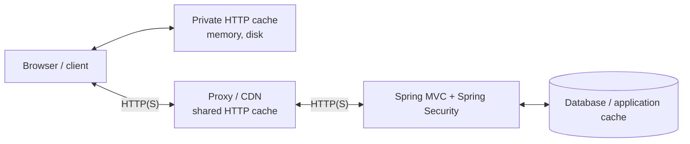

# Browser caches, proxies, and sensitive response data

## Learning objectives

HTTP caching reduces latency and the amount of data transferred between browsers, CDNs, reverse proxies, and applications. However, a response containing a username, balance, order, token, or personal information must never be reused in the wrong context. A misconfigured cache can let a subsequent user see a previous user's data, even if server-side login and authorization are written correctly.

After this lesson, you will be able to:

1. Distinguish **browser cache (private cache)**, **proxy/CDN shared cache**, **application-level cache**, and other mechanisms such as back/forward cache or Service Worker Cache Storage.
2. Explain `Cache-Control` directives: `no-store`, `no-cache`, `private`, `public`, `max-age`, `s-maxage`, `must-revalidate`, and `immutable`.
3. Understand when a cache can serve a stored copy and when it must contact the server to revalidate using `ETag`/`If-None-Match` or `Last-Modified`/`If-Modified-Since`.
4. Analyze risks when an HTTP response depends on **the logged-in user, cookies, `Authorization`, roles, tenants**, or sensitive data.
5. Know where Spring Security adds default cache headers, when Spring MVC or the application overrides them, and how to set distinct policies for private APIs versus public resources.
6. Write and test a Spring Boot 3.x / Spring Security 6.x / Java 17 application with a `no-store` sensitive API and a finitely cacheable public API.

The focus is **HTTP response caching** in Spring MVC/Servlet systems. Using Redis, Caffeine, or `@Cacheable` for internal data is a separate concern: headers sent to the browser do not manage service-layer caches, and vice versa.

## 1. What is caching and why does it pose security risks?

A cache retains a copy of a response for reuse on later requests, avoiding recomputing or re-downloading all data. For shared public resources, this is a sound performance optimization:

```text
1st time: browser --GET /assets/app.a1b2.js--> server
                    <--200 + JS content--

2nd time: browser -- has fresh copy --> uses cache
                    (may not send a new HTTP request)
```

But for a different endpoint:

```text
GET /api/profile
Cookie: SESSION=...Alice's...

200 OK
{"username":"alice","balance":500000}
```

If a shared proxy serving multiple users stores the above response under a cache key that does not distinguish users, Bob might receive Alice's data when calling the same URL. Even if caching occurs only in the browser, another person sharing the same device or browser profile could still encounter stale data if the storage policy is inappropriate.

**Two decisions must be kept separate:**

- **Who is allowed to request generation of the response?** Decided by server authentication/authorization.
- **May this response be stored and reused?** Decided by the HTTP cache policy and each layer's configuration.

Valid login does not automatically eliminate the risk of sensitive data being cached. Conversely, setting `Cache-Control: no-store` also **does not** replace authentication, authorization, session management, or hiding secrets on the client.

## 2. Cache layers in the HTTP path



The diagram is a conceptual model; browsers may reach the application directly or go through multiple gateways/CDNs, and exact cache mechanics depend on deployment.

| Layer | Who typically uses it? | What needs control |
| --- | --- | --- |
| **Private HTTP cache** | A single user agent/browser profile | May it retain the response? For how long? Is revalidation needed? |
| **Shared HTTP cache** | Shared proxies, CDNs, reverse proxies for multiple clients | Only store public content or content isolated by proper cache keys/rules; never reuse another user's data. |
| **Application/server cache** | Spring services, Redis, Caffeine, ORM caches, internal gateways | Cache keys must account for user/tenant/permissions if data depends on them; separate invalidation and access-control policies. |
| **Service Worker Cache Storage** | Web app scripts authorized to manage responses programmatically | Do not assume it follows the same lifecycle as the HTTP cache; apps must design proper save/clear rules. |
| **Back/forward cache (bfcache), history, tab memory** | Browsers keeping page state for fast navigation | Not a regular HTTP cache; `no-store` is not a guarantee to wipe all UI/DOM state from memory. |
| **Logs, monitoring, downloads, screenshots** | Users, servers, devices, operational infrastructure | Cache headers have no function to remove data from these places. |

For highly confidential data, consider **multiple layers**: restrict HTTP response storage, prevent sharing across CDNs, keep tokens out of URLs, avoid logging sensitive data, handle logout/sessions, and design UIs not to display excessive data after sessions expire.

### 2.1. Private cache and shared cache are not synonymous

A private cache in the HTTP standard serves a single user; a shared cache can serve **multiple** people. The `private` directive means **shared caches must not store** that response, yet **private caches may still store it**. For extremely sensitive data, `private` is insufficient if the goal is preventing storage in both cache types; in that case consider `no-store`.

With CDNs, "private" does not mean the data is encrypted, nor does it mean the CDN granted special permission to Alice. It is a **storage-scope instruction within HTTP caching**, not a data classification label or proof of authentication.

## 3. How does an HTTP cache decide to serve a stored copy?

An HTTP cache inspects the request method, URI, certain request fields named in `Vary`, response status, freshness lifetime, directives, and other HTTP caching rules. Depending on CDN configuration, cache keys can be customized; thus you cannot blindly infer "same URL means guaranteed safe."

```text
GET /public/catalog
       |
       v
Does cache have a matching response?
       |
       +-- No --> forward to origin --> receive 200 --> store if permitted
       |
       +-- Yes:
             |
             +-- Still fresh and reuse permitted --> return stored copy
             |
             +-- Stale / requires revalidation --> send conditional request
                          |
                          +-- 304 Not Modified --> update metadata,
                          |                       reuse stored body
                          |
                          +-- 200 OK, new body --> replace or update cache
```

**Fresh** means the copy is still valid per maximum age/freshness rules, not that server data has never changed. **Stale** means expired; depending on directives and circumstances, the cache must revalidate before reusing, though some mechanisms allow serving stale within defined bounds.

### 3.1. Timing example with `max-age=60`

At 10:00:00 the server returns:

```http
HTTP/1.1 200 OK
Cache-Control: public, max-age=60
Content-Type: application/json

{"catalogVersion":"v1"}
```

A compliant cache can reuse the response during the freshness window without asking the server. Once stale, it can request fresh content or revalidate. If v1 changes on the server after 15 seconds, users can still receive v1 for the remaining freshness period. Therefore pick a TTL matching the **maximum acceptable staleness** of public data.

For personalized responses, the risk is not only *staleness* but also *cross-user reuse*. Data that must not leak should not be traded off with a short TTL; shrinking from 1 hour to 10 seconds still leaves a leakage window.

## 4. Understanding `Cache-Control` directives accurately

| Directive | Meaning to HTTP caches | Use case / warning |
| --- | --- | --- |
| `no-store` | Instructs caches **not to store** the response (and related request per spec). Applies to both private and shared HTTP caches. | Right choice for APIs with confidential/personal data, tokens, sensitive documents; does not delete previously cached data. |
| `no-cache` | **Permits storage**, but **must not reuse** without successful revalidation with the origin server. | Sensible when caching/revalidation is desired while always checking before use. Misleading name. |
| `private` | Disallows shared caches from storing; private caches may store per other rules. | User-specific responses whose sensitivity permits browser storage; not equivalent to `no-store`. |
| `public` | Allows shared caches to store under caching conditions; can alter caching rules for requests with `Authorization`. | Only use for truly public responses independent of user, role, tenant, or personal data. |
| `max-age=60` | Maximum freshness lifetime of 60 seconds per cache time, factoring in `Age` and related metadata. | Public catalogs, rarely changing responses, with an intentional TTL. |
| `s-maxage=300` | Freshness for **shared caches**, overriding `max-age`/`Expires` in shared caches. | Public CDNs/proxies; very dangerous if applied to user-specific responses. |
| `must-revalidate` | Once stale, caches must not reuse before successful revalidation; **does not forbid storing**. | Data requiring strict re-checks upon expiration; note special HTTP rules for shared caches and `Authorization`. |
| `immutable` | Indicates content is expected not to change while fresh. | Static assets with content hashes in filenames, e.g., `app.a1b2c3.js`; never use for personal responses or mutable resources at fixed URLs. |
| `no-transform` | Instructs intermediaries not to transform content in the HTTP sense. | Does not prevent storing/reusing; not a privacy mode. |

**Statements to remember:**

- `Cache-Control: no-cache` **does not mean** "do not store."
- `Cache-Control: max-age=0` means the response is almost immediately stale and may need revalidation; **does not mean** "do not store."
- `Cache-Control: must-revalidate` prevents reuse once stale without revalidation; **does not mean** "do not store."
- `Cache-Control: private` forbids shared caches from storing yet still allows private caches to store.
- `Cache-Control: no-store` is the core directive when policy requires not keeping an HTTP copy in any compliant cache.

### 4.1. Three representative configurations

**Personal data API:**

```http
Cache-Control: no-store
```

**Single-user content allowed in browser storage yet requiring revalidation:**

```http
Cache-Control: private, no-cache
```

The second configuration is inappropriate when data must never reside in device cache. Furthermore, the server must verify access rights before allowing reuse of the response after revalidation.

**Public static asset with content hash in URL:**

```http
Cache-Control: public, max-age=31536000, immutable
```

Only use when the filename truly changes whenever content changes, such as `app.6f20c1.js`. If `app.js` is overwritten at the same URL, a one-year cache duration can leave users stuck on an old version for a very long time.

### 4.2. What do `Pragma` and `Expires` mean?

You may see:

```http
Cache-Control: no-cache, no-store, max-age=0, must-revalidate
Pragma: no-cache
Expires: 0
```

This is Spring Security's common default header set for responses that must prevent HTTP caching. `Cache-Control` is the modern mechanism and takes precedence under HTTP caching rules; `Pragma: no-cache` is mainly for historical compatibility (especially on **requests**), while `Expires` is a legacy expiration header. Do not set only `Pragma` and assume you have fully satisfied non-storage requirements for sensitive responses.

`Expires: 0` in that header set is commonly used to indicate the response is already expired; clients should follow current `Cache-Control` directives when present.

### 4.3. `Vary` augments the cache key, it does not make data public

For example, the server may return:

```http
Vary: Accept-Language
Cache-Control: public, max-age=120
```

This indicates the response may differ by request language, so a compliant cache must consider `Accept-Language` when matching stored entries against future requests.

For sensitive data, adding `Vary: Cookie` or `Vary: Authorization` **does not guarantee** against information leaks: shared caches/CDNs may have custom cache-key rules, credentials can change, and one mismatched condition suffices to cause exposure. Prefer **`no-store` for truly sensitive responses**, paired with CDN configuration not to cache those responses.

## 5. Caching with `Authorization`, cookies, and `Set-Cookie`

### 5.1. Responses received for requests with `Authorization`

Under RFC 9111, shared caches face strict restrictions on reusing responses to requests carrying an `Authorization` header. However, **you must not treat the mere presence of `Authorization` as a `no-store` policy**: private caches can still store them, and certain response directives like `public`, `s-maxage`, or `must-revalidate` have semantics allowing shared caching under standard-defined conditions.

The following example is dangerous if the body holds Alice's private data:

```http
GET /api/me
Authorization: Bearer <Alice's-token>

HTTP/1.1 200 OK
Cache-Control: public, max-age=600

{"name":"Alice","role":"USER"}
```

The problem is that a personalized response carries a public cache directive. Never apply `public` or `s-maxage` on endpoints returning per-principal/tenant data.

### 5.2. Cookies do not automatically make responses private

An application logged in with cookies:

```http
GET /api/me
Cookie: SESSION=<opaque-session-id>
```

A request with cookies **does not automatically** force every HTTP cache to discard the response. Likewise, RFC 9111 states that having a `Set-Cookie` header on a response **does not automatically prohibit caching**. You must emit explicit policies, inspect real proxy/CDN behavior, and avoid "cache all GETs" rules for personalized endpoints.

**Wrong mindset:** "Since we returned a session cookie, the reverse proxy automatically knows this is private content."

**Right mindset:** Any URL returning personal data must have an explicit policy; the CDN must be told never to cache that class of responses, regardless of whether requests use cookies or bearer tokens.

### 5.3. Does the response depend on role/tenant/locale?

`/api/me` is not the only personalized endpoint:

- `GET /api/orders/42` may return different bodies depending on whether the caller owns the order.
- `GET /dashboard` may contain per-tenant charts.
- `GET /admin/reports` depends on `ADMIN` permissions.
- `GET /prices` may vary by contract/customer tier and is no longer public content.
- `GET /features` may return experimental flags or access permissions per user.

If a URL produces **different representations per caller**, evaluate shared-cache reuse risks. In sensitive cases, a `no-store` response eliminates one layer of risk, while **the server still must enforce authorization on every request**.

## 6. ETag, Last-Modified, and `304 Not Modified`

### 6.1. How does revalidation happen?

The server returns a cacheable resource:

```http
HTTP/1.1 200 OK
Cache-Control: public, max-age=0, must-revalidate
ETag: "catalog-v7"
Content-Type: application/json

{"version":7}
```

When revalidating, the client sends:

```http
GET /public/catalog HTTP/1.1
If-None-Match: "catalog-v7"
```

If the actual representation has not changed and conditions hold, the server may return:

```http
HTTP/1.1 304 Not Modified
ETag: "catalog-v7"
```

A `304` response **does not resend the representation body**. The cache uses the previously stored body and updates metadata per rules. Therefore, `304` does not mean "no data"; the data may be sitting in the cache.

With `Last-Modified`, the client can use `If-Modified-Since`. Both serve similar purposes with different validator mechanisms. `ETag` should represent the version of the appropriate representation, not simply a user secret.

### 6.2. Revalidation must never bypass authorization

For a conditional sensitive resource:

```text
Alice previously had permission to view /api/reports/9.
Later Alice's permission is revoked.
Alice resends If-None-Match from her previously viewed copy.
```

The server **must check current permissions** before deciding to process data or return `304`, which could cause the client to reuse an old body. If the app returns `304` solely because the ETag matches while skipping authorization, that can preserve revoked access.

For sensitive data, `no-store` is usually easier to reason about and test than building complex revalidation/permission logic. If a product genuinely requires private caching for optimization, clearly specify which copies are stored, when they expire, revalidation conditions, user/tenant scope, and behavior when permissions change.

### 6.3. Two easily overlooked notes

1. Sending `no-store` on a **new** response does not delete an **old** cached copy stored under a prior policy. When changing cache policy after an incident, consider URL versioning, CDN invalidation/purging, logout/session handling, and client lifecycle.
2. `304` is still an HTTP response that needs proper headers and caching policy handling; do not assume an empty body means zero information risk.

## 7. Spring Security and default cache headers

Spring Security supports security response headers. In typical Servlet configurations when header support is enabled, Spring Security sends a default cache-control header group such as:

```http
Cache-Control: no-cache, no-store, max-age=0, must-revalidate
Pragma: no-cache
Expires: 0
```

The goal is protecting user content from being stored and unintentionally reused by HTTP caches. This mechanism involves `HeaderWriterFilter` and HTTP security headers config; it runs inside Spring Security's servlet filter chain, before/around MVC processing.

**A very important point:** when the application has **explicitly set `Cache-Control`** on a response, Spring Security can defer the cache decision to that header. Thus even though Security defaults to `no-store`, a custom controller/static-resource handler/response filter can still enable caching if it emits appropriate headers.

Do not assume by default that:

- "Having the Security starter means no response is ever cached."
- "Any response passing through `SecurityFilterChain` is safe even if the controller sets `public`."
- "Disabling Security's default cache headers will only affect CSS/JS."
- "If the response is `200`, the security headers must already be right."

**Official reference:** [Spring Security — HTTP Response Headers](https://docs.spring.io/spring-security/reference/servlet/exploits/headers.html).

### 7.1. How to customize sensibly

If you want to cache **public resources**, set explicit cache policies **only on those responses**, such as content-hashed CSS/JS or a catalog identical for everyone.

If you want private APIs **not to be stored**, setting `Cache-Control: no-store` explicitly on the response expresses the endpoint's contract; keep Spring Security's defaults too as an extra safety net.

Avoid disabling globally with:

```java
// WARNING: illustrative snippet of an option not to be used casually.
http.headers(headers -> headers.cacheControl(cache -> cache.disable()));
```

If disabled application-wide, you must ensure on your own that **every** sensitive endpoint emits proper cache headers, including errors, redirects, and newly added routes. It is better to adjust policies per specific resource and test headers on actual responses.

### 7.2. Spring MVC `CacheControl` support

Spring Framework provides the `org.springframework.http.CacheControl` API to attach `Cache-Control` to `ResponseEntity` or MVC/static resource config:

```java
ResponseEntity.ok()
    .cacheControl(CacheControl.noStore())
    .body(profile);
```

For public responses:

```java
ResponseEntity.ok()
    .cacheControl(CacheControl.maxAge(Duration.ofSeconds(60)).cachePublic())
    .body(catalog);
```

These methods control the **HTTP response header**; they do not inject auth checks, create CDN cache keys, or clear Redis caches.

**Official reference:** [Spring Framework — HTTP Caching](https://docs.spring.io/spring-framework/reference/web/webmvc/mvc-caching.html).

## 8. Runnable example with Java 17, Spring Boot 3.x, and Spring Security

### 8.1. Exercise requirements

Build a Servlet/MVC application with two GET endpoints:

- `GET /api/profile`: requires login; returns the caller's data; must have `Cache-Control: no-store`.
- `GET /public/catalog`: public and identical for everyone; permits caching with `Cache-Control: max-age=60, public`.

Demo login uses HTTP Basic for easy observation with curl. Do not disable CSRF; the lab only uses GET. Never use hardcoded accounts or HTTP Basic over plain HTTP in real products; in production use HTTPS, proper authentication/sessions/tokens, and secret management.

Directory structure:

```text
cache-security-lab/
├── pom.xml
└── src/
    ├── main/java/com/example/cachelab/
    │   ├── CacheLabApplication.java
    │   ├── SecurityConfig.java
    │   └── DemoController.java
    └── test/java/com/example/cachelab/
        └── CacheHeadersTest.java
```

### 8.2. `pom.xml`

```xml
<project xmlns="http://maven.apache.org/POM/4.0.0"
         xmlns:xsi="http://www.w3.org/2001/XMLSchema-instance"
         xsi:schemaLocation="http://maven.apache.org/POM/4.0.0 https://maven.apache.org/xsd/maven-4.0.0.xsd">
    <modelVersion>4.0.0</modelVersion>

    <parent>
        <groupId>org.springframework.boot</groupId>
        <artifactId>spring-boot-starter-parent</artifactId>
        <version>3.5.0</version>
        <relativePath/>
    </parent>

    <groupId>com.example</groupId>
    <artifactId>cache-security-lab</artifactId>
    <version>1.0.0</version>

    <properties>
        <java.version>17</java.version>
    </properties>

    <dependencies>
        <dependency>
            <groupId>org.springframework.boot</groupId>
            <artifactId>spring-boot-starter-web</artifactId>
        </dependency>
        <dependency>
            <groupId>org.springframework.boot</groupId>
            <artifactId>spring-boot-starter-security</artifactId>
        </dependency>
        <dependency>
            <groupId>org.springframework.boot</groupId>
            <artifactId>spring-boot-starter-test</artifactId>
            <scope>test</scope>
        </dependency>
        <dependency>
            <groupId>org.springframework.security</groupId>
            <artifactId>spring-security-test</artifactId>
            <scope>test</scope>
        </dependency>
    </dependencies>

    <build>
        <plugins>
            <plugin>
                <groupId>org.springframework.boot</groupId>
                <artifactId>spring-boot-maven-plugin</artifactId>
            </plugin>
        </plugins>
    </build>
</project>
```

Use compatible Spring dependencies managed by the Spring Boot parent/BOM. `3.5.0` is a concrete Boot 3.x version for the example; for real projects pick a supported patch release.

### 8.3. `CacheLabApplication.java`

```java
package com.example.cachelab;

import org.springframework.boot.SpringApplication;
import org.springframework.boot.autoconfigure.SpringBootApplication;

@SpringBootApplication
public class CacheLabApplication {
    public static void main(String[] args) {
        SpringApplication.run(CacheLabApplication.class, args);
    }
}
```

Spring Boot boots the application context; Spring MVC maps paths to controllers; Spring Security enforces access policies and adds security headers in the servlet filter chain.

### 8.4. `SecurityConfig.java`

```java
package com.example.cachelab;

import org.springframework.context.annotation.Bean;
import org.springframework.context.annotation.Configuration;
import org.springframework.http.HttpMethod;
import org.springframework.security.config.Customizer;
import org.springframework.security.config.annotation.web.builders.HttpSecurity;
import org.springframework.security.config.annotation.web.configurers.AbstractHttpConfigurer;
import org.springframework.security.core.userdetails.User;
import org.springframework.security.core.userdetails.UserDetailsService;
import org.springframework.security.crypto.bcrypt.BCryptPasswordEncoder;
import org.springframework.security.crypto.password.PasswordEncoder;
import org.springframework.security.provisioning.InMemoryUserDetailsManager;
import org.springframework.security.web.SecurityFilterChain;

@Configuration(proxyBeanMethods = false)
public class SecurityConfig {

    @Bean
    SecurityFilterChain securityFilterChain(HttpSecurity http) throws Exception {
        return http
            .authorizeHttpRequests(auth -> auth
                .requestMatchers(HttpMethod.GET, "/public/catalog").permitAll()
                .requestMatchers(HttpMethod.GET, "/api/profile").authenticated()
                .anyRequest().denyAll()
            )
            .httpBasic(Customizer.withDefaults())
            .formLogin(AbstractHttpConfigurer::disable)
            .build();
    }

    @Bean
    PasswordEncoder passwordEncoder() {
        return new BCryptPasswordEncoder();
    }

    @Bean
    UserDetailsService users(PasswordEncoder encoder) {
        return new InMemoryUserDetailsManager(
            User.withUsername("alice")
                .password(encoder.encode("demo-secret"))
                .roles("USER")
                .build(),
            User.withUsername("bob")
                .password(encoder.encode("demo-secret"))
                .roles("USER")
                .build()
        );
    }
}
```

Notes:

- `/api/profile` only allows authenticated users; reading the username from `Authentication` ensures the response depends on the current identity.
- `/public/catalog` is public; data on this endpoint must genuinely be identical for all callers to fit shared caching policy.
- `.anyRequest().denyAll()` restricts extra routes outside the lab scope.
- Security's default headers configuration is left untouched intentionally. The controller picks the specific cache policy per response.
- `PasswordEncoder` uses BCrypt here; demo passwords are for local use only, not production.
- For APIs with POST/PUT/DELETE, CSRF must also be designed per credential type; caching does not determine CSRF on its own.

### 8.5. `DemoController.java`

```java
package com.example.cachelab;

import java.time.Duration;
import java.util.List;

import org.springframework.http.CacheControl;
import org.springframework.http.ResponseEntity;
import org.springframework.security.core.Authentication;
import org.springframework.web.bind.annotation.GetMapping;
import org.springframework.web.bind.annotation.RestController;

@RestController
public class DemoController {

    @GetMapping("/api/profile")
    public ResponseEntity<Profile> profile(Authentication auth) {
        Profile result = new Profile(auth.getName(), "PERSONAL");
        return ResponseEntity.ok()
            .cacheControl(CacheControl.noStore())
            .body(result);
    }

    @GetMapping("/public/catalog")
    public ResponseEntity<List<Product>> catalog() {
        List<Product> result = List.of(
            new Product("book-1", "Java fundamentals"),
            new Product("book-2", "Spring web")
        );

        return ResponseEntity.ok()
            .cacheControl(
                CacheControl.maxAge(Duration.ofSeconds(60)).cachePublic()
            )
            .body(result);
    }

    public record Profile(String username, String accountType) {}
    public record Product(String id, String name) {}
}
```

`@GetMapping` and `ResponseEntity` come from Spring MVC/Framework, while `Authentication` comes from Spring Security. The `Profile`/`Product` records are serialized to JSON by Spring Boot web starter's Jackson.

Two key lines:

```java
CacheControl.noStore()
CacheControl.maxAge(Duration.ofSeconds(60)).cachePublic()
```

The first declares a contract **not to store personalized HTTP responses**. The second permits **caching the public catalog response for 60 seconds**. Spring Security still handles authentication/authorization; cache policy never lets a client bypass security policy.

### 8.6. Automated testing with MockMvc

`CacheHeadersTest.java`:

```java
package com.example.cachelab;

import org.junit.jupiter.api.Test;
import org.springframework.beans.factory.annotation.Autowired;
import org.springframework.boot.test.autoconfigure.web.servlet.AutoConfigureMockMvc;
import org.springframework.boot.test.context.SpringBootTest;
import org.springframework.test.web.servlet.MockMvc;

import static org.hamcrest.Matchers.containsString;
import static org.springframework.security.test.web.servlet.request.SecurityMockMvcRequestPostProcessors.httpBasic;
import static org.springframework.test.web.servlet.request.MockMvcRequestBuilders.get;
import static org.springframework.test.web.servlet.result.MockMvcResultMatchers.header;
import static org.springframework.test.web.servlet.result.MockMvcResultMatchers.jsonPath;
import static org.springframework.test.web.servlet.result.MockMvcResultMatchers.status;

@SpringBootTest
@AutoConfigureMockMvc
class CacheHeadersTest {

    @Autowired
    MockMvc mvc;

    @Test
    void privateProfileUsesNoStore() throws Exception {
        mvc.perform(get("/api/profile").with(httpBasic("alice", "demo-secret")))
            .andExpect(status().isOk())
            .andExpect(header().string("Cache-Control", "no-store"))
            .andExpect(jsonPath("$.username").value("alice"));

        mvc.perform(get("/api/profile").with(httpBasic("bob", "demo-secret")))
            .andExpect(status().isOk())
            .andExpect(header().string("Cache-Control", "no-store"))
            .andExpect(jsonPath("$.username").value("bob"));
    }

    @Test
    void anonymousUserCannotViewProfile() throws Exception {
        mvc.perform(get("/api/profile"))
            .andExpect(status().isUnauthorized());
    }

    @Test
    void publicCatalogHasExplicitPublicTtl() throws Exception {
        mvc.perform(get("/public/catalog"))
            .andExpect(status().isOk())
            .andExpect(header().string("Cache-Control", containsString("max-age=60")))
            .andExpect(header().string("Cache-Control", containsString("public")))
            .andExpect(jsonPath("$[0].id").value("book-1"));
    }
}
```

The test proves that **the same URL `/api/profile` returns different data for Alice and Bob, yet both carry `no-store`**. Conversely, the public endpoint permits finite caching. MockMvc tests the application's responses; to know how a CDN or browser actually stores/reuses them, integration testing with that infrastructure is also required.

### 8.7. Running the application and observing responses

From the project directory, using JDK 17+ and Maven:

```bash
mvn test
mvn spring-boot:run
```

In another terminal:

```bash
curl -i http://localhost:8080/public/catalog
curl -i http://localhost:8080/api/profile
curl -i -u alice:demo-secret http://localhost:8080/api/profile
curl -i -u bob:demo-secret http://localhost:8080/api/profile
```

In PowerShell, use `curl.exe` if `curl` is aliased to `Invoke-WebRequest`.

Expected results per this lesson's config and dependencies:

| Request | HTTP status | Key cache header | Notable body |
| --- | --- | --- | --- |
| Anonymous `GET /public/catalog` | `200` | `Cache-Control` contains `max-age=60` and `public` | List of two products; identical for all users. |
| Anonymous `GET /api/profile` | `401` (HTTP Basic challenge) | Security defaults usually emit anti-caching headers | Does not return a personal profile. |
| Alice `GET /api/profile` | `200` | `Cache-Control: no-store` | `{"username":"alice","accountType":"PERSONAL"}` |
| Bob `GET /api/profile` | `200` | `Cache-Control: no-store` | `{"username":"bob","accountType":"PERSONAL"}` |

Additional security headers, timestamps, or Content-Length/Transfer-Encoding may appear depending on environment. Do not hardcode the entire raw response into tests. Do not treat two fast consecutive curl calls looking alike as proof of browser caching: plain curl **is not a browser HTTP cache**.

**What to observe:** the same Spring Security filter chain protects the endpoints, while **cache semantics are decided by each specific response**. This protects personal data while keeping caching benefits for public content.

## 9. Testing on browsers, proxies, and CDNs

### 9.1. Browser DevTools

A basic observation approach:

1. Open the Network tab, keeping **Disable cache** unchecked when testing caching policy (do not enable it while testing reuse).
2. Request a cacheable public resource; inspect `Cache-Control`, `Age` if present, `ETag`/`Last-Modified`, the Size column, or "from memory cache"/"from disk cache" indicators depending on the browser.
3. Call `/api/profile` after logging in; confirm the response emits `no-store`. Log out/switch users and retry with another session, observing that the response must pass authentication checks and return the right person's data.
4. Try normal reloads, navigating to another page, using Back/Forward, and opening a new browser session. **HTTP cache and bfcache differ**; Back navigation results cannot be explained solely by `Cache-Control`.
5. Check whether any Service Worker intercepts requests or saves responses into Cache Storage. If so, test the worker's policy separately.

Note on step 1: DevTools has a **Disable cache** option. Leaving it checked can make you think the browser always hits the server, even when cache policy allows storage. Checking headers in DevTools is still useful, but testing reuse must happen with caching enabled.

### 9.2. Proxy/CDN: testing cache against real deployment

For public content behind a CDN, observe response headers such as `Age`, `Via`, and provider-specific headers like `X-Cache` or cache status. There is no single mandatory header name across all CDNs.

Check these points:

- Are sensitive routes `/api/profile`, `/api/orders/**`, `/admin/**` covered by any "cache all" or forced TTL rule?
- Does the CDN respect `Cache-Control: no-store` and `private` from the origin, or is a custom rule overriding them?
- Does the cache key include everything needed for public resources (host, path, query, `Vary`) without omitting fields that govern content?
- Are there rules for `Set-Cookie`, `Cookie`, or `Authorization` that alter caching behavior? Never rely on defaults without verifying.
- Can `401`/`403`/`404` error paths, redirects to login, previews, or sensitive attachments be mis-cached?
- When an error is found, is there a purge/invalidation mechanism and verification across every POP/edge location?

**Priority rule:** for confidential endpoints, configure the CDN to **bypass cache** appropriately and emit `no-store` from the origin. Do not try to "share cache keyed by session cookie" without strong need and thorough security verification.

### 9.3. How to test negative cases

Suppose `GET /api/invoices/100` returns invoices by ownership:

- Alice logs in and fetches Alice's invoice; the response must have an appropriate privacy policy.
- Alice logs out, Bob logs in, and tries the same URL. Bob must be denied by the server if unauthorized, **never receiving Alice's cached body**.
- Test requests with and without `Authorization`, and with different session cookies.
- Test using two devices/browser profiles or two clients routing through the **same CDN edge** if available.
- Test error responses, redirect responses, `If-None-Match` conditions, and alternate paths.
- Test after permissions are revoked or tenants change; even if legitimate caching exists, the system must uphold permission policies.

This testing catches **cross-user response reuse**. Unit-level tests validating `Cache-Control` alone cannot substitute for end-to-end tests against a real proxy/CDN.

## 10. Common deployment mistakes and fixes

### Mistake 1: "With HTTPS, caching is safe"

**Wrong:** TLS protects data in transit and helps authenticate the server, but browsers/proxies/CDNs can still store copies under matching conditions. **Fix:** classify data types and set dedicated caching policies; protect logs, downloads, and infrastructure access.

### Mistake 2: "`no-cache` means forbid storing"

**Wrong:** `no-cache` allows storing and only requires revalidation before reuse. **Fix:** use `no-store` when no HTTP copy may be kept; use `private, no-cache` when browser storage is desired yet re-checking is mandatory.

### Mistake 3: "If logged in, the CDN definitely won't cache"

**Wrong:** some mechanisms restrict by default, yet CDN policies and configs can override; cookies in particular do not lock out caching automatically. **Fix:** private responses must have explicit headers, CDN bypass rules, and multi-user negative tests.

### Mistake 4: "Spring Security already sets `Cache-Control`, so whatever the controller sets doesn't matter"

**Wrong:** Spring Security usually defers when the application sets its own cache policy on a response. **Fix:** review header-setting code, MVC resource handlers, response advice, and gateway/CDN; verify actual emitted headers.

### Mistake 5: "`private` and `no-store` are the same"

**Wrong:** `private` still allows private caches to store. **Fix:** choose by goal: block shared caches only, or block private HTTP caches as well.

### Mistake 6: "`Vary: Cookie` is enough to safely cache per-user data"

**Wrong:** `Vary` is a cache representation selection condition, not authorization or an absolute secrecy policy. **Fix:** use `no-store` on sensitive data; if personalized caching is mandatory, rigorously design cache keys, scope, invalidation, and testing.

### Mistake 7: "Logout clears all caches and browser history"

**Wrong:** logout usually invalidates the server-side session/token per the corresponding mechanism. It does not automatically wipe all HTTP caches, bfcache, Service Worker storage, downloads, screenshots, or logged data. **Fix:** restrict storage up front, protect sessions, clean app-owned client state when appropriate, and never promise deletion of every copy.

### Mistake 8: "Returning `304` is always safe because it has no body"

**Wrong:** the client can reuse the previously stored body. **Fix:** still verify current permissions and representation-accurate validators; avoid designing 304 for sensitive data unless needed.

### Mistake 9: "Setting `no-store` for the entire website is best"

Not necessarily. For content-hashed CSS/JS and public static assets, long caching boosts performance significantly. **Fix:** separate immutable public resources, HTML pages with fitting policies, and sensitive user data. Classify by **response nature**, not mechanically by file extension.

### Mistake 10: "The `Cache-Control` header also controls `@Cacheable`"

**Wrong:** HTTP response caches and server-side caches are two separate mechanisms. **Fix:** audit both: `no-store` on browser responses does not fix a Redis key containing tenant A's data; server-side caches must be keyed and authorized with proper scope.

## 11. Choosing policies by resource type

| Response type | Sensitivity | Typical approach | Notes |
| --- | --- | --- | --- |
| HTML with account data, transaction history, private reports | High | `Cache-Control: no-store` | Pair with authz, TLS, and CDN no-cache policy. |
| JSON `/api/me`, invoices, tokens, personal info | High | `Cache-Control: no-store` | Never use `public`/`s-maxage`. |
| Redirects with login info, OTPs, callbacks carrying sensitive codes | High | Do not store responses, minimize data in URLs and logs | Also assess referrer, history, and related OAuth/OIDC mechanics. |
| Low-sensitivity personal info, products supporting offline | Conditional | Possibly `private, no-cache` if risk is acceptable | Evaluate explicit storage requirements, permission changes, shared devices. |
| Public SPA HTML shell with fixed URL across deploys | No personal data | Typically revalidate or short TTL | Avoid getting stuck with HTML pointing to outdated assets. |
| Public JS/CSS/images with content-hashed filenames | Public | `public, max-age=31536000, immutable` | Filename changes whenever content changes. |
| Public catalog or user-independent data API | Public | Finite TTL such as `public, max-age=60` | Check licensing, data accuracy, freshness requirements, and cache invalidation. |
| "Public" JSON that varies by role/tenant/contract price | Has personal factors | Re-scope, typically `no-store` | Do not judge by endpoint name; evaluate actual representation. |
| Private file downloads | High | `no-store`, verify access permissions | Browsers can still save downloaded files per user action; cache policy does not delete downloads. |
| Error pages leaking data, stack traces, or request info | High | Avoid information disclosure, `no-store` when appropriate | Protect error responses and fallback paths as well. |

The table offers design suggestions; final decisions must rest on the data, product behavior, supported browsers, and deployment infrastructure.

## 12. Cache poisoning, cache deception, and advanced cases

Caching vulnerabilities sometimes stem not from developers forgetting `no-store`, but from **clients, proxies, and applications interpreting requests differently**.

- **Web cache poisoning:** caller-controlled input affects the response without being properly distinguished in the cache key; the influenced response can then be served to other clients.
- **Web cache deception:** a URL/path resembling a static asset tricks a proxy into caching a dynamic private response due to faulty path-matching rules.
- **Host/header confusion:** if a proxy excludes certain headers from the cache key yet the backend uses them to build absolute URLs or content, responses can get mixed or corrupted.
- **Query normalization:** proxies ignoring or normalizing queries differently from the backend cause two requests interpreted differently by the app to share a cached copy.
- **Content negotiation:** responses varying by `Accept-Language`, `Accept-Encoding`, or `Origin` require careful `Vary` and cache behavior review.

Design risk example:

```text
Proxy rule: any URL ending in ".css" is cached publicly.
Backend: /users/profile.css actually returns session-based account data.
```

Here the proxy classifies by path suffix, whereas the backend classifies by endpoint/identity. Divergent interpretations create a security bug. **Defense:** sensitive responses carry `no-store`; proxies/CDNs do not force-cache these routes; explicitly define static asset paths, cache keys, and forwarded headers, and test path/query variants.

Do not try to fix cache poisoning by increasing TTL or stuffing every client header into the cache key. Such changes create other performance and security consequences; prefer narrowing which inputs can affect representations and aligning policies across layers.

## 13. Short threat model for features with sensitive responses

When deploying an API, document at minimum:

| Question | Example answer | Test/mitigation |
| --- | --- | --- |
| **Who may view?** | Only the order owner or staff with specific permissions | Authentication + owner/tenant authorization. |
| **Is the data sensitive?** | Address, purchase history, balance, tokens | `Cache-Control: no-store`; minimize data in responses/logs. |
| **Who can keep a copy?** | Browser, CDN, reverse proxy, Service Worker | Inspect origin headers, CDN rules, client storage. |
| **What forms the cache key?** | Host/path/query; certain header variants | Public responses have proper cache keys; private responses bypass. |
| **When do permissions expire?** | Logout, account lock, role/tenant change | Never reuse sensitive copies; recheck current permissions. |
| **What non-success responses exist?** | `302` login, `401`, `403`, `404`, exports | Review errors, redirects, and downloads too. |
| **How long keep public copies?** | Catalog tolerates up to 1 minute staleness | `max-age=60`, purge when needed. |
| **What observability tools exist?** | MockMvc, DevTools, CDN logs, curl | Test across enough clients and real shared caches. |

Easy-to-operate review order:

1. **Classify responses**: immutable public, mutable public, user-specific, or confidential.
2. **Map the path**: browser → CDN/proxy → Spring Security → controller/service; are there Service Workers or other response caches?
3. **Choose headers**: for confidential data, `no-store`; for hashed static public assets, long TTL; explicit policies for remaining cases.
4. **Verify server permissions**: under-privileged users must not generate/receive sensitive representations, even via conditional requests.
5. **Audit proxy/CDN rules**: do not cache confidential routes, do not unexpectedly override origin policies.
6. **Run negative tests**: two different users, logged out, revoked permissions, error responses, and URL/path variants.
7. **Verify post-deploy**: measure actual HTTP headers received by clients and cache status at gateway/CDN, not only service unit tests.

## 14. Self-check questions

**1. Does `no-cache` prevent the browser from storing JSON?**  
No. It forces the cache to revalidate before reusing. To forbid storing HTTP copies, consider `no-store`.

**2. Is `private` completely safe for financial information?**  
No. It blocks shared caches from storing, yet private caches can still store. Very sensitive data typically needs `no-store`, alongside other defense layers.

**3. If a response has `Set-Cookie`, is the proxy guaranteed not to cache?**  
No. `Set-Cookie` does not automatically forbid caching by specification. Appropriate `Cache-Control` and proper CDN policies are required.

**4. If a request carries `Authorization`, can checking cache headers be skipped?**  
No. Shared caches have standard rules restricting reuse, but private caches and certain directives create exceptions; never treat an auth header as equivalent to `no-store`.

**5. Why can a `304` response still involve sensitive data?**  
Because the client can pull the body from a stored cache. Deciding to return 304 must respect current permissions and the right representation.

**6. Does `Vary: Cookie` replace resource authorization?**  
No. `Vary` is a rule for selecting cached entries; authorization must be enforced on the server.

**7. Should `public, max-age=31536000, immutable` be set on `app.js` when deployments always overwrite the same URL?**  
No. Long TTLs only make sense when URLs are versioned/content-hashed and content does not change at the same URL while fresh.

**8. Why does Spring Security default to `no-store` yet an API can still return `public, max-age=60`?**  
Because the application can explicitly set `Cache-Control` per response; Security defers to that header. Always audit the cache policy actually emitted.

**9. Does `Cache-Control: no-store` delete Redis, downloaded files, browser history, and bfcache?**  
No. It is a directive for HTTP caches; other stores/mechanisms must be managed separately and must not be assumed cleared.

**10. After Alice logs out, Bob calls the same URL with a different session yet receives Alice's body from the CDN—where is the bug?**  
That is cross-user private response reuse in a shared cache, potentially caused by cache headers, CDN rules, or cache keys. Stop caching the sensitive endpoint, fix the config, and purge existing cached entries; also verify server permissions.

## Conclusion

Caching optimizes performance by **reusing responses**, yet reuse decisions are only safe when accounting accurately for **data scope and recipient identity**. With Spring MVC/Spring Security, authentication and authorization guard who can access; `Cache-Control` and browser/proxy/CDN configuration determine whether responses can be stored or reused; mechanisms like Service Workers, bfcache, and server-side caches require separate evaluation.

Remember three practical rules: **responses with sensitive data → consider `no-store` and bypass shared caches; immutable public resources with content hashes → can be cached long-term; every cache policy must be verified on real responses and along the infrastructure path**. Never treat the presence of cookies, TLS, `Authorization`, or the Spring Security starter as proof that caching is automatically safe.

## References

- [RFC 9111 — HTTP Caching](https://www.rfc-editor.org/rfc/rfc9111.html): storage semantics, freshness, revalidation, shared/private caches, and directives.
- [Spring Security — Security HTTP Response Headers](https://docs.spring.io/spring-security/reference/features/exploits/headers.html): Spring Security's default cache headers.
- [Spring Security — Servlet HTTP Response Headers](https://docs.spring.io/spring-security/reference/servlet/exploits/headers.html): configuring cache headers in the filter chain.
- [Spring Framework — HTTP Caching](https://docs.spring.io/spring-framework/reference/web/webmvc/mvc-caching.html): `CacheControl`, `ResponseEntity`, and conditional requests in MVC.
- [MDN — HTTP Caching](https://developer.mozilla.org/en-US/docs/Web/HTTP/Guides/Caching): browser behavior examples and distinguishing common directives.
