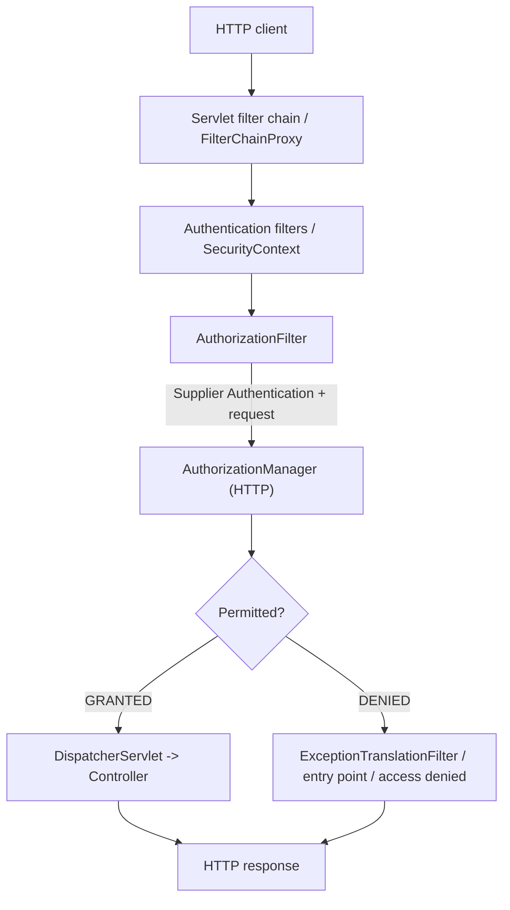

# AuthorizationManager in Access Control Decisions

## Learning Objectives

Once a request reaches Spring Security, the questions "who is the user?" and "is that person allowed to do this?" are handled in different steps. `AuthenticationManager` typically deals with **verifying identity**; whereas `AuthorizationManager` is Spring Security's contract for **evaluating access permission** to a protected object. That object can be an HTTP request, a method invocation, or a resource in another integrated mechanism.

This lesson focuses on where `AuthorizationManager` sits in the **Spring Security Servlet** component map, how it makes decisions, how to choose policies, how it pairs with method security, and how to implement a context-aware custom manager. Examples use **Java 17, Spring Boot 3.x, Spring Security 6.5.x, and Spring MVC**.

After studying this lesson, you will be able to:

1. Trace the flow `SecurityContextHolder → AuthorizationFilter → AuthorizationManager → allow/deny → controller`.
2. Distinguish `AuthenticationManager`, `AuthorizationManager`, `SecurityFilterChain`, `RequestMatcher`, and `ExceptionTranslationFilter`.
3. Understand the meaning of `Supplier<Authentication>`, `AuthorizationDecision`, `AuthorizationResult`, `granted`, `denied`, and `abstain`.
4. Know how the `authorizeHttpRequests(...)` DSL builds and composes authorization managers, and why **matcher order** and **default deny** matter.
5. Understand the relationship between HTTP authorization and method authorization using `@EnableMethodSecurity`, `@PreAuthorize`, and `@PostAuthorize`.
6. Write a custom manager for report-reading permissions by username/role, test **401**, **403**, and **200**, and also protect the service layer.

> **Version boundary:** The 6.5 line still has `AuthorizationManager#check(...)` as the method to implement and `authorize(...)` as a default method added later; some Spring Security 7.x documentation presents `authorize(...)` as the primary method. The concrete code examples below intentionally follow the 6.5.x API. When upgrading major versions, always consult the JavaDoc for the version you are running.

## 1. What Is AuthorizationManager?

`AuthorizationManager<T>` resides in package `org.springframework.security.authorization`. It receives information about the current identity along with a **secure object** of type `T` and decides whether that operation is permitted.

You can visualize the decision contract as:

```text
                          +---------------------+
Authentication ---------->|                     |
(supplied via Supplier)   | AuthorizationManager |--> GRANTED / DENIED / ABSTAIN
                          |                     |
Secure object ----------->|                     |
(request / invocation)    +---------------------+
```

Each time a rule is evaluated, Spring Security can consult the corresponding manager. The manager **does not run the controller itself**, **does not verify passwords itself**, and **does not create sessions itself**. It returns a decision to its caller, such as `AuthorizationFilter` or a method security interceptor, so the system decides whether to proceed or deny.

### 1.1. Comparing Similar-Sounding Names

| Component | Question it answers | Example |
| --- | --- | --- |
| `AuthenticationManager` | Are the identity credentials/evidence valid? | `ProviderManager` calls an `AuthenticationProvider` to authenticate username/password. |
| `Authentication` | Who is currently represented? Which authorities do they hold? | Principal `alice`, authorities `REPORT_READ` and `ROLE_USER`. |
| `SecurityContextHolder` | How is the current security context retrieved in Servlet flows? | Security filters retrieve `Authentication` when needed. |
| `AuthorizationManager<T>` | Is that identity allowed to act on object `T`? | Alice can read `/api/reports/alice`, denied for Bob's report. |
| `SecurityFilterChain` | Which security filters does an HTTP request pass through? | Authentication filters, CSRF protection, `AuthorizationFilter`… |
| `RequestMatcher` | Which rule/chain does this request match? | `/api/**`, HTTP method GET, path containing `{owner}` variable. |
| `ExceptionTranslationFilter` | How are auth/authz errors in the filter chain turned into HTTP handling? | Catches exceptions and invokes the right entry point or access-denied handler. |
| Method security interceptor | How are permissions checked before/after an invocation? | `@PreAuthorize` checks before calling the service; `@PostAuthorize` checks the return value. |

**Authentication is an input to authorization**, yet being logged in does not mean having unrestricted access. For example, `alice` and `bob` both hold `REPORT_READ` authority, yet should only read reports they own, unless policy allows an administrator to access them instead.

### 1.2. Managers Do Not Decide Everything via Roles Alone

An authorization decision can use:

- Identity from `Authentication#getName()`.
- Authorities in `Authentication#getAuthorities()`.
- HTTP request attributes: method, path, path variables, or server-controlled attributes.
- Method parameters, return value, ownership/tenant, and resource state.
- Policies from a database or dedicated policy engine when design truly requires it.

**Role-based access control (RBAC)** is only one way to make decisions. **Attribute-based (ABAC)** or owner/tenant relationships often require additional data about the real resource and business policy. A URL containing an owner's name does not by itself prove that person actually owns the database record.

## 2. API Contract and Decision Results

### 2.1. `AuthorizationManager<T>` on Spring Security 6.5

The high-level API includes the following methods (abbreviated for reading the mechanism; not a standalone Java file):

```java
public interface AuthorizationManager<T> {
    AuthorizationDecision check(
            Supplier<Authentication> authentication,
            T object);

    default AuthorizationResult authorize(
            Supplier<Authentication> authentication,
            T object) {
        // 6.5 default delegates to check(...).
    }

    default void verify(
            Supplier<Authentication> authentication,
            T object) {
        // Throws AccessDeniedException if the result is denied.
    }
}
```

On **6.5.x**, `check(...)` has been marked deprecated in favor of the newer API, yet remains the contract to implement when directly implementing the interface in this example. `authorize(...)` is the newer API path (since 6.4) and `AuthorizationResult` is a more general result type; Java code targeting Spring Security 7.x must check the version because the interface signature evolved.

**`T` carries practical meaning:**

- `AuthorizationManager<RequestAuthorizationContext>`: decides access for an HTTP request, with a context holding the request and path variables extracted by matchers.
- `AuthorizationManager<MethodInvocation>`: decides before a method call, able to inspect the method and arguments.
- `AuthorizationManager<MethodInvocationResult>`: can also inspect the return value after the method executes.

The generic parameter expresses **the object being protected**; it does not mean the manager searches system objects on its own or alters business logic.

### 2.2. Why Pass `Supplier<Authentication>`?

Instead of eagerly fetching `Authentication` upfront for every request, Spring Security passes a supplier providing the value only when the manager actually needs it:

```java
Supplier<Authentication> authSupplier = /* supplied by framework */;
Authentication current = authSupplier.get(); // read only when needed
```

The snippet above is a **conceptual illustration**, not code you write to create suppliers in an application.

Rules like `permitAll()` or `denyAll()` can decide **without** reading the session or security context. When a custom manager needs the username or authorities, it calls `authentication.get()`. Lazy lookup saves work and decouples the caller from how `Authentication` is stored.

**Do not assume `Authentication` is always a real logged-in user.** Spring Security Servlet may use anonymous authentication; `AnonymousAuthenticationToken` can represent an anonymous request. A custom manager must properly distinguish anonymous from authenticated principals rather than blindly relying on `isAuthenticated()`.

### 2.3. Granted, Denied, and Abstain

In principle:

| Result | Meaning | Behavior to watch out for |
| --- | --- | --- |
| `AuthorizationDecision(true)` | Manager agrees to permit the operation. | Caller proceeds unless another check denies. |
| `AuthorizationDecision(false)` | Manager denies. | With `verify(...)` or appropriate interceptor/filter, triggers `AccessDeniedException`. |
| `null` | Manager makes no decision (*abstain*). | **Not equivalent to deny**, nor should it be relied on by default as a security policy. Caller/composition decides handling. |

Do not write a manager returning `null` when username or path variables are missing and assume the request is automatically denied. For sensitive policies, return an **explicit deny** when required inputs are missing or invalid.

Simple illustrative example:

```java
return new AuthorizationDecision(permitted);
```

`permitted` is a boolean computed by policy. `AuthorizationDecision` records the decision; it does not replace looking up true ownership data, verifying transactions, or turning a URL rule into permission over every object.

### 2.4. Distinguishing 401 and 403

When a manager denies access, the domain meaning is **authorization failed**. The final HTTP status code also depends on authentication state and error handling:

- **401 Unauthorized**: typically returned when the request provided no credentials or invalid credentials and an authentication entry point challenges for login. With HTTP Basic this may include `WWW-Authenticate`.
- **403 Forbidden**: typically returned when the identity is authenticated yet lacks sufficient authority; or another protector rejects the request (e.g. CSRF).
- In apps using cookies/form login, an unauthenticated request may receive a **302 redirect** to the login page instead of 401. Never try to deduce all HTTP statuses from a single `AuthorizationDecision` value.

An HTTP policy usually passes through `ExceptionTranslationFilter` to convert exceptions into appropriate handling; when invoking methods outside an HTTP context, authorization errors may need to be handled by the caller.

## 3. Where AuthorizationManager Sits in Servlet HTTP Requests

### 3.1. High-Level Flow



The diagram describes component roles, **without fixing every filter order or direct filter call**. In the Servlet stack, `FilterChainProxy` selects the matching `SecurityFilterChain`; authentication filters and `SecurityContext` handling provide user information by the time access checks run.

Processing with `authorizeHttpRequests(...)`:

1. The servlet container receives an HTTP request; a Spring Security filter chain applies if the request matches a defined chain.
2. The appropriate authentication mechanism may process session, HTTP Basic, bearer token, etc., and create/restore `Authentication`.
3. `AuthorizationFilter` prepares `Supplier<Authentication>` from the security context and passes it along with the request to `AuthorizationManager`.
4. The manager aggregates configured rules, finds the matching rule, and evaluates its condition.
5. If permitted, the filter chain proceeds so Spring MVC can invoke the controller. If denied, the exception and security handling decide the HTTP response.
6. If method security is enabled, when the controller invokes a Spring-managed service through its proxy, **another authorization check** may occur right before (or after) the method.

**HTTP permissions and method permissions are two separate checkpoints.** Letting a request through does not mean every downstream method or every data row is authorized.

### 3.2. `AuthorizationFilter` and `ExceptionTranslationFilter`

With the `authorizeHttpRequests(...)` DSL, modern Spring Security uses `AuthorizationFilter` and the `AuthorizationManager` system. Older docs may mention `FilterSecurityInterceptor`, `AccessDecisionManager`, `AccessDecisionVoter`, and `SecurityMetadataSource`: those belong to the earlier authorization architecture. Do not use old `authorizeRequests(...)` guides as the current standard without checking versions.

`AuthorizationFilter` runs near the end of the Spring Security filter chain by default. This allows preceding authentication and defense filters to run before deciding access. **Any custom filter added to the chain must be positioned intentionally**; placing one after `AuthorizationFilter` does not automatically make that filter an independent authorization gate.

`ExceptionTranslationFilter` does not decide business policy itself. It reacts to `AuthenticationException`/`AccessDeniedException` thrown inside the filter chain: if the request requires authentication, it can invoke `AuthenticationEntryPoint`; if already authenticated yet lacking permissions, it can invoke `AccessDeniedHandler`. This component explains why the same "access denied" outcome can become 401 or 403 depending on caller status and login mechanism.

### 3.3. Multiple SecurityFilterChains and Match Order

A Servlet application can have multiple `SecurityFilterChain`s, such as one chain for `/api/**` and one chain for HTML pages. `FilterChainProxy` selects the **first matching chain** in order. **Inside that chain**, `RequestMatcherDelegatingAuthorizationManager` picks the matching rule in the order declared inside `authorizeHttpRequests`.

Two selection levels must be distinguished:

```text
HTTP request
  |
  v
FilterChainProxy: picks the first matching SecurityFilterChain
  |
  v
That chain's AuthorizationFilter
  |
  v
RequestMatcherDelegatingAuthorizationManager:
     picks the first matching requestMatcher rule
  |
  +-- permitAll / authenticated / hasRole / custom access(...)
  |
  v
Allow or deny
```

Do not treat `securityMatcher("/api/**")` and `requestMatchers("/api/**")` as synonyms:

- `securityMatcher` determines which requests **belong to a SecurityFilterChain**.
- `requestMatchers` inside `authorizeHttpRequests` determines the **authorization policy within the selected chain**.

A chain with an overly narrow `securityMatcher` can cause requests to fall into another chain or bypass Spring Security protection unexpectedly. Checking chain order and default rules is an essential part of security design.

## 4. Common AuthorizationManagers

Spring Security provides factories to create managers for common conditions:

| API / Implementation | Core question | Example |
| --- | --- | --- |
| `AuthenticatedAuthorizationManager` | Does the caller satisfy the required authentication state? | `authenticated()`, `fullyAuthenticated()`, or configured remember-me rules. |
| `AuthorityAuthorizationManager` | Does the caller hold one of the required authorities/roles? | `hasAuthority("REPORT_READ")`, `hasRole("ADMIN")`. |
| `RequestMatcherDelegatingAuthorizationManager` | Which rule does the HTTP request match, and which manager handles that rule? | `/public/**` public, `/admin/**` requires ADMIN, `/api/**` requires login. |
| `WebExpressionAuthorizationManager` | Evaluates an authorization expression at the web layer. | Migration cases needing expressions with URL variables; prefer strongly typed manager APIs where reasonable. |
| `PreAuthorizeAuthorizationManager` | Does a method invocation pass `@PreAuthorize` before running? | `hasAuthority('REPORT_READ')` on a service method. |
| `PostAuthorizeAuthorizationManager` | May the value returned by a method be returned to the caller? | Checking ownership after the method computes a result. |
| `SecuredAuthorizationManager` / `Jsr250AuthorizationManager` | Evaluates corresponding annotations when enabled. | `@Secured` / `@RolesAllowed` in compatible setups. |

High-level DSL rules like `permitAll`, `denyAll`, `authenticated`, and `hasRole` are usually **sufficient for simple APIs**; you do not need to write a custom manager for every condition. Write a custom `AuthorizationManager` when you need custom context access, shared policies, independently testable logic, or integration with another authorization system.

### 4.1. Roles and Authorities

`GrantedAuthority` represents a permission as a string. Typically `hasRole("ADMIN")` checks for authority `ROLE_ADMIN` (under the default prefix); `hasAuthority("REPORT_READ")` matches the **exact** string `REPORT_READ`. Depending on role prefix configuration, `hasRole` behavior can vary.

Example:

```java
User.withUsername("alice")
    .password(encoded)
    .authorities("REPORT_READ")
    .build();

User.withUsername("admin")
    .password(encoded)
    .authorities("REPORT_READ", "ROLE_ADMIN")
    .build();
```

This is an **illustrative snippet using variable `encoded`**, not a standalone Java class. Alice holds `REPORT_READ` but lacks `ROLE_ADMIN`. Admin holds both authorities. Never mix `roles("ADMIN")` and `authorities("ROLE_ADMIN")` while forgetting how the prefix works.

### 4.2. "AND" and "OR" Logic Must Be Designed Intentionally

For example, an endpoint permitting only **someone with `REPORT_READ` who is the owner**, or an admin allowed by policy:

```text
allow =
  authenticated
  AND REPORT_READ
  AND (username == resource.owner OR has ROLE_ADMIN)
```

Using only `authenticated()` skips both functional authority and ownership checks. Using only `hasRole("ADMIN")` may block regular users even when allowed to read their own resources. Combining with `OR` in the wrong place can grant unintended access beyond design.

With real data, ownership must rely on records **managed by the server/DB**, not solely on a string sent by the client. Path-variable permissions work well for labs and some identity-scoped routes, yet the service must still ensure the returned object belongs to a valid scope.

## 5. Configuring AuthorizationManager via the `authorizeHttpRequests` DSL

Basic configuration:

```java
http.authorizeHttpRequests(auth -> auth
    .requestMatchers("/public/**").permitAll()
    .requestMatchers("/admin/**").hasRole("ADMIN")
    .requestMatchers("/api/**").authenticated()
    .anyRequest().denyAll()
);
```

This is a **configuration snippet**, not a standalone Java program. It demonstrates 4 choices:

1. `permitAll()` for intentionally public endpoints.
2. `hasRole("ADMIN")` for administrative endpoints.
3. `authenticated()` requiring an authenticated identity for other API requests.
4. `anyRequest().denyAll()` denying any request not matched by earlier rules.

**Order matters greatly.** Placing `.requestMatchers("/**").permitAll()` first leaves later protective rules with no chance to inspect matching requests. A rule like `.requestMatchers("/api/**").authenticated()` placed before `.requestMatchers("/api/admin/**").hasRole("ADMIN")` lets any logged-in user reach admin endpoints because `/api/**` matched first.

**Never infer protection from route names.** A controller method in an `admin` package or returning sensitive data does not automatically inherit an appropriate policy. Verify paths, HTTP methods, dispatchers, and how matchers actually execute.

### 5.1. Different Dispatch Types

`AuthorizationFilter` can evaluate dispatcher types such as `REQUEST`, `ERROR`, and `FORWARD`. For instance, Spring Boot forwards an error to `/error` via an `ERROR` dispatch. If a default-deny rule does not account for this, error responses may be affected by an extra authorization pass.

In real applications, you can declare explicitly:

```java
.dispatcherTypeMatchers(DispatcherType.ERROR, DispatcherType.FORWARD).permitAll()
```

Import `jakarta.servlet.DispatcherType` (Boot 3.x uses Jakarta). Permitting internal dispatches by type is a choice to review per application; it does not open admin endpoints to direct HTTP `REQUEST` calls.

### 5.2. `permitAll` vs. `web.ignoring`

These two approaches are not equivalent:

- `permitAll()`: requests still traverse the Spring Security filter chain, so security response headers and other mechanisms still operate; only the authorization decision permits access.
- Bypassing completely with `web.ignoring()`: requests are not processed by that Spring Security filter chain at all, bypassing many security mechanisms as well.

For public endpoints and static resources, `permitAll` is usually easier to reason about and control. If skipping filters is required for special reasons, make sure you understand every filter that will not run.

## 6. Method Security: Same Manager Idea, Different Checkpoint

HTTP authorization protects **entry points**. Method authorization protects **method calls** on Spring-managed beans, usually at the service layer, before and/or after the method runs. This matters because a service may be called from a controller, background job, message consumer, or another path not going through the same URL rule.

Enabling method security:

```java
@Configuration
@EnableMethodSecurity
class MethodSecurityConfiguration {
}
```

The compact snippet above needs the corresponding annotation import and a configured Spring module; in the runnable application in section 8, we place `@EnableMethodSecurity` on `SecurityConfig`.

### 6.1. `@PreAuthorize` Flow

```text
Controller calls service proxy
      |
      v
AuthorizationManagerBeforeMethodInterceptor
      |
      v
PreAuthorizeAuthorizationManager
      |
      +--> evaluates expression with Authentication + MethodInvocation
      |
      +--> deny: AccessDeniedException
      |
      v
Invoke real method when permitted
```

`@PreAuthorize("hasAuthority('REPORT_READ')")` means **check permission before running the method**. In a standard setup, denied service calls cannot execute side effects inside that method.

### 6.2. `@PostAuthorize` Flow and Limitations

`@PostAuthorize` evaluates **after the method returns**, and can inspect `returnObject`. Conceptual example:

```java
@PostAuthorize("returnObject.owner == authentication.name")
public Report readReport(long id) {
    return repository.findById(id).orElseThrow();
}
```

This is an **illustrative snippet**; `Report`/`repository` are not defined. It shows that callers can be blocked **right before receiving the result**, yet the method has already run. Therefore, never use `@PostAuthorize` as the sole protection for **charging money, sending emails, updating databases, or operations with side effects**, because the action may already have happened before the check.

For queries returning large lists, never fetch data from other tenants and rely on post-filtering/annotations to "filter safely": constrain permissions right in the query and service.

### 6.3. Proxy/AOP and Self-Invocation

Standard method security relies on Spring AOP proxies. If a method on a bean directly calls another method on the same bean via `this.securedMethod()`, the internal call may **bypass the proxy**, so the required interceptor never runs.

Similarly, instantiating `new Service()` outside the Spring container or invoking code without a security context breaks method security assumptions. For sensitive functionality, test calls from controllers, other services, and background flows. Never treat the mere presence of an annotation as proof that every call path is guarded.

### 6.4. How URL and Method Authorization Work Together

| Check | Primary inputs | Value |
| --- | --- | --- |
| Request authorization | Method, URL pattern, request context, authentication | Blocks access early before controllers; enforces broad auditable rules. |
| Before-method authorization | Authentication, method parameters, service rules | Blocks before business execution; enables policy reuse across multiple entry points. |
| After-method authorization | Authentication and return value | Prevents callers from receiving an unauthorized object, though may not prevent side effects. |
| Repository/DB scoping | Owner/tenant conditions, service account privileges | Returns/writes only rows permitted by business rules, reducing data exposure from overly broad queries. |

An **allowed** decision at the URL layer does not cancel lower checks. Multiple checks across layers can all apply, and a single denial is enough to block the operation.

## 7. When Should You Write a Custom AuthorizationManager?

It is not always necessary:

- If you only need "logged in", use `authenticated()`.
- If you only need fixed roles/authorities, use `hasRole(...)` or `hasAuthority(...)`.
- If a clear method expression suffices, use `@PreAuthorize(...)` with method security enabled.
- If logic needs **custom context**, independent unit testing, and reuse across places, a custom manager turns policy into a replaceable, observable component.

Valid use cases include organization/tenant policies, ownership where the manager holds trusted data, multi-permission conditions, querying a policy service, or external decision-engine integration. **Never call a remote authorization service on every request without timeouts, failure policies, load limits, and observability**, as remote failures can hang requests or mis-handle permissions.

### 7.1. Safety Rules When Designing a Custom Manager

1. **Know the exact object type `T`** your manager receives; do not cast requests to the wrong type.
2. **Read identity from `Supplier/Authentication`**; never treat client-supplied `X-User` headers or `user` query parameters as proof.
3. **Reject anonymous requests when policy requires login**; do not merely check `isAuthenticated()` while ignoring the Authentication class.
4. **Do not treat a path variable as real ownership** when real data lives in the DB; verify against the actual resource.
5. **Return an explicit deny** when required variables/context are missing. Never assume `null` equals deny.
6. **Never fail open on error**: when the policy store is unreachable, fail closed for sensitive operations as system requirements dictate.
7. **Keep side effects out of decisions**: an authorization manager should evaluate policy; avoid mutating data or triggering business actions.
8. **Separate auditing from sensitive data**: log decision, policy, request id, or safe actor id, never passwords, tokens, or secret contents.

## 8. Complete Example — Custom AuthorizationManager for HTTP and Method Security

### 8.1. The Problem

The application has 3 test accounts:

- `alice` and `bob` both have authority `REPORT_READ`.
- `admin` has `REPORT_READ` and `ROLE_ADMIN`.

Endpoints:

- `GET /public/ping`: accessible by anyone.
- `GET /api/reports/{owner}`: only the owner or ADMIN can pass the **HTTP authorization manager**.
- `GET /admin/ping`: only ADMIN can access via the built-in manager.
- `ReportService.readForOwner(...)`: enforces **method authorization** to confirm `REPORT_READ` and owner/admin before returning content.

The example uses a static map in the service to focus on the policy flow without a real database. In production, verify ownership against server-managed records and enforce tenant-scoped queries; never rely solely on a name in the URL.

### 8.2. Project Structure

```text
authorization-manager-lab/
├── pom.xml
└── src/
    ├── main/java/com/example/authz/
    │   ├── AuthzApplication.java
    │   ├── SecurityConfig.java
    │   ├── ReportOwnerAuthorizationManager.java
    │   ├── ReportService.java
    │   └── DemoController.java
    └── test/java/com/example/authz/
        └── AuthorizationManagerTest.java
```

### 8.3. `pom.xml`

```xml
<project xmlns="http://maven.apache.org/POM/4.0.0"
         xmlns:xsi="http://www.w3.org/2001/XMLSchema-instance"
         xsi:schemaLocation="http://maven.apache.org/POM/4.0.0 https://maven.apache.org/xsd/maven-4.0.0.xsd">
    <modelVersion>4.0.0</modelVersion>

    <parent>
        <groupId>org.springframework.boot</groupId>
        <artifactId>spring-boot-starter-parent</artifactId>
        <version>3.5.0</version>
        <relativePath/>
    </parent>

    <groupId>com.example</groupId>
    <artifactId>authorization-manager-lab</artifactId>
    <version>1.0.0</version>

    <properties>
        <java.version>17</java.version>
    </properties>

    <dependencies>
        <dependency>
            <groupId>org.springframework.boot</groupId>
            <artifactId>spring-boot-starter-web</artifactId>
        </dependency>
        <dependency>
            <groupId>org.springframework.boot</groupId>
            <artifactId>spring-boot-starter-security</artifactId>
        </dependency>
        <dependency>
            <groupId>org.springframework.boot</groupId>
            <artifactId>spring-boot-starter-test</artifactId>
            <scope>test</scope>
        </dependency>
        <dependency>
            <groupId>org.springframework.security</groupId>
            <artifactId>spring-security-test</artifactId>
            <scope>test</scope>
        </dependency>
    </dependencies>

    <build>
        <plugins>
            <plugin>
                <groupId>org.springframework.boot</groupId>
                <artifactId>spring-boot-maven-plugin</artifactId>
            </plugin>
        </plugins>
    </build>
</project>
```

The Spring Boot BOM selects compatible Spring Security versions. With parent 3.5.0, this example sits in the Spring Security 6.5 generation; in real usage, upgrade to a supported patch release and avoid arbitrarily mixing incompatible Boot and Security versions.

### 8.4. `AuthzApplication.java`

```java
package com.example.authz;

import org.springframework.boot.SpringApplication;
import org.springframework.boot.autoconfigure.SpringBootApplication;

@SpringBootApplication
public class AuthzApplication {
    public static void main(String[] args) {
        SpringApplication.run(AuthzApplication.class, args);
    }
}
```

`@SpringBootApplication` boots the Spring Framework context and web configuration; it does not write your application's policy for you. The Security beans below provide request decisions.

### 8.5. `ReportOwnerAuthorizationManager.java`

```java
package com.example.authz;

import java.util.function.Supplier;

import org.springframework.security.authentication.AnonymousAuthenticationToken;
import org.springframework.security.authorization.AuthorizationDecision;
import org.springframework.security.authorization.AuthorizationManager;
import org.springframework.security.core.Authentication;
import org.springframework.security.core.GrantedAuthority;
import org.springframework.security.web.access.intercept.RequestAuthorizationContext;
import org.springframework.stereotype.Component;

@Component
public class ReportOwnerAuthorizationManager
        implements AuthorizationManager<RequestAuthorizationContext> {

    @Override
    @SuppressWarnings("deprecation") // Spring Security 6.5 requires check(...).
    public AuthorizationDecision check(
            Supplier<Authentication> authentication,
            RequestAuthorizationContext context) {

        Authentication current = authentication.get();

        if (current == null
                || current instanceof AnonymousAuthenticationToken
                || !current.isAuthenticated()) {
            return new AuthorizationDecision(false);
        }

        String owner = context.getVariables().get("owner");
        if (owner == null || owner.isBlank()) {
            return new AuthorizationDecision(false);
        }

        boolean isOwner = owner.equals(current.getName());

        boolean isAdmin = current.getAuthorities().stream()
                .map(GrantedAuthority::getAuthority)
                .anyMatch("ROLE_ADMIN"::equals);

        return new AuthorizationDecision(isOwner || isAdmin);
    }
}
```

**Step-by-step breakdown:**

1. Spring Security invokes the manager when an HTTP request matches the `/api/reports/{owner}` rule.
2. `authentication.get()` reads `Authentication` only when policy needs it. If anonymous, missing, or invalid, the manager returns **deny**.
3. `context.getVariables().get("owner")` extracts the path variable from the corresponding `RequestMatcher`. If missing, the manager denies explicitly.
4. `isOwner` compares the URL owner against the principal's name. `isAdmin` checks for the `ROLE_ADMIN` authority.
5. The manager returns `AuthorizationDecision(true/false)`. It does **not** send a 403 response itself; `AuthorizationFilter`/exception handling enforces the outcome.
6. This rule protects **username-addressed routes**. In systems with real resource IDs like `/api/reports/42`, never compare username to path to infer permission; verify real ownership from the DB/service.

`@SuppressWarnings("deprecation")` is placed precisely on the method because `check(...)` is deprecated in 6.5 after `authorize(...)` was introduced. This is an **intentional 6.5 compatibility choice**, not advice to rely on deprecated APIs indefinitely.

### 8.6. `SecurityConfig.java`

```java
package com.example.authz;

import jakarta.servlet.DispatcherType;

import org.springframework.context.annotation.Bean;
import org.springframework.context.annotation.Configuration;
import org.springframework.http.HttpMethod;
import org.springframework.security.config.Customizer;
import org.springframework.security.config.annotation.method.configuration.EnableMethodSecurity;
import org.springframework.security.config.annotation.web.builders.HttpSecurity;
import org.springframework.security.config.annotation.web.configurers.AbstractHttpConfigurer;
import org.springframework.security.core.userdetails.User;
import org.springframework.security.core.userdetails.UserDetailsService;
import org.springframework.security.crypto.bcrypt.BCryptPasswordEncoder;
import org.springframework.security.crypto.password.PasswordEncoder;
import org.springframework.security.provisioning.InMemoryUserDetailsManager;
import org.springframework.security.web.SecurityFilterChain;

@Configuration(proxyBeanMethods = false)
@EnableMethodSecurity
public class SecurityConfig {

    @Bean
    SecurityFilterChain securityFilterChain(
            HttpSecurity http,
            ReportOwnerAuthorizationManager reportOwnerManager)
            throws Exception {

        return http
            .authorizeHttpRequests(auth -> auth
                .dispatcherTypeMatchers(
                    DispatcherType.ERROR, DispatcherType.FORWARD
                ).permitAll()
                .requestMatchers(HttpMethod.GET, "/public/ping").permitAll()
                .requestMatchers(HttpMethod.GET, "/admin/**").hasRole("ADMIN")
                .requestMatchers(
                    HttpMethod.GET, "/api/reports/{owner}"
                ).access(reportOwnerManager)
                .anyRequest().denyAll()
            )
            .httpBasic(Customizer.withDefaults())
            .formLogin(AbstractHttpConfigurer::disable)
            .build();
    }

    @Bean
    PasswordEncoder passwordEncoder() {
        return new BCryptPasswordEncoder();
    }

    @Bean
    UserDetailsService userDetailsService(PasswordEncoder encoder) {
        return new InMemoryUserDetailsManager(
            User.withUsername("alice")
                .password(encoder.encode("alice-pass"))
                .authorities("REPORT_READ")
                .build(),
            User.withUsername("bob")
                .password(encoder.encode("bob-pass"))
                .authorities("REPORT_READ")
                .build(),
            User.withUsername("admin")
                .password(encoder.encode("admin-pass"))
                .authorities("REPORT_READ", "ROLE_ADMIN")
                .build()
        );
    }
}
```

Key points:

- `@EnableMethodSecurity` activates annotations like `@PreAuthorize` for calls through proxies.
- `/admin/**` uses the built-in `hasRole("ADMIN")` rule; `/api/reports/{owner}` uses the custom manager via `.access(reportOwnerManager)`.
- `requestMatchers` handles rule selection. The `owner` URL variable is passed in `RequestAuthorizationContext` to the manager.
- `.anyRequest().denyAll()` prevents new endpoints from accidentally becoming public if a developer adds a controller and forgets policy.
- Permitting internal `ERROR`/`FORWARD` dispatches is intentional in this lab so error responses are not turned into denials by general path rules.
- HTTP Basic is used for `curl` testing; production requires HTTPS, proper identity provider/credential storage, and an appropriate login/token strategy.
- CSRF is not disabled in the example; only GET endpoints exist. If adding POST/PUT/DELETE, evaluate CSRF based on how clients transmit credentials rather than treating URL rules as CSRF protection.

### 8.7. `ReportService.java`

```java
package com.example.authz;

import java.util.Map;

import org.springframework.security.access.prepost.PreAuthorize;
import org.springframework.security.core.parameters.P;
import org.springframework.stereotype.Service;

@Service
public class ReportService {

    private final Map<String, String> reports = Map.of(
        "alice", "Report for alice",
        "bob", "Report for bob"
    );

    @PreAuthorize(
        "hasAuthority('REPORT_READ') and " +
        "(#owner == authentication.name or hasRole('ADMIN'))"
    )
    public String readForOwner(@P("owner") String owner) {
        return reports.get(owner);
    }
}
```

Even though the HTTP manager allowed the request through, `ReportService` still protects the business operation:

- `hasAuthority('REPORT_READ')` requires report-reading authority.
- `#owner == authentication.name or hasRole('ADMIN')` requires either the owner or an admin.
- `@P("owner")` gives Spring Security the parameter name for SpEL without relying on compiler parameter-name metadata.
- The method returns `null` if the owner is not in the sample dataset; the controller converts that into 404.

**Why duplicate policy in two places?** The request manager illustrates protecting the HTTP boundary, while method security protects the service when invoked from **another entry point**. In large applications, centralize shared policy logic so two copies do not drift; this example keeps expressions concise to clearly show both mechanisms in action.

In a DB-backed environment, service logic must ensure **owner is a real property of the persisted record**, check permissions by resource ID, and apply tenant filters in queries. The map merely simulates static lesson data.

### 8.8. `DemoController.java`

```java
package com.example.authz;

import org.springframework.http.ResponseEntity;
import org.springframework.web.bind.annotation.GetMapping;
import org.springframework.web.bind.annotation.PathVariable;
import org.springframework.web.bind.annotation.RestController;

@RestController
public class DemoController {

    private final ReportService reportService;

    public DemoController(ReportService reportService) {
        this.reportService = reportService;
    }

    @GetMapping("/public/ping")
    public String ping() {
        return "pong";
    }

    @GetMapping("/admin/ping")
    public String adminPing() {
        return "admin";
    }

    @GetMapping("/api/reports/{owner}")
    public ResponseEntity<String> report(@PathVariable String owner) {
        String value = reportService.readForOwner(owner);
        if (value == null) {
            return ResponseEntity.notFound().build();
        }
        return ResponseEntity.ok(value);
    }
}
```

The controller does not manually parse passwords or decide "who can enter the URL" with ad-hoc `if` statements. Request authorization has already been handled by Spring Security before reaching the controller. When the controller calls `reportService.readForOwner(owner)` through the bean proxy, method security enforces business permissions as well.

**Distinguish three scopes:** request matchers decide routing; method interceptors govern service calls; sample data determines whether the report exists. Permission denial is not the same as "resource not found".

### 8.9. Integration Testing with MockMvc

`AuthorizationManagerTest.java`:

```java
package com.example.authz;

import org.junit.jupiter.api.Test;
import org.springframework.beans.factory.annotation.Autowired;
import org.springframework.boot.test.autoconfigure.web.servlet.AutoConfigureMockMvc;
import org.springframework.boot.test.context.SpringBootTest;
import org.springframework.test.web.servlet.MockMvc;

import static org.springframework.security.test.web.servlet.request
        .SecurityMockMvcRequestPostProcessors.httpBasic;
import static org.springframework.test.web.servlet.request.MockMvcRequestBuilders.get;
import static org.springframework.test.web.servlet.result.MockMvcResultMatchers.content;
import static org.springframework.test.web.servlet.result.MockMvcResultMatchers.status;

@SpringBootTest
@AutoConfigureMockMvc
class AuthorizationManagerTest {

    @Autowired
    MockMvc mvc;

    @Test
    void publicEndpointNeedsNoCredentials() throws Exception {
        mvc.perform(get("/public/ping"))
            .andExpect(status().isOk())
            .andExpect(content().string("pong"));
    }

    @Test
    void unauthenticatedRequestIsChallenged() throws Exception {
        mvc.perform(get("/api/reports/alice"))
            .andExpect(status().isUnauthorized());
    }

    @Test
    void ownerCanReadOwnReport() throws Exception {
        mvc.perform(get("/api/reports/alice")
                .with(httpBasic("alice", "alice-pass")))
            .andExpect(status().isOk())
            .andExpect(content().string("Report for alice"));
    }

    @Test
    void ownerCannotReadAnotherUsersReport() throws Exception {
        mvc.perform(get("/api/reports/bob")
                .with(httpBasic("alice", "alice-pass")))
            .andExpect(status().isForbidden());
    }

    @Test
    void anotherOwnerCanReadOwnReport() throws Exception {
        mvc.perform(get("/api/reports/bob")
                .with(httpBasic("bob", "bob-pass")))
            .andExpect(status().isOk())
            .andExpect(content().string("Report for bob"));
    }

    @Test
    void adminCanReadAnyExistingReport() throws Exception {
        mvc.perform(get("/api/reports/alice")
                .with(httpBasic("admin", "admin-pass")))
            .andExpect(status().isOk())
            .andExpect(content().string("Report for alice"));
    }

    @Test
    void ordinaryUserCannotVisitAdminRoute() throws Exception {
        mvc.perform(get("/admin/ping")
                .with(httpBasic("alice", "alice-pass")))
            .andExpect(status().isForbidden());
    }

    @Test
    void adminCanVisitAdminRoute() throws Exception {
        mvc.perform(get("/admin/ping")
                .with(httpBasic("admin", "admin-pass")))
            .andExpect(status().isOk())
            .andExpect(content().string("admin"));
    }

    @Test
    void unknownOwnerIsNotFoundToAdmin() throws Exception {
        mvc.perform(get("/api/reports/unknown")
                .with(httpBasic("admin", "admin-pass")))
            .andExpect(status().isNotFound());
    }
}
```

**Why are comprehensive negative tests needed?**

- `401` proves missing login cannot get through.
- `403` when Alice reads Bob proves **being authenticated can still lack authorization**.
- `200` for admin proves the policy includes the intended role exception.
- `403` on `/admin/ping` for a regular user proves the built-in role manager works distinctly from the custom owner manager.
- `404` for a non-existent owner proves read permission does not conjure up a nonexistent resource.

MockMvc tests exercise the application's filter chain with `spring-security-test` without starting a real HTTP server. These tests do not replace proxy/CDN, persistence, and production routing tests.

### 8.10. Running the Application and Sending HTTP Requests

Requires JDK 17+ and Maven. From the project directory:

```bash
mvn test
mvn spring-boot:run
```

Send requests in another terminal (in PowerShell use `curl.exe` instead of `curl` if needed):

```bash
curl -i http://localhost:8080/public/ping
curl -i http://localhost:8080/api/reports/alice
curl -i -u alice:alice-pass http://localhost:8080/api/reports/alice
curl -i -u alice:alice-pass http://localhost:8080/api/reports/bob
curl -i -u bob:bob-pass http://localhost:8080/api/reports/bob
curl -i -u admin:admin-pass http://localhost:8080/api/reports/alice
curl -i -u alice:alice-pass http://localhost:8080/admin/ping
curl -i -u admin:admin-pass http://localhost:8080/admin/ping
```

**Expected results** (environment-dependent headers omitted):

| Request | HTTP status | Body on success | Explanation |
| --- | --- | --- | --- |
| Anonymous `/public/ping` | 200 | `pong` | `permitAll`. |
| Anonymous `/api/reports/alice` | 401 | No report returned | Unauthenticated; HTTP Basic entry point. |
| Alice reads `/api/reports/alice` | 200 | `Report for alice` | Custom manager recognizes owner; service permits. |
| Alice reads `/api/reports/bob` | 403 | No report returned | Manager denies before controller. |
| Bob reads `/api/reports/bob` | 200 | `Report for bob` | Matching owner, has `REPORT_READ`. |
| Admin reads `/api/reports/alice` | 200 | `Report for alice` | `ROLE_ADMIN` permitted per policy, also has `REPORT_READ`. |
| Alice reads `/admin/ping` | 403 | No admin content returned | Built-in `hasRole("ADMIN")` denies. |
| Admin reads `/admin/ping` | 200 | `admin` | Has `ROLE_ADMIN`. |

Never put demo passwords into real systems; HTTP Basic does not encrypt credentials at the application layer and must only be used over HTTPS outside local environments. In apps using sessions/form login, "unauthenticated" handling may redirect to login instead of returning 401.

## 9. Self-Checking the Manager's Decisions in the Lab

Trace Alice's request `GET /api/reports/bob`:

1. HTTP Basic authentication succeeds: `Authentication` has `getName() = "alice"`, `getAuthorities() = ["REPORT_READ"]`.
2. `AuthorizationFilter` receives `GET /api/reports/bob`. `RequestMatcherDelegatingAuthorizationManager` locates the `/api/reports/{owner}` rule.
3. The matcher provides variable `owner = "bob"` to `ReportOwnerAuthorizationManager`.
4. The manager invokes the supplier to read `Authentication`. Alice is not anonymous and is authenticated.
5. `isOwner = false` because `"bob" != "alice"`.
6. `isAdmin = false` because Alice lacks `ROLE_ADMIN`.
7. `AuthorizationDecision(false)` rejects the request. `ExceptionTranslationFilter` turns the error into 403 because the request is authenticated.
8. The controller and `ReportService.readForOwner(...)` **do not execute** in this flow.

Now trace Alice's request `GET /api/reports/alice`:

1. The matcher hits the same rule, except `owner = "alice"`.
2. `isOwner = true`, so the custom manager permits it.
3. The controller calls `reportService.readForOwner("alice")`.
4. `@PreAuthorize` checks `REPORT_READ` and owner; both pass.
5. The service returns `Report for alice`; HTTP status is 200.

Admin reading Bob's report:

1. `isOwner = false` yet `isAdmin = true`, so the HTTP manager permits it.
2. Method security evaluates `hasRole('ADMIN') = true` and `REPORT_READ = true`.
3. Sample data contains Bob, so the service returns `Report for bob`.

**Core takeaway:** an authorization decision is the outcome of **applying a policy to a specific object** at a point in time, not simply a "logged in" state.

## 10. Common Mistakes When Writing a Custom AuthorizationManager

### Mistake 1 — Using the manager to verify passwords

`AuthorizationManager` is not the place to check passwords or issue tokens. Authentication belongs to the corresponding authentication components. The manager only uses the already-established identity/authorities when making a decision.

### Mistake 2 — Checking only `isAuthenticated()`

Some anonymous mechanisms create an `Authentication` whose `isAuthenticated()` value causes naive checks to misbehave. Use built-in `authenticated()` where needed, or explicitly handle anonymous/`AuthenticationTrustResolver` in custom managers.

### Mistake 3 — Returning `null` when data is missing

`null` means abstain, which does not guarantee deny. When owner/tenant is missing or a policy service returns an uncertain result, **choose an intentional handling rule**, typically denying access for sensitive data.

### Mistake 4 — Placing a broad matcher before a narrow matcher

`/api/**` before `/api/admin/**` can intercept requests before the admin rule. Always verify first-match ordering and add `anyRequest().denyAll()`.

### Mistake 5 — Thinking `securityMatcher` is `requestMatchers`

`securityMatcher` picks the chain, while `requestMatchers` picks rules within the chain. Mistakes at the chain level can cause requests to skip expected filters or policies.

### Mistake 6 — Treating a URL owner as proof of ownership

`/reports/alice` is just a client-supplied string in the path. In real applications, verify record ownership from trusted data, query tenant/owner constraints, or proper service policies.

### Mistake 7 — Assuming `@PreAuthorize` activates automatically with the starter

`spring-boot-starter-security` does not enable method security automatically. You need `@EnableMethodSecurity`, and calls must pass through the bean proxy.

### Mistake 8 — Calling a secured method via `this.method()`

Self-invocation can bypass the proxy, so the annotation will not run as you expect. Separate responsibilities into distinct services, invoke via Spring beans, or use appropriate method-security integration.

### Mistake 9 — Using `@PostAuthorize` to prevent write operations

A method with side effects may already have executed before the post-condition check runs. Put authorization **before** dangerous operations, and reserve after-method policies for checks on returned results.

### Mistake 10 — Granting permissions from client-asserted data

Header `X-Role: ADMIN`, body `{"tenant":"customerA"}`, or query `?owner=alice` are not authority sources. Use the authenticated principal, policies, and server-verified owner/tenant data.

### Mistake 11 — Letting policy service errors "default to permit"

If a custom manager calls an external policy service, timeouts or connection errors must never accidentally become permits. Choose explicit failure behavior, finite timeouts, avoid leaking sensitive reasons, and test external unavailability.

### Mistake 12 — Testing only the happy allow path

A single 200 test does not prove permission boundaries are sound. Test anonymous access, authenticated without authority, different roles, non-matching paths, different HTTP methods, missing owner variables, and revoked authorities.

## 11. Observing and Debugging Authorization

Troubleshooting steps in order:

1. **Confirm the actual HTTP request**: method, normalized path, context path, servlet path, proxy, and dispatcher type.
2. **Confirm which filter chain was selected**: single or multiple chains, `@Order`, `securityMatcher`.
3. **Confirm the post-authentication identity**: principal name, authentication type, granted authorities (never log passwords/tokens).
4. **Confirm the first matching request matcher rule** for the URL, especially with wildcards and path variables.
5. **Confirm which conditions the manager evaluates**: owner, role, tenant, resource status; if calling a remote service, check timeouts and outcomes.
6. **Confirm method security is enabled and invoked through a proxy**; see if an interceptor rejects after the HTTP filter allows.
7. **Distinguish 401/403 from 404/500**. A 403 may stem from authorization, CSRF, or another security layer; a 500 may come from a code or dependency bug rather than "not permitted".
8. **Run real negative tests**: user A cannot access B's resources, revoked permissions cannot be reused, and path-variant requests remain controlled.

You can enable diagnostic logging per Spring Security configuration in development and use `MockMvc` + `spring-security-test` to simulate principals. Never dump full credentials, bearer tokens, session IDs, or secrets into logs just to debug.

### 11.1. Seeing 403 Despite `permitAll` on an Endpoint

Check:

- Is `permitAll` inside **the exact chain** chosen by `FilterChainProxy`?
- Does an earlier wildcard rule intercept the request first?
- Did `@PreAuthorize`/a method interceptor reject after the controller called the service?
- Is the request POST/PUT/DELETE and rejected by **CSRF protection**?
- Was an `ERROR`/`FORWARD` dispatch rejected by another rule?
- Did the controller/service throw `AccessDeniedException` itself per business policy?

Do not assume "403 despite permitAll" is a Spring Security bug. It is usually the result of multiple active protection layers.

### 11.2. API Returns 401 Even When Client Sends `Authorization`

Having the header present does not prove credentials are valid. Check the scheme (Basic/Bearer), token expiry/audience, authentication filters, corresponding provider beans, and what caller info `SecurityContext` actually received. `AuthorizationManager` is not where a bad bearer token becomes valid.

## 12. Migrating from AccessDecisionManager/AccessDecisionVoter

Older Spring Security examples follow the flow:

```text
FilterSecurityInterceptor
  -> SecurityMetadataSource + ConfigAttribute
  -> AccessDecisionManager
  -> AccessDecisionVoter(s)
```

In modern `authorizeHttpRequests` configuration, the mental model is:

```text
AuthorizationFilter
  -> AuthorizationManager
  -> AuthorizationDecision / AuthorizationResult
```

This simplifies the authorization decision API. Some legacy systems still run older components depending on version/configuration; do not treat them as the required engine for new designs.

When migrating:

- Identify policies from voters/decision managers and map them to equivalent `AuthorizationManager`s.
- Verify combination rules, abstain handling, default deny, and matcher ordering; do not accidentally change `OR` into `AND`.
- Preserve HTTP status/exception handling behavior and existing authorization tests.
- On Spring Security 6.5, pick the matching `check(...)` signature; when moving to 7.x, consult the target version's newer `authorize(...)` API.
- Prefer clear bean configuration with unit/integration tests, avoiding wrapper adapters that only rename types without understanding semantics.

## 13. Self-Check Questions

**Question 1.** How do `AuthenticationManager` and `AuthorizationManager` differ?  
**Answer:** `AuthenticationManager` processes evidence to verify identity; `AuthorizationManager` uses identity along with the secure object to decide permission to perform an operation.

**Question 2.** Why does a manager receive `Supplier<Authentication>` instead of taking the object directly?  
**Answer:** For deferred lookup; rules that need no identity such as `permitAll` can avoid reading authentication/session.

**Question 3.** Does `AuthorizationDecision(false)` directly send HTTP 403?  
**Answer:** No. The manager returns a decision; filters/interceptors and exception handling handle it further, which may yield 401/403/redirect depending on state and login mechanism.

**Question 4.** If a manager returns `null`, is the request guaranteed to be denied?  
**Answer:** No. `null` means abstain; it depends on the caller/composition. For sensitive policies, never rely on null as an uncontrolled fail-closed mechanism.

**Question 5.** Is `/api/**.authenticated()` enough to stop Alice from viewing Bob's report?  
**Answer:** No. Both are logged in; you must enforce owner/tenant checks and required business permissions.

**Question 6.** Where does the example's custom manager get the owner from, and what is its biggest limitation?  
**Answer:** From the `{owner}` path variable extracted by the matcher; it is client URL input and does not prove ownership of all DB records. Service/DB layers must enforce properly scoped data access.

**Question 7.** What can happen if `/api/**` is placed before `/api/admin/**`?  
**Answer:** The broader rule matches first and the admin rule is never evaluated, causing a policy flaw. Put specific rules first and use default deny.

**Question 8.** Does `@PreAuthorize` work immediately upon adding the Spring Security starter?  
**Answer:** No. You must enable method security with `@EnableMethodSecurity` and ensure calls pass through the Spring AOP proxy or equivalent integration.

**Question 9.** When is `@PostAuthorize` insufficient to protect an operation?  
**Answer:** When the method has side effects; it checks after the method runs, so it cannot guarantee preventing writes that already occurred.

**Question 10.** Why might Bob get 403 when calling `/api/reports/alice` even with valid credentials?  
**Answer:** Authentication only proves Bob is Bob. The manager enforces the owner/admin policy, so Bob is not allowed to read Alice's report.

## Conclusion

`AuthorizationManager` is the central point for **access decisions** in modern Spring Security. It receives identity context when needed along with the protected object, then returns a result so an HTTP filter or method interceptor can allow execution or deny it. For HTTP Servlet, `AuthorizationFilter` applies policies from `authorizeHttpRequests`; for method security, `AuthorizationManager`-backed interceptors guard invocations and return values via annotations.

To implement securely, separate authentication from authorization, understand both **SecurityFilterChain** and **request rule** selection levels, apply least privilege/default deny, verify ownership from trusted sources, protect services across multiple call paths, and write negative tests for every permission boundary. When writing custom managers, handle anonymous users and missing inputs explicitly, avoid unintended abstains, and never equate a permit at one layer with unrestricted access to data.

## Further Reading

- [Spring Security 6.5 — Authorization Architecture](https://docs.spring.io/spring-security/reference/6.5/servlet/authorization/architecture.html)
- [Spring Security 6.5 — Authorize HttpServletRequests](https://docs.spring.io/spring-security/reference/6.5/servlet/authorization/authorize-http-requests.html)
- [Spring Security 6.5 — Method Security](https://docs.spring.io/spring-security/reference/6.5/servlet/authorization/method-security.html)
- [Spring Security 6.5 — AuthorizationManager JavaDoc](https://docs.spring.io/spring-security/reference/6.5/api/java/org/springframework/security/authorization/AuthorizationManager.html)
