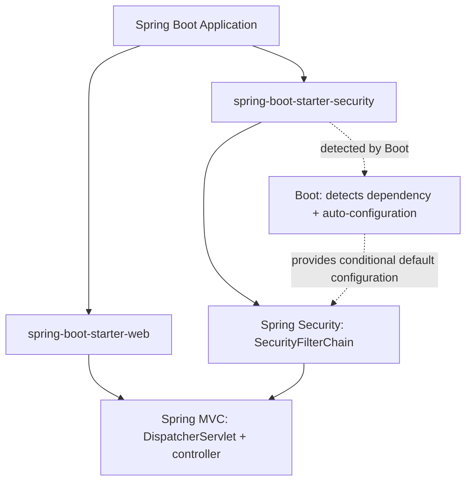
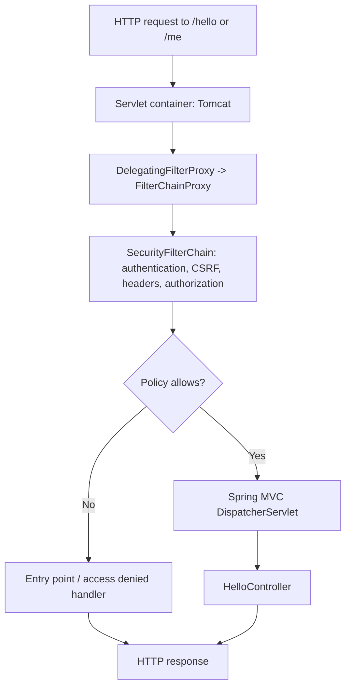

# Adding spring-boot-starter-security to Your First Web Application

## What Will You Accomplish After This Lesson?

A new Spring Boot application can serve several HTTP endpoints with just `spring-boot-starter-web`. Once you add `spring-boot-starter-security`, the application's behavior changes even before you **write a single security class**: Spring Boot detects Spring Security on the classpath, activates default security integration, and requires authentication for normal web requests.

This lab walks through the sequence step by step:

1. Create a simple Spring MVC application running on Java 17 and Spring Boot 3.x.
2. Run the application **before** adding the Security starter and observe the publicly accessible endpoint.
3. Add the `spring-boot-starter-security` dependency; observe HTTP 401, the default login page, the `user` account, and the startup-generated password.
4. Use curl to authenticate with HTTP Basic.
5. Declare a `SecurityFilterChain` bean to make `GET /hello` public and protect `GET /me`.
6. Replace the auto-generated account with an in-memory `UserDetailsService` and `PasswordEncoder` for repeatable testing.
7. Write MockMvc tests proving the public endpoint, the login-protected endpoint, and the wrong-password case.
8. Explain the defaults you must understand before real deployment: authentication, authorization, CSRF, sessions, security headers, and URL-based access rules.

**Scope:** Spring Boot **3.5.0** (3.x line), Spring Framework 6.x, Spring Security 6.x, **Java 17**, Maven, and the **Servlet/Spring MVC** stack. This is a concrete version set for learning; real projects should use a currently supported patch release. API names for Spring Boot 4.x/Spring Security 7.x or WebFlux may differ.

No database, OAuth2 provider, or production login system is needed to complete this lesson. Sample usernames and passwords are for localhost use only.

## 1. Three Responsibility Layers to Understand Before Adding the Dependency

| Component | What does it do in this lab? | Key takeaway |
| --- | --- | --- |
| **Spring Framework / Spring MVC** | Instantiates beans and maps `GET /hello` and `GET /me` to the controller. | `@RestController` or `@GetMapping` does not grant or restrict access on its own. |
| **Spring Security** | Uses Servlet filters to authenticate callers and evaluate authorization policies before requests reach the controller. | It is a library suite and set of security components; not a feature "built in" merely by having Spring MVC. |
| **Spring Boot** | Manages dependencies via starters/BOM; detects Security on the classpath; auto-configures baseline beans and defaults to get you started quickly. | Boot integrates and configures Security; actual authentication/authorization logic is executed by Security components. |

`spring-boot-starter-security` is a **starter dependency**, not an annotation. It pulls in the Spring Security modules needed for basic web security configuration and enables Spring Boot to detect auto-configuration eligibility. When you declare your own security beans, you still use Spring Security; only the corresponding pieces of Boot auto-configuration back off.

Simple diagram:



This diagram illustrates **operational responsibilities**, not every Maven dependency edge.

## 2. Preparing the Environment and Project

Requirements:

- **JDK 17 or higher**: `java -version` must show a compatible version.
- **Apache Maven**: `mvn -version` must run, or use the Maven Wrapper `./mvnw` if provided.
- Any editor/IDE; a terminal and curl for testing.
- Port `8080` free, or override via `server.port` if needed.

Verify:

```bash
java -version
mvn -version
```

Create a Spring Boot project with group `com.example`, artifact `first-security-app`, package `com.example.firstsecurity`, and Java 17. If using [Spring Initializr](https://start.spring.io/), you can select **Spring Web** first and add **Spring Security** in the next step to compare behaviors. This lesson uses Maven so you can see the exact dependency change clearly.

Final structure:

```text
first-security-app/
├── pom.xml
└── src/
    ├── main/
    │   └── java/com/example/firstsecurity/
    │       ├── FirstSecurityApplication.java
    │       ├── HelloController.java
    │       └── SecurityConfig.java
    └── test/
        └── java/com/example/firstsecurity/
            └── SecurityIntegrationTest.java
```

In the **initial step**, `SecurityConfig.java` and `SecurityIntegrationTest.java` do not exist yet. Those two files are added only after you observe the default behavior.

### 2.1. Initial `pom.xml`: Spring Web Only

```xml
<project xmlns="http://maven.apache.org/POM/4.0.0"
         xmlns:xsi="http://www.w3.org/2001/XMLSchema-instance"
         xsi:schemaLocation="http://maven.apache.org/POM/4.0.0 https://maven.apache.org/xsd/maven-4.0.0.xsd">
    <modelVersion>4.0.0</modelVersion>

    <parent>
        <groupId>org.springframework.boot</groupId>
        <artifactId>spring-boot-starter-parent</artifactId>
        <version>3.5.0</version>
        <relativePath/>
    </parent>

    <groupId>com.example</groupId>
    <artifactId>first-security-app</artifactId>
    <version>1.0.0</version>

    <properties>
        <java.version>17</java.version>
    </properties>

    <dependencies>
        <dependency>
            <groupId>org.springframework.boot</groupId>
            <artifactId>spring-boot-starter-web</artifactId>
        </dependency>
    </dependencies>

    <build>
        <plugins>
            <plugin>
                <groupId>org.springframework.boot</groupId>
                <artifactId>spring-boot-maven-plugin</artifactId>
            </plugin>
        </plugins>
    </build>
</project>
```

Let Maven resolve dependency versions from the parent/BOM. Do not manually specify Spring Framework or Spring Security versions different from what Boot manages.

### 2.2. `FirstSecurityApplication.java`

```java
package com.example.firstsecurity;

import org.springframework.boot.SpringApplication;
import org.springframework.boot.autoconfigure.SpringBootApplication;

@SpringBootApplication
public class FirstSecurityApplication {
    public static void main(String[] args) {
        SpringApplication.run(FirstSecurityApplication.class, args);
    }
}
```

`@SpringBootApplication` lets Spring Boot create the application context, perform component scanning, and apply auto-configuration. Place the remaining classes in the same package or a subpackage so they are discovered.

### 2.3. `HelloController.java`

```java
package com.example.firstsecurity;

import java.util.Map;

import org.springframework.security.core.Authentication;
import org.springframework.web.bind.annotation.GetMapping;
import org.springframework.web.bind.annotation.RestController;

@RestController
public class HelloController {

    @GetMapping("/hello")
    public Map<String, String> hello() {
        return Map.of("message", "Hello, Spring!");
    }

    @GetMapping("/me")
    public Map<String, String> me(Authentication authentication) {
        return Map.of("username", authentication.getName());
    }
}
```

**Note for running the initial step cleanly:** the `HelloController.java` above **already imports Spring Security's `Authentication`**, so it will not compile while `pom.xml` only has Spring Web. To perform an **accurate** before/after comparison, start with the controller version below; only replace it with the `/me` controller above after adding the Security starter:

```java
package com.example.firstsecurity;

import java.util.Map;

import org.springframework.web.bind.annotation.GetMapping;
import org.springframework.web.bind.annotation.RestController;

@RestController
public class HelloController {

    @GetMapping("/hello")
    public Map<String, String> hello() {
        return Map.of("message", "Hello, Spring!");
    }
}
```

This gives you a standalone, runnable Spring MVC app during the **pre-Security stage**. `/me` is added once Security is present and able to supply `Authentication`.

### 2.4. Running the Application Without Security

From the directory containing `pom.xml`:

```bash
mvn spring-boot:run
```

Open another terminal:

```bash
curl -i http://localhost:8080/hello
```

Expected:

```http
HTTP/1.1 200
Content-Type: application/json

{"message":"Hello, Spring!"}
```

This is an **illustrative snippet** of the response; the actual server may include additional headers or format the status line slightly differently. The key observation is that `GET /hello` returns `200 OK` **without any credentials**.

Path names like `/hello`, `/admin`, or `/private` do not lock down an endpoint by themselves. To enforce authentication and authorization via Spring Security, you must add the dependency and appropriate configuration.

## 3. Adding `spring-boot-starter-security`

Stop the application with `Ctrl+C`. Inside `<dependencies>` in `pom.xml`, add the dependency:

```xml
<dependency>
    <groupId>org.springframework.boot</groupId>
    <artifactId>spring-boot-starter-security</artifactId>
</dependency>
```

**No `<version>` is needed** when the project uses the Spring Boot parent/BOM as shown. This is how Boot manages a set of Spring Security versions compatible with the framework and web starter.

At this point the dependencies section is at minimum:

```xml
<dependencies>
    <dependency>
        <groupId>org.springframework.boot</groupId>
        <artifactId>spring-boot-starter-web</artifactId>
    </dependency>
    <dependency>
        <groupId>org.springframework.boot</groupId>
        <artifactId>spring-boot-starter-security</artifactId>
    </dependency>
</dependencies>
```

Keep the controller with only `/hello` and **do not create `SecurityConfig` yet**. Run again:

```bash
mvn spring-boot:run
```

Now the exact same URL `http://localhost:8080/hello` is protected by Spring Security by default.

### 3.1. What Did Maven Actually Pull In?

You can inspect the dependency tree:

```bash
mvn dependency:tree
```

In the relevant section, Maven shows the Security starter along with the Spring Security modules needed for web and configuration. Take exact artifact names and versions from your project's output rather than guessing and pinning `spring-security-core`, `spring-security-web`, or `spring-security-config` individually.

Role-wise, the starter does three notable things: (1) puts the Security libraries on the classpath; (2) lets Boot activate auto-configuration when conditions match; (3) enables you to declare configuration beans like `SecurityFilterChain`, `UserDetailsService`, and `PasswordEncoder` later.

### 3.2. Which Defaults Appear?

For a **typical Servlet web application**, when no custom security beans are declared yet:

- Boot configures Spring Security to protect web requests; most endpoints, including `/hello`, require login.
- Boot can create an in-memory `UserDetailsService` containing a default user named **`user`** with a random password.
- The demo password is logged at startup, usually on a line starting with `Using generated security password:`.
- Depending on the request/`Accept` header, clients may receive an HTTP Basic challenge or a form-based login flow. A browser opening a page may be redirected to a Spring Security-generated `/login` page.
- CSRF protection, several security response headers, and related filter mechanisms are configured with Spring Security Servlet defaults.

Thus, **simply adding the starter changes HTTP behavior**, even without changing a single line in the controller.

**Note:** if you have already configured a `SecurityFilterChain` or added a specific identity mechanism beforehand, behavior will differ. This list applies to the initial lab setup and should not be taken as a guarantee for every Boot application.

## 4. Trying the Boot-Generated Default Login

### 4.1. Reading the Auto-Generated Password

After starting the app with the Security starter, look in the logs for:

```text
Using generated security password: <random-password>
```

This is an example format; replace the bracketed part with the actual value printed in **that specific startup's log**. The default account is:

```text
Username: user
Password: random value from startup log
```

Do not copy an example password from documentation or from a previous run. This password is for testing, not a real operational account.

If no password line appears, check whether the application already supplies a `UserDetailsService`, `AuthenticationProvider`, `AuthenticationManager`, or a setting that suppresses Boot's default user; logging configuration might also hide the message. Do not assume the password is `user` or `password`.

### 4.2. Accessing with curl

With standard curl:

```bash
curl -i -H "Accept: application/json" http://localhost:8080/hello
```

Expected: **401 Unauthorized**, as the request is unauthenticated. With some `Accept` headers, entry points, or browsers, you may receive a **302** redirect to the login page instead of 401; that reflects a difference in login mechanism/content negotiation, not a controller bug.

Try the default credentials (replace `YOUR_GENERATED_PASSWORD` with the real value):

```bash
curl -i -u "user:YOUR_GENERATED_PASSWORD" http://localhost:8080/hello
```

Expected: **200 OK** with the previous JSON payload.

`curl -u` uses HTTP Basic: curl builds an `Authorization: Basic ...` header from username/password. Base64 encoding in HTTP Basic is **not security encryption**; outside localhost it must run over HTTPS to protect credentials in transit.

On Windows PowerShell, use `curl.exe` if `curl` is aliased to `Invoke-WebRequest`:

```powershell
curl.exe -i http://localhost:8080/hello
```

### 4.3. Trying in a Browser

Open `http://localhost:8080/hello`:

- On an unauthenticated HTML navigation request, you are typically routed to the default login form.
- Enter `user` and the password printed in the log.
- After signing in, Spring Security establishes the authenticated session and can redirect back to the requested page.

The browser/form flow differs from curl's HTTP Basic. Do not conclude from "curl gets 401 while browser gets 302" that the app enforces two different authorization policies; the difference usually comes from entry points and content negotiation.

## 5. Which Components Does a Request Pass Through?



With Spring MVC, the controller is invoked **after** checks in the servlet security filter chain. Key concepts:

| Name | Responsibility |
| --- | --- |
| `DelegatingFilterProxy` | Bridge between the Servlet container and a Spring-managed filter bean. |
| `FilterChainProxy` | Collects/selects the `SecurityFilterChain` matching the request. |
| `SecurityFilterChain` | Filter chain and security configuration for matching requests; an app may declare multiple chains. |
| Authentication filter/provider | Extracts credentials, authenticates, and creates/restores `Authentication`. |
| `SecurityContext` / `SecurityContextHolder` | Holds active authentication information for the current execution context. |
| `AuthorizationFilter` / authorization manager | Checks whether the caller is permitted to perform the request according to rules. |
| `ExceptionTranslationFilter` and handlers/entry points | Translates security exceptions into appropriate HTTP responses such as 401, 403, or a login redirect. |
| `DispatcherServlet` | Locates the Spring MVC handler/controller and executes it once the request is allowed through. |

Authentication/login does not equal authorization: a user can log in successfully and still be forbidden from calling an endpoint requiring role `ADMIN`. Initially, the default "logged in" suffices for all URLs; next we replace it with a policy separating public and private endpoints.

**Do not write manual filters** merely to "turn on security"; the starter with Boot/Security already handles filter chain integration. Add custom filters only when you have genuine custom authentication/observability needs and understand filter ordering.

## 6. Explicitly Configuring Public vs. Private Endpoints

In this step, we replace the randomly generated user with a fixed demo account (password encoded with BCrypt), and require login only for `/me`. We select HTTP Basic so curl results are predictable.

### 6.1. Replace `HelloController.java` with the Full Version

```java
package com.example.firstsecurity;

import java.util.Map;

import org.springframework.security.core.Authentication;
import org.springframework.web.bind.annotation.GetMapping;
import org.springframework.web.bind.annotation.RestController;

@RestController
public class HelloController {

    @GetMapping("/hello")
    public Map<String, String> hello() {
        return Map.of("message", "Hello, Spring!");
    }

    @GetMapping("/me")
    public Map<String, String> me(Authentication authentication) {
        return Map.of("username", authentication.getName());
    }
}
```

`Authentication` is supplied by Spring Security for authenticated requests. In this example, `GET /me` must pass through the auth filter and the `authenticated()` rule before the controller reads `authentication.getName()`.

Never take a username from a query parameter like `?user=learner` and treat it as an authenticated identity. Clients can forge request parameters; controllers should obtain the principal only from trusted security mechanisms.

### 6.2. Create `SecurityConfig.java`

```java
package com.example.firstsecurity;

import org.springframework.context.annotation.Bean;
import org.springframework.context.annotation.Configuration;
import org.springframework.security.config.Customizer;
import org.springframework.security.config.annotation.web.builders.HttpSecurity;
import org.springframework.security.config.annotation.web.configurers.AbstractHttpConfigurer;
import org.springframework.security.core.userdetails.User;
import org.springframework.security.core.userdetails.UserDetailsService;
import org.springframework.security.crypto.bcrypt.BCryptPasswordEncoder;
import org.springframework.security.crypto.password.PasswordEncoder;
import org.springframework.security.provisioning.InMemoryUserDetailsManager;
import org.springframework.security.web.SecurityFilterChain;

@Configuration(proxyBeanMethods = false)
public class SecurityConfig {

    @Bean
    SecurityFilterChain securityFilterChain(HttpSecurity http) throws Exception {
        return http
            .authorizeHttpRequests(auth -> auth
                .requestMatchers("/hello").permitAll()
                .requestMatchers("/me").authenticated()
                .anyRequest().denyAll()
            )
            .httpBasic(Customizer.withDefaults())
            .formLogin(AbstractHttpConfigurer::disable)
            .build();
    }

    @Bean
    PasswordEncoder passwordEncoder() {
        return new BCryptPasswordEncoder();
    }

    @Bean
    UserDetailsService users(PasswordEncoder encoder) {
        return new InMemoryUserDetailsManager(
            User.withUsername("learner")
                .password(encoder.encode("demo-password"))
                .roles("USER")
                .build()
        );
    }
}
```

Explanation of key lines:

1. `@Configuration` and `@Bean` belong to Spring Framework; Spring manages the security configuration objects.
2. The `SecurityFilterChain` bean you declare **replaces Boot's default web chain configuration**. It does not remove Spring Security; it hands control of request rules to your application.
3. `.requestMatchers("/hello").permitAll()` lets anyone access `/hello`. Requests still pass through security filters; `permitAll` differs from bypassing Security altogether.
4. `.requestMatchers("/me").authenticated()` requires an authenticated user.
5. `.anyRequest().denyAll()` sets an explicit policy for undefined URLs: deny rather than accidentally exposing them.
6. `.httpBasic(Customizer.withDefaults())` enables HTTP Basic authentication.
7. `.formLogin(AbstractHttpConfigurer::disable)` **only disables form login** so the Basic lab behaves clearly; it does not disable Spring Security or CSRF.
8. The `UserDetailsService` bean provides the demo account `learner`. Because the app declares its own user source, Boot will **no longer generate** the default `user` account and random password from the earlier step.
9. `PasswordEncoder` uses BCrypt; `User.withUsername(...).password(...)` expects the encoded string. Each startup BCrypt may emit a different hash due to salting, while the raw password `demo-password` still verifies cleanly.

**Use this hardcoded password only for a local lab.** Real systems require a proper user store or identity provider, secret management, HTTPS, and appropriate account policies.

### 6.3. Restart and Verify the Policy

Stop the application and start it again:

```bash
mvn spring-boot:run
```

In another terminal:

```bash
curl -i http://localhost:8080/hello
curl -i http://localhost:8080/me
curl -i -u learner:demo-password http://localhost:8080/me
curl -i -u learner:wrong-password http://localhost:8080/me
```

Expected with **this exact code**:

| Request | HTTP status | Body / Meaning |
| --- | --- | --- |
| No credentials, `GET /hello` | **200 OK** | JSON `{"message":"Hello, Spring!"}`. |
| No credentials, `GET /me` | **401 Unauthorized** | Basic challenge; username is not returned. |
| `learner:demo-password`, `GET /me` | **200 OK** | JSON `{"username":"learner"}`. |
| `learner:wrong-password`, `GET /me` | **401 Unauthorized** | Wrong password; access denied. |

Additional headers such as `WWW-Authenticate`, `Cache-Control`, `X-Content-Type-Options`, or server info may appear depending on configuration. The table highlights the details to check; responses do not need to match a sample log byte-for-byte.

Because **form login was disabled** in the custom configuration, a browser may now display an HTTP Basic prompt instead of an HTML login page. That difference comes from your chosen authentication mechanism, not from adding or removing `@RestController`.

## 7. Automated Testing with MockMvc

Security testing should not cover only "valid user gets access." You should also test **anonymous**, **wrong credentials**, and public routes after Security is enabled.

### 7.1. Add Test Dependencies to `pom.xml`

Here is the **final complete** `<dependencies>` block for the project; you can replace the existing dependencies block directly with:

```xml
<dependencies>
    <dependency>
        <groupId>org.springframework.boot</groupId>
        <artifactId>spring-boot-starter-web</artifactId>
    </dependency>
    <dependency>
        <groupId>org.springframework.boot</groupId>
        <artifactId>spring-boot-starter-security</artifactId>
    </dependency>
    <dependency>
        <groupId>org.springframework.boot</groupId>
        <artifactId>spring-boot-starter-test</artifactId>
        <scope>test</scope>
    </dependency>
    <dependency>
        <groupId>org.springframework.security</groupId>
        <artifactId>spring-security-test</artifactId>
        <scope>test</scope>
    </dependency>
</dependencies>
```

Keep `parent`, `properties`, and `build` from the initial `pom.xml` unchanged.

- `spring-boot-starter-test` brings JUnit, Spring test support, and testing utilities.
- `spring-security-test` adds helpers for authenticated requests or mock principals like `httpBasic(...)` and `@WithMockUser`.
- `MockMvc` lets you test Spring MVC together with the Spring Security filter chain inside the test application context without starting a real network server.

### 7.2. `SecurityIntegrationTest.java`

```java
package com.example.firstsecurity;

import org.junit.jupiter.api.Test;
import org.springframework.beans.factory.annotation.Autowired;
import org.springframework.boot.test.autoconfigure.web.servlet.AutoConfigureMockMvc;
import org.springframework.boot.test.context.SpringBootTest;
import org.springframework.test.web.servlet.MockMvc;

import static org.springframework.security.test.web.servlet.request.SecurityMockMvcRequestPostProcessors.httpBasic;
import static org.springframework.test.web.servlet.request.MockMvcRequestBuilders.get;
import static org.springframework.test.web.servlet.result.MockMvcResultMatchers.jsonPath;
import static org.springframework.test.web.servlet.result.MockMvcResultMatchers.status;

@SpringBootTest
@AutoConfigureMockMvc
class SecurityIntegrationTest {

    @Autowired
    MockMvc mvc;

    @Test
    void helloIsPublic() throws Exception {
        mvc.perform(get("/hello"))
            .andExpect(status().isOk())
            .andExpect(jsonPath("$.message").value("Hello, Spring!"));
    }

    @Test
    void meRejectsAnonymousRequest() throws Exception {
        mvc.perform(get("/me"))
            .andExpect(status().isUnauthorized());
    }

    @Test
    void meAcceptsValidBasicCredentials() throws Exception {
        mvc.perform(get("/me")
                .with(httpBasic("learner", "demo-password")))
            .andExpect(status().isOk())
            .andExpect(jsonPath("$.username").value("learner"));
    }

    @Test
    void meRejectsInvalidPassword() throws Exception {
        mvc.perform(get("/me")
                .with(httpBasic("learner", "wrong-password")))
            .andExpect(status().isUnauthorized());
    }
}
```

From the project directory:

```bash
mvn test
```

**Expected:** Maven reports a successful build/test run, and all four test cases pass against the code and dependencies shown in this lesson. Exact output depends on Maven and plugin versions; what matters is **zero failures or errors**. This is the expected behavior when you run the project; if a test fails, inspect the actual response and look for policy, dependency, or version mismatches.

The tests verify:

- Public endpoints still work after adding the starter.
- Protected endpoints reject anonymous access.
- Valid credentials establish the `learner` identity.
- Wrong passwords cannot access protected endpoints.

As the application grows, also test roles/authorities, owner/tenant checks, CSRF on write requests, undeclared paths, and error/redirect handling. Never test only HTTP 200.

## 8. Security Defaults to Understand Early On

### 8.1. Authentication vs. Authorization

- **Authentication:** "Who is sending the request?" After login, `Authentication` holds the principal and authorities.
- **Authorization:** "Is this caller allowed to invoke this endpoint/operation?" `permitAll()`, `authenticated()`, `hasRole(...)`, and `hasAuthority(...)` are common conditions.

`authenticated()` means a valid identity exists under the Security mechanism; **it does not mean** permission to read every resource. A logged-in `learner` user must not read another user's order simply by changing an ID in the URL. Resource ownership/tenant checks must be added in services/queries when real data is involved.

### 8.2. `requestMatchers` Rules Are Ordered

The `authorizeHttpRequests` DSL evaluates rules in matching order; placing an overly broad rule first can prevent later rules from applying as intended.

Example to **avoid**:

```java
.authorizeHttpRequests(auth -> auth
    .requestMatchers("/**").permitAll()
    .requestMatchers("/admin/**").hasRole("ADMIN")
)
```

The `/**` rule can match first, rendering the `/admin/**` policy below ineffective. Put specific rules first and add a fallback:

```java
.authorizeHttpRequests(auth -> auth
    .requestMatchers("/hello").permitAll()
    .requestMatchers("/admin/**").hasRole("ADMIN")
    .anyRequest().authenticated()
)
```

Both snippets are **`HttpSecurity` configuration fragments**, not standalone Java programs. In a multi-route production app, choosing `authenticated()` or `denyAll()` as the fallback must be intentional; "deny all undeclared routes" is usually clearer for sensitive APIs.

### 8.3. CSRF: Why Can POST Return 403?

Spring Security Servlet normally **enables CSRF protection by default** for state-changing requests that need protection, such as POST/PUT/PATCH/DELETE. This is crucial for applications whose session cookies are automatically sent by browsers.

This lab only uses `GET`, so no CSRF token was needed yet. If you add:

```java
@PostMapping("/orders")
public String createOrder() {
    return "created";
}
```

this is only an **illustrative snippet** meant for a controller with `PostMapping` imported; calling POST without the required CSRF token can return **403 Forbidden** even when authenticated. Do not rush to "fix it" with a global `csrf.disable()`. Examine how clients authenticate (session cookie, HTTP Basic, bearer token...), whether browsers send credentials automatically, and configure CSRF handling to match your architecture.

**HTTP Basic does not automatically make every app immune to CSRF** if browsers can auto-submit cached credentials. Decisions to enable, disable, or exempt CSRF must be based on your threat model and actual client behavior.

### 8.4. Security Headers

Spring Security supports multiple response headers that mitigate browser risks, including cache headers preventing sensitive responses from being cached in typical Servlet configurations, anti-MIME-sniffing headers, and other version-dependent protections. Do not assume every HTTP response already carries the CSP your app wants: a **Content Security Policy** usually needs custom design and configuration.

When the application sets headers explicitly, Security defaults may yield according to configuration rules. Inspect final responses via curl/DevTools, especially on endpoints serving personal data or public static assets.

### 8.5. Sessions, Form Login, and HTTP Basic

The custom lab uses Basic for simplicity, yet real applications have several options:

| Mechanism | When to use? | What to control |
| --- | --- | --- |
| HTTP Basic | Experiments, tooling, or suitable internal APIs | Requires HTTPS, no hardcoded credentials in source, client control. |
| Form login + session | Server-rendered/browser web apps | Cookie attributes, session fixation/expiration, logout, CSRF. |
| OAuth2/OIDC login | Login via an identity provider | Redirects, state/nonce, callbacks, issuer/client config, and sessions. |
| Bearer access token | APIs with an authorization server/resource server | Signature/issuer/audience/expiry/scope, preventing token leakage, and TLS protection. |

Adding the Security starter **does not mean** the application is already architected properly for OAuth2, stateless APIs, JWTs, social login, or production sessions. Those are subsequent configuration topics.

### 8.6. When Do You Need `@EnableMethodSecurity`?

The Security starter provides HTTP-layer checks via `SecurityFilterChain`. To use method-level authorization annotations such as `@PreAuthorize` in a standard design, enable method security:

```java
@Configuration
@EnableMethodSecurity
public class MethodSecurityConfig {
}
```

This is a short example requiring Spring/Spring Security annotation imports when placed in a project. Method security typically uses Spring AOP proxies; self-invocation `this.securedMethod()` inside the same bean can bypass the proxy. For your first application you do not need this annotation yet; add it once you understand service-layer protection needs.

## 9. Why Does Creating a SecurityFilterChain Change the Default Configuration?

When you only add the starter, Boot provides a **default chain** requiring login for all requests. Once your application supplies a `SecurityFilterChain` bean:

1. Spring Framework registers the bean you created.
2. Spring Boot sees that the application has provided a filter chain, and the corresponding default web security auto-configuration **backs off**.
3. Spring Security runs the chain you configured; `FilterChainProxy` uses it to protect matching requests.
4. **The default `UserDetailsService` is not necessarily disabled just because you defined a `SecurityFilterChain`.** In this lesson, it stepped aside **because we also declared a custom `UserDetailsService`**.

Distinguish these two auto-configuration conditions:

| What do you declare yourself? | Typical outcome in Spring Boot 3.5 Servlet |
| --- | --- |
| No custom Security beans, starter present | Boot conditionally provides the default web filter chain and development account. |
| `SecurityFilterChain` bean | Boot's default web chain backs off; the app defines URL rules. |
| `UserDetailsService` / `AuthenticationProvider` / `AuthenticationManager` bean | Boot's default in-memory user configuration conditionally backs off. |
| Both `SecurityFilterChain` and `UserDetailsService` (this lab) | The app controls both URL policy and the learning user source. |

This explains why defining one bean can alter behavior without adding any manual filter. In real apps, inspect auto-configuration reports/bean definitions and write startup tests to avoid false assumptions.

## 10. How to Add the Starter in Gradle

If your project already has Spring Boot Gradle configuration and proper dependency management, add to `build.gradle` (Groovy DSL):

```groovy
dependencies {
    implementation 'org.springframework.boot:spring-boot-starter-web'
    implementation 'org.springframework.boot:spring-boot-starter-security'

    testImplementation 'org.springframework.boot:spring-boot-starter-test'
    testImplementation 'org.springframework.security:spring-security-test'
}
```

This is a **dependencies snippet**, not a complete standalone Gradle file; plugins, repositories, and Java toolchain depend on your project. Normally the Boot plugin/BOM manages versions, so avoid pinning a separate version on the Security starter without a clear reason.

Equivalent Kotlin DSL `build.gradle.kts`:

```kotlin
dependencies {
    implementation("org.springframework.boot:spring-boot-starter-web")
    implementation("org.springframework.boot:spring-boot-starter-security")

    testImplementation("org.springframework.boot:spring-boot-starter-test")
    testImplementation("org.springframework.security:spring-security-test")
}
```

The observation sequence matches Maven: before the starter, endpoints are public; after the starter, default web security requires login; after the custom chain, each URL follows explicit rules.

## 11. Common Mistakes When Adding the Security Starter

### Mistake 1 — "As soon as I added the starter, my API broke with 401s everywhere"

Usually this is **intentional default behavior**: requests must be authenticated once Spring Security is present. Check the log for the generated user/password, test valid Basic credentials, and define a `SecurityFilterChain` for endpoints that should be public.

### Mistake 2 — "Browser redirects to /login while curl returns 401—is that broken?"

Not necessarily. Security can pick entry points based on `Accept` and client type. Browsers sending HTML requests normally go to form login; curl/API clients may receive a Basic challenge. Once you customize to Basic-only and disable form login as in the lab, do not expect the default `/login` page to remain active.

### Mistake 3 — "I wrote a SecurityFilterChain and still expected default rules"

Once you provide your own chain, **you own the request policy**. If you only configure `permitAll` for one URL group and forget a fallback, behavior for other URLs may differ from before. Always review all routes and test undeclared paths.

### Mistake 4 — "Do I have to add @EnableWebSecurity to turn on Spring Security in Boot?"

In Spring Boot Servlet apps with the starter and proper auto-configuration, you usually **do not need** `@EnableWebSecurity` just to get the default chain. Creating the config bean as shown works for the lab. Use configuration annotations only when you understand the integration and scope of control desired.

### Mistake 5 — "Using User.withDefaultPasswordEncoder() for production"

Tutorial examples may use that builder for demos, but it must not be treated as a production password solution. In this lesson, `PasswordEncoder` uses BCrypt and `InMemoryUserDetailsManager` holds test users in RAM only. Real systems need a proper store, password policy, and secure operations.

### Mistake 6 — "Putting username/password in application.properties and committing it"

Setting `spring.security.user.name` and `spring.security.user.password` can speed up a lab, yet **real secrets must never be stored in the repository**. In production, use external configuration, a secret manager, and dedicated identity management.

### Mistake 7 — "POST returns 403 so I must disable Security"

CSRF might be blocking the request, a role might be missing, or an authorization rule might not match. Check HTTP method, credentials, token, filter chain, logs, and exceptions before changing anything. Never disable CSRF/authorization globally just to turn tests green.

### Mistake 8 — "CORS is causing my API to return 401/403"

CORS and authentication/authorization are separate concerns. A frontend at `http://localhost:5173` calling a backend at `http://localhost:8080` is **cross-origin because the ports differ** and may need CORS configuration. Yet even when CORS allows it, `/me` still requires authentication. Never use `permitAll` to mask a CORS preflight failure without diagnosing the root cause.

### Mistake 9 — "Setting `anyRequest().permitAll()` to fix 401"

That lets requests pass the URL authorization layer. For an API handling user data, that is a major policy change; permit only truly public URLs and protect the rest. In the lab, `/hello` is public and `/me` is authenticated.

### Mistake 10 — "Package names do not affect finding config"

If `SecurityConfig` sits outside the package scanned by Spring Boot, `SecurityFilterChain`/`UserDetailsService` beans may not be discovered, making it look like your config code does nothing. Place classes under the root package `com.example.firstsecurity` or configure scanning explicitly.

### Mistake 11 — "I wanted 404 but got 403 on a URL with no handler"

Because `.anyRequest().denyAll()` applies before MVC routing, unpermitted requests can be blocked before Spring MVC determines 404. Certain `ERROR` dispatches also pass through authorization. If your app needs a specific error policy, design routing/error dispatch intentionally and test statuses as needed; never relax all permissions just to force 404.

### Mistake 12 — "Security automatically protects every service call and DB record"

The security filter chain protects matching requests; sensitive business operations may still require method security and owner/tenant checks in services/queries. Even an authenticated endpoint must authorize data access per principal.

## 12. Roadmap from Lab to Real Application

The starter gives you a starting point, while production requires completing these areas:

1. **Choose the right login mechanism:** session form login, OIDC identity provider, JWT resource server, or another mechanism fitting your architecture. Never use in-memory test accounts as a production user store.
2. **Protect credentials:** always use HTTPS/TLS when transmitting usernames/passwords/tokens; never leave secrets in code, logs, or query strings.
3. **Design permissions:** roles/authorities for functional capabilities, owner/tenant for resources, deny-by-default, and check alternative entry paths into services.
4. **Define session lifecycle:** session timeouts, logout, invalidation, appropriate Secure/HttpOnly/SameSite cookie flags, and CSRF defense whenever browsers auto-send cookies.
5. **Evaluate CORS and headers:** allow only truly required origins; configure response headers, caching of personal data, and CSP when required.
6. **Defend against brute force and abuse:** rate limiting, appropriate lockout/throttling, MFA based on sensitivity, and security auditing.
7. **Write negative tests:** missing credentials, wrong password, missing role, missing ownership, CSRF-suspect requests, undeclared paths, and proxy/forwarded headers.
8. **Manage dependencies:** upgrade to supported Boot/Security patches, run dependency scans, test after each upgrade, and avoid cherry-picking random Spring module versions.
9. **Operational observability:** log 401/403 events, auth failures, and permission changes without logging passwords, bearer tokens, session IDs, or sensitive data.
10. **Apply multi-layer least privilege:** web URL rules, service methods, database roles, network access, and secret access must all be scoped to what is necessary.

Adding a dependency is only the first step of security design; your policies and the tests verifying them determine whether the application behaves securely.

## 13. Self-Check Questions

**Question 1.** With only `spring-boot-starter-web` and a `@RestController`, does `GET /hello` require login automatically?

**Answer:** No. Spring MVC maps requests, but does not enable Spring Security authentication/authorization without security integration.

**Question 2.** After adding `spring-boot-starter-security` with no config written yet, why does `/hello` become a protected endpoint?

**Answer:** Boot detects Security on the classpath and conditionally provides default web security configuration; the Spring Security filter chain requires requests to be authenticated.

**Question 3.** What is the default account and where is its password?

**Answer:** In the standard demo setup, the username is `user`; the password is randomly generated and printed in the startup log. Never use sample credentials from documentation or an earlier run.

**Question 4.** If curl receives 401 while a browser redirects to a login page, are the two requests necessarily using different authorization policies?

**Answer:** No. Both may enforce the same "must be logged in" policy while the entry point responds differently based on client/`Accept`.

**Question 5.** Does `permitAll()` bypass all security filters completely?

**Answer:** No. Requests still pass through the Spring Security filter chain; the authorization rule permits access. This differs from `web.ignoring()`.

**Question 6.** When you declare a custom `SecurityFilterChain`, is Boot's default user guaranteed to disappear?

**Answer:** Not necessarily. A `SecurityFilterChain` bean makes Boot's default web chain back off, whereas the default user source has its own auto-configuration condition. In this lab, the custom `UserDetailsService` is what causes the auto-generated user to back off.

**Question 7.** Why does the lab use `PasswordEncoder`?

**Answer:** Security must verify credentials according to a password-encoding policy. BCrypt provides salted password hashing instead of storing or comparing plaintext in the test user configuration. In-memory accounts remain demo-only.

**Question 8.** Why can adding the Security starter lead to HTTP 403 on POST requests?

**Answer:** A common cause is default CSRF protection rejecting requests without a valid token; it can also be authorization. Check the authentication mechanism and filter chain before making changes.

**Question 9.** Is getting the username in `/me` from `Authentication` safer than reading a `?user=...` query parameter?

**Answer:** Yes, for request identity. `Authentication` is established by Security; clients can trivially tamper with query parameters, so queries must never be trusted as an authentication source. Still, for other business resources, you must check data-level permissions.

**Question 10.** Why must tests cover both valid login and wrong passwords?

**Answer:** Testing only `200` proves the happy path works. Negative `401` tests for anonymous callers and wrong passwords prove the endpoint is actually protected as expected.

## Conclusion

Adding `spring-boot-starter-security` is a small change that transforms the HTTP layer: a Spring Boot 3.x application begins requiring login before calling endpoints, generates a `user` development account, and chooses form login or HTTP Basic depending on the client. To design real behavior, declare a `SecurityFilterChain` specifying which URLs are public and which require identity/authorities, and declare a `UserDetailsService` or appropriate authentication mechanism to manage users.

The completed lab has `GET /hello` returning 200 without login, `GET /me` returning 401 for anonymous or wrong-password requests and 200 for `learner:demo-password`, plus four MockMvc tests verifying the policy. This is the foundation for moving on to real user management, roles/authorities, method security, OAuth2/OIDC, API tokens, and owner/tenant data protection.

## Official Documentation

- [Spring Boot 3.5 — Spring Security auto-configuration](https://docs.spring.io/spring-boot/3.5/reference/web/spring-security.html): defaults when Security is on the classpath; generated user; replacement conditions for `SecurityFilterChain` and `UserDetailsService`.
- [Spring Security — Hello Spring Security](https://docs.spring.io/spring-security/reference/servlet/getting-started.html): default request protection, login, and initial run experience.
- [Spring Security — Java Configuration](https://docs.spring.io/spring-security/reference/servlet/configuration/java.html): configuring `HttpSecurity`, `SecurityFilterChain`, form login, and HTTP Basic.
- [Spring Security — Authorize HttpServletRequests](https://docs.spring.io/spring-security/reference/servlet/authorization/authorize-http-requests.html): `permitAll`, `authenticated`, `requestMatchers`, and URL-based authorization policies.
- [Spring Security — Testing](https://docs.spring.io/spring-security/reference/servlet/test/index.html): `MockMvc`, `spring-security-test`, and policy tests.
