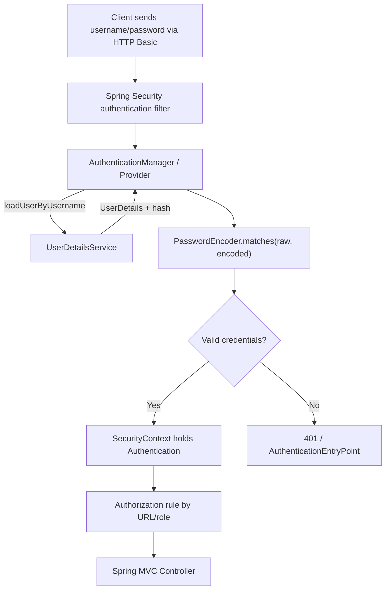

# Declaring Sample Accounts and PasswordEncoder for a Learning Environment

## Goal and Scope

When learning Spring Security for the first time, you need a repeatable way to log in with two or three accounts, observe 401/403 responses, and understand why passwords are never stored in plaintext. In a Spring Boot application using username/password, the trio of `UserDetails`, `UserDetailsService`, and `PasswordEncoder` is a convenient starting point. `InMemoryUserDetailsManager` lets you declare users directly in memory for study, while `PasswordEncoder` handles transforming raw passwords into stored form and verifying passwords at login.

This lesson walks through configuring **Java 17 + Spring Boot 3.5.x + Spring Security 6.5.x + Spring MVC/Servlet + Maven**. The APIs in the examples belong to the Spring Boot 3.x line; if you use Boot 4/Security 7 or WebFlux, consult the documentation for your exact version. The content is **intended solely for a local/learning environment**: fixed usernames and passwords in source code are test data, not how real applications manage accounts and secrets.

After this lesson, you will be able to:

1. Distinguish **authentication** from **authorization**.
2. Distinguish **raw passwords**, **encoded (hashed) passwords**, and the `matches()` operation.
3. Declare two accounts using `UserDetails` / `InMemoryUserDetailsManager`.
4. Register a `PasswordEncoder` bean with `PasswordEncoderFactories.createDelegatingPasswordEncoder()` and understand the `{bcrypt}...` format.
5. Configure a `SecurityFilterChain` for public endpoints, authenticated endpoints, and endpoints requiring role ADMIN.
6. Use curl and MockMvc to verify success, wrong password, anonymous users, and insufficient privileges.
7. Explain why `{noop}`, `NoOpPasswordEncoder`, and committing passwords to Git are unsuitable for production.

## 1. How Do the Components Work Together?

In Spring Security, three pieces often appear side by side yet perform different jobs:

| Component | Responsibility | Example |
| --- | --- | --- |
| `UserDetails` | Represents a user for authentication, including username, **encoded/hashed** password, authorities, and account status flags. | `User.withUsername("learner")...build()` |
| `UserDetailsService` | Loads `UserDetails` by username. It **does not directly compare passwords**. | `loadUserByUsername("learner")` |
| `InMemoryUserDetailsManager` | An implementation of `UserDetailsService` and `UserDetailsManager` holding users in process memory. | `new InMemoryUserDetailsManager(learner, admin)` |
| `PasswordEncoder` | Provides `encode(raw)` and `matches(raw, encoded)`; can signal hash upgrade needs via `upgradeEncoding(...)`. | `DelegatingPasswordEncoder` / `BCryptPasswordEncoder` |
| `AuthenticationProvider` | Uses the appropriate components to verify credentials. | `DaoAuthenticationProvider` loads the user and calls the encoder to check the password. |
| `AuthenticationManager` | Coordinates authentication across one or more providers. | `ProviderManager` in the common model. |
| `SecurityFilterChain` | Applies HTTP security filters and URL policies. | `/me` requires login; `/admin/hello` requires `ROLE_ADMIN`. |

Conceptual flow when using HTTP Basic:



The diagram shows responsibilities and **is not the internal class sequence of every authentication mechanism**. An application may use form login, sessions, JWT, OAuth2, or another mechanism instead of HTTP Basic. `PasswordEncoder` is specifically tied to password-based authentication; not every token type uses this encoder.

### 1.1. Authentication Is Not Authorization

- **Authentication:** Did `learner` supply the right password for `learner`?
- **Authorization:** Is the logged-in `learner` allowed to access `/admin/hello`?

A successfully logged-in account can still receive `403 Forbidden` when lacking privileges. Meanwhile, missing or invalid credentials typically return `401 Unauthorized` under HTTP Basic. If an app uses form login, unauthenticated clients may be redirected to the login page instead of receiving 401.

## 2. What Does PasswordEncoder Do and Not Do?

### 2.1. Password Hashing Differs from Reversible Encryption

For password storage, systems normally do not need to recover the original password. They only need to verify whether what the user just typed matches the stored value. Accordingly, Spring Security uses `PasswordEncoder` as the contract for **cost-based password hashing** algorithms instead of storing plaintext or using two-way decryptable encryption.

```text
When creating an account (demo):
  rawPassword = "learner-pass"
      |
      v
  encoder.encode(rawPassword)
      |
      v
  encodedPassword = "{bcrypt}$2a$10$..."   (illustrative value)
      |
      v
  UserDetails.password(encodedPassword)

When logging in:
  rawPassword from client
      |
      v
  encoder.matches(rawPassword, storedEncodedPassword)
      |
      +-- true  -> valid credentials
      +-- false -> invalid credentials
```

**Do not do the following:**

```java
// Principally wrong for algorithms with random salts.
boolean valid = encoder.encode(inputPassword).equals(storedPassword);
```

Reason: algorithms like bcrypt normally generate a **random salt** during encoding; hashing the same password twice can yield two different strings. `matches(raw, stored)` uses the parameters/structure embedded in the stored hash to verify accurately.

### 2.2. Three Important Methods

```java
public interface PasswordEncoder {
    String encode(CharSequence rawPassword);
    boolean matches(CharSequence rawPassword, String encodedPassword);
    default boolean upgradeEncoding(String encodedPassword) {
        return false;
    }
}
```

This is an **abbreviated signature for study**, not a Java file to copy into your project.

- `encode(...)`: produces the storage representation of the input password.
- `matches(...)`: compares the newly entered raw password against the stored string, returning true/false when the format and encoder match.
- `upgradeEncoding(...)`: hints that the stored representation should be migrated to a newer encoding. This method **does not automatically update the database** or rewrite all passwords in the system.

A hashed password is **not a login token**. Never send hashes to clients, and never treat knowledge of a hash string as authorization to access an account.

### 2.3. Why Does bcrypt Fit the Example?

`BCryptPasswordEncoder` uses the bcrypt algorithm, with a random salt and intentional computational work to slow down password guessing if data is leaked. A bcrypt hash typically embeds version and cost metadata in the stored string, such as starting with `$2a$10$...`.

- The **salt** is not a secret: it prevents identical default passwords from always producing identical hashes and defeats precomputed hash tables.
- The **work factor / strength** increases computation cost. Higher cost slows down both attackers and your own server during login verification, so benchmark against real hardware and traffic.
- Hashing does not replace password policies, MFA, online brute-force protection on login endpoints, database security, and dependency updates.

In the lab, for simplicity and clarity, we use Spring Security's default factory encoder with bcrypt for new passwords. Production systems must choose algorithms/costs based on requirements, measure hashing latency, and plan upgrades for legacy hashes.

## 3. Two Ways to Configure PasswordEncoder and Common Pitfalls

### 3.1. Recommended for the Lab: DelegatingPasswordEncoder

Spring Security provides:

```java
@Bean
PasswordEncoder passwordEncoder() {
    return PasswordEncoderFactories.createDelegatingPasswordEncoder();
}
```

Required imports:

```java
import org.springframework.context.annotation.Bean;
import org.springframework.security.crypto.factory.PasswordEncoderFactories;
import org.springframework.security.crypto.password.PasswordEncoder;
```

This is a **fragment of a `@Configuration` class**; the complete runnable class appears in the practice section.

`PasswordEncoderFactories.createDelegatingPasswordEncoder()` creates a `DelegatingPasswordEncoder`. In Spring Security 6.5's standard setup, the encoder used for **new hashes** is bcrypt, and the stored string carries an algorithm-identifying prefix:

```text
{bcrypt}$2a$10$...
\______/\____________/
   id     bcrypt hash
```

The `{bcrypt}` prefix tells the encoder which implementation to pick for verification. When a system needs to retain multiple hash styles across upgrades, this identifier supports gradual migration instead of assuming every string shares one format.

**Remember:** `{bcrypt}` is **part of the stored string** when using `DelegatingPasswordEncoder`, not part of what the user types. The password entered at login remains `learner-pass`.

### 3.2. A Simpler Alternative: BCryptPasswordEncoder Directly

You can also declare:

```java
@Bean
PasswordEncoder passwordEncoder() {
    return new BCryptPasswordEncoder();
}
```

With this bean, `encode("learner-pass")` normally returns a string starting with `$2a$...` **without** the `{bcrypt}` prefix managed by `DelegatingPasswordEncoder`. This suits a simple system that exclusively uses bcrypt and does not need to support multiple hash formats.

Do not mix the two styles casually:

| Encoding Approach at Storage | Typical Stored String | Encoder Used for matches |
| --- | --- | --- |
| Default `DelegatingPasswordEncoder` | `{bcrypt}$2a$...` | `DelegatingPasswordEncoder` recognizes `{bcrypt}` |
| Direct `BCryptPasswordEncoder` | `$2a$...` | Direct `BCryptPasswordEncoder` |
| `{noop}learner-pass` (illustrative only) | Effectively plaintext | `DelegatingPasswordEncoder` can recognize `noop` but is **insecure** |

If you pass a bcrypt string **without** `{id}` to `DelegatingPasswordEncoder`, it can throw an error stating no encoder is mapped for the id. That is a format configuration mismatch, not a user typing the wrong password. The fix lies in **aligning the algorithm and stored format**, not disabling password checks.

In this lab, we **exclusively use `DelegatingPasswordEncoder`** from start to finish so formats never diverge.

### 3.3. Why Avoid `{noop}` and NoOpPasswordEncoder?

You may run across tutorials containing:

```java
User.withUsername("learner")
    .password("{noop}learner-pass")
    .roles("USER")
    .build();
```

This is a **fragment illustrating what not to adopt**. `{noop}` tells `DelegatingPasswordEncoder` not to hash the stored password, leaving it effectively plaintext. `NoOpPasswordEncoder` likewise provides no protection for stored passwords.

Using `{noop}` makes demos shorter, yet trains learners into habits unsuitable for storing passwords. This lesson uses a hashing encoder so good habits form from the start.

### 3.4. Should You Use User.withDefaultPasswordEncoder()?

`User.withDefaultPasswordEncoder()` is a convenience builder for tutorials. It encodes the password while constructing `UserDetails`; however, the raw password **still appears in source/compiled artifacts** if written directly:

```java
UserDetails user = User.withDefaultPasswordEncoder()
    .username("learner")
    .password("learner-pass")
    .roles("USER")
    .build();
```

Thus this utility is **not a production secret management solution**. In the lab, we declare a separate encoder bean so hashing is explicit and the encoder can be tested directly. With both approaches, remember hardcoded raw passwords are strictly learning data.

## 4. Complete Spring Boot Application: Two Accounts and Three Endpoints

### 4.1. Scenario to Observe

| Endpoint | Who Can Call? | What You Will See |
| --- | --- | --- |
| `GET /public/ping` | Everyone, including anonymous | HTTP 200 and body `pong`. |
| `GET /me` | Authenticated users | HTTP 200, JSON with the logged-in user's username and authorities. |
| `GET /admin/hello` | Users with role ADMIN | HTTP 200 when logged in as admin; regular users receive 403. |
| Other requests | Denied by the lab's default rule | Prevents accidentally exposing new endpoints. |

Two sample accounts:

- `learner` / `learner-pass`: role USER.
- `admin` / `admin-pass`: roles USER and ADMIN.

**All credentials here are valid only inside this lesson's local application.** Never reuse these usernames or passwords on real infrastructure.

### 4.2. Directory Structure

```text
password-encoder-lab/
├── pom.xml
└── src/
    ├── main/java/com/example/passwordlab/
    │   ├── PasswordLabApplication.java
    │   ├── SecurityConfig.java
    │   └── DemoController.java
    └── test/java/com/example/passwordlab/
        ├── PasswordEncoderTest.java
        └── SecurityHttpTest.java
```

### 4.3. pom.xml (Maven + Java 17)

```xml
<project xmlns="http://maven.apache.org/POM/4.0.0"
         xmlns:xsi="http://www.w3.org/2001/XMLSchema-instance"
         xsi:schemaLocation="http://maven.apache.org/POM/4.0.0 https://maven.apache.org/xsd/maven-4.0.0.xsd">
    <modelVersion>4.0.0</modelVersion>
    <parent>
        <groupId>org.springframework.boot</groupId>
        <artifactId>spring-boot-starter-parent</artifactId>
        <version>3.5.0</version>
        <relativePath/>
    </parent>

    <groupId>com.example</groupId>
    <artifactId>password-encoder-lab</artifactId>
    <version>1.0.0</version>

    <properties>
        <java.version>17</java.version>
    </properties>

    <dependencies>
        <dependency>
            <groupId>org.springframework.boot</groupId>
            <artifactId>spring-boot-starter-web</artifactId>
        </dependency>
        <dependency>
            <groupId>org.springframework.boot</groupId>
            <artifactId>spring-boot-starter-security</artifactId>
        </dependency>
        <dependency>
            <groupId>org.springframework.boot</groupId>
            <artifactId>spring-boot-starter-test</artifactId>
            <scope>test</scope>
        </dependency>
        <dependency>
            <groupId>org.springframework.security</groupId>
            <artifactId>spring-security-test</artifactId>
            <scope>test</scope>
        </dependency>
    </dependencies>

    <build>
        <plugins>
            <plugin>
                <groupId>org.springframework.boot</groupId>
                <artifactId>spring-boot-maven-plugin</artifactId>
            </plugin>
        </plugins>
    </build>
</project>
```

The Security starter provides core web authentication and security modules. Do not pin individual versions on Spring Security modules in a Boot project without a specific compatibility reason; Boot's parent/BOM selects a compatible set. Version `3.5.0` is an **example baseline**; in real use, stay on a supported patch release.

### 4.4. PasswordLabApplication.java

```java
package com.example.passwordlab;

import org.springframework.boot.SpringApplication;
import org.springframework.boot.autoconfigure.SpringBootApplication;

@SpringBootApplication
public class PasswordLabApplication {
    public static void main(String[] args) {
        SpringApplication.run(PasswordLabApplication.class, args);
    }
}
```

This class sits in the root package `com.example.passwordlab`. Spring Boot component scanning discovers components and configurations in the same package and subpackages, including `SecurityConfig` and `DemoController`.

### 4.5. SecurityConfig.java: PasswordEncoder + UserDetailsService + SecurityFilterChain Beans

```java
package com.example.passwordlab;

import org.springframework.context.annotation.Bean;
import org.springframework.context.annotation.Configuration;
import org.springframework.security.config.Customizer;
import org.springframework.security.config.annotation.web.builders.HttpSecurity;
import org.springframework.security.config.annotation.web.configurers.AbstractHttpConfigurer;
import org.springframework.security.core.userdetails.User;
import org.springframework.security.core.userdetails.UserDetails;
import org.springframework.security.core.userdetails.UserDetailsService;
import org.springframework.security.crypto.factory.PasswordEncoderFactories;
import org.springframework.security.crypto.password.PasswordEncoder;
import org.springframework.security.provisioning.InMemoryUserDetailsManager;
import org.springframework.security.web.SecurityFilterChain;

@Configuration(proxyBeanMethods = false)
public class SecurityConfig {

    @Bean
    PasswordEncoder passwordEncoder() {
        return PasswordEncoderFactories.createDelegatingPasswordEncoder();
    }

    @Bean
    UserDetailsService userDetailsService(PasswordEncoder encoder) {
        UserDetails learner = User.withUsername("learner")
            .password(encoder.encode("learner-pass"))
            .roles("USER")
            .build();

        UserDetails admin = User.withUsername("admin")
            .password(encoder.encode("admin-pass"))
            .roles("USER", "ADMIN")
            .build();

        return new InMemoryUserDetailsManager(learner, admin);
    }

    @Bean
    SecurityFilterChain securityFilterChain(HttpSecurity http)
            throws Exception {

        return http
            .authorizeHttpRequests(auth -> auth
                .requestMatchers("/public/ping").permitAll()
                .requestMatchers("/admin/hello").hasRole("ADMIN")
                .requestMatchers("/me").authenticated()
                .anyRequest().denyAll()
            )
            .httpBasic(Customizer.withDefaults())
            .formLogin(AbstractHttpConfigurer::disable)
            .build();
    }
}
```

**Reading the configuration by responsibility:**

1. `passwordEncoder()` registers the `PasswordEncoder` bean. Spring manages the bean; the factory builds a `DelegatingPasswordEncoder` using bcrypt for new hashes.
2. `userDetailsService(PasswordEncoder encoder)` receives the encoder via dependency injection. Both demo passwords are hashed **before** being placed into `UserDetails`.
3. `User.withUsername("learner")` builds `UserDetails` for the learner; `.roles("USER")` grants authority `ROLE_USER` via the default prefix.
4. `User.withUsername("admin")` creates an account with `ROLE_USER` and `ROLE_ADMIN`, since `.roles("USER", "ADMIN")` prepends `ROLE_`.
5. `InMemoryUserDetailsManager` holds both objects in memory. It creates no SQL tables and persists nothing across restarts.
6. `securityFilterChain(...)` defines request policies: public, logged-in, and admin.
7. `.httpBasic(...)` selects Basic so curl is easy to observe. `.formLogin(AbstractHttpConfigurer::disable)` only turns off the login form page for this demo; it does **not** disable Spring Security, CSRF, or authorization.
8. `.anyRequest().denyAll()` is a cautious fallback: newly added undeclared paths will not be granted access automatically.

**Note on Boot's default user:** when no custom user source is declared, Boot normally generates a `user` account with a random password printed to logs. Once your application supplies a `UserDetailsService` bean as above, Boot's default-user auto-configuration **backs off**. Thus in this lab you use `learner` or `admin` rather than looking for a generated password.

### 4.6. DemoController.java

```java
package com.example.passwordlab;

import java.util.List;
import java.util.Map;

import org.springframework.security.core.Authentication;
import org.springframework.security.core.GrantedAuthority;
import org.springframework.web.bind.annotation.GetMapping;
import org.springframework.web.bind.annotation.RestController;

@RestController
public class DemoController {

    @GetMapping("/public/ping")
    public String ping() {
        return "pong";
    }

    @GetMapping("/me")
    public Map<String, Object> me(Authentication authentication) {
        List<String> authorities = authentication.getAuthorities()
            .stream()
            .map(GrantedAuthority::getAuthority)
            .sorted()
            .toList();

        return Map.of(
            "username", authentication.getName(),
            "authorities", authorities
        );
    }

    @GetMapping("/admin/hello")
    public String adminHello() {
        return "Hello, admin";
    }
}
```

`/me` reads the name and authorities from the `Authentication` established by Spring Security. It **does not take a username from a query string or JSON body** because callers can supply arbitrary values in requests.

Using `List#toList()` requires Java 16+, which Java 17 satisfies. `Map.of` and Spring Boot's JSON mapper serialize the payload to JSON. The code never returns password hashes from `UserDetails`.

### 4.7. Running the Application and Manual Verification

From the `password-encoder-lab` directory:

```bash
mvn spring-boot:run
```

Open another terminal. On PowerShell, use `curl.exe` instead of the `curl` alias present in some Windows PowerShell versions:

```bash
curl -i http://localhost:8080/public/ping
curl -i http://localhost:8080/me
curl -i -u learner:learner-pass http://localhost:8080/me
curl -i -u learner:wrong-pass http://localhost:8080/me
curl -i -u learner:learner-pass http://localhost:8080/admin/hello
curl -i -u admin:admin-pass http://localhost:8080/admin/hello
```

Expected results:

| Request | HTTP status | Meaning |
| --- | --- | --- |
| `GET /public/ping`, anonymous | **200 OK** | Body `pong`, because of `permitAll()`. |
| `GET /me`, anonymous | **401 Unauthorized** | No valid Basic credentials supplied. |
| `GET /me`, learner right password | **200 OK** | JSON with `username=learner` and `authorities=["ROLE_USER"]`. |
| `GET /me`, learner wrong password | **401 Unauthorized** | Password verification failed. |
| `GET /admin/hello`, valid learner | **403 Forbidden** | Learner is logged in but lacks `ROLE_ADMIN`. |
| `GET /admin/hello`, valid admin | **200 OK** | Body `Hello, admin`. |

For `GET /me` as admin, authorities are sorted, so JSON may contain `["ROLE_ADMIN","ROLE_USER"]`. JSON map key ordering should not be treated as a contract; inspect the values. Extra HTTP headers depend on the web container, Spring Security, and configuration.

**Warning about curl:** `curl -u` creates a Base64 HTTP Basic header from username/password. **Base64 is not security encryption**; with real credentials, always consider HTTPS/TLS, client secret storage, and shell history exposure. The `http://localhost:8080` example is strictly for a local study machine.

## 5. Testing PasswordEncoder Independently of HTTP Requests

You must prove both **matching password returns true** and **wrong password returns false**. Never compare two hash strings for equality because their salts can differ.

### 5.1. PasswordEncoderTest.java

```java
package com.example.passwordlab;

import org.junit.jupiter.api.Test;
import org.springframework.beans.factory.annotation.Autowired;
import org.springframework.boot.test.context.SpringBootTest;
import org.springframework.security.crypto.password.PasswordEncoder;

import static org.assertj.core.api.Assertions.assertThat;

@SpringBootTest
class PasswordEncoderTest {

    @Autowired
    PasswordEncoder encoder;

    @Test
    void encodedPasswordContainsAlgorithmIdAndMatches() {
        String encoded = encoder.encode("learner-pass");

        assertThat(encoded).startsWith("{bcrypt}");
        assertThat(encoder.matches("learner-pass", encoded)).isTrue();
        assertThat(encoder.matches("wrong-pass", encoded)).isFalse();
    }

    @Test
    void encodedPasswordIsNotStoredAsPlaintext() {
        String encoded = encoder.encode("admin-pass");

        assertThat(encoded).isNotEqualTo("admin-pass");
        assertThat(encoded).startsWith("{bcrypt}");
        assertThat(encoder.matches("admin-pass", encoded)).isTrue();
    }
}
```

This tests the real `PasswordEncoder` bean registered in the application context, not a mock. With the factory used here, `{bcrypt}` is the ID for new hashes. If you switch encoders in production, update prefix tests to match your policy.

**Never log hashes or passwords just to prove a test ran.** What to verify is that `encode` generates an appropriate representation and `matches` responds accurately. Even salted hashes are authentication data that must be handled carefully.

### 5.2. Why Does encode Have No "Fixed Stdout"?

Bcrypt uses random salts. Calling twice:

```java
String first = encoder.encode("learner-pass");
String second = encoder.encode("learner-pass");
```

can produce two different strings, yet:

```java
encoder.matches("learner-pass", first);  // true
encoder.matches("learner-pass", second); // true
```

Hence an accurate README **never prints a fixed bcrypt string** as required program output. Testing `startsWith("{bcrypt}")` and `matches(...)` reflects the mechanism accurately. When moving from a learning setup to a database, persist the generated hash once rather than re-encoding passwords on read.

## 6. Testing HTTP Authentication and Authorization with MockMvc

### 6.1. SecurityHttpTest.java

```java
package com.example.passwordlab;

import org.junit.jupiter.api.Test;
import org.springframework.beans.factory.annotation.Autowired;
import org.springframework.boot.test.autoconfigure.web.servlet.AutoConfigureMockMvc;
import org.springframework.boot.test.context.SpringBootTest;
import org.springframework.test.web.servlet.MockMvc;

import static org.springframework.security.test.web.servlet.request
        .SecurityMockMvcRequestPostProcessors.httpBasic;
import static org.springframework.test.web.servlet.request.MockMvcRequestBuilders.get;
import static org.springframework.test.web.servlet.result.MockMvcResultMatchers.content;
import static org.springframework.test.web.servlet.result.MockMvcResultMatchers.jsonPath;
import static org.springframework.test.web.servlet.result.MockMvcResultMatchers.status;

@SpringBootTest
@AutoConfigureMockMvc
class SecurityHttpTest {

    @Autowired
    MockMvc mvc;

    @Test
    void publicRouteIsAccessibleToAnonymous() throws Exception {
        mvc.perform(get("/public/ping"))
            .andExpect(status().isOk())
            .andExpect(content().string("pong"));
    }

    @Test
    void meRejectsMissingCredentials() throws Exception {
        mvc.perform(get("/me"))
            .andExpect(status().isUnauthorized());
    }

    @Test
    void meAcceptsCorrectPassword() throws Exception {
        mvc.perform(get("/me")
                .with(httpBasic("learner", "learner-pass")))
            .andExpect(status().isOk())
            .andExpect(jsonPath("$.username").value("learner"))
            .andExpect(jsonPath("$.authorities[0]").value("ROLE_USER"));
    }

    @Test
    void meRejectsWrongPassword() throws Exception {
        mvc.perform(get("/me")
                .with(httpBasic("learner", "wrong-pass")))
            .andExpect(status().isUnauthorized());
    }

    @Test
    void learnerCannotAccessAdminEndpoint() throws Exception {
        mvc.perform(get("/admin/hello")
                .with(httpBasic("learner", "learner-pass")))
            .andExpect(status().isForbidden());
    }

    @Test
    void adminCanAccessAdminEndpoint() throws Exception {
        mvc.perform(get("/admin/hello")
                .with(httpBasic("admin", "admin-pass")))
            .andExpect(status().isOk())
            .andExpect(content().string("Hello, admin"));
    }

    @Test
    void unknownUsernameCannotLogIn() throws Exception {
        mvc.perform(get("/me")
                .with(httpBasic("unknown", "any-password")))
            .andExpect(status().isUnauthorized());
    }
}
```

MockMvc exercises the Spring web application context with the Spring Security filter chain when auto-configured, without opening a network port. `httpBasic(...)` attaches credentials to the request and passes through the configured authentication mechanism. Thus the wrong-password test **genuinely exercises the failed-login path** in the lab.

To test **authorization without caring how passwords are checked**, Spring Security Test also offers `@WithMockUser` or `user(...)`. Those are useful for policy unit/integration tests, yet **do not replace real HTTP Basic tests with `PasswordEncoder`** when the goal is verifying right/wrong passwords.

### 6.2. Running the Tests

```bash
mvn test
```

The project is expected to compile cleanly and pass all **9 tests** across the two classes above (2 encoder tests + 7 HTTP tests). Exact Maven/Surefire output may vary across machines; what matters is zero test failures or errors. This is the expected outcome of the configuration presented, not logs captured from a pre-run execution.

If a test fails, check package/class names, the `spring-security-test` dependency, the encoder bean, user definitions, actual HTTP status, and request matcher order before changing policies.

## 7. Understanding How AuthenticationProvider Uses PasswordEncoder at Login

The sample app above does not need custom `AuthenticationManager` or `DaoAuthenticationProvider` beans just for Basic login. Spring Security and Boot construct the authentication flow from the available `UserDetailsService` and `PasswordEncoder` beans.

Conceptual flow:

```text
Client GET /me + Authorization: Basic ...
             |
             v
BasicAuthenticationFilter
             |
             v
AuthenticationManager
             |
             v
DaoAuthenticationProvider (in matching configuration)
             |
             +--> UserDetailsService.loadUserByUsername("learner")
             |          |
             |          v
             |      UserDetails (with encoded password + authorities)
             |
             +--> PasswordEncoder.matches(raw, encoded)
             |
             +--> wrong credentials: AuthenticationException
             |
             +--> valid: authenticated Authentication
             |
             v
AuthorizationFilter checks .authenticated()
             |
             v
Controller /me
```

Filter/provider names and wiring can vary by configuration, while the **contracts** of `UserDetailsService` and `PasswordEncoder` remain clear.

One detail to remember: `UserDetailsService#loadUserByUsername` returns data needed for authentication, **not resource authorization policies**. Even if the service returns a user with `ROLE_USER`, Security can compare roles for `/admin/hello`; yet when an API returns data by order ID or tenant, you still need ownership checks at the service/DB layer.

### 7.1. What Does UserDetails Contain?

A `UserDetails` holds fields such as:

- `username`.
- `password`: **encoded**, not the raw password, by secure authentication design.
- `authorities`: the user's set of permissions/roles.
- Status flags such as enabled, account non-locked, account non-expired, and credentials non-expired.

With `User.withUsername(...).roles(...)`, status flags default to permitted; real applications must manage account statuses appropriately if accounts can be locked, expired, or disabled. `InMemoryUserDetailsManager` stores users in process memory for labs, yet **does not persist account state to a database**.

### 7.2. Roles and Authorities

In the example:

```java
.roles("USER")
```

creates authority `ROLE_USER` via the default prefix. Similarly:

```java
.roles("USER", "ADMIN")
```

creates `ROLE_USER` and `ROLE_ADMIN`.

With policy:

```java
.requestMatchers("/admin/hello").hasRole("ADMIN")
```

Spring Security checks authority `ROLE_ADMIN`. If you grant `authorities("ADMIN")` without `ROLE_ADMIN`, `hasRole("ADMIN")` will not match. Do not mix role and authority names without understanding the prefix. For fine-grained permissions such as `READ_REPORT`, use `hasAuthority("READ_REPORT")` and grant that exact authority string.

## 8. When Does Boot Still Generate a Default User?

If you only add `spring-boot-starter-security` to a web app without providing a user source, Boot's Servlet setup normally creates user `user` with a random password printed in the startup log. Once you declare a `UserDetailsService` as in this lab, Boot's default user mechanism backs off.

Common scenarios:

| What You Configure | Typical User Source / Behavior |
| --- | --- |
| Only Security starter, no custom auth beans | Boot may create user `user` with a random development password. |
| Custom `SecurityFilterChain` only, no custom user source | URL policy changes, yet Boot's default user may still be created independently. |
| Custom `UserDetailsService` bean | Boot no longer needs to create the default in-memory `UserDetailsService`. |
| Matching `AuthenticationProvider` or `AuthenticationManager` bean | Can cause Boot's default-user auto-config to back off per Boot conditions. |
| OAuth2 resource server/client or SAML configured | Auto-configuration rules change; do not assume `user` always exists. |

See [Spring Boot 3.5 — Spring Security](https://docs.spring.io/spring-boot/3.5/reference/web/spring-security.html).

### 8.1. Quick Shortcut via application.properties for Tiny Labs

When there is **no** custom `UserDetailsService` yet, you can customize the default user with:

```properties
spring.security.user.name=demo
spring.security.user.password=demo-pass
spring.security.user.roles=USER
```

This is a **separate option for small labs**, not something to add to the main project in section 4. These properties configure Boot's default user when auto-configuration applies; they do not add a third user alongside `learner`/`admin` once a custom service has replaced it.

Never commit real secrets into `application.properties`. Making properties easy to configure is for experimentation, not a production secret management or user management strategy.

## 9. Comparing Two Password Storage Styles

The table below distinguishes patterns commonly seen in tutorials or legacy code:

| Example | Real Hash? | Format | Assessment |
| --- | --- | --- | --- |
| `password(encoder.encode("demo"))` with `DelegatingPasswordEncoder` | Yes | `{bcrypt}$2a$...` under current default | Good for learning; clearly shows `encode`/`matches`. |
| `password(new BCryptPasswordEncoder().encode("demo"))` | Yes | `$2a$...` | Works with matching `BCryptPasswordEncoder`; keep format consistent. |
| `password("{noop}demo")` | No | Plaintext with `{noop}` marker | Only for understanding legacy/demos; never store real passwords this way. |
| `User.withDefaultPasswordEncoder().password("demo")` | Yes | Usually uses `{id}` format, e.g. `{bcrypt}...` | Handy for getting started, yet raw password stays hardcoded. |
| `password("demo")` without a matching encoder | Unclear / usually misconfigured | Unprefixed plaintext | Causes `There is no PasswordEncoder mapped...` or auth failures; avoid. |

Do not simply swap the `PasswordEncoder` bean in a live app with existing user data. If the database previously stored unprefixed hashes or used a different algorithm, switching matchers abruptly can lock out all users. Design a migration covering old and new formats and test both.

### 9.1. Wrong vs. Right encode/matches Example

**Wrong:**

```java
// Do not use to verify bcrypt.
String stored = encoder.encode("demo");
boolean matches = encoder.encode("demo").equals(stored);
```

**Right:**

```java
String stored = encoder.encode("demo");
boolean matches = encoder.matches("demo", stored);
```

Both snippets are fragments; `encoder` must be an appropriate bean or encoder instance. With this lesson's encoder, the right snippet returns `true` for `matches`; comparing two `encode` calls can return false due to different salts.

## 10. Advanced Concepts to Know (Not Needed in the Lab Yet)

### 10.1. Password Changes and Hash Upgrades

A real app needs secure password-change and reset flows with identity verification and abuse limits. `PasswordEncoder#upgradeEncoding(stored)` only helps evaluate whether a stored hash should be re-encoded under policy. To upgrade, the app can re-encode the **newly verified raw password** and persist the new hash through the service/repository properly. You cannot "decrypt a bcrypt hash back to plaintext" to re-hash it after the user has left.

`UserDetailsPasswordService` is an integration hook that can update encoded passwords during authentication flows when appropriate. When users live in a DB, you need transactions, auditing, error handling, and write permissions; adding an encoder alone does not complete migration automatically.

### 10.2. Hashing Cost and Brute-Force Attacks

Bcrypt is designed to slow down password guessing. Encoding/matching latency depends on cost and hardware; setting cost too high can hurt throughput, login latency, and overload resistance under login spikes. Therefore:

- Choose algorithms and costs based on current guidance and environment benchmarks.
- Use TLS for login and defend against online brute-force attacks with appropriate limits.
- Add MFA when risk warrants it.
- Never log raw passwords or hashes; restrict access to the credential store.
- Track dependency lifecycles and plan hash upgrades.

Plain SHA-256 does not become a good password storage choice merely because it is a cryptographic hash; salted, cost-tunable password-hashing algorithms (bcrypt, scrypt, Argon2, PBKDF2 in suitable contexts) solve a different problem from fast general-purpose hashes.

### 10.3. InMemoryUserDetailsManager Is Not a Production User Store

In real systems, users need creation, password changes, locking/unlocking, resets, MFA, identity linking, and auditing. `InMemoryUserDetailsManager` lives solely in one process's memory:

- Data does not survive restarts if merely initialized from code.
- Multiple instances hold separate memory without automatic synchronization.
- Editing users in RAM does not update a database or identity provider.
- Changing hardcoded usernames/passwords requires redeploying the artifact.
- Anyone able to read source or compiled artifacts can see raw test passwords even though the encoder hashes them in memory.

Moving toward production typically leads to `JdbcUserDetailsManager`, a custom repository-backed `UserDetailsService`, an external identity provider, or another dedicated auth solution—requiring schemas, secret management, policies, and dedicated tests. In this lesson, **you do not need a users table** just to understand `PasswordEncoder`.

### 10.4. HTTP Basic and Form Login Use Encoders Similarly

In Basic login, credentials arrive in the `Authorization` header. In form login, they come from a form submission handled by the authentication filter. Although raw password transport differs, username/password providers can still use `UserDetailsService` and `PasswordEncoder` to verify them.

APIs acting as bearer JWT/OAuth2 resource servers verify tokens differently—never "hash a JWT with `PasswordEncoder`" to verify its signature. Do not force `PasswordEncoder` into every authentication flow merely because its name involves security.

## 11. Common Mistakes When Declaring Sample Accounts

### Mistake 1 — Storing Plaintext and Expecting Spring Security to Accept It

For example, `.password("secret")` without a matching format and encoder can fail authentication. **Fix:** pick an explicit encoder, encode when building `UserDetails`, and apply the same policy during matching.

### Mistake 2 — Using DelegatingPasswordEncoder with Hashes Missing `{id}`

The encoder cannot identify the algorithm and may reject it. **Fix:** standardize the stored format and plan legacy data migration; in the lab, use only the factory encoder.

### Mistake 3 — Hashing Twice at Login

Many beginners take the newly entered password, call `encode(...)`, and compare strings with the DB. **Fix:** call `matches(raw, encoded)`.

### Mistake 4 — Using `{noop}` Because the Demo Is Short

It skips hashing, leaving readable passwords in the store. **Fix:** use bcrypt/delegating in study projects so plaintext habits never take hold.

### Mistake 5 — Thinking Hash = Reversible Encryption

Bcrypt has no "decode user password" operation. **Fix:** implement a password reset flow when users forget passwords instead of trying to decrypt hashes.

### Mistake 6 — Writing `roles("ROLE_ADMIN")`

`roles(...)` prepends `ROLE_` automatically; the argument must omit that prefix. **Fix:** use `roles("ADMIN")` or grant the exact authority via `authorities("ROLE_ADMIN")` as needed.

### Mistake 7 — Assuming a Valid User Can Access Every URL

Learner with `ROLE_USER` still receives 403 on endpoints requiring ADMIN. **Fix:** separate authentication from authorization and test both allowed and denied cases.

### Mistake 8 — Using `@WithMockUser` to Prove a Password Works

Mock principals bypass password checking. **Fix:** test real login through HTTP Basic/form login plus the `PasswordEncoder` bean, and reserve mocks for isolated business policy tests.

### Mistake 9 — Not Seeing User `user` or a Generated Password in Logs

Once you declare a custom `UserDetailsService` bean, Boot stops supplying its auto-generated user. **Fix:** log in with the accounts you declared and check auto-configuration conditions.

### Mistake 10 — Changing the PasswordEncoder Bean While Keeping Old Data

Incompatible hash formats or costs can break every login. **Fix:** design a migration and test existing data before switching.

### Mistake 11 — Disabling CSRF to Fix a 403 on POST

403 can stem from CSRF, missing privileges, or how credentials are sent. **Fix:** check request method, CSRF token, filter chain, and policies first; this GET-only lab needs no CSRF disabling.

### Mistake 12 — Putting Real Passwords in Source Code or Test Output

Even when encoded at runtime, hardcoded raw strings remain in source and compiled artifacts. **Fix:** fixed credentials are strictly for study; real apps use external secret/identity configuration and sanitized logs.

### Mistake 13 — Thinking a Demo Password Is Safe Because It Uses BCrypt

BCrypt protects the stored representation, **not** a weak shared password sitting in source code. **Fix:** distinguish hash protection from secret management and abuse prevention.

### Mistake 14 — Declaring Multiple Encoder Beans Without Clarity on Which One Runs

Multiple `PasswordEncoder` beans with ambiguous injection can cause confusion over beans or formats. **Fix:** register one clear encoding policy and test the actual bean used during authentication.

## 12. From-Scratch Practice Checklist

Follow in order:

1. Create the Maven project from section 4 with Java 17, Boot 3.5.0, Spring Web, Spring Security, and both test dependencies.
2. Create `PasswordLabApplication.java`.
3. Create `SecurityConfig.java`: one `PasswordEncoder` bean, one `UserDetailsService` bean, and one `SecurityFilterChain` bean.
4. Create `DemoController.java` with the exact three endpoints.
5. Run `mvn spring-boot:run` and verify `GET /public/ping` returns 200.
6. Call `GET /me` without credentials: must receive a challenge.
7. Call `GET /me` with learner's right and wrong passwords: must yield 200 and 401 respectively.
8. Call `GET /admin/hello` as learner and as admin: must yield 403 and 200.
9. Add both test classes; run `mvn test` and verify both login and role branches.
10. Temporarily change admin's `.roles("USER", "ADMIN")` to `.roles("USER")` in the lab and run tests: the admin access case for `/admin/hello` should fail. Restore the policy after observing.
11. Temporarily change `learner-pass` to another string (in the lab only) and call with old credentials: login fails. Restore so tests pass again.
12. Verify no `{noop}`, hardcoded production passwords, or overly broad `permitAll` rules remain before building new features.

Never run deliberate security-weakening experiments in an environment with real users or real data. Every item on this checklist is for a local project with two mock users.

## 13. Self-Check Questions with Explanations

**Question 1.** Does `PasswordEncoder` look up users by username on its own?

**Answer:** No. `UserDetailsService` loads the user; the encoder only encodes and compares passwords. The authentication provider coordinates both responsibilities.

**Question 2.** Why can calling `encoder.encode("demo")` twice return two different strings?

**Answer:** Bcrypt generates a random salt so the same password does not always yield the same hash. Use `matches(...)` to verify.

**Question 3.** Why does `{bcrypt}` appear before the hash when using `DelegatingPasswordEncoder`?

**Answer:** It is the algorithm identifier stored alongside the hash so the encoder selects the right implementation during `matches`, supporting systems with multiple hash formats or upgrades.

**Question 4.** If the raw password in Java source is `learner-pass`, does calling `encoder.encode` remove it from the source?

**Answer:** No. The raw literal stays in source code and compiled build artifacts. That is why this setup is strictly for local demos.

**Question 5.** Why can `learner` read `/me` yet not `/admin/hello`?

**Answer:** `/me` only requires `authenticated`; `/admin/hello` requires authority `ROLE_ADMIN`, whereas `learner` only holds `ROLE_USER`.

**Question 6.** Does `InMemoryUserDetailsManager` automatically write accounts to a database?

**Answer:** No. Users are managed in process memory; they do not synchronize across servers or persist across restarts.

**Question 7.** Is switching from `new BCryptPasswordEncoder()` to `createDelegatingPasswordEncoder()` always compatible with existing hashes?

**Answer:** No—check `{id}` prefixes, encoder mappings, and migration strategy. Never switch abruptly on live user data.

**Question 8.** What does `{noop}` do, and why should it be avoided?

**Answer:** It marks a password as unencoded; convenient for minimal demos, yet leaves stored passwords unprotected.

**Question 9.** If `curl -u learner:wrong-pass` returns 401, did the Spring MVC controller detect the wrong password itself?

**Answer:** No. The authentication filter/provider and `PasswordEncoder` checked it before the controller; the request was rejected at the security layer.

**Question 10.** If `@WithMockUser` allows calling an endpoint, does that prove the user entered the right password?

**Answer:** No. Mock users test policies without verifying password hashing/matching; send real credentials through the filter to test passwords.

## Conclusion

For a learning Spring Boot application, a clear and testable pattern is declaring **`PasswordEncoder` bean → `UserDetailsService` with hashed `UserDetails` → `SecurityFilterChain` with URL policies**. `InMemoryUserDetailsManager` holds a few sample accounts so you can grasp authentication and authorization; `DelegatingPasswordEncoder` stores hashes with algorithm identifiers, defaulting to bcrypt for new passwords in the example. At login, the system runs logic equivalent to `matches(rawPassword, storedHash)`; during authorization, `hasRole("ADMIN")` inspects authorities without re-checking the password.

What carries forward into real applications are the **principles**: never store plaintext passwords, never compare hashes by encoding twice, manage encoding versions/costs, separate authentication from access control, and test failure paths. Hardcoded passwords and in-memory users are purely learning tools; production systems require proper identity stores, secret management, HTTPS, and matching operational policies.

## Official Documentation

- [Spring Security 6.5 — Password Storage](https://docs.spring.io/spring-security/reference/6.5/features/authentication/password-storage.html): `PasswordEncoder`, bcrypt, delegated encoding, and password storage.
- [Spring Security — In-Memory Authentication](https://docs.spring.io/spring-security/reference/servlet/authentication/passwords/in-memory.html): `InMemoryUserDetailsManager` and `UserDetails` configuration.
- [Spring Security — Spring Security Crypto Module](https://docs.spring.io/spring-security/reference/6.5/features/integrations/cryptography.html): `PasswordEncoder` contracts and bcrypt.
- [Spring Boot 3.5 — Spring Security](https://docs.spring.io/spring-boot/3.5/reference/web/spring-security.html): default accounts and auto-configuration conditions.
- [Spring Security — Testing with Spring MVC](https://docs.spring.io/spring-security/reference/servlet/test/mockmvc/index.html): testing HTTP authorization and authentication.
