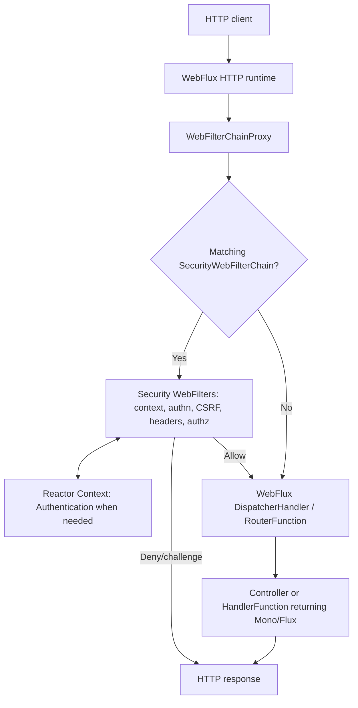

# ServerHttpSecurity and SecurityWebFilterChain in WebFlux Applications

## Learning Objectives

When using Spring MVC on Servlet, you typically declare a `SecurityFilterChain` with `HttpSecurity`. When moving to **Spring WebFlux**, the corresponding APIs are **`ServerHttpSecurity` and `SecurityWebFilterChain`**. The names look similar, but the hook into HTTP requests, filter types, how the security context is carried, and the programming style are not identical.

After this lesson you can:

1. Distinguish **Servlet/MVC security** and **WebFlux/reactive security**, avoiding confusing `HttpSecurity` with `ServerHttpSecurity`.
2. Explain the relationship between `ServerHttpSecurity`, `SecurityWebFilterChain`, `WebFilterChainProxy`, `SecurityWebFiltersOrder`, and `ServerWebExchange`.
3. Create a `SecurityWebFilterChain` bean to define `permitAll`, `authenticated`, `hasRole`, and `denyAll` by URL/method using **`authorizeExchange`**.
4. Read the identity from `ReactiveSecurityContextHolder` and understand why **Reactor Context** matters more than assuming a request always runs on one thread.
5. Create two learning accounts with `MapReactiveUserDetailsService` and `PasswordEncoder`, using HTTP Basic to observe 200/401/403.
6. Test WebFlux configuration with **`WebTestClient`**, including anonymous, wrong password, and missing authority cases.
7. Know when multiple security chains, `securityMatcher`, reactive method security, CSRF, CORS, OAuth2 resource server, and handling blocking components are needed.

The runnable example in this lesson uses **Java 17, Spring Boot 3.5.0, Spring Security 6.5.x, Spring WebFlux, and Maven**. Choose a Boot/Security patch line that is still supported when creating a real project; this is an intentional illustrative version set, not a long-term version lock requirement. The lab uses HTTP Basic and dummy passwords on **localhost** for easy observation; do not use these credentials on real systems.

## 1. Verify the Right Stack Before Configuring Security

**Spring WebFlux** is Spring Framework's reactive web stack, using Reactive Streams `Publisher`s, commonly as Project Reactor's `Mono<T>` and `Flux<T>`. WebFlux can handle HTTP requests in a non-blocking model, supporting annotation-based controllers and functional routes.

**Spring MVC** is the web stack based on the Servlet API. Both share `@RestController`, `@GetMapping`, and many web concepts, but the request infrastructure and security filters differ.

| Question | Spring MVC / Servlet | Spring WebFlux / Reactive |
| --- | --- | --- |
| Primary web starter | `spring-boot-starter-web` | `spring-boot-starter-webflux` |
| HTTP processing | Servlet container, `DispatcherServlet` | Reactive web runtime, `DispatcherHandler` |
| Filter | `jakarta.servlet.Filter` | `org.springframework.web.server.WebFilter` |
| Security chain bean | `SecurityFilterChain` | `SecurityWebFilterChain` |
| Configuration builder | `HttpSecurity` | `ServerHttpSecurity` |
| Chain aggregator/selector | Servlet `FilterChainProxy` | Reactive `WebFilterChainProxy` |
| URL authorization DSL | `authorizeHttpRequests` + `requestMatchers` | `authorizeExchange` + `pathMatchers` |
| Common security context | `SecurityContextHolder`, thread-bound by default in Servlet | `ReactiveSecurityContextHolder`, Reactor Context |
| Common authentication manager | `AuthenticationManager` / `AuthenticationProvider` | `ReactiveAuthenticationManager` and reactive components |
| User loading service | `UserDetailsService` | `ReactiveUserDetailsService` |
| Web testing | `MockMvc` | `WebTestClient` |
| Enable method security | `@EnableMethodSecurity` | `@EnableReactiveMethodSecurity` |

Do not simply rename `HttpSecurity` to `ServerHttpSecurity` and keep all the old imports, filters, and configuration calls. When code returns `Mono`/`Flux`, you must also understand how the security context and data sources operate inside a reactive chain.

### 1.1. Watch Out When Adding Both Web Starters

Spring Boot defaults to **choosing Spring MVC** if both `spring-boot-starter-web` and `spring-boot-starter-webflux` are on the classpath. A Servlet project may add WebFlux to use `WebClient` and still remain an **MVC application**.

If you want to learn `SecurityWebFilterChain` accurately, the lab project below declares only `spring-boot-starter-webflux` together with `spring-boot-starter-security`. Do not add `spring-boot-starter-web`.

Check which stack a project runs on via the dependency tree, `ApplicationContext` type, startup logs, web beans, and configuration chosen by Boot. Do not infer application type merely from seeing a `reactor-core` dependency or a service method returning `Mono`.

### 1.2. Reactive Does Not Always Mean Netty

Boot with the WebFlux starter runs on Reactor Netty by default. WebFlux can run on several other compatible HTTP runtimes. What matters to distinguish is the **reactive web model and `WebFilter` chain**, not the web server name.

Similarly, a controller returning `Mono` does not automatically guarantee the entire processing path is non-blocking. If inside `map(...)` you call synchronous JDBC, a synchronous HTTP client, or `Thread.sleep(...)`, you still risk blocking the event-loop.

## 2. What Do ServerHttpSecurity and SecurityWebFilterChain Do?

### 2.1. `ServerHttpSecurity` Is the Configuration Builder

`org.springframework.security.config.web.server.ServerHttpSecurity` is the DSL API for WebFlux. It lets you configure request rules, authentication mechanisms, headers, CSRF, CORS, login, logout, exception handling, and other mechanisms depending on version.

You typically inject `ServerHttpSecurity` into a bean factory method:

```java
@Bean
SecurityWebFilterChain securityWebFilterChain(ServerHttpSecurity http) {
    return http
        .authorizeExchange(exchanges -> exchanges
            .pathMatchers("/public/**").permitAll()
            .anyExchange().authenticated()
        )
        .httpBasic(Customizer.withDefaults())
        .build();
}
```

This is a **fragment**: it must be placed inside a `@Configuration` class with relevant types imported. It shows the core API, not a full project. `Customizer` belongs to `org.springframework.security.config.Customizer`.

- `http` is the configuration/build DSL, not an HTTP request.
- `authorizeExchange(...)` declares **authorization rules for `ServerWebExchange`s**.
- `pathMatchers(...)` selects which paths a rule applies to.
- `httpBasic(...)` enables HTTP Basic authentication where appropriate.
- `build()` produces a `SecurityWebFilterChain`, a **filter chain configuration bean**, for reactive security infrastructure to use when requests arrive.

### 2.2. What Is `SecurityWebFilterChain`?

`SecurityWebFilterChain` describes:

- **Which exchanges** this chain applies to, typically via a `ServerWebExchangeMatcher`.
- Which **security `WebFilter`s** must run when an exchange matches.

In a web application, Spring Security provides a `WebFilterChainProxy` that selects the matching chain and runs the security filters. Those filters can do things such as enforce/redirect requests by HTTPS policy, read the security context, authenticate credentials, handle CSRF, write security headers, handle exceptions, and check URL authorization.

**Similar names, different types:**

- Servlet: `SecurityFilterChain` containing `jakarta.servlet.Filter`.
- WebFlux: `SecurityWebFilterChain` containing `org.springframework.web.server.WebFilter`.

You do not need to declare `WebFilterChainProxy` yourself in the lab just to enable Security; Boot and `@EnableWebFluxSecurity` provide the corresponding integration. The main need is defining the right policy for the application.

### 2.3. What Does `ServerWebExchange` Carry?

`ServerWebExchange` represents the context of an HTTP exchange in Spring WebFlux: request, response, attributes, principal/session where appropriate, and related components.

Overview model:



The diagram simplifies the path and is **not an ordered list of every WebFilter**. Filter order and conditions depend on configuration. A request that matches no security chain may bypass the expected security filters, so multi-chain designs need a catch-all chain when required.

### 2.4. `WebFilterChainProxy` and `SecurityWebFiltersOrder`

`SecurityWebFiltersOrder` is an enum representing meaningful positions in the reactive security filter chain. If you need to add a specialized security WebFilter, you may see `addFilterBefore(...)`, `addFilterAt(...)`, or `addFilterAfter(...)` on `ServerHttpSecurity`.

Do not arbitrarily place a filter that reads or modifies `Authentication` after the authorization step and expect earlier policies to update automatically. For learners, prefer built-in authentication/authorization configuration, writing a custom filter only when you genuinely need a mechanism the framework does not provide.

## 3. URL Policies: authorizeExchange and pathMatchers

A clear configuration usually has these layers:

```java
http.authorizeExchange(exchanges -> exchanges
    .pathMatchers("/public/**").permitAll()
    .pathMatchers("/admin/**").hasRole("ADMIN")
    .pathMatchers("/api/**").authenticated()
    .anyExchange().denyAll()
);
```

This is a **fragment of the `ServerHttpSecurity` DSL**, not standalone runnable code.

| Rule | Expected outcome |
| --- | --- |
| `permitAll()` | Matching exchange is allowed through without requiring a logged-in user. |
| `authenticated()` | Requires a valid authenticated identity. |
| `hasRole("ADMIN")` | Requires authority `ROLE_ADMIN` with the usual default prefix. |
| `hasAuthority("REPORT_READ")` | Requires exact authority `REPORT_READ`. |
| `denyAll()` | Denies access, even if the caller is logged in. |
| `anyExchange()` | Fallback for exchanges not matched by rules above. |

### 3.1. Match Order Matters

If `/api/**` with `authenticated()` appears before `/api/admin/**` with `hasRole("ADMIN")`, the broader rule can match first and prevent the admin rule from ever being evaluated. Place specific rules first, followed by general rules.

Similarly, do not place `pathMatchers("/**").permitAll()` ahead of protective rules and expect later rules to still apply.

"Allowing the request through" **does not automatically grant permission to read every data row**. For `GET /api/orders/123`, the service/DB must still verify that the order belongs to the caller or valid tenant, even after the request passes `authenticated()`.

### 3.2. HTTP Method Is Also Part of Policy

`pathMatchers` has overloads accepting `HttpMethod`. Example:

```java
import org.springframework.http.HttpMethod;

// Fragment inside authorizeExchange(...)
.pathMatchers(HttpMethod.GET, "/public/catalog").permitAll()
.pathMatchers(HttpMethod.GET, "/api/me").authenticated()
.anyExchange().denyAll()
```

`POST /public/catalog` requests are not permitted just because `GET` on the same path is public. For write endpoints, you must also consider CSRF, validation, and object-level permissions.

### 3.3. `pathMatchers` Differs from `securityMatcher`

Two selection levels are very easy to confuse:

1. **`ServerHttpSecurity.securityMatcher(...)`** restricts **which `SecurityWebFilterChain` applies to an exchange**.
2. **`authorizeExchange(...).pathMatchers(...)`** selects **authorization rules inside the already-selected chain**.

A chain whose `securityMatcher` does not match will not run for that request, so an `anyExchange()` rule inside that chain cannot protect requests outside the chain's scope.

Visualize it as:

```text
GET /api/me
   |
   v
WebFilterChainProxy
   |
   +--> SecurityWebFilterChain #1 with securityMatcher("/admin/**")?
   |       No
   |
   +--> SecurityWebFilterChain #2 catching remaining paths?
           Yes
           |
           v
        authorizeExchange:
          /public/** -> permitAll
          /api/**    -> authenticated
          any        -> denyAll
```

For a new application, **one catch-all chain** is usually simpler and less error-prone. If you have multiple chains for API, UI, actuator, or external resources, use intentional `@Order`, minimal matcher overlap, and test URLs that match no chain.

### 3.4. Distinguishing Authentication from Authorization

- **Authentication:** who does the request represent? Basic credentials, form login/session, bearer token...
- **Authorization:** does that identity have permission for the exchange and operation?

Common HTTP statuses with Basic configuration:

- **200 OK:** request is allowed and the handler succeeds.
- **401 Unauthorized:** unauthenticated or wrong credentials; may include `WWW-Authenticate`.
- **403 Forbidden:** authenticated but lacking permission; can also come from CSRF or another security check.

In a web app using form login, an unauthenticated user may receive **302** to the login page. Do not try to guess 401/403/302 solely from `pathMatchers` names; it also depends on the authentication entry point, principal state, and exception handling.

## 4. Reactive SecurityContext: The Most Important Difference When Moving from Servlet

### 4.1. Why Thread-Bound `SecurityContextHolder` Is Not Enough

Servlet usually processes a request segment on a thread with a security context bound to that thread. Reactive execution can hop across multiple threads within the same pipeline, using event loops, schedulers, or asynchronous operations. Calling `SecurityContextHolder.getContext()` arbitrarily inside a callback is not guaranteed to return the right user in all WebFlux cases.

Reactive Spring Security uses **Reactor Context** to propagate security data per **subscription**, without assuming a request stays pinned to one thread.

Commonly used API:

```java
import org.springframework.security.core.context.ReactiveSecurityContextHolder;
import org.springframework.security.core.context.SecurityContext;
import reactor.core.publisher.Mono;

Mono<String> currentUsername =
    ReactiveSecurityContextHolder.getContext()
        .map(SecurityContext::getAuthentication)
        .map(authentication -> authentication.getName());
```

This is a fragment; in the complete lab in Section 6, the controller invokes this expression as part of a reactive pipeline subscribed to by WebFlux.

### 4.2. Subscription and Context Propagation

A `Mono<String>` describes work that will happen upon subscription. Creating a `Mono` does not mean the request has finished processing; Spring WebFlux subscribes properly within the response pipeline.

**Do not call `.block()` inside a controller or security callback on an event-loop.** Blocking hurts latency, throughput, and sometimes throws errors on non-blocking threads.

**Do not call `.subscribe()` yourself to trigger business work** and return a response prematurely. That detaches the work's lifecycle from the request, risking lost cancellation, error handling, security context, and transaction context. **Return `Mono`/`Flux`** and chain steps using appropriate `map`, `flatMap`, `then`, `onErrorResume`.

### 4.3. What Happens If a Service Uses a Blocking Repository?

Suppose a controller is written as:

```java
@GetMapping("/orders/{id}")
Mono<Order> getOrder(@PathVariable long id) {
    return Mono.just(repository.findById(id).orElseThrow());
}
```

This is a **fragment illustrating a blocking mistake**; `repository` and `Order` are undefined. `repository.findById(...)` is called eagerly when constructing `Mono.just(...)`, potentially blocking the event-loop. When using synchronous JDBC/JPA in a WebFlux application, design proper scheduler/worker boundaries and understand the limits; for genuinely reactive workloads, choose reactive drivers/clients such as R2DBC as needed.

Using `Mono.fromCallable(...).subscribeOn(Schedulers.boundedElastic())` can isolate a legacy blocking operation in some cases, but it does not make JDBC non-blocking, does not eliminate high-load bottlenecks, and does not exempt you from transaction/security context checks. Do not add schedulers arbitrarily just to silence warnings.

## 5. Differences Between Reactive and Servlet Authentication Components

When using username/password in WebFlux, common components include:

| Reactive component | Role | Rough Servlet counterpart |
| --- | --- | --- |
| `ReactiveUserDetailsService` | Loads user via `Mono<UserDetails>` | `UserDetailsService` |
| `MapReactiveUserDetailsService` | Holds sample users in memory for learning | `InMemoryUserDetailsManager` |
| `ReactiveAuthenticationManager` | Verifies an `Authentication` under the reactive contract | `AuthenticationManager` |
| `UserDetailsRepositoryReactiveAuthenticationManager` | Uses user details and password encoder for username/password auth | `DaoAuthenticationProvider` in many designs |
| `PasswordEncoder` | Hashes/matches passwords; this interface is shared | `PasswordEncoder` |
| `ReactiveSecurityContextHolder` | Reads authentication from Reactor Context | `SecurityContextHolder` |
| `AuthenticationWebFilter` and counterpart filters | Integrates login into the reactive WebFilter chain | Servlet authentication filters |

**`MapReactiveUserDetailsService` is not a database.** Each instance holds data privately in memory; it does not synchronize across nodes and does not provide full user/secret lifecycle management for real products.

For form login, Basic auth, OAuth2/JWT, and tokens, Spring Security uses corresponding configurations and filters. Even though both are reactive, verifying a bearer JWT is **not** calling `PasswordEncoder.matches(...)` on the token; the password encoder is used for raw passwords in the appropriate mechanisms.

## 6. Runnable Lab: Spring WebFlux with SecurityWebFilterChain

The lab has four endpoints:

| Endpoint | URL rule | Additional check |
| --- | --- | --- |
| `GET /public/ping` | `permitAll` | No login needed; body `pong`. |
| `GET /api/me` | `authenticated` | Returns username from Reactive SecurityContext. |
| `GET /admin/ping` | `hasRole("ADMIN")` | Only admin account receives `admin-only`. |
| `GET /api/reports` | `authenticated` | Service has `@PreAuthorize("hasRole('ADMIN')")` so regular users still get 403. |
| All other requests | `denyAll` | No new endpoints are exposed automatically. |

Two demo accounts:

- `learner` / `learner-pass`: has `ROLE_USER`.
- `admin` / `admin-pass`: has `ROLE_USER` and `ROLE_ADMIN`.

All credentials in this lesson are for local machine practice only. Never store plaintext passwords or hardcoded credentials in real system source code.

### 6.1. Directory Structure

```text
webflux-security-lab/
├── pom.xml
└── src/
    ├── main/java/com/example/reactivesecurity/
    │   ├── ReactiveSecurityApplication.java
    │   ├── ReactiveSecurityConfig.java
    │   ├── ReportService.java
    │   └── ApiController.java
    └── test/java/com/example/reactivesecurity/
        └── WebFluxSecurityIntegrationTest.java
```

### 6.2. Maven `pom.xml`

```xml
<project xmlns="http://maven.apache.org/POM/4.0.0"
         xmlns:xsi="http://www.w3.org/2001/XMLSchema-instance"
         xsi:schemaLocation="http://maven.apache.org/POM/4.0.0 https://maven.apache.org/xsd/maven-4.0.0.xsd">
    <modelVersion>4.0.0</modelVersion>

    <parent>
        <groupId>org.springframework.boot</groupId>
        <artifactId>spring-boot-starter-parent</artifactId>
        <version>3.5.0</version>
        <relativePath/>
    </parent>

    <groupId>com.example</groupId>
    <artifactId>webflux-security-lab</artifactId>
    <version>1.0.0</version>

    <properties>
        <java.version>17</java.version>
    </properties>

    <dependencies>
        <dependency>
            <groupId>org.springframework.boot</groupId>
            <artifactId>spring-boot-starter-webflux</artifactId>
        </dependency>
        <dependency>
            <groupId>org.springframework.boot</groupId>
            <artifactId>spring-boot-starter-security</artifactId>
        </dependency>
        <dependency>
            <groupId>org.springframework.boot</groupId>
            <artifactId>spring-boot-starter-test</artifactId>
            <scope>test</scope>
        </dependency>
        <dependency>
            <groupId>org.springframework.security</groupId>
            <artifactId>spring-security-test</artifactId>
            <scope>test</scope>
        </dependency>
    </dependencies>

    <build>
        <plugins>
            <plugin>
                <groupId>org.springframework.boot</groupId>
                <artifactId>spring-boot-maven-plugin</artifactId>
            </plugin>
        </plugins>
    </build>
</project>
```

`spring-boot-starter-webflux` provides the WebFlux/Reactor server foundation, while `spring-boot-starter-security` provides Spring Security and integration support. `spring-security-test` supplies security test helpers/mutators for WebTestClient. Boot's parent/BOM manages compatible dependency versions.

**Do not add `spring-boot-starter-web` to this file**, because Boot may select MVC as explained earlier. Inspect the dependency tree with `mvn dependency:tree` if the application does not run on the stack you expect.

### 6.3. `ReactiveSecurityApplication.java`

```java
package com.example.reactivesecurity;

import org.springframework.boot.SpringApplication;
import org.springframework.boot.autoconfigure.SpringBootApplication;

@SpringBootApplication
public class ReactiveSecurityApplication {
    public static void main(String[] args) {
        SpringApplication.run(ReactiveSecurityApplication.class, args);
    }
}
```

`@SpringBootApplication` enables Boot features and scans beans in package `com.example.reactivesecurity`. This is the general startup class and does not write URL policies itself. The Security beans below handle that.

### 6.4. `ReactiveSecurityConfig.java`

```java
package com.example.reactivesecurity;

import org.springframework.context.annotation.Bean;
import org.springframework.context.annotation.Configuration;
import org.springframework.http.HttpMethod;
import org.springframework.security.config.Customizer;
import org.springframework.security.config.annotation.method.configuration.EnableReactiveMethodSecurity;
import org.springframework.security.config.annotation.web.reactive.EnableWebFluxSecurity;
import org.springframework.security.config.web.server.ServerHttpSecurity;
import org.springframework.security.core.userdetails.MapReactiveUserDetailsService;
import org.springframework.security.core.userdetails.User;
import org.springframework.security.core.userdetails.UserDetails;
import org.springframework.security.crypto.factory.PasswordEncoderFactories;
import org.springframework.security.crypto.password.PasswordEncoder;
import org.springframework.security.web.server.SecurityWebFilterChain;

@Configuration(proxyBeanMethods = false)
@EnableWebFluxSecurity
@EnableReactiveMethodSecurity
public class ReactiveSecurityConfig {

    @Bean
    PasswordEncoder passwordEncoder() {
        return PasswordEncoderFactories.createDelegatingPasswordEncoder();
    }

    @Bean
    MapReactiveUserDetailsService reactiveUsers(PasswordEncoder encoder) {
        UserDetails learner = User.withUsername("learner")
            .password(encoder.encode("learner-pass"))
            .roles("USER")
            .build();

        UserDetails admin = User.withUsername("admin")
            .password(encoder.encode("admin-pass"))
            .roles("USER", "ADMIN")
            .build();

        return new MapReactiveUserDetailsService(learner, admin);
    }

    @Bean
    SecurityWebFilterChain securityWebFilterChain(ServerHttpSecurity http) {
        return http
            .authorizeExchange(exchanges -> exchanges
                .pathMatchers(HttpMethod.GET, "/public/ping").permitAll()
                .pathMatchers(HttpMethod.GET, "/admin/ping").hasRole("ADMIN")
                .pathMatchers(HttpMethod.GET, "/api/me").authenticated()
                .pathMatchers(HttpMethod.GET, "/api/reports").authenticated()
                .anyExchange().denyAll()
            )
            .httpBasic(Customizer.withDefaults())
            .formLogin(ServerHttpSecurity.FormLoginSpec::disable)
            .build();
    }
}
```

Analysis:

1. `@EnableWebFluxSecurity` enables Spring Security's reactive web security configuration. Spring Boot also provides conditional WebFlux security auto-configuration; we declare it explicitly so learners see the stack clearly.
2. `@EnableReactiveMethodSecurity` enables method security for beans returning `Publisher`s. Without this annotation, relying solely on URL rules means `@PreAuthorize` on a service may not protect as expected.
3. `PasswordEncoderFactories.createDelegatingPasswordEncoder()` creates a delegating encoder; the default for new hashes in this Security line uses bcrypt. Demo passwords are encoded when creating the users.
4. `MapReactiveUserDetailsService` is the reactive identity source used in the lab. It holds `UserDetails` with hashed passwords; it does not persist to a DB.
5. `ServerHttpSecurity.authorizeExchange` selects rules by HTTP method and path. Specific rules come before `anyExchange().denyAll()`.
6. `httpBasic(Customizer.withDefaults())` enables Basic auth. `formLogin(...disable)` disables form login in the lab so unauthenticated requests receive a Basic challenge that is easy to test. **Do not disable CSRF** or default headers.
7. `SecurityWebFilterChain` is the built bean used for WebFlux HTTP exchanges. Declaring this bean causes Boot's corresponding default web chain to back off; other security integrations still remain active.

**Warning:** HTTP Basic builds a header containing Base64 credentials, not secret encryption. Only use it over HTTPS outside localhost. Hardcoded names and passwords in Java source are test data, not a production identity management system.

### 6.5. `ReportService.java`: Illustrating Reactive Method Security

```java
package com.example.reactivesecurity;

import org.springframework.security.access.prepost.PreAuthorize;
import org.springframework.stereotype.Service;

import reactor.core.publisher.Mono;

@Service
public class ReportService {

    @PreAuthorize("hasRole('ADMIN')")
    public Mono<String> getRestrictedReport() {
        return Mono.just("restricted-report");
    }
}
```

Key learning points:

- `@PreAuthorize` in **reactive method security** is enforced when the call passes through a Spring-managed bean/proxy.
- Spring Security uses the authentication from the reactive context to evaluate permissions.
- `Mono<String>` allows the result to compose into the pipeline instead of calling `block()`.
- User `learner` has `ROLE_USER`, so the HTTP rule `authenticated()` allows `/api/reports`, yet **method security denies** it for lacking `ROLE_ADMIN`.
- User `admin` has `ROLE_ADMIN`, so access is permitted.

This service returns static data for illustration without a DB. In real systems, authorization also needs owner/tenant checks in the service/repository and policies before side-effecting operations. Proxy-based method security has a self-invocation limitation; a method in the same bean calling `this.securedMethod()` may bypass the interceptor.

### 6.6. `ApiController.java`: ReactiveSecurityContextHolder and Routes

```java
package com.example.reactivesecurity;

import java.util.Map;

import org.springframework.security.core.context.ReactiveSecurityContextHolder;
import org.springframework.security.core.context.SecurityContext;
import org.springframework.web.bind.annotation.GetMapping;
import org.springframework.web.bind.annotation.RestController;

import reactor.core.publisher.Mono;

@RestController
public class ApiController {

    private final ReportService reports;

    public ApiController(ReportService reports) {
        this.reports = reports;
    }

    @GetMapping("/public/ping")
    public Mono<String> ping() {
        return Mono.just("pong");
    }

    @GetMapping("/api/me")
    public Mono<Map<String, String>> me() {
        return ReactiveSecurityContextHolder.getContext()
            .map(SecurityContext::getAuthentication)
            .map(authentication -> Map.of(
                "username", authentication.getName()
            ));
    }

    @GetMapping("/admin/ping")
    public Mono<String> adminPing() {
        return Mono.just("admin-only");
    }

    @GetMapping("/api/reports")
    public Mono<String> report() {
        return reports.getRestrictedReport();
    }
}
```

**Why is `/api/me` important?** It obtains `Authentication` via `ReactiveSecurityContextHolder.getContext()` inside the request's reactive pipeline itself. This mechanism is compatible with security context propagation via Reactor Context; it does not assume callbacks always execute on one specific thread.

If a service method needs the username, you can pass the principal from the controller under a clear policy or use the reactive context within the proper subscription context. Never read a username from `?user=...` or an `X-User` header arbitrarily sent by the client as a substitute for verified authentication.

### 6.7. Running the Application and Observing with curl

Requires JDK 17+ and Maven:

```bash
java -version
mvn -version
mvn spring-boot:run
```

Open another terminal to call:

```bash
curl -i http://localhost:8080/public/ping
curl -i http://localhost:8080/api/me
curl -i -u learner:learner-pass http://localhost:8080/api/me
curl -i -u learner:wrong-pass http://localhost:8080/api/me
curl -i -u learner:learner-pass http://localhost:8080/admin/ping
curl -i -u admin:admin-pass http://localhost:8080/admin/ping
curl -i -u learner:learner-pass http://localhost:8080/api/reports
curl -i -u admin:admin-pass http://localhost:8080/api/reports
```

On PowerShell, use `curl.exe` if `curl` is aliased to `Invoke-WebRequest`. Expected HTTP statuses and bodies for this exact configuration:

| Request | Status | Body / meaning |
| --- | --- | --- |
| Anonymous `GET /public/ping` | **200** | `pong`; public. |
| Anonymous `GET /api/me` | **401** | Requires HTTP Basic authentication. |
| Learner correct password, `GET /api/me` | **200** | JSON `{"username":"learner"}`. |
| Learner wrong password, `GET /api/me` | **401** | Authentication fails before controller. |
| Learner `GET /admin/ping` | **403** | Authenticated but lacks `ROLE_ADMIN`. |
| Admin `GET /admin/ping` | **200** | `admin-only`. |
| Learner `GET /api/reports` | **403** | HTTP rule allows through, but `@PreAuthorize` on service denies. |
| Admin `GET /api/reports` | **200** | `restricted-report`. |

Headers such as `WWW-Authenticate`, cache-control, and security headers depend on configuration/security runtime. Basic can send `WWW-Authenticate` on 401. Do not treat the listed responses as a verbatim capture of a running server; these are **expected results** for you to verify yourself.

## 7. Automated Testing with WebTestClient

`WebTestClient` is designed for HTTP/reactive web testing. With `@SpringBootTest(webEnvironment = RANDOM_PORT)`, Boot starts a test HTTP server on a random port and provides `WebTestClient` to send real requests over local loopback. This confirms the Security WebFilter chain works end-to-end with controllers and services.

`@WebFluxTest` is useful when testing only a controller slice, but if you want to prove **the entire SecurityWebFilterChain + reactive method security + user service**, a full application context test as below is more direct.

### 7.1. `WebFluxSecurityIntegrationTest.java`

```java
package com.example.reactivesecurity;

import org.junit.jupiter.api.Test;
import org.springframework.beans.factory.annotation.Autowired;
import org.springframework.boot.test.context.SpringBootTest;
import org.springframework.test.web.reactive.server.WebTestClient;

@SpringBootTest(
    webEnvironment = SpringBootTest.WebEnvironment.RANDOM_PORT
)
class WebFluxSecurityIntegrationTest {

    @Autowired
    WebTestClient client;

    @Test
    void publicEndpointAllowsAnonymous() {
        client.get().uri("/public/ping")
            .exchange()
            .expectStatus().isOk()
            .expectBody(String.class).isEqualTo("pong");
    }

    @Test
    void meRequiresAuthentication() {
        client.get().uri("/api/me")
            .exchange()
            .expectStatus().isUnauthorized();
    }

    @Test
    void learnerCanReadOwnPrincipal() {
        client.get().uri("/api/me")
            .headers(headers ->
                headers.setBasicAuth("learner", "learner-pass")
            )
            .exchange()
            .expectStatus().isOk()
            .expectBody()
            .jsonPath("$.username").isEqualTo("learner");
    }

    @Test
    void wrongPasswordIsRejected() {
        client.get().uri("/api/me")
            .headers(headers ->
                headers.setBasicAuth("learner", "wrong-pass")
            )
            .exchange()
            .expectStatus().isUnauthorized();
    }

    @Test
    void userCannotAccessAdminRoute() {
        client.get().uri("/admin/ping")
            .headers(headers ->
                headers.setBasicAuth("learner", "learner-pass")
            )
            .exchange()
            .expectStatus().isForbidden();
    }

    @Test
    void adminCanAccessAdminRoute() {
        client.get().uri("/admin/ping")
            .headers(headers ->
                headers.setBasicAuth("admin", "admin-pass")
            )
            .exchange()
            .expectStatus().isOk()
            .expectBody(String.class).isEqualTo("admin-only");
    }

    @Test
    void methodSecurityRejectsOrdinaryUser() {
        client.get().uri("/api/reports")
            .headers(headers ->
                headers.setBasicAuth("learner", "learner-pass")
            )
            .exchange()
            .expectStatus().isForbidden();
    }

    @Test
    void adminPassesMethodSecurity() {
        client.get().uri("/api/reports")
            .headers(headers ->
                headers.setBasicAuth("admin", "admin-pass")
            )
            .exchange()
            .expectStatus().isOk()
            .expectBody(String.class).isEqualTo("restricted-report");
    }

    @Test
    void unlistedRouteDoesNotBecomePublic() {
        client.get().uri("/unlisted")
            .exchange()
            .expectStatus().isUnauthorized();
    }
}
```

**Important takeaway on the last test:** `anyExchange().denyAll()` denies the exchange before the MVC/WebFlux handler determines 404. For anonymous callers, exception handling may invoke the authentication entry point to return 401 (due to HTTP Basic); for authenticated principals, `denyAll` typically returns 403. Non-existent URLs do not have to return 404 if policy intentionally blocks them early.

Run:

```bash
mvn test
```

In this example there are **9 test cases**. All are expected to pass if code, dependencies, and environment are correct. This is a **design expectation**, not a claim that Maven has already run on your machine. If a test fails, inspect actual statuses and WebFilter chain logs before changing policy.

### 7.2. Using `spring-security-test` with WebTestClient

Besides real Basic credentials, `spring-security-test` supports simulating authentication with reactive mutators:

```java
import static org.springframework.security.test.web.reactive.server
    .SecurityMockServerConfigurers.mockUser;

// Fragment when WebTestClient has Spring Security test support:
webTestClient.mutateWith(mockUser().roles("ADMIN"))
    .get().uri("/admin/ping")
    .exchange()
    .expectStatus().isOk();
```

This is a fragment; when manually binding `WebTestClient` to an `ApplicationContext`, apply the appropriate `springSecurity()` test configurer. `mockUser()` tests authorization with a simulated principal and **does not prove the password encoder verified correct/incorrect passwords**. That is why the main tests above use real Basic credentials against a full running server.

## 8. Multiple SecurityWebFilterChains and securityMatcher

An application can separate policies for API, web UI, actuator, or special channels into multiple chains. Guidelines:

- Use `@Order` to decide chain precedence.
- Give each chain a `securityMatcher` to limit scope when needed.
- Ensure the selected chain has suitable `authorizeExchange` rules.
- Provide a policy covering requests outside specialized chains if you want every request protected by Spring Security.
- Test overlapping paths, different HTTP methods, redirects, and error handling.

Example **architecture fragment**; do not replace the lab's `securityWebFilterChain` bean directly without designing the full set of chains:

```java
@Bean
@Order(1)
SecurityWebFilterChain adminChain(ServerHttpSecurity http) {
    return http
        .securityMatcher(
            new PathPatternParserServerWebExchangeMatcher("/admin/**")
        )
        .authorizeExchange(exchanges -> exchanges
            .anyExchange().hasRole("ADMIN")
        )
        .httpBasic(Customizer.withDefaults())
        .build();
}

@Bean
@Order(2)
SecurityWebFilterChain otherChain(ServerHttpSecurity http) {
    return http
        .authorizeExchange(exchanges -> exchanges
            .pathMatchers("/public/**").permitAll()
            .anyExchange().authenticated()
        )
        .httpBasic(Customizer.withDefaults())
        .build();
}
```

The snippet requires additional imports `org.springframework.core.annotation.Order` and `org.springframework.security.web.server.util.matcher.PathPatternParserServerWebExchangeMatcher` along with components from the complete code section. **It is a standalone example of chain selection**, not meant to be combined verbatim with the lab's chain and does not define a full login/session strategy for production.

Key distinction: `.securityMatcher(...)` selects the **chain**; `.pathMatchers(...)` selects **rules** inside the chain. A default chain with `anyExchange().authenticated()` cannot protect URLs it never matches unless another chain handles them.

## 9. CSRF in WebFlux: Enabled by Default, Not Servlet-Only

Reactive Spring Security supports `CsrfWebFilter` and token mechanisms. **CSRF protection is enabled by default** in standard WebFlux Security configurations. For applications using browser sessions/cookies or credentials automatically sent by the browser, CSRF matters for state-changing requests.

The lab only has **GET** endpoints to observe authorization; therefore we **keep default CSRF protection**, and no token needs to be sent for read-only GET requests.

If you extend with POST/PUT/PATCH/DELETE:

1. Identify the credential mechanism: browser session cookie, automatically attached Basic auth, explicitly sent bearer token, or server-to-server client.
2. Check whether requests risk being triggered by external sites using the user's credentials.
3. Define token storage/flow; in WebFlux, tokens by default can live in `WebSession` via `WebSessionServerCsrfTokenRepository`.
4. Use `CsrfWebFilter` and `ServerCsrfTokenRepository` appropriately if configuration is needed.
5. Test write requests **without a token** and **with a valid token**.
6. Only decide to disable CSRF for a specific architecture after a real evaluation. Having a JSON body **does not automatically exempt an API from CSRF**.

An example fragment to customize a cookie token in WebFlux, **omitted from the lab because the lab has no frontend reading the token**:

```java
http.csrf(csrf -> csrf.csrfTokenRepository(
    CookieServerCsrfTokenRepository.withHttpOnlyFalse()
));
```

This fragment requires importing `CookieServerCsrfTokenRepository` from Spring Security's reactive package. `withHttpOnlyFalse()` lets JavaScript read the token cookie; choose it only when JS genuinely needs to read the token under an intentional pattern. **Never apply it to session cookies holding credentials**; HttpOnly on session cookies should remain enabled when appropriate.

Note that CORS does not replace CSRF: the browser blocking scripts from reading cross-origin responses does not mean cross-origin requests cannot be sent or cause side effects.

## 10. CORS, Cookies, Headers, and HTTPS in ServerHttpSecurity

### 10.1. CORS: Origin Policy Differs from API Permissions

A frontend at `http://localhost:5173` calling a WebFlux API at `http://localhost:8080` is **cross-origin** because the port differs. If the browser needs to read API responses, the server must have a CORS policy for the corresponding origin/method/header, while still authenticating and authorizing requests.

WebFlux has CORS support in Spring Framework; Spring Security has `ServerHttpSecurity.cors(...)` to integrate when properly configured. You can configure CORS in `CorsWebFilter` or framework configuration suited to the app; confirm preflight handling runs early and avoid confusing overlapping configurations.

**Do not use `permitAll()` on all routes as a fix for CORS errors.** Preflight and authentication policies are different check layers. Do not arbitrarily reflect every `Origin` with credentials into `Access-Control-Allow-Origin`.

### 10.2. Security Headers

Spring Security provides default response security headers for WebFlux such as MIME-sniffing prevention and cache headers restricting storage of sensitive responses. `Content-Security-Policy` is a policy that must be designed for the application's frontend; do not assume an appropriate CSP is already in place just by adding the Security starter.

For APIs returning user data, consider `Cache-Control: no-store` and CDN/proxy rules. For public static assets with content-hashed filenames, bounded/long caching can fit the resource's nature. Never treat default headers as a substitute for data authorization.

### 10.3. HTTPS and Proxies

In production, credentials, session cookies, and bearer tokens must travel over **HTTPS/TLS**. When the application sits behind a load balancer/reverse proxy, trust `Forwarded`/`X-Forwarded-*` headers only from controlled proxies; headers sent arbitrarily by clients are not proof that the original request was secure.

`ServerHttpSecurity` supports HTTPS redirect options depending on version. TLS setup also depends on the reverse proxy, web server, Secure cookies, HSTS, and external addresses seen by browsers. Do not copy a local redirect configuration to production without understanding the proxy architecture.

## 11. OAuth2 Resource Server / JWT in WebFlux

WebFlux often serves as an API verifying bearer access tokens rather than accepting username/password directly. It still uses `ServerHttpSecurity` and `SecurityWebFilterChain`, adding resource server integration.

Example **directional fragment, not part of the runnable project in Section 6**:

```java
http
    .authorizeExchange(exchanges -> exchanges
        .pathMatchers("/public/**").permitAll()
        .pathMatchers("/api/**").authenticated()
        .anyExchange().denyAll()
    )
    .oauth2ResourceServer(oauth2 ->
        oauth2.jwt(Customizer.withDefaults())
    );
```

To use this fragment, you need Boot's corresponding resource server dependency (for example `spring-boot-starter-oauth2-resource-server` in a compatible generation) and issuer/JWK validation settings for a trusted identity provider. Spring Security validates JWTs using appropriate reactive components; you still must verify **issuer, audience, expiry, scope/authority mapping, and business rules** for your system.

**Do not equate "JWT parsed successfully" with "user may read all data."** HTTP policies and object owner/tenant checks remain essential.

With a resource server using bearer tokens explicitly sent by JavaScript, the CSRF threat model can differ from browser session cookies. CSRF decisions still depend on how credentials are actually stored and sent, especially if the app supports both cookies and tokens.

## 12. Functional WebFlux Routes Still Go Through SecurityWebFilterChain

WebFlux supports both `@RestController` and functional routes `RouterFunction<ServerResponse>`. `SecurityWebFilterChain` applies to the WebFlux HTTP exchange **before the handler**, so WebFilter policies do not depend on whether requests are handled by annotated controllers or handler functions.

Example standalone functional route fragment:

```java
@Bean
RouterFunction<ServerResponse> routes() {
    return RouterFunctions.route(
        RequestPredicates.GET("/public/functional"),
        request -> ServerResponse.ok().bodyValue("functional-pong")
    );
}
```

Requires importing `RouterFunction`, `ServerResponse`, `RouterFunctions`, and `RequestPredicates` from the WebFlux functional API. If added to the lab project, **this route will be denied by `anyExchange().denyAll()`** until you declare `pathMatchers("/public/functional").permitAll()` in the proper position.

This clearly shows the difference between **a route existing** and **policy allowing calls to the route**; no public rule is generated automatically just because a handler name starts with `public`.

## 13. Common Mistakes and How to Spot Them

### Mistake 1: Using `HttpSecurity` Instead of `ServerHttpSecurity`

When the project is WebFlux, a Servlet `SecurityFilterChain` bean does not represent a WebFlux `SecurityWebFilterChain`. Choose the right API, imports, and web starter. Do not copy MVC configuration verbatim from another article.

### Mistake 2: Adding Both WebFlux and MVC Starters Without Knowing Which Boot Picks

Boot normally auto-configures MVC when both starters are present. As a result, you write reactive beans while requests travel through the servlet stack, or no `ServerHttpSecurity` bean exists as expected. Inspect the dependency tree and web application type.

### Mistake 3: Copying `authorizeHttpRequests` into WebFlux

The WebFlux DSL is `authorizeExchange` with `pathMatchers`/`anyExchange`. Names do not adapt automatically by intuition; you must use the exact matcher methods and types for code to compile and run.

### Mistake 4: Assuming `Mono` Is Always Non-Blocking

A JDBC, JPA, file IO, or synchronous HTTP call inside a reactive lambda still blocks the thread. Inspect call stacks and either pick reactive clients/drivers or isolate blocking properly; avoid `block()` in request handlers.

### Mistake 5: Calling `SecurityContextHolder.getContext()` in a Reactive Callback

WebFlux can switch threads, so ThreadLocal does not guarantee the right user context. Read from `ReactiveSecurityContextHolder` and keep work within the same reactive pipeline.

### Mistake 6: Calling `subscribe()` Yourself and Returning HTTP 200

Work runs detached from the response, potentially failing late or losing context/cancellation. Return `Mono`/`Flux` for WebFlux to subscribe and propagate errors properly.

### Mistake 7: Thinking `securityMatcher` and `pathMatchers` Are the Same

One selects the chain, the other selects policies inside the chain. A wrong chain matcher can leave routes bypassing the security gate. Test URLs that do not match specialized chains.

### Mistake 8: Placing `/api/**` Before `/api/admin/**`

The broad rule can match first and prevent the admin rule from being evaluated. Put specific rules first, and use `anyExchange().denyAll()` when wanting default deny.

### Mistake 9: Not Enabling Reactive Method Security While Assuming `@PreAuthorize` Runs

In standard designs you need `@EnableReactiveMethodSecurity` and calls going through a bean proxy. Write a 403 test at the method level when the HTTP request already passes `authenticated()`.

### Mistake 10: Using Servlet's `@EnableMethodSecurity` Instead of the Reactive Annotation

When a WebFlux application uses reactive `Publisher`s and Reactor Context, enable `@EnableReactiveMethodSecurity` per the corresponding API. Check type/annotation limits in the version in use.

### Mistake 11: Disabling CSRF Globally Just to Fix 403 on POST

CSRF may be the very thing protecting browser sessions. If adjustment is needed, identify cookies/tokens, write routes, client types, and negative tests. Never treat JSON or WebFlux as automatic immunity from CSRF.

### Mistake 12: Equating CORS with Authentication

CORS decides whether browser scripts from another origin may read responses; authentication/authorization decides permission to call the API. An allowed origin must still provide valid credentials and permissions.

### Mistake 13: Believing `MapReactiveUserDetailsService` Is a Production User Database

It only holds users in RAM. Data does not synchronize across instances, and it has no password reset, audit, MFA, or secret management. Use it only for labs and tests.

### Mistake 14: Opening `anyExchange().permitAll()` to Fix 401/403

That is a broad policy change. Define specific public endpoints, keep private zones and appropriate roles. For user data, check owner/tenant in the service/DB layer.

### Mistake 15: Relying on Login to Allow Any Resource ID

`authenticated()` only states that the request has a verified identity. IDOR/BOLA still occurs if the service takes a client-supplied ID and fetches someone else's record without checking ownership or tenant.

### Mistake 16: Guessing HTTP Statuses Without Inspecting Entry Point/Exception Handling

A 401 may come from a Basic challenge, 403 from missing role/CSRF, 302 from form login. A 404 may be masked by a default-deny policy. Observe actual exchanges and test proper security flows instead of opening access to force a desired status.

## 14. WebFlux Security Debugging Workflow

When encountering 401/403 or seeing policies not take effect, check in order:

1. **Web application type:** is it truly WebFlux or MVC? Are both starters present?
2. **Chain bean:** is a `SecurityWebFilterChain` bean created? Are there multiple chains and `@Order` settings?
3. **Matchers:** which `securityMatcher` did the exchange match? Which `pathMatchers` rule ran first?
4. **Credentials:** Basic, form login, or bearer token? Are credentials valid? Can the user source/reactive authentication manager produce an authentication?
5. **Reactive context:** is authentication present in Reactor Context when the controller/service subscribes? Did `subscribe()`/thread-local/blocking break assumptions?
6. **Method authorization:** are `@EnableReactiveMethodSecurity`, bean proxy, and authorities properly aligned?
7. **CSRF/CORS:** does the request use an unsafe method or browser preflight? How do those two policies act before/after authorization?
8. **HTTP response:** what are the actual 200/401/403/302 statuses and headers in WebTestClient/DevTools/curl?
9. **Negative tests:** anonymous, wrong password, missing role, undeclared route, someone else's object, and other HTTP methods.
10. **Safe observability:** use selective logging in dev; never log raw passwords, tokens, session cookies, or private payloads.

You can enable Spring Security logging at an appropriate level in development, but do not rely on logs in place of tests. Never put real credentials into test output or issue trackers.

## 15. Self-Check Questions

**1. Why does WebFlux use `SecurityWebFilterChain` instead of `SecurityFilterChain`?**  
Because WebFlux operates on `WebFilter` and `ServerWebExchange`, whereas Servlet uses Servlet `Filter`/request-response. The two stacks have different HTTP integration mechanisms.

**2. How do `ServerHttpSecurity` and `SecurityWebFilterChain` differ?**  
`ServerHttpSecurity` is the DSL/builder; `build()` produces `SecurityWebFilterChain` for reactive security to apply to matching exchanges.

**3. What is `authorizeExchange` used for?**  
Defining authorization policies for HTTP exchanges using matchers and conditions such as `permitAll`, `authenticated`, `hasRole`, and `denyAll`.

**4. Why must `pathMatchers("/admin/**").hasRole("ADMIN")` be placed before `pathMatchers("/**").authenticated()`?**  
Because the broad rule can match first and cause the admin role check to be skipped. Specific rules must be selected first.

**5. Does `securityMatcher` protect every URL in the application?**  
No. It restricts the scope of one chain. A chain/policy covering the rest is needed if you want all exchanges protected.

**6. Why should ThreadLocal `SecurityContextHolder` not be used as the primary source in reactive callbacks?**  
Because reactive work can run across multiple threads; the security context is propagated via the subscriber's Reactor Context.

**7. Does `MapReactiveUserDetailsService` differ from `InMemoryUserDetailsManager`?**  
Yes in contract: the reactive service returns `Mono<UserDetails>` suitable for WebFlux; the Servlet in-memory implementation uses the blocking interface.

**8. Is the HTTP rule `authenticated()` on `/api/reports` enough for learner to read a report annotated with `@PreAuthorize("hasRole('ADMIN')")`?**  
No. If reactive method security is enabled, the service still denies learner for lacking ROLE_ADMIN.

**9. Does WebFlux automatically disable CSRF because it is reactive?**  
No. CSRF support has its own defaults and must be evaluated by browser/credentials; the lab keeps the default mechanism.

**10. Does CORS allow anonymous users to view private data?**  
No. CORS does not replace server authentication/authorization.

**11. Why is `Mono.just(repository.findById(id))` not necessarily non-blocking?**  
Because the argument `repository.findById(id)` is evaluated immediately when constructing the Mono; if it blocks, the event-loop can be blocked.

**12. When both `spring-boot-starter-web` and `spring-boot-starter-webflux` are present, which stack does Boot choose by default?**  
Usually Spring MVC. For a clean WebFlux lab, use only the WebFlux starter or configure the application type intentionally.

## Conclusion

**`ServerHttpSecurity` is the HTTP security configuration API for Spring WebFlux; `SecurityWebFilterChain` is the chain of security `WebFilter`s built from that configuration.** The mechanism operates on `ServerWebExchange` and Reactor Context, whereas Servlet configuration uses `HttpSecurity` and `SecurityFilterChain`. With WebFlux, use `authorizeExchange`, order matchers properly, distinguish `securityMatcher` from `pathMatchers`, keep default policies restrictive, and use `ReactiveSecurityContextHolder` inside reactive pipelines.

The lab demonstrates one public endpoint, one endpoint requiring login, one endpoint requiring the ADMIN role, and one method additionally protected by reactive method security. From this foundation, you can expand to OAuth2/JWT resource servers, object/tenant checks, frontend CSRF/CORS, and genuinely reactive data access. **A pipeline containing `Mono` is not automatically non-blocking or secure; policy, context, and data sources must still be verified.**

## Official References

- [Spring Security 6.5 — WebFlux Security](https://docs.spring.io/spring-security/reference/6.5/reactive/configuration/webflux.html)
- [Spring Security 6.5 — ServerHttpSecurity JavaDoc](https://docs.spring.io/spring-security/reference/6.5/api/java/org/springframework/security/config/web/server/ServerHttpSecurity.html)
- [Spring Security 6.5 — Reactive Method Security](https://docs.spring.io/spring-security/reference/6.5/reactive/authorization/method.html)
- [Spring Security 6.5 — WebFlux CSRF](https://docs.spring.io/spring-security/reference/6.5/reactive/exploits/csrf.html)
- [Spring Security 6.5 — Testing Authentication with WebTestClient](https://docs.spring.io/spring-security/reference/6.5/reactive/test/web/authentication.html)
- [Spring Boot 3.5 — Testing Spring Boot Applications](https://docs.spring.io/spring-boot/3.5/reference/testing/spring-boot-applications.html)
- [Spring Boot — Reactive Web Applications](https://docs.spring.io/spring-boot/reference/web/reactive.html)
