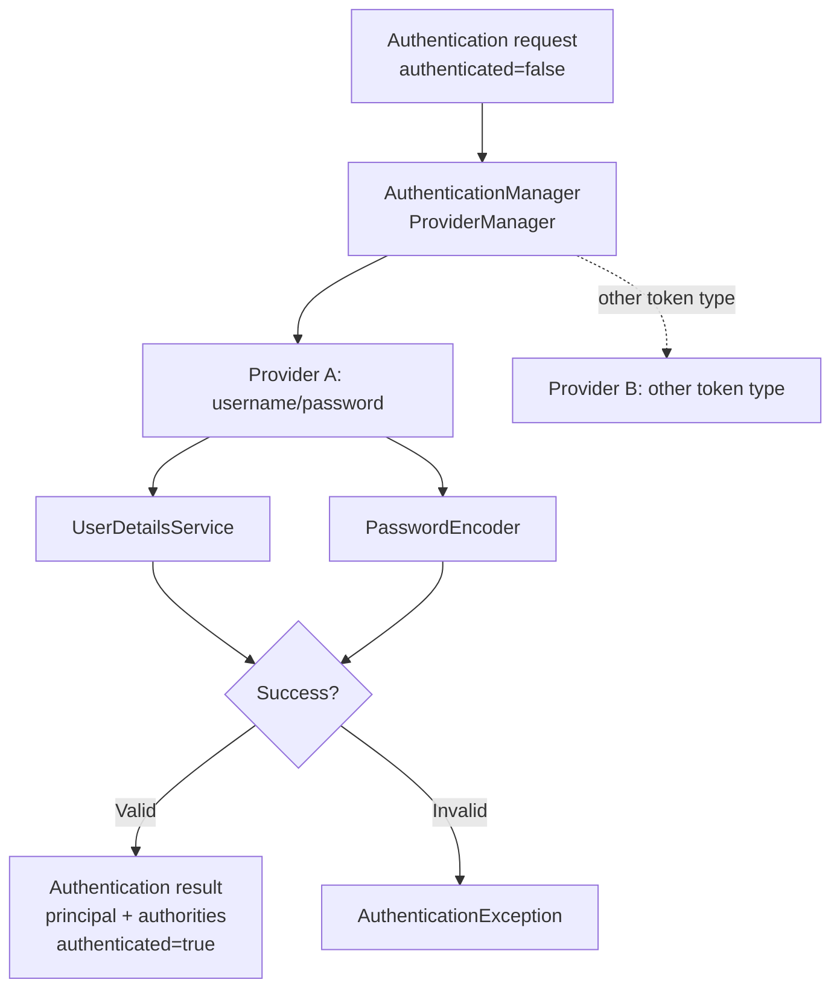

# Authentication Represents Both the Authentication Request and the Authenticated Result

## Lesson Objectives

In Spring Security, the term **Authentication** serves two easily misunderstood roles. Before a user is verified, an `Authentication` object can hold an **authentication request**: the username and credentials the user just supplied. After `AuthenticationManager` verifies them successfully, another `Authentication` typically represents the **authenticated identity**: the confirmed principal, the granted authorities, and the authenticated status. The same interface, yet the meaning and trust level of the data change completely after the verification step.

This lesson focuses on **Spring Security 6.x, Java 17, Spring MVC/Servlet** and a runnable example with **Spring Boot 3.5.0 / Spring Security 6.5.x**. The concepts apply more broadly, though APIs and integration details differ in WebFlux, Spring Security 7.x, or specific token mechanisms.

After completing this lesson, you will be able to:

1. Explain why `Authentication` is both the **input** to `AuthenticationManager.authenticate(...)` and the **result** of that operation.
2. Correctly read the components `principal`, `credentials`, `authorities`, `details`, `getName()`, and `isAuthenticated()`.
3. Distinguish `UsernamePasswordAuthenticationToken.unauthenticated(...)` from a provider-issued authenticated token, avoiding forging an authenticated state yourself.
4. Trace the flow HTTP Basic → authentication filter → `AuthenticationManager` → `AuthenticationProvider` → `SecurityContext` → authorization.
5. Understand credential erasure from the authentication result, the limitations of `isAuthenticated()` when anonymous/remember-me tokens exist, and how context is persisted across requests.
6. Run a Spring Boot project with sample accounts, read the principal in a controller, and use JUnit/MockMvc to verify the request, result, and 200/401/403 responses.

**The primary goal is to understand the contract and lifecycle of Authentication.** `Authentication` is not a plain username, not a password, not an HTTP session, and not the entire authorization mechanism.

## 1. One Interface, Two Roles

Spring Security describes `Authentication` for two purposes:

- **Authentication request — a proposal to authenticate:** a filter or login component creates an object representing what the caller *claims* ("I am learner") and the accompanying evidence ("here is my password"). There is not yet any basis to trust this claim. This object is passed into `AuthenticationManager.authenticate(...)`.
- **Authenticated result — a verified identity:** after a trusted mechanism verifies the evidence, the manager/provider returns an `Authentication` representing the result, typically containing the verified principal, system-granted authorities, and `isAuthenticated() == true`. Web security components use this result to update `SecurityContext`.

```text
                  [Before verification]                 [After verification]
HTTP request
(username/password)
      |
      v
Authentication request
 principal   = "learner"      \
 credentials = "learner-pass"   >-- AuthenticationManager
 authorities = []             /       |
 authenticated = false                v
                                AuthenticationProvider
                                  + UserDetailsService
                                  + PasswordEncoder
                                        |
                                  Valid? / Invalid?
                                   /       \
                                 Valid     Invalid
                                  |          |
                                  v          v
                        Authentication    AuthenticationException
                        result            -> 401/appropriate error flow
                         principal = UserDetails learner
                         credentials = typically erased
                         authorities = [ROLE_USER]
                         authenticated = true
                                  |
                                  v
                         SecurityContext / authorization
```

The diagram illustrates a **typical username/password flow**. The token used and the source of the principal vary by mechanism: form login, HTTP Basic, OAuth2 login, JWT bearer token, X.509, pre-authentication, or remember-me. Do not assume every token carries a password.

### 1.1. Authentication Does Not Perform the Check Itself

Calling:

```java
Authentication request =
    UsernamePasswordAuthenticationToken.unauthenticated(
        "learner", "learner-pass"
    );
```

**Has not authenticated anything yet.** You have only created an object holding data claimed by the sender. `request.isAuthenticated()` is `false`. Naming a class `Authentication` or `UsernamePasswordAuthenticationToken` does not turn a request into a trusted result.

Verification happens when an `AuthenticationManager` uses an appropriate provider to check the evidence:

```java
Authentication result = authenticationManager.authenticate(request);
```

If valid, the manager returns an authenticated `Authentication` per contract; if authentication fails, an appropriate `AuthenticationException` is thrown. **Do not treat the `request` variable after this call as proof of access**; use the actual result returned by the manager.

### 1.2. Authentication vs. Authorization

| Question | Core component | Example |
| --- | --- | --- |
| "Who is the caller, and do they have valid evidence?" | Authentication filter, `AuthenticationManager`, `AuthenticationProvider` | Checking learner's password. |
| "What general permissions are granted to the authenticated person?" | `Authentication.getAuthorities()` and a trusted identity source | Learner has `ROLE_USER`; admin has `ROLE_ADMIN`. |
| "Is that person allowed to call this endpoint?" | `AuthorizationManager`, `AuthorizationFilter`, `SecurityFilterChain` | `GET /admin` requires ADMIN. |
| "Is that person allowed to view order ID 42?" | Business policy, method security, and ownership/tenant checks in service/DB | Alice cannot view Bob's order merely because she is logged in. |

**Successful authentication is a prerequisite for many actions, not a license to do everything.** `Authentication` carries identity/authorities; authorization policies decide which operations are permitted in a specific context.

## 2. Structure of the Authentication Interface

`org.springframework.security.core.Authentication` extends `java.security.Principal`. Common methods:

```java
// Summarized signatures for learning, not the full interface definition.
Object getPrincipal();
Object getCredentials();
Collection<? extends GrantedAuthority> getAuthorities();
Object getDetails();
String getName();
boolean isAuthenticated();
void setAuthenticated(boolean authenticated)
        throws IllegalArgumentException;
```

Depending on the implementation, you may access other attributes. **This is a condensed contract outline**, not a suggestion to implement it yourself or call the setter to grant access. Token classes can restrict transitioning `false -> true` to prevent creating an authenticated token from unverified data.

| Member | Typical meaning | What should not be assumed |
| --- | --- | --- |
| `getPrincipal()` | The person/object represented. Before auth it may be a username `String`; after auth it is often `UserDetails` or a specialized principal. | Do not assume it is always a `String` or always a JPA entity. |
| `getCredentials()` | Evidence used at login: password, token, or equivalent value. | Do not assume it remains intact after login; never write it to logs/responses. |
| `getAuthorities()` | `GrantedAuthority` instances assigned to the identity; used for role/scope/permission policies. | Does not automatically grant ownership of every object by ID. |
| `getDetails()` | Auxiliary metadata depending on filter/provider, such as request details. | Do not confuse with `principal`; do not treat IP/header metadata as proof of permissions. |
| `getName()` | Name of the principal per implementation; often the username in password-login examples. | Does not guarantee it is always an email or user primary key. |
| `isAuthenticated()` | Status flag of the token according to that authentication mechanism. | Not the sole proof to determine "a real user has logged in". |

### 2.1. Principal Before and After Authentication

For an unauthenticated `UsernamePasswordAuthenticationToken`:

```java
Authentication request =
    UsernamePasswordAuthenticationToken.unauthenticated(
        "learner", "learner-pass"
    );

Object principalBefore = request.getPrincipal(); // "learner"
```

After the provider verifies successfully, `getPrincipal()` **can** be the `UserDetails` returned by `UserDetailsService`. In the lab in section 8, that is Spring Security's `User` implementation. However, in a JWT resource server, the principal can be `Jwt`; in OAuth2 login, an `OAuth2User`; and in other models, other types.

Therefore do not cast blindly:

```java
// Brittle: only works when the principal is actually a UserDetails.
UserDetails user = (UserDetails) authentication.getPrincipal();
```

Use `authentication.getName()` when you only need the display/identifying name provided by the implementation. If you need a specific principal object, check its type and apply it only within the mechanism you configured, or use `@AuthenticationPrincipal` with an appropriate handler.

### 2.2. Credentials Are Not Something to Keep in SecurityContext

With password login, before authentication `credentials` is usually the raw password. After authentication, `ProviderManager` by default tries to **erase sensitive credential information** from the result whenever possible, based on the `CredentialsContainer` contract. Thus `getCredentials()` on the result is typically `null` in a standard username/password flow.

Do not write:

```java
// Poor design: relying on the raw password still sitting in the context.
String password = (String) authentication.getCredentials();
```

The application does not need to know the authenticated password to handle business requests. If it must call an external service, design dedicated credentials/delegation; do not forward the user's login password.

**A note on user caching:** if a `UserDetails` instance is reused from a shared cache and the provider erases credentials on that exact instance, subsequent logins may encounter an erased hash. When building a custom `UserDetails` cache, you must manage object copying and credential erasure architecturally rather than arbitrarily disabling credential erasure.

### 2.3. Authorities Are Not Self-Granted by the Client

`GrantedAuthority` represents a granted permission, for example:

```text
ROLE_USER
ROLE_ADMIN
REPORT_READ
SCOPE_orders.read
```

`hasRole("ADMIN")` by default corresponds to checking the authority `ROLE_ADMIN`; `hasAuthority("REPORT_READ")` checks the string `REPORT_READ`. Prefix rules can be customized by configuration; read the project's policy instead of guessing from names alone.

**Danger:** the client sends `X-Role: ADMIN` and the backend constructs an authenticated `Authentication` with `ROLE_ADMIN` without verifying the source of the role. In that case, the application grants permissions based on what the client self-asserts.

The authorities of a result must come from a trusted source: a verified user record, validated and intentionally mapped JWT claims, or an appropriate authorization system. Even when an authority is valid, ownership/tenant authorization still must be resolved where the resource data lives.

### 2.4. Details and getName Are Not Synonymous

`getDetails()` in a web flow may contain `WebAuthenticationDetails` with the remote address/session ID; filters can customize metadata. This field primarily serves supplementary context/auditing. For systems behind a reverse proxy, IP addresses and forwarded headers require an explicit proxy-trust policy; never turn client metadata into a role.

`Authentication.getName()` typically returns the name of the `Principal`/`UserDetails` or a value derived from the principal per implementation. In the lab, the result is the username. However, the API does not require every system to use email as the name, nor does it guarantee it is always a foreign key for querying business data.

## 3. UsernamePasswordAuthenticationToken Illustrates Two States

`UsernamePasswordAuthenticationToken` is a common `Authentication` implementation in username/password authentication.

### 3.1. Factory for Creating an Authentication Request

Spring Security 6.x provides:

```java
UsernamePasswordAuthenticationToken token =
    UsernamePasswordAuthenticationToken.unauthenticated(
        "learner", "learner-pass"
    );
```

Meaning:

- `principal` = `"learner"` string claimed by the client.
- `credentials` = `"learner-pass"` string supplied by the client.
- `authorities` = empty list in this token.
- `isAuthenticated()` = `false`.

You may also see the two-argument constructor in older code; the `unauthenticated(...)` factory makes the intent clearer.

### 3.2. Factory for Creating an Authenticated Token Reserved for Trusted Components

Spring Security has the factory:

```java
UsernamePasswordAuthenticationToken authenticated =
    UsernamePasswordAuthenticationToken.authenticated(
        verifiedPrincipal,
        null,
        verifiedAuthorities
    );
```

This **is only a conceptual fragment**: `verifiedPrincipal` and `verifiedAuthorities` must be supplied by a mechanism that has performed valid verification. The factory does not query a database or check passwords on its own. Never take principal/authorities sent by a browser and call this factory to bypass the authentication manager.

In a real system, the **authentication provider** is where the authenticated result is created after verification. Application code calls `AuthenticationManager.authenticate(request)` instead of setting true on the request itself.

### 3.3. Same Class Does Not Mean Same Instance

A typical flow:

```java
Authentication request =
    UsernamePasswordAuthenticationToken.unauthenticated(
        username, rawPassword
    );

Authentication result =
    authenticationManager.authenticate(request);

// Only use result from here on.
```

The input and output can be **two different objects**, or even different implementations depending on the mechanism. Do not write logic that depends on the object being mutated in place. `AuthenticationManager` is responsible for returning a valid authentication result or signaling an error; **it does not necessarily return the exact initial token type for every provider**.

### 3.4. Why Not Call setAuthenticated(true)?

The following snippet is an **anti-pattern**:

```java
// DO NOT USE to "log in" a user.
request.setAuthenticated(true);
```

In `UsernamePasswordAuthenticationToken`, transitioning an unauthenticated request to authenticated via the setter is restricted to prevent trusting unverified data. With custom classes as well, you must preserve the rule that only trusted components may create recognized results.

**Rule to remember:** *The request object holds a claim; the manager/provider verifies it; only the result is used as the identity.*

## 4. How Do AuthenticationManager and AuthenticationProvider Work Together?

### 4.1. The AuthenticationManager Contract

`AuthenticationManager` defines the operation:

```java
Authentication authenticate(Authentication authentication)
        throws AuthenticationException;
```

This is a **condensed signature**. `AuthenticationManager` does not necessarily know how to read passwords from a database; it can delegate to one or more `AuthenticationProvider` instances. A very common implementation is `ProviderManager`.

Model:



The diagram is conceptual; `ProviderManager` has real rules for provider ordering, exceptions, and parent managers. A provider may declare that it does not support the requested `Authentication` type; if no provider can handle it, authentication fails. Do not treat "no provider handled it" as a default allow condition.

### 4.2. What Does DaoAuthenticationProvider Do?

In a standard username/password flow, `DaoAuthenticationProvider` coordinates:

1. Receives a `UsernamePasswordAuthenticationToken` with caller-supplied username/password.
2. Calls `UserDetailsService.loadUserByUsername(username)` to obtain `UserDetails`.
3. Calls `PasswordEncoder.matches(rawPassword, storedEncodedPassword)`.
4. Checks appropriate account statuses (enabled, locked, expired, ...).
5. If valid, returns an authenticated `Authentication` with the principal and authorities from the trusted result.
6. If invalid, throws an `AuthenticationException` (commonly `BadCredentialsException` for a wrong password or non-existent user under anti-enumeration policies).

`UserDetailsService` **only loads user data**; it is not a direct API for logging in by itself. `PasswordEncoder` only checks hashes; it does not decide permission to view resources.

### 4.3. ProviderManager Erases Credentials After Authentication

A successful `Authentication` may carry sensitive data. In typical configurations, `ProviderManager` executes `eraseCredentials()` on the result if the object supports it, reducing the risk of retaining passwords in sessions or logs.

Therefore **do not use `result.getCredentials()` to prove a login succeeded**. Use the authenticated status along with principal/authorities from the result and let the security components manage it.

Credential erasure is not equivalent to disabling an account, invalidating a session, clearing cookies, or removing every copy of a password from memory/heap; it is a data-hygiene layer in the processing pipeline.

## 5. How Does an HTTP Request Reach SecurityContext?

With **Spring MVC/Servlet** and HTTP Basic, a typical flow is:

```text
Client
  |
  | Authorization: Basic <base64(username:password)>
  v
Servlet container
  |
  v
Spring Security FilterChainProxy / SecurityFilterChain
  |
  v
BasicAuthenticationFilter
  |
  | Creates an unauthenticated Authentication request
  v
AuthenticationManager -> AuthenticationProvider
  |
  | verify password + load authorities
  v
Authentication result (authenticated)
  |
  v
SecurityContext holds Authentication
  |
  v
AuthorizationFilter -> policy for the HTTP request
  |
  +--> Insufficient conditions -> 401/403/appropriate entry point
  |
  v
DispatcherServlet -> Controller -> Service
```

With form login, the handling filter differs (`UsernamePasswordAuthenticationFilter`); with bearer JWT, the authentication token/provider and source of authorities differ. **The overall structure remains "collect evidence → verify → establish identity → apply policy".**

### 5.1. SecurityContext and SecurityContextHolder

`SecurityContext` holds the current `Authentication`. `SecurityContextHolder` gives Servlet-stack code access to that context via a strategy (by default typically backed by `ThreadLocal`).

Code reading inside a Security-managed call:

```java
Authentication current =
    SecurityContextHolder.getContext().getAuthentication();
```

**This is a fragment** and should not be run outside a request expecting a user to always be present. For public requests, the context may contain no Authentication or an anonymous token depending on the filter chain. For other threads/`@Async`, the context does not automatically propagate properly in all situations. With **WebFlux**, use `ReactiveSecurityContextHolder` and Reactor Context rather than reasoning from Servlet ThreadLocal.

Better yet, in a protected Spring MVC controller, you can receive `Authentication` as a method argument, as in section 8's code. This makes the endpoint's identity dependency explicit and avoids querying the holder across many places.

### 5.2. An Authenticated Result Is Not Automatically Saved Across Every Request

Keep two things separate:

- **Putting Authentication into the current request's SecurityContext:** lets subsequent steps know who the caller is during this request.
- **Saving SecurityContext to restore on future requests:** requires `SecurityContextRepository`/session or repeated authentication, depending on the architecture.

In Spring Security 6, if you write a custom login controller or authentication filter and set the context manually, you should not assume the context is automatically saved to the session. With `SecurityContextHolderFilter`, persisting context across requests requires calling `SecurityContextRepository.saveContext(...)` properly or using a Spring Security-supported flow. With stateless per-request HTTP Basic, the client can send credentials on every request and the filter re-authenticates; you do not need to write a custom session-issuing controller to learn the Authentication concept.

**Never set SecurityContext based on unverified client input.** That creates a severe security-layer bypass, even though the controller will afterward see an `Authentication` in the holder.

### 5.3. 401, 403, 302, and Authentication Failures

| Situation | Meaning | Typical response |
| --- | --- | --- |
| No credentials, endpoint requires login, using Basic | No valid identity yet | `401` and possibly `WWW-Authenticate`. |
| Wrong username/password provided | Authentication failed, no trusted result | `401` with Basic; do not leak password details. |
| Authenticated but lacking role for URL | Authorization denied | `403 Forbidden`. |
| Using form login with an unauthenticated navigation request | Entry point redirects to form | `302` to the login page in the corresponding setup. |
| Authenticated with sufficient permissions | Request allowed to proceed | Handler may return `200` or another code per business logic. |

**Do not blame every 403 on a wrong password:** CSRF and other protection mechanisms can also return 403. **Do not blame every 401 on a non-existent username:** it can be caused by a missing token, invalid token, or authentication entry point.

## 6. isAuthenticated(): An Important Flag, Yet Not Enough to Distinguish Anonymous

An easy mistake to make:

```java
if (authentication != null && authentication.isAuthenticated()) {
    // Assuming this is a real logged-in user.
}
```

This is a **fragment with a policy-bug risk** in systems with anonymous authentication enabled: `AnonymousAuthenticationToken` can have `isAuthenticated() == true` in terms of the token's internal state, yet Spring Security considers it **anonymous**, not a user logged in with credentials.

Therefore:

- To protect URLs, use `authorizeHttpRequests(...).authenticated()`, `fullyAuthenticated()`, `hasRole(...)`, or an appropriate policy. Those managers use logic that distinguishes authentication types.
- If checking manually in business code, use APIs/helpers appropriate with `AuthenticationTrustResolver` or supported security annotations rather than inspecting only the flag.
- Do not perform naive authorization with `authentication.getName() != null`. `anonymousUser` can be the principal name of an anonymous request.
- `RememberMeAuthenticationToken` can represent a user recognized via remember-me, but is not **fully authenticated** at the same trust level as a full login.
- If policy requires stronger verification steps (e.g., MFA, re-authentication), the `isAuthenticated()` flag cannot express all those requirements either. Specific policies on authentication factors are needed.

### 6.1. AnonymousAuthenticationToken Differs from a Request Token Pending Verification

Two things are easily lumped together as "not logged in":

| Type | Meaning | `isAuthenticated()` can be |
| --- | --- | --- |
| `UsernamePasswordAuthenticationToken.unauthenticated(...)` | Carries unverified username/password claims | **false** |
| `AnonymousAuthenticationToken` set by the framework | Represents an anonymous caller in the filter chain for consistent policy handling | **true** per implementation |
| `UsernamePasswordAuthenticationToken` authenticated by a provider | Verified identity in the username/password flow | **true** |
| `RememberMeAuthenticationToken` | Identity restored via remember-me through its own mechanism | **true**, but differs from fully authenticated |

For this reason, checking a single boolean **cannot distinguish all trust levels**. Use `authenticated()` and `fullyAuthenticated()` as required, or a trust resolver when custom policy code is unavoidable.

## 7. How Is the Authenticated Result Used in a Controller/Service?

After the Security filter chain authenticates successfully and URL rules allow continuation, a controller can receive:

```java
@GetMapping("/api/me")
Map<String, String> me(Authentication authentication) {
    return Map.of("username", authentication.getName());
}
```

This is a **fragment** meant to live inside a `@RestController`. Benefits:

- The username comes from the `Authentication` established by web security.
- The controller does not parse Basic Base64 or look up users by password itself.
- URL authorization responsibility stays in `SecurityFilterChain`.
- No raw `principal` or `credentials` need to be sent in the response.

If the full user is needed, in a `UserDetails`-based system you can use:

```java
@GetMapping("/api/me/details")
Map<String, String> details(
        @AuthenticationPrincipal UserDetails user) {
    return Map.of("username", user.getUsername());
}
```

This fragment requires importing `@AuthenticationPrincipal` and `UserDetails` and only works when the actual principal is a `UserDetails`. With a JWT resource server, the principal is a different type; design the handler accordingly.

### 7.1. Do Not Return Authentication Directly as JSON

`Authentication` can contain request details, authorities, principal type, credentials, or metadata the application should not expose. Returning it raw:

```java
// Should not return the security object directly to the client.
return authentication;
```

can expose internal structure and couple the API to implementation types. Use an explicit DTO containing only the fields the client needs to know. Do not log raw tokens/passwords/hashes, and do not send them in debug responses.

### 7.2. Object-Level Permissions Still Need Checking

An endpoint like `GET /api/orders/42` requiring `authenticated()` only guarantees there is a user. If ID 42 belongs to Bob, Alice must not view it merely because `Authentication#getAuthorities()` contains `ROLE_USER`.

In a service or query, use the identity/tenant from a trusted source and verify ownership:

```sql
SELECT id, label
FROM purchase_orders
WHERE id = :requestedId
  AND owner_username = :authenticatedUsername;
```

This is **illustrative SQL** using named parameters of an appropriate query mechanism; it is not a statement meant to run verbatim on every DB. Key idea: post-authentication identity is the **input to resource-level authorization**, not a blanket grant for every row of data.

## 8. Runnable Lab: From Authentication Request to Authentication Result

We create a Boot application with two accounts `learner` and `admin`, HTTP Basic, a public endpoint, an endpoint returning selected info from Authentication, and an endpoint requiring the ADMIN role.

Alongside HTTP tests, a unit/integration test directly calls `AuthenticationManager.authenticate(...)` to observe how **before** and **after** differ.

### 8.1. Directory Structure

```text
authentication-lifecycle-demo/
├── pom.xml
└── src/
    ├── main/java/com/example/authlifecycle/
    │   ├── AuthLifecycleApplication.java
    │   ├── SecurityConfig.java
    │   └── IdentityController.java
    └── test/java/com/example/authlifecycle/
        ├── AuthenticationLifecycleTest.java
        └── IdentityHttpTest.java
```

### 8.2. Maven `pom.xml`

```xml
<project xmlns="http://maven.apache.org/POM/4.0.0"
         xmlns:xsi="http://www.w3.org/2001/XMLSchema-instance"
         xsi:schemaLocation="http://maven.apache.org/POM/4.0.0 https://maven.apache.org/xsd/maven-4.0.0.xsd">
    <modelVersion>4.0.0</modelVersion>

    <parent>
        <groupId>org.springframework.boot</groupId>
        <artifactId>spring-boot-starter-parent</artifactId>
        <version>3.5.0</version>
        <relativePath/>
    </parent>

    <groupId>com.example</groupId>
    <artifactId>authentication-lifecycle-demo</artifactId>
    <version>1.0.0</version>

    <properties>
        <java.version>17</java.version>
    </properties>

    <dependencies>
        <dependency>
            <groupId>org.springframework.boot</groupId>
            <artifactId>spring-boot-starter-web</artifactId>
        </dependency>
        <dependency>
            <groupId>org.springframework.boot</groupId>
            <artifactId>spring-boot-starter-security</artifactId>
        </dependency>
        <dependency>
            <groupId>org.springframework.boot</groupId>
            <artifactId>spring-boot-starter-test</artifactId>
            <scope>test</scope>
        </dependency>
        <dependency>
            <groupId>org.springframework.security</groupId>
            <artifactId>spring-security-test</artifactId>
            <scope>test</scope>
        </dependency>
    </dependencies>

    <build>
        <plugins>
            <plugin>
                <groupId>org.springframework.boot</groupId>
                <artifactId>spring-boot-maven-plugin</artifactId>
            </plugin>
        </plugins>
    </build>
</project>
```

`spring-boot-starter-security` brings Spring Security onto the classpath and integrates it with Boot. `spring-security-test` provides helpers for testing HTTP authentication. Boot's parent/BOM manages compatible module versions.

Version `3.5.0` is used only to keep the example consistent with 6.5 APIs; in real projects use a currently supported patch release. This lesson is **Servlet/MVC**, and does not use WebFlux types such as `ServerHttpSecurity` or `SecurityWebFilterChain`.

### 8.3. `AuthLifecycleApplication.java`

```java
package com.example.authlifecycle;

import org.springframework.boot.SpringApplication;
import org.springframework.boot.autoconfigure.SpringBootApplication;

@SpringBootApplication
public class AuthLifecycleApplication {
    public static void main(String[] args) {
        SpringApplication.run(AuthLifecycleApplication.class, args);
    }
}
```

The startup class sits in the root package `com.example.authlifecycle` so Spring can scan configurations/controllers in the same package. There is no authentication logic directly here.

### 8.4. `SecurityConfig.java`

```java
package com.example.authlifecycle;

import org.springframework.context.annotation.Bean;
import org.springframework.context.annotation.Configuration;
import org.springframework.security.authentication.AuthenticationManager;
import org.springframework.security.authentication.ProviderManager;
import org.springframework.security.authentication.dao.DaoAuthenticationProvider;
import org.springframework.security.config.Customizer;
import org.springframework.security.config.annotation.web.builders.HttpSecurity;
import org.springframework.security.config.annotation.web.configurers.AbstractHttpConfigurer;
import org.springframework.security.core.userdetails.User;
import org.springframework.security.core.userdetails.UserDetails;
import org.springframework.security.core.userdetails.UserDetailsService;
import org.springframework.security.crypto.factory.PasswordEncoderFactories;
import org.springframework.security.crypto.password.PasswordEncoder;
import org.springframework.security.provisioning.InMemoryUserDetailsManager;
import org.springframework.security.web.SecurityFilterChain;

@Configuration(proxyBeanMethods = false)
public class SecurityConfig {

    @Bean
    PasswordEncoder passwordEncoder() {
        return PasswordEncoderFactories.createDelegatingPasswordEncoder();
    }

    @Bean
    UserDetailsService users(PasswordEncoder encoder) {
        UserDetails learner = User.withUsername("learner")
            .password(encoder.encode("learner-pass"))
            .roles("USER")
            .build();

        UserDetails admin = User.withUsername("admin")
            .password(encoder.encode("admin-pass"))
            .roles("USER", "ADMIN")
            .build();

        return new InMemoryUserDetailsManager(learner, admin);
    }

    @Bean
    AuthenticationManager authenticationManager(
            UserDetailsService users,
            PasswordEncoder encoder) {

        DaoAuthenticationProvider provider =
            new DaoAuthenticationProvider(users);
        provider.setPasswordEncoder(encoder);
        return new ProviderManager(provider);
    }

    @Bean
    SecurityFilterChain securityFilterChain(HttpSecurity http)
            throws Exception {

        return http
            .authorizeHttpRequests(auth -> auth
                .requestMatchers("/public/ping").permitAll()
                .requestMatchers("/api/me").authenticated()
                .requestMatchers("/admin/ping").hasRole("ADMIN")
                .anyRequest().denyAll()
            )
            .httpBasic(Customizer.withDefaults())
            .formLogin(AbstractHttpConfigurer::disable)
            .build();
    }
}
```

**Configuration explanation:**

1. `PasswordEncoderFactories.createDelegatingPasswordEncoder()` creates the encoder; the default in this line uses bcrypt when encoding new passwords, storing strings in `{bcrypt}...` format.
2. `InMemoryUserDetailsManager` holds learning users in memory only; hashes are generated from demo raw passwords at startup. Because the code still contains raw passwords, it is **not suitable for production**.
3. The `AuthenticationManager` bean is declared **explicitly** here so tests can invoke it directly and so you can see `ProviderManager → DaoAuthenticationProvider`. In a normal Boot app, you do not need to register the manager manually if the default configuration suffices.
4. `DaoAuthenticationProvider` takes `UserDetailsService` and `PasswordEncoder` to verify username/password.
5. `SecurityFilterChain` specifies `/public/ping` is public, `/api/me` requires authentication, and `/admin/ping` requires `ROLE_ADMIN`.
6. `.httpBasic(...)` enables Basic; `.formLogin(...disable)` disables form login **only to demonstrate clear HTTP responses**. It does not disable CSRF or all of Spring Security.
7. `.anyRequest().denyAll()` is the fallback for undeclared paths, regardless of whether an endpoint exists in MVC.

Although this is an introductory app, declaring `AuthenticationManager` explicitly in this lesson has a **pedagogical purpose**: a test can pass an Authentication request straight into the manager and inspect the Authentication result. When you just want standard login, you normally let Spring Security/Boot configure the appropriate manager.

### 8.5. `IdentityController.java`

```java
package com.example.authlifecycle;

import java.util.List;
import java.util.Map;

import org.springframework.security.core.Authentication;
import org.springframework.security.core.GrantedAuthority;
import org.springframework.web.bind.annotation.GetMapping;
import org.springframework.web.bind.annotation.RestController;

@RestController
public class IdentityController {

    @GetMapping("/public/ping")
    public String ping() {
        return "pong";
    }

    @GetMapping("/api/me")
    public Map<String, Object> me(Authentication authentication) {
        List<String> authorities = authentication.getAuthorities().stream()
            .map(GrantedAuthority::getAuthority)
            .sorted()
            .toList();

        return Map.of(
            "username", authentication.getName(),
            "authenticated", authentication.isAuthenticated(),
            "authorities", authorities
        );
    }

    @GetMapping("/admin/ping")
    public String adminPing() {
        return "admin-only";
    }
}
```

The controller returns only selected **username, status, and authorities**. It does not return the raw `Authentication`, raw `UserDetails`, `credentials`, or password hashes. Requiring `authenticated()` on `/api/me` ensures the output shown in the lab comes from a real Basic-authenticated user, not anonymous.

### 8.6. `AuthenticationLifecycleTest.java`

```java
package com.example.authlifecycle;

import org.junit.jupiter.api.Test;
import org.springframework.beans.factory.annotation.Autowired;
import org.springframework.boot.test.context.SpringBootTest;
import org.springframework.security.authentication.AuthenticationManager;
import org.springframework.security.authentication.BadCredentialsException;
import org.springframework.security.authentication.UsernamePasswordAuthenticationToken;
import org.springframework.security.core.Authentication;
import org.springframework.security.core.GrantedAuthority;
import org.springframework.security.core.userdetails.UserDetails;

import static org.assertj.core.api.Assertions.assertThat;
import static org.assertj.core.api.Assertions.assertThatThrownBy;

@SpringBootTest
class AuthenticationLifecycleTest {

    @Autowired
    AuthenticationManager authenticationManager;

    @Test
    void requestIsNotYetAnAuthenticatedIdentity() {
        Authentication request =
            UsernamePasswordAuthenticationToken.unauthenticated(
                "learner", "learner-pass"
            );

        assertThat(request.isAuthenticated()).isFalse();
        assertThat(request.getPrincipal()).isEqualTo("learner");
        assertThat(request.getCredentials()).isEqualTo("learner-pass");
        assertThat(request.getAuthorities()).isEmpty();
    }

    @Test
    void managerReturnsVerifiedIdentityWithGrantedAuthorities() {
        Authentication request =
            UsernamePasswordAuthenticationToken.unauthenticated(
                "learner", "learner-pass"
            );

        Authentication result =
            authenticationManager.authenticate(request);

        assertThat(result.isAuthenticated()).isTrue();
        assertThat(result.getName()).isEqualTo("learner");
        assertThat(result.getPrincipal()).isInstanceOf(UserDetails.class);
        assertThat(result.getAuthorities())
            .extracting(GrantedAuthority::getAuthority)
            .contains("ROLE_USER");

        // ProviderManager erases credentials on the result by default.
        assertThat(result.getCredentials()).isNull();
    }

    @Test
    void wrongPasswordCannotCreateTrustedResult() {
        Authentication request =
            UsernamePasswordAuthenticationToken.unauthenticated(
                "learner", "wrong-pass"
            );

        assertThatThrownBy(
            () -> authenticationManager.authenticate(request)
        ).isInstanceOf(BadCredentialsException.class);
    }
}
```

**The three tests target the core focus of the lesson:**

- Test 1 proves the **request object** holds a claim, not yet a trusted identity.
- Test 2 proves the **result object** has `UserDetails`, learner's authorities, and authenticated status. `ProviderManager` erases credentials from the result by default in this flow.
- Test 3 proves a wrong password throws an exception and **does not** return a successful Authentication.

Assertions do not depend on random bcrypt hash strings or object memory addresses. No passwords or hashes are printed to stdout. Testing `AuthenticationManager` directly does not place the result into `SecurityContextHolder`; that is the job of properly integrated authentication filters or controllers.

### 8.7. `IdentityHttpTest.java`

```java
package com.example.authlifecycle;

import org.junit.jupiter.api.Test;
import org.springframework.beans.factory.annotation.Autowired;
import org.springframework.boot.test.autoconfigure.web.servlet.AutoConfigureMockMvc;
import org.springframework.boot.test.context.SpringBootTest;
import org.springframework.test.web.servlet.MockMvc;

import static org.springframework.security.test.web.servlet.request.SecurityMockMvcRequestPostProcessors.httpBasic;
import static org.springframework.test.web.servlet.request.MockMvcRequestBuilders.get;
import static org.springframework.test.web.servlet.result.MockMvcResultMatchers.content;
import static org.springframework.test.web.servlet.result.MockMvcResultMatchers.jsonPath;
import static org.springframework.test.web.servlet.result.MockMvcResultMatchers.status;

@SpringBootTest
@AutoConfigureMockMvc
class IdentityHttpTest {

    @Autowired
    MockMvc mvc;

    @Test
    void pingIsPublic() throws Exception {
        mvc.perform(get("/public/ping"))
            .andExpect(status().isOk())
            .andExpect(content().string("pong"));
    }

    @Test
    void meRejectsAnonymous() throws Exception {
        mvc.perform(get("/api/me"))
            .andExpect(status().isUnauthorized());
    }

    @Test
    void meShowsAuthenticatedPrincipal() throws Exception {
        mvc.perform(get("/api/me")
                .with(httpBasic("learner", "learner-pass")))
            .andExpect(status().isOk())
            .andExpect(jsonPath("$.username").value("learner"))
            .andExpect(jsonPath("$.authenticated").value(true))
            .andExpect(jsonPath("$.authorities[0]").value("ROLE_USER"));
    }

    @Test
    void meRejectsBadPassword() throws Exception {
        mvc.perform(get("/api/me")
                .with(httpBasic("learner", "bad-pass")))
            .andExpect(status().isUnauthorized());
    }

    @Test
    void learnerIsNotAdmin() throws Exception {
        mvc.perform(get("/admin/ping")
                .with(httpBasic("learner", "learner-pass")))
            .andExpect(status().isForbidden());
    }

    @Test
    void adminMayVisitAdminRoute() throws Exception {
        mvc.perform(get("/admin/ping")
                .with(httpBasic("admin", "admin-pass")))
            .andExpect(status().isOk())
            .andExpect(content().string("admin-only"));
    }
}
```

The two classes provide **9 tests**: three Authentication lifecycle tests and six HTTP tests. MockMvc exercises the real filter chain inside the Spring MVC test context, unlike merely creating a fake principal with `@WithMockUser`. When the goal is to verify password authentication, sending real Basic credentials in tests is more direct than just mocking a user.

### 8.8. Running and Observing in the Terminal

Requires JDK 17+, Maven, and port 8080 available:

```bash
java -version
mvn -version
mvn test
mvn spring-boot:run
```

Once the app is running, open another terminal:

```bash
curl -i http://localhost:8080/public/ping
curl -i http://localhost:8080/api/me
curl -i -u learner:learner-pass http://localhost:8080/api/me
curl -i -u learner:wrong-pass http://localhost:8080/api/me
curl -i -u learner:learner-pass http://localhost:8080/admin/ping
curl -i -u admin:admin-pass http://localhost:8080/admin/ping
```

On Windows PowerShell, use `curl.exe` if `curl` points to the `Invoke-WebRequest` alias.

| Request | Expected status | Main body on success |
| --- | --- | --- |
| `GET /public/ping` anonymous | **200** | `pong` |
| `GET /api/me` anonymous | **401** | No identity info |
| `GET /api/me` learner right password | **200** | JSON with `username=learner`, `authenticated=true`, `authorities=["ROLE_USER"]` |
| `GET /api/me` learner wrong password | **401** | No verified identity |
| `GET /admin/ping` learner right password | **403** | Admin content not returned |
| `GET /admin/ping` admin right password | **200** | `admin-only` |

These are **expected results** for the illustrative code, not actual output run on the learner's machine. Headers such as `WWW-Authenticate`, `Cache-Control`, or response metadata may vary by runtime and security configuration. The JSON payload represents a logical structure; field ordering is not a contract.

**Note:** HTTP Basic sends username/password as Base64 in a header and does not protect confidentiality in transit on its own. This `localhost` lab uses mock credentials; a real application requires HTTPS, proper identity store/secret management, and appropriate login protection policies.

## 9. Stepping Through a Real Case

Suppose a client sends:

```http
GET /api/me HTTP/1.1
Host: localhost:8080
Authorization: Basic <base64-value>
```

This is an illustrative request containing no real credentials. Sequence of events:

1. `BasicAuthenticationFilter` reads HTTP Basic and creates an unauthenticated `Authentication` with a username-shaped principal.
2. The filter passes the Authentication request to `AuthenticationManager`.
3. `ProviderManager` finds a provider supporting `UsernamePasswordAuthenticationToken`.
4. `DaoAuthenticationProvider` loads `UserDetails` for learner and uses `PasswordEncoder.matches(...)` to verify the password.
5. If successful, the provider returns an `Authentication` with a trusted principal and authorities. `ProviderManager` typically erases sensitive credentials on the result.
6. The filter sets `SecurityContext` for the current request.
7. The authorization rule for `/api/me` requires `authenticated()`, so the request is allowed to proceed.
8. Spring MVC invokes `IdentityController.me(...)` with the active `Authentication`.
9. The controller extracts only `getName()`, `isAuthenticated()`, and authority names to return JSON.

If the password is wrong, step 4 fails and no verified Authentication result reaches the controller. If learner calls `/admin/ping`, authentication still succeeds, yet `hasRole("ADMIN")` denies access for lacking `ROLE_ADMIN`. This exact point separates **authentication success** from **authorization denied**.

## 10. When Is the Principal Not UserDetails?

Do not turn this lesson into the assumption "every Authentication is username/password". A few important mechanisms:

| Mechanism | Common Authentication/token | Principal can be | Credentials / authorities |
| --- | --- | --- | --- |
| HTTP Basic / form login with DaoAuthenticationProvider | `UsernamePasswordAuthenticationToken` | `UserDetails` after authentication | Raw password only before auth; authorities loaded from user store. |
| JWT resource server | `JwtAuthenticationToken` | `Jwt` or adapter-defined principal | Verified JWT; scopes mapped to authorities per configuration. |
| OAuth2/OIDC login | `OAuth2AuthenticationToken` or related token | `OAuth2User`/`OidcUser` | User data/claims provided by the provider and verified via the flow. |
| Anonymous in servlet security | `AnonymousAuthenticationToken` | Typically `anonymousUser` | Used inside the security flow, not a real logged-in user. |
| Remember-me | `RememberMeAuthenticationToken` or corresponding mechanism | Restored user identity | Trust level differs from full login. |
| Pre-auth / X.509 | Dedicated token/implementation | Identifier originating from the corresponding authentication layer | Must have a trust policy for upstream identity. |

These token names are examples under common configurations; versions, adapters, and principal types can differ. When an API switches to an OAuth2 resource server, code that unconditionally casts to `UserDetails` can fail even though every request is validly authenticated.

## 11. Common Misconceptions

### Mistake 1 — "Having an Authentication object means login succeeded"

Incorrect: `Authentication` is also used to **represent an unauthenticated request**. Check the result returned by the manager/provider and enforce policies through the security framework.

### Mistake 2 — "The client can set isAuthenticated=true itself"

Never: constructing an authenticated token from self-claimed data bypasses the authentication mechanism. Use the manager/provider or a trusted authentication infrastructure, not a manual flag flip to pass filters.

### Mistake 3 — "AuthenticationManager itself grants endpoint access"

The manager verifies identity and builds the result. `AuthorizationManager`/filters/method security decide which endpoints or business actions are permitted.

### Mistake 4 — "Authentication.getPrincipal() always returns a String username"

Before auth it may often be a String, but after auth it can be `UserDetails`, `Jwt`, `OAuth2User`, or a system-specific object. When you only need the name, use `getName()` per your active mechanism's contract.

### Mistake 5 — "Authentication.getCredentials() must still hold the password after login"

Wrong: providers/managers usually erase sensitive credential info. Never design services that depend on passwords remaining in the security context.

### Mistake 6 — "isAuthenticated() == true means a real user has logged in"

Not necessarily, because an anonymous token can return true depending on implementation. Use built-in `authenticated()`/`fullyAuthenticated()` or a trust resolver when manual checks are necessary.

### Mistake 7 — "Authorities sent by the browser count as permissions"

No. Authorities of a verified result must come from a trusted source. Headers/JSON where a client claims a role are not evidence.

### Mistake 8 — "ROLE_USER means owning every user record"

Roles are usually application-wide permissions; specific resources require ownership/tenant policies. Object-level authorization does not arise automatically from login.

### Mistake 9 — "Setting SecurityContextHolder automatically saves the session"

Not automatically. In Spring Security 6, custom authentication flows must account for `SecurityContextRepository` and explicit saves if identity must persist across requests; use built-in integrations unless custom login is truly needed.

### Mistake 10 — "Once passwords are hashed, sending raw passwords over plain HTTP is fine"

No. Bcrypt protects passwords **at rest**; HTTP Basic Base64 does not encrypt transport. Use TLS/HTTPS and do not hard-code real credentials.

### Mistake 11 — "A @WithMockUser test proves PasswordEncoder is right"

A mock principal skips many authentication steps. To prove the username/password flow, test the manager and send real Basic credentials via MockMvc or integration tests.

### Mistake 12 — "Reading Authentication in any thread sees the same user"

With the Servlet ThreadLocal strategy, the context has a specific execution scope; async threads require proper propagation mechanisms. WebFlux uses Reactor Context instead of relying on Servlet-style ThreadLocal defaults.

### Mistake 13 — "On failed login, returning 'username does not exist' details to the client is fine"

Use appropriate authentication failure messages to avoid inadvertently disclosing the user store. Test failure paths without outputting passwords/hashes or information that distinguishes non-existent users in a way that enables account enumeration.

### Mistake 14 — "The Authentication result is always the original request object mutated in place"

There is no such guarantee. A provider may create a new instance. Use the object returned by the manager and do not write logic relying on instance identity.

### Mistake 15 — "Returning the entire Authentication over REST is a harmless debug trick"

Avoid this. The object can contain internal fields, principal/authorities, details, and info that shouldn't be public. Return safe DTOs, log selectively, and scrub secrets.

## 12. Checklist When Debugging 401 or 403

When an endpoint does not behave as expected, do not rush to replace `authenticated()` with `permitAll()`. Trace the flow:

1. **HTTP request:** were the path, method, Authorization header, or cookie actually sent? Basic, Bearer, form, or session?
2. **Filter chain:** was the right `SecurityFilterChain` applied to the request? Are there multiple chains/`securityMatcher`s or overlapping rule matchers?
3. **Authentication request:** what token type did the filter create? Are principal and credentials in the right format? Do not log raw credentials.
4. **AuthenticationManager:** is there a provider supporting the token? Are `UserDetailsService`/`PasswordEncoder` compatible with the hash format?
5. **Failure:** is the exception bad credentials, account disabled/locked, unsupported provider, or expired token?
6. **Success result:** do principal type, `getName()`, authorities, and authenticated state match the trusted source?
7. **SecurityContext:** was the result attached to the request context, and does it need session persistence or per-request re-authentication?
8. **Authorization:** which rule matched first? Is there a `hasRole` vs. `hasAuthority` prefix mismatch? Does method security add another policy?
9. **CSRF/CORS:** if it is a POST or cross-origin browser call, is another protection layer returning 403?
10. **Negative tests:** anonymous, wrong password, missing role, different owner user, and requests matching no chain.

Do not log passwords, bearer tokens, session IDs, or full Authentication results into public issues/docs. Debug signals should suffice to distinguish **authenticated but lacking permissions** from **unauthenticated**.

## 13. Review Questions with Explanations

**Question 1.** Why can a `UsernamePasswordAuthenticationToken` exist before knowing whether the password is correct?

**Answer:** It represents an **authentication request**, carrying only claims and evidence to be checked. Constructing the object is not executing `authenticate(...)`.

**Question 2.** For `UsernamePasswordAuthenticationToken.unauthenticated("learner", "pw")`, what does `isAuthenticated()` return?

**Answer:** `false`. This token has not been verified by a provider and carries no granted authorities yet.

**Question 3.** After the manager verifies the correct password, should the application use `request` or `result`?

**Answer:** `result`. The manager returns an authenticated result carrying trusted principal/authorities; do not rely on the original request object.

**Question 4.** Why can `result.getCredentials()` return `null`?

**Answer:** `ProviderManager` normally tries to erase sensitive credentials after a successful login to reduce the risk of keeping passwords in memory/context.

**Question 5.** Do `getPrincipal()` and `getName()` differ?

**Answer:** Yes. Principal is the object representing identity, which can be `UserDetails`/`Jwt`/a custom object; `getName()` is a name derived/defined by the implementation.

**Question 6.** If `getAuthorities()` returns `ROLE_USER`, does that grant access to any `/orders/{id}`?

**Answer:** No. Authorization policies per endpoint and actual order ownership/tenant are still required.

**Question 7.** Should `auth != null && auth.isAuthenticated()` be used as proof a real user logged in?

**Answer:** Not by default, because an anonymous token can return true depending on implementation. Prefer manager policies `authenticated()` or an appropriate trust resolver.

**Question 8.** What does a wrong password cause when calling `AuthenticationManager.authenticate(...)`?

**Answer:** An appropriate `AuthenticationException`, in the example `BadCredentialsException`; no verified Authentication result is produced.

**Question 9.** Once `SecurityContextHolder.setContext(...)` is called in a custom login, is the browser guaranteed to stay logged in on the next request?

**Answer:** Not yet. A suitable persistence mechanism via `SecurityContextRepository`/session or a re-authentication mechanism is required; by default Spring Security 6 with `SecurityContextHolderFilter` typically requires an explicit save in custom flows.

**Question 10.** If a controller returns `Authentication` directly, what can go wrong?

**Answer:** The client may see internal principal/details/fields that should not be public. Return a DTO with minimal info and never expose credentials.

**Question 11.** Why does `@WithMockUser` not replace testing a wrong password?

**Answer:** Mock user supplies a simulated authentication for authorization tests; it does not go through the full password-matching steps from raw credentials.

**Question 12.** Is it contradictory when a request passes authentication successfully yet receives 403?

**Answer:** No. Successful authentication proves identity; authorization can still deny the operation due to missing roles/permissions/ownership or other protections.

## 14. Takeaways When Moving to a Real Project

- Only components that have **verified credentials/tokens** may create or accept a trusted authenticated result.
- Never trust client-claimed roles, user IDs, or tenants; principal/authorities must come from an authenticated source and proper mapping.
- Protect credentials both **in transit** (TLS) and **at rest** (proper password hashing). Do not return or log them after login.
- Use `Authentication` to represent identity and coarse-grained permissions; enforce per-resource access in services/queries.
- Distinguish anonymous, remember-me, fully authenticated states, and MFA requirements according to real policies.
- Let Spring Security filters and `SecurityContextRepository` manage lifecycle whenever possible; if implementing custom login, test context saving/restoring/clearing.
- Use Spring Security Test to verify **all** cases: missing credentials, wrong credentials, sufficient permissions, insufficient permissions, and a user accessing another owner's data.
- For WebFlux, switch to the corresponding reactive authentication/context APIs; do not copy Servlet ThreadLocal logic.
- Keep Boot/Security on compatible versions, avoiding old APIs merely because an outdated tutorial still compiles.

## Conclusion

**`Authentication` is a contract representing identity at two different moments.** Before verification, it holds an **authentication request** with claims and evidence that must not be trusted by default. After `AuthenticationManager` and providers verify them successfully, the returned `Authentication` is the **authenticated result**, carrying the principal, authorities, and status suitable for Spring Security to store in `SecurityContext` and enforce policies. Failure throws an exception, never a "logged-in user with a wrong password".

In application code, clearly separate the **request token** from the **result token**, never mark authenticated from client data, never depend on raw credentials remaining present, never equate `isAuthenticated()` with fully authenticated, and never forget that **authentication does not replace resource-level authorization**. This is the foundation for understanding HTTP Basic, form login, JWT/OAuth2, method security, and all subsequent security flows.

## References

- [Spring Security 6.5 — Servlet Authentication Architecture](https://docs.spring.io/spring-security/reference/6.5/servlet/authentication/architecture.html)
- [Spring Security 6.5 — HTTP Basic Authentication](https://docs.spring.io/spring-security/reference/6.5/servlet/authentication/passwords/basic.html)
- [Spring Security 6.5 — DaoAuthenticationProvider](https://docs.spring.io/spring-security/reference/6.5/servlet/authentication/passwords/dao-authentication-provider.html)
- [Spring Security — Username/Password Authentication](https://docs.spring.io/spring-security/reference/6.5/servlet/authentication/passwords/)
- [Spring Security 6.5 — Authentication Persistence and Session Management](https://docs.spring.io/spring-security/reference/6.5/servlet/authentication/session-management.html)
- [Spring Security — Authorization Architecture](https://docs.spring.io/spring-security/reference/6.5/servlet/authorization/architecture.html)
