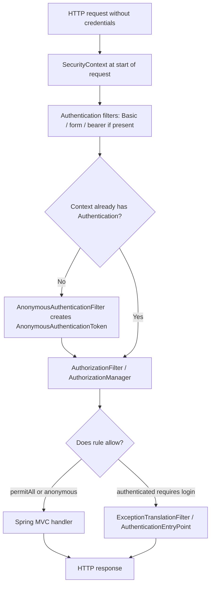

# AnonymousAuthenticationToken and Unauthenticated User State

## Learning Objectives

An unauthenticated request does not necessarily have `Authentication == null` when passing through Spring Security. In a Spring MVC/Servlet application with default anonymous support, Spring Security can place an **`AnonymousAuthenticationToken`** into `SecurityContext` to represent an anonymous caller. That token typically has principal `anonymousUser`, authority `ROLE_ANONYMOUS`, and notably **`isAuthenticated() == true`**. This sounds contradictory until we separate two questions: "is there an Authentication object so the framework can handle callers uniformly?" and "has the caller proved their identity yet?".

This lesson explains the exact role of anonymous authentication, how to recognize it, the difference between `permitAll()` and `anonymous()`, why unauthenticated users typically receive **401** on private endpoints, and a runnable example with **Java 17, Spring Boot 3.5.0, Spring Security 6.5.x, and Spring MVC**.

After completing this lesson, you will be able to:

1. Explain how **`AnonymousAuthenticationFilter`**, **`AnonymousAuthenticationToken`**, and **`AnonymousAuthenticationProvider`** work together.
2. Distinguish `null Authentication`, an unauthenticated `UsernamePasswordAuthenticationToken`, an anonymous token, and a logged-in user token.
3. Avoid mistaking `Authentication#isAuthenticated()` for proof that "a real user has logged in".
4. Use `AuthenticationTrustResolver`/`AuthenticationTrustResolverImpl` to check for anonymous and understand the differences between anonymous, remember-me, authenticated, and fully authenticated.
5. Understand why a Spring MVC `Authentication` method argument can be `null` for anonymous callers while `@CurrentSecurityContext` still reads the anonymous token.
6. Apply `permitAll()`, `anonymous()`, `authenticated()`, `fullyAuthenticated()`, `hasRole(...)`, and `denyAll()` to the right subjects.
7. Run and verify 200/401/403 responses along with token characteristics using MockMvc and JUnit.

**Scope:** Servlet stack, `HttpSecurity`, and `SecurityFilterChain` on Spring Security 6.5.x. WebFlux uses `ServerHttpSecurity`, `SecurityWebFilterChain`, and `ReactiveSecurityContextHolder`; do not copy Servlet code verbatim into WebFlux. Sample accounts and passwords are for local learning environments only.

## 1. What Does "Anonymous Authentication" Mean?

In everyday language, *anonymous* means someone who has not provided a verified identity. Spring Security likewise understands anonymous as someone **not actually logged in**, yet places an object into the security context so authorization, logging, and auditing layers can handle callers consistently.

Suppose a browser sends:

```http
GET /public/ping HTTP/1.1
Host: localhost:8080
```

The request has no credentials, no valid login session, and no bearer token. After other authentication filters do not establish an `Authentication`, `AnonymousAuthenticationFilter` can create:

```text
AnonymousAuthenticationToken
  principal       = anonymousUser
  authorities     = [ROLE_ANONYMOUS]
  authenticated   = true   (token flag)
  credentials     = ""     (empty string per implementation)
```

**Do not interpret `authenticated=true` here as a successful login.** This is a special internal representation for unauthenticated callers, recognized by its token type and `AuthenticationTrustResolver`. Spring Security will not let an anonymous caller pass an `authenticated()` rule merely because that flag is true.

### 1.1. Why Does the Framework Want an Anonymous Object?

There are at least four benefits:

- **Consistent policies:** public/guest/private endpoints can be expressed within the same authorization system.
- **Auditing/logging:** code reading `SecurityContext` has a default principal for anonymous requests instead of handling `null` everywhere.
- **Distinguishing trust levels:** the framework separates anonymous, remember-me, and fully logged-in users.
- **Accurate entry point:** when an anonymous caller is denied access to a private endpoint, Spring Security can prompt the caller to log in (typically 401 Basic or 302 form login) rather than merely returning 403.

Anonymous authentication **does not turn a stranger into a database account**; it creates no password, grants no logged-in session, adds no permission to view others' data, and does not assign `ROLE_USER`.

### 1.2. Conceptual Path of an Anonymous Request



The diagram illustrates a typical path, not the exact order of every filter in every `SecurityFilterChain`. The key decisions are: whether another filter already authenticated the caller, whether the anonymous filter is enabled, which authorization rule matches the request, and how exception handling responds.

## 2. Three Components of Anonymous Authentication

### 2.1. AnonymousAuthenticationFilter: Adds a Token Only If Missing

In a Servlet security chain, `AnonymousAuthenticationFilter` populates `SecurityContextHolder` with an anonymous token when **there is no Authentication yet**. When a user has already logged in validly, the filter must not overwrite that identity with anonymous.

Think of it as pseudocode:

```java
// PSEUDOCODE: not verbatim framework source code.
Authentication current = securityContext.getAuthentication();
if (current == null) {
    securityContext.setAuthentication(createAnonymousToken());
}
```

Important: the anonymous token is created **after the relevant authentication mechanisms** in the chain; it does not read Basic headers or check passwords itself. If the request has valid Basic credentials, the result from `BasicAuthenticationFilter`/provider is used. If there is no valid login, anonymous can be placed into the context.

For a request carrying wrong credentials, the authentication filter may handle the error and terminate with a challenge without continuing down the usual anonymous path. Therefore **do not conclude every failed login request reaches the controller with an anonymous token**.

### 2.2. AnonymousAuthenticationToken: A Special Authentication

`org.springframework.security.authentication.AnonymousAuthenticationToken` implements `Authentication` via `AbstractAuthenticationToken`. It holds a principal and `GrantedAuthority` set for the anonymous caller. Typical defaults:

| Property | Typical default value | Meaning |
| --- | --- | --- |
| Token type | `AnonymousAuthenticationToken` | An internal marker for anonymous identity. |
| Principal | `anonymousUser` | Default display name; not a user looked up in a database. |
| Authorities | `ROLE_ANONYMOUS` | Default authority for anonymous tokens, not `ROLE_USER`. |
| `isAuthenticated()` | `true` | Internal state of the token; **does not mean actually logged in**. |
| `getCredentials()` | `""` | Empty string, holds no user password. |
| `getName()` | Typically `anonymousUser` | Usable for description/audit, not an authenticated identity. |

This token holds no login password, grants no permission to access `authenticated()` APIs, and carries no proof of resource ownership. The `ROLE_ANONYMOUS` authority is a **framework classification authority** and should not be given business-role semantics.

### 2.3. AnonymousAuthenticationProvider: Supporting the Anonymous Token Type

`AnonymousAuthenticationProvider` can be registered in `ProviderManager` to recognize/validate the anonymous token it supports. Classic configurations of the filter/provider share a **key**; Spring Security uses it for internal consistency across components.

**Do not treat the key as a trusted authentication secret.** Spring Security's documentation emphasizes this key is not a true security boundary. If an untrusted remote client could construct an `Authentication` object and submit it to an `AuthenticationManager` sharing an anonymous provider, that architecture needs redesigning; never use the anonymous token key to verify identity.

In ordinary Spring Boot Servlet applications, you **do not need to manually instantiate** `AnonymousAuthenticationFilter` or `AnonymousAuthenticationProvider` just to get anonymous support. `HttpSecurity` typically configures this feature by default.

### 2.4. Do Not Confuse AnonymousAuthenticationToken with an "Unauthenticated Login Request"

`UsernamePasswordAuthenticationToken.unauthenticated("alice", "raw-password")` holds sender-supplied principal/credentials awaiting verification by `AuthenticationManager`.

`AnonymousAuthenticationToken`, by contrast, is a token **created by the framework to represent someone with no login identity**, not a login attempt waiting for a provider. Neither represents a "logged-in user", yet they **differ in purpose and internal state**.

## 3. Four States Easily Mixed Up

| State | Example `Authentication` | `isAuthenticated()` | Can be treated as a real logged-in user? |
| --- | --- | :---: | --- |
| **No Authentication** | `null` in context before anonymous filter runs or outside security chain | No object to call | No. |
| **Unverified login request** | `UsernamePasswordAuthenticationToken.unauthenticated(...)` | `false` | No. |
| **Anonymous** | `AnonymousAuthenticationToken` | Typically **true** | **No**; trust resolver recognizes anonymous. |
| **Verified login** | `UsernamePasswordAuthenticationToken` returned by provider after password verification | Typically **true** | Yes, within the corresponding mechanism and trust level. |
| **Remember-me** | `RememberMeAuthenticationToken` | Typically **true** | Recognized via remember-me, but not `fullyAuthenticated()`. |

This table describes typical cases only. With pre-authentication, JWT, OAuth2/OIDC, or custom tokens, types/principals/authorities differ; trust levels must be determined by the security mechanism and policy.

### 3.1. Why Can a Plain Boolean If-Check Fail?

The following is a classic bug:

```java
Authentication authentication =
    SecurityContextHolder.getContext().getAuthentication();

if (authentication != null && authentication.isAuthenticated()) {
    // Wrong if interpreted as "this is definitely a real logged-in user".
    showPrivateData();
}
```

With the default anonymous token, both conditions can hold true even though the caller **is not logged in**. Using that logic to guard sensitive data can open the wrong access boundary.

**Preferred solution:** let Spring Security's `authorizeHttpRequests(...).authenticated()` or method authorization enforce policies where appropriate. Those rules carry semantics that distinguish anonymous via a trust resolver. When forced to check in business code, use `AuthenticationTrustResolver` and test missing-context, anonymous, and remember-me cases.

### 3.2. Do Not Check by Principal Name

This is also unreliable:

```java
boolean guest = "anonymousUser".equals(authentication.getName());
```

Because `principal` can be customized via `HttpSecurity.anonymous(...)`, and an application should not infer trust level from a display name. In practice, a registered user's username could even look like the anonymous name if allowed.

Similarly, `authentication.getAuthorities().contains("ROLE_ANONYMOUS")` is not a general way to identify authentication types, especially with custom authorities or type mismatches comparing `GrantedAuthority` against `String`.

## 4. How Does AuthenticationTrustResolver Recognize Anonymous?

Spring Security provides the `AuthenticationTrustResolver` interface and `AuthenticationTrustResolverImpl` implementation to distinguish login states. This is a proper mechanism compared to checking a boolean or comparing principal strings.

Example fragment:

```java
Authentication auth =
    SecurityContextHolder.getContext().getAuthentication();

AuthenticationTrustResolver trustResolver =
    new AuthenticationTrustResolverImpl();

boolean isGuest = trustResolver.isAnonymous(auth);
```

Imports:

```java
import org.springframework.security.authentication.AuthenticationTrustResolver;
import org.springframework.security.authentication.AuthenticationTrustResolverImpl;
import org.springframework.security.core.Authentication;
import org.springframework.security.core.context.SecurityContextHolder;
```

This is a **conceptual fragment** that does not belong in every controller since Spring Security handles most policies already. In the full lab later, we use the trust resolver to build a dedicated observation endpoint.

### 4.1. Trust Levels

Common semantics:

- **Anonymous:** no verified login identity yet; `trustResolver.isAnonymous(authentication)` returns true for the default anonymous token.
- **Remember-me:** a user with an identity restored from a session-remembering mechanism without necessarily undergoing a recent interactive login; the trust resolver has `isRememberMe(...)`.
- **Authenticated:** the `authenticated()` policy does not treat an anonymous token as a logged-in user, though it may accept remember-me in appropriate contexts.
- **Fully authenticated:** the `fullyAuthenticated()` policy requires a full authentication state, excluding anonymous and remember-me.

Do not treat "fully authenticated" as a guarantee that the user just completed MFA or re-authenticated within a specific window. If business logic requires step-up authentication for sensitive transactions, model that requirement explicitly.

### 4.2. Why Does the Framework Not Rely Only on isAuthenticated()?

For an anonymous token, `isAuthenticated()` can be true. However, the framework **knows it is anonymous** via authentication type / trust resolver and still enforces `authenticated()` with proper semantics. This also enables `ExceptionTranslationFilter` to choose **start authentication** when an unauthenticated caller is denied, instead of treating them as logged in and always returning 403.

### 4.3. Short Illustrative Unit Test

```java
AuthenticationTrustResolver resolver =
    new AuthenticationTrustResolverImpl();

AnonymousAuthenticationToken guest =
    new AnonymousAuthenticationToken(
        "local-key",
        "anonymousUser",
        List.of(new SimpleGrantedAuthority("ROLE_ANONYMOUS"))
    );

System.out.println(guest.isAuthenticated());       // true
System.out.println(resolver.isAnonymous(guest));    // true

Authentication loginRequest =
    UsernamePasswordAuthenticationToken.unauthenticated(
        "learner", "demo-secret"
    );

System.out.println(loginRequest.isAuthenticated()); // false
System.out.println(resolver.isAnonymous(loginRequest)); // false
```

This is a **fragment depending on Spring Security classes** and proper imports, not a standalone Java file compiled with plain `javac`. Expected logical output:

```text
true
true
false
false
```

Key takeaway: **`!isAnonymous(...)` does not equal `authenticated()`**. An unverified login request is not an `AnonymousAuthenticationToken` either, yet still cannot be treated as a valid identity. When you need framework policies, use the built-in authorization rules.

## 5. Where Does the Anonymous Token Live in Spring MVC?

A detail that easily misleads debugging: Spring MVC has multiple ways to inject identity into controller methods, and they **do not behave uniformly** for anonymous callers.

### 5.1. HttpServletRequest#getPrincipal() Can Be Null

Spring Security's documentation explicitly notes: servlet APIs like `HttpServletRequest#getUserPrincipal()` or `getCallerPrincipal()` may still return `null` for anonymous callers, even though `SecurityContextHolder` holds an `AnonymousAuthenticationToken`.

In Spring MVC, the parameter:

```java
@GetMapping("/public/whoami")
String whoami(Authentication authentication) {
    return authentication == null ? "none" : authentication.getName();
}
```

is typically resolved by Spring MVC via `HttpServletRequest#getPrincipal`. On an anonymous request, the `authentication` parameter can be **null**. Thus the branch:

```java
if (authentication instanceof AnonymousAuthenticationToken) {
    return "anonymous";
}
```

may **never enter the anonymous branch**, even though the anonymous filter placed the token into Spring Security's context. This is a common source of confusion when learners "cannot see the anonymous token" in a controller.

### 5.2. Use @CurrentSecurityContext to Observe the Anonymous Token Accurately

To observe anonymous callers as well, read the security context directly:

```java
@GetMapping("/public/security-context")
String contextInfo(@CurrentSecurityContext SecurityContext context) {
    Authentication auth = context.getAuthentication();
    return auth instanceof AnonymousAuthenticationToken
        ? "anonymous"
        : "other";
}
```

Imports:

```java
import org.springframework.security.authentication.AnonymousAuthenticationToken;
import org.springframework.security.core.Authentication;
import org.springframework.security.core.context.SecurityContext;
import org.springframework.security.core.annotation.CurrentSecurityContext;
```

This is a controller fragment needing Spring MVC annotation imports. The lab below uses `@CurrentSecurityContext` alongside `HttpServletRequest` to show **both perspectives in one response**.

### 5.3. Do Not Design Business Services Around anonymousUser

For a public catalog page, the response may be identical for all anonymous users. For a pre-login shopping cart, you can use a dedicated application-managed guest session/ID. However, `anonymousUser` **is not a unique user ID per visitor**. Many anonymous visitors share the exact same display principal name `anonymousUser`.

**Wrong:** saving orders, comments, or resource ownership with `ownerUsername = "anonymousUser"` and expecting guests not to see one another's data.

**Right:** when temporary guest identification is needed, design a random guest identity/session with explicit ownership and lifetime, cookie/CSRF controls, and a clear ownership-transfer policy upon login. The anonymous token is merely a convenient marker for the security framework.

## 6. authorizeHttpRequests: permitAll, anonymous, and authenticated Differ

Spring Security supports multiple policy types through `HttpSecurity.authorizeHttpRequests(...)`:

| Rule | Unauthenticated user | Validly logged-in user | Meaning |
| --- | :---: | :---: | --- |
| `permitAll()` | Allowed | Allowed | Endpoint public to everyone. |
| `anonymous()` | Allowed | Denied | Only callers in anonymous state. |
| `authenticated()` | Denied/challenged | Allowed | Must have an authenticated identity, excluding anonymous tokens. |
| `fullyAuthenticated()` | Denied/challenged | Allowed if trust level suffices | Excludes anonymous and remember-me. |
| `hasRole("ADMIN")` | Fails | Only callers with `ROLE_ADMIN` | Checks granted role. |
| `hasAuthority("ROLE_ANONYMOUS")` | Usually passes with default anonymous | Usually fails | Checks authority string; not a general state check. |
| `denyAll()` | Denied | Denied | Allows nobody through. |

**Key distinction:** `permitAll()` does not mean "guests only". If a registration or product landing page must serve both guests and logged-in users, use `permitAll()`. If a page is exclusively for callers who are not logged in, such as `/guest-only` in the lab, use `anonymous()` as required.

### 6.1. Clear Rule Example

```java
http.authorizeHttpRequests(auth -> auth
    .requestMatchers("/public/**").permitAll()
    .requestMatchers("/guest-only").anonymous()
    .requestMatchers("/api/**").authenticated()
    .requestMatchers("/admin/**").hasRole("ADMIN")
    .anyRequest().denyAll()
);
```

This is an **`HttpSecurity` fragment**. Place **more specific rules before broader ones**: for example, if `/api/admin/**` requires ADMIN, it must come before `/api/**` which only requires authenticated. In the example above, `/admin/**` does not overlap `/api/**`.

`.anyRequest().denyAll()` prevents new endpoints from accidentally becoming public. It can cause nonexistent routes to return an authorization error before Spring MVC produces 404; design error/dispatch policies to fit the application.

### 6.2. permitAll Still Runs Security Filters

`permitAll()` means the authorization rule **allows the request to proceed**, not that Spring Security is disabled. Other filters, including anonymous support and security headers, can still run. Spring Security generally recommends `permitAll` for public resources rather than excluding them from the filter chain with `web.ignoring()`.

Conversely, excluding a URL entirely from the Security filter chain may mean **no anonymous token**, no security headers, or missing protections. Not seeing an `Authentication` in code outside the filter chain proves neither that the browser is logged in nor that the policy is sound.

### 6.3. anonymous() Is Not Passwordless Login

`anonymous()` only describes a rule for unauthenticated callers. It is not OAuth anonymous login, does not create a guest account with custom privileges, and is not a trick for "letting write APIs run without a token".

If an endpoint performs writes, define **temporary permissions, anti-spam/abuse controls, CSRF, email/OTP verification when needed, ownership, and lifecycle**; the anonymous policy is just one piece of the design.

## 7. Why Do Unauthenticated Users Receive 401 Instead of 403?

Distinguish two layers:

1. `AuthorizationFilter` and the authorization manager evaluate the policy for the request. If an anonymous request hits an endpoint requiring `authenticated()`, the decision is **deny**.
2. `ExceptionTranslationFilter` catches the denial exception and can use `AuthenticationTrustResolver` to detect that the authentication is anonymous. For anonymous callers, it invokes **`AuthenticationEntryPoint`** to initiate login.
3. With **HTTP Basic**, the entry point typically returns **401 Unauthorized** with `WWW-Authenticate`. With **form login**, it can redirect **302** to the login page.
4. If the caller is genuinely authenticated yet lacks permission, `AccessDeniedHandler` typically responds with **403 Forbidden**.

```text
GET /api/me (not logged in)
      |
      v
AnonymousAuthenticationToken in context
      |
      v
Authorization: .authenticated() -> denied
      |
      v
ExceptionTranslationFilter + AuthenticationTrustResolver
      |
      v
Anonymous -> AuthenticationEntryPoint -> 401 Basic / 302 form

GET /admin/ping (learner logged in)
      |
      v
Verified Authentication, has only ROLE_USER
      |
      v
Authorization: .hasRole("ADMIN") -> denied
      |
      v
AccessDeniedHandler -> typically 403
```

**Do not infer status solely from the token:** it also depends on form/Basic/Bearer, custom exception handling, request type, and other filters. 403 can also come from **CSRF**, and 401 can occur on wrong credentials even if a URL is public by policy. Read actual logs/responses before concluding.

### 7.1. Wrong Credentials Differ from Sending No Credentials

On a request sending **no** Basic header, the anonymous filter may create a token to support authorization. On a request sending **wrong** Basic credentials, `BasicAuthenticationFilter` may catch the authentication error, clear the current security context, and invoke the entry point for login failure. Both requests may return 401 on a private endpoint, yet **their execution paths are not identical**.

A helpful debugging rule: log the 401/403, authentication type, and denied rule; never log raw passwords, Basic headers, bearer tokens, or session cookies.

## 8. Runnable Example: Boot 3.5, Java 17, Spring Security 6.5

### 8.1. Project Purpose

Create five endpoints:

| HTTP endpoint | Policy | Outcome to observe |
| --- | --- | --- |
| `GET /public/ping` | `permitAll` | Both anonymous and logged-in users can access. |
| `GET /public/context` | `permitAll` | Compares security context with Servlet principal, distinguishing anonymous vs. verified user. |
| `GET /guest-only` | `anonymous` | Anonymous gets 200; logged-in user gets 403. |
| `GET /api/me` | `authenticated` | Anonymous gets 401; validly logged-in user gets 200. |
| `GET /admin/ping` | `hasRole("ADMIN")` | Learner gets 403; admin gets 200. |

Two demo accounts:

- `learner` / `learner-pass`: authority `ROLE_USER`.
- `admin` / `admin-pass`: authorities `ROLE_USER` and `ROLE_ADMIN`.

**Passwords and accounts here are for localhost learning only.** Never hard-code production credentials, and never use HTTP Basic over unencrypted HTTP outside local environments.

### 8.2. Directory Structure

```text
anonymous-security-lab/
├── pom.xml
└── src/
    ├── main/java/com/example/anonymous/
    │   ├── AnonymousLabApplication.java
    │   ├── SecurityConfig.java
    │   └── IdentityController.java
    └── test/java/com/example/anonymous/
        ├── AnonymousTokenTest.java
        └── AnonymousHttpTest.java
```

### 8.3. pom.xml

```xml
<project xmlns="http://maven.apache.org/POM/4.0.0"
         xmlns:xsi="http://www.w3.org/2001/XMLSchema-instance"
         xsi:schemaLocation="http://maven.apache.org/POM/4.0.0 https://maven.apache.org/xsd/maven-4.0.0.xsd">
    <modelVersion>4.0.0</modelVersion>

    <parent>
        <groupId>org.springframework.boot</groupId>
        <artifactId>spring-boot-starter-parent</artifactId>
        <version>3.5.0</version>
        <relativePath/>
    </parent>

    <groupId>com.example</groupId>
    <artifactId>anonymous-security-lab</artifactId>
    <version>1.0.0</version>

    <properties>
        <java.version>17</java.version>
    </properties>

    <dependencies>
        <dependency>
            <groupId>org.springframework.boot</groupId>
            <artifactId>spring-boot-starter-web</artifactId>
        </dependency>
        <dependency>
            <groupId>org.springframework.boot</groupId>
            <artifactId>spring-boot-starter-security</artifactId>
        </dependency>
        <dependency>
            <groupId>org.springframework.boot</groupId>
            <artifactId>spring-boot-starter-test</artifactId>
            <scope>test</scope>
        </dependency>
        <dependency>
            <groupId>org.springframework.security</groupId>
            <artifactId>spring-security-test</artifactId>
            <scope>test</scope>
        </dependency>
    </dependencies>

    <build>
        <plugins>
            <plugin>
                <groupId>org.springframework.boot</groupId>
                <artifactId>spring-boot-maven-plugin</artifactId>
            </plugin>
        </plugins>
    </build>
</project>
```

This is a **Servlet MVC** Maven project using only `spring-boot-starter-web`, without adding `spring-boot-starter-webflux`. The Spring Boot parent/BOM selects compatible versions for Spring Security and modules. `3.5.0` is an example milestone; in real projects apply currently supported patch releases.

### 8.4. AnonymousLabApplication.java

```java
package com.example.anonymous;

import org.springframework.boot.SpringApplication;
import org.springframework.boot.autoconfigure.SpringBootApplication;

@SpringBootApplication
public class AnonymousLabApplication {
    public static void main(String[] args) {
        SpringApplication.run(AnonymousLabApplication.class, args);
    }
}
```

The `@SpringBootApplication` class sits in the root package, so Spring component scanning discovers `SecurityConfig` and `IdentityController` in the same package. Startup does not create production identities; users come from the bean below.

### 8.5. SecurityConfig.java

```java
package com.example.anonymous;

import org.springframework.context.annotation.Bean;
import org.springframework.context.annotation.Configuration;
import org.springframework.http.HttpMethod;
import org.springframework.security.config.Customizer;
import org.springframework.security.config.annotation.web.builders.HttpSecurity;
import org.springframework.security.config.annotation.web.configurers.AbstractHttpConfigurer;
import org.springframework.security.core.userdetails.User;
import org.springframework.security.core.userdetails.UserDetails;
import org.springframework.security.core.userdetails.UserDetailsService;
import org.springframework.security.crypto.bcrypt.BCryptPasswordEncoder;
import org.springframework.security.crypto.password.PasswordEncoder;
import org.springframework.security.provisioning.InMemoryUserDetailsManager;
import org.springframework.security.web.SecurityFilterChain;

@Configuration(proxyBeanMethods = false)
public class SecurityConfig {

    @Bean
    PasswordEncoder passwordEncoder() {
        return new BCryptPasswordEncoder();
    }

    @Bean
    UserDetailsService users(PasswordEncoder encoder) {
        UserDetails learner = User.withUsername("learner")
            .password(encoder.encode("learner-pass"))
            .roles("USER")
            .build();

        UserDetails admin = User.withUsername("admin")
            .password(encoder.encode("admin-pass"))
            .roles("USER", "ADMIN")
            .build();

        return new InMemoryUserDetailsManager(learner, admin);
    }

    @Bean
    SecurityFilterChain securityFilterChain(HttpSecurity http)
            throws Exception {

        return http
            .authorizeHttpRequests(auth -> auth
                .requestMatchers(
                    HttpMethod.GET,
                    "/public/ping",
                    "/public/context"
                ).permitAll()
                .requestMatchers(HttpMethod.GET, "/guest-only").anonymous()
                .requestMatchers(HttpMethod.GET, "/api/me").authenticated()
                .requestMatchers(HttpMethod.GET, "/admin/ping").hasRole("ADMIN")
                .anyRequest().denyAll()
            )
            .httpBasic(Customizer.withDefaults())
            .formLogin(AbstractHttpConfigurer::disable)
            .build();
    }
}
```

Key points to explain:

1. `InMemoryUserDetailsManager` stores two learning users with BCrypt-hashed passwords. This is not a database or secret-management system; the source still contains demo passwords.
2. `SecurityFilterChain` defines permissions by HTTP method/path. `requestMatchers` are authorization rules, not controller route declarations.
3. The listed `/public/**` URLs have `permitAll`, so both anonymous and authenticated users can enter.
4. `/guest-only` has **`anonymous()`**, the opposite of a login-only endpoint: validly logged-in users are denied access.
5. `/api/me` has **`authenticated()`**; even though the anonymous token has `isAuthenticated()=true`, the framework denies it.
6. `/admin/ping` requires `ROLE_ADMIN` per the `hasRole("ADMIN")` convention.
7. `.anyRequest().denyAll()` keeps new routes closed even if another `@GetMapping` exists in the source.
8. `httpBasic(...)` is enabled so curl and MockMvc can test easily; form login is disabled **only in this lab** to avoid HTML redirects, without disabling anonymous support or default CSRF.
9. We **do not call `http.anonymous(...)`**: this is intentional so we observe the default anonymous principal `anonymousUser` and authority `ROLE_ANONYMOUS`. If customized later, tests must be updated to match the new policy.

### 8.6. IdentityController.java: Inspecting Both SecurityContext and Servlet Principal Together

```java
package com.example.anonymous;

import jakarta.servlet.http.HttpServletRequest;

import java.util.List;
import java.util.Map;

import org.springframework.security.authentication.AuthenticationTrustResolver;
import org.springframework.security.authentication.AuthenticationTrustResolverImpl;
import org.springframework.security.core.Authentication;
import org.springframework.security.core.GrantedAuthority;
import org.springframework.security.core.annotation.CurrentSecurityContext;
import org.springframework.security.core.context.SecurityContext;
import org.springframework.web.bind.annotation.GetMapping;
import org.springframework.web.bind.annotation.RestController;

@RestController
public class IdentityController {

    private final AuthenticationTrustResolver trustResolver =
        new AuthenticationTrustResolverImpl();

    @GetMapping("/public/ping")
    public String ping() {
        return "pong";
    }

    @GetMapping("/public/context")
    public Map<String, Object> context(
            @CurrentSecurityContext SecurityContext context,
            HttpServletRequest request) {

        Authentication auth = context.getAuthentication();

        List<String> authorities = (auth == null)
            ? List.of()
            : auth.getAuthorities().stream()
                .map(GrantedAuthority::getAuthority)
                .sorted()
                .toList();

        return Map.of(
            "name", auth == null ? "(none)" : auth.getName(),
            "tokenAuthenticated", auth != null && auth.isAuthenticated(),
            "anonymous", trustResolver.isAnonymous(auth),
            "servletPrincipalPresent", request.getUserPrincipal() != null,
            "authorities", authorities
        );
    }

    @GetMapping("/guest-only")
    public String guestOnly() {
        return "guest-only";
    }

    @GetMapping("/api/me")
    public Map<String, String> me(Authentication authentication) {
        return Map.of("username", authentication.getName());
    }

    @GetMapping("/admin/ping")
    public String adminPing() {
        return "admin-only";
    }
}
```

**Analyzing `/public/context`:**

- `@CurrentSecurityContext SecurityContext context` retrieves Spring Security's context directly, including when anonymous authentication is present.
- `context.getAuthentication()` can return `AnonymousAuthenticationToken` on anonymous requests passing through the Security filter chain.
- `trustResolver.isAnonymous(auth)` classifies the token more reliably than checking the name `anonymousUser`.
- `tokenAuthenticated` intentionally reveals that an anonymous token has flag `true` yet `anonymous=true`.
- `request.getUserPrincipal()` per the Servlet API is typically null for anonymous callers, even though `SecurityContext` holds the token. On a successful Basic login, the Servlet principal appears on the request wrapper in standard setups.
- `authorities` is a curated list of strings; it does not expose credentials, session IDs, or the full `Authentication` object.

**Do not accidentally ship a diagnostic endpoint like `/public/context` in a real product.** In the lab it only exposes safe metadata of mock accounts. In production, public responses should not disclose internal permission lists or security runtime structure unnecessarily.

`GET /api/me` uses the `Authentication` method argument because the URL already requires `authenticated()`; there, a valid logged-in identity is passed to the handler. For anonymous callers on public endpoints, **do not rely on this method argument alone to detect anonymous** because Spring MVC may resolve it via the Servlet principal and return null.

### 8.7. Running with Maven, Testing with curl

From the directory containing `pom.xml`:

```bash
java -version
mvn -version
mvn spring-boot:run
```

In another terminal:

```bash
curl -i http://localhost:8080/public/ping
curl -i http://localhost:8080/public/context
curl -i -u learner:learner-pass http://localhost:8080/public/context
curl -i http://localhost:8080/guest-only
curl -i -u learner:learner-pass http://localhost:8080/guest-only
curl -i http://localhost:8080/api/me
curl -i -u learner:learner-pass http://localhost:8080/api/me
curl -i -u learner:wrong-pass http://localhost:8080/api/me
curl -i -u learner:learner-pass http://localhost:8080/admin/ping
curl -i -u admin:admin-pass http://localhost:8080/admin/ping
```

On Windows PowerShell, use `curl.exe` if `curl` is an alias for `Invoke-WebRequest`.

Expected results:

| Request | HTTP status | Key content |
| --- | --- | --- |
| Anonymous `GET /public/ping` | 200 | `pong` |
| Anonymous `GET /public/context` | 200 | `name=anonymousUser`, `tokenAuthenticated=true`, `anonymous=true`, `servletPrincipalPresent=false`, `authorities=["ROLE_ANONYMOUS"]` |
| Valid learner `GET /public/context` | 200 | `name=learner`, `tokenAuthenticated=true`, `anonymous=false`, `servletPrincipalPresent=true`, `authorities=["ROLE_USER"]` |
| Anonymous `GET /guest-only` | 200 | `guest-only` |
| Valid learner `GET /guest-only` | 403 | Logged in, so fails `anonymous()` |
| Anonymous `GET /api/me` | 401 | Basic challenge; no username returned |
| Valid learner `GET /api/me` | 200 | JSON `{"username":"learner"}` |
| Wrong password `GET /api/me` | 401 | No verified Authentication |
| Valid learner `GET /admin/ping` | 403 | Missing `ROLE_ADMIN` |
| Valid admin `GET /admin/ping` | 200 | `admin-only` |

**Do not read this table as verbatim HTTP output.** Headers, JSON field ordering, and transport metadata can vary by runtime. Observing the status and listed properties is sufficient. `curl` is not a browser and has no browser-like cookie/session jar here; in this example each request sends Basic credentials per command.

## 9. Unit Test: Anonymous Token and Trust Resolver

To test token semantics in isolation, no HTTP server is required. Create `src/test/java/com/example/anonymous/AnonymousTokenTest.java`:

```java
package com.example.anonymous;

import java.util.List;

import org.junit.jupiter.api.Test;
import org.springframework.security.authentication.AnonymousAuthenticationToken;
import org.springframework.security.authentication.AuthenticationTrustResolver;
import org.springframework.security.authentication.AuthenticationTrustResolverImpl;
import org.springframework.security.authentication.UsernamePasswordAuthenticationToken;
import org.springframework.security.core.Authentication;
import org.springframework.security.core.authority.SimpleGrantedAuthority;

import static org.assertj.core.api.Assertions.assertThat;

class AnonymousTokenTest {

    private final AuthenticationTrustResolver trust =
        new AuthenticationTrustResolverImpl();

    @Test
    void anonymousTokenHasTrueFlagButIsAnonymous() {
        AnonymousAuthenticationToken guest =
            new AnonymousAuthenticationToken(
                "local-demo-key",
                "anonymousUser",
                List.of(new SimpleGrantedAuthority("ROLE_ANONYMOUS"))
            );

        assertThat(guest.isAuthenticated()).isTrue();
        assertThat(guest.getName()).isEqualTo("anonymousUser");
        assertThat(guest.getCredentials()).isEqualTo("");
        assertThat(trust.isAnonymous(guest)).isTrue();
    }

    @Test
    void unverifiedLoginRequestIsNotAnonymousToken() {
        Authentication loginRequest =
            UsernamePasswordAuthenticationToken.unauthenticated(
                "learner", "learner-pass"
            );

        assertThat(loginRequest.isAuthenticated()).isFalse();
        assertThat(trust.isAnonymous(loginRequest)).isFalse();
        assertThat(loginRequest.getAuthorities()).isEmpty();
    }

    @Test
    void VerifiedUsernameTokenIsDifferentFromAnonymous() {
        Authentication verified =
            UsernamePasswordAuthenticationToken.authenticated(
                "learner",
                null,
                List.of(new SimpleGrantedAuthority("ROLE_USER"))
            );

        assertThat(verified.isAuthenticated()).isTrue();
        assertThat(trust.isAnonymous(verified)).isFalse();
        assertThat(verified.getAuthorities())
            .extracting(authority -> authority.getAuthority())
            .containsExactly("ROLE_USER");
    }
}
```

These are **3 unit tests** for tokens and the trust resolver. The third test uses the factory to build an authenticated token solely to simulate the type; **this is not how login is implemented on a real server**. In production applications, only an authentication provider or verified mechanism may produce a trusted authenticated result.

**Key lesson:** unit test 2 shows that `isAnonymous == false` is also insufficient to infer "logged in". You must enforce authentication states via the framework rather than relying on isolated out-of-context checks.

## 10. Integration Test: Same HTTP Endpoint, Different Users

Create `src/test/java/com/example/anonymous/AnonymousHttpTest.java`:

```java
package com.example.anonymous;

import org.junit.jupiter.api.Test;
import org.springframework.beans.factory.annotation.Autowired;
import org.springframework.boot.test.autoconfigure.web.servlet.AutoConfigureMockMvc;
import org.springframework.boot.test.context.SpringBootTest;
import org.springframework.test.web.servlet.MockMvc;

import static org.springframework.security.test.web.servlet.request
    .SecurityMockMvcRequestPostProcessors.httpBasic;
import static org.springframework.test.web.servlet.request.MockMvcRequestBuilders.get;
import static org.springframework.test.web.servlet.result.MockMvcResultMatchers.content;
import static org.springframework.test.web.servlet.result.MockMvcResultMatchers.jsonPath;
import static org.springframework.test.web.servlet.result.MockMvcResultMatchers.status;

@SpringBootTest
@AutoConfigureMockMvc
class AnonymousHttpTest {

    @Autowired
    MockMvc mvc;

    @Test
    void publicPingAllowsAnonymous() throws Exception {
        mvc.perform(get("/public/ping"))
            .andExpect(status().isOk())
            .andExpect(content().string("pong"));
    }

    @Test
    void anonymousContextHasTokenButNoServletPrincipal()
            throws Exception {
        mvc.perform(get("/public/context"))
            .andExpect(status().isOk())
            .andExpect(jsonPath("$.name").value("anonymousUser"))
            .andExpect(jsonPath("$.tokenAuthenticated").value(true))
            .andExpect(jsonPath("$.anonymous").value(true))
            .andExpect(jsonPath("$.servletPrincipalPresent").value(false))
            .andExpect(jsonPath("$.authorities[0]")
                .value("ROLE_ANONYMOUS"));
    }

    @Test
    void loggedInContextIsNotAnonymous() throws Exception {
        mvc.perform(get("/public/context")
                .with(httpBasic("learner", "learner-pass")))
            .andExpect(status().isOk())
            .andExpect(jsonPath("$.name").value("learner"))
            .andExpect(jsonPath("$.tokenAuthenticated").value(true))
            .andExpect(jsonPath("$.anonymous").value(false))
            .andExpect(jsonPath("$.servletPrincipalPresent").value(true))
            .andExpect(jsonPath("$.authorities[0]")
                .value("ROLE_USER"));
    }

    @Test
    void anonymousRuleAllowsGuest() throws Exception {
        mvc.perform(get("/guest-only"))
            .andExpect(status().isOk())
            .andExpect(content().string("guest-only"));
    }

    @Test
    void anonymousRuleRejectsLoggedInUser() throws Exception {
        mvc.perform(get("/guest-only")
                .with(httpBasic("learner", "learner-pass")))
            .andExpect(status().isForbidden());
    }

    @Test
    void authenticatedRuleChallengesGuest() throws Exception {
        mvc.perform(get("/api/me"))
            .andExpect(status().isUnauthorized());
    }

    @Test
    void authenticatedRuleAcceptsLearner() throws Exception {
        mvc.perform(get("/api/me")
                .with(httpBasic("learner", "learner-pass")))
            .andExpect(status().isOk())
            .andExpect(jsonPath("$.username").value("learner"));
    }

    @Test
    void incorrectPasswordIsRejected() throws Exception {
        mvc.perform(get("/api/me")
                .with(httpBasic("learner", "wrong-pass")))
            .andExpect(status().isUnauthorized());
    }

    @Test
    void adminRouteRejectsOrdinaryUser() throws Exception {
        mvc.perform(get("/admin/ping")
                .with(httpBasic("learner", "learner-pass")))
            .andExpect(status().isForbidden());
    }

    @Test
    void adminRouteAcceptsAdmin() throws Exception {
        mvc.perform(get("/admin/ping")
                .with(httpBasic("admin", "admin-pass")))
            .andExpect(status().isOk())
            .andExpect(content().string("admin-only"));
    }

    @Test
    void unlistedRouteIsDeniedForAuthenticatedUser() throws Exception {
        mvc.perform(get("/unlisted")
                .with(httpBasic("learner", "learner-pass")))
            .andExpect(status().isForbidden());
    }
}
```

**There are 11 integration tests** covering:

- `permitAll()` on a public endpoint.
- The anonymous token appearing properly in `SecurityContext`.
- The Servlet principal being absent when anonymous.
- A Basic-logged-in user no longer treated as anonymous.
- `anonymous()` accepting guests while rejecting logged-in users.
- `authenticated()` rejecting anonymous callers.
- Wrong passwords denied even when a Basic header is sent.
- `hasRole("ADMIN")` distinguishing USER from ADMIN.
- `denyAll()` preventing new endpoints from accidentally becoming public.

MockMvc runs Spring MVC requests through the security filters in the test application context. It tests the code layers in this lesson, but does not replace testing browser sessions, load balancers, or identity providers if production uses those mechanisms.

### 10.1. Running Tests

```bash
mvn test
```

With the configuration and filenames above, there are **14 tests** in total: 3 unit tests + 11 integration tests. All are expected to pass when dependencies and environment are correct. If a test fails, check the actual assertion and HTTP status; the tables in this document state expected results, **not logs from a pre-executed run**.

`JUnit` and `spring-security-test` help verify behavior, though no test here uses real passwords. Demo accounts live only in the test process's memory.

## 11. Customizing the Anonymous Principal and Authorities When Truly Needed

By default, most applications **do not need** to configure anonymous support manually. If you want to change the guest display name or authority for a specific policy, `HttpSecurity` supports:

```java
http.anonymous(anonymous -> anonymous
    .principal("guestVisitor")
    .authorities("ROLE_GUEST")
);
```

This is an **`HttpSecurity` fragment** meant for an appropriate configuration class, not a standalone Java class. On Spring Security 6.5, the lambda `anonymous(Customizer)` API is preferred over the older deprecated no-arg `anonymous()` call.

After customizing, `getName()`/`getAuthorities()` on the anonymous token may change. However, **`AuthenticationTrustResolver.isAnonymous(...)` still recognizes the `AnonymousAuthenticationToken` type**, and the `authenticated()` rule still does not treat guests as logged-in users.

**Never turn `ROLE_GUEST` into permission to view personal data** just because a user lacks an account. If an endpoint needs temporary guest identity, design a per-client random session/token and isolated ownership, not a shared static principal.

### 11.1. Does Disabling Anonymous Support Make an App Safer?

You can configure:

```java
http.anonymous(AbstractHttpConfigurer::disable);
```

This is a **fragment solely to illustrate the API**. Disabling anonymous does not replace authorization. It can make `SecurityContext#getAuthentication()` null on unauthenticated requests and affect code/policies expecting the anonymous marker. If a system must disable it for a special model, re-test entry points, exception handling, authorization, and auditing use cases.

Do not disable anonymous just to fix a bug where "`isAuthenticated()` returns true". Fix **how permissions are checked** using a trust resolver or built-in authorization. Removing the anonymous filter may expose extra `NullPointerException` bugs in unguarded code without improving security policy quality.

### 11.2. Protecting Registration/Login Pages

Registration and login are typically pages **allowing unauthenticated callers**. They can use `permitAll()` if a logged-in user still needs to view them or redirect via custom logic. `anonymous()` can fit if policy decrees the login page is strictly for guests, though that requires testing both users who already hold a session and redirects/entry points to avoid loops.

Not every login form must use `anonymous()`. When the requirement is simply a page accessible before login, `permitAll()` is usually clearer and easier to operate.

## 12. Anonymous, CSRF, CORS, and Sessions Are Separate Concepts

### 12.1. An Anonymous Token Does Not Prevent CSRF

A `POST /guest/feedback` endpoint may let unauthenticated callers submit feedback, yet if the request involves browsers/sessions/cookies, CSRF risk must still be evaluated. Spring Security Servlet typically enables CSRF protection by default for state-changing HTTP methods.

**Wrong:** "Anonymous requests have no CSRF risk, just disable CSRF."

**Right:** evaluate whether the browser automatically attaches credentials/cookies or any state that could be abused, whether the endpoint has side effects, how CSRF tokens are designed, and whether appropriate anti-spam/rate-limiting layers exist.

### 12.2. Anonymous and CORS Are Two Different Things

Suppose a frontend at `http://localhost:5173` calls `http://localhost:8080/public/context`: even when the endpoint is `permitAll` and the caller is a guest, JavaScript still needs a valid **CORS** policy for the browser to read cross-origin responses. CORS provides no login identity and does not replace Spring Security authorization.

### 12.3. An Anonymous Token Does Not Mean the Server Creates an HTTP Session

An unauthenticated request may use an anonymous token within the **current request** context. Creating an anonymous token alone does not mean every request creates a persistent session to remember the user. Sessions can arise from other app/security mechanisms (such as saved requests, CSRF tokens, or session logic), so inspect real requests/responses.

Guest data that must survive across requests—such as a pre-login shopping cart—requires a **dedicated guest/session identification mechanism** with proper cookies/IDs. Never use the string `anonymousUser` as a shared key across everyone.

### 12.4. Anonymous and Logout

After a valid logout, the logged-in principal is no longer an authorized identity for subsequent requests. A follow-up request sending no credentials may once again receive an `AnonymousAuthenticationToken` from the anonymous filter. That **does not mean logout failed**; what to verify is that protected endpoints deny access and old sessions/tokens can no longer be used as designed.

With HTTP Basic, a client may continue sending username/password on later requests and thus re-authenticate; server-side logout cannot force a client to forget Basic credentials it keeps actively sending.

## 13. SecurityContext, Async, and Background Jobs

`SecurityContextHolder` uses a strategy to hold the context; in the Servlet stack, the default ties to the current thread. The anonymous token is set during request processing when the relevant filter runs. However:

- In a scheduled job outside the HTTP security chain, `SecurityContextHolder.getContext().getAuthentication()` may be **null**.
- In `@Async`, other threads, or self-managed executors, the security context does not automatically propagate in all cases.
- If a request bypasses the Spring Security filter chain completely, that chain's anonymous support will not create a token either.
- In WebFlux, the security context lives in **Reactor Context** per pipeline/subscription and requires reactive APIs.

Thus writing a service assuming "SecurityContextHolder always contains an anonymous token when not logged in" gets the scope wrong. **The anonymous token is a feature of security processing within a configured context**, not a JVM-wide global default for every thread.

### 13.1. When Should You Log Anonymous Requests?

Audits can record actor type `ANONYMOUS`, route, action, request ID, and policy decision without a real username. If IP/UA info is recorded for abuse prevention, keep in mind its trust limits and privacy concerns and handle it separately. Never treat `anonymousUser` as a unique ID or log the entire `Authentication` object.

### 13.2. When Should You Use a Guest Role?

The default `ROLE_ANONYMOUS` serves framework authorization. An e-commerce system may have "guest checkout" as a distinct business state tied to a cart ID, email verification, or session-scoped identity. Do not equate a "guest business flow" solely with having an `AnonymousAuthenticationToken`.

## 14. Common Mistakes When Working with Anonymous

### Mistake 1 — Using isAuthenticated() to Decide If a User Is Logged In

An anonymous token can return `true`. **Fix:** use `authenticated()`/`fullyAuthenticated()` in security policies or an appropriate trust resolver.

### Mistake 2 — Comparing getName() to "anonymousUser"

The default principal can be customized or collide with a username. **Fix:** inspect the token via a trust resolver rather than inferring type from a string.

### Mistake 3 — Using an Authentication Method Argument on a Public Endpoint to Find the Anonymous Token

Spring MVC may resolve from the Servlet principal and return `null`. **Fix:** use `@CurrentSecurityContext` when directly observing Spring Security authentication.

### Mistake 4 — Thinking permitAll Skips the Filter Chain

`permitAll` passes URL authorization, while many security filters still run. **Fix:** distinguish `permitAll` from `web.ignoring` and test headers/context.

### Mistake 5 — Thinking anonymous() Equals permitAll()

`anonymous()` is for guests and denies logged-in users; `permitAll()` allows both. **Fix:** choose according to the endpoint's intent.

### Mistake 6 — Granting Access Based on ROLE_ANONYMOUS While Ignoring Token Type

Authorities can be customized or misconfigured. **Fix:** use authentication-state policies and control how authorities are issued.

### Mistake 7 — Creating AnonymousAuthenticationToken from Client Data as a Login Mechanism

An anonymous token **is not** a verified password or JWT result; its token key is not a trusted secret. **Fix:** go through the provider/manager matching the credential type and verify real identity.

### Mistake 8 — Using "anonymousUser" as the Owner Key for Every Guest's Data

All guests can share the same principal name. **Fix:** use a protected random guest/session ID, bind ownership to resources properly, and bound its lifecycle.

### Mistake 9 — Concluding 401 Means Missing a Role

401 is normally an authentication challenge, while a logged-in user lacking a role usually gets 403. **Fix:** inspect filters, entry point, trust resolver, exception handling, and credentials.

### Mistake 10 — Disabling the Anonymous Filter to Fix a Boolean-Check Bug

Disabling the filter can leave `Authentication` null and break other code; the root bug is flawed check logic. **Fix:** use built-in authorization or a trust resolver.

### Mistake 11 — Thinking Guest Requests Never Have Sessions/Cookies

Other mechanisms may still use sessions or cookies even though an anonymous token represents no logged-in user. **Fix:** inspect `Set-Cookie` and actual security/session configuration.

### Mistake 12 — Assuming an Anonymous Token Exists in Non-HTTP Jobs/Threads

The anonymous filter only runs inside its filter chain. **Fix:** distinguish HTTP request contexts, async propagation, and scheduled tasks.

### Mistake 13 — Returning the Raw Authentication Object from a Public Endpoint

Can expose unnecessary details, authorities, and metadata. **Fix:** return a minimal DTO, and use diagnostic endpoints intentionally only locally.

### Mistake 14 — Using authenticated() to Protect Per-Record Ownership

This rule only proves a request has a valid login, not owner/tenant rights. **Fix:** enforce resource-level authorization in services/repositories.

### Mistake 15 — Putting an Overly Broad Matcher First

`requestMatchers("/**").permitAll()` placed before other rules can nullify them. **Fix:** place specific rules first with an appropriate default deny.

### Mistake 16 — Skipping Logged-In User Tests on Guest-Only Routes

Testing that anonymous gets 200 does not prove `anonymous()` works; the endpoint might accidentally be `permitAll()`. **Fix:** test that an authenticated user receives 403 to verify the exact policy.

## 15. Self-Check Exercises

**Question 1.** Is `AnonymousAuthenticationToken` proof that the user entered the right password?  
**Answer:** No. It is an internal token representing an unauthenticated caller when `Authentication` is missing from the security context.

**Question 2.** Why can `AnonymousAuthenticationToken.isAuthenticated()` be true?  
**Answer:** It is an internal state of the framework-created token, not proof of real login. Authorization uses a trust resolver to distinguish anonymous callers.

**Question 3.** If `auth.isAuthenticated() == true`, should personal data APIs automatically open?  
**Answer:** No. First evaluate authentication type/trust level, and then enforce owner/tenant/role permissions for the resource.

**Question 4.** What are the typical default principal and authority of an anonymous token?  
**Answer:** `anonymousUser` and `ROLE_ANONYMOUS`, customizable via `HttpSecurity.anonymous(...)`.

**Question 5.** When does `AnonymousAuthenticationFilter` create a token?  
**Answer:** Within its chain, if the security context does not yet hold an `Authentication` when the filter runs.

**Question 6.** Why can a controller's `Authentication` parameter be null on an anonymous request even when `SecurityContext` has a token?  
**Answer:** Spring MVC may resolve it from the Servlet principal; the Servlet API returns null for anonymous callers. Use `@CurrentSecurityContext` to read the security context directly.

**Question 7.** Does `permitAll()` allow logged-in users into an endpoint?  
**Answer:** Yes. `permitAll` is open to all callers.

**Question 8.** Does `anonymous()` allow logged-in users into an endpoint?  
**Answer:** No, per its policy. It is for anonymous callers only, not a synonym for `permitAll`.

**Question 9.** Why does a guest calling `/api/me` typically receive 401 with HTTP Basic?  
**Answer:** The `authenticated()` rule rejects anonymous; `ExceptionTranslationFilter` detects the unauthenticated state and invokes `AuthenticationEntryPoint` to challenge.

**Question 10.** What does a logged-in user lacking `ROLE_ADMIN` typically receive when calling `/admin/ping`?  
**Answer:** 403 Forbidden from authorization/exception handling in a standard Basic setup.

**Question 11.** Is `!trustResolver.isAnonymous(auth)` sufficient to prove login?  
**Answer:** No. `auth` could be null or an unverified login request token. Use framework policies based on authentication state/trust level.

**Question 12.** Can the anonymous token serve as a durable user ID for each unauthenticated shopping cart?  
**Answer:** No. Multiple guests share the `anonymousUser` principal; a proper guest identity/session is needed if data must be linked across requests.

**Question 13.** Does disabling anonymous support make every endpoint safer?  
**Answer:** Not automatically. You must evaluate authorization rules, entry points, null contexts, and re-test all execution paths.

**Question 14.** Is anonymous the same case as remember-me?  
**Answer:** No. Remember-me recognizes a user via a session-remembering mechanism, whereas anonymous proves no login identity; `fullyAuthenticated()` excludes both by its semantics.

## 16. Checklist for Applying in Real Applications

When adding public/guest/private endpoints, review:

1. **URL goal:** public to everyone (`permitAll`), guests only (`anonymous`), or login required (`authenticated`)?
2. **Trusted identity:** never infer permissions from the `anonymousUser` name, self-asserted headers, or `isAuthenticated()` alone.
3. **Data scope:** any API holding user/tenant data must enforce resource-level authorization.
4. **Spring MVC arguments:** if you need to see anonymous context, use `@CurrentSecurityContext`; do not confuse it with the Servlet principal.
5. **Error handling:** test 401/403/302 according to actual Basic, form login, or Bearer setup.
6. **Lifecycle:** the anonymous token creates no account, persistent session, or unique guest ID.
7. **CSRF/CORS:** analyze independently based on browser credentials and origin; never use anonymous as an excuse to skip these layers.
8. **Filter chain:** ensure requests enter the right `SecurityFilterChain`; with multiple chains, also test unmatched URLs.
9. **Negative cases:** anonymous, wrong credentials, valid user missing role, different owner, unknown routes, and other HTTP methods.
10. **Safe observability:** never return or log credentials, real tokens, session cookies, or the entire security context in production.
11. **Version:** verify APIs against your Boot/Security version; Servlet configurations do not copy verbatim to WebFlux.
12. **Policy changes:** if customizing the anonymous principal/authorities, update related tests and rules and avoid relying on hardcoded name strings.

## Conclusion

`AnonymousAuthenticationToken` lets Spring Security **represent an unauthenticated caller with a specialized `Authentication`** so authorization, auditing, and exception handling share a consistent context. `AnonymousAuthenticationFilter` creates the token when the context lacks an identity, `AnonymousAuthenticationProvider` supports recognizing that token type internally, and `AuthenticationTrustResolver` lets the framework know it is still **anonymous**.

The single most important point: **`AnonymousAuthenticationToken.isAuthenticated() == true` does not mean a real user has logged in**. Use `permitAll()` for public endpoints, `anonymous()` for guest-only endpoints, `authenticated()` or `fullyAuthenticated()` for corresponding login tiers, and continue protecting data by role/owner/tenant. In Spring MVC, use `@CurrentSecurityContext` to observe the anonymous token; the Servlet principal may still be null.

The lab with Java 17 and Spring Boot 3.5.0 demonstrates the contrast directly: an unauthenticated caller carries an anonymous token yet fails `authenticated()`, a logged-in user fails `anonymous()`, and only admin can reach the endpoint requiring `ROLE_ADMIN`. This lays the foundation for understanding how Spring Security treats unauthenticated identities without misreading a boolean flag.

## Official References

- [Spring Security 6.5 — Anonymous Authentication](https://docs.spring.io/spring-security/reference/6.5/servlet/authentication/anonymous.html)
- [Spring Security 6.5 — Servlet Authentication Architecture](https://docs.spring.io/spring-security/reference/6.5/servlet/authentication/architecture.html)
- [Spring Security 6.5 — Authorize HttpServletRequests](https://docs.spring.io/spring-security/reference/6.5/servlet/authorization/authorize-http-requests.html)
- [Spring Security 6.5 — HttpSecurity JavaDoc](https://docs.spring.io/spring-security/reference/6.5/api/java/org/springframework/security/config/annotation/web/builders/HttpSecurity.html)
- [Spring Security 6.5 — AnonymousConfigurer JavaDoc](https://docs.spring.io/spring-security/reference/6.5/api/java/org/springframework/security/config/annotation/web/configurers/AnonymousConfigurer.html)
- [Spring Security 6.5 — AnonymousAuthenticationToken JavaDoc](https://docs.spring.io/spring-security/reference/6.5/api/java/org/springframework/security/authentication/AnonymousAuthenticationToken.html)
- [Spring Security 6.5 — HTTP Basic Authentication](https://docs.spring.io/spring-security/reference/6.5/servlet/authentication/passwords/basic.html)
