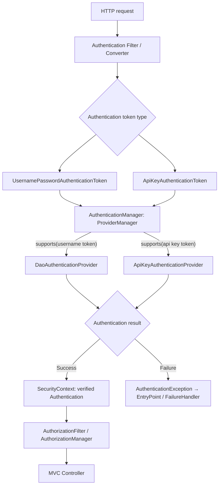
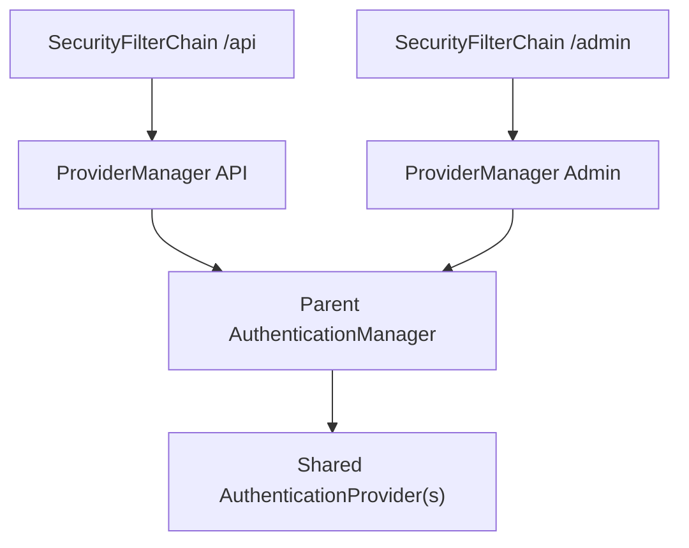

# AuthenticationProvider.supports and Support for Multiple Authentication Methods

## Lesson Objectives

An application can accept multiple login methods: username/password, service API keys, bearer JWTs, mTLS, LDAP, or an identity provider. In Spring Security, `AuthenticationManager` is the entry point for verifying an authentication request; its common implementation `ProviderManager` coordinates a list of `AuthenticationProvider` instances. Each provider declares **`supports(Class<?>)`** to indicate **which Authentication request type** it can handle.

**The single most important point:** `supports(...) == true` only reports capability to handle **the token type**. It **does not** prove a password, API key, or JWT is valid. Evidence verification occurs inside `authenticate(Authentication)`. A provider can return an authenticated Authentication, return `null` because it cannot decide, or throw `AuthenticationException` because authentication failed.

This content targets **Java 17, Spring Boot 3.5.0, Spring Security 6.5.x, Servlet/Spring MVC**. The example at the end intentionally uses two mechanisms: **HTTP Basic username/password** and **API key via custom header**. Hardcoded API keys/passwords are fake localhost data only; real applications should use OAuth2, mTLS, a secret manager, or a key service with proper lifecycle governance.

After completing this lesson, you will be able to:

1. Explain the distinct roles of filters, `Authentication`, `AuthenticationManager`, `AuthenticationProvider`, and authorization.
2. Read the signatures `supports(Class<?>)` and `authenticate(Authentication)` accurately and know why they take different parameter types.
3. Trace how `ProviderManager` tries multiple providers in order; distinguish skipped, `null`, success, exception, and parent manager.
4. Understand the meaning of `ProviderNotFoundException`, `BadCredentialsException`, and special handling of account-status exceptions.
5. Design clear token types for different mechanisms; avoid letting token classes or client-sent data decide permissions.
6. Build custom `ApiKeyAuthenticationToken` and `ApiKeyAuthenticationProvider`, configured alongside `DaoAuthenticationProvider`.
7. Test provider selection with JUnit and HTTP 200/401/403 with MockMvc.
8. Know when to use one shared manager versus splitting managers/chains by trust boundary.

## 1. Component Map

Spring Security does not begin by "trying every password in the database". An HTTP request is interpreted by an authentication filter or converter into **an Authentication request object**; only then does the manager decide which provider can inspect that object.



| Component | What is it responsible for? | What does it NOT do? |
| --- | --- | --- |
| Authentication filter | Reads Basic/form/bearer/header and creates an Authentication request; passes it to the manager. | Does not treat header presence alone as valid credentials. |
| `Authentication` | Holds claims and credentials before verification; holds trusted principal/authorities on successful result. | Does not verify keys/passwords itself. |
| `AuthenticationManager` | Defines `authenticate(Authentication)`, returns result or throws exception. | Does not authorize all endpoints/resources itself. |
| `ProviderManager` | Selects/tries multiple providers and may use a parent manager. | Does not guess login type solely from username. |
| `AuthenticationProvider` | Verifies a supported Authentication request type. | Does not send HTTP 401/403 itself. |
| `SecurityContext` | Holds the authentication result in the active context. | Does not guarantee session persistence across requests without configuration. |
| `AuthorizationManager` | Checks permissions on requests/methods/resources. | Does not replace credential verification mechanisms. |

For example, Spring Security commonly has `BasicAuthenticationFilter` creating `UsernamePasswordAuthenticationToken`; `DaoAuthenticationProvider` uses `UserDetailsService` and `PasswordEncoder` to verify username/password. A JWT resource server can create a bearer token request and use a provider that verifies signature/issuer/claims. Custom API keys need the corresponding header extraction and provider.

**Two ways of receiving credentials do not require two providers.** HTTP Basic and form login can both create `UsernamePasswordAuthenticationToken` and share one DaoAuthenticationProvider. Conversely, two providers can both support the same token class when two identity stores exist, though that makes fallback/partitioning more complex.

## 2. The AuthenticationProvider Contract

Spring Security 6.5 defines the interface in `org.springframework.security.authentication.AuthenticationProvider`:

```java
public interface AuthenticationProvider {
    Authentication authenticate(Authentication authentication)
            throws AuthenticationException;

    boolean supports(Class<?> authentication);
}
```

The snippet above is a condensed form for study. The `supports` method accepts **`Class<?>`**, such as `UsernamePasswordAuthenticationToken.class`, **not** an object containing a username/key. The `authenticate` method is what receives the **instance** with actual credentials.

### 2.1. `supports(Class<?>)` is capability by token type

```java
@Override
public boolean supports(Class<?> authenticationType) {
    return ApiKeyAuthenticationToken.class
        .isAssignableFrom(authenticationType);
}
```

It returns true when the queried class is `ApiKeyAuthenticationToken` or a compatible subtype. Because the API key token in the lab is `final`, in practice only that exact class is supported.

**The argument order of `isAssignableFrom` matters greatly:** the left-hand side is the class the provider understands; the right-hand side is the class passed in. Reversing the direction can cause the provider to miss the right token type or accept out-of-scope classes.

### 2.2. Why doesn't supports=true determine login outcome?

Suppose the filter creates:

```java
Authentication request =
    UsernamePasswordAuthenticationToken.unauthenticated(
        "learner", "wrong-password"
    );
```

DaoAuthenticationProvider **still supports** `UsernamePasswordAuthenticationToken.class`. However, `PasswordEncoder.matches(...)` will detect the wrong password and authentication will fail. Similarly, the presence of an `X-API-Key` header does not mean the API key value is valid.

The accurate statement is: **the provider recognizes the structure of the claim; the provider must still verify the content of the claim**.

### 2.3. Three possible outcomes from authenticate

| Returned/thrown | Interpretation | How the manager handles it |
| --- | --- | --- |
| Valid authenticated `Authentication` | Verified and carries trusted principal/authorities. | Usually stops and returns the result. |
| `null` | Provider cannot decide for this specific request. | May try later providers/parent; does not permit login on its own. |
| `AuthenticationException` | Evidence was rejected or authentication error occurred. | Manager applies exception/fallback semantics; may report final failure. |

Note: `supports == false` causes the provider to be **skipped from the start**, unlike `authenticate(...) == null` where the provider **was invoked but yielded the decision**.

### 2.4. Do not return null when credentials are known to be wrong

A custom provider truly responsible for API key tokens, having read the key and found it wrong, should throw `BadCredentialsException`. If it arbitrarily returns `null`, the manager may move on to another provider that also supports this token type. That could bypass a lock/denial intent when an alternative authentication source exists.

Conversely, in an architecture with clearly partitioned providers, a provider may return `null` if the request falls outside the scope it is allowed to evaluate. Partitioning must rest on trustworthy design, not guessing from a user-claimed username.

### 2.5. Do not put authorization into supports

`supports(Class<?>)` is not the place for `hasRole("ADMIN")`, tenant checks, or order ownership checks. Those belong to authorization after principal/authorities are authenticated. At the supports phase, the token class may still hold unverified client data.

## 3. How Does ProviderManager Use Multiple Providers?

`ProviderManager` is an `AuthenticationManager` taking a list of providers. When a request arrives, it checks providers in configured order and uses `supports(request.getClass())` to learn which providers may be asked.

```text
ProviderManager.authenticate(authentication)
  |
  +--> Provider A supports(tokenClass)?
  |        false → skip
  |        true  → A.authenticate(request)
  |                    success → return verified Authentication
  |                    null    → try next matching provider
  |                    exception → apply handling/fallback rules
  |
  +--> Provider B ...
  |
  +--> Parent AuthenticationManager (if configured, per rules)
  |
  +--> Nobody authenticates → AuthenticationException
```

The description above is pseudocode; the real implementation adds special rules for parent managers, account-status exceptions, events, and credential erasure.

### 3.1. Two separate token types

Suppose the manager contains `List.of(apiKeyProvider, daoProvider)`:

| Request token | ApiKey provider | DAO provider | Result if credentials are valid |
| --- | --- | --- | --- |
| `ApiKeyAuthenticationToken` | `supports=true`, verifies key | `supports=false` | `service-client`, `ROLE_SERVICE` |
| `UsernamePasswordAuthenticationToken` | `supports=false` | `supports=true`, verifies password | `learner`, `ROLE_USER` |
| `TestingAuthenticationToken` | `supports=false` | `supports=false` | No matching provider, fails. |

When two providers support **different token types**, the configuration is easy to read and less error-prone. Adding a later provider does not magically make an invalid API key/password valid.

### 3.2. ProviderNotFoundException

If the manager has no provider supporting a token class and the parent cannot handle it either, `ProviderManager` usually throws `ProviderNotFoundException`. This is an `AuthenticationException` indicating a problem with **token-type capability** or manager configuration.

Test example:

```java
Authentication unknown =
    new TestingAuthenticationToken("name", "value");

authenticationManager.authenticate(unknown);
// ProviderNotFoundException with the lab's manager.
```

This is a test fragment; `TestingAuthenticationToken` is not a production login mechanism. If you create a filter for `ApiKeyAuthenticationToken` yet forget to wire the API key provider into the manager the filter actually uses, you can encounter a similar error.

### 3.3. Exceptions do not always stop immediately

Do not document that "whenever a provider throws BadCredentialsException, ProviderManager always stops and skips remaining providers". For certain standard `AuthenticationException`s, the manager **can try the next provider**, and a subsequent successful result can be used.

Conversely, exceptions in the `AccountStatusException` family (such as disabled/locked accounts) and `InternalAuthenticationServiceException` normally make ProviderManager stop under special rules. Never actively turn locked/disabled exceptions into `null` just to try another mechanism.

**Security implication:** if two providers both support `UsernamePasswordAuthenticationToken`, an account locked in source A must not silently "retry in source B" to log in. Identity realm design and fallback ordering must be explicitly tested, especially when usernames overlap across stores.

### 3.4. Parent AuthenticationManager

A `ProviderManager` can configure a **parent manager**. When local providers do not produce a valid result per the manager's rules, the parent may be consulted. Multiple security chains can have their own managers while sharing a parent for certain mechanisms.



**A broader parent is not always safe.** If the admin chain is intended to accept only hardware-backed/mTLS authentication while the parent accepts another password credential type, fallback can widen the trust boundary. Authorization rules should rely on the actual authentication type and requirements, not just having any principal.

### 3.5. Credential erasure

`ProviderManager` by default attempts to erase sensitive credentials from the result Authentication when the token implements `CredentialsContainer`. This reduces the risk of keeping passwords/keys long-lived in sessions/contexts. A custom token should support `eraseCredentials()` and usually **not put the raw key into the verified result** in the first place.

If principal/UserDetails instances are reused from a shared cache, erasing credentials on the cached instance itself can break subsequent authentications. When caching, clone data or manage credential erasure lifecycles explicitly; do not rush to disable sensitive data erasure.

## 4. One Shared Manager or Multiple Separate Managers?

### 4.1. One manager containing multiple providers

Suitable when entry points share a designed trust boundary and you want a single, easily testable provider list. The lab uses two authentication filters: the Basic filter creates a username/password token, the API key filter creates a custom token, and both call **one** ProviderManager.

```text
HTTP Basic credentials ─> BasicAuthenticationFilter ─> UsernamePasswordAuthenticationToken
                                                        |
X-API-Key header ──────> ApiKeyHeaderFilter ────────> ApiKeyAuthenticationToken
                                                        |
                                                        v
                                                  ProviderManager
                                                   |         |
                                                   v         v
                                                 Dao     ApiKeyProvider
```

### 4.2. Multiple SecurityFilterChains with separate managers

You can separate `/staff/**` using form login from `/api/service/**` using bearer JWT or mTLS. `FilterChainProxy` picks the matching **SecurityFilterChain** by `securityMatcher(...)` and order; then filters inside that chain create tokens and send them to the manager configured for that chain.

Distinguish clearly:

1. **Selecting the chain:** HTTP request matcher, configured with `securityMatcher`.
2. **Selecting the provider:** `supports(Class<?>)` on the **token class** created by the authentication filter.
3. **Access permissions:** `authorizeHttpRequests(...).requestMatchers(...)` and authorization managers.

Using `securityMatcher` and `supports` as synonyms is an architectural mistake. If a filter chain does not match the request, the manager inside that chain may never be invoked.

### 4.3. One token class, multiple supporting providers

Two `DaoAuthenticationProvider` instances using two different stores can both support `UsernamePasswordAuthenticationToken`. `supports` does not distinguish realms by username. If you must authenticate across multiple stores, define source boundaries, precedence, not-found behavior, disabled/locked account handling, and how to prevent username collisions from leaking or bypassing permissions.

Do not treat `null` as a convenience to "keep trying until login succeeds somewhere" without analyzing the trust boundary. Systems with LDAP + local accounts, external identity providers + backup accounts, or multiple tenants must test this policy especially carefully.

### 4.4. Built-in framework mechanisms

- `DaoAuthenticationProvider`: username/password with `UserDetailsService` and `PasswordEncoder`.
- `JwtAuthenticationProvider`: JWT bearer token after applying the corresponding verification setup.
- Opaque token provider: introspection at a trusted server.
- LDAP, pre-authentication, SAML, and other protocols: providers/filters per module and version.
- Custom API key: requires token/converter/filter/provider and dedicated secret rules if no framework/app integration already exists.

**JWTs are not authenticated merely by Base64-decoding the payload.** The provider/decoder must verify signature/issuer/audience/expiry and claims per policy; `supports` only states it understands the token type.

## 5. Lab: HTTP Basic + API Key in the Same Application

We build a Spring Boot MVC application using two credential types with this policy:

| Endpoint | Rule | Basic user `learner` | API key `service-client` |
| --- | --- | :---: | :---: |
| `GET /public/ping` | `permitAll` | Allowed | Allowed |
| `GET /api/whoami` | `authenticated` | Allowed | Allowed |
| `GET /api/basic` | `hasRole("USER")` | Allowed | 403 |
| `GET /api/service` | `hasRole("SERVICE")` | 403 | Allowed |
| Other URLs | `denyAll` | 403 when logged in | 403 when authenticated |

Lab credentials:

- Basic: `learner` / `learner-pass` -> `ROLE_USER`.
- Key: `lab-key-123` -> `service-client` / `ROLE_SERVICE`.
- No credentials on private endpoints -> **401** in the HTTP Basic flow.
- Wrong password/key -> **401**.
- Same request carrying both `Authorization` and `X-API-Key` -> **400** because application policy intentionally rejects ambiguous situations.

### 5.1. Structure

```text
multi-provider-lab/
├── pom.xml
└── src/
    ├── main/java/com/example/multiprovider/
    │   ├── MultiProviderApplication.java
    │   ├── ApiKeyAuthenticationToken.java
    │   ├── ApiKeyAuthenticationProvider.java
    │   ├── ApiKeyHeaderFilter.java
    │   ├── SecurityConfig.java
    │   └── DemoController.java
    └── test/java/com/example/multiprovider/
        ├── ProviderSelectionTest.java
        └── MultiProviderHttpTest.java
```

### 5.2. Maven pom.xml

```xml
<project xmlns="http://maven.apache.org/POM/4.0.0"
         xmlns:xsi="http://www.w3.org/2001/XMLSchema-instance"
         xsi:schemaLocation="http://maven.apache.org/POM/4.0.0 https://maven.apache.org/xsd/maven-4.0.0.xsd">
    <modelVersion>4.0.0</modelVersion>
    <parent>
        <groupId>org.springframework.boot</groupId>
        <artifactId>spring-boot-starter-parent</artifactId>
        <version>3.5.0</version>
        <relativePath/>
    </parent>
    <groupId>com.example</groupId>
    <artifactId>multi-provider-lab</artifactId>
    <version>1.0.0</version>
    <properties>
        <java.version>17</java.version>
    </properties>
    <dependencies>
        <dependency>
            <groupId>org.springframework.boot</groupId>
            <artifactId>spring-boot-starter-web</artifactId>
        </dependency>
        <dependency>
            <groupId>org.springframework.boot</groupId>
            <artifactId>spring-boot-starter-security</artifactId>
        </dependency>
        <dependency>
            <groupId>org.springframework.boot</groupId>
            <artifactId>spring-boot-starter-test</artifactId>
            <scope>test</scope>
        </dependency>
        <dependency>
            <groupId>org.springframework.security</groupId>
            <artifactId>spring-security-test</artifactId>
            <scope>test</scope>
        </dependency>
    </dependencies>
    <build>
        <plugins>
            <plugin>
                <groupId>org.springframework.boot</groupId>
                <artifactId>spring-boot-maven-plugin</artifactId>
            </plugin>
        </plugins>
    </build>
</project>
```

The Boot parent manages compatible versions. `3.5.0` is a learning milestone aligned with Spring Security 6.5; real projects should upgrade to supported patch versions. This lesson uses **Servlet MVC**, without adding the WebFlux starter.

### 5.3. MultiProviderApplication.java

```java
package com.example.multiprovider;

import org.springframework.boot.SpringApplication;
import org.springframework.boot.autoconfigure.SpringBootApplication;

@SpringBootApplication
public class MultiProviderApplication {
    public static void main(String[] args) {
        SpringApplication.run(MultiProviderApplication.class, args);
    }
}
```

Place all classes in the same `com.example.multiprovider` package so Spring Boot discovers controllers/configs during component scan.

## 6. Custom Authentication Token for API Key

### 6.1. ApiKeyAuthenticationToken.java

```java
package com.example.multiprovider;

import java.util.Collection;
import java.util.Collections;

import org.springframework.security.authentication.AbstractAuthenticationToken;
import org.springframework.security.core.GrantedAuthority;

public final class ApiKeyAuthenticationToken
        extends AbstractAuthenticationToken {

    private final Object principal;
    private Object credentials;

    private ApiKeyAuthenticationToken(
            Object principal,
            Object credentials,
            Collection<? extends GrantedAuthority> authorities,
            boolean verified) {

        super(authorities);
        this.principal = principal;
        this.credentials = credentials;
        if (verified) {
            super.setAuthenticated(true);
        }
    }

    public static ApiKeyAuthenticationToken unauthenticated(
            String submittedKey) {

        return new ApiKeyAuthenticationToken(
            null,
            submittedKey,
            Collections.emptyList(),
            false
        );
    }

    static ApiKeyAuthenticationToken verified(
            String principal,
            Collection<? extends GrantedAuthority> authorities) {

        return new ApiKeyAuthenticationToken(
            principal,
            null,
            authorities,
            true
        );
    }

    @Override
    public Object getPrincipal() {
        return principal;
    }

    @Override
    public Object getCredentials() {
        return credentials;
    }

    @Override
    public void setAuthenticated(boolean authenticated) {
        if (authenticated) {
            throw new IllegalArgumentException(
                "Verified token must come from a trusted provider"
            );
        }
        super.setAuthenticated(false);
    }

    @Override
    public void eraseCredentials() {
        super.eraseCredentials();
        credentials = null;
    }
}
```

**Explanation:**

- `unauthenticated(submittedKey)` creates a **request token**: no trusted principal yet, credentials contains the client-submitted key, authorities empty.
- `verified(...)` is a **package-private** factory, called in the lab only by the provider after verifying the key; creates a token with assigned principal and authorities.
- Public `setAuthenticated(true)` is blocked. `super.setAuthenticated(true)` in the private constructor is only for the internal verified path.
- `eraseCredentials()` clears the key copy inside the object when called.
- A token type alone does not create a security boundary: components inside the JVM must still be trusted. Never grant the ability to create verified tokens directly from arbitrary client input.

Before/after flow:

```text
Before provider:
  ApiKeyAuthenticationToken
  principal=null; credentials="lab-key-123"
  authorities=[]; isAuthenticated=false

After provider verifies:
  ApiKeyAuthenticationToken
  principal="service-client"; credentials=null
  authorities=[ROLE_SERVICE]; isAuthenticated=true
```

## 7. Custom Provider with supports(Class<?>)

### 7.1. ApiKeyAuthenticationProvider.java

```java
package com.example.multiprovider;

import java.nio.charset.StandardCharsets;
import java.security.MessageDigest;
import java.util.List;

import org.springframework.security.authentication.AuthenticationProvider;
import org.springframework.security.authentication.BadCredentialsException;
import org.springframework.security.core.Authentication;
import org.springframework.security.core.authority.SimpleGrantedAuthority;

public final class ApiKeyAuthenticationProvider
        implements AuthenticationProvider {

    private final byte[] expectedKey;

    public ApiKeyAuthenticationProvider(String expectedKey) {
        this.expectedKey =
            expectedKey.getBytes(StandardCharsets.UTF_8);
    }

    @Override
    public Authentication authenticate(Authentication authentication) {
        if (!(authentication instanceof ApiKeyAuthenticationToken)) {
            // Guard if called directly outside ProviderManager.
            return null;
        }

        Object credentials = authentication.getCredentials();
        if (!(credentials instanceof String submitted)
                || submitted.isBlank()) {
            throw new BadCredentialsException("Invalid API key");
        }

        byte[] submittedBytes =
            submitted.getBytes(StandardCharsets.UTF_8);

        if (!MessageDigest.isEqual(expectedKey, submittedBytes)) {
            throw new BadCredentialsException("Invalid API key");
        }

        return ApiKeyAuthenticationToken.verified(
            "service-client",
            List.of(new SimpleGrantedAuthority("ROLE_SERVICE"))
        );
    }

    @Override
    public boolean supports(Class<?> authenticationType) {
        return ApiKeyAuthenticationToken.class
            .isAssignableFrom(authenticationType);
    }
}
```

**Clean separation of responsibilities:**

1. `supports(Class<?>)` accepts the **token type**, returning true only for the custom API key token.
2. `authenticate(Authentication)` accepts the concrete object, with a defensive type guard if called outside the manager.
3. `getCredentials()` is the unverified key. Blank/wrong key -> `BadCredentialsException`.
4. Valid key -> returns verified result with principal `service-client` and authority `ROLE_SERVICE`.
5. No step trusts `X-Role`/`X-User` sent by the client; permissions are assigned **inside the provider after verifying the key**.

`MessageDigest.isEqual(...)` compares byte arrays avoiding ordinary string equality pitfalls, yet **this lesson does not implement production API key storage**: the key is hardcoded, with no ID/rotation/expiry/tenant/revocation. Real products require secure secret sources, key hashing/lookup, and least privilege.

## 8. HTTP Filter Converting Header into Request Token

The provider does not read HTTP headers itself. To accept `X-API-Key` in the Servlet stack, a filter/converter is required. The lab uses `OncePerRequestFilter` to show clearly how the token is created and the manager is invoked.

### 8.1. ApiKeyHeaderFilter.java

```java
package com.example.multiprovider;

import java.io.IOException;

import jakarta.servlet.FilterChain;
import jakarta.servlet.ServletException;
import jakarta.servlet.http.HttpServletRequest;
import jakarta.servlet.http.HttpServletResponse;

import org.springframework.security.authentication.AuthenticationManager;
import org.springframework.security.core.Authentication;
import org.springframework.security.core.AuthenticationException;
import org.springframework.security.core.context.SecurityContext;
import org.springframework.security.core.context.SecurityContextHolder;
import org.springframework.web.filter.OncePerRequestFilter;

public final class ApiKeyHeaderFilter extends OncePerRequestFilter {

    private final AuthenticationManager manager;

    public ApiKeyHeaderFilter(AuthenticationManager manager) {
        this.manager = manager;
    }

    @Override
    protected void doFilterInternal(
            HttpServletRequest request,
            HttpServletResponse response,
            FilterChain chain) throws ServletException, IOException {

        String key = request.getHeader("X-API-Key");

        if (key == null) {
            chain.doFilter(request, response);
            return;
        }

        if (request.getHeader("Authorization") != null) {
            // Lab policy: do not accept two credential types at the same time.
            response.setStatus(HttpServletResponse.SC_BAD_REQUEST);
            return;
        }

        Authentication result;
        try {
            result = manager.authenticate(
                ApiKeyAuthenticationToken.unauthenticated(key)
            );
        } catch (AuthenticationException ex) {
            SecurityContextHolder.clearContext();
            response.setStatus(HttpServletResponse.SC_UNAUTHORIZED);
            return;
        }

        SecurityContext context =
            SecurityContextHolder.createEmptyContext();
        context.setAuthentication(result);
        SecurityContextHolder.setContext(context);

        try {
            chain.doFilter(request, response);
        } finally {
            SecurityContextHolder.clearContext();
        }
    }
}
```

Branch-by-branch behavior:

- No API key: lets the request continue. If Basic credentials exist, `BasicAuthenticationFilter` handles them.
- Both API key and Basic present: returns `400` to avoid ambiguous authentication precedence without creating an identity.
- Single key present: creates an **unauthenticated token**, calls the manager. If the manager rejects it, returns `401` without leaking the key.
- Success: creates a new `SecurityContext` for the **current request**, sets the verified Authentication, and lets the filter chain continue.
- `finally` clears the context after the request finishes. The lab uses per-request credentials without writing results to a session.

**This is a learning filter**, not a replacement for every capability of `AuthenticationFilter`/the framework: async dispatch, custom failure/success handlers, unified entry points, request caching, session persistence, and lifecycle must be properly designed for real use. Placing a custom filter in the wrong position can make it run outside the security chain or read the wrong context.

Notice the `try/catch` block only catches exceptions from `manager.authenticate`. Exceptions thrown later when the controller/authorization executes will not be misinterpreted as "invalid API key".

## 9. Wiring ProviderManager with Two Providers

### 9.1. SecurityConfig.java

```java
package com.example.multiprovider;

import java.util.List;

import org.springframework.context.annotation.Bean;
import org.springframework.context.annotation.Configuration;
import org.springframework.http.HttpMethod;
import org.springframework.security.authentication.AuthenticationManager;
import org.springframework.security.authentication.ProviderManager;
import org.springframework.security.authentication.dao.DaoAuthenticationProvider;
import org.springframework.security.config.Customizer;
import org.springframework.security.config.annotation.web.builders.HttpSecurity;
import org.springframework.security.config.annotation.web.configurers.AbstractHttpConfigurer;
import org.springframework.security.config.http.SessionCreationPolicy;
import org.springframework.security.core.userdetails.User;
import org.springframework.security.core.userdetails.UserDetailsService;
import org.springframework.security.crypto.bcrypt.BCryptPasswordEncoder;
import org.springframework.security.crypto.password.PasswordEncoder;
import org.springframework.security.provisioning.InMemoryUserDetailsManager;
import org.springframework.security.web.SecurityFilterChain;
import org.springframework.security.web.authentication.www.BasicAuthenticationFilter;

@Configuration(proxyBeanMethods = false)
public class SecurityConfig {

    @Bean
    PasswordEncoder passwordEncoder() {
        return new BCryptPasswordEncoder();
    }

    @Bean
    UserDetailsService users(PasswordEncoder encoder) {
        return new InMemoryUserDetailsManager(
            User.withUsername("learner")
                .password(encoder.encode("learner-pass"))
                .roles("USER")
                .build()
        );
    }

    @Bean
    ApiKeyAuthenticationProvider apiKeyProvider() {
        return new ApiKeyAuthenticationProvider("lab-key-123");
    }

    @Bean
    AuthenticationManager authenticationManager(
            UserDetailsService users,
            PasswordEncoder encoder,
            ApiKeyAuthenticationProvider apiKeyProvider) {

        DaoAuthenticationProvider dao =
            new DaoAuthenticationProvider(users);
        dao.setPasswordEncoder(encoder);

        return new ProviderManager(List.of(apiKeyProvider, dao));
    }

    @Bean
    SecurityFilterChain securityFilterChain(
            HttpSecurity http,
            AuthenticationManager manager) throws Exception {

        return http
            .authenticationManager(manager)
            .sessionManagement(session -> session
                .sessionCreationPolicy(SessionCreationPolicy.STATELESS)
            )
            .authorizeHttpRequests(auth -> auth
                .requestMatchers(
                    HttpMethod.GET, "/public/ping"
                ).permitAll()
                .requestMatchers(
                    HttpMethod.GET, "/api/whoami"
                ).authenticated()
                .requestMatchers(
                    HttpMethod.GET, "/api/basic"
                ).hasRole("USER")
                .requestMatchers(
                    HttpMethod.GET, "/api/service"
                ).hasRole("SERVICE")
                .anyRequest().denyAll()
            )
            .addFilterBefore(
                new ApiKeyHeaderFilter(manager),
                BasicAuthenticationFilter.class
            )
            .httpBasic(Customizer.withDefaults())
            .formLogin(AbstractHttpConfigurer::disable)
            .build();
    }
}
```

Here:

- The first provider handles API keys; the second is DAO handling username/password.
- `DaoAuthenticationProvider(UserDetailsService)` and `setPasswordEncoder(...)` belong to the valid API on Spring Security 6.5.x.
- `ProviderManager(List.of(...))` creates a concrete list with explicit ordering.
- `http.authenticationManager(manager)` ensures the chain's HTTP Basic filter uses the configured manager.
- `new ApiKeyHeaderFilter(manager)` receives the exact same instance; both mechanisms go to the same manager.
- `addFilterBefore(..., BasicAuthenticationFilter.class)` places the custom filter before Basic, yet after appropriate context-preparation mechanisms in the chain.
- `SessionCreationPolicy.STATELESS` does not store SecurityContext in HTTP session. Clients must send valid credentials on every request.
- `.anyRequest().denyAll()` protects undeclared routes.
- HTTP Basic is enabled and form login is disabled to demonstrate 401 clearly. **CSRF remains enabled by default** since the lab only uses GET; if adding POST/PUT/PATCH/DELETE, assess CSRF risk based on how clients auto-send cookies/Basic credentials and provide tokens per architecture. Do not disable CSRF globally just to make write requests stop returning 403.

Accounts/passwords in source are demo-only. `InMemoryUserDetailsManager` is not a production user store, and a generic `ROLE_SERVICE` is not enough to identify tenant or owner permissions for business objects.

**Why wire explicitly?** Seeing an `AuthenticationProvider` bean in the application context alone does not prove every SecurityFilterChain or authentication filter will automatically use that bean. With multiple managers, misconfiguration causes a filter to create a token that the manager has no provider to handle, resulting in `ProviderNotFoundException`.

## 10. Controller with Endpoints Using Different Roles

### 10.1. DemoController.java

```java
package com.example.multiprovider;

import java.util.Map;

import org.springframework.security.core.Authentication;
import org.springframework.web.bind.annotation.GetMapping;
import org.springframework.web.bind.annotation.RestController;

@RestController
public class DemoController {

    @GetMapping("/public/ping")
    public String ping() {
        return "pong";
    }

    @GetMapping("/api/whoami")
    public Map<String, String> whoami(Authentication authentication) {
        return Map.of(
            "principal", authentication.getName(),
            "tokenType",
            authentication.getClass().getSimpleName()
        );
    }

    @GetMapping("/api/basic")
    public String basicRoute() {
        return "user-access";
    }

    @GetMapping("/api/service")
    public String serviceRoute() {
        return "service-access";
    }
}
```

`/api/whoami` returns only username and token class for learning purposes. In production, never return the raw `Authentication` or raw credentials, and avoid exposing internal token types if clients do not need them. For endpoints returning orders/invoices by ID, still check ownership/tenant in the service or query even after passing `authenticated()`.

### 10.2. Which provider does HTTP Basic go through?

Client sends:

```http
GET /api/whoami HTTP/1.1
Authorization: Basic <base64(learner:learner-pass)>
```

Sequence:

1. Custom API key filter sees no `X-API-Key` -> passes request onward.
2. `BasicAuthenticationFilter` creates an unauthenticated `UsernamePasswordAuthenticationToken`.
3. `ProviderManager` asks the API key provider; `supports(UsernamePasswordAuthenticationToken.class)==false` -> skipped.
4. DAO provider supports this token, loads `learner`, and verifies using `PasswordEncoder.matches(...)`.
5. Returns verified Authentication with `ROLE_USER`, request passes `authenticated()`, and the controller receives `learner`.

### 10.3. Which provider does the API key go through?

Client sends:

```http
GET /api/whoami HTTP/1.1
X-API-Key: lab-key-123
```

Sequence:

1. Custom filter sees the key and creates `ApiKeyAuthenticationToken.unauthenticated(...)`.
2. `ProviderManager` asks the API key provider; `supports(ApiKeyAuthenticationToken.class)==true`.
3. Provider compares the key and returns a verified token with principal `service-client`, authority `ROLE_SERVICE`.
4. Filter sets the result in SecurityContext; Basic filter sees no Basic header so it does not replace the identity.
5. Controller receives `service-client`, token type `ApiKeyAuthenticationToken`.

Two login methods yield **the same HTTP success status yet two different principals/roles**, so calling endpoints restricted to USER/SERVICE produces different results.

## 11. Unit/Integration Tests for supports and ProviderManager

### 11.1. ProviderSelectionTest.java

```java
package com.example.multiprovider;

import java.util.List;

import org.junit.jupiter.api.Test;
import org.springframework.beans.factory.annotation.Autowired;
import org.springframework.boot.test.context.SpringBootTest;
import org.springframework.security.authentication.AuthenticationManager;
import org.springframework.security.authentication.AuthenticationProvider;
import org.springframework.security.authentication.BadCredentialsException;
import org.springframework.security.authentication.ProviderManager;
import org.springframework.security.authentication.ProviderNotFoundException;
import org.springframework.security.authentication.TestingAuthenticationToken;
import org.springframework.security.authentication.UsernamePasswordAuthenticationToken;
import org.springframework.security.core.Authentication;

import static org.assertj.core.api.Assertions.assertThat;
import static org.assertj.core.api.Assertions.assertThatThrownBy;

@SpringBootTest
class ProviderSelectionTest {

    @Autowired
    AuthenticationManager manager;

    @Autowired
    ApiKeyAuthenticationProvider keyProvider;

    @Test
    void apiKeyProviderSupportsOnlyItsTokenType() {
        assertThat(keyProvider.supports(
            ApiKeyAuthenticationToken.class
        )).isTrue();

        assertThat(keyProvider.supports(
            UsernamePasswordAuthenticationToken.class
        )).isFalse();
    }

    @Test
    void apiKeyRequestStartsUnauthenticated() {
        ApiKeyAuthenticationToken request =
            ApiKeyAuthenticationToken.unauthenticated("lab-key-123");

        assertThat(request.isAuthenticated()).isFalse();
        assertThat(request.getAuthorities()).isEmpty();
        assertThat(request.getCredentials()).isEqualTo("lab-key-123");
    }

    @Test
    void correctApiKeyProducesVerifiedResult() {
        Authentication result = manager.authenticate(
            ApiKeyAuthenticationToken.unauthenticated("lab-key-123")
        );

        assertThat(result.isAuthenticated()).isTrue();
        assertThat(result.getName()).isEqualTo("service-client");
        assertThat(result.getCredentials()).isNull();
        assertThat(result.getAuthorities())
            .extracting(granted -> granted.getAuthority())
            .containsExactly("ROLE_SERVICE");
    }

    @Test
    void correctBasicPasswordUsesDaoProvider() {
        Authentication result = manager.authenticate(
            UsernamePasswordAuthenticationToken.unauthenticated(
                "learner", "learner-pass"
            )
        );

        assertThat(result.isAuthenticated()).isTrue();
        assertThat(result.getName()).isEqualTo("learner");
        assertThat(result.getAuthorities())
            .extracting(granted -> granted.getAuthority())
            .contains("ROLE_USER");
    }

    @Test
    void invalidApiKeyFails() {
        assertThatThrownBy(() -> manager.authenticate(
            ApiKeyAuthenticationToken.unauthenticated("wrong-key")
        )).isInstanceOf(BadCredentialsException.class);
    }

    @Test
    void invalidPasswordFails() {
        assertThatThrownBy(() -> manager.authenticate(
            UsernamePasswordAuthenticationToken.unauthenticated(
                "learner", "wrong-pass"
            )
        )).isInstanceOf(BadCredentialsException.class);
    }

    @Test
    void unrecognizedTokenFailsWithoutProvider() {
        assertThatThrownBy(() -> manager.authenticate(
            new TestingAuthenticationToken("any", "not-used")
        )).isInstanceOf(ProviderNotFoundException.class);
    }

    @Test
    void providerReturningNullAllowsNextProvider() {
        AuthenticationProvider undecided = new AuthenticationProvider() {
            @Override
            public boolean supports(Class<?> type) {
                return ApiKeyAuthenticationToken.class
                    .isAssignableFrom(type);
            }

            @Override
            public Authentication authenticate(
                    Authentication request) {
                return null;
            }
        };

        ProviderManager sequential = new ProviderManager(
            List.of(undecided, keyProvider)
        );

        Authentication result = sequential.authenticate(
            ApiKeyAuthenticationToken.unauthenticated("lab-key-123")
        );

        assertThat(result.isAuthenticated()).isTrue();
        assertThat(result.getName()).isEqualTo("service-client");
    }
}
```

A total of **8 tests** demonstrate: provider supports by class, unauthenticated input, two providers producing distinct results, wrong key/password throwing exceptions, unsupported token types leading to `ProviderNotFoundException`, and a provider returning `null` letting the second provider try next.

The last test only illustrates the fallback contract; it is not a recommendation to add a "always return null" provider in a real system. When two sources both support a token type, clear partitioning/priority rules are required.

## 12. MockMvc Verifying HTTP Authentication and Permissions

### 12.1. MultiProviderHttpTest.java

```java
package com.example.multiprovider;

import org.junit.jupiter.api.Test;
import org.springframework.beans.factory.annotation.Autowired;
import org.springframework.boot.test.autoconfigure.web.servlet.AutoConfigureMockMvc;
import org.springframework.boot.test.context.SpringBootTest;
import org.springframework.test.web.servlet.MockMvc;

import static org.springframework.security.test.web.servlet.request
    .SecurityMockMvcRequestPostProcessors.httpBasic;
import static org.springframework.test.web.servlet.request.MockMvcRequestBuilders.get;
import static org.springframework.test.web.servlet.result.MockMvcResultMatchers.content;
import static org.springframework.test.web.servlet.result.MockMvcResultMatchers.jsonPath;
import static org.springframework.test.web.servlet.result.MockMvcResultMatchers.status;

@SpringBootTest
@AutoConfigureMockMvc
class MultiProviderHttpTest {

    @Autowired
    MockMvc mvc;

    @Test
    void publicEndpointAllowsAnonymous() throws Exception {
        mvc.perform(get("/public/ping"))
            .andExpect(status().isOk())
            .andExpect(content().string("pong"));
    }

    @Test
    void privateEndpointChallengesAnonymous() throws Exception {
        mvc.perform(get("/api/whoami"))
            .andExpect(status().isUnauthorized());
    }

    @Test
    void basicAuthUsesUsernamePasswordToken() throws Exception {
        mvc.perform(get("/api/whoami")
                .with(httpBasic("learner", "learner-pass")))
            .andExpect(status().isOk())
            .andExpect(jsonPath("$.principal").value("learner"))
            .andExpect(jsonPath("$.tokenType")
                .value("UsernamePasswordAuthenticationToken"));
    }

    @Test
    void apiKeyUsesCustomToken() throws Exception {
        mvc.perform(get("/api/whoami")
                .header("X-API-Key", "lab-key-123"))
            .andExpect(status().isOk())
            .andExpect(jsonPath("$.principal")
                .value("service-client"))
            .andExpect(jsonPath("$.tokenType")
                .value("ApiKeyAuthenticationToken"));
    }

    @Test
    void basicUserAccessesUserRoute() throws Exception {
        mvc.perform(get("/api/basic")
                .with(httpBasic("learner", "learner-pass")))
            .andExpect(status().isOk())
            .andExpect(content().string("user-access"));
    }

    @Test
    void keyClientAccessesServiceRoute() throws Exception {
        mvc.perform(get("/api/service")
                .header("X-API-Key", "lab-key-123"))
            .andExpect(status().isOk())
            .andExpect(content().string("service-access"));
    }

    @Test
    void basicUserCannotAccessServiceRoute() throws Exception {
        mvc.perform(get("/api/service")
                .with(httpBasic("learner", "learner-pass")))
            .andExpect(status().isForbidden());
    }

    @Test
    void keyClientCannotAccessUserRoute() throws Exception {
        mvc.perform(get("/api/basic")
                .header("X-API-Key", "lab-key-123"))
            .andExpect(status().isForbidden());
    }

    @Test
    void wrongKeyIsRejected() throws Exception {
        mvc.perform(get("/api/service")
                .header("X-API-Key", "wrong-key"))
            .andExpect(status().isUnauthorized());
    }

    @Test
    void wrongBasicPasswordIsRejected() throws Exception {
        mvc.perform(get("/api/basic")
                .with(httpBasic("learner", "wrong-pass")))
            .andExpect(status().isUnauthorized());
    }

    @Test
    void conflictingCredentialHeadersAreRejected() throws Exception {
        mvc.perform(get("/api/whoami")
                .header("X-API-Key", "lab-key-123")
                .with(httpBasic("learner", "learner-pass")))
            .andExpect(status().isBadRequest());
    }

    @Test
    void unlistedRouteIsDeniedToLoggedInUser() throws Exception {
        mvc.perform(get("/unlisted")
                .with(httpBasic("learner", "learner-pass")))
            .andExpect(status().isForbidden());
    }
}
```

These are **12 HTTP tests**. Total tests in the project = **20** (8 provider tests + 12 MockMvc tests). They are designed to distinguish authentication failures (401), authorization denials (403), policy rejecting two credential types together (400), and successful requests (200).

**MockMvc** runs the Spring MVC test context along with the Security filter chain without opening a network port. These tests do not replace testing TLS, reverse proxies, real sessions, key rotation, or multi-node deployments. `@WithMockUser` is helpful when testing roles, yet does not prove password/key matching; here, requests carry real credentials for that goal.

## 13. Running Maven and Sending HTTP Requests

Requires Java 17+ and Maven. Inside the `multi-provider-lab` directory:

```bash
java -version
mvn -version
mvn test
mvn spring-boot:run
```

In another terminal:

```bash
curl -i http://localhost:8080/public/ping
curl -i http://localhost:8080/api/whoami
curl -i -u learner:learner-pass http://localhost:8080/api/whoami
curl -i -H "X-API-Key: lab-key-123" http://localhost:8080/api/whoami
curl -i -u learner:learner-pass http://localhost:8080/api/basic
curl -i -H "X-API-Key: lab-key-123" http://localhost:8080/api/service
curl -i -u learner:learner-pass http://localhost:8080/api/service
curl -i -H "X-API-Key: wrong-key" http://localhost:8080/api/service
curl -i -u learner:learner-pass -H "X-API-Key: lab-key-123" http://localhost:8080/api/whoami
```

On Windows PowerShell, use `curl.exe` if `curl` is aliased to `Invoke-WebRequest`. Expected results with the lab code:

| Request | HTTP status | Observed value |
| --- | --- | --- |
| Public, anonymous | 200 | `pong` |
| Private, anonymous | 401 | Basic authentication challenge |
| Valid Basic, `/api/whoami` | 200 | `principal=learner`, username/password token |
| Valid API key, `/api/whoami` | 200 | `principal=service-client`, API key token |
| Valid Basic, `/api/basic` | 200 | `user-access` |
| Valid API key, `/api/service` | 200 | `service-access` |
| Basic calling `/api/service` | 403 | Lacks ROLE_SERVICE |
| API key calling `/api/basic` | 403 | Lacks ROLE_USER |
| Wrong key | 401 | No verified Authentication created |
| Key + Basic on same request | 400 | Rejected per custom filter policy |

The status codes and bodies above are **design expectations**, not logs captured from an executed Maven run. A `WWW-Authenticate` header is normally present on HTTP Basic challenges; the 401 response from the custom key filter here only sets the status without issuing a separate challenge.

HTTP Basic uses Base64 and does not encrypt credentials at the transport layer; API keys are direct secrets. Production requires **HTTPS/TLS** and avoiding raw secrets in source, shell history, logs, URLs, or reports.

## 14. When Expanding to More Authentication Types

### 14.1. Adding JWT bearer tokens

To support a JWT resource server, there are typically three parts:

1. A filter reads `Authorization: Bearer ...` and creates a bearer authentication request.
2. The manager/provider or corresponding components must **genuinely verify the JWT**: signature, issuer, audience, expiry, and claims per policy.
3. Then map verified principal/authorities and apply authorization to the request/resource.

**No step grants permissions merely because `supports(...) == true`.** Nor should you Base64-decode a token and immediately trust role/tenant fields. For OAuth2 resource servers, prefer Spring Security's integrated module rather than writing a custom JWT parser/provider.

### 14.2. Form login and HTTP Basic can share a provider

Form login reads username/password from a form; Basic reads them from a header. Both can create the same `UsernamePasswordAuthenticationToken` and use one `DaoAuthenticationProvider`. Thus, the number of credential-receiving filters and the number of providers do not have a one-to-one relationship.

### 14.3. Multiple username/password stores

Two user stores (staff and customers) can share the password token class. Both providers can have `supports=true`, yet must have explicit realm and fallback design. Overlapping usernames in both stores, accounts disabled in source A, or differing passwords are mandatory test cases. Never carelessly rely on a rule of "later provider wins if earlier provider reports wrong password".

### 14.4. Reading context on the right stack

The lab uses Servlet `SecurityContextHolder`, meaning context bound via the appropriate thread/request strategy. WebFlux uses `ServerHttpSecurity`, `SecurityWebFilterChain`, and `ReactiveSecurityContextHolder` in the Reactor Context. Never copy a custom Servlet `OncePerRequestFilter` verbatim into WebFlux.

## 15. Common Mistakes

**1. Interpreting supports=true as valid credentials.**  
It only confirms token class compatibility; you must call `authenticate` and verify the evidence.

**2. Returning true from supports for every Class.**  
The provider may receive the wrong token and hit cast errors or untrusted authentication. Use directional type checks properly.

**3. Reading username inside supports.**  
The method receives a Class object; username/key live inside the Authentication instance passed to `authenticate`.

**4. Returning null when evidence is wrong yet within the provider's scope.**  
This can cause the manager to try another provider and alter authentication boundaries. Use exceptions with proper semantics.

**5. Believing BadCredentialsException always stops the entire chain immediately.**  
ProviderManager can continue trying subsequent providers under certain conditions. Design fallback intentionally and test it.

**6. Turning LockedException/DisabledException into null.**  
This can bypass account lock policies if a later provider allows login. Respect account-status failures.

**7. Forgetting to register the provider into the manager used by the filter.**  
A provider bean existing in the project does not mean the filter is calling that manager. Wire explicitly and test with real requests.

**8. Creating a token type without a filter/converter.**  
Providers do not read HTTP requests themselves. Provide a mechanism to extract credentials and build the right token.

**9. Filter creating an authenticated result based on an X-Role header.**  
Client-asserted headers are not an authority source. Filters only build request tokens; providers verify.

**10. Allowing multiple credential types without precedence rules.**  
Explicitly decide how to handle requests sending both Basic and API key to avoid actor/role confusion. The lab returns 400.

**11. Using a parent manager to open fallback outside chain policy.**  
This can accept an insufficiently trusted authentication mechanism. Separate managers/chains and test boundaries.

**12. Assuming authenticated() suffices for every record.**  
Logged-in users still require role/scope/owner/tenant checks on the accessed data.

**13. Logging raw keys or entire Authentication objects.**  
Easily leaks secrets, session metadata, and principal details. Log actor ID, mechanism type, and outcome at an appropriate level.

**14. Using a static demo API key in real systems.**  
Lacks key ID, revocation, rotation, expiry, scopes, and rate limiting. Use proper secret infrastructure.

**15. Disabling CSRF to make a POST request stop returning 403.**  
CSRF and authentication/authorization are separate protections. Evaluate cookies/Basic/browser auto-sent credentials, tokens, and HTTP methods before changing settings.

**16. Placing broad URL rules before specific rules.**  
`requestMatchers("/**").permitAll()` first can expose protected endpoints. Use ordered first-match rules and a `denyAll` fallback where appropriate.

**17. Testing only 200 on the valid case.**  
Fails to prove wrong passwords/keys, unsupported tokens, missing roles, or conflicting credential requests are rejected. Write matching negative tests.

## 16. Multi-Authentication Review Checklist

Before deploying to production, answer:

1. Which HTTP entry point creates the Authentication request, under which filter/chain?
2. Are token classes and credential sources unambiguous?
3. Which provider supports each token class? Do any providers overlap in support?
4. How are credentials verified: password hash, key store, JWT validator, mTLS trust store?
5. When evidence is invalid, which exception does the provider throw? When out of scope, is returning null safe?
6. Is there any parent manager/fallback crossing a trust boundary?
7. Do authority/principal come from trusted data or client-supplied headers?
8. Are credentials erased from the result and kept out of logs after authentication?
9. If multiple mechanisms are sent at once, does the app reject or pick intentionally?
10. Is SecurityContext set for the request and saved/restored per stateless/session policy?
11. Do endpoints also enforce authorization and ownership/tenant rules?
12. Have you tested 401, 403, unsupported provider, wrong key, wrong password, locked account, and cross-mechanism cases?
13. Are keys/passwords managed with TLS, secret storage, rotation, revocation, auditing, and rate limiting?
14. When adding a new SecurityFilterChain, have you verified `securityMatcher`/`@Order` and fallback?
15. When moving to WebFlux, have you switched to the right reactive APIs and context propagation?

## 17. Review Questions

**Question 1.** Does `supports(Class<?>)` receive username/password?  
**Answer:** No, it receives `Class<?>`. Concrete data lives inside the Authentication instance passed to `authenticate(Authentication)`.

**Question 2.** If a provider returns `null`, is the request logged in?  
**Answer:** No. It yields the decision; the manager may ask a later provider or parent, and if none yield a result, it fails.

**Question 3.** Does a wrong password cause DaoAuthenticationProvider's `supports` to return false?  
**Answer:** No. The token type is still username/password; the wrong password is detected during authenticate.

**Question 4.** Why can HTTP Basic and form login share the same provider?  
**Answer:** They are two ways to collect credentials that can both create `UsernamePasswordAuthenticationToken`.

**Question 5.** If no provider accepts `ApiKeyAuthenticationToken`, what exception typically occurs?  
**Answer:** `ProviderNotFoundException`, if no parent can authenticate it.

**Question 6.** Why does throwing BadCredentialsException not guarantee all later providers are skipped?  
**Answer:** ProviderManager has a continuation/fallback algorithm for some ordinary exceptions. Do not rely on this false assumption to guard identity boundaries.

**Question 7.** Why can a valid key still receive 403 on `/api/basic`?  
**Answer:** It authenticated as service-client, which only has ROLE_SERVICE and lacks the ROLE_USER required by that endpoint.

**Question 8.** Does adding an AuthenticationProvider bean automatically make all HTTP requests use it?  
**Answer:** Not necessarily. A filter must create the right token type and the filter's manager must be configured with that provider.

**Question 9.** Should an API key be treated like a JWT by Base64-decoding it manually?  
**Answer:** No. JWTs require verifying signature, issuer, audience, expiry, and claim policies. Use standard resource-server support.

**Question 10.** If two sources both support password tokens and a user is locked in source A, should source B be tried automatically?  
**Answer:** Not by default. That crosses trust and account-status policy boundaries; define realms clearly and never bypass locked states.

**Question 11.** Why does the lab reject requests carrying both Basic and API key?  
**Answer:** To prevent ambiguous precedence that could cause actors/authorities to be misunderstood; this is an intentional illustrative policy of the app.

**Question 12.** Does `supports` decide permission to view someone else's order?  
**Answer:** No. That is object/tenant/owner authorization, occurring after identity is authenticated.

## Conclusion

**`AuthenticationProvider.supports(Class<?>)` only answers whether a provider can evaluate the given Authentication token type.** `authenticate(Authentication)` is what verifies credentials and returns an authenticated result, returns `null` when undecided, or throws an exception when authentication fails. `ProviderManager` coordinates multiple providers, can consult a parent manager, handles exceptions per its rules, and erases sensitive credentials from successful results when supported.

An application can use one AuthenticationManager across multiple mechanisms: each filter/converter must create the right token type, the manager must contain the matching provider, and each provider only creates a trusted identity after verifying evidence. For overlapping identity sources, clearly design realms, ordering, and fallback. After successful authentication, **authorization** continues to govern access by role, scope, owner, and tenant. The Basic + API key lab and its 20 tests provide a starting point for verifying these boundaries yourself.

## Official Documentation

- [Spring Security 6.5 — Servlet Authentication Architecture](https://docs.spring.io/spring-security/reference/6.5/servlet/authentication/architecture.html)
- [Spring Security 6.5 — AuthenticationProvider JavaDoc](https://docs.spring.io/spring-security/reference/6.5/api/java/org/springframework/security/authentication/AuthenticationProvider.html)
- [Spring Security 6.5 — ProviderManager JavaDoc](https://docs.spring.io/spring-security/reference/6.5/api/java/org/springframework/security/authentication/ProviderManager.html)
- [Spring Security 6.5 — AuthenticationManager JavaDoc](https://docs.spring.io/spring-security/reference/6.5/api/java/org/springframework/security/authentication/AuthenticationManager.html)
- [Spring Security 6.5 — DaoAuthenticationProvider](https://docs.spring.io/spring-security/reference/6.5/servlet/authentication/passwords/dao-authentication-provider.html)
- [Spring Security 6.5 — HttpSecurity JavaDoc](https://docs.spring.io/spring-security/reference/6.5/api/java/org/springframework/security/config/annotation/web/builders/HttpSecurity.html)
- [Spring Security 6.5 — Authorize HttpServletRequests](https://docs.spring.io/spring-security/reference/6.5/servlet/authorization/authorize-http-requests.html)
- [Spring Security 6.5 — Spring Security Test](https://docs.spring.io/spring-security/reference/6.5/servlet/test/index.html)
