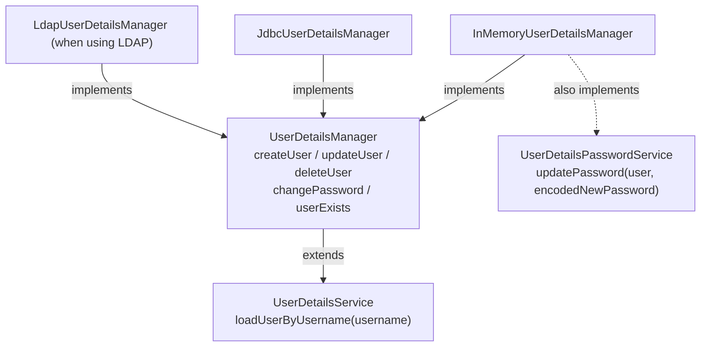
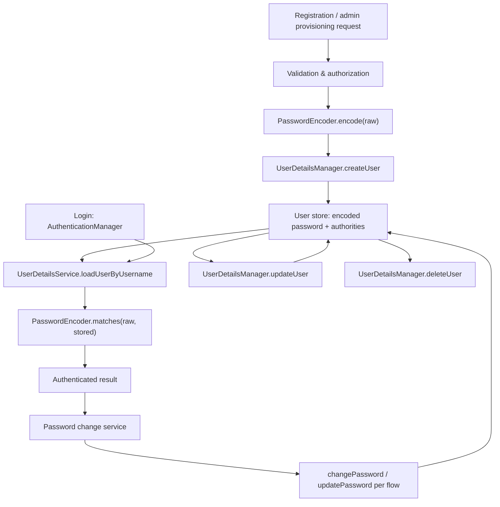

# UserDetailsManager Adds Account Management Operations

## Lesson Objectives

In Spring Security, `UserDetailsService` enables the system to **read account information for authentication** via `loadUserByUsername(String username)`. When an application needs to **create, update, delete, check existence, or change passwords** for accounts, the extended interface `UserDetailsManager` provides the corresponding management operations. Understanding this difference properly helps you pick the right layer for the problem, rather than accidentally putting the entire account lifecycle into login verification code.

This lesson focuses on **Spring Security 6.5.x, Java 17, Spring Boot 3.5.0, and Spring MVC/Servlet**. We build a small application using `InMemoryUserDetailsManager` as the user source, configure HTTP Basic, and write independent tests for `createUser`, `updateUser`, `deleteUser`, `userExists`, `changePassword`, and how they affect subsequent authentications. The JDBC section illustrates the path toward persistent storage.

After this lesson, you can:

1. Distinguish `UserDetails`, `UserDetailsService`, `UserDetailsManager`, `UserDetailsPasswordService`, `PasswordEncoder`, and `AuthenticationManager`.
2. Properly invoke all five account management operations of `UserDetailsManager` along with the inherited `loadUserByUsername` method.
3. Understand why passwords passed to `createUser/updateUser` must be encoded beforehand and why `changePassword` has special conditions.
4. Use `InMemoryUserDetailsManager` to observe creating, modifying authorities, locking/unlocking status, and deleting users without a database.
5. Verify that changes actually affect authentication/authorization on subsequent requests.
6. Understand `JdbcUserDetailsManager`, the users/authorities schema, and what must be added when deploying with a database.
7. Write JUnit 5 and MockMvc tests, distinguishing manager lifecycle tests from HTTP 200/401/403 tests.
8. Identify production boundaries: administrative permissions, password change/reset, race conditions, transactions, revoking sessions/tokens, auditing, MFA, and secret management.

**The scope of UserDetailsManager is managing identity data for username/password**—not a pre-secured REST API, not a solution for issuing MFA/sessions/tokens, and not an automatic enforcer of every business policy around accounts.

## 1. How Are UserDetailsService and UserDetailsManager Related?

Look closely at the interface hierarchy:



In Java:

```java
// Simplified contract shape for learning.
public interface UserDetailsService {
    UserDetails loadUserByUsername(String username)
        throws UsernameNotFoundException;
}

public interface UserDetailsManager extends UserDetailsService {
    void createUser(UserDetails user);
    void updateUser(UserDetails user);
    void deleteUser(String username);
    void changePassword(String oldPassword, String newPassword);
    boolean userExists(String username);
}
```

This is an **API diagram**, not two interfaces you must recreate in your application. Spring Security already provides them in:

- `org.springframework.security.core.userdetails.UserDetailsService`
- `org.springframework.security.provisioning.UserDetailsManager`

**Key point:** because `UserDetailsManager extends UserDetailsService`, every implementation of UserDetailsManager can be used as **the user source for `DaoAuthenticationProvider`** during username/password login. You do not need to write a second UserDetailsService just to read users created by the manager.

### 1.1. Is UserDetails a database entity?

No. `UserDetails` is the data contract Spring Security needs to verify an account. It typically holds username, **encoded password**, authorities, and statuses such as enabled/non-expired/non-locked.

```java
UserDetails learner = User.withUsername("learner")
    .password(encoder.encode("learner-pass"))
    .roles("USER")
    .build();
```

This is a fragment using an existing `PasswordEncoder encoder`. `User` is a `UserDetails` implementation provided by Spring Security.

**Do not equate UserDetails with a JPA `Account` entity**. In production, an entity may contain email, phone, createdAt, tenant, MFA, verification status, and business data; the identity service/mapper converts only the needed information into `UserDetails`. Returning `UserDetails` raw to the frontend is also not a safe API DTO because it can contain the password hash and internal info.

### 1.2. UserDetailsManager differs from AuthenticationManager

| API | Question the API answers | Example |
| --- | --- | --- |
| `UserDetailsService.loadUserByUsername` | "What authentication data does this account have?" | Loads username/hash/authorities from the user store. |
| `UserDetailsManager.createUser/updateUser/deleteUser` | "How should the user store change?" | Creates a user, updates roles, deletes an account record. |
| `UserDetailsManager.userExists` | "Is this username already in the store?" | Checks existence. |
| `UserDetailsManager.changePassword` | "Change the current user's password per this implementation." | Typically needs context and may require verifying the old password. |
| `AuthenticationManager.authenticate` | "Are the provided credentials valid?" | Returns verified Authentication or throws an exception. |
| `PasswordEncoder.encode/matches` | "How to hash a password; does raw match the stored hash?" | Uses bcrypt/DelegatingPasswordEncoder. |
| `AuthorizationManager` | "Is the authenticated actor allowed to perform this action?" | Checks role, permission, owner, tenant. |

**Creating a user is not logging in.** `manager.createUser(...)` only writes `UserDetails` into the store. It does not automatically create an HTTP session or place an authenticated `Authentication` into `SecurityContextHolder`. To log in, HTTP Basic/form/filters still must send credentials to `AuthenticationManager`.

**Deleting a user does not automatically revoke all sessions/JWTs.** A session may retain the old `Authentication`; a self-contained JWT may remain valid until expiration without token revocation/session invalidation. These policies must be designed outside the interface.

## 2. The Five Account Management Methods

### 2.1. createUser(UserDetails user)

Creates a new record from the passed `UserDetails` data. Example:

```java
UserDetails account = User.withUsername("analyst")
    .password(encoder.encode("analyst-pass"))
    .roles("USER")
    .build();

users.createUser(account);
```

Here `users` is a `UserDetailsManager` and `encoder` is a `PasswordEncoder` bean. The manager accepts **a UserDetails whose password is already in storage format**; it cannot guess whether a passed string is plaintext or bcrypt.

With `InMemoryUserDetailsManager`, if the username already exists, `createUser` rejects it instead of silently overwriting. With JDBC/LDAP, the error raised may be a different exception subject to database/schema constraints; do not rely on a single exception class across all implementations.

**Do not use `createUser` as a self-registration API if users can submit arbitrary roles/authorities fields.** The server must assign minimal roles after verification and policy checks.

### 2.2. updateUser(UserDetails user)

Updates an existing account's info. Example modifying authorities in a lab:

```java
UserDetails current = users.loadUserByUsername("analyst");
UserDetails updated = User.withUserDetails(current)
    .authorities("ROLE_USER", "REPORT_READ")
    .build();

users.updateUser(updated);
```

`User.withUserDetails(current)` preserves existing `UserDetails` properties, then intentionally replaces authorities as requested. If you construct a brand-new `User` and forget to copy `password`/enabled/locked flags, you can accidentally reset security statuses or break login for the user.

**`updateUser` is not an automatic HTTP PATCH.** There is no version checking, validation, auditing, role-grant policy, or transaction on the interface. With a database and multiple admins, ensure the updater is authorized to grant those roles and prevent lost concurrent updates (appropriate optimistic locking/transactions).

### 2.3. deleteUser(String username)

Deletes the user record from the user store:

```java
users.deleteUser("analyst");
boolean stillExists = users.userExists("analyst");
```

With `InMemoryUserDetailsManager`, the record can no longer be found after deletion; in production you must also decide: hard delete vs. deactivate/soft-delete, retaining audit trails, cascading or decoupling related data, revoking refresh tokens/sessions/API keys, and avoiding deleting accounts subject to legal retention obligations.

**Do not conclude the user has been kicked out of every session just because deleteUser ran.** Previously created sessions and self-contained tokens require separate revocation mechanisms or status-checking policies.

### 2.4. userExists(String username)

Checks whether the username is in the store:

```java
if (!users.userExists("analyst")) {
    users.createUser(account);
}
```

This is an illustrative fragment and **does not guarantee safe account creation under race conditions**. Two concurrent requests can both see false and both attempt to create. When using a database, a unique constraint on username/tenant is the source of truth; the service must handle duplicate conflicts according to design conventions.

**Do not expose a `/users/exists?username=...` endpoint publicly to all callers without assessing account enumeration risk.** Registration/password-recovery messages should limit revealing account existence per the actual threat model.

### 2.5. changePassword(String oldPassword, String newPassword)

This method **changes the password of the current user** per the implementation, completely different from `updateUser(UserDetails)` which carries an explicit username.

```java
users.changePassword(oldRawPassword, newEncodedPassword);
```

This is an important fragment yet **not a complete password-change endpoint**. The interface's two parameters do not promise to auto-encode the password, auto-verify `oldPassword` across every implementation, or derive the username from a parameter. The verification depth and storage behavior depend on the configured manager.

In `InMemoryUserDetailsManager` in Spring Security 6.5:

1. The method looks up **the current user's Authentication** in `SecurityContextHolder`.
2. If there is no Authentication, it does not know which user is changing passwords and throws `AccessDeniedException`.
3. **If `setAuthenticationManager(...)` has been configured**, the manager re-authenticates the current username with `oldPassword` before writing the new value.
4. **If no AuthenticationManager has been configured on InMemoryUserDetailsManager**, old password verification **is not performed by the in-memory manager itself**. So do not assume passing a wrong `oldPassword` is always blocked.
5. The implementation stores the passed `newPassword` string; in labs, call `encoder.encode(newRawPassword)` first so plaintext is not stored.
6. It does not automatically invalidate prior sessions or access tokens, nor does it replace a password-reset workflow.

**This is the easiest point to get wrong in this lesson:** a password-change UI must verify identity, old password if required, new password policy, brute-force protection, rate limiting, auditing, hashing, transactions, token revocation, and CSRF protection depending on client type. Merely calling `changePassword` does not provide all of those layers.

## 3. Account Lifecycle in an Application



This is a conceptual flow, not "createUser automatically calls AuthenticationManager". Admin provisioning, registration, and password reset each have different policies. When using JDBC/JPA or an external identity provider, there are also transactions, unique constraints, events, and session/cache synchronization.

### 3.1. Creating and updating UserDetails is not testing login

A `UserDetails` can be saved cleanly in structure yet still fail to authenticate if:

- The stored password is not encoded in the format `PasswordEncoder` expects at login.
- `isEnabled() == false`.
- The account is locked/expired or credentials are expired.
- Authorities do not match the expected schema, or the user-loading source is misconfigured.
- `AuthenticationManager` uses a different `UserDetailsService` from the manager you just updated.

Therefore tests must cover both **successful CRUD operations** and **actual login before/after changes**.

### 3.2. Adjusting roles after a user has already logged in

`users.updateUser(...)` can change authorities in the user store, yet an `Authentication` already placed in an HTTP session may still retain old authorities. With stateless HTTP Basic where the user is reloaded on each authentication request, new requests usually see the new state. With session-based login, you need a policy to refresh `SecurityContext`, invalidate sessions, or evaluate permissions from source data to ensure permission updates take effect promptly.

**Changing roles in the database does not automatically strip old roles from existing JWTs.** If tokens carry self-contained role claims, you must consider token lifetime, revocation, introspection, or server-side permission checks.

## 4. Common Implementations

| Implementation | Storage source | Supports CRUD | Best suited for |
| --- | --- | --- | --- |
| `InMemoryUserDetailsManager` | In-RAM Map of a single JVM/process | Yes | Demos, tests, learning examples, small tightly controlled cases |
| `JdbcUserDetailsManager` | JDBC/DataSource, users/authorities tables per supported schema | Yes | Username/password systems using a compatible JDBC schema |
| `LdapUserDetailsManager` | LDAP directory per environment/config | Yes, per directory capabilities | Systems using LDAP as the account store |
| Custom `UserDetailsService` | Application-defined repository/identity provider | Read-only per interface | When integrating identity with a complex domain |
| Custom `UserDetailsManager` | Application-built repository | Yes if implemented and tested | When wanting custom management APIs while keeping Spring Security contracts |

**Choose the interface based on needs:** if the app only logs in via external OAuth2/OIDC, you do not need to create a `UserDetailsManager` by default. If the app has internal accounts and needs CRUD, the interface can unify code, yet it does not replace a domain-level account service.

### 4.1. InMemoryUserDetailsManager

`InMemoryUserDetailsManager` has a no-arg constructor and constructors from `UserDetails...`, `Collection<UserDetails>`, or `Properties`. It implements `loadUserByUsername` and all five management methods.

Characteristics:

- Data lives in process RAM; restarts lose runtime changes unless initialized from another source.
- Separate instances do not automatically synchronize users.
- No migrations, transactions, or user tables.
- Well-suited for verifying account-management code without needing a DB.
- Has certain implementation-specific behaviors such as normalizing username keys on lookup; **do not rely on that behavior to assume all DBs/LDAPs are case-insensitive**.

### 4.2. JdbcUserDetailsManager

`JdbcUserDetailsManager` extends `JdbcDaoImpl` and implements `UserDetailsManager`. It uses a `DataSource`, queries to read/write data, and the default users/authorities schema per Spring Security documentation.

A configuration fragment:

```java
@Bean
UserDetailsManager jdbcUsers(DataSource dataSource) {
    return new JdbcUserDetailsManager(dataSource);
}
```

Required imports include `org.springframework.context.annotation.Bean`, `javax.sql.DataSource`, and `org.springframework.security.provisioning.JdbcUserDetailsManager` / `UserDetailsManager`. **Only add this fragment after configuring the DataSource, schema, and removing any competing in-memory bean**, otherwise you may end up with multiple `UserDetailsService` sources and unpredictable authentication source selection.

Simplified sample table schema for databases supporting this syntax:

```sql
CREATE TABLE users (
    username VARCHAR(50) NOT NULL PRIMARY KEY,
    password VARCHAR(500) NOT NULL,
    enabled BOOLEAN NOT NULL
);

CREATE TABLE authorities (
    username VARCHAR(50) NOT NULL,
    authority VARCHAR(50) NOT NULL,
    CONSTRAINT fk_auth_user
        FOREIGN KEY (username) REFERENCES users(username)
);

CREATE UNIQUE INDEX ix_auth_username
    ON authorities(username, authority);
```

**This is an outline SQL example, not a universal migration script for every database.** Spring Security ships default schema resources and queries; H2/Oracle/PostgreSQL/MySQL differ in data types/collations/constraints. If using a custom schema (e.g., accounts with UUID, email, tenantId, custom status), you must configure custom queries or implement an appropriate manager; do not assume `JdbcUserDetailsManager` automatically understands your JPA entities.

#### Why are authorities separated from the users table?

One user can have multiple roles/permissions, so each row in `authorities` stores one authority tied to username. `.roles("ADMIN")` typically generates `ROLE_ADMIN` per the default prefix. `JdbcUserDetailsManager.updateUser(...)` must update permission data using queries/schemas the manager understands; if the database uses a separate multi-table role-permission model, map it or design a different manager.

#### Persistent storage does not automatically guarantee permission synchronization

With JDBC, the DB persists across restarts and can be shared across multiple apps, yet `UserDetails` caching, HTTP sessions, JWTs, replication lag, and concurrent writes still affect when new permissions take effect. You need invalidation/event strategies and concurrency tests as required.

## 5. Where Does PasswordEncoder Fit in Account Management?

### 5.1. Raw password and stored password

`UserDetailsManager` **is not a PasswordEncoder**. In the lab:

```java
PasswordEncoder encoder =
    PasswordEncoderFactories.createDelegatingPasswordEncoder();

String raw = "learner-pass";
String stored = encoder.encode(raw);

UserDetails user = User.withUsername("learner")
    .password(stored)
    .roles("USER")
    .build();
```

`PasswordEncoderFactories.createDelegatingPasswordEncoder()` in Spring Security 6.5 defaults to bcrypt for new passwords, attaching the `{bcrypt}` prefix to the stored hash. At login, `DaoAuthenticationProvider` uses the matching encoder to call `matches(raw, encoded)`. Bcrypt uses a random salt, so encoding the same raw string twice usually yields different results: **never compare two encode results with equals**.

```java
// Wrong with bcrypt because each encode call can generate a different salt.
boolean wrongCheck =
    encoder.encode(submitted).equals(storedHash);

// Right:
boolean matches = encoder.matches(submitted, storedHash);
```

These two lines are a fragment; `submitted` and `storedHash` must be initialized by real code.

### 5.2. Do not use {noop} for real accounts

You may see `.password("{noop}pass")` in very old tutorials. The `{noop}` marker means no password hashing. It is only suitable for understanding format mechanics/minimal demos; **never use it to store production passwords**.

Even when you call `encoder.encode("demo-pass")` in the app, the raw string still sits in the source/build artifact. Therefore hard-coded lab accounts must only use dummy credentials on local machines.

### 5.3. Does changing a password with updateUser require re-encoding?

Yes, **if replacing a raw password with a new password**. Example:

```java
UserDetails current = users.loadUserByUsername("learner");

UserDetails updated = User.withUserDetails(current)
    .password(encoder.encode("new-lab-pass"))
    .build();

users.updateUser(updated);
```

However, this is a **direct administrative operation on the user store**, not a self-service password-change flow: there is no old-password check, no automatic retrieval of the current user, no abuse protection, and no session revocation. In production, the backend may only invoke this flow after administrator authorization/verification or valid reset-token verification has completed.

### 5.4. changePassword must be designed carefully

`UserDetailsManager.changePassword(oldPassword, newPassword)` changes the password of the **current principal**; it does not take a username. For `InMemoryUserDetailsManager` in 6.5, if you want to re-authenticate the old password, you must configure `setAuthenticationManager(...)`; otherwise the implementation may skip verifying the old password.

For the lab using `DelegatingPasswordEncoder`, we call:

```java
UserDetailsManager users = configuredManager;

// Execute only within an authenticated current-user context.
users.changePassword(
    "learner-pass",
    encoder.encode("next-lab-pass")
);
```

This is a **fragment**, not a public REST endpoint callable at will. The current user must have an authentication in `SecurityContext`; `configuredManager` must have a designed and tested mechanism for verifying the old password rather than relying on an implicit assumption.

**Never store a raw `newPassword`** into the in-memory manager just because the signature parameter is named `newPassword`; the implementation may store the exact string you pass, and subsequent logins will fail to match the corresponding hash.

## 6. Distinguishing changePassword from UserDetailsPasswordService.updatePassword

This is an under-explained yet important part:

| API | Belongs to interface | Whose password is changed? | Who must verify? |
| --- | --- | --- | --- |
| `changePassword(oldPassword, newPassword)` | `UserDetailsManager` | **Current user** in SecurityContext (per implementation) | Whether old password is checked depends on manager/config; self-service must design full checks |
| `updateUser(UserDetails)` | `UserDetailsManager` | User matching the username in the passed object | Caller/service must be authorized to edit the user; interface does not check old password |
| `updatePassword(UserDetails, encodedNewPassword)` | `UserDetailsPasswordService` | Specified UserDetails | Mainly serves hash upgrades/rehashing via an appropriate mechanism; not a self-service password-change endpoint |

`InMemoryUserDetailsManager` implements **both** `UserDetailsManager` and `UserDetailsPasswordService`. `JdbcUserDetailsManager` also supports password updates per API and version. However, **`updatePassword` is not a method of UserDetailsManager**; do not call it through a `UserDetailsManager` variable assuming the interface declares that method.

Illustrative example of the second method:

```java
// Only when you have an appropriate UserDetailsPasswordService
// and have established corresponding policy/authority checks.
UserDetails user = users.loadUserByUsername("learner");
UserDetails updated = passwordService.updatePassword(
    user,
    encoder.encode("rotated-lab-pass")
);
```

This is a fragment; `passwordService` is a `UserDetailsPasswordService` and must be initialized/injected from a suitable implementation. This method does not require `oldPassword`, so it does not replace a user-verified password change flow. `DaoAuthenticationProvider` can integrate `UserDetailsPasswordService` to upgrade hashes under supported mechanisms; version/algorithm/cost must be verified.

## 7. Complete Spring Boot Project: A Manageable User Source

### 7.1. HTTP scenario

We use sample accounts:

- `learner` / `learner-pass`: `ROLE_USER`.
- `admin` / `admin-pass`: `ROLE_USER` and `ROLE_ADMIN`.

The application has three GET endpoints:

| HTTP request | Policy | Expected result |
| --- | --- | --- |
| `GET /public/ping` | `permitAll()` | Anonymous 200, body `pong` |
| `GET /api/me` | `authenticated()` | Learner/admin 200; anonymous 401 with Basic |
| `GET /admin/ping` | `hasRole("ADMIN")` | Admin 200; learner 403 |
| Other requests | `denyAll()` | No accidentally public new endpoints |

**The lab does not expose REST endpoints for create/update/delete user.** Account management will be tested directly against an isolated manager in each unit test, because raw CRUD lacks built-in admin authorization, validation, auditing, or CSRF protection. When implementing real business flows, you must put a service and dedicated protection policies in place before exposing administrative actions over HTTP.

### 7.2. Directory structure

```text
user-manager-lab/
├── pom.xml
└── src/
    ├── main/java/com/example/usermanager/
    │   ├── UserManagerApplication.java
    │   ├── SecurityConfig.java
    │   └── IdentityController.java
    └── test/java/com/example/usermanager/
        ├── UserDetailsManagerLifecycleTest.java
        └── AccountAuthenticationHttpTest.java
```

### 7.3. Maven pom.xml

```xml
<project xmlns="http://maven.apache.org/POM/4.0.0"
         xmlns:xsi="http://www.w3.org/2001/XMLSchema-instance"
         xsi:schemaLocation="http://maven.apache.org/POM/4.0.0 https://maven.apache.org/xsd/maven-4.0.0.xsd">
    <modelVersion>4.0.0</modelVersion>

    <parent>
        <groupId>org.springframework.boot</groupId>
        <artifactId>spring-boot-starter-parent</artifactId>
        <version>3.5.0</version>
        <relativePath/>
    </parent>

    <groupId>com.example</groupId>
    <artifactId>user-manager-lab</artifactId>
    <version>1.0.0</version>

    <properties>
        <java.version>17</java.version>
    </properties>

    <dependencies>
        <dependency>
            <groupId>org.springframework.boot</groupId>
            <artifactId>spring-boot-starter-web</artifactId>
        </dependency>
        <dependency>
            <groupId>org.springframework.boot</groupId>
            <artifactId>spring-boot-starter-security</artifactId>
        </dependency>
        <dependency>
            <groupId>org.springframework.boot</groupId>
            <artifactId>spring-boot-starter-test</artifactId>
            <scope>test</scope>
        </dependency>
        <dependency>
            <groupId>org.springframework.security</groupId>
            <artifactId>spring-security-test</artifactId>
            <scope>test</scope>
        </dependency>
    </dependencies>

    <build>
        <plugins>
            <plugin>
                <groupId>org.springframework.boot</groupId>
                <artifactId>spring-boot-maven-plugin</artifactId>
            </plugin>
        </plugins>
    </build>
</project>
```

`spring-boot-starter-web` brings the Spring MVC/Servlet stack; `spring-boot-starter-security` integrates Spring Security; `spring-security-test` supports MockMvc testing. The Boot parent selects compatible dependency versions. Version `3.5.0` is a learning baseline, not a recommendation to stay on an unpatched version in production.

### 7.4. UserManagerApplication.java

```java
package com.example.usermanager;

import org.springframework.boot.SpringApplication;
import org.springframework.boot.autoconfigure.SpringBootApplication;

@SpringBootApplication
public class UserManagerApplication {
    public static void main(String[] args) {
        SpringApplication.run(UserManagerApplication.class, args);
    }
}
```

This is the entry point. Placing the class in the root package `com.example.usermanager` lets Boot scan `SecurityConfig` and `IdentityController`.

### 7.5. SecurityConfig.java

```java
package com.example.usermanager;

import org.springframework.context.annotation.Bean;
import org.springframework.context.annotation.Configuration;
import org.springframework.security.config.Customizer;
import org.springframework.security.config.annotation.web.builders.HttpSecurity;
import org.springframework.security.config.annotation.web.configurers.AbstractHttpConfigurer;
import org.springframework.security.config.http.SessionCreationPolicy;
import org.springframework.security.core.userdetails.User;
import org.springframework.security.crypto.factory.PasswordEncoderFactories;
import org.springframework.security.crypto.password.PasswordEncoder;
import org.springframework.security.provisioning.InMemoryUserDetailsManager;
import org.springframework.security.provisioning.UserDetailsManager;
import org.springframework.security.web.SecurityFilterChain;

@Configuration(proxyBeanMethods = false)
public class SecurityConfig {

    @Bean
    PasswordEncoder passwordEncoder() {
        return PasswordEncoderFactories.createDelegatingPasswordEncoder();
    }

    @Bean
    UserDetailsManager users(PasswordEncoder encoder) {
        return new InMemoryUserDetailsManager(
            User.withUsername("learner")
                .password(encoder.encode("learner-pass"))
                .roles("USER")
                .build(),
            User.withUsername("admin")
                .password(encoder.encode("admin-pass"))
                .roles("USER", "ADMIN")
                .build()
        );
    }

    @Bean
    SecurityFilterChain securityFilterChain(HttpSecurity http)
            throws Exception {

        return http
            .sessionManagement(session -> session
                .sessionCreationPolicy(SessionCreationPolicy.STATELESS)
            )
            .authorizeHttpRequests(auth -> auth
                .requestMatchers("/public/ping").permitAll()
                .requestMatchers("/api/me").authenticated()
                .requestMatchers("/admin/ping").hasRole("ADMIN")
                .anyRequest().denyAll()
            )
            .httpBasic(Customizer.withDefaults())
            .formLogin(AbstractHttpConfigurer::disable)
            .build();
    }
}
```

**Explanation of key lines:**

- `users(...)` returns **`UserDetailsManager`**, so the bean also satisfies `UserDetailsService` via interface inheritance. Spring Security's username/password mechanism can retrieve users from this very bean.
- `PasswordEncoderFactories.createDelegatingPasswordEncoder()` creates an encoder defaulting to bcrypt with `{bcrypt}...` format for new hashes.
- Demo passwords are encoded right when creating `UserDetails`; `{noop}` is not used.
- `SessionCreationPolicy.STATELESS` ensures learning Basic GET requests do not rely on a previously logged-in session. Each request carrying suitable credentials goes through the corresponding authentication.
- `httpBasic(...)` handles HTTP Basic; form login is disabled so learners see 401 instead of a redirect to an HTML page.
- `anyRequest().denyAll()` protects unconfigured routes, even if controllers are added later.
- **Default CSRF remains enabled.** Because the lab only uses non-state-mutating GETs, no token is needed in the GET tests. When building POST/PUT/DELETE endpoints that modify users, handle CSRF and administrative authorization according to the threat model.

**Spring Boot's default user:** when no custom user source exists, Boot may generate a user named `user` with a random password logged at startup. Here there is a `UserDetailsManager` bean (which is also a `UserDetailsService`), so the corresponding default-user auto-configuration steps back. Use `learner`/`admin` in the example.

### 7.6. IdentityController.java

```java
package com.example.usermanager;

import java.util.List;
import java.util.Map;

import org.springframework.security.core.Authentication;
import org.springframework.security.core.GrantedAuthority;
import org.springframework.web.bind.annotation.GetMapping;
import org.springframework.web.bind.annotation.RestController;

@RestController
public class IdentityController {

    @GetMapping("/public/ping")
    public String ping() {
        return "pong";
    }

    @GetMapping("/api/me")
    public Map<String, Object> me(Authentication authentication) {
        List<String> authorities = authentication.getAuthorities()
            .stream()
            .map(GrantedAuthority::getAuthority)
            .sorted()
            .toList();

        return Map.of(
            "username", authentication.getName(),
            "authorities", authorities
        );
    }

    @GetMapping("/admin/ping")
    public String adminPing() {
        return "admin-only";
    }
}
```

At `/api/me`, Spring Security has already authenticated the request, so the controller receives the appropriate `Authentication`. The API returns only the username and sorted list of authority strings, **never** returning full `UserDetails` or password hashes.

### 7.7. Running and testing HTTP

In the `user-manager-lab` directory:

```bash
java -version
mvn -version
mvn spring-boot:run
```

Open another terminal:

```bash
curl -i http://localhost:8080/public/ping
curl -i http://localhost:8080/api/me
curl -i -u learner:learner-pass http://localhost:8080/api/me
curl -i -u learner:wrong-pass http://localhost:8080/api/me
curl -i -u learner:learner-pass http://localhost:8080/admin/ping
curl -i -u admin:admin-pass http://localhost:8080/admin/ping
```

On PowerShell, use `curl.exe` if `curl` is aliased to `Invoke-WebRequest`.

**Expected** results:

| Request | HTTP status | Body on success |
| --- | --- | --- |
| Anonymous `GET /public/ping` | 200 | `pong` |
| Anonymous `GET /api/me` | 401 | No identity returned |
| Learner right password `GET /api/me` | 200 | JSON with `username=learner`, `authorities=["ROLE_USER"]` |
| Learner wrong password `GET /api/me` | 401 | No verified Authentication |
| Learner `GET /admin/ping` | 403 | Missing ROLE_ADMIN |
| Admin `GET /admin/ping` | 200 | `admin-only` |

The table only describes behavior for you to verify yourself, not stdout captured from an actual run. JSON field order and certain security headers are not part of the lesson's contract.

HTTP Basic carries the password in a Base64 header. Base64 **does not encrypt secrets**; only use demo credentials on localhost. Real apps must use HTTPS/TLS, secret management, and controls against leakage via command history/logs.

## 8. Testing UserDetailsManager Directly

We create a **fresh manager in each test** to prevent one test from mutating the user store of another. Do not share the application singleton bean when testing create/update/delete in unit tests; doing so can expose HTTP tests to deleted users or altered roles and lead to order-dependent failures.

### 8.1. UserDetailsManagerLifecycleTest.java

```java
package com.example.usermanager;

import java.util.List;

import org.junit.jupiter.api.AfterEach;
import org.junit.jupiter.api.BeforeEach;
import org.junit.jupiter.api.Test;

import org.springframework.security.access.AccessDeniedException;
import org.springframework.security.authentication.AuthenticationManager;
import org.springframework.security.authentication.BadCredentialsException;
import org.springframework.security.authentication.DisabledException;
import org.springframework.security.authentication.ProviderManager;
import org.springframework.security.authentication.UsernamePasswordAuthenticationToken;
import org.springframework.security.authentication.dao.DaoAuthenticationProvider;
import org.springframework.security.core.Authentication;
import org.springframework.security.core.context.SecurityContext;
import org.springframework.security.core.context.SecurityContextHolder;
import org.springframework.security.core.userdetails.User;
import org.springframework.security.core.userdetails.UserDetails;
import org.springframework.security.core.userdetails.UsernameNotFoundException;
import org.springframework.security.crypto.factory.PasswordEncoderFactories;
import org.springframework.security.crypto.password.PasswordEncoder;
import org.springframework.security.provisioning.InMemoryUserDetailsManager;

import static org.assertj.core.api.Assertions.assertThat;
import static org.assertj.core.api.Assertions.assertThatThrownBy;

class UserDetailsManagerLifecycleTest {

    private PasswordEncoder encoder;
    private InMemoryUserDetailsManager users;
    private AuthenticationManager authenticationManager;

    @BeforeEach
    void setUp() {
        encoder = PasswordEncoderFactories.createDelegatingPasswordEncoder();

        users = new InMemoryUserDetailsManager(
            User.withUsername("learner")
                .password(encoder.encode("start-pass"))
                .roles("USER")
                .build()
        );

        DaoAuthenticationProvider provider =
            new DaoAuthenticationProvider(users);
        provider.setPasswordEncoder(encoder);

        authenticationManager = new ProviderManager(provider);

        // Important: changePassword can reauthenticate oldPassword.
        users.setAuthenticationManager(authenticationManager);
    }

    @AfterEach
    void clearSecurityContext() {
        SecurityContextHolder.clearContext();
    }

    @Test
    void createUserAddsEncodedAccount() {
        UserDetails analyst = User.withUsername("analyst")
            .password(encoder.encode("analyst-pass"))
            .roles("USER")
            .build();

        users.createUser(analyst);

        assertThat(users.userExists("analyst")).isTrue();
        UserDetails stored = users.loadUserByUsername("analyst");

        assertThat(stored.getUsername()).isEqualTo("analyst");
        assertThat(stored.getPassword()).startsWith("{bcrypt}");
        assertThat(encoder.matches(
            "analyst-pass", stored.getPassword()
        )).isTrue();
    }

    @Test
    void duplicateAccountCannotBeCreatedAgain() {
        UserDetails duplicate = User.withUsername("learner")
            .password(encoder.encode("another-pass"))
            .roles("USER")
            .build();

        assertThatThrownBy(() -> users.createUser(duplicate))
            .isInstanceOf(IllegalArgumentException.class);

        assertThat(encoder.matches(
            "start-pass",
            users.loadUserByUsername("learner").getPassword()
        )).isTrue();
    }

    @Test
    void updateUserReplacesAuthoritiesAndKeepsPassword() {
        UserDetails before = users.loadUserByUsername("learner");

        UserDetails edited = User.withUserDetails(before)
            .authorities("ROLE_USER", "REPORT_READ")
            .build();

        users.updateUser(edited);
        UserDetails after = users.loadUserByUsername("learner");

        assertThat(after.getAuthorities())
            .extracting(a -> a.getAuthority())
            .containsExactlyInAnyOrder("ROLE_USER", "REPORT_READ");

        assertThat(encoder.matches(
            "start-pass", after.getPassword()
        )).isTrue();
    }

    @Test
    void disableUserMakesFollowingAuthenticationFail() {
        UserDetails current = users.loadUserByUsername("learner");

        users.updateUser(
            User.withUserDetails(current).disabled(true).build()
        );

        assertThat(users.loadUserByUsername("learner")
            .isEnabled()).isFalse();

        assertThatThrownBy(() -> authenticationManager.authenticate(
            UsernamePasswordAuthenticationToken.unauthenticated(
                "learner", "start-pass"
            )
        )).isInstanceOf(DisabledException.class);
    }

    @Test
    void deleteUserRemovesAccount() {
        users.deleteUser("learner");

        assertThat(users.userExists("learner")).isFalse();
        assertThatThrownBy(
            () -> users.loadUserByUsername("learner")
        ).isInstanceOf(UsernameNotFoundException.class);
    }

    @Test
    void userExistsIsFalseForAnUnknownAccount() {
        assertThat(users.userExists("not-created")).isFalse();
    }

    @Test
    void updateMissingUserIsRejected() {
        UserDetails missing = User.withUsername("missing")
            .password(encoder.encode("missing-pass"))
            .roles("USER")
            .build();

        assertThatThrownBy(() -> users.updateUser(missing))
            .isInstanceOf(IllegalArgumentException.class);
    }

    @Test
    void changePasswordChecksOldPasswordAndStoresEncodedNewOne() {
        Authentication verified = authenticationManager.authenticate(
            UsernamePasswordAuthenticationToken.unauthenticated(
                "learner", "start-pass"
            )
        );

        SecurityContext context =
            SecurityContextHolder.createEmptyContext();
        context.setAuthentication(verified);
        SecurityContextHolder.setContext(context);

        users.changePassword(
            "start-pass",
            encoder.encode("next-pass")
        );

        String encodedAfter =
            users.loadUserByUsername("learner").getPassword();

        assertThat(encoder.matches(
            "next-pass", encodedAfter
        )).isTrue();
        assertThat(encoder.matches(
            "start-pass", encodedAfter
        )).isFalse();

        assertThatThrownBy(() -> authenticationManager.authenticate(
            UsernamePasswordAuthenticationToken.unauthenticated(
                "learner", "start-pass"
            )
        )).isInstanceOf(BadCredentialsException.class);
    }

    @Test
    void wrongOldPasswordDoesNotChangePassword() {
        Authentication verified = authenticationManager.authenticate(
            UsernamePasswordAuthenticationToken.unauthenticated(
                "learner", "start-pass"
            )
        );

        SecurityContext context =
            SecurityContextHolder.createEmptyContext();
        context.setAuthentication(verified);
        SecurityContextHolder.setContext(context);

        assertThatThrownBy(() -> users.changePassword(
            "wrong-old",
            encoder.encode("unexpected-pass")
        )).isInstanceOf(BadCredentialsException.class);

        assertThat(encoder.matches(
            "start-pass",
            users.loadUserByUsername("learner").getPassword()
        )).isTrue();
    }

    @Test
    void changePasswordNeedsCurrentAuthenticatedIdentity() {
        assertThatThrownBy(() -> users.changePassword(
            "start-pass",
            encoder.encode("new-pass")
        )).isInstanceOf(AccessDeniedException.class);
    }

    @Test
    void updatePasswordChangesStoredHashWithoutOldPasswordCheck() {
        UserDetails old = users.loadUserByUsername("learner");

        UserDetails updated = users.updatePassword(
            old, encoder.encode("rotated-pass")
        );

        assertThat(encoder.matches(
            "rotated-pass", updated.getPassword()
        )).isTrue();
        assertThat(encoder.matches(
            "rotated-pass",
            users.loadUserByUsername("learner").getPassword()
        )).isTrue();
    }
}
```

**There are 11 independent test cases** in the file above. Each test creates a fresh `InMemoryUserDetailsManager`, uses the same `PasswordEncoder` as the Spring Boot app, and wires `DaoAuthenticationProvider → ProviderManager` to verify real passwords.

**How to read the changePassword test:**

1. `authenticate(...)` checks the username and initial password, returning a verified `Authentication`.
2. The test puts the verified `Authentication` into `SecurityContextHolder` **simulating the current user**. This is a trusted test environment; production must never set `Authentication` from a client-supplied username.
3. `users.setAuthenticationManager(authenticationManager)` was configured beforehand, so `changePassword("start-pass", ...)` checks the old password through the manager.
4. The test passes **the hash of the new password**, not the raw string directly.
5. Then `matches(...)` proves the new password matches, the old password fails, and logging in with the old password fails.
6. `@AfterEach` clears `SecurityContext` to prevent this test's identity from leaking to another test.

**Key distinction:** `updatePassword(UserDetails, encodedPassword)` belongs to `UserDetailsPasswordService`, which this implementation also supports. It does not require the old password like a self-service change flow; use it only when the calling layer already has appropriate proof and policy.

The `disableUserMakesFollowingAuthenticationFail` test shows that a change in the user store can cause subsequent logins to receive `DisabledException`, unlike merely changing an HTTP authorization rule. It **does not automatically log out existing sessions**.

### 8.2. Why not test by calling encode twice?

With bcrypt, random salts make hashes differ; the right assertion is:

```java
assertThat(encoder.matches(raw, encoded)).isTrue();
```

This is a standalone fragment; `raw` and `encoded` must have appropriate values. **Do not write `encoder.encode(raw).equals(encoded)`** to verify a password. Hashes are not login tokens, and there is no need to print hashes to logs to prove tests.

## 9. HTTP Testing: The Manager Is Also the Authentication Source

`@SpringBootTest`/MockMvc runs the application context with the real `UserDetailsManager users(...)` bean. The HTTP tests below are **read-only** and do not mutate the `users` singleton, so they do not depend on the execution order of the unit tests in Section 8.

### 9.1. AccountAuthenticationHttpTest.java

```java
package com.example.usermanager;

import org.junit.jupiter.api.Test;
import org.springframework.beans.factory.annotation.Autowired;
import org.springframework.boot.test.autoconfigure.web.servlet.AutoConfigureMockMvc;
import org.springframework.boot.test.context.SpringBootTest;
import org.springframework.security.provisioning.UserDetailsManager;
import org.springframework.test.web.servlet.MockMvc;

import static org.assertj.core.api.Assertions.assertThat;
import static org.springframework.security.test.web.servlet.request
    .SecurityMockMvcRequestPostProcessors.httpBasic;
import static org.springframework.test.web.servlet.request.MockMvcRequestBuilders.get;
import static org.springframework.test.web.servlet.result.MockMvcResultMatchers.content;
import static org.springframework.test.web.servlet.result.MockMvcResultMatchers.jsonPath;
import static org.springframework.test.web.servlet.result.MockMvcResultMatchers.status;

@SpringBootTest
@AutoConfigureMockMvc
class AccountAuthenticationHttpTest {

    @Autowired
    MockMvc mvc;

    @Autowired
    UserDetailsManager users;

    @Test
    void bootProvidesSameManagerForUserLookup() {
        assertThat(users.userExists("learner")).isTrue();
        assertThat(users.loadUserByUsername("learner")
            .getUsername()).isEqualTo("learner");
    }

    @Test
    void publicEndpointIsAccessibleToAnonymous() throws Exception {
        mvc.perform(get("/public/ping"))
            .andExpect(status().isOk())
            .andExpect(content().string("pong"));
    }

    @Test
    void anonymousCannotReadMe() throws Exception {
        mvc.perform(get("/api/me"))
            .andExpect(status().isUnauthorized());
    }

    @Test
    void learnerWithCorrectPasswordIsAuthenticated() throws Exception {
        mvc.perform(get("/api/me")
                .with(httpBasic("learner", "learner-pass")))
            .andExpect(status().isOk())
            .andExpect(jsonPath("$.username").value("learner"))
            .andExpect(jsonPath("$.authorities[0]")
                .value("ROLE_USER"));
    }

    @Test
    void wrongPasswordFailsAuthentication() throws Exception {
        mvc.perform(get("/api/me")
                .with(httpBasic("learner", "wrong-pass")))
            .andExpect(status().isUnauthorized());
    }

    @Test
    void learnerLacksAdminRole() throws Exception {
        mvc.perform(get("/admin/ping")
                .with(httpBasic("learner", "learner-pass")))
            .andExpect(status().isForbidden());
    }

    @Test
    void adminPassesAdminRule() throws Exception {
        mvc.perform(get("/admin/ping")
                .with(httpBasic("admin", "admin-pass")))
            .andExpect(status().isOk())
            .andExpect(content().string("admin-only"));
    }

    @Test
    void unknownRouteIsNotPublicForAuthenticatedUser()
            throws Exception {
        mvc.perform(get("/unknown")
                .with(httpBasic("learner", "learner-pass")))
            .andExpect(status().isForbidden());
    }
}
```

These are **8 HTTP/context test cases**, consisting of one bean verification test and seven HTTP tests. Combined with the 11 lifecycle tests, that totals **19 test cases**.

Crucially, `UserDetailsManager` is registered as a Spring bean that `DaoAuthenticationProvider` uses under the `UserDetailsService` contract, so real logins read users from this store. The tests distinguish:

- **200:** valid credentials and permitted URL rule.
- **401:** missing or wrong credentials in the HTTP Basic flow.
- **403:** logged in but lacking `ROLE_ADMIN`, or route blocked by default-deny.
- A username appearing in the manager does not automatically mean access to every endpoint.

These tests were **written for you to run**, not actual Maven output from an executed run. If results differ from expectations, check dependencies, packages, user-source beans, filter chains, encoders, HTTP matchers, and actual user status before loosening rules.

### 9.2. Running the full test suite

```bash
mvn test
```

Expect **19 tests** with zero failures/errors when running the exact code in the stated structure. Maven/Surefire output may vary across machines; this lesson does not fabricate a fixed log. For unit tests changing passwords, execution time may be longer than typical tests because bcrypt has a work factor and performs multiple hash/verify operations.

## 10. If You Want to Try a Direct Management Example Outside HTTP

In a small test, you can try sequentially:

```java
PasswordEncoder encoder =
    PasswordEncoderFactories.createDelegatingPasswordEncoder();

InMemoryUserDetailsManager users =
    new InMemoryUserDetailsManager();

users.createUser(
    User.withUsername("demo")
        .password(encoder.encode("demo-pass"))
        .roles("USER")
        .build()
);

System.out.println(users.userExists("demo"));    // true

UserDetails current = users.loadUserByUsername("demo");
UserDetails updated = User.withUserDetails(current)
    .authorities("ROLE_USER", "REPORT_READ")
    .build();

users.updateUser(updated);

System.out.println(
    users.loadUserByUsername("demo").getAuthorities().stream()
        .map(a -> a.getAuthority())
        .sorted()
        .toList()
); // [REPORT_READ, ROLE_USER]

users.deleteUser("demo");

System.out.println(users.userExists("demo"));    // false
```

This is a **fragment needing imports and a class/test wrapper**, not a bare `javac` file; the project in Section 7 provides the dependencies. The three commented stdout lines have the **exact** expected output when executed sequentially on a dedicated manager:

```text
true
[REPORT_READ, ROLE_USER]
false
```

No fixed bcrypt hash is printed because salts change between encode calls. This snippet illustrates `UserDetailsManager` CRUD support; it **does not illustrate HTTP authorization** because all operations occur inside test/learning code.

## 11. Why Should You Not Expose REST CRUD Directly Using the Manager?

The example below is an **anti-pattern**; do not copy it into a project:

```java
// DANGEROUS: clients can grant themselves ROLE_ADMIN or delete other users.
@PostMapping("/users")
void create(@RequestBody UserDetails user) {
    users.createUser(user);
}
```

Risks:

1. Clients pass arbitrary authorities and can request `ROLE_ADMIN` for themselves.
2. Clients pass raw passwords or malformed encoded passwords.
3. No validation for username, password, uniqueness, or email verification.
4. Does not determine which accounts the caller is allowed to create/delete/edit.
5. No CSRF, auditing, rate limiting, or dangerous-operation policy.
6. No mass-assignment control from JSON into the `UserDetails` object.
7. Responses/errors can leak account existence or hashes.
8. No transactions, ownership/tenant checking, idempotency, or concurrency handling.

### 11.1. Shape of a properly layered service

A production service typically follows this flow:

```text
HTTP / registration / admin operation
    |
    v
Authentication + authorization (actor, tenant, action)
    |
    v
Validate input / business policy
    |
    v
Password policy + PasswordEncoder / identity provider
    |
    v
UserDetailsManager or repository service
    |
    v
Transaction + audit + event/session/token invalidation
    |
    v
DTO response without password/hash
```

The manager itself cannot infer these checks. If a user is changing their own password, the actor/subject must usually be that same user or go through a verified reset workflow. If an admin updates roles, the service must know whether the admin is permitted to grant that role and operate on the target tenant.

### 11.2. Example service fragment for account creation

```java
public void registerLearner(String username, String rawPassword) {
    // Assumes outer layers already enforce registration policy,
    // rate limiting, and appropriate email/identity verification.
    if (username == null || username.isBlank()) {
        throw new IllegalArgumentException("Username is required");
    }
    if (rawPassword == null || rawPassword.length() < 12) {
        throw new IllegalArgumentException("Password policy not met");
    }
    if (users.userExists(username)) {
        throw new IllegalArgumentException("Username unavailable");
    }

    UserDetails learner = User.withUsername(username)
        .password(encoder.encode(rawPassword))
        .roles("USER") // Role assigned by server, not taken from request.
        .build();

    users.createUser(learner);
}
```

This is a **design fragment**, not a complete service safe to expose publicly without modification. `users` is a `UserDetailsManager`, and `encoder` is a `PasswordEncoder` injected by the service. Validation is minimal and `userExists + createUser` has a race condition; the DB must enforce unique constraints, error mapping, transactions, and context-appropriate anti-username-enumeration measures.

### 11.3. What when a user has administrative privileges?

Admin endpoints can be protected with `hasRole("ADMIN")` or `@PreAuthorize`, yet a generic role does not necessarily permit editing every tenant. With RBAC + tenants, you also need to verify which scope the admin belongs to, which roles may be granted, whether separation-of-duties rules apply, and before/after change auditing.

**Never let an admin API accept raw `UserDetails` from a client and save it as-is**. Use request DTOs with allowlisted fields, validate each transition, and keep role assignment inside trusted code.

## 12. From InMemory to JDBC: What Else Is Needed?

### 12.1. Preparing the schema

According to Spring Security JDBC documentation, the default schema includes at least:

- `users(username, password, enabled)`;
- `authorities(username, authority)`;
- unique constraint/index on the username-authority pair;
- foreign key pointing from `authorities` to `users`.

A local H2 project can use the `org/springframework/security/core/userdetails/jdbc/users.ddl` resource, though that DDL syntax may differ from production databases. Do not use it directly on PostgreSQL/Oracle/MySQL without checking dialects and migration strategies.

### 12.2. Preparing the DataSource

In Maven, add the right JDBC driver and `spring-boot-starter-jdbc`. With H2 for learning, example dependencies:

```xml
<dependency>
    <groupId>org.springframework.boot</groupId>
    <artifactId>spring-boot-starter-jdbc</artifactId>
</dependency>
<dependency>
    <groupId>com.h2database</groupId>
    <artifactId>h2</artifactId>
    <scope>runtime</scope>
</dependency>
```

This is an additive fragment **for the JDBC variant**; do not insert it verbatim into the in-memory lab unless you intend to switch to JDBC. Use embedded H2 to learn SQL/user persistence within a process, yet do not assume in-memory H2 preserves data across restarts.

In the corresponding configuration, `@Bean UserDetailsManager jdbcUsers(DataSource dataSource)` can return `new JdbcUserDetailsManager(dataSource)`. Ensure only the user source the authentication manager actually needs is present, and data is properly seeded/migrated.

### 12.3. Simply swapping classes does not give production-ready account management

Switching to JDBC solves **persistent storage** if the DB is operated properly, yet does not solve:

- Password reset/verification, MFA, username recovery.
- Account lock/unlock after brute-force attacks.
- Soft delete and record retention requirements.
- Session/token management after role/password changes.
- Rate limits, auditing, notifications, and events.
- Tenant isolation, admin authorization, and per-tenant unique usernames.
- Schema migrations, transactions, optimistic locking.
- `UserDetails` caching and permission validity lifetimes.
- Secret/key rotation, backups, encryption-at-rest where needed.

If the user domain is complex, a custom `UserDetailsService` + domain account service usually yields a better business model than forcing every attribute into the default `users`/`authorities` schema.

## 13. Extended Exercises with Solution Outlines

### Exercise 1 — Add a temporary user

Create an isolated manager in JUnit, call `createUser` for username `temp` with an encoded password, then `loadUserByUsername` and `PasswordEncoder.matches`. Test that duplicate usernames are rejected. Never log raw passwords.

### Exercise 2 — Add report-viewing permission

For `learner`, build `User.withUserDetails(old).authorities("ROLE_USER", "REPORT_READ").build()` and call `updateUser`. Use `hasAuthority("REPORT_READ")` on a dedicated test endpoint if needed. Verify role/authority prefixes are not confused.

### Exercise 3 — Disable an account

Use `User.withUserDetails(old).disabled(true).build()` and `updateUser`. Use `DaoAuthenticationProvider` to verify subsequent login is rejected rather than checking only the store flag. Place unlock capability behind an explicit admin policy.

### Exercise 4 — Change password via manager

Create an appropriate `AuthenticationManager`, configure `InMemoryUserDetailsManager.setAuthenticationManager(...)`, place a verified `Authentication` in the test context, call `changePassword(oldRaw, encoder.encode(newRaw))`, and test wrong old password and right new password. Always clear `SecurityContext` after the test.

### Exercise 5 — Compare updatePassword with changePassword

Call `updatePassword(UserDetails, encodedNewPassword)` from the `UserDetailsPasswordService` implementation, and demonstrate that it does not accept `oldPassword`. Explain why a method for internal hash updates is not a public self-service password-change endpoint.

### Exercise 6 — Switch to JDBC

Create an H2 `DataSource` and schema per docs, replace the in-memory user source with `JdbcUserDetailsManager`, seed a test user with an encoded password, then test CRUD and login. Try restarting with in-memory vs. file-based H2 to observe persistence differences.

### Exercise 7 — Impact on existing sessions

Create a test app with form login/session, log in, change roles in the store, and test the next request using the same session. Depending on configuration, it may still hold the old authorities. Propose invalidation or server-side permission checks for sensitive actions.

### Exercise 8 — Concurrency check during createUser

Create two concurrent calls attempting the same username. With a DB, use a unique index and transaction; with in-memory, do not treat the demo scenario as a multi-node guarantee. Define an appropriate conflict response without leaking excessive account enumeration info.

## 14. Common Mistakes and How to Fix Them

### Mistake 1 — Thinking UserDetailsManager is just another way to call loadUserByUsername

It **extends** `UserDetailsService` and adds create/update/delete/changePassword/userExists. Use the right interface when account management is actually needed.

### Mistake 2 — Thinking createUser logs the user in

`createUser` only writes to the user store. The user must go through `AuthenticationManager` or a login flow; `SecurityContext`/sessions do not appear automatically.

### Mistake 3 — Saving plaintext passwords via createUser/updateUser

The manager does not automatically guarantee encoding. Encode with a proper `PasswordEncoder` before saving and test `matches(raw, storedHash)`.

### Mistake 4 — Using {noop} or comparing two bcrypt encodes

`{noop}` does not hash passwords, and two bcrypt encodes use salts so they differ. Use an encoder and `matches` in the right format.

### Mistake 5 — Calling changePassword without a current Authentication

`InMemoryUserDetailsManager` needs the current user to know whose password to change. Without an `Authentication`, it can throw `AccessDeniedException`.

### Mistake 6 — Trusting InMemoryUserDetailsManager to always check oldPassword

It only re-authenticates if an `AuthenticationManager` is configured. Check the implementation and write tests rather than relying on parameter names.

### Mistake 7 — Passing raw newPassword directly to changePassword

Some implementations like in-memory store the passed string verbatim; pass an encoded value in the right format. Do not wait for the manager to guess.

### Mistake 8 — Confusing updatePassword with changePassword

`UserDetailsPasswordService.updatePassword` takes `UserDetails` and a new encoded password; it is not a `UserDetailsManager` method, nor does it prove the current user entered the right old password.

### Mistake 9 — updateUser wiping password/flags/authorities

Changing a role while creating a fresh `UserDetails` without old status fields can break the account. Use the copy builder intentionally and test all relevant flags.

### Mistake 10 — Granting client-supplied roles in createUser

Clients can choose `ADMIN` for themselves. The server must assign roles based on policy and verify actor/tenant.

### Mistake 11 — Assuming userExists followed by createUser is concurrency-safe

Two requests can both see false simultaneously. Use a DB unique constraint, transactions, and conflict handling; do not rely solely on a precheck.

### Mistake 12 — Thinking deleteUser automatically terminates all sessions/JWTs

Already-issued sessions/tokens may continue to be accepted depending on architecture. You need revocation/invalidation and account-status check policies.

### Mistake 13 — Thinking updateUser's new roles take effect immediately on all tokens

Authorities may be cached inside `Authentication`/JWTs. Inspect existing sessions, refresh context, and use token revocation/introspection.

### Mistake 14 — Wiring JDBC manager without schema/queries

`JdbcUserDetailsManager` needs a `DataSource` and compatible schema. Do not assume it reads arbitrary JPA tables automatically.

### Mistake 15 — Having two user sources without knowing which authentication selects

Multiple `UserDetailsService`/manager beans can cause auto-config failures or ambiguity. Wire the right source into `AuthenticationProvider` and write real login tests.

### Mistake 16 — Exposing public CRUD REST just because UserDetailsManager has the API

The interface does not authorize itself. Wrap it with a service, request DTOs, validation, role/tenant policies, CSRF where appropriate, auditing, and rate limits.

### Mistake 17 — Disabling CSRF so account-editing POSTs stop returning 403

CSRF can be a critical protection for browser cookies/auto-attached credentials. Evaluate the threat model and token flow; do not disable globally because one test lacked a token.

### Mistake 18 — Using InMemoryUserDetailsManager as a distributed user database

Data is an in-process map; restarts lose changes and replicas do not synchronize. Use a persistent store for multi-node systems.

### Mistake 19 — Testing the full lifecycle on a singleton shared across tests

Deleting/editing users causes other HTTP tests to fail randomly. Create isolated managers in unit tests or isolate transactions/contexts for integration tests.

### Mistake 20 — Returning UserDetails or password hashes through an API

`UserDetails` is an internal security model, not a response DTO. Only send necessary info and never log raw/hashed credentials.

## 15. Self-Check Questions with Answers

**Question 1.** Can `UserDetailsManager` replace `UserDetailsService` during authentication?  
**Answer:** Yes, because it extends `UserDetailsService` and has `loadUserByUsername`. It also provides user management operations.

**Question 2.** Name the five methods added by `UserDetailsManager`.  
**Answer:** `createUser`, `updateUser`, `deleteUser`, `changePassword`, `userExists`.

**Question 3.** Why does `createUser` not automatically log the user in?  
**Answer:** It only updates the user store; it does not verify credentials or place a verified `Authentication` into `SecurityContext`.

**Question 4.** Why must passwords be encoded before `createUser`?  
**Answer:** The manager may store the exact string you pass; `PasswordEncoder` at authentication expects an encoded format matching policy. Never store plaintext.

**Question 5.** Does `updateUser` automatically understand "just add one authority"?  
**Answer:** No. The interface takes a complete `UserDetails`; the implementation updates per that object's data. Copy fields to preserve and explicitly replace authorities.

**Question 6.** Does `userExists` guarantee a subsequent `createUser` will succeed under concurrent requests?  
**Answer:** No. You need unique constraints/transactions/conflict handling in a persistent store.

**Question 7.** Which user does `changePassword` change?  
**Answer:** Per contract, the current user's password; in `InMemoryUserDetailsManager`, it retrieves the username from the current `Authentication` in `SecurityContext`.

**Question 8.** Does `InMemoryUserDetailsManager` always verify `oldPassword` passed to `changePassword`?  
**Answer:** No. In 6.5, re-authentication occurs only if you have set a corresponding `AuthenticationManager`.

**Question 9.** Can the `newPassword` parameter of `changePassword` always be plaintext?  
**Answer:** Never assume so. With the in-memory implementation, pass an encoded string matching storage policy because it stores the passed `newPassword`.

**Question 10.** Does `updatePassword` belong to `UserDetailsManager`?  
**Answer:** No. It belongs to `UserDetailsPasswordService`; `InMemoryUserDetailsManager` also implements that interface.

**Question 11.** Does `JdbcUserDetailsManager` automatically use a JPA `Account` table with `tenantId` and `email`?  
**Answer:** Not automatically. It relies on compatible JDBC schemas/queries; custom domains need custom queries or a different implementation.

**Question 12.** Why is deleting a user not enough to revoke a JWT?  
**Answer:** Self-contained JWTs may still be unexpired and validated without reading the user store on every request. Appropriate revocation/introspection/expiry policies are required.

**Question 13.** With Spring Security's default role prefix, what authority does `roles("ADMIN")` create?  
**Answer:** `ROLE_ADMIN`. `hasRole("ADMIN")` usually checks for this authority.

**Question 14.** Why must unit tests create a fresh manager per test?  
**Answer:** CRUD mutates state; sharing a singleton causes other tests to become order-dependent and fail unpredictably.

**Question 15.** Can an admin `createUser` API accept raw `UserDetails` from the client?  
**Answer:** It should not. Clients must not assign roles, submit arbitrary password/hash values, or set account flags freely. Use DTOs, policies, validation, and an intermediary service.

**Question 16.** When changing a password after login, what checks are still needed outside `UserDetailsManager`?  
**Answer:** Identity/old-password or reset proof, password policy, password hashing, client-appropriate CSRF, rate limiting, auditing, and post-change session/token handling.

## 16. Checklist Before Applying to Production

1. **Identity source:** using a local database, LDAP, or external IdP? Do you need a writable manager or only a read-only `UserDetailsService`?
2. **Schema and transactions:** users/authorities, uniqueness, migrations, optimistic locking, transaction boundaries, and tenant isolation.
3. **Password policy:** encoder, cost, salt, format/migration, MFA, reset/change flow, brute-force protection, and TLS.
4. **CRUD authorization:** who may create accounts, lock, grant roles, delete, or reset passwords, for whom, and within which tenant?
5. **Input mapping:** request DTOs and allowlisted fields; never accept raw `UserDetails` with authorities/password hashes from a browser.
6. **Context:** how is the current user in `changePassword` authenticated, and is `oldPassword` verified per the implementation?
7. **Credential erasure/caching:** never log secrets, avoid retaining passwords in caches or leaking via APIs/exceptions.
8. **Sessions/tokens:** invalidate sessions, revoke refresh tokens/keys, and handle cached permissions after role/password changes.
9. **Concurrency:** duplicate creates, conflicting updates, idempotency, transactions, and unique constraints.
10. **Audit:** actor, subject, before/after roles, reason, timestamp; never log raw passwords/tokens.
11. **Testing:** CRUD success/failure, invalid input, unauthorized admin, CSRF, wrong old password, disabled account, stale session/JWT, and multi-node.
12. **Operations:** backups, recovery, rate limits, data-retention/deletion policies, dependency upgrades, and recovery testing.

## Conclusion

**`UserDetailsManager` is an extension of `UserDetailsService` that adds account lifecycle management** via `createUser`, `updateUser`, `deleteUser`, `changePassword`, and `userExists`. It lets you both read user info for authentication and update the user store under a shared contract, yet it **does not itself provide authorization, validation, auditing, transactions, password policies, or session/token revocation**.

`InMemoryUserDetailsManager` is great for lessons because the full API can be tested without a database. `JdbcUserDetailsManager` extends practice toward JDBC and the users/authorities schema, yet requires real persistence design. Above all, **never assume `changePassword` automatically verifies the old password or hashes the new password**: read the implementation's contract, configure `AuthenticationManager`/`PasswordEncoder`, and write negative tests. Management steps modify account data; authentication/authorization steps continue deciding who has proven identity and what they are permitted to do.

## Official References

- [Spring Security 6.5 — UserDetailsManager JavaDoc](https://docs.spring.io/spring-security/reference/6.5/api/java/org/springframework/security/provisioning/UserDetailsManager.html): interface, five methods, and inherited method.
- [Spring Security 6.5 — InMemoryUserDetailsManager JavaDoc](https://docs.spring.io/spring-security/reference/6.5/api/java/org/springframework/security/provisioning/InMemoryUserDetailsManager.html): non-persistent user store, setAuthenticationManager, changePassword, updatePassword.
- [Spring Security 6.5 — JdbcUserDetailsManager JavaDoc](https://docs.spring.io/spring-security/reference/6.5/api/java/org/springframework/security/provisioning/JdbcUserDetailsManager.html): JDBC CRUD, schema/queries.
- [Spring Security 6.5 — In-Memory Authentication](https://docs.spring.io/spring-security/reference/6.5/servlet/authentication/passwords/in-memory.html): using the manager in authentication.
- [Spring Security 6.5 — JDBC Authentication](https://docs.spring.io/spring-security/reference/6.5/servlet/authentication/passwords/jdbc.html): DataSource, users/authorities schema.
- [Spring Security 6.5 — UserDetailsService](https://docs.spring.io/spring-security/reference/6.5/servlet/authentication/passwords/user-details-service.html): loadUserByUsername.
- [Spring Security 6.5 — UserDetailsPasswordService JavaDoc](https://docs.spring.io/spring-security/reference/6.5/api/java/org/springframework/security/core/userdetails/UserDetailsPasswordService.html): updating passwords by UserDetails.
- [Spring Security 6.5 — Password Storage](https://docs.spring.io/spring-security/reference/6.5/features/authentication/password-storage.html): hash formats and DelegatingPasswordEncoder.
- [Spring Security 6.5 — MockMvc Security Testing](https://docs.spring.io/spring-security/reference/6.5/servlet/test/mockmvc/index.html): HTTP authentication/authorization tests.
