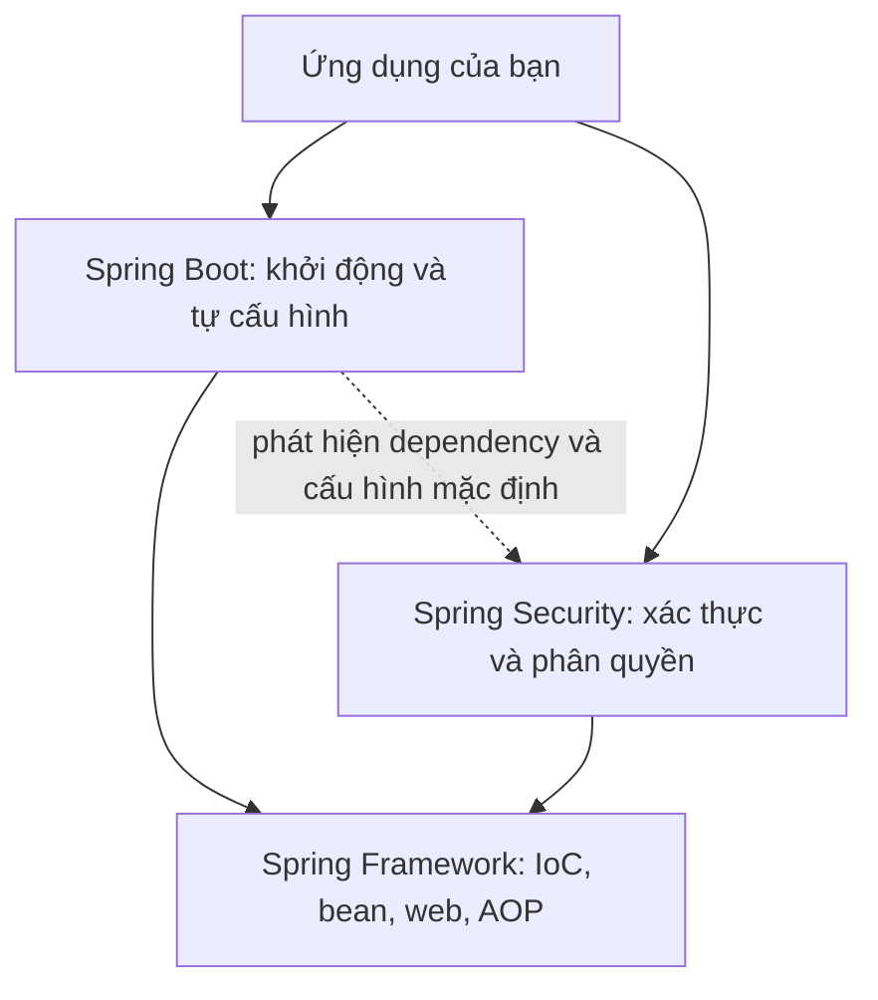

# Mối quan hệ giữa Spring Security, Spring Framework và Spring Boot

## Mục tiêu học tập

Sau bài này, bạn có thể phân biệt trách nhiệm của ba dự án, giải thích vì sao chỉ thêm dependency Spring Security có thể thay đổi hành vi HTTP của ứng dụng Spring Boot, lần theo một request từ servlet filter đến controller, và tự cấu hình một API có endpoint công khai cùng endpoint cần đăng nhập.

Ví dụ thực hành tập trung vào **Spring MVC/Servlet, Java 17 và Spring Boot 3.x** (tương ứng với thế hệ Spring Framework 6.x, Spring Security 6.x). Các khái niệm chính cũng áp dụng cho phiên bản mới hơn, nhưng tên API và cấu hình phải đối chiếu với bộ phiên bản thực tế của dự án.

## 1. Ba dự án làm ba việc khác nhau

| Thành phần | Trách nhiệm chính | Đóng góp trong một ứng dụng web |
| --- | --- | --- |
| **Spring Framework** | Cung cấp nền tảng IoC/DI, bean, application context, cấu hình, AOP, xử lý web qua Spring MVC hoặc WebFlux. | Tạo, liên kết các bean; ánh xạ HTTP request đến controller; cung cấp điểm mở rộng để các module tích hợp. |
| **Spring Security** | Cung cấp cơ chế xác thực (authentication), phân quyền (authorization) và nhiều biện pháp bảo vệ ứng dụng. | Tạo chuỗi bộ lọc hoặc web filter, quản lý danh tính/ngữ cảnh bảo mật, áp chính sách URL và phương thức. |
| **Spring Boot** | Đơn giản hóa việc khởi tạo, cấu hình và vận hành ứng dụng Spring bằng starters, quản lý phiên bản phụ thuộc, auto-configuration và các tiện ích chạy ứng dụng. | Nhận diện thư viện trên classpath, cấu hình các bean mặc định khi đủ điều kiện, giúp chạy ứng dụng web nhanh chóng. |

**Spring Security là một dự án riêng thuộc hệ sinh thái Spring, được xây dựng để tích hợp với Spring Framework.** Nó không phải tính năng do Spring Boot tự triển khai. **Spring Boot sử dụng cả Spring Framework lẫn Spring Security**, hỗ trợ thiết lập những phần cấu hình mặc định cần thiết. Boot không thay thế engine xác thực, chuỗi filter hoặc chính sách phân quyền của Security.

Có thể hình dung quan hệ theo chức năng:



Sơ đồ mô tả trách nhiệm và khả năng tích hợp, **không phải sơ đồ dependency Maven cứng nhắc**. Có thể dùng Spring Framework với Spring Security mà không dùng Boot; cũng có thể dùng Boot hoàn toàn không có Spring Security.

## 2. Vai trò của từng lớp khi xây dựng ứng dụng

### 2.1. Spring Framework: nền móng để các thành phần phối hợp

- **IoC container/ApplicationContext** tạo các đối tượng được quản lý dưới dạng bean. Các lớp cấu hình `@Configuration` và phương thức `@Bean` giúp đăng ký chính sách bảo mật, bộ mã hóa mật khẩu và dịch vụ người dùng.
- **Dependency Injection (DI)** đưa các bean cần thiết vào controller, service hoặc cấu hình khác, tránh tự tạo các thành phần bảo mật rời rạc.
- **Spring MVC** tiếp nhận request sau lớp servlet filters, định tuyến đến controller. Với WebFlux, Spring Framework cung cấp pipeline phản ứng tương ứng.
- **Spring AOP và cơ chế proxy** tạo hạ tầng để Spring Security kiểm tra quyền khi gọi phương thức có chú thích như `@PreAuthorize`.

Tự Spring Framework **không tự suy ra** rằng mọi endpoint phải đăng nhập. Muốn bảo vệ ứng dụng cần bổ sung và cấu hình cơ chế bảo mật phù hợp, thường là Spring Security.

### 2.2. Spring Security: quyết định ai được làm gì

Hai khái niệm cần tách bạch:

- **Authentication (xác thực)**: xác lập danh tính. Ví dụ, kiểm tra username/password và tạo `Authentication` đã được xác thực.
- **Authorization (phân quyền)**: kiểm tra danh tính cùng quyền hạn có đủ để truy cập một tài nguyên hoặc thực hiện hành động hay không. Ví dụ, chỉ người có role `ADMIN` được duyệt một báo cáo.

Một số thành phần tiêu biểu trong mô hình Servlet:

| Thành phần | Ý nghĩa |
| --- | --- |
| `SecurityFilterChain` | Định nghĩa các bộ lọc và chính sách áp dụng cho những request phù hợp; ứng dụng có thể có nhiều chain. |
| `FilterChainProxy` | Chọn và thực thi chuỗi filter bảo mật tương ứng trong Spring Security. |
| `DelegatingFilterProxy` | Cầu nối từ Servlet container đến bean filter được Spring quản lý, thường là `springSecurityFilterChain`. |
| `AuthenticationManager` / `AuthenticationProvider` | Phối hợp thực hiện một cơ chế xác thực cụ thể, tùy phương thức đăng nhập được cấu hình. |
| `SecurityContext` / `SecurityContextHolder` | Giữ thông tin `Authentication` hiện tại khi xử lý request; ở Servlet thường sử dụng ngữ cảnh gắn với luồng thực thi. |
| `PasswordEncoder` | Mã hóa và đối chiếu mật khẩu; không lưu mật khẩu thô trong hệ thống thực tế. |

Spring Security còn tích hợp xử lý phiên đăng nhập, CSRF, security headers, CORS và nhiều cơ chế khác. Không phải mọi tính năng đều tự động được cấu hình đầy đủ cho mọi ứng dụng; chính sách thực tế phụ thuộc dependency, cấu hình và loại ứng dụng.

### 2.3. Spring Boot: lắp ghép và cung cấp mặc định theo điều kiện

Trong dự án Boot, **starter** gom các dependency thường dùng; ví dụ:

- `spring-boot-starter-web` mang đến cơ sở cho ứng dụng Spring MVC trên Servlet.
- `spring-boot-starter-security` thêm Spring Security và khả năng tích hợp/tự cấu hình tương ứng của Boot.

Khi ứng dụng web có Spring Security trên classpath và chưa khai báo cơ chế tương đương, Boot có thể đóng góp **cấu hình bảo mật mặc định**. Với ứng dụng Servlet điển hình, mặc định đó yêu cầu xác thực các request và hỗ trợ form login cùng HTTP Basic. Nếu chưa có nguồn người dùng do ứng dụng cung cấp, Boot có thể tạo tài khoản `user` và in mật khẩu tạm thời vào log khởi động để phục vụ phát triển.

Khi bạn tự định nghĩa bean `SecurityFilterChain`, cấu hình filter chain web mặc định của Boot sẽ **nhường chỗ** cho chain bạn cung cấp. Điều đó có nghĩa là bạn phải tự xác định request nào được phép truy cập và request nào cần xác thực. Các phần auto-configuration khác vẫn có thể hoạt động; thêm một chain không đồng nghĩa với việc vô hiệu hóa toàn bộ Security hay toàn bộ Boot auto-configuration.

Lưu ý: `@SpringBootApplication` là tiện ích khởi động, component scanning và auto-configuration của Boot. Chú thích này **không tự biến ứng dụng thành ứng dụng có Spring Security** nếu thiếu dependency/cấu hình bảo mật.

## 3. Luồng xử lý một HTTP request trong Spring MVC

Với Servlet stack, luồng khái quát là:

```text
HTTP client
    |
    v
Servlet container (ví dụ Tomcat)
    |
    v
DelegatingFilterProxy
    |
    v
FilterChainProxy -> chọn SecurityFilterChain phù hợp
    |
    +--> các security filter: đọc thông tin xác thực,
    |    xác lập SecurityContext, kiểm tra quyền URL, ...
    |
    +--> không được phép: trả về lỗi/challenge phù hợp
    |
    v
DispatcherServlet (Spring MVC)
    |
    v
Controller -> Service -> dữ liệu/logic nghiệp vụ
    |
    v
HTTP response
```

Trình tự cụ thể của các security filter phụ thuộc phiên bản và cấu hình; ví dụ trên mô tả ranh giới trách nhiệm thay vì cam kết một danh sách filter cố định.

Một request đến `GET /private` có thể diễn ra như sau:

1. Container nhận request và chuyển nó qua chuỗi Servlet filter đã đăng ký.
2. Spring Security chọn `SecurityFilterChain` phù hợp và lấy/kiểm tra thông tin xác thực theo cơ chế đang dùng (ví dụ HTTP Basic).
3. Nếu chưa xác thực mà URL yêu cầu đăng nhập, request bị chặn trước controller; với HTTP Basic thường nhận **401 Unauthorized** và thử thách đăng nhập.
4. Nếu xác thực thành công, `Authentication` được gắn vào security context. Quy tắc phân quyền xác định có được gọi controller hay không.
5. Khi được phép, Spring MVC gọi handler tương ứng, rồi trả response.

**401 và 403 không đồng nghĩa:** 401 thường cho biết request cần thông tin xác thực hợp lệ; 403 thường cho biết request đã xác thực nhưng không đủ quyền (hoặc bị một biện pháp bảo vệ khác, ví dụ CSRF, từ chối). Mã trả về cụ thể còn phụ thuộc entry point, cơ chế xác thực và cấu hình exception handling.

Spring Security hoạt động ở lớp filter **trước** controller, nhưng vẫn có thể kiểm tra quyền thêm ở **lớp service/method**. Hai lớp bảo vệ phục vụ các nhu cầu khác nhau.

## 4. Ví dụ chạy được: Boot khởi động, Security bảo vệ, Framework xử lý controller

Ví dụ tạo hai endpoint:

- `GET /public`: ai cũng gọi được.
- `GET /private`: phải dùng HTTP Basic với tài khoản thử nghiệm.

### 4.1. Cấu trúc thư mục

```text
security-relation-demo/
├── pom.xml
└── src/main/java/com/example/demo/
    ├── DemoApplication.java
    ├── SecurityConfig.java
    └── ApiController.java
```

### 4.2. Maven `pom.xml`

```xml
<project xmlns="http://maven.apache.org/POM/4.0.0"
         xmlns:xsi="http://www.w3.org/2001/XMLSchema-instance"
         xsi:schemaLocation="http://maven.apache.org/POM/4.0.0 https://maven.apache.org/xsd/maven-4.0.0.xsd">
    <modelVersion>4.0.0</modelVersion>

    <parent>
        <groupId>org.springframework.boot</groupId>
        <artifactId>spring-boot-starter-parent</artifactId>
        <version>3.5.0</version>
        <relativePath/>
    </parent>

    <groupId>com.example</groupId>
    <artifactId>security-relation-demo</artifactId>
    <version>0.0.1-SNAPSHOT</version>

    <properties>
        <java.version>17</java.version>
    </properties>

    <dependencies>
        <dependency>
            <groupId>org.springframework.boot</groupId>
            <artifactId>spring-boot-starter-web</artifactId>
        </dependency>
        <dependency>
            <groupId>org.springframework.boot</groupId>
            <artifactId>spring-boot-starter-security</artifactId>
        </dependency>
    </dependencies>

    <build>
        <plugins>
            <plugin>
                <groupId>org.springframework.boot</groupId>
                <artifactId>spring-boot-maven-plugin</artifactId>
            </plugin>
        </plugins>
    </build>
</project>
```

Đây là một phiên bản Boot 3.x cụ thể để minh họa và chạy thử; khi dùng thực tế hãy chọn **bản vá đang được hỗ trợ** trong dòng phiên bản phù hợp. Không gắn phiên bản độc lập cho `spring-security-*` trong ví dụ vì Spring Boot quản lý bộ phiên bản dependency tương thích thông qua parent/BOM.

### 4.3. `DemoApplication.java`

```java
package com.example.demo;

import org.springframework.boot.SpringApplication;
import org.springframework.boot.autoconfigure.SpringBootApplication;

@SpringBootApplication
public class DemoApplication {
    public static void main(String[] args) {
        SpringApplication.run(DemoApplication.class, args);
    }
}
```

`@SpringBootApplication` yêu cầu Spring Boot khởi tạo application context và khám phá các component trong package `com.example.demo` cùng các package con. Spring Framework quản lý bean; Boot xử lý phần khởi động và auto-configuration.

### 4.4. `SecurityConfig.java`

```java
package com.example.demo;

import org.springframework.context.annotation.Bean;
import org.springframework.context.annotation.Configuration;
import org.springframework.security.config.Customizer;
import org.springframework.security.config.annotation.web.builders.HttpSecurity;
import org.springframework.security.config.annotation.web.configurers.AbstractHttpConfigurer;
import org.springframework.security.core.userdetails.User;
import org.springframework.security.core.userdetails.UserDetails;
import org.springframework.security.core.userdetails.UserDetailsService;
import org.springframework.security.crypto.bcrypt.BCryptPasswordEncoder;
import org.springframework.security.crypto.password.PasswordEncoder;
import org.springframework.security.provisioning.InMemoryUserDetailsManager;
import org.springframework.security.web.SecurityFilterChain;

@Configuration(proxyBeanMethods = false)
public class SecurityConfig {

    @Bean
    SecurityFilterChain securityFilterChain(HttpSecurity http) throws Exception {
        http
            .authorizeHttpRequests(auth -> auth
                .requestMatchers("/public").permitAll()
                .anyRequest().authenticated()
            )
            .httpBasic(Customizer.withDefaults())
            .formLogin(AbstractHttpConfigurer::disable);

        return http.build();
    }

    @Bean
    PasswordEncoder passwordEncoder() {
        return new BCryptPasswordEncoder();
    }

    @Bean
    UserDetailsService userDetailsService(PasswordEncoder encoder) {
        UserDetails learner = User.withUsername("learner")
            .password(encoder.encode("demo-password"))
            .roles("USER")
            .build();

        return new InMemoryUserDetailsManager(learner);
    }
}
```

Giải thích trách nhiệm:

1. `@Configuration` và `@Bean` là cơ chế **Spring Framework** để đăng ký, tiêm và quản lý đối tượng.
2. `HttpSecurity`, `SecurityFilterChain`, `UserDetailsService` và `BCryptPasswordEncoder` là thành phần **Spring Security**. Chúng mô tả quy tắc URL, HTTP Basic và cách kiểm tra thông tin đăng nhập.
3. **Spring Boot** khám phá cấu hình, lắp ghép bean với web application và sử dụng cấu hình do ứng dụng cung cấp thay cho chain mặc định.
4. Quy tắc `.anyRequest().authenticated()` là bước khóa phần còn lại: nếu quên dòng này hoặc viết matcher sai, chính sách truy cập có thể không đúng ý định.
5. `formLogin` được tắt **chỉ để ví dụ HTTP Basic trả kết quả rõ ràng khi dùng curl**. Cấu hình không tắt CSRF; các request thay đổi trạng thái vẫn phải được đánh giá và xử lý đúng chính sách CSRF.

Tài khoản và mật khẩu trên chỉ dành cho ứng dụng học tập cục bộ. Hệ thống thật cần nguồn định danh phù hợp, quản lý secret an toàn, HTTPS và chính sách quyền truy cập cụ thể.

### 4.5. `ApiController.java`

```java
package com.example.demo;

import org.springframework.web.bind.annotation.GetMapping;
import org.springframework.web.bind.annotation.RestController;

@RestController
public class ApiController {

    @GetMapping("/public")
    public String publicEndpoint() {
        return "public\n";
    }

    @GetMapping("/private")
    public String privateEndpoint() {
        return "private\n";
    }
}
```

`@RestController` và `@GetMapping` thuộc **Spring MVC (Spring Framework)**. Controller không cần tự đọc header `Authorization`; Security filter chain đã kiểm tra request trước khi Spring MVC gọi method.

### 4.6. Chạy và tự quan sát

Cần JDK 17+ và Maven. Từ thư mục chứa `pom.xml`:

```bash
mvn spring-boot:run
```

Mở một terminal khác. Trên Windows PowerShell, dùng `curl.exe` để tránh alias `curl` của một số phiên bản PowerShell:

```bash
curl.exe -i http://localhost:8080/public
curl.exe -i http://localhost:8080/private
curl.exe -i -u learner:demo-password http://localhost:8080/private
curl.exe -i -u learner:wrong-password http://localhost:8080/private
```

Kỳ vọng với đúng cấu hình trên (lược bỏ các header có thể thay đổi):

| Request | HTTP status | Body/ý nghĩa |
| --- | --- | --- |
| `GET /public` không có credentials | `200` | `public`, theo sau bởi newline |
| `GET /private` không có credentials | `401` | Chưa xác thực; HTTP Basic yêu cầu credentials hợp lệ |
| `GET /private` với `learner:demo-password` | `200` | `private`, theo sau bởi newline |
| `GET /private` với mật khẩu sai | `401` | Xác thực thất bại |

Điểm quan sát quan trọng: **controller vẫn là code Spring MVC bình thường**, còn quyền truy cập thay đổi chỉ nhờ bean `SecurityFilterChain` và các thành phần Spring Security do Spring/Boot đưa vào ứng dụng.

## 5. Phân biệt cấu hình mặc định và cấu hình của ứng dụng

Hãy tách bốn trường hợp:

| Trường hợp | Điều gì xảy ra? |
| --- | --- |
| Spring MVC/Boot web **không có** Spring Security trên classpath | Không có chuỗi filter bảo mật do Spring Security cung cấp. Các endpoint không tự có xác thực/phân quyền của Spring Security. |
| Thêm `spring-boot-starter-security`, chưa khai báo `SecurityFilterChain` | Trong ứng dụng Servlet thông thường, Boot kích hoạt chain mặc định của Security; phần lớn request cần xác thực. |
| Khai báo `SecurityFilterChain` riêng như ví dụ | Bean của ứng dụng điều khiển quy tắc truy cập URL; auto-configuration mặc định tương ứng của Boot nhường chỗ. |
| Dùng Spring Framework + Spring Security **không qua Boot** | Vẫn dùng được Security, nhưng người phát triển phải tự cấu hình và đăng ký những phần tích hợp/khởi tạo mà Boot thường làm giúp. |

Không nên đồng nhất “có starter” với “đã triển khai bảo mật sản phẩm”. Trong thực tế phải thiết kế danh tính, vai trò, quyền hạn, bảo vệ dữ liệu, session/token, CSRF/CORS và đường đi ngoại lệ theo yêu cầu cụ thể.

## 6. Quan hệ với phân quyền ở mức method

Kiểm tra URL thường trả lời “request này có được đi tiếp không?”. Kiểm tra method trả lời “người dùng hiện tại có được thực hiện thao tác nghiệp vụ này không?”, kể cả khi thao tác được gọi từ nhiều điểm vào.

Ví dụ **mở rộng độc lập**, chỉ áp dụng nếu trong ứng dụng có bean service tương ứng: bật method security bằng `@EnableMethodSecurity` rồi bảo vệ phương thức:

```java
import org.springframework.context.annotation.Configuration;
import org.springframework.security.config.annotation.method.configuration.EnableMethodSecurity;
import org.springframework.security.access.prepost.PreAuthorize;
import org.springframework.stereotype.Service;

@Configuration
@EnableMethodSecurity
class MethodSecurityConfiguration {
}

@Service
class ReportService {
    @PreAuthorize("hasRole('ADMIN')")
    public String approve() {
        return "approved";
    }
}
```

Trong phần mở rộng này:

- Spring Framework cung cấp bean và cơ chế proxy/interceptor.
- Spring Security cung cấp `@PreAuthorize` và logic đánh giá `hasRole('ADMIN')` dựa trên `Authentication`.
- Spring Boot giúp nhận diện và cấu hình hạ tầng chung, nhưng việc bật `@EnableMethodSecurity` là lựa chọn có chủ đích của ứng dụng.

`User.withUsername(...).roles("USER")` trong ví dụ gốc cấp authority `ROLE_USER`, nên **không** đáp ứng `hasRole('ADMIN')`. Đừng nhầm `role` với tên authority thô, và lưu ý lời gọi nội bộ `this.approve()` trong cùng bean thường không đi qua proxy nên có thể bỏ qua interceptor phương thức.

## 7. Spring MVC/Servlet và Spring WebFlux/Reactive

Cùng là Spring Security nhưng cách cắm vào pipeline web khác nhau:

| Khía cạnh | Servlet / Spring MVC | Reactive / Spring WebFlux |
| --- | --- | --- |
| Hạ tầng web | Servlet Filter, `DispatcherServlet` | Reactive `WebFilter`, `DispatcherHandler` |
| Security chain | `SecurityFilterChain`, cấu hình bằng `HttpSecurity` | `SecurityWebFilterChain`, cấu hình bằng `ServerHttpSecurity` |
| Tập hợp filter bảo mật | `FilterChainProxy` | `WebFilterChainProxy` |
| Ngữ cảnh danh tính | `SecurityContextHolder` (thường gắn theo thread trong luồng Servlet) | Reactor Context, thường truy cập qua `ReactiveSecurityContextHolder` |

Không sao chép trực tiếp cấu hình `HttpSecurity` sang WebFlux. Với reactive flow, không dựa vào giả định một request luôn chạy trên cùng một thread. Chọn starter, cơ chế cấu hình và hướng dẫn bảo mật tương ứng với stack của ứng dụng.

## 8. Lỗi hiểu sai thường gặp

1. **“Spring Boot đã bao gồm Spring Security.”** Boot hỗ trợ tích hợp, nhưng ứng dụng cần dependency thích hợp. Spring Boot cũng chạy được mà không dùng Security.
2. **“Spring Security chỉ là một annotation trên controller.”** Việc bảo vệ request web chủ yếu đi qua chuỗi filter trước Spring MVC; bảo vệ method là lớp bổ sung.
3. **“Tự thêm SecurityFilterChain thì mọi URL vẫn dùng chính sách mặc định của Boot.”** Khi chain mặc định nhường chỗ, bạn cần mô tả chính sách bao phủ đầy đủ. Nếu có nhiều chain, hãy chú ý matcher và thứ tự để không bỏ sót request.
4. **“Chỉ cần đã đăng nhập thì đủ quyền.”** Authentication xác nhận danh tính; authorization phải kiểm tra role/authority hoặc điều kiện nghiệp vụ.
5. **“Không viết cấu hình CSRF thì nó đã bị tắt.”** Spring Security Servlet có cơ chế CSRF mặc định cho các request cần bảo vệ. Chỉ thay đổi khi hiểu rõ session, cookie, loại client và threat model.
6. **“Một bộ phiên bản Spring Framework/Security bất kỳ đều dùng được với Boot.”** Giữ phiên bản tương thích do Boot BOM quản lý. Khi nâng cấp từ thế hệ cũ, chú ý API hiện đại `SecurityFilterChain` và chuyển đổi namespace Servlet từ `javax.*` sang `jakarta.*` ở Boot 3.x.
7. **“Bảo mật URL thay thế mọi kiểm tra nghiệp vụ.”** Với các thao tác nhạy cảm, thêm kiểm tra quyền tại service/method và kiểm tra quyền sở hữu tài nguyên theo dữ liệu thực tế.
8. **“HTTP Basic trong ví dụ là kiến trúc đăng nhập nên dùng cho mọi hệ thống.”** Đây chỉ là cơ chế dễ quan sát. Web app có session, API dùng bearer token, OAuth2/OIDC hoặc phương án khác sẽ có pipeline và yêu cầu bổ sung riêng.

## 9. Tự kiểm tra hiểu biết

- Nếu bỏ `spring-boot-starter-security` khỏi `pom.xml`, phần nào còn hoạt động? **Spring Boot và Spring MVC vẫn khởi động, controller vẫn xử lý request; Security filter chain trong ví dụ không còn khả dụng.**
- Nếu thêm starter Security nhưng chưa viết bean chain, ai định nghĩa mặc định cho web? **Boot auto-configuration kích hoạt cấu hình mặc định dựa trên Spring Security**, khi điều kiện phù hợp.
- Nếu muốn yêu cầu quyền `ADMIN` trước khi phê duyệt, nên đặt kiểm tra ở đâu? **Có thể ở URL và ở method nghiệp vụ**; method security giảm rủi ro khi một service được gọi từ đường đi khác.
- Vì sao Spring Framework xuất hiện trong cả hai hướng tích hợp? **Framework cung cấp container, DI, web abstraction và AOP; Security dùng hạ tầng đó, còn Boot đơn giản hóa việc tạo và lắp ghép ứng dụng.**

**Kết luận:** Spring Framework là nền tảng chạy ứng dụng; Spring Security xây dựng chính sách và thực thi bảo mật trên nền tảng ấy; Spring Boot giúp chọn dependency, khởi động và tự cấu hình phần tích hợp khi đủ điều kiện. Hiểu đúng ba trách nhiệm này giúp bạn biết lỗi cần tìm ở đâu: bean/web ở Framework, auth/filter/policy ở Security, còn mặc định theo classpath và quá trình bootstrap ở Boot.