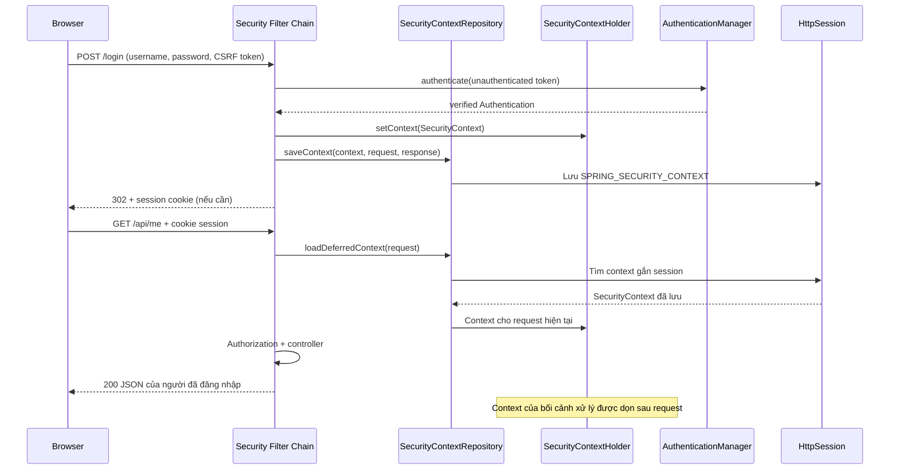

# Quan hệ giữa ngữ cảnh của yêu cầu hiện tại với dữ liệu lưu trong HttpSession

## Mục tiêu học tập

Trong một ứng dụng web Spring Security, có hai thứ rất dễ bị gọi chung là “trạng thái đăng nhập”:

1. **`SecurityContext` đang có hiệu lực trong quá trình xử lý một HTTP request**, được mã ứng dụng Servlet thường đọc qua `SecurityContextHolder`.
2. **`SecurityContext` được lưu để một HTTP request sau có thể phục hồi**, thường qua `SecurityContextRepository` với dữ liệu đặt trong `HttpSession`.

Hai thứ có liên quan nhưng **không đồng nhất**. Một request có thể thấy principal đã xác thực trong `SecurityContextHolder` mà chưa lưu gì vào session. Ngược lại, một session đang có dữ liệu `SPRING_SECURITY_CONTEXT` chưa có nghĩa mọi thread luôn mang cùng một security context; Spring Security phải **nạp ngữ cảnh cho từng request**, rồi dọn bối cảnh xử lý khi request kết thúc.

Chủ đề này thuộc phần **Ngữ cảnh bảo mật** của Spring Security fundamentals. Bài sử dụng **Java 17, Spring Boot 3.5.0 và Spring Security 6.5.x trên Spring MVC/Servlet**. Phần thực hành gồm form login có `HttpSession`, các endpoint quan sát context ở request hiện tại, kiểm thử bằng MockMvc, và kiểm thử repository độc lập. Phần code đăng nhập tùy chỉnh được đánh dấu riêng là fragment vì nếu tự triển khai login trong sản phẩm, còn phải xử lý session fixation, CSRF, authentication success/failure handlers và các chính sách khác.

Sau bài này, bạn có thể:

1. Phân biệt `Authentication`, `SecurityContext`, `SecurityContextHolder`, `SecurityContextRepository` và `HttpSession`.
2. Giải thích cách session ID trong cookie liên hệ tới dữ liệu session phía server, chứ không trực tiếp chứa principal/password.
3. Mô tả luồng **đọc context → xử lý request → lưu context có chủ đích → request sau phục hồi**.
4. Hiểu `SecurityContextHolderFilter` và sự khác nhau với `SecurityContextPersistenceFilter` trong Spring Security 6.
5. Phân biệt `HttpSessionSecurityContextRepository`, `RequestAttributeSecurityContextRepository`, `DelegatingSecurityContextRepository` và `NullSecurityContextRepository`.
6. Hiểu khi nào phải gọi `saveContext(context, request, response)`, đặc biệt khi tự viết login filter/controller.
7. Nắm `SessionCreationPolicy.IF_REQUIRED`, `ALWAYS`, `NEVER`, `STATELESS` và giới hạn của từng chính sách.
8. Kiểm chứng đăng nhập form qua nhiều request có chung session, cũng như request mới không có session và logout.
9. Chỉ ra rủi ro về session fixation, CSRF, cookie, timeout, quyền đã cache, async threads và distributed deployment.

**Ý chính:** `SecurityContextHolder` biểu diễn danh tính **đang có hiệu lực trong bối cảnh thực thi**; `SecurityContextRepository` quyết định **có và như thế nào** danh tính ấy được lưu/phục hồi; `HttpSession` chỉ là **một** cơ chế lưu thường gặp.

## 1. Bốn lớp khái niệm cần tách

### 1.1. Authentication — kết quả xác thực

`Authentication` thường chứa:

- **Principal:** danh tính được biểu diễn, ví dụ username hoặc `UserDetails`.
- **Authorities:** các quyền mức khái quát do nguồn tin cậy cấp, ví dụ `ROLE_USER`.
- **Credentials:** bằng chứng được gửi khi login, thường được xóa khỏi kết quả khi có thể.
- **Trạng thái:** `isAuthenticated()` của token.

Ví dụ sau khi một authentication provider kiểm chứng username/password thành công, một `UsernamePasswordAuthenticationToken` có thể biểu diễn user `learner` và authority `ROLE_USER`. Đây là kết quả xác thực, không phải session.

### 1.2. SecurityContext — bao chứa Authentication

`org.springframework.security.core.context.SecurityContext` là một interface có phương thức chính:

```java
Authentication getAuthentication();
void setAuthentication(Authentication authentication);
```

Đây là **hình dạng interface rút gọn để học**, không phải một file Java cần viết lại. Một `SecurityContext` có thể chứa Authentication của request hiện tại, hoặc chưa chứa authentication nào.

```java
SecurityContext context = SecurityContextHolder.createEmptyContext();
context.setAuthentication(verifiedAuthentication);
```

Fragment này giả định `verifiedAuthentication` **đã được manager/provider xác minh**. Không được tạo token tự nhận authenticated từ username/role do client gửi rồi đặt vào context. Việc đặt context chỉ có ý nghĩa an toàn nếu identity bên trong là đáng tin.

### 1.3. SecurityContextHolder — truy cập context theo bối cảnh thực thi

Trong Servlet stack, bạn thường thấy:

```java
SecurityContext current = SecurityContextHolder.getContext();
Authentication authentication = current.getAuthentication();
```

`SecurityContextHolder` dùng một strategy để giữ context. Strategy mặc định thông dụng là `MODE_THREADLOCAL`: context gắn với thread đang thực thi request, chứ **không phải** một biến singleton chứa tất cả user của ứng dụng.

Kết thúc xử lý, framework dọn context để thread từ thread pool không vô tình mang identity của request trước. Nếu tự tạo background thread, `@Async`, `CompletableFuture` hoặc executor, không thể mặc định identity tự theo sang thread khác. Cần cơ chế propagation được hỗ trợ, ví dụ `DelegatingSecurityContextExecutor` khi thực sự cần.

### 1.4. HttpSession — nơi Servlet container giữ state giữa request

`jakarta.servlet.http.HttpSession` là container cho các attributes được ràng buộc với **một session**. Browser thường giữ **session ID** trong cookie `JSESSIONID`; server dựa trên ID đó để tìm session và các attributes.

`HttpSession` có thể chứa nhiều loại dữ liệu:

```text
HttpSession
├── SPRING_SECURITY_CONTEXT  -> SecurityContext của Spring Security (nếu được lưu)
├── một attribute nghiệp vụ do ứng dụng đặt
├── dữ liệu hỗ trợ request/cache/tokens khác tùy cấu hình
└── ...
```

Không phải session nào cũng có `SPRING_SECURITY_CONTEXT`. Một trang anonymous có thể tạo session cho CSRF token, lưu request đợi login hoặc giỏ hàng, nhưng **không vì vậy mà người dùng đã được xác thực**.

**Cookie không nhất thiết chứa SecurityContext hoặc raw password**. Trong kiểu session truyền thống, cookie chỉ chứa **session identifier** nhạy cảm; principal/authorities được lưu phía server hoặc hạ tầng session được cấu hình. Một số ứng dụng có custom session/token cookie riêng, nhưng không được nhầm chúng với mô hình mặc định của Servlet `HttpSession`.

### 1.5. Bảng so sánh một lần

| Thành phần | Phạm vi/hợp đồng | Có thể tồn tại khi không có session? | Có tự tồn tại qua nhiều HTTP request? |
| --- | --- | :---: | :---: |
| `Authentication` | Object biểu diễn request/result xác thực | Có | Không tự động. |
| `SecurityContext` | Bao Authentication | Có | Không tự động; phụ thuộc nơi lưu/phục hồi. |
| `SecurityContextHolder` | Strategy truy cập context lúc thực thi | Có | Không, context được chuẩn bị/dọn theo bối cảnh. |
| `SecurityContextRepository` | Đọc/lưu SecurityContext theo request và storage strategy | Có | Tùy implementation. |
| `HttpSession` | Container state phía server theo session ID | Bản thân là session | Có theo timeout/invalidation/storage. |
| `JSESSIONID` | Cookie chứa session ID do Servlet container quản lý | Không áp dụng | Browser gửi lại khi cookie hợp lệ. |

**Đừng đồng nhất “đang authenticated” với “đã ghi vào HttpSession”.** Luồng HTTP Basic hoặc bearer JWT thường xác thực lại mỗi request mà không cần lưu SecurityContext giữa request.

## 2. Trình tự của hai HTTP request dùng chung session

Giả sử một người đăng nhập qua form login vào Spring MVC:



Sơ đồ chỉ mô tả quan hệ chức năng; thứ tự chi tiết filter/response wrappers khác nhau theo config/version. Với form login chuẩn, các authentication filters/success handlers tích hợp thực hiện việc lưu và session strategy thích hợp, không yêu cầu controller nghiệp vụ tự xử lý. Với **custom login code**, phải hiểu và tự cấu hình phần còn thiếu.

### 2.1. Request 1: mới đăng nhập

1. Browser gửi username/password và CSRF token phù hợp nếu bảo vệ CSRF đang bật.
2. Login filter tạo `Authentication` chưa xác thực và gọi `AuthenticationManager`.
3. Provider xác minh password với user store/PasswordEncoder.
4. Khi thành công, filter tạo/đặt `SecurityContext` với verified Authentication.
5. Cơ chế lưu được cấu hình ghi context qua `SecurityContextRepository`, thường có thành phần lưu trong `HttpSession`.
6. Servlet container có thể gửi cookie chứa session ID tới browser.
7. Browser dùng cookie ở các request sau; không cần tiếp tục gửi raw password trong mô hình form-login session thông thường.

**Đăng nhập thành công không đồng nghĩa lưu plaintext password trong session.** ProviderManager thường xóa dữ liệu credentials nhạy cảm của result nếu token hỗ trợ. Dù vậy, SecurityContext vẫn là dữ liệu bảo mật và phải được bảo vệ.

### 2.2. Request 2: đã có session

1. Browser gửi cookie chứa session ID.
2. Container gắn session tương ứng vào request nếu ID hợp lệ và session chưa hết hạn.
3. Spring Security dùng repository để lấy SecurityContext phù hợp.
4. `SecurityContextHolderFilter` cung cấp context cho bối cảnh xử lý.
5. Authorization rule `authenticated()`/`hasRole(...)` đánh giá Authentication.
6. MVC controller chạy nếu được phép; sau request, holder được dọn.

**Context đang được dùng không nhất thiết là cùng reference Java object** với thứ đã ghi trong session ở mọi kiến trúc. Có thể có serialization, replication, caching hoặc repository wrapper. Đừng dựa vào so sánh identity bằng toán tử `==` để xác định “cùng user”; dùng identity và policy tin cậy.

### 2.3. Request không gửi session cookie

Nếu browser mới hoặc request không có cookie, repository không tìm được SecurityContext đã lưu. Framework có thể tạo context trống rồi thêm `AnonymousAuthenticationToken` nếu anonymous support được bật.

Khi request vào endpoint yêu cầu `authenticated()`, anonymous caller thường bị yêu cầu login: **302 đến /login** với form login hoặc **401** với HTTP Basic. Mã HTTP phụ thuộc authentication entry point, không chỉ phụ thuộc sự tồn tại của session.

### 2.4. Session có thể đã hết hạn

Nếu browser vẫn gửi cookie nhưng session đã timeout/invalidate, container không tìm được state cũ. Spring Security không thể phục hồi Authentication từ một session không tồn tại. Người dùng thường phải đăng nhập lại hoặc được xác thực bằng cơ chế khác (remember-me, bearer token...) nếu hệ thống chủ động hỗ trợ.

Không dùng việc cookie `JSESSIONID` có mặt làm bằng chứng xác thực: cookie có thể cũ, giả, đã hết hạn hoặc chỉ gắn với guest session.

## 3. SecurityContextRepository làm cầu nối

Spring Security định nghĩa `org.springframework.security.web.context.SecurityContextRepository` để nạp/lưu ngữ cảnh xác thực. Các API quan trọng trên 6.x gồm:

```java
// Hình dạng hợp đồng rút gọn, để học:
DeferredSecurityContext loadDeferredContext(HttpServletRequest request);

void saveContext(
    SecurityContext context,
    HttpServletRequest request,
    HttpServletResponse response
);

boolean containsContext(HttpServletRequest request);
```

`DeferredSecurityContext` giúp trì hoãn việc tải context khi cần. Repository phụ thuộc vào HTTP request/response vì với session-based storage, nó cần tiếp cận session và có thể tác động thời điểm response được commit.

**`SecurityContextRepository` không phải `UserDetailsService`**. UserDetailsService dùng để tìm dữ liệu tài khoản khi xác thực. Repository giữ/kéo **kết quả xác thực** để request sau dùng lại, nếu chính sách session cho phép. Hai nguồn dữ liệu có thể cập nhật với tần suất khác nhau; Session còn có thể giữ authorities cũ sau khi bạn sửa role trong database.

### 3.1. HttpSessionSecurityContextRepository

`HttpSessionSecurityContextRepository` sử dụng `HttpSession` để lưu context giữa nhiều request. Theo mặc định, attribute name thường là:

```text
SPRING_SECURITY_CONTEXT
```

Spring Security cung cấp constant:

```java
HttpSessionSecurityContextRepository.SPRING_SECURITY_CONTEXT_KEY
```

Đây là **tên attribute trong session**, không phải tên cookie. Cookie thường là `JSESSIONID` theo container, còn attribute `SPRING_SECURITY_CONTEXT` tồn tại **bên trong server-side session**.

Repository thường không cần tạo session mới chỉ để lưu **context rỗng hoặc anonymous authentication**. Nhưng session có thể được tạo bởi thành phần khác (CSRF, request cache, MVC code hoặc container), nên không suy từ một HTTP response có Set-Cookie rằng nó đã chứa danh tính đăng nhập.

### 3.2. RequestAttributeSecurityContextRepository

`RequestAttributeSecurityContextRepository` lưu SecurityContext trong **attributes của Servlet request**. Nó hữu ích khi request được chuyển sang dispatch khác, ví dụ error dispatch, bởi một số container có thể làm context hiện tại không còn trên holder trong tình huống dispatch cụ thể.

Nó **không** tự mang context sang một HTTP request hoàn toàn mới từ browser. Servlet request attribute và HttpSession là hai phạm vi khác nhau.

```text
HTTP request A
  request attributes -> SecurityContext A
  ERROR dispatch thuộc request A -> có thể phục hồi context A

HTTP request B (mới)
  không tự nhận context A từ request attributes
```

Nếu ứng dụng chỉ dùng RequestAttribute repository, đó không phải session login bền qua nhiều HTTP requests.

### 3.3. DelegatingSecurityContextRepository

Trên Spring Security 6.x, repository mặc định thường là `DelegatingSecurityContextRepository`, kết hợp:

- `RequestAttributeSecurityContextRepository`
- `HttpSessionSecurityContextRepository`

Delegating repository có thể lưu vào nhiều delegates và tìm context từ các delegates theo thứ tự của cấu hình. Kết hợp này giúp bảo đảm vừa hỗ trợ request dispatch vừa hỗ trợ lưu context giữa các HTTP request bằng session.

Fragment tạo tương đương về ý tưởng:

```java
SecurityContextRepository repository =
    new DelegatingSecurityContextRepository(
        new RequestAttributeSecurityContextRepository(),
        new HttpSessionSecurityContextRepository()
    );
```

Đây là **fragment** cần imports và cấu hình đồng nhất với SecurityFilterChain. Không phải mọi ứng dụng luôn dùng đúng instances này: SessionCreationPolicy và các security mechanisms có thể thay repository hoặc đặt chính sách stateless.

### 3.4. NullSecurityContextRepository

`NullSecurityContextRepository` không giữ context để request tương lai lấy lại. Một mô hình JWT/bearer hoặc HTTP Basic stateless có thể tạo Authentication mới từ credentials ở mỗi request và không cần session storage.

```text
GET /api/me   Authorization: Bearer <token A>
  -> validate bearer token -> Authentication cho request #1
  -> xử lý xong -> clear context

GET /api/me   Authorization: Bearer <token A>
  -> validate bearer token -> Authentication cho request #2
  -> không lấy identity từ HttpSession
```

Token chỉ được đánh giá là hợp lệ khi cơ chế xác minh chữ ký/issuer/audience/expiry hoặc introspection tương ứng hoàn tất. `NullSecurityContextRepository` không làm một bearer token trở nên an toàn, và `STATELESS` không tự cung cấp authentication.

### 3.5. Bảng so sánh repository

| Repository | Dữ liệu sống ở đâu? | Dùng cho request khác? | Use case |
| --- | --- | :---: | --- |
| `HttpSessionSecurityContextRepository` | Attribute trong HttpSession | **Có**, nếu session hợp lệ và context đã lưu | Form login/session authentication. |
| `RequestAttributeSecurityContextRepository` | Servlet request attribute | **Không**, chỉ phạm vi request/dispatch | Giữ context qua một số dispatch/error flow. |
| `DelegatingSecurityContextRepository` | Nhiều delegates | Tùy delegates; mặc định có session support | Kết hợp request attribute + HttpSession. |
| `NullSecurityContextRepository` | Không lưu lâu dài | **Không** | API stateless/Bearer/Basic theo request. |
| Custom repository | Cache/DB hoặc backend tùy chỉnh | Tùy implementation | Session distribution hoặc trust/lifecycle chuyên biệt. |

**Đừng nhầm `DelegatingSecurityContextRepository` với `DelegatingPasswordEncoder`**. Một cái phục hồi/lưu ngữ cảnh xác thực; cái còn lại chọn thuật toán kiểm tra password hash. Tên “Delegating” chỉ mô tả cấu trúc ủy quyền.

## 4. Spring Security 6: đọc context không đồng nghĩa tự lưu

### 4.1. SecurityContextHolderFilter

Spring Security 6 dùng `SecurityContextHolderFilter` làm hướng mặc định. Filter này **đọc** `SecurityContext` từ repository và cung cấp nó trong `SecurityContextHolder`, nhưng **không tự động ghi lại mọi thay đổi** mà code ứng dụng tạo ra.

Một custom controller có thể làm:

```java
SecurityContext context = SecurityContextHolder.createEmptyContext();
context.setAuthentication(verifiedAuthentication);
SecurityContextHolder.setContext(context);
```

Đoạn fragment này tạo một context cho bối cảnh xử lý hiện tại, **không hứa sẽ lưu trong HttpSession cho request sau**. Nếu muốn persistence, code phải dùng `SecurityContextRepository.saveContext(context, request, response)` đúng cách.

**Cảnh báo:** verifiedAuthentication trong fragment phải đến từ `AuthenticationManager.authenticate(...)` hoặc một cơ chế tin cậy. Không tạo identity bằng cách tự đặt `authenticated=true` từ username do client gửi.

### 4.2. Cơ chế cũ SecurityContextPersistenceFilter

Trong Spring Security 5 và một số cấu hình tương thích, `SecurityContextPersistenceFilter` có thể nạp context và **tự ghi lại** khi request kết thúc hoặc trước thời điểm commit response theo logic của filter. Cách đó dễ khiến ứng dụng tự ý thay SecurityContextHolder rồi tin rằng session được cập nhật.

Spring Security 6 chuyển hướng sang **explicit save** để giảm ambiguity và tránh những lần ghi session không cần thiết. Một app chỉ có **một** trong các filter đảm nhiệm lifecycle này theo cấu hình, không nên tùy tiện thêm cả `SecurityContextHolderFilter` lẫn `SecurityContextPersistenceFilter` vào cùng chain.

Có các tùy chọn migration như `securityContext(context -> context.requireExplicitSave(false))` trong 6.x, nhưng chúng nhằm phục vụ chuyển đổi từ code cũ. **Không nên chọn auto-save chỉ để che giấu một custom login flow chưa thiết kế đầy đủ.**

### 4.3. Form login có cần code tự saveContext không?

Với form login chuẩn của Spring Security, các authentication filters/handlers tích hợp **tự xử lý việc lưu thành công** theo cơ chế cấu hình. Bạn thường chỉ khai báo:

```java
http.formLogin(form -> form.permitAll());
```

Đây là fragment cấu hình, không phải controller tự login. Khi người dùng submit form hợp lệ, cơ chế của framework làm phần authenticate, context và persistence. Bạn không cần viết `HttpSession#setAttribute("SPRING_SECURITY_CONTEXT", ...)` thủ công.

### 4.4. Khi tự viết custom login controller/filter thì sao?

Với custom authentication, một luồng khái niệm:

```java
// Fragment bên trong controller/filter có HttpServletRequest/HttpServletResponse.
// authenticationManager và securityContextRepository phải được inject/cấu hình.
// username/rawPassword lấy từ một input đã validate; đây không phải nguyên class.

Authentication requested =
    UsernamePasswordAuthenticationToken.unauthenticated(
        username, rawPassword
    );

Authentication verified =
    authenticationManager.authenticate(requested);

SecurityContext context =
    SecurityContextHolder.createEmptyContext();
context.setAuthentication(verified);
SecurityContextHolder.setContext(context);

// Cần khi muốn lưu danh tính cho HTTP request tiếp theo:
securityContextRepository.saveContext(context, request, response);
```

**Không gọi `request.getSession().setAttribute(...)` như một giải pháp thay thế mặc định.** Dùng repository đúng của SecurityFilterChain để không bỏ qua request-attribute delegate, chính sách session/explicit-save và hành vi của filters liên quan.

**Fragment này chưa phải một implementation login production hoàn chỉnh**: phải xử lý CSRF nếu client dùng cookie/credentials tự gửi, session fixation protection (`SessionAuthenticationStrategy`), failure/success handlers, giới hạn đăng nhập, bảo vệ raw credentials, exception mapping, audit và session/concurrency policies. Đừng lấy 8 dòng này làm custom authentication endpoint public.

### 4.5. Save phải diễn ra trước thời điểm không thể sửa response

`HttpSessionSecurityContextRepository` có thể cần tạo session và ghi session cookie. Nếu custom controller commit response trước khi lưu context, nó có thể không gửi được cookie mới hoặc không persist theo cách mong muốn.

Vì vậy trong custom login flow, gọi `saveContext` **trước khi redirect/commit response**, với request/response đúng instance mà security chain sử dụng. Test toàn bộ quá trình login + request sau, không chỉ kiểm tra endpoint login trả 200.

## 5. Khi nào có session nhưng không có Authentication?

Rất thường gặp:

- Anonymous request được tạo `HttpSession` để chứa một giỏ hàng trước khi đăng nhập.
- Một request bị chặn ở protected URL được `RequestCache` lưu để redirect lại sau login.
- Form login page được render cùng CSRF token, có thể tạo session tùy repository/config.
- Một phần MVC/JSP hoặc application code gọi `request.getSession()` mà không đặt Authentication.
- Session được tạo trước login hoặc sau khi Authentication đã bị xóa, nhưng vẫn còn một số attributes khác.

Chính vì vậy, điều kiện:

```java
if (request.getSession(false) != null) {
    // SAI nếu coi đây là authenticated user.
}
```

không phải authorization check hợp lệ.

**Cách đúng:** để `authorizeHttpRequests(...).authenticated()` hoặc method-level authorization đánh giá identity, hoặc đọc Authentication từ context đúng stack và dùng cơ chế phân biệt anonymous/remember-me nếu thật sự cần.

### 5.1. Anonymous token cũng không phải login

Trong một security chain có anonymous support, `SecurityContextHolder.getContext().getAuthentication()` có thể là `AnonymousAuthenticationToken`, với `isAuthenticated() == true` theo implementation. Tuy nhiên policy `authenticated()` của Spring Security **không xem anonymous là user đã login** nhờ cơ chế trust resolver.

Vì vậy các kiểm tra sau đều có thể sai:

```java
// Không dùng làm security boundary:
boolean loggedIn =
    SecurityContextHolder.getContext().getAuthentication() != null;

// Không đủ để phân biệt anonymous:
boolean loggedIn2 =
    SecurityContextHolder.getContext().getAuthentication()
        .isAuthenticated();
```

Dùng authorization rules của framework thay vì tự kiểm tra boolean thiếu ngữ nghĩa.

## 6. Khi nào có Authentication mà không có session?

### 6.1. HTTP Basic theo request

Với HTTP Basic, client thường gửi header `Authorization: Basic ...` trên **mỗi request**. Filter/provider xác minh credentials và tạo Authentication cho request đó. Một ứng dụng có thể dùng `SessionCreationPolicy.STATELESS` để không lưu context vào HttpSession.

```text
GET /api/me + Authorization: Basic ...
   -> xác thực -> SecurityContextHolder có user -> trả 200
   -> context của request được dọn

GET /api/me (không có header, không có session login)
   -> anonymous -> 401 Basic challenge
```

HTTP Basic dùng Base64, không mã hóa secret khi truyền. Dùng HTTPS/TLS ngoài localhost; không log Basic header.

### 6.2. Bearer/JWT resource server

Một resource server dùng bearer token thường kiểm tra token trên từng request và không dựa vào `JSESSIONID`. Cùng token hợp lệ có thể được gửi qua các request độc lập; việc gắn Authentication là tạm thời theo request.

JWT tự mang thông tin được kiểm chứng bằng chữ ký/claims; opaque token có thể được introspection. Trong cả hai trường hợp, **session policy và repository phải phù hợp**, không mặc nhiên cho Spring Security lưu mọi bearer authentication vào session nếu mục tiêu của API là stateless.

### 6.3. Test đặt context trực tiếp

Trong unit test, bạn có thể gọi:

```java
SecurityContextHolder.setContext(context);
```

và quan sát authenticated principal, nhưng không có HTTP session vì bạn chỉ đang thao tác trong thread test. Đây là lý do không nên dùng một unit test chỉ assert `SecurityContextHolder.getContext()` để kết luận “login sẽ tồn tại qua browser reload”.

## 7. SessionCreationPolicy: tạo session khác với sử dụng session

Spring Security có enum `SessionCreationPolicy`:

| Policy | Spring Security tạo HttpSession? | Spring Security dùng session sẵn có làm SecurityContext? | Use case |
| --- | --- | --- | --- |
| `ALWAYS` | Chủ động tạo session | Có theo config | Ứng dụng cần session ngay. |
| `IF_REQUIRED` | Tạo khi cần | Có | Form login/session-based app thường gặp. |
| `NEVER` | Bản thân Spring Security không chủ động tạo để lưu context, nhưng vẫn có thể dùng session đã tồn tại | Có | App có session từ thành phần khác nhưng không muốn Security tự tạo. |
| `STATELESS` | Không tạo session cho SecurityContext | Không dùng HttpSession để lấy SecurityContext | API bearer/Basic stateless theo request. |

Bảng mô tả semantics của Spring Security; **không thể dùng chính sách này để cấm mọi Servlet component khác tạo session**. Ví dụ JSP/MVC code hoặc library khác có thể gọi `getSession(true)`.

### 7.1. IF_REQUIRED không có nghĩa “session luôn tồn tại”

Ở form login, Spring Security có thể tạo session khi flow cần lưu context hoặc một thành phần khác lưu request/CSRF token. Nhưng một request public đơn giản có thể xử lý xong mà không tạo session.

**Session creation phụ thuộc đường đi request và các filters thực tế**, không nên khẳng định `permitAll()` luôn tạo hoặc luôn không tạo session.

### 7.2. NEVER không phải STATELESS

`NEVER` có thể **đọc session đã tồn tại** để lấy context, trong khi `STATELESS` được dùng khi bạn muốn Spring Security **không dùng HttpSession để lấy SecurityContext**. Vì vậy nếu dùng `NEVER` với browser có session login từ trước, application có thể vẫn coi người dùng đã xác thực qua session ấy.

Một HTTP request không có session trước đó có thể bị thiếu context, nhưng thành phần không thuộc Spring Security vẫn có khả năng tạo session. Xem code và test thực để biết state đến từ đâu.

### 7.3. Ví dụ cấu hình stateless

```java
http.sessionManagement(session -> session
    .sessionCreationPolicy(SessionCreationPolicy.STATELESS)
);
```

Đây là fragment đặt trong cấu hình `HttpSecurity`. Trên Spring Security 6, cấu hình stateless tiêu biểu dùng `NullSecurityContextRepository` để không lưu/khôi phục context qua HttpSession, cùng hành vi request cache phù hợp. Không ghép `STATELESS` với kỳ vọng form login tạo session để browser ghi nhớ đăng nhập, trừ khi bạn chủ động thay đổi thiết kế.

### 7.4. Ví dụ không ép tạo session

```java
http.sessionManagement(session -> session
    .sessionCreationPolicy(SessionCreationPolicy.NEVER)
);
```

Khác biệt của đoạn này với `STATELESS` là app vẫn có thể dùng một session đã tồn tại. Đây là một công cụ thiết kế, không phải tùy chọn “bảo mật hơn mặc định” trong mọi trường hợp.

## 8. Bài lab hoàn chỉnh: form login và HttpSession

Bài thực hành cố ý chọn **form login tích hợp** để không tự viết phần nguy hiểm như xử lý session fixation. Ta quan sát:

- Request anonymous vào public URL.
- Request anonymous vào private URL bị redirect đến form login.
- `POST /login` với username/password + CSRF token tạo authenticated context và lưu vào session.
- Request tiếp theo chỉ gửi session, không gửi lại mật khẩu, vẫn được xác thực.
- Request không dùng session đó vẫn là anonymous.
- User có session nhưng thiếu role ADMIN nhận 403.
- `POST /logout` có CSRF token làm session bị invalidate.

### 8.1. Tạo cấu trúc project

```text
security-context-session-lab/
├── pom.xml
└── src/
    ├── main/java/com/example/securitysession/
    │   ├── SessionLabApplication.java
    │   ├── SecurityConfig.java
    │   └── SessionController.java
    └── test/java/com/example/securitysession/
        ├── SessionRepositoryTest.java
        └── SessionPersistenceHttpTest.java
```

### 8.2. Maven pom.xml

```xml
<project xmlns="http://maven.apache.org/POM/4.0.0"
         xmlns:xsi="http://www.w3.org/2001/XMLSchema-instance"
         xsi:schemaLocation="http://maven.apache.org/POM/4.0.0 https://maven.apache.org/xsd/maven-4.0.0.xsd">
    <modelVersion>4.0.0</modelVersion>

    <parent>
        <groupId>org.springframework.boot</groupId>
        <artifactId>spring-boot-starter-parent</artifactId>
        <version>3.5.0</version>
        <relativePath/>
    </parent>

    <groupId>com.example</groupId>
    <artifactId>security-context-session-lab</artifactId>
    <version>1.0.0</version>

    <properties>
        <java.version>17</java.version>
    </properties>

    <dependencies>
        <dependency>
            <groupId>org.springframework.boot</groupId>
            <artifactId>spring-boot-starter-web</artifactId>
        </dependency>
        <dependency>
            <groupId>org.springframework.boot</groupId>
            <artifactId>spring-boot-starter-security</artifactId>
        </dependency>
        <dependency>
            <groupId>org.springframework.boot</groupId>
            <artifactId>spring-boot-starter-test</artifactId>
            <scope>test</scope>
        </dependency>
        <dependency>
            <groupId>org.springframework.security</groupId>
            <artifactId>spring-security-test</artifactId>
            <scope>test</scope>
        </dependency>
    </dependencies>

    <build>
        <plugins>
            <plugin>
                <groupId>org.springframework.boot</groupId>
                <artifactId>spring-boot-maven-plugin</artifactId>
            </plugin>
        </plugins>
    </build>
</project>
```

Cấu hình parent quản lý các phiên bản dependency tương thích trong Spring Boot 3.5.0. Tại thời điểm áp dụng vào dự án thật cần chọn **bản vá Boot/Security đang được hỗ trợ**, không giữ mốc ví dụ mà bỏ cập nhật an ninh.

Lab dùng `spring-boot-starter-web` cho Servlet/MVC và `spring-security-test` để test CSRF/form login/MockMvc. Không thêm WebFlux starter, vì `ReactiveSecurityContextHolder` thuộc stack khác.

### 8.3. SessionLabApplication.java

```java
package com.example.securitysession;

import org.springframework.boot.SpringApplication;
import org.springframework.boot.autoconfigure.SpringBootApplication;

@SpringBootApplication
public class SessionLabApplication {
    public static void main(String[] args) {
        SpringApplication.run(SessionLabApplication.class, args);
    }
}
```

Lớp khởi động ở package gốc để Spring component scan nhận SecurityConfig và SessionController. Không tạo HttpSession trực tiếp trong `main`.

### 8.4. SecurityConfig.java

```java
package com.example.securitysession;

import org.springframework.context.annotation.Bean;
import org.springframework.context.annotation.Configuration;
import org.springframework.security.config.annotation.web.builders.HttpSecurity;
import org.springframework.security.core.userdetails.User;
import org.springframework.security.core.userdetails.UserDetailsService;
import org.springframework.security.crypto.factory.PasswordEncoderFactories;
import org.springframework.security.crypto.password.PasswordEncoder;
import org.springframework.security.provisioning.InMemoryUserDetailsManager;
import org.springframework.security.web.SecurityFilterChain;

@Configuration(proxyBeanMethods = false)
public class SecurityConfig {

    @Bean
    PasswordEncoder passwordEncoder() {
        return PasswordEncoderFactories.createDelegatingPasswordEncoder();
    }

    @Bean
    UserDetailsService users(PasswordEncoder encoder) {
        return new InMemoryUserDetailsManager(
            User.withUsername("learner")
                .password(encoder.encode("learner-pass"))
                .roles("USER")
                .build(),
            User.withUsername("admin")
                .password(encoder.encode("admin-pass"))
                .roles("USER", "ADMIN")
                .build()
        );
    }

    @Bean
    SecurityFilterChain securityFilterChain(HttpSecurity http)
            throws Exception {

        return http
            .authorizeHttpRequests(auth -> auth
                .requestMatchers(
                    "/public/**", "/logout-success"
                ).permitAll()
                .requestMatchers(
                    "/api/me", "/api/context"
                ).authenticated()
                .requestMatchers(
                    "/admin/ping"
                ).hasRole("ADMIN")
                .anyRequest().denyAll()
            )
            .formLogin(form -> form
                .defaultSuccessUrl("/api/me", true)
                .permitAll()
            )
            .logout(logout -> logout
                .logoutSuccessUrl("/logout-success")
                .permitAll()
            )
            .build();
    }
}
```

**Chủ ý cấu hình:**

1. `UserDetailsService` dùng in-memory accounts để học; raw password cố định trong source chỉ dùng trên localhost.
2. `PasswordEncoder` tạo hash có `{bcrypt}` thay vì lưu plaintext.
3. Không đặt `SessionCreationPolicy.STATELESS`; flow form login mặc định có khả năng giữ Authentication qua HttpSession.
4. Không tự thêm `HttpSessionSecurityContextRepository` vì Spring Security 6.x mặc định đã có hỗ trợ repository phù hợp cho session form login, thường là delegating repository gồm request attribute và session.
5. Không tắt CSRF: `POST /login` và `POST /logout` được bảo vệ bởi CSRF token trong cấu hình tương ứng.
6. Login thành công redirect về `/api/me`; Spring Security filters thực hiện authenticate, context save và session strategy.
7. Logout là luồng framework: invalidate session và clear security context, thay vì tự gọi `session.removeAttribute(...)`.
8. `anyRequest().denyAll()` tránh vô tình mở các URL mới. `/login` được form login permit theo cơ chế của DSL.

**Không khẳng định session luôn tồn tại trước login.** Nếu client cần CSRF token, việc phục vụ trang form login có thể tự tạo session trước thời điểm xác thực thành công.

### 8.5. SessionController.java

```java
package com.example.securitysession;

import jakarta.servlet.http.HttpServletRequest;
import jakarta.servlet.http.HttpSession;

import java.util.Map;
import java.util.Objects;

import org.springframework.security.authentication.AnonymousAuthenticationToken;
import org.springframework.security.core.Authentication;
import org.springframework.security.core.annotation.CurrentSecurityContext;
import org.springframework.security.core.context.SecurityContext;
import org.springframework.security.web.context.HttpSessionSecurityContextRepository;
import org.springframework.web.bind.annotation.GetMapping;
import org.springframework.web.bind.annotation.RestController;

@RestController
public class SessionController {

    @GetMapping("/public/ping")
    public String ping() {
        return "pong";
    }

    @GetMapping("/public/context")
    public Map<String, Object> publicContext(
            HttpServletRequest request,
            @CurrentSecurityContext SecurityContext context) {

        Authentication auth = context.getAuthentication();
        HttpSession session = request.getSession(false);

        boolean sessionHasSecurityContext =
            session != null &&
            session.getAttribute(
                HttpSessionSecurityContextRepository.SPRING_SECURITY_CONTEXT_KEY
            ) instanceof SecurityContext;

        return Map.of(
            "anonymous", auth instanceof AnonymousAuthenticationToken,
            "currentAuthenticationPresent", auth != null,
            "hasSession", session != null,
            "sessionHasSecurityContext", sessionHasSecurityContext
        );
    }

    @GetMapping("/api/me")
    public Map<String, String> me(Authentication authentication) {
        return Map.of("username", authentication.getName());
    }

    @GetMapping("/api/context")
    public Map<String, Object> privateContext(
            HttpServletRequest request,
            @CurrentSecurityContext SecurityContext currentContext) {

        Authentication active = currentContext.getAuthentication();
        HttpSession session = request.getSession(false);

        Object stored = session == null
            ? null
            : session.getAttribute(
                HttpSessionSecurityContextRepository.SPRING_SECURITY_CONTEXT_KEY
            );

        boolean savedContext = stored instanceof SecurityContext;

        boolean storedNameMatches =
            stored instanceof SecurityContext persisted &&
            persisted.getAuthentication() != null &&
            Objects.equals(
                active.getName(),
                persisted.getAuthentication().getName()
            );

        return Map.of(
            "currentUser", active.getName(),
            "hasSession", session != null,
            "sessionHasSecurityContext", savedContext,
            "storedNameMatchesCurrent", storedNameMatches
        );
    }

    @GetMapping("/admin/ping")
    public String adminPing() {
        return "admin-only";
    }

    @GetMapping("/logout-success")
    public String logoutSuccess() {
        return "logged-out";
    }
}
```

**Tại sao dùng `request.getSession(false)`?** Vì ta chỉ muốn **quan sát** session có tồn tại hay không, không muốn một endpoint chẩn đoán tự tạo session rồi gây sai kết luận. `getSession(false)` trả `null` nếu request không có session hợp lệ.

**Tại sao đọc constant `SPRING_SECURITY_CONTEXT_KEY`?** Chỉ để học sự khác nhau giữa context hiện tại và context trong session. Business code production **không nên truy cập trực tiếp session attribute Spring Security**; hãy sử dụng `Authentication`/`SecurityContext` được framework cung cấp và authorization rules. Khi session storage được thay bằng custom repository, attribute này có thể không tồn tại.

**Tại sao không trả toàn bộ SecurityContext?** Object có thể chứa internal principal, authorities, details và thông tin nhạy cảm. Endpoint chỉ trả các cờ boolean, username trên URL đã được bảo vệ và kết quả so tên; không trả password hash, credentials hoặc session ID.

## 9. Kiểm thử repository độc lập: holder khác session

### 9.1. SessionRepositoryTest.java

```java
package com.example.securitysession;

import java.util.List;

import org.junit.jupiter.api.AfterEach;
import org.junit.jupiter.api.Test;

import org.springframework.mock.web.MockHttpServletRequest;
import org.springframework.mock.web.MockHttpServletResponse;
import org.springframework.mock.web.MockHttpSession;
import org.springframework.security.authentication.UsernamePasswordAuthenticationToken;
import org.springframework.security.core.Authentication;
import org.springframework.security.core.authority.SimpleGrantedAuthority;
import org.springframework.security.core.context.SecurityContext;
import org.springframework.security.core.context.SecurityContextHolder;
import org.springframework.security.web.context.HttpSessionSecurityContextRepository;
import org.springframework.security.web.context.RequestAttributeSecurityContextRepository;

import static org.assertj.core.api.Assertions.assertThat;

class SessionRepositoryTest {

    private SecurityContext verifiedContext() {
        Authentication verified =
            UsernamePasswordAuthenticationToken.authenticated(
                "learner",
                null,
                List.of(new SimpleGrantedAuthority("ROLE_USER"))
            );

        SecurityContext context =
            SecurityContextHolder.createEmptyContext();
        context.setAuthentication(verified);
        return context;
    }

    @AfterEach
    void clearContext() {
        SecurityContextHolder.clearContext();
    }

    @Test
    void settingHolderDoesNotAutomaticallyCreateHttpSession() {
        MockHttpServletRequest request =
            new MockHttpServletRequest();

        SecurityContextHolder.setContext(verifiedContext());

        assertThat(SecurityContextHolder.getContext()
            .getAuthentication().getName()).isEqualTo("learner");

        assertThat(request.getSession(false)).isNull();
    }

    @Test
    void saveContextCreatesSessionAndStoresSecurityContext() {
        HttpSessionSecurityContextRepository repository =
            new HttpSessionSecurityContextRepository();

        MockHttpServletRequest request =
            new MockHttpServletRequest();
        MockHttpServletResponse response =
            new MockHttpServletResponse();

        assertThat(request.getSession(false)).isNull();

        SecurityContext context = verifiedContext();
        repository.saveContext(context, request, response);

        assertThat(request.getSession(false)).isNotNull();
        assertThat(repository.containsContext(request)).isTrue();

        Object saved = request.getSession(false).getAttribute(
            HttpSessionSecurityContextRepository.SPRING_SECURITY_CONTEXT_KEY
        );

        assertThat(saved).isInstanceOf(SecurityContext.class);
        assertThat(((SecurityContext) saved)
            .getAuthentication().getName()).isEqualTo("learner");
    }

    @Test
    void savedSessionContextCanBeLoadedOnAnotherRequest() {
        HttpSessionSecurityContextRepository repository =
            new HttpSessionSecurityContextRepository();

        MockHttpServletRequest first =
            new MockHttpServletRequest();
        MockHttpServletResponse response =
            new MockHttpServletResponse();

        repository.saveContext(verifiedContext(), first, response);

        MockHttpSession session =
            (MockHttpSession) first.getSession(false);

        MockHttpServletRequest second =
            new MockHttpServletRequest();
        second.setSession(session);

        SecurityContext restored =
            repository.loadDeferredContext(second).get();

        assertThat(restored.getAuthentication()).isNotNull();
        assertThat(restored.getAuthentication().getName())
            .isEqualTo("learner");
    }

    @Test
    void emptyContextDoesNotNeedToCreateSession() {
        HttpSessionSecurityContextRepository repository =
            new HttpSessionSecurityContextRepository();

        MockHttpServletRequest request =
            new MockHttpServletRequest();
        MockHttpServletResponse response =
            new MockHttpServletResponse();

        repository.saveContext(
            SecurityContextHolder.createEmptyContext(),
            request,
            response
        );

        assertThat(request.getSession(false)).isNull();
    }

    @Test
    void requestAttributeContextDoesNotMoveToIndependentRequest() {
        RequestAttributeSecurityContextRepository repository =
            new RequestAttributeSecurityContextRepository();

        MockHttpServletRequest first =
            new MockHttpServletRequest();
        MockHttpServletResponse response =
            new MockHttpServletResponse();

        repository.saveContext(verifiedContext(), first, response);

        assertThat(repository.containsContext(first)).isTrue();

        MockHttpServletRequest independent =
            new MockHttpServletRequest();

        assertThat(repository.containsContext(independent)).isFalse();
        assertThat(repository.loadDeferredContext(independent)
            .get().getAuthentication()).isNull();
    }
}
```

**Có 5 test độc lập về repository.** Test 1 chứng minh đặt context vào holder không tự tạo session. Test 2 chứng minh `saveContext` tạo và lưu session khi có verified Authentication. Test 3 mô phỏng request thứ hai có **cùng MockHttpSession** và khôi phục principal. Test 4 cho thấy context rỗng không buộc tạo session. Test 5 cho thấy request attribute chỉ thuộc một request, không vượt sang HTTP request độc lập.

**Chú ý:** việc tự tạo token authenticated trong `verifiedContext()` chỉ phục vụ test của repository đã ở vùng code tin cậy. Trong production, `Authentication` phải đến từ manager/provider thật sự xác minh credentials. Không cho browser gửi role rồi gọi `UsernamePasswordAuthenticationToken.authenticated(...)` để bypass login.

## 10. Kiểm thử HTTP qua form login và session

### 10.1. SessionPersistenceHttpTest.java

```java
package com.example.securitysession;

import jakarta.servlet.http.HttpSession;

import org.junit.jupiter.api.Test;
import org.springframework.beans.factory.annotation.Autowired;
import org.springframework.boot.test.autoconfigure.web.servlet.AutoConfigureMockMvc;
import org.springframework.boot.test.context.SpringBootTest;
import org.springframework.mock.web.MockHttpSession;
import org.springframework.security.core.Authentication;
import org.springframework.security.core.context.SecurityContext;
import org.springframework.security.web.context.HttpSessionSecurityContextRepository;
import org.springframework.test.web.servlet.MockMvc;
import org.springframework.test.web.servlet.MvcResult;

import static org.assertj.core.api.Assertions.assertThat;
import static org.springframework.security.test.web.servlet.request
    .SecurityMockMvcRequestPostProcessors.csrf;
import static org.springframework.test.web.servlet.request.MockMvcRequestBuilders.get;
import static org.springframework.test.web.servlet.request.MockMvcRequestBuilders.post;
import static org.springframework.test.web.servlet.result.MockMvcResultMatchers.content;
import static org.springframework.test.web.servlet.result.MockMvcResultMatchers.jsonPath;
import static org.springframework.test.web.servlet.result.MockMvcResultMatchers.status;

@SpringBootTest
@AutoConfigureMockMvc
class SessionPersistenceHttpTest {

    @Autowired
    MockMvc mvc;

    private MockHttpSession login(String username, String password)
            throws Exception {

        MvcResult result = mvc.perform(post("/login")
                .with(csrf())
                .param("username", username)
                .param("password", password))
            .andExpect(status().is3xxRedirection())
            .andReturn();

        HttpSession session = result.getRequest().getSession(false);

        assertThat(session).isInstanceOf(MockHttpSession.class);

        return (MockHttpSession) session;
    }

    @Test
    void publicEndpointWorksWithoutLogin() throws Exception {
        mvc.perform(get("/public/ping"))
            .andExpect(status().isOk())
            .andExpect(content().string("pong"));
    }

    @Test
    void publicContextShowsAnonymousWithoutStoredLogin()
            throws Exception {
        mvc.perform(get("/public/context"))
            .andExpect(status().isOk())
            .andExpect(jsonPath("$.anonymous").value(true))
            .andExpect(jsonPath("$.sessionHasSecurityContext")
                .value(false));
    }

    @Test
    void protectedEndpointRedirectsGuestToLogin()
            throws Exception {
        mvc.perform(get("/api/me"))
            .andExpect(status().is3xxRedirection());
    }

    @Test
    void successfulFormLoginSavesContextInHttpSession()
            throws Exception {
        MockHttpSession session =
            login("learner", "learner-pass");

        Object stored = session.getAttribute(
            HttpSessionSecurityContextRepository.SPRING_SECURITY_CONTEXT_KEY
        );

        assertThat(stored).isInstanceOf(SecurityContext.class);

        Authentication auth =
            ((SecurityContext) stored).getAuthentication();

        assertThat(auth.isAuthenticated()).isTrue();
        assertThat(auth.getName()).isEqualTo("learner");
    }

    @Test
    void nextRequestUsesSameSessionWithoutResendingPassword()
            throws Exception {
        MockHttpSession session =
            login("learner", "learner-pass");

        mvc.perform(get("/api/me").session(session))
            .andExpect(status().isOk())
            .andExpect(jsonPath("$.username").value("learner"));

        mvc.perform(get("/api/context").session(session))
            .andExpect(status().isOk())
            .andExpect(jsonPath("$.currentUser").value("learner"))
            .andExpect(jsonPath("$.hasSession").value(true))
            .andExpect(jsonPath("$.sessionHasSecurityContext")
                .value(true))
            .andExpect(jsonPath("$.storedNameMatchesCurrent")
                .value(true));
    }

    @Test
    void independentRequestWithoutSessionRemainsAnonymous()
            throws Exception {
        login("learner", "learner-pass");

        // Không truyền MockHttpSession từ login vào request mới.
        mvc.perform(get("/public/context"))
            .andExpect(status().isOk())
            .andExpect(jsonPath("$.anonymous").value(true))
            .andExpect(jsonPath("$.sessionHasSecurityContext")
                .value(false));
    }

    @Test
    void loggedInUserStillCannotAccessAdminRoute()
            throws Exception {
        MockHttpSession session =
            login("learner", "learner-pass");

        mvc.perform(get("/admin/ping").session(session))
            .andExpect(status().isForbidden());
    }

    @Test
    void adminSessionCanAccessAdminRoute()
            throws Exception {
        MockHttpSession session =
            login("admin", "admin-pass");

        mvc.perform(get("/admin/ping").session(session))
            .andExpect(status().isOk())
            .andExpect(content().string("admin-only"));
    }

    @Test
    void csrfProtectionRejectsLogoutPostWithoutToken()
            throws Exception {
        MockHttpSession session =
            login("learner", "learner-pass");

        mvc.perform(post("/logout").session(session))
            .andExpect(status().isForbidden());

        assertThat(session.isInvalid()).isFalse();
    }

    @Test
    void validLogoutPostInvalidatesStoredSession()
            throws Exception {
        MockHttpSession session =
            login("learner", "learner-pass");

        mvc.perform(post("/logout")
                .session(session)
                .with(csrf()))
            .andExpect(status().is3xxRedirection());

        assertThat(session.isInvalid()).isTrue();

        mvc.perform(get("/api/me"))
            .andExpect(status().is3xxRedirection());
    }
}
```

Có **10 HTTP integration tests**, tổng cộng với 5 repository tests là **15 test methods**. Các tình huống kiểm chứng đúng quan hệ giữa **context của request hiện tại** và **context đã lưu trong session**, không chỉ kiểm tra một response đăng nhập.

**Khi đọc test:**

- `login(...)` gửi username/password tới `POST /login` cùng CSRF token và lấy `MockHttpSession` của kết quả.
- `successfulFormLoginSavesContextInHttpSession` chứng minh attribute `SPRING_SECURITY_CONTEXT` thực sự được ghi.
- `nextRequestUsesSameSessionWithoutResendingPassword` truyền **chính session đó** cho request GET mới; nó không gửi lại password nhưng vẫn có principal learner.
- `independentRequestWithoutSessionRemainsAnonymous` chứng minh Authentication không bị rò sang request mới không có session.
- Role không đổi chỉ vì có session: learner vẫn 403 ở route ADMIN.
- `csrfProtectionRejectsLogoutPostWithoutToken` chứng minh logout cần CSRF trong cấu hình đã bật.
- `validLogoutPostInvalidatesStoredSession` chứng minh logout framework hủy session và request mới không còn dùng identity cũ.

**Kết quả là các assertions được thiết kế để chạy**, không phải báo cáo Maven đã thực thi ở môi trường của bạn. Nếu có sự khác biệt vì nâng version, session policy, custom filter hoặc CSRF repository, hãy xem kết quả thực trước khi thay authorization.

### 10.2. Chạy Maven

```bash
java -version
mvn -version
mvn test
mvn spring-boot:run
```

Với Java 17+, Maven và dependencies như `pom.xml`, các test có thể được thực thi bằng `mvn test`. `mvn spring-boot:run` khởi chạy ứng dụng trên cổng mặc định 8080 nếu chưa bị dùng và không có override.

### 10.3. Quan sát với browser

Mở:

1. `http://localhost:8080/public/context` để xem `anonymous=true` và có thể thấy chưa có session.
2. `http://localhost:8080/api/me` sẽ được chuyển sang login page khi chưa đăng nhập.
3. Đăng nhập với username `learner`, password `learner-pass` qua form do Spring Security sinh ra.
4. Sau đăng nhập, truy cập `http://localhost:8080/api/context`. Response dự kiến có `currentUser=learner`, `hasSession=true`, `sessionHasSecurityContext=true`, `storedNameMatchesCurrent=true`.
5. Mở tab ẩn danh/browser profile khác và vào `/public/context`: đó là một browser session khác, thường vẫn anonymous.
6. Truy cập `/admin/ping` với learner: bị từ chối 403 dù đã có session; role không đủ.
7. Logout bằng form/luồng `POST /logout` có CSRF token phù hợp, sau đó request mới đến `/api/me` lại yêu cầu login.

Với `curl`, một lệnh `-u learner:learner-pass` là **HTTP Basic**, nhưng lab này **cố ý bật form login** và không khai báo Basic trong config. Đừng dùng `curl -u` rồi suy rằng session form login đã được tạo. Nếu muốn dùng curl, cần lấy CSRF token/login form và giữ cookie jar đúng cách; browser tiện hơn cho thực hành này.

### 10.4. Vì sao không test bằng @WithMockUser?

`@WithMockUser` rất hữu ích để kiểm tra authorization hoặc handler có authentication fixture. Nhưng nó thường **cung cấp context giả lập trong test**, không chứng minh login filter đã xác thực raw password, tạo session và lưu `SPRING_SECURITY_CONTEXT`. Vì bài này tập trung vào persistence giữa request, tests dùng `POST /login` thật trong MockMvc với CSRF token và giữ session.

## 11. Những giới hạn của dữ liệu đã lưu trong session

### 11.1. Session lưu kết quả xác thực, không phải “đọc DB liên tục”

Khi form login thành công, Authentication có principal và authorities. Trong một request sau cùng session, repository có thể phục hồi object đã lưu mà **không bắt buộc tải lại user store** chỉ để biết identity.

Vì vậy đổi role của user trong database **không bảo đảm** một session đã đăng nhập nhận role mới ngay. Ví dụ admin gỡ `ROLE_ADMIN` nhưng Authentication trong session cũ vẫn chứa authority trước đó cho đến khi cơ chế refresh/invalidation/policy mới có hiệu lực.

Giải pháp tùy mức rủi ro:

- Invalidate các sessions của user khi quyền nhạy cảm thay đổi.
- Đưa policy tài nguyên/tenant vào service/database để không phụ thuộc hoàn toàn vào authorities đã cache.
- Giới hạn session lifetime và yêu cầu reauthentication/step-up cho hành động nhạy cảm.
- Dùng session registry/revocation và đồng bộ nhiều nodes nếu kiến trúc cần.

**Không suy “đổi role trong UserDetailsService sẽ tự cập nhật SecurityContext mọi request”**.

### 11.2. Hủy session khác xóa SecurityContextHolder

`SecurityContextHolder.clearContext()` chỉ dọn context đang được giữ bởi strategy của bối cảnh thực thi. Nó **không tự invalidate HttpSession** hoặc xóa dữ liệu đã lưu trong repository. Nếu request tiếp theo vẫn có cookie hợp lệ và session chứa `SPRING_SECURITY_CONTEXT`, ứng dụng có thể phục hồi authentication.

Ngược lại, `session.invalidate()` làm session cũ không còn được phục hồi, nhưng nếu bạn tự hủy session trong một request rồi vẫn giữ Authentication đã xác thực trong holder cho phần code tiếp theo, context hiện tại có thể vẫn tồn tại đến khi filter dọn. Logout đúng cần xử lý **cả** context/repository/session theo flow phù hợp.

### 11.3. SecurityContext lưu trong HttpSession có thể bị serialized

Trong ứng dụng phân tán hoặc khi Servlet container serialize session, principal/authorities hoặc custom fields bên trong SecurityContext có thể phải hỗ trợ serialization. Một custom principal giữ một JPA Entity có lazy relations, connection, security secret hoặc cấu trúc không serializable có thể gây lỗi ở failover/replication.

Ưu tiên principal DTO nhỏ, rõ và không chứa raw credentials, biết versioning khi rolling deployment. Đừng nhét object graph của toàn bộ domain model vào session.

## 12. Session fixation, logout và cookie security

### 12.1. Session fixation

Session fixation xảy ra khi attacker cố ép victim sử dụng một session ID mà attacker biết trước login. Sau khi victim xác thực, nếu server tiếp tục dùng cùng ID mà không bảo vệ, attacker có thể lợi dụng session đó.

Spring Security có **session fixation protection** tích hợp cho form login. Với Servlet hiện đại, cơ chế mặc định phù hợp thường dùng `HttpServletRequest.changeSessionId()` khi cần. Cách này thay session ID trong quá trình login mà vẫn giữ dữ liệu session cần thiết theo policy.

**Đừng tự viết login controller rồi chỉ gọi saveContext mà bỏ qua SessionAuthenticationStrategy.** Fragment custom login ở mục 4 chỉ minh họa persistence; production cần áp session strategy và security controls tương đương integration chuẩn.

### 12.2. Logout cần xóa cả thông tin liên quan

Spring Security logout support thường thực hiện:

- Invalidate HttpSession nếu cấu hình mặc định phù hợp.
- Clear `SecurityContextHolderStrategy` và dữ liệu repository cần dọn.
- Xóa remember-me/CSRF tokens theo các handlers được bật.
- Trả response/redirect success thích hợp.

Với CSRF bật, `POST /logout` thường cần token hợp lệ. Không biến logout thành một anonymous GET gây thay đổi trạng thái mà không đánh giá CSRF; dùng flow của framework.

### 12.3. Cookie ID là dữ liệu nhạy cảm

Cookie `JSESSIONID` là một **bearer-like session identifier**: ai có ID hợp lệ có thể cố sử dụng session đó. Vì vậy cần:

- HTTPS/TLS; cookie `Secure` trong kết nối thích hợp.
- `HttpOnly` khi cookie không cần JavaScript đọc.
- `SameSite` và CSRF policy phù hợp browser flows.
- Session timeout, regeneration sau login và invalidation đúng khi logout.
- Chống lộ qua log, analytics, URLs, Referer, reverse proxies và XSS.
- Thiết lập domain/path phù hợp, không mở cookie rộng qua subdomain nếu không cần.

**HttpOnly không thay CSRF và SameSite không thay authorization.** Từng cơ chế giải quyết một rủi ro khác nhau.

### 12.4. CORS và cross-origin session

Nếu một frontend chạy ở origin khác muốn dùng cookie session, cần xem **CORS**, `credentials` mode của browser, SameSite/Secure policy của cookie và CSRF. Một endpoint có `permitAll()` vẫn có thể bị browser chặn đọc response cross-origin khi CORS không cho phép.

CORS **không xác thực danh tính**, và `Access-Control-Allow-Origin: *` không thể tùy tiện kết hợp với credentialed requests. Không coi việc browser chặn một request JS là authorization server-side.

## 13. Debug những trường hợp tưởng như session bị mất

### Trường hợp A — Login endpoint trả thành công nhưng refresh mất đăng nhập

Kiểm tra:

1. Custom login có gọi `AuthenticationManager.authenticate` thật không?
2. Có đặt verified Authentication vào một `SecurityContext` mới không?
3. Có gọi đúng `SecurityContextRepository.saveContext(context, request, response)` không?
4. Save xảy ra **trước response commit** không?
5. Browser có nhận và gửi lại cookie session hợp lệ không?
6. Context có được lưu vào đúng repository mà chain request sau đang đọc không?
7. App có vô tình cấu hình `STATELESS` hoặc dùng `NullSecurityContextRepository` không?
8. Session store/replication có hoạt động khi qua load balancer/nhiều nodes không?

**Đừng sửa bằng cách cho mọi endpoint `permitAll()`**. Đó là bỏ security boundary chứ không sửa persistence.

### Trường hợp B — Đã có JSESSIONID nhưng vẫn bị redirect login

Cookie ID có thể gắn guest session, session hết hạn, context chưa được save, security chain không đọc đúng repository, cookie path/domain không khớp, hoặc session backend bị mất. Kiểm tra **session có attribute context đáng tin không**, không chỉ nhìn cookie tồn tại.

### Trường hợp C — Có Authentication trong request hiện tại nhưng HttpSession null

Có thể đúng thiết kế với Basic/JWT stateless hoặc trong custom filter vừa xác thực nhưng không save. Hỏi xem ứng dụng **có cần** giữ login qua request không. Nếu chỉ là API bearer, đừng “sửa” bằng cách tạo session bừa.

### Trường hợp D — HttpSession có context nhưng controller đọc null

Controller có thể chạy ngoài đúng security chain, dùng thread/async khác không được propagate, request đã bị logout/invalidated, security context được dọn trong dispatch hoặc app dùng nhiều chains/repositories khác nhau. Với Spring MVC, method argument `Authentication` trên public endpoint còn có thể phản ánh Servlet principal thay vì anonymous token trong holder.

Cách quan sát thích hợp là dùng `@CurrentSecurityContext` trong một endpoint chẩn đoán đã bảo vệ và xem filter/chain configuration, không log toàn bộ SecurityContext ở production.

### Trường hợp E — Session trên máy A không dùng được ở máy B

Session mặc định có thể nằm trong RAM của một node, trong khi load balancer gửi request khác tới node B. Cần thiết kế sticky sessions (nếu phù hợp), distributed session store như Spring Session, session replication hoặc cơ chế stateless phù hợp.

Khi triển khai Spring Session với Redis/JDBC, `HttpSession` vẫn là hợp đồng Servlet nhưng backend lưu có thể khác. Đó là một thiết kế vận hành, không có nghĩa đổi `SecurityContextHolder` từ ThreadLocal sang global object.

### Trường hợp F — Logout rồi vẫn “đăng nhập lại”

Nếu browser tiếp tục gửi HTTP Basic credentials ở request mới, framework có thể xác thực lại. Nếu có remember-me hoặc SSO IdP, browser có thể được xác thực lại theo flow khác. Cần biết **nguồn identity**: session, Basic, bearer, remember-me, OAuth2/OIDC.

Đừng xem Authentication xuất hiện lại là bằng chứng HttpSession cũ chưa bị hủy; phải xác minh loại token, filters và credentials đến từ đâu.

## 14. Từ SecurityContextHolder tới async và WebFlux

### 14.1. ThreadLocal không tự biến thành session

`SecurityContextHolder` mặc định trong Servlet dùng ThreadLocal. ThreadLocal bám **thread**, còn HttpSession bám **session ID/cookie** và được container quản lý. Spring Security filters chịu trách nhiệm nối hai miền này trên request thông qua repository.

Đặt `SecurityContextHolder.MODE_INHERITABLETHREADLOCAL` không phải giải pháp thay session và không phải lựa chọn mặc định an toàn với thread pools: inherited context có thể tồn tại ngoài scope mong muốn. Cần propagation rõ ràng và cleanup.

### 14.2. Async processing

Nếu request Servlet bắt đầu async processing, Spring Security có các integration hỗ trợ trong những use cases thích hợp, nhưng custom executor/`@Async` không mặc định copy context cho mọi nhiệm vụ. Khi cần có identity trong background task, dùng `DelegatingSecurityContextRunnable`, `DelegatingSecurityContextExecutor` hoặc tính năng tích hợp theo phiên bản, đồng thời kiểm soát lúc tạo snapshot, cleanup và thay đổi quyền sau đó.

Một job chạy lâu với Authentication snapshot cũ không tự biết admin vừa revoke role hoặc logout. Các công việc có ảnh hưởng bảo mật cao nên kiểm tra lại quyền phù hợp tại thời điểm thực thi.

### 14.3. WebFlux khác Servlet

Trong Spring WebFlux, context security dùng **Reactor Context** qua `ReactiveSecurityContextHolder` và server repository phù hợp, không dựa vào Servlet `HttpSession`/ThreadLocal ở cùng cách thức. WebFlux có `WebSession` và `ServerSecurityContextRepository`. Không copy một Servlet `OncePerRequestFilter` hay `HttpSessionSecurityContextRepository` nguyên dạng sang WebFlux.

## 15. Những lỗi thường gặp

### Lỗi 1 — “SecurityContextHolder là một HttpSession”

Sai: holder là cơ chế truy cập context ở bối cảnh xử lý; session là storage qua các request. Cần repository nối hai thứ.

### Lỗi 2 — “Có JSESSIONID nghĩa là login thành công”

Sai: session có thể chỉ chứa CSRF token, request cache hoặc giỏ hàng guest. Authorization dựa trên Authentication đáng tin.

### Lỗi 3 — “Gọi setContext thì request sau tự có user”

Không đúng mặc định Spring Security 6 với SecurityContextHolderFilter. Nếu custom login cần persistence phải save vào SecurityContextRepository.

### Lỗi 4 — “Tự set attribute SPRING_SECURITY_CONTEXT là cách tốt nhất”

Không nên. Code custom phải dùng repository đồng nhất với chain, xử lý đúng save/commit và session strategy.

### Lỗi 5 — “Cứ request xong holder còn user thì framework sẽ giữ nguyên”

Filters dọn holder sau request để tránh rò context qua thread pool. Nếu cần state, phải lưu qua repository.

### Lỗi 6 — “SessionCreationPolicy.NEVER đồng nghĩa STATELESS”

NEVER có thể dùng session đã có; STATELESS không dùng HttpSession để lấy context. Xem policy chính xác.

### Lỗi 7 — “Bật STATELESS mà vẫn đòi form login ghi nhớ qua session”

Không phù hợp nếu không chủ động thiết kế cơ chế persistence khác. Chọn session-based hoặc stateless theo yêu cầu.

### Lỗi 8 — “Session luôn có attribute SPRING_SECURITY_CONTEXT”

Không: guest session, session đã logout hoặc custom repository có thể không có. Không coi absence/presence là policy duy nhất.

### Lỗi 9 — “SecurityContext phải luôn là đúng cùng object instance ở session và request”

Không bảo đảm nếu có serialization, wrapper hoặc distributed session storage. So danh tính/chính sách, không so reference.

### Lỗi 10 — “RequestAttributeSecurityContextRepository tự giữ login qua browser reload”

Không: request attributes thuộc một request/dispatch, không tồn tại qua independent HTTP requests.

### Lỗi 11 — “NullSecurityContextRepository làm Authentication biến mất ngay lập tức”

Không: nó chỉ không lưu/phục hồi giữa request; context hiện tại vẫn dùng trong request mà credentials đã xác thực.

### Lỗi 12 — “Logout chỉ cần SecurityContextHolder.clearContext()”

Không đủ nếu session/repository vẫn giữ context. Dùng logout handlers để clear/invalidate đầy đủ.

### Lỗi 13 — “Logout chỉ cần xóa cookie browser”

Nếu server-side session vẫn hợp lệ, cookie bị lộ vẫn có thể tái sử dụng. Cần invalidate session phía server và chính sách token khác.

### Lỗi 14 — “Đổi role trong DB lập tức thay mọi session”

Không luôn. Authentication trong session có thể giữ authorities cũ; cần invalidation/refresh hoặc kiểm tra quyền server-side.

### Lỗi 15 — “Cookie HttpOnly/SameSite đã thay được CSRF”

Không. Mỗi cờ có mục đích khác nhau; form login/logout và endpoint ghi dùng session cần xem CSRF policy đúng cách.

### Lỗi 16 — “Mở endpoint /api/context để debug ở production không có rủi ro”

Endpoint chẩn đoán có thể làm lộ token type, principal, authorities, session metadata. Lab chỉ trả boolean/username; production cần hạn chế/loại bỏ.

### Lỗi 17 — “Mọi Authentication được đọc qua HttpServletRequest#getPrincipal()”

Spring MVC method argument và Servlet principal có behavior riêng với anonymous; dùng `@CurrentSecurityContext` khi cần đọc holder/context trực tiếp.

### Lỗi 18 — “Session tạo trong node A tự xuất hiện ở node B”

Không có bảo đảm nếu session chỉ lưu trong memory của A. Dùng distributed session store, replication hoặc sticky sessions theo kiến trúc.

### Lỗi 19 — “ThreadLocal là nơi lưu identity giữa request”

Thread pool tái sử dụng threads; Spring Security dọn context cuối request. Nếu không dọn sẽ rò danh tính, không phải session persistence hợp lệ.

### Lỗi 20 — “Lỗi 403 chắc chắn là mất HttpSession”

403 có thể do thiếu role/CSRF. Mất identity trong form-login flow thường dẫn đến redirect login, nhưng còn phụ thuộc entry point/chains. Kiểm tra request/response thực.

## 16. Bài tập tự kiểm tra và đáp án

**Câu 1.** `SecurityContextHolder` khác `HttpSession` thế nào?  
**Đáp án:** Holder truy cập context trong bối cảnh thực thi request/thread; session là storage có thể sống qua nhiều request nhờ session ID.

**Câu 2.** Ai nạp context từ session?  
**Đáp án:** `SecurityContextRepository` dùng bởi security filters, thường delegating repository có HttpSession delegate.

**Câu 3.** Spring Security 6 với SecurityContextHolderFilter có tự lưu mọi lần setContext không?  
**Đáp án:** Không. Custom flow cần saveContext nếu muốn persistence; built-in login filters xử lý phù hợp.

**Câu 4.** Vì sao GET public có thể không có session?  
**Đáp án:** Không có dữ liệu nào cần lưu; Security không buộc tạo session cho mọi request.

**Câu 5.** Vì sao guest có session nhưng vẫn không vào /api/me?  
**Đáp án:** Session có thể không có verified Authentication. Authorization rule authenticated() kiểm tra identity thật, không kiểm tra có session hay không.

**Câu 6.** Thuộc tính session mặc định thường chứa context tên gì?  
**Đáp án:** `SPRING_SECURITY_CONTEXT`, khác với cookie `JSESSIONID`.

**Câu 7.** RequestAttributeSecurityContextRepository có lưu qua request mới không?  
**Đáp án:** Không, chỉ trong phạm vi request và một số dispatch.

**Câu 8.** Với GET /api/me dùng JWT stateless, có thể Authentication tồn tại mà HttpSession null không?  
**Đáp án:** Có. Token được xác minh mỗi request rồi context bị dọn.

**Câu 9.** NEVER khác STATELESS ở đâu?  
**Đáp án:** NEVER vẫn có thể đọc session đã có; STATELESS không dùng HttpSession lấy SecurityContext.

**Câu 10.** Nếu tự tạo controller login rồi setContext, còn cần gì để refresh vẫn đăng nhập?  
**Đáp án:** Save verified context qua SecurityContextRepository trước response commit, và triển khai đầy đủ session strategy/các controls khác.

**Câu 11.** Gọi SecurityContextHolder.clearContext() có tự hủy session không?  
**Đáp án:** Không. Session/repository vẫn có thể chứa authentication.

**Câu 12.** Gọi session.invalidate() có xóa mọi bearer JWT không?  
**Đáp án:** Không. JWT/token có vòng đời/thu hồi riêng; session chỉ là một cơ chế.

**Câu 13.** Vì sao đổi ROLE_ADMIN ở DB chưa chắc làm session cũ mất admin ngay?  
**Đáp án:** Authentication lưu trong session có thể chứa authorities snapshot. Cần chính sách refresh/revoke hoặc authorization lấy dữ liệu mới.

**Câu 14.** Tại sao MockMvc test phải lấy MockHttpSession từ POST /login rồi gửi vào GET mới?  
**Đáp án:** Để chứng minh persistence qua independent HTTP requests; một request login thành công chưa đủ.

**Câu 15.** HttpOnly có thay được TLS/CSRF không?  
**Đáp án:** Không. HttpOnly giảm rủi ro JS đọc cookie, TLS bảo vệ đường truyền, CSRF bảo vệ request có side effects trong mô hình browser credentials.

**Câu 16.** Spring Security WebFlux có dùng cùng HttpSessionSecurityContextRepository không?  
**Đáp án:** Không. WebFlux dùng ServerSecurityContextRepository và Reactor Context/WebSession.

## 17. Checklist áp dụng vào dự án

1. **Đường login:** form/Basic/OAuth2/bearer/custom? Có cần duy trì login qua session không?
2. **SecurityFilterChain:** đúng chain cho URL, matchers, filter order và entry point?
3. **Context lifecycle:** ai tạo, đặt, đọc, dọn `SecurityContext` ở request hiện tại?
4. **Persistence:** repository nào lưu, request attribute/session/null/custom? Filter/controller có save explicit đúng chỗ không?
5. **Cookie:** session ID được tạo/gửi/nhận với Path/Domain/SameSite/Secure/HttpOnly/TLS đúng?
6. **Session policy:** ALWAYS/IF_REQUIRED/NEVER/STATELESS có phù hợp use case không?
7. **Session fixation:** ID có được rotate hoặc áp strategy khi login thành công?
8. **CSRF:** POST login/logout và endpoint thay đổi trạng thái có token/cấu hình phù hợp không?
9. **Timeout & revoke:** logout, idle timeout, token reset, thay mật khẩu/quyền và account disable có effect mong muốn không?
10. **Tính nhất quán:** session DB/Redis, cache, app replicas/load balancer, serialization, migrations.
11. **Async:** không rò identity qua thread pool; propagation có scope/cleanup và re-authorization khi cần.
12. **Observability:** log request ID, chain/auth result và session presence ở mức cần thiết, không log session cookie, raw credentials hay toàn bộ context.
13. **Testing:** anonymous vs authenticated, saved vs unsaved context, request mới cùng session vs session khác, role mismatch, logout, CSRF, session expiry và multi-node.
14. **Khả năng đổi phiên bản:** đối chiếu hành vi Spring Security 5/6/7, đặc biệt explicit-save và cơ chế session filters.

## Kết luận

**Ngữ cảnh bảo mật của request hiện tại và dữ liệu lưu trong HttpSession là hai phần liên quan của cùng một vòng đời xác thực, nhưng không phải cùng một thứ.** Spring Security dùng `SecurityContextHolder` để code trong request truy cập Authentication, và dùng `SecurityContextRepository` để nạp/lưu context khi kiến trúc yêu cầu tồn tại qua nhiều HTTP request. `HttpSessionSecurityContextRepository` là một phương án phổ biến; `DelegatingSecurityContextRepository` có thể kết hợp nó với request-attribute repository. `NullSecurityContextRepository` phù hợp trường hợp cần xác thực stateless theo request.

Với **Spring Security 6**, `SecurityContextHolderFilter` đọc context nhưng không tự động persist mọi thay đổi. Built-in form-login filters xử lý persistence và session strategy trong flow chuẩn; một custom login controller/filter muốn giữ login qua reload phải gọi `saveContext(...)` và đảm bảo các security controls đi kèm. **Có session không chứng minh login; có context trong request cũng không chứng minh nó đã được lưu sang request sau.**

Bài thực hành cho thấy: sau form login, Spring Security lưu SecurityContext vào session; một GET mới dùng đúng session không cần gửi lại password, nhưng browser/request độc lập vẫn là anonymous; logout phải hủy session và clear context. Đây là cách tiếp cận đúng để debug session “bị mất”, 401/302, 403, và các tình huống khi ứng dụng chuyển giữa mô hình stateful và stateless.

## Tài liệu tham khảo chính thức

- [Spring Security 6.5 — Authentication Persistence and Session Management](https://docs.spring.io/spring-security/reference/6.5/servlet/authentication/session-management.html)
- [Spring Security 6.5 — Session Management Migration / Explicit Save](https://docs.spring.io/spring-security/reference/6.5/migration/servlet/session-management.html)
- [Spring Security 6.5 — SecurityContextRepository API](https://docs.spring.io/spring-security/reference/6.5/api/java/org/springframework/security/web/context/SecurityContextRepository.html)
- [Spring Security 6.5 — HttpSessionSecurityContextRepository API](https://docs.spring.io/spring-security/reference/6.5/api/java/org/springframework/security/web/context/HttpSessionSecurityContextRepository.html)
- [Spring Security 6.5 — DelegatingSecurityContextRepository API](https://docs.spring.io/spring-security/reference/6.5/api/java/org/springframework/security/web/context/DelegatingSecurityContextRepository.html)
- [Spring Security 6.5 — SecurityContextHolderFilter API](https://docs.spring.io/spring-security/reference/6.5/api/java/org/springframework/security/web/context/SecurityContextHolderFilter.html)
- [Spring Security 6.5 — Spring Security Session Fixation Protection](https://docs.spring.io/spring-security/reference/6.5/servlet/authentication/session-management.html)
- [Spring Security 6.5 — Handling Logout](https://docs.spring.io/spring-security/reference/6.5/servlet/authentication/logout.html)
- [Spring Security 6.5 — Form Login](https://docs.spring.io/spring-security/reference/6.5/servlet/authentication/passwords/form.html)
- [Spring Security 6.5 — Servlet Spring Security Test](https://docs.spring.io/spring-security/reference/6.5/servlet/test/index.html)
