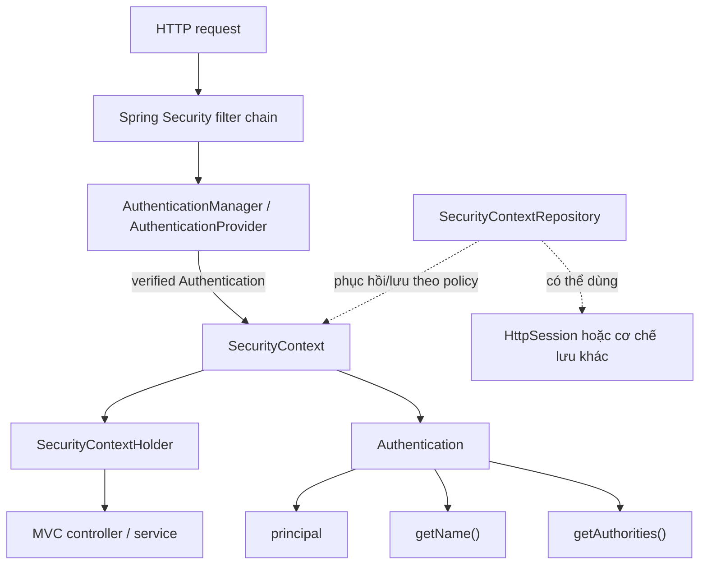

# Đọc danh tính qua API phù hợp thay vì phụ thuộc vào chi tiết lưu trữ

## Mục tiêu và phạm vi

Trong Spring Security, câu hỏi **“Ai đang thực hiện yêu cầu này?”** không nên được trả lời bằng cách đào vào `HttpSession`, đọc một cookie, tự giải mã JWT hoặc ép kiểu trực tiếp một object do filter nội bộ lưu vào một attribute. Spring Security đã cung cấp các **API đọc danh tính có hợp đồng rõ ràng** cho từng lớp ứng dụng: `Principal`, `Authentication`, `@AuthenticationPrincipal`, `@CurrentSecurityContext`, `SecurityContextHolder`, các API Servlet và API dành riêng cho reactive stack.

Điểm quan trọng là chọn API theo **dữ liệu thực sự cần** và **tầng đang xử lý**. Một controller chỉ cần tên người dùng không nên đọc toàn bộ context trong session. Một service cần authorization không nên tin client gửi `userId`. Một ứng dụng nhận JWT không nên giả định principal luôn là `UserDetails`. Và một request đã được xác thực không chứng minh rằng dữ liệu identity sẽ còn ở cùng một ThreadLocal hoặc cùng một `HttpSession` trong mọi bối cảnh.

Bài thuộc nhóm **Ngữ cảnh bảo mật** trong **Spring Security - fundamentals**, viết cho **Java 17+, Spring Boot 3.5.0 và Spring Security 6.5.x với Spring MVC/Servlet**. Có một project chạy được gồm các endpoint đọc danh tính qua nhiều API khác nhau, service được bảo vệ bằng method security, cùng nhóm kiểm thử JUnit/MockMvc. Các đoạn về JWT/OIDC, async và WebFlux sẽ được ghi rõ là **mô hình/fragment** thay vì giả vờ tất cả code cùng chạy trong ứng dụng HTTP Basic mẫu.

Kết quả mong đợi:

1. Nắm mối quan hệ `SecurityContextHolder → SecurityContext → Authentication → principal/authorities`.
2. Biết cách đọc tên danh tính qua `Principal#getName()` hoặc `Authentication#getName()` khi không cần biết implementation của principal.
3. Dùng `@AuthenticationPrincipal` khi controller thật sự cần **principal object**; hiểu `expression` và `errorOnInvalidType`.
4. Dùng `@CurrentSecurityContext` khi cần một phần của `SecurityContext`; hiểu SpEL có root là context.
5. Biết khi nào `HttpServletRequest#getUserPrincipal()`, `getRemoteUser()`, `isUserInRole()` hữu ích.
6. Dùng `SecurityContextHolder` có kiểm soát trong service/đoạn không có web argument resolver; không tự xem thread-local là user database.
7. Tránh phụ thuộc vào `HttpSession`, `SPRING_SECURITY_CONTEXT`, cookie `JSESSIONID` và chi tiết filter/repository.
8. Phân biệt **authenticated**, **anonymous**, **remember-me**, loại principal, authorities và quyền trên tài nguyên.
9. Hiểu bẫy của JWT/OIDC/opaque bearer/machine identity, request async và WebFlux.
10. Viết test phân biệt **xác thực thật bằng password** với **mock identity** phục vụ unit test.

## 1. Trước tiên: danh tính hiện tại được mô hình hóa ra sao?

### 1.1. Sơ đồ dữ liệu



Đây là sơ đồ khái niệm: filter cụ thể và hướng lưu context thay đổi theo Spring Security version, session policy và authentication mechanism. **Đọc danh tính** bắt đầu từ abstraction `Authentication`/`SecurityContext`, không bắt đầu từ tên attribute lưu trong session.

### 1.2. Authentication chứa những gì?

`Authentication` là interface kế thừa `java.security.Principal`. Một Authentication kết quả thường có:

- `getName()`: tên đại diện cho principal, không nhất thiết là email hoặc database ID.
- `getPrincipal()`: object biểu diễn user/subject; kiểu Java thay đổi theo provider.
- `getAuthorities()`: quyền, role hoặc scope được gán bởi cơ chế tin cậy.
- `isAuthenticated()`: trạng thái của token theo contract, **không tự đủ để nhận biết anonymous**.
- `getCredentials()`, `getDetails()`: thông tin nhạy cảm hoặc chi tiết authentication tùy token; không tùy tiện serialize ra response.

Ví dụ username/password thường trả `UsernamePasswordAuthenticationToken` với `UserDetails` làm principal. JWT resource server thường mang `Jwt` hoặc token/principal chuyên biệt; OIDC login có thể cung cấp `OidcUser`. **Không có một Java class principal đúng cho mọi authentication mechanism.**

### 1.3. SecurityContext là wrapper, SecurityContextHolder là access strategy

`SecurityContext` thường chứa `Authentication`:

```java
SecurityContext context = SecurityContextHolder.getContext();
Authentication authentication = context.getAuthentication();

if (authentication != null) {
    String name = authentication.getName();
    // Sử dụng trong bối cảnh đã được bảo vệ phù hợp.
}
```

Đây là fragment trong Servlet stack. `SecurityContextHolder` thường sử dụng `ThreadLocal` để cung cấp context cho đoạn code đang chạy trong thread request. Framework đặt/xóa context theo filter chain. **ThreadLocal không phải storage giữa requests** và không thay `HttpSession`, JWT hoặc user database.

### 1.4. Repository khác API đọc danh tính

`SecurityContextRepository` có thể phục hồi context cho request từ storage và lưu context sau authentication nếu cơ chế cần. Với web session thường có `HttpSessionSecurityContextRepository` và `DelegatingSecurityContextRepository`; với stateless có thể dùng `NullSecurityContextRepository`.

Đây là **chi tiết quản lý vòng đời context**, không phải API mà controller nghiệp vụ cần truy cập để trả lời “user hiện tại là ai?”. Controller đang chạy trong security chain nên nên dùng `Authentication`/`Principal`/argument resolver; nó không nên tìm session attribute nội bộ.

## 2. Anti-pattern: đọc danh tính trực tiếp từ HttpSession

Giả sử trong một controller có code:

```java
// ANTI-PATTERN, không nên đưa vào ứng dụng.
HttpSession session = request.getSession(false);

SecurityContext context =
    (SecurityContext) session.getAttribute(
        "SPRING_SECURITY_CONTEXT"
    );

String username =
    context.getAuthentication().getName();
```

Cách này có nhiều vấn đề:

1. `session` có thể **null**: API stateless, request public, cookie hết hạn hoặc request chưa tạo session.
2. Session tồn tại nhưng **không có SecurityContext**: guest session chỉ lưu CSRF token, request cache hoặc dữ liệu ứng dụng.
3. Attribute name là **chi tiết storage strategy**, không phải hợp đồng đọc principal cho business code.
4. SecurityContext có thể được giữ trong request attribute/custom repository, **không nằm trong HttpSession**.
5. App đổi sang OAuth2 resource server/Basic stateless, hoặc đổi repository, thì code hỏng dù authentication vẫn hợp lệ.
6. Dễ phát sinh `NullPointerException`, `ClassCastException` và luồng error làm lộ chi tiết nội bộ.
7. Code kiểm soát quyền có thể bỏ qua anonymous/remember-me hoặc tin một object chưa được kiểm chứng.
8. Nó ràng buộc business service với Servlet API, khó unit test và không chạy nguyên dạng trong WebFlux.
9. Nếu gọi `request.getSession()` thay vì `getSession(false)`, chính bước “đọc danh tính” có thể **tạo session mới**, làm quan sát/debug sai.
10. Dùng key string thay vì abstraction làm code phụ thuộc implementation của framework và sự kết hợp các filter/repository.

**Cách thay thế khi chỉ cần tên:**

```java
@GetMapping("/api/me")
Map<String, String> me(Principal principal) {
    return Map.of("name", principal.getName());
}
```

Đây là fragment controller Spring MVC. URL phải được bảo vệ để principal không null; phần project đầy đủ dưới đây triển khai điều kiện này. Nếu code cần **verified Authentication và authorities**, hãy nhận `Authentication` hoặc `@CurrentSecurityContext` thay vì tự đọc HttpSession.

## 3. Bảng chọn API theo nhu cầu

| Bạn cần gì? | API phù hợp | Điểm phải nhớ |
| --- | --- | --- |
| Chỉ tên user trong Spring MVC controller | `Principal` argument, `principal.getName()` | Không cần biết loại token/principal; endpoint protected khi đòi login. |
| Thông tin authentication và authorities | `Authentication` argument | Kết quả đến từ web security context; tránh gửi credential/details ra client. |
| Principal object có type xác định | `@AuthenticationPrincipal MyPrincipal` | Chỉ dùng khi login mechanism có loại principal phù hợp. |
| Một trường của principal object | `@AuthenticationPrincipal(expression = "username") String` | Biểu thức được đánh giá trên **principal**, không phải HttpSession. |
| Cả SecurityContext hiện tại | `@CurrentSecurityContext SecurityContext` | Dùng khi thật sự cần context; tránh phơi bày toàn bộ object. |
| Authentication từ context bằng annotation | `@CurrentSecurityContext(expression = "authentication") Authentication` | SpEL có root là **SecurityContext**. |
| Tên trong context bằng expression | `@CurrentSecurityContext(expression = "authentication.name") String` | Có ích khi muốn trích một trường mà không đọc storage. |
| Tên ở Servlet API | `HttpServletRequest#getRemoteUser()` / `getUserPrincipal()` | Spring Security request wrapper tích hợp thông tin từ context. |
| Quyền với role ở Servlet API | `request.isUserInRole("ADMIN")` | Có quy tắc role prefix; prefer authorization của Spring Security ở boundary. |
| Danh tính trong service Servlet đồng bộ | `SecurityContextHolder.getContext().getAuthentication()` | Có context propagation/scope; sử dụng `@PreAuthorize` để bảo vệ thao tác. |
| Kiểm tra quyền truy cập HTTP | `authorizeHttpRequests` / `AuthorizationManager` | Không chỉ tự đọc user rồi so chuỗi tùy ý. |
| Kiểm tra quyền method/service | `@PreAuthorize` / method security | Quyền theo actor, action và resource; cần bật `@EnableMethodSecurity`. |
| Reactive/WebFlux | `ReactiveSecurityContextHolder` / reactive argument resolver | Dùng Reactor Context, không copy Servlet ThreadLocal code. |
| Danh tính từ JWT/OIDC | Spring Security principal/token API tương ứng; `Authentication.getName()` khi đủ | Kiểm tra nguồn token, issuer/subject/tenant, không cast UserDetails tùy tiện. |

**Tối ưu thiết kế:** nếu business logic chỉ cần một **actor ID được định nghĩa ổn định**, tầng web/security nên chuyển authenticated principal sang một **actor abstraction/DTO an toàn** rồi truyền tham số cần thiết vào service. Đừng làm service biết quá nhiều về Servlet session, cookie hoặc type riêng của provider.

## 4. Principal và Authentication trong Spring MVC controller

### 4.1. Dùng Principal khi chỉ cần một tên

Vì `Authentication extends Principal`, code ở MVC controller có thể viết:

```java
@GetMapping("/api/principal")
Map<String, String> me(Principal principal) {
    return Map.of("name", principal.getName());
}
```

Spring MVC cung cấp `Principal` qua request; Spring Security có integration cập nhật Servlet principal từ SecurityContext. Điều này giữ controller ít phụ thuộc vào chi tiết provider.

**Điều kiện:** một endpoint chỉ dành cho người đã login nên có rule `authenticated()` hoặc mạnh hơn. Với route public, `Principal` có thể là `null`; đừng gọi `principal.getName()` mà không kiểm tra ngữ cảnh.

### 4.2. Dùng Authentication khi cần authorities hoặc loại token

```java
@GetMapping("/api/authentication")
Map<String, Object> info(Authentication authentication) {
    return Map.of(
        "name", authentication.getName(),
        "authenticated", authentication.isAuthenticated(),
        "authorities", authentication.getAuthorities().stream()
            .map(GrantedAuthority::getAuthority)
            .sorted()
            .toList()
    );
}
```

Đây là fragment; import `org.springframework.security.core.Authentication` và `GrantedAuthority`. Nó chỉ trả dữ liệu đã chọn, **không** trả nguyên `Authentication`. Object authentication có thể chứa:

- `principal` với `UserDetails`/JWT claims/custom attributes.
- `details` như request metadata.
- `credentials` còn tồn tại trong một số cơ chế nếu chưa được xóa.

Đưa nguyên object vào `ResponseEntity.ok(authentication)` không phải cách debug an toàn. Trong production, quyền/role cũng chỉ nên được trả cho client khi UI cần và policy cho phép; client **không được dùng giá trị đó làm nguồn phán quyết authorization server-side**.

### 4.3. Không xem getName() là khóa định danh toàn cục

`authentication.getName()` là một giá trị do implementation token/principal quyết định. Với username/password, nó thường là username; với OAuth2/JWT có thể là `sub`, preferred username hoặc claim được cấu hình.

Khi có nhiều identity providers/tenants, hai người khác nhau có thể cùng `getName()=="alice"`. Để làm khóa nghiệp vụ, xác định danh tính có tính duy nhất đúng domain, ví dụ **(issuer, subject, tenant)** hoặc internal user ID liên kết với authenticated subject. Không tự ghép từ dữ liệu query string do client gửi.

### 4.4. Đọc tên không thay thế phân quyền

Một controller biết `principal.getName()=="learner"` chưa đủ chứng minh người đó có quyền xem invoice `/invoices/123`. Phải có rule theo resource owner/tenant/role và policy của ứng dụng.

**Authentication trả lời “ai?”, authorization trả lời “được phép làm gì với tài nguyên nào?”**. Truy xuất danh tính tốt là điều kiện hỗ trợ authorization nhưng không thay thế nó.

## 5. @AuthenticationPrincipal: lấy đúng principal object

Spring Security cung cấp `org.springframework.security.core.annotation.AuthenticationPrincipal`. Annotation này yêu cầu argument resolver lấy **`Authentication.getPrincipal()`** của request hiện tại và chuyển thành tham số controller.

### 5.1. Khi principal là UserDetails

Với HTTP Basic/form login dùng `DaoAuthenticationProvider` và `InMemoryUserDetailsManager` trong lab:

```java
@GetMapping("/api/user-details")
Map<String, String> details(
        @AuthenticationPrincipal UserDetails user) {

    return Map.of("username", user.getUsername());
}
```

Ở đây `UserDetails` được lấy từ `Authentication.getPrincipal()`, không từ session attribute. Nó phù hợp khi provider thật sự đưa UserDetails vào principal.

**Đừng trả nguyên UserDetails**: `getPassword()` thường chứa password hash, và object có các flags/authorities nội bộ. Hãy chuyển thành response DTO tối thiểu.

### 5.2. Dùng expression để trích một property

```java
@GetMapping("/api/principal-expression")
Map<String, String> principalExpression(
        @AuthenticationPrincipal(expression = "username")
        String username) {

    return Map.of("username", username);
}
```

SpEL ở đây có **root là principal object**. Với Spring Security `UserDetails`, property `username` đọc bằng `getUsername()`. Nếu app chuyển sang JWT principal kiểu `Jwt`, expression này có thể không còn phù hợp.

### 5.3. errorOnInvalidType và vấn đề “im lặng trả null”

`@AuthenticationPrincipal` có tùy chọn:

```java
@AuthenticationPrincipal(errorOnInvalidType = true)
UserDetails currentUser
```

Khi actual principal không thuộc kiểu mong đợi, resolver mặc định có thể trả **null**; với `errorOnInvalidType=true`, nó báo lỗi chuyển kiểu thay vì âm thầm bỏ qua. Lựa chọn này có ích cho endpoint **đã được thiết kế chặt theo một principal type** và muốn phát hiện sai cấu hình sớm.

Đây **không** phải phép kiểm chứng quyền. Annotation không tự xác thực password/JWT; nó chỉ trích principal mà security context hiện có. Quy tắc bảo vệ URL/method vẫn cần được cấu hình.

### 5.4. Custom principal và trích domain user

Nếu UserDetails được ứng dụng tự thiết kế và có property `internalUserId`:

```java
// Fragment: chỉ dùng nếu principal thực sự có getInternalUserId().
@GetMapping("/api/internal-id")
Map<String, Long> internalId(
        @AuthenticationPrincipal(expression = "internalUserId")
        Long id) {

    return Map.of("id", id);
}
```

Biểu thức không tự tạo property, không tự tìm account trong database, và không biến username thành numeric user ID. Để fragment hợp lệ, custom principal class và `getInternalUserId()` phải có thật. Khi đổi OAuth2 provider, nên có adapter ánh xạ vào domain actor thay vì để mọi controller biết claim names.

### 5.5. Khi principal không phải UserDetails

Ví dụ kiến trúc khác:

| Cơ chế | Principal thường gặp | Cách đọc phù hợp |
| --- | --- | --- |
| DAO username/password | `UserDetails` | `@AuthenticationPrincipal UserDetails`, `getUsername()`. |
| OAuth2 login | `OAuth2User` | `@AuthenticationPrincipal OAuth2User` hoặc `Authentication.getName()`. |
| OIDC login | `OidcUser` | `@AuthenticationPrincipal OidcUser`; đọc subject/claims đã được xác thực qua flow. |
| JWT resource server | `Jwt` trên `JwtAuthenticationToken` mặc định | `@AuthenticationPrincipal Jwt` hoặc token API, chú ý issuer/subject. |
| Opaque bearer token | `OAuth2AuthenticatedPrincipal` trong cấu hình mặc định điển hình | Dùng principal/token API tương ứng; không giả định Jwt. |
| Anonymous | Thường String `"anonymousUser"` bên trong anonymous token | Không cast sang UserDetails; không coi là login. |
| Custom machine identity | Custom principal do provider tạo | Adapter riêng hoặc `Authentication.getName()` nếu đủ. |

Các loại trên là **mẫu thường gặp**, không phải hợp đồng bắt buộc cho mọi ứng dụng. Security config có thể thay principal, converter, claim mapping hoặc token type. Cần test chính cơ chế authentication thật mà dự án đang dùng.

## 6. @CurrentSecurityContext: lấy context hoặc một trường cụ thể

Spring Security cung cấp `org.springframework.security.core.annotation.CurrentSecurityContext` và MVC `CurrentSecurityContextArgumentResolver`.

### 6.1. Lấy toàn SecurityContext

```java
@GetMapping("/api/context")
Map<String, String> context(
        @CurrentSecurityContext SecurityContext context) {

    return Map.of(
        "name", context.getAuthentication().getName()
    );
}
```

API này cho biết **context của request hiện tại**, không bắt controller phải biết nó được nạp từ session, bearer token hay một repository khác. Một endpoint yêu cầu `authenticated()` có thể dựa vào việc request hợp lệ đã được framework bảo vệ trước khi controller chạy.

Nếu method là public, `context.getAuthentication()` có thể null hoặc anonymous; cần xử lý phù hợp. Không dùng ví dụ protected endpoint rồi copy nguyên sang mọi public route.

### 6.2. Lấy Authentication bằng expression

```java
@GetMapping("/api/context-auth")
Map<String, String> contextAuthentication(
    @CurrentSecurityContext(expression = "authentication")
    Authentication authentication) {

    return Map.of("name", authentication.getName());
}
```

Ở `@CurrentSecurityContext`, SpEL **root là SecurityContext**, vì vậy `authentication` là property trả về Authentication trong context. So sánh với `@AuthenticationPrincipal`: SpEL của annotation kia root ở **principal**, không phải context.

### 6.3. Lấy một property của Authentication

```java
@GetMapping("/api/context-expression")
Map<String, String> contextName(
    @CurrentSecurityContext(expression = "authentication.name")
    String name) {

    return Map.of("name", name);
}
```

Đây là cách ngắn gọn để lấy tên khi bạn muốn dùng annotation thay vì khai báo `Authentication` và gọi `getName()`. Tuy nhiên, nếu controller chỉ cần `Principal#getName()`, `Principal` vẫn là phương án rất đơn giản và ít phụ thuộc framework.

### 6.4. Phân biệt hai expression roots

| Cú pháp | Root SpEL | Giá trị kỳ vọng trong lab |
| --- | --- | --- |
| `@AuthenticationPrincipal UserDetails user` | Lấy nguyên principal | UserDetails của `learner`. |
| `@AuthenticationPrincipal(expression="username") String s` | UserDetails principal | `learner`. |
| `@CurrentSecurityContext SecurityContext c` | Lấy nguyên context | Context chứa verified Authentication. |
| `@CurrentSecurityContext(expression="authentication") Authentication a` | SecurityContext | Authentication đã xác thực. |
| `@CurrentSecurityContext(expression="authentication.name") String s` | SecurityContext → Authentication | `learner`. |

**Lưu ý:** Java compile-time chỉ biết kiểu tham số; property SpEL thường được kiểm tra lúc runtime. Khi đổi principal model, cần integration test để phát hiện expression không còn đúng.

## 7. Servlet API: getUserPrincipal, getRemoteUser và isUserInRole

Spring Security tích hợp Servlet API thông qua `SecurityContextHolderAwareRequestFilter` và wrapper của request. Với endpoint đã được bảo vệ:

```java
@GetMapping("/api/servlet")
Map<String, Object> servletIdentity(
        HttpServletRequest request) {

    Principal principal = request.getUserPrincipal();

    return Map.of(
        "principalName", principal.getName(),
        "remoteUser", request.getRemoteUser(),
        "isAdmin", request.isUserInRole("ADMIN")
    );
}
```

Đây là fragment; dự án lab bên dưới có toàn bộ imports/controller. `getUserPrincipal()` trả Principal theo Servlet API, còn `getRemoteUser()` trả tên hoặc null khi không có danh tính được nhận diện. `isUserInRole("ADMIN")` có thể ánh xạ sang `ROLE_ADMIN` theo role prefix mà security integration sử dụng.

**Không dùng `request.getSession(false).getAttribute(...)` để cố “sửa” getUserPrincipal.** Nếu Servlet principal null ở một public request nhưng SecurityContextHolder chứa anonymous, đó có thể là hành vi bình thường. Với REST resource server hoặc custom filters, cần kiểm tra integration/chain phù hợp.

### 7.1. Khi nào chọn Servlet API?

- Bạn đang viết một thư viện Servlet-level không muốn gắn trực tiếp annotation Spring MVC.
- Bạn cần một API chuẩn cho tên/các role ở lớp gần request.
- Bạn đang tích hợp hệ thống Servlet legacy đã dùng `getRemoteUser()` hoặc `isUserInRole()`.

Trong controller Spring MVC nghiệp vụ, `Principal` argument hoặc annotations của Spring Security thường dễ đọc/test hơn. Trong service tầng domain, tránh inject `HttpServletRequest` chỉ để biết user.

### 7.2. Đừng coi request header là principal

`request.getHeader("X-User")`, `request.getHeader("X-Role")` hoặc `request.getHeader("Authorization")` là **input do client hoặc proxy chuyển tiếp**; chúng chưa tự chứng minh danh tính. Nếu kiến trúc xác thực ở gateway, phải cấu hình trust boundary, xóa/rewrite headers tại edge và xác minh gateway identity trước khi Spring Security tạo trusted Authentication.

Tự đọc `X-Role: ADMIN` rồi cấp quyền bỏ qua security provider là authentication bypass. `Principal` và `Authentication` sau xác thực có giá trị vì chúng được filter/provider tin cậy tạo ra, không phải vì tên header nghe giống danh tính.

## 8. Service layer: dùng SecurityContextHolder khi không có MVC argument

Controller có argument resolvers, nhưng class service thông thường không tự nhận `@AuthenticationPrincipal` làm một method parameter theo cách MVC resolver làm. Với logic chạy đồng bộ trong Servlet security context, bạn có thể dùng:

```java
Authentication auth =
    SecurityContextHolder.getContext().getAuthentication();

if (auth == null) {
    throw new AuthenticationCredentialsNotFoundException(
        "Authentication required"
    );
}

String actorName = auth.getName();
```

Đây là fragment, import `AuthenticationCredentialsNotFoundException` từ `org.springframework.security.authentication`. **Một check `auth != null` chưa đủ bảo vệ thao tác** nếu anonymous authentication được bật; nên dùng method authorization được framework hỗ trợ.

### 8.1. Tách đọc actor và kiểm tra quyền

Trong project mẫu, service dùng:

```java
@PreAuthorize("isAuthenticated()")
public String currentName() {
    return SecurityContextHolder.getContext()
        .getAuthentication()
        .getName();
}
```

Bản thân `@PreAuthorize` được thực thi khi method security đã bật và lệnh gọi đi **qua Spring AOP proxy**, ví dụ controller gọi method của một bean `@Service`. Nếu bạn gọi trực tiếp method từ một method khác **trong cùng instance (self-invocation)**, proxy-based method authorization có thể không được thực thi.

Đối với dữ liệu nhạy cảm, nên kiểm tra quyền ở tầng service/domain và áp owner/tenant policy dựa trên **tài nguyên thật trong store**, không chỉ kiểm tra string user mà client truyền.

### 8.2. Khi nào nên truyền actor vào service thay vì dùng holder?

Một service có nhiều use cases (HTTP, scheduled job, message consumer, tests) có thể dễ kiểm thử hơn nếu nhận actor đã được xác định bởi security adapter:

```java
public record ActorIdentity(
    String subject,
    String tenantId
) {}

public interface InvoiceService {
    InvoiceView readInvoice(ActorIdentity actor, long invoiceId);
}
```

Đây là fragment thiết kế, chưa phải Java source đầy đủ (cần định nghĩa `InvoiceView`). ActorIdentity phải được xây từ **Authentication đã được kiểm chứng**, không nhận tự do từ request JSON/query. Service vẫn cần kiểm tra invoice thuộc tenant/owner hợp lệ, hoặc dùng authorization policy tương đương.

Lợi ích: ít phụ thuộc Spring MVC/Servlet; unit test truyền ActorIdentity cụ thể; authorization có thể xem xét cả actor, action và resource. Khi backend nhiều IdPs, một mapping tập trung từ issuer/sub/tenant sang internal actor ID cũng tránh rải ép kiểu principal khắp code.

### 8.3. Không đọc holder trong static global/cached singleton như “current user”

Giá trị SecurityContextHolder gắn với bối cảnh xử lý, không phải cấu hình application. Nếu giữ `Authentication` trong field của singleton bean rồi đọc lại cho request khác, có thể **lộ danh tính giữa người dùng**. Không cache currentUser trong static variable hay giữ raw principal trong session riêng trừ khi có thiết kế thực sự cần.

## 9. Anonymous, null và authenticated: ba tình huống dễ nhầm

### 9.1. Tại sao isAuthenticated() không đủ?

`AnonymousAuthenticationToken` do Spring Security tạo có thể có `isAuthenticated() == true` theo implementation; đó vẫn **không phải người dùng đăng nhập thật**. Spring Security dùng `AuthenticationTrustResolver` để phân biệt anonymous khi thực thi rule `authenticated()`.

Đoạn tự kiểm tra sau là **anti-pattern** nếu dùng làm guard:

```java
Authentication a =
    SecurityContextHolder.getContext().getAuthentication();

boolean loggedIn = a != null && a.isAuthenticated();
// Không dùng loggedIn này làm thay thế rule authenticated().
```

Nếu cần bảo vệ endpoint, chọn:

```java
.authorizeHttpRequests(auth -> auth
    .requestMatchers("/api/**").authenticated()
)
```

Nếu cần một service method được bảo vệ, dùng `@PreAuthorize("isAuthenticated()")` khi method security đã bật. Nếu bạn thật sự phải phân loại trạng thái, sử dụng trust resolver hoặc API authorization phù hợp thay vì chỉ dựa vào boolean của token.

### 9.2. Public endpoint có thể nhận gì?

Với một route `permitAll()`:

- `Principal` và `HttpServletRequest#getUserPrincipal()` có thể null nếu anonymous.
- `SecurityContextHolder.getContext().getAuthentication()` có thể là `AnonymousAuthenticationToken` nếu anonymous filter được bật.
- `@AuthenticationPrincipal UserDetails` có thể null khi principal thật là String anonymousUser hoặc type khác.
- `SecurityContext` thường có thể lấy, nhưng Authentication bên trong có thể null/anonymous ở một số cấu hình.

Vì vậy route public nên xử lý anonymous có chủ đích; không kết luận hệ thống hỏng khi MVC Principal null mà holder có token anonymous.

### 9.3. Remember-me khác fully authenticated

Spring Security còn có khái niệm `rememberMe()` và `fullyAuthenticated()`. Một request có thể có principal không phải anonymous nhưng được phục hồi bằng remember-me, chưa đáp ứng mức xác thực cần cho thao tác nhạy cảm. Rule `fullyAuthenticated()`/step-up/MFA tùy hệ thống có thể cần thiết.

**Lấy được username không chứng minh đã đạt assurance phù hợp cho giao dịch.** Identity extraction API không thay policy xác thực mạnh hoặc session age.

## 10. Session, cookies và repository không phải API nhận diện user

### 10.1. Vì sao HttpSession tồn tại không chứng minh login?

Một HttpSession có thể được tạo bởi CSRF storage, request cache, giỏ hàng hoặc một thư viện khác dù user chưa login. Cookie `JSESSIONID` chứa **session identifier**, không tự chứa verified principal theo mô hình Servlet session truyền thống.

Nếu session timeout, cookie cũ vẫn có thể được browser gửi nhưng không còn state. Khi đổi sang Basic/JWT stateless, request vẫn có authenticated principal mà không cần HttpSession.

### 10.2. Khi nào SecurityContext được lưu qua request?

Với session-based form login, Spring Security có thể lưu context qua `SecurityContextRepository`, ví dụ `DelegatingSecurityContextRepository` có `HttpSessionSecurityContextRepository`. Với API stateless, context thường được dựng theo credential ở request hiện tại và dọn sau khi xử lý.

**Đừng để controller phụ thuộc vào lựa chọn storage này.** Nếu bạn dùng `@CurrentSecurityContext`/`Principal` trong request, code có thể giữ nguyên ngay cả khi storage thay đổi, miễn authentication/authorization được cấu hình nhất quán.

### 10.3. SecurityContextHolderFilter trong Spring Security 6

Spring Security 6 hướng tới việc đọc SecurityContext qua `SecurityContextHolderFilter` và yêu cầu **explicit save** khi custom code thay context và muốn persist sang request sau. Built-in authentication mechanisms như form login đã có logic persistence tương ứng; controller business không nên tự ý ghi attribute session.

Đọc current identity bằng `SecurityContextHolder.getContext()` **không có nghĩa cần gọi `saveContext()`**. Lưu context chỉ liên quan khi flow authentication cần persistence; business request đã có verified Authentication chỉ việc dùng API đọc phù hợp.

### 10.4. Quyền cũ trong session

Nếu roles/authorities đã được snapshot vào Authentication trong session, việc admin đổi role ở database không bảo đảm session cũ tự cập nhật ngay. Điều này ảnh hưởng authorization, không thể khắc phục bằng cách controller đọc attribute session trực tiếp.

Các phương án: invalidate sessions, giới hạn token lifetime, kiểm tra permission server-side tại thời điểm truy cập tài nguyên, hoặc dùng event/caching strategy thích hợp. Không tin client tự gửi role mới để “đồng bộ”.

## 11. Các loại principal: JWT, OIDC, OAuth2 và custom identity

### 11.1. getName() giúp giảm phụ thuộc Java class, nhưng không giải quyết định danh

`Authentication.getName()` thuận tiện khi UI chỉ cần display/small audit name. Tuy nhiên, với JWT:

- `JwtAuthenticationToken` thường có tên mặc định dựa trên `sub`.
- Tên có thể tùy converter `JwtAuthenticationConverter`/principal claim được chọn.
- `getPrincipal()` có thể là `Jwt`, không phải `UserDetails`.
- Claims chỉ có ý nghĩa khi token đã được resource server **xác minh chữ ký, issuer, audience, expiry và các policy cần thiết**.

Không dùng `jwt.getClaimAsString("role")` rồi tự cấp quyền nếu token chưa được kiểm chứng. Dùng Spring Security resource server và converter/authorization tương ứng.

### 11.2. Fragment cho JWT principal

```java
// Fragment cho một application đã cấu hình OAuth2 Resource Server JWT.
// Không thuộc project HTTP Basic ở phần thực hành.
@GetMapping("/jwt/me")
Map<String, String> jwtMe(
        @AuthenticationPrincipal Jwt jwt) {

    return Map.of(
        "subject", jwt.getSubject(),
        "issuer", jwt.getIssuer().toString()
    );
}
```

Chỉ hoạt động khi principal thực tế là Jwt và các claims/issuer phù hợp; `getIssuer()` có thể null trong trường hợp token/config cho phép nên fragment phải được gia cố nếu đưa vào endpoint thực. JWT phải đến từ flow resource server đã xác minh. **Không thêm endpoint này vào project Basic**, vì với principal là UserDetails, argument có thể null.

### 11.3. OIDC subject và email không giống nhau

Với OIDC, `OidcUser` có thể cung cấp subject, issuer cùng email/name/profile claims. Email có thể thay đổi hoặc chưa được xác minh theo policy; display name cũng không phải khóa định danh. Đối với hệ thống nhiều IdPs, thường dùng **issuer + subject** để xác định external identity, ánh xạ về internal user ID/tenant.

Một annotation `@AuthenticationPrincipal UserDetails` được viết cho Basic không tự biến thành `OidcUser` khi đổi sang OIDC login. Chọn API dựa trên authentication mechanism thực tế và thiết kế một lớp chuyển đổi principal cho domain service.

### 11.4. Opaque bearer token không giống JWT

Opaque access token có thể được introspection ở authorization server. Principal trong Spring Security có thể là một `OAuth2AuthenticatedPrincipal` và authorities được ánh xạ từ scope/claims đã được introspect. Không cast sang Jwt chỉ vì request có `Authorization: Bearer ...`.

### 11.5. Machine-to-machine và service account

Với OAuth2 client credentials/mTLS/API key, “người gọi” có thể là **client application**, không phải người dùng cuối. `getName()` có thể là client ID hoặc subject tương ứng. Một audit field có thể cần phân biệt actor type (`USER` vs `SERVICE`), tenant, issuer, delegated-on-behalf-of identity.

Nếu service A hành động thay cho end user B, đừng ghi audit theo một username mơ hồ; mô hình identity phải diễn tả ai là bên thực hiện, ai là bên được đại diện và bằng chứng nào đã được xác thực.

## 12. Async, thread pool và WebFlux: tránh lạm dụng ThreadLocal

### 12.1. Vì sao context có thể biến mất ngoài request thread?

`SecurityContextHolder` mặc định với Servlet dùng ThreadLocal. Nếu code chuyển sang thread khác bằng `@Async`, `CompletableFuture.supplyAsync` hoặc một executor tùy chỉnh, context không nhất thiết có trong thread mới.

Đây không phải lúc nào là lỗi: một background task không nên vô tình mang quyền người dùng vào công việc kéo dài hoặc chạy ngoài bối cảnh request. Nếu cần, dùng integration chính thức như `DelegatingSecurityContextExecutor`/`DelegatingSecurityContextRunnable`, hoặc truyền **actor ID và quyền đã được quyết định** như một tham số nghiệp vụ có kiểm soát.

### 12.2. Không đặt SecurityContext trong static field

```java
// ANTI-PATTERN: làm lẫn identity giữa requests.
public final class DangerousCurrentUser {
    public static Authentication CURRENT;
}
```

Servlet threads được tái sử dụng; singleton/static object không có request scope. Đừng cache Authentication của request A rồi trả cho request B. Framework clear holder theo lifecycle để tránh rò rỉ này.

### 12.3. InheritableThreadLocal không phải giải pháp tổng quát

`MODE_INHERITABLETHREADLOCAL` có thể đưa security context xuống **thread con được tạo mới** trong một số điều kiện, nhưng không phù hợp tự động với thread pool và có nguy cơ giữ identity lâu hơn dự kiến. Dùng abstraction propagation/cleanup đúng use case, và kiểm tra lại quyền với thao tác nhạy cảm diễn ra về sau.

### 12.4. WebFlux dùng Reactor Context

Trong Spring WebFlux, dùng `ReactiveSecurityContextHolder`, `ServerSecurityContextRepository` và reactive annotations/resolvers được hỗ trợ; nó **không** dùng trực tiếp Servlet `HttpSession`/ThreadLocal theo cùng cơ chế.

Fragment minh họa:

```java
// Fragment chỉ dùng trong WebFlux/reactive code với dependencies phù hợp.
Mono<String> actorName() {
    return ReactiveSecurityContextHolder.getContext()
        .map(context -> context.getAuthentication().getName());
}
```

Không đưa fragment này vào app Spring MVC ở phần thực hành. Phải import Reactor `Mono` và lớp reactive tương ứng nếu triển khai. Với công việc reactive, phương thức lấy context phải tôn trọng Reactor subscription context; không block để gọi Servlet holder.

## 13. Dự án Java 17 + Spring Boot minh họa các API đọc danh tính

### 13.1. Yêu cầu và endpoint

Ta xây một app MVC chỉ có **HTTP GET** endpoint để kiểm chứng nhiều cách đọc cùng một authenticated identity.

Tài khoản mẫu:

- `learner / learner-pass` → `ROLE_USER`.
- `admin / admin-pass` → `ROLE_USER` và `ROLE_ADMIN`.

Bảo mật:

- `GET /public/ping`: công khai.
- `GET /api/**`: phải được xác thực bằng HTTP Basic.
- `GET /api/admin-proof`: ngoài authentication, **service method** còn đòi `ROLE_ADMIN` với `@PreAuthorize`.
- Các URL khác: `denyAll`.
- `SessionCreationPolicy.STATELESS`: mỗi request Basic tự cung cấp credentials; không phụ thuộc HttpSession.
- Không tắt CSRF trên toàn app; demo chỉ GET nên không cần token trong những test đọc.
- Response chỉ trả trường được chọn, không bao gồm hash, session ID hoặc full Authentication.

Bảng nhanh:

| Endpoint | Giá trị quan sát | Người dùng guest | learner | admin |
| --- | --- | :---: | :---: | :---: |
| `/public/ping` | `pong` | 200 | 200 | 200 |
| `/api/principal` | Principal name | 401 | 200 | 200 |
| `/api/authentication` | Name + verified flag + authorities | 401 | 200 | 200 |
| `/api/user-details` | UserDetails username | 401 | 200 | 200 |
| `/api/principal-expression` | Username từ principal SpEL | 401 | 200 | 200 |
| `/api/context` | Name từ SecurityContext | 401 | 200 | 200 |
| `/api/context-auth` | Name từ Authentication qua context | 401 | 200 | 200 |
| `/api/context-expression` | Name qua context SpEL | 401 | 200 | 200 |
| `/api/servlet` | Remote user, principal name, isAdmin | 401 | 200 | 200 |
| `/api/service` | Name qua service + holder | 401 | 200 | 200 |
| `/api/admin-proof` | Method authorization ADMIN | 401 | **403** | 200 |
| URL không khai báo | Default deny | Theo entry point | 403 | 403 |

**Ý nghĩa của stateless:** dù controller vẫn lấy được Authentication qua những API trên, dữ liệu đó không cần được đọc từ `HttpSession`. Đây là bằng chứng thực tế rằng đọc principal qua API đúng **không phụ thuộc storage**.

### 13.2. Cấu trúc thư mục

```text
current-identity-lab/
├── pom.xml
└── src/
    ├── main/java/com/example/currentidentity/
    │   ├── CurrentIdentityApplication.java
    │   ├── SecurityConfig.java
    │   ├── CurrentActorService.java
    │   └── IdentityController.java
    └── test/java/com/example/currentidentity/
        ├── IdentityHttpTest.java
        └── CurrentActorServiceTest.java
```

### 13.3. pom.xml

```xml
<project xmlns="http://maven.apache.org/POM/4.0.0"
         xmlns:xsi="http://www.w3.org/2001/XMLSchema-instance"
         xsi:schemaLocation="http://maven.apache.org/POM/4.0.0 https://maven.apache.org/xsd/maven-4.0.0.xsd">
    <modelVersion>4.0.0</modelVersion>

    <parent>
        <groupId>org.springframework.boot</groupId>
        <artifactId>spring-boot-starter-parent</artifactId>
        <version>3.5.0</version>
        <relativePath/>
    </parent>

    <groupId>com.example</groupId>
    <artifactId>current-identity-lab</artifactId>
    <version>1.0.0</version>

    <properties>
        <java.version>17</java.version>
    </properties>

    <dependencies>
        <dependency>
            <groupId>org.springframework.boot</groupId>
            <artifactId>spring-boot-starter-web</artifactId>
        </dependency>
        <dependency>
            <groupId>org.springframework.boot</groupId>
            <artifactId>spring-boot-starter-security</artifactId>
        </dependency>
        <dependency>
            <groupId>org.springframework.boot</groupId>
            <artifactId>spring-boot-starter-test</artifactId>
            <scope>test</scope>
        </dependency>
        <dependency>
            <groupId>org.springframework.security</groupId>
            <artifactId>spring-security-test</artifactId>
            <scope>test</scope>
        </dependency>
    </dependencies>

    <build>
        <plugins>
            <plugin>
                <groupId>org.springframework.boot</groupId>
                <artifactId>spring-boot-maven-plugin</artifactId>
            </plugin>
        </plugins>
    </build>
</project>
```

Dùng parent BOM Spring Boot cho dependency versions tương thích. `3.5.0` là mốc API học tập, **không có nghĩa phiên bản này là bản vá an ninh mới nhất**. Với hệ thống thực, nâng lên patch release đang được hỗ trợ và kiểm thử lại security config, principal types, method security.

### 13.4. CurrentIdentityApplication.java

```java
package com.example.currentidentity;

import org.springframework.boot.SpringApplication;
import org.springframework.boot.autoconfigure.SpringBootApplication;

@SpringBootApplication
public class CurrentIdentityApplication {
    public static void main(String[] args) {
        SpringApplication.run(CurrentIdentityApplication.class, args);
    }
}
```

Package `com.example.currentidentity` là root của app. Các file còn lại dùng cùng package để component scan nhận `SecurityConfig`, `CurrentActorService` và `IdentityController`.

### 13.5. SecurityConfig.java

```java
package com.example.currentidentity;

import org.springframework.context.annotation.Bean;
import org.springframework.context.annotation.Configuration;
import org.springframework.http.HttpMethod;
import org.springframework.security.config.Customizer;
import org.springframework.security.config.annotation.method.configuration.EnableMethodSecurity;
import org.springframework.security.config.annotation.web.builders.HttpSecurity;
import org.springframework.security.config.annotation.web.configurers.AbstractHttpConfigurer;
import org.springframework.security.config.http.SessionCreationPolicy;
import org.springframework.security.core.userdetails.User;
import org.springframework.security.core.userdetails.UserDetailsService;
import org.springframework.security.crypto.factory.PasswordEncoderFactories;
import org.springframework.security.crypto.password.PasswordEncoder;
import org.springframework.security.provisioning.InMemoryUserDetailsManager;
import org.springframework.security.web.SecurityFilterChain;

@Configuration(proxyBeanMethods = false)
@EnableMethodSecurity
public class SecurityConfig {

    @Bean
    PasswordEncoder passwordEncoder() {
        return PasswordEncoderFactories.createDelegatingPasswordEncoder();
    }

    @Bean
    UserDetailsService users(PasswordEncoder encoder) {
        return new InMemoryUserDetailsManager(
            User.withUsername("learner")
                .password(encoder.encode("learner-pass"))
                .roles("USER")
                .build(),
            User.withUsername("admin")
                .password(encoder.encode("admin-pass"))
                .roles("USER", "ADMIN")
                .build()
        );
    }

    @Bean
    SecurityFilterChain securityFilterChain(HttpSecurity http)
            throws Exception {

        return http
            .sessionManagement(session -> session
                .sessionCreationPolicy(SessionCreationPolicy.STATELESS)
            )
            .authorizeHttpRequests(auth -> auth
                .requestMatchers(
                    HttpMethod.GET, "/public/ping"
                ).permitAll()
                .requestMatchers(
                    HttpMethod.GET, "/api/**"
                ).authenticated()
                .anyRequest().denyAll()
            )
            .httpBasic(Customizer.withDefaults())
            .formLogin(AbstractHttpConfigurer::disable)
            .build();
    }
}
```

**Giải thích:**

1. `PasswordEncoder` lưu password demo bằng hash bcrypt có prefix do factory tạo, không dùng `{noop}`.
2. `UserDetailsService` cung cấp UserDetails cho `DaoAuthenticationProvider` của username/password flow.
3. `httpBasic` đọc header Basic, kiểm tra credentials, tạo Authentication và đưa vào SecurityContext cho request hiện tại.
4. `STATELESS` không dùng HttpSession để nạp context cho lần request sau; Basic client phải gửi credentials mỗi lần.
5. `@EnableMethodSecurity` kích hoạt kiểm tra `@PreAuthorize` ở service bean.
6. `GET /api/**` đòi authentication, nhưng **không tự cấp ROLE_ADMIN**. Role được kiểm tra tại method `adminProof()`.
7. `anyRequest().denyAll()` bảo vệ các đường và HTTP methods ngoài scope.
8. CSRF không bị tắt; vì lab chỉ phục vụ GET, không có POST/PUT/PATCH/DELETE để test token. Nếu bổ sung endpoint ghi hoặc dùng browser cookie/session, phải đánh giá CSRF và chọn thiết kế thích hợp.

**Không coi HTTP Basic phù hợp cho mọi API production.** Basic truyền Base64 username/password, phải có HTTPS/TLS, tránh credentials trong logs và shell history. OAuth2/OIDC/JWT hoặc session form login có thể phù hợp hơn tùy đối tượng sử dụng.

### 13.6. CurrentActorService.java

```java
package com.example.currentidentity;

import org.springframework.security.access.prepost.PreAuthorize;
import org.springframework.security.core.Authentication;
import org.springframework.security.core.context.SecurityContextHolder;
import org.springframework.stereotype.Service;

@Service
public class CurrentActorService {

    @PreAuthorize("isAuthenticated()")
    public String currentName() {
        Authentication authentication =
            SecurityContextHolder.getContext().getAuthentication();

        return authentication.getName();
    }

    @PreAuthorize("hasRole('ADMIN')")
    public String adminProof() {
        return "admin-service";
    }
}
```

**Giải thích:**

- Service không inject Servlet request hoặc session để tìm user; nó đọc context được framework chuẩn bị cho request hiện tại.
- `@PreAuthorize("isAuthenticated()")` bảo vệ currentName khi được gọi **qua Spring bean proxy**.
- `@PreAuthorize("hasRole('ADMIN')")` bảo vệ thao tác chỉ dành cho admin. Cách đặt ở service vẫn hữu ích nếu có controller khác gọi tới service đó.
- Code không cache Authentication vào field.
- Khi một tác vụ background không có security context, method được bảo vệ sẽ từ chối thay vì mượn tùy ý danh tính của request cũ.

**Lưu ý:** Trong domain nghiêm túc, một method đọc tài nguyên phải kiểm tra resource owner/tenant. `adminProof()` chỉ là method rất nhỏ để minh họa 403 ở service layer.

### 13.7. IdentityController.java

```java
package com.example.currentidentity;

import jakarta.servlet.http.HttpServletRequest;
import java.security.Principal;
import java.util.Map;

import org.springframework.security.core.Authentication;
import org.springframework.security.core.GrantedAuthority;
import org.springframework.security.core.annotation.AuthenticationPrincipal;
import org.springframework.security.core.annotation.CurrentSecurityContext;
import org.springframework.security.core.context.SecurityContext;
import org.springframework.security.core.userdetails.UserDetails;
import org.springframework.web.bind.annotation.GetMapping;
import org.springframework.web.bind.annotation.RestController;

@RestController
public class IdentityController {

    private final CurrentActorService actors;

    public IdentityController(CurrentActorService actors) {
        this.actors = actors;
    }

    @GetMapping("/public/ping")
    public String ping() {
        return "pong";
    }

    @GetMapping("/api/principal")
    public Map<String, String> principal(Principal principal) {
        return Map.of("name", principal.getName());
    }

    @GetMapping("/api/authentication")
    public Map<String, Object> authentication(
            Authentication authentication) {

        return Map.of(
            "name", authentication.getName(),
            "authenticated", authentication.isAuthenticated(),
            "authorities", authentication.getAuthorities().stream()
                .map(GrantedAuthority::getAuthority)
                .sorted()
                .toList()
        );
    }

    @GetMapping("/api/user-details")
    public Map<String, String> userDetails(
            @AuthenticationPrincipal(errorOnInvalidType = true)
            UserDetails user) {

        return Map.of("username", user.getUsername());
    }

    @GetMapping("/api/principal-expression")
    public Map<String, String> principalExpression(
            @AuthenticationPrincipal(expression = "username")
            String username) {

        return Map.of("username", username);
    }

    @GetMapping("/api/context")
    public Map<String, String> context(
            @CurrentSecurityContext SecurityContext context) {

        return Map.of(
            "name", context.getAuthentication().getName()
        );
    }

    @GetMapping("/api/context-auth")
    public Map<String, String> contextAuthentication(
            @CurrentSecurityContext(expression = "authentication")
            Authentication authentication) {

        return Map.of("name", authentication.getName());
    }

    @GetMapping("/api/context-expression")
    public Map<String, String> contextExpression(
            @CurrentSecurityContext(
                expression = "authentication.name"
            )
            String name) {

        return Map.of("name", name);
    }

    @GetMapping("/api/servlet")
    public Map<String, Object> servlet(HttpServletRequest request) {
        return Map.of(
            "principalName", request.getUserPrincipal().getName(),
            "remoteUser", request.getRemoteUser(),
            "isAdmin", request.isUserInRole("ADMIN")
        );
    }

    @GetMapping("/api/service")
    public Map<String, String> service() {
        return Map.of("name", actors.currentName());
    }

    @GetMapping("/api/admin-proof")
    public String adminProof() {
        return actors.adminProof();
    }
}
```

**Có gì đáng chú ý?**

- Tất cả `/api/**` được URL rule bảo vệ, vì thế method đọc `Principal`/`Authentication` có thể kỳ vọng một danh tính hợp lệ trong phạm vi lab.
- `authentication` endpoint chỉ chọn name, authenticated flag, authorities — không serialize raw Authentication object.
- `@AuthenticationPrincipal UserDetails` hoạt động do lab dùng DaoAuthenticationProvider; khi đổi principal kiểu JWT/OIDC phải xem lại endpoint này.
- `@CurrentSecurityContext(expression="authentication.name")` dùng SpEL root là SecurityContext, không phải UserDetails.
- `/api/servlet` chỉ đọc Servlet principal/remoteUser/role từ security-aware request, không đọc `HttpSession`.
- `/api/service` cho thấy service method dùng SecurityContextHolder, được bảo vệ bằng method security.
- `/api/admin-proof` có URL rule `authenticated()`, nhưng service yêu cầu `ROLE_ADMIN` nên learner nhận **403**, admin nhận 200.

**Đừng expose diagnostic endpoint kiểu `/api/authentication` trong production nếu không có mục đích UI/audit được duyệt.** Khi cần dữ liệu UI, trả DTO tối thiểu; quyền phải được kiểm tra server-side.

## 14. Các tests MockMvc cho đường đọc identity

### 14.1. IdentityHttpTest.java

```java
package com.example.currentidentity;

import org.junit.jupiter.api.Test;
import org.springframework.beans.factory.annotation.Autowired;
import org.springframework.boot.test.autoconfigure.web.servlet.AutoConfigureMockMvc;
import org.springframework.boot.test.context.SpringBootTest;
import org.springframework.test.web.servlet.MockMvc;
import org.springframework.test.web.servlet.MvcResult;

import static org.assertj.core.api.Assertions.assertThat;
import static org.springframework.security.test.web.servlet.request
    .SecurityMockMvcRequestPostProcessors.httpBasic;
import static org.springframework.test.web.servlet.request.MockMvcRequestBuilders.get;
import static org.springframework.test.web.servlet.result.MockMvcResultMatchers.content;
import static org.springframework.test.web.servlet.result.MockMvcResultMatchers.jsonPath;
import static org.springframework.test.web.servlet.result.MockMvcResultMatchers.status;

@SpringBootTest
@AutoConfigureMockMvc
class IdentityHttpTest {

    @Autowired
    MockMvc mvc;

    @Test
    void publicPingWorksWithoutAuthentication() throws Exception {
        mvc.perform(get("/public/ping"))
            .andExpect(status().isOk())
            .andExpect(content().string("pong"));
    }

    @Test
    void guestCannotCallPrincipalEndpoint() throws Exception {
        mvc.perform(get("/api/principal"))
            .andExpect(status().isUnauthorized());
    }

    @Test
    void guestCannotCallUserDetailsEndpoint() throws Exception {
        mvc.perform(get("/api/user-details"))
            .andExpect(status().isUnauthorized());
    }

    @Test
    void wrongPasswordIsRejected() throws Exception {
        mvc.perform(get("/api/principal")
                .with(httpBasic("learner", "wrong-pass")))
            .andExpect(status().isUnauthorized());
    }

    @Test
    void unknownUsernameIsRejected() throws Exception {
        mvc.perform(get("/api/principal")
                .with(httpBasic("not-created", "learner-pass")))
            .andExpect(status().isUnauthorized());
    }

    @Test
    void principalArgumentReadsVerifiedUsername() throws Exception {
        mvc.perform(get("/api/principal")
                .with(httpBasic("learner", "learner-pass")))
            .andExpect(status().isOk())
            .andExpect(jsonPath("$.name").value("learner"));
    }

    @Test
    void authenticationArgumentReadsNameAndAuthorities()
            throws Exception {
        mvc.perform(get("/api/authentication")
                .with(httpBasic("learner", "learner-pass")))
            .andExpect(status().isOk())
            .andExpect(jsonPath("$.name").value("learner"))
            .andExpect(jsonPath("$.authenticated").value(true))
            .andExpect(jsonPath("$.authorities[0]")
                .value("ROLE_USER"));
    }

    @Test
    void annotationResolvesUserDetailsPrincipal()
            throws Exception {
        mvc.perform(get("/api/user-details")
                .with(httpBasic("learner", "learner-pass")))
            .andExpect(status().isOk())
            .andExpect(jsonPath("$.username").value("learner"));
    }

    @Test
    void annotationExpressionResolvesPrincipalUsername()
            throws Exception {
        mvc.perform(get("/api/principal-expression")
                .with(httpBasic("learner", "learner-pass")))
            .andExpect(status().isOk())
            .andExpect(jsonPath("$.username").value("learner"));
    }

    @Test
    void contextAnnotationResolvesCurrentName() throws Exception {
        mvc.perform(get("/api/context")
                .with(httpBasic("learner", "learner-pass")))
            .andExpect(status().isOk())
            .andExpect(jsonPath("$.name").value("learner"));
    }

    @Test
    void contextAuthenticationExpressionWorks() throws Exception {
        mvc.perform(get("/api/context-auth")
                .with(httpBasic("learner", "learner-pass")))
            .andExpect(status().isOk())
            .andExpect(jsonPath("$.name").value("learner"));
    }

    @Test
    void contextNameExpressionWorks() throws Exception {
        mvc.perform(get("/api/context-expression")
                .with(httpBasic("learner", "learner-pass")))
            .andExpect(status().isOk())
            .andExpect(jsonPath("$.name").value("learner"));
    }

    @Test
    void servletApiUsesAuthenticatedPrincipal()
            throws Exception {
        mvc.perform(get("/api/servlet")
                .with(httpBasic("learner", "learner-pass")))
            .andExpect(status().isOk())
            .andExpect(jsonPath("$.principalName").value("learner"))
            .andExpect(jsonPath("$.remoteUser").value("learner"))
            .andExpect(jsonPath("$.isAdmin").value(false));
    }

    @Test
    void servletRoleReflectsAdminAuthority()
            throws Exception {
        mvc.perform(get("/api/servlet")
                .with(httpBasic("admin", "admin-pass")))
            .andExpect(status().isOk())
            .andExpect(jsonPath("$.principalName").value("admin"))
            .andExpect(jsonPath("$.isAdmin").value(true));
    }

    @Test
    void serviceCanReadCurrentIdentityWithoutSessionAccess()
            throws Exception {
        mvc.perform(get("/api/service")
                .with(httpBasic("learner", "learner-pass")))
            .andExpect(status().isOk())
            .andExpect(jsonPath("$.name").value("learner"));
    }

    @Test
    void learnerCannotPassAdminMethodAuthorization()
            throws Exception {
        mvc.perform(get("/api/admin-proof")
                .with(httpBasic("learner", "learner-pass")))
            .andExpect(status().isForbidden());
    }

    @Test
    void adminCanPassAdminMethodAuthorization()
            throws Exception {
        mvc.perform(get("/api/admin-proof")
                .with(httpBasic("admin", "admin-pass")))
            .andExpect(status().isOk())
            .andExpect(content().string("admin-service"));
    }

    @Test
    void authenticatedUserCannotAccessUnlistedRoute()
            throws Exception {
        mvc.perform(get("/not-registered")
                .with(httpBasic("learner", "learner-pass")))
            .andExpect(status().isForbidden());
    }

    @Test
    void nextBasicRequestStillNeedsCredentials()
            throws Exception {
        mvc.perform(get("/api/principal")
                .with(httpBasic("learner", "learner-pass")))
            .andExpect(status().isOk());

        mvc.perform(get("/api/principal"))
            .andExpect(status().isUnauthorized());
    }

    @Test
    void basicStatelessRequestDoesNotNeedHttpSession()
            throws Exception {
        MvcResult result = mvc.perform(
                get("/api/principal")
                    .with(httpBasic("learner", "learner-pass"))
            )
            .andExpect(status().isOk())
            .andReturn();

        assertThat(
            result.getRequest().getSession(false)
        ).isNull();
    }
}
```

**20 HTTP integration tests** trên xác nhận:

- Xác thực bằng password thực qua HTTP Basic thay vì gắn identity giả.
- Cùng username có thể được đọc qua Principal, Authentication, @AuthenticationPrincipal, @CurrentSecurityContext, Servlet API và service.
- Anonymous/credentials sai nhận 401, không bị coi là logged-in chỉ vì một API trả context.
- Method authorization phân biệt learner và admin: 403/200.
- Request Basic stateless không đòi session, request tiếp theo không mang credentials thì không “kế thừa” identity của request trước.
- Unlisted URL không tự public.

Không có testcase nào cần đọc `SPRING_SECURITY_CONTEXT` hoặc session ID để biết ai đang đăng nhập.

### 14.2. CurrentActorServiceTest.java

Test HTTP chứng minh đi qua BasicAuthenticationFilter thật. Khi test method authorization riêng, có thể dùng `@WithMockUser`/`@WithAnonymousUser` để tạo context mock và kiểm tra service behavior. **Đây không phải bằng chứng password đúng**; nó chỉ kiểm tra service logic/authorization với giả lập principal.

```java
package com.example.currentidentity;

import org.junit.jupiter.api.Test;
import org.springframework.beans.factory.annotation.Autowired;
import org.springframework.boot.test.context.SpringBootTest;
import org.springframework.security.access.AccessDeniedException;
import org.springframework.security.test.context.support.WithAnonymousUser;
import org.springframework.security.test.context.support.WithMockUser;

import static org.assertj.core.api.Assertions.assertThat;
import static org.assertj.core.api.Assertions.assertThatThrownBy;

@SpringBootTest
class CurrentActorServiceTest {

    @Autowired
    CurrentActorService actors;

    @Test
    @WithMockUser(username = "test-user", roles = "USER")
    void mockAuthenticatedUserCanReadName() {
        assertThat(actors.currentName()).isEqualTo("test-user");
    }

    @Test
    @WithAnonymousUser
    void anonymousCannotInvokeProtectedService() {
        assertThatThrownBy(actors::currentName)
            .isInstanceOf(AccessDeniedException.class);
    }

    @Test
    @WithMockUser(username = "test-admin", roles = "ADMIN")
    void mockedAdminCanInvokeAdminMethod() {
        assertThat(actors.adminProof()).isEqualTo("admin-service");
    }

    @Test
    @WithMockUser(username = "test-user", roles = "USER")
    void mockedRegularUserCannotInvokeAdminMethod() {
        assertThatThrownBy(actors::adminProof)
            .isInstanceOf(AccessDeniedException.class);
    }
}
```

**4 tests ở service** kiểm tra method security ở bean thật. Tổng cộng app có **24 phương thức test** (20 MockMvc + 4 service). `@WithMockUser` tạo SecurityContext trong test framework và dọn theo lifecycle, khác với việc gọi HTTP Basic trong integration tests.

### 14.3. Kiểm tra điều gì sau khi chạy?

```bash
java -version
mvn -version
mvn test
mvn spring-boot:run
```

Kỳ vọng Maven chạy toàn bộ tests không có failures/errors khi code/versions đúng. Bài này **chỉ cung cấp mã và kỳ vọng**, không khẳng định Maven đã chạy trên workspace của người học.

Khi test thất bại:

- Nếu `@AuthenticationPrincipal UserDetails` trả null, kiểm tra principal type thực tế.
- Nếu `@PreAuthorize` không áp dụng, kiểm tra `@EnableMethodSecurity`, bean proxy và self-invocation.
- Nếu endpoint guest trả redirect 302 thay vì 401, kiểm tra form login/entry point.
- Nếu request Basic vô tình dùng session, kiểm tra SessionCreationPolicy, repository và filter chain.
- Nếu Servlet `getUserPrincipal` null, kiểm tra wrapper/filter chain, request authentication và URL security.
- Nếu method annotation không chạy, kiểm tra auto-configuration MVC và Spring Security integration.

**Không “sửa” bằng cách cho phép `permitAll()` ở mọi API** hoặc tự gán Authentication từ header cho request.

## 15. Chạy thử bằng curl

Khi `mvn spring-boot:run` khởi động app ở localhost port 8080, thử:

```bash
curl -i http://localhost:8080/public/ping

curl -i http://localhost:8080/api/principal

curl -i -u learner:learner-pass \
  http://localhost:8080/api/principal

curl -i -u learner:learner-pass \
  http://localhost:8080/api/authentication

curl -i -u learner:learner-pass \
  http://localhost:8080/api/user-details

curl -i -u learner:learner-pass \
  http://localhost:8080/api/principal-expression

curl -i -u learner:learner-pass \
  http://localhost:8080/api/context

curl -i -u learner:learner-pass \
  http://localhost:8080/api/context-auth

curl -i -u learner:learner-pass \
  http://localhost:8080/api/context-expression

curl -i -u learner:learner-pass \
  http://localhost:8080/api/servlet

curl -i -u learner:learner-pass \
  http://localhost:8080/api/service

curl -i -u learner:learner-pass \
  http://localhost:8080/api/admin-proof

curl -i -u admin:admin-pass \
  http://localhost:8080/api/admin-proof
```

Dấu `\` ở cuối dòng là cách nối dòng của POSIX shell. Trong Windows PowerShell có thể dùng `curl.exe` và viết mỗi lệnh trên một dòng, hoặc dùng cú pháp nối dòng riêng của PowerShell. Nếu cổng 8080 bị sử dụng, đổi cấu hình `server.port` và cập nhật URL.

### 15.1. Response ví dụ dự kiến

Với learner đã được xác thực:

```http
HTTP/1.1 200 OK
Content-Type: application/json

{"name":"learner"}
```

Ví dụ từ `GET /api/authentication`:

```json
{
  "name": "learner",
  "authenticated": true,
  "authorities": ["ROLE_USER"]
}
```

Đây là response theo code của lab, **không phải transcript thực lấy từ server đã chạy**. Thứ tự JSON fields/header có thể khác, nhưng giá trị những fields được kiểm thử phải phù hợp.

Ví dụ `GET /api/servlet` với learner:

```json
{
  "principalName": "learner",
  "remoteUser": "learner",
  "isAdmin": false
}
```

Với admin, `isAdmin` thành true. `GET /api/admin-proof` với learner nhận **403** do `@PreAuthorize("hasRole('ADMIN')")`, còn admin nhận `200` và body `admin-service`.

**Không sử dụng credentials thật trong shell history hoặc localhost HTTP ngoài phạm vi test.** Với production, luôn dùng TLS, hạn chế logs, áp rate limiting, tránh hard-code accounts.

## 16. Từ lab đến hệ thống nhiều cơ chế authentication

### 16.1. API đọc ổn định đến đâu khi đổi Basic sang JWT?

Nếu code chỉ cần `Authentication.getName()` và app có chính sách mapping thống nhất, nhiều controller có thể giữ nguyên. Nhưng `@AuthenticationPrincipal UserDetails` phụ thuộc principal type và sẽ cần sửa hoặc adapter nếu JWT principal là `Jwt`.

**Chiến lược thực tế:**

1. Định nghĩa domain actor key với uniqueness/tenant rõ ràng.
2. Viết một mapper tin cậy từ `Authentication` (của DAO/JWT/OIDC) sang actor key.
3. Dùng actor key đó cho service methods, logging/audit có kiểm soát và authorization.
4. Không dùng displayName/email nếu chúng không phải stable identifier.
5. Viết tests riêng cho từng authentication mechanism, nhất là role/claim mapping.

### 16.2. @AuthenticationPrincipal không thay authentication

Annotation chỉ trích principal **đã có trong context**. Nếu filter chain chưa xác minh request, hoặc route chỉ public, annotation không tự thực hiện password check. Đừng coi việc method nhận một object không null là permission cho thao tác nhạy cảm.

### 16.3. Header X-User có đáng tin không?

Chỉ khi kiến trúc đã xác minh identity ở một proxy tin cậy và app đặt ranh giới hợp lệ (trusted network, header stripping, signed identity/assertion, authenticated upstream), với Spring Security pre-authentication integration phù hợp. Trong app thông thường, header do client tự cung cấp không có giá trị xác thực.

### 16.4. UserDetails có phải domain profile không?

Không nhất thiết. `UserDetails` phục vụ cơ chế xác thực, có password hash và account flags; profile nghiệp vụ có thể ở repository khác. Controller muốn trả avatar/name nên gọi profile service **sau khi có authenticated actor ID**, không truyền UserDetails trực tiếp ra API.

### 16.5. Role và tenant không giống nhau

`ROLE_USER` là authority cấp rộng, không chứng minh user được đọc data tenant khác. Một hệ thống nhiều tenant phải kiểm tra tenant membership/resource owner ở service/repository. Nếu bạn sử dụng subject ngoài (OIDC `sub`), cần ràng buộc issuer/tenant trước khi ánh xạ vào row trong DB.

## 17. Những lỗi thường gặp

### Lỗi 1 — Đọc SPRING_SECURITY_CONTEXT từ HttpSession trong mọi controller

Nó gắn với storage implementation, null trong stateless/custom repository, khó test. **Sửa:** nhận Principal, Authentication hoặc annotation phù hợp.

### Lỗi 2 — Tin có JSESSIONID là user đã login

Cookie có thể thuộc guest, hết hạn hoặc bị làm giả. **Sửa:** chỉ tin verified Authentication qua security chain.

### Lỗi 3 — Gọi getSession() để “đọc user”

`getSession()` có thể tạo session, làm sai observability. **Sửa:** đừng đọc user qua session; nếu chỉ debug session tồn tại, dùng `getSession(false)` và không coi đó là authentication check.

### Lỗi 4 — Cast Authentication.getPrincipal() luôn thành UserDetails

JWT/OIDC/API key có principal type khác. **Sửa:** dùng getName() khi đủ, hoặc adapter/annotation đúng type đã kiểm chứng.

### Lỗi 5 — Gọi principal.getName() trên route permitAll mà không kiểm tra null

Anonymous servlet principal có thể null. **Sửa:** route cần login phải có `authenticated()`; route public phải xử lý anonymous.

### Lỗi 6 — Dùng auth.isAuthenticated() làm cờ “user đã đăng nhập”

AnonymousAuthenticationToken có thể trả true. **Sửa:** dùng Spring Security authorization/trust resolver hoặc `@PreAuthorize("isAuthenticated()")`.

### Lỗi 7 — Dùng @AuthenticationPrincipal ở service và mong MVC resolver tự chạy

Argument resolver dành cho Spring MVC controller (và các integration tương ứng), không tự áp vào arbitrary service method. **Sửa:** truyền actor đã xác thực hoặc đọc holder trong đúng security context và bảo vệ service.

### Lỗi 8 — Giữ Authentication trong static/singleton field

Dễ trộn identity giữa nhiều requests. **Sửa:** dùng context theo request và không cache caller identity global.

### Lỗi 9 — Dựa vào ThreadLocal khi chuyển sang @Async

Context không nhất thiết truyền sang thread pool. **Sửa:** propagation có chủ đích, actor parameters và cleanup.

### Lỗi 10 — Dùng @WithMockUser rồi tuyên bố login thật đã hoạt động

Mock test bỏ qua kiểm chứng mật khẩu/JWT. **Sửa:** thêm HTTP integration test với Basic/form/bearer credentials thực cho đúng flow.

### Lỗi 11 — Lấy email/displayName làm khóa bất biến

Email/name có thể đổi, không unique giữa IdPs/tenants. **Sửa:** dùng internal user ID hoặc issuer+subject+tenant phù hợp.

### Lỗi 12 — Tin token claim chưa verify rồi tạo actor

Chữ ký/issuer/audience/expiry cần được kiểm chứng theo trust policy. **Sửa:** dùng Spring Security resource server/OIDC integration.

### Lỗi 13 — Trả nguyên Authentication/UserDetails/Jwt ra JSON

Có thể lộ claims, hash, credentials, request details và metadata nội bộ. **Sửa:** DTO whitelist fields.

### Lỗi 14 — Dùng getName() để tự cho phép xem invoice do client chỉ định

Authentication chỉ xác nhận actor; object ownership cần kiểm tra. **Sửa:** authorization ở service/query theo resource thật.

### Lỗi 15 — Cho ROLE_ADMIN từ request param hoặc header

Caller tự khai quyền không phải authority. **Sửa:** authorities đến từ provider/IdP đã được verify và mapping server-side.

### Lỗi 16 — Đổi SecurityContextHolder strategy thành GLOBAL để “giữ login”

GLOBAL làm identity có nguy cơ chia sẻ toàn JVM, không dùng làm session persistence. **Sửa:** repository/session/token tùy kiến trúc, giữ holder strategy phù hợp.

### Lỗi 17 — Kỳ vọng đổi role trong DB đổi ngay Authentication hiện tại

Context có thể chứa snapshot quyền từ trước. **Sửa:** session/token revocation, refresh hoặc kiểm tra quyền tại source.

### Lỗi 18 — Tưởng request.getUserPrincipal() luôn giống anonymous token trong holder

Servlet integration có thể trả null cho anonymous trong khi holder có AnonymousAuthenticationToken. **Sửa:** hiểu contract của từng API.

### Lỗi 19 — Đọc cookie để suy user ID

Session ID/token là credentials, không phải trusted user ID trực tiếp. **Sửa:** để filter/repository xác thực và tạo Authentication.

### Lỗi 20 — Chỉ dùng URL rule authenticated() cho API admin

Đăng nhập không tự cấp quyền admin. **Sửa:** hasRole/hasAuthority, method security và resource-level authorization.

### Lỗi 21 — Viết method security nhưng gọi self-invocation

Spring proxy có thể không intercept lời gọi nội bộ cùng object. **Sửa:** tách protected method vào bean riêng hoặc dùng cơ chế hỗ trợ phù hợp; test cả các đường gọi thật.

### Lỗi 22 — Xử lý WebFlux như Servlet ThreadLocal

Reactive context nằm trong Reactor pipeline; ThreadLocal có thể sai. **Sửa:** dùng ReactiveSecurityContextHolder và reactive security APIs.

## 18. Checklist thiết kế API đọc danh tính

- [ ] Chỉ cần **name** hay cần full Authentication/principal/claims?
- [ ] Tầng code là MVC controller, Servlet filter, service đồng bộ, background task hay WebFlux?
- [ ] Endpoint có được bảo vệ bằng authentication/authorization đúng mức?
- [ ] Principal có thể là UserDetails/Jwt/OidcUser/String/custom type nào?
- [ ] Có xử lý null/anonymous/remember-me khác fully authenticated chưa?
- [ ] Tên trả bởi getName() có đủ ổn định để làm business key không?
- [ ] Có mapper trusted từ issuer/subject/tenant thành actor ID không?
- [ ] Có phụ thuộc trực tiếp HttpSession/cookie/SPRING_SECURITY_CONTEXT cần loại bỏ không?
- [ ] Có bất kỳ bước nào tin X-User/X-Role/URL userId chưa xác minh không?
- [ ] Service đã kiểm tra owner/tenant/role trên resource thật, ngoài authenticated() chưa?
- [ ] Method security đã được bật, lời gọi có đi qua proxy không?
- [ ] Có lộ nguyên UserDetails/JWT/authentication details qua response/log không?
- [ ] Async/reactive pipeline có context propagation đúng và không giữ quyền cũ quá lâu không?
- [ ] Tests có cả identity mock và credentials thật khi cần không?
- [ ] Stateless/session policy có đúng, request mới thiếu credentials sẽ ra kết quả mong muốn?
- [ ] Có kế hoạch khi đổi IdP, principal converter, Spring Security version và session store?

## 19. Câu hỏi tự kiểm tra kèm đáp án

**Câu 1.** Trong MVC controller chỉ cần username, có nên đọc HttpSession attribute không?  
**Đáp án:** Không. Dùng `Principal#getName()` hoặc `Authentication#getName()` ở protected endpoint.

**Câu 2.** `@AuthenticationPrincipal` lấy gì?  
**Đáp án:** Lấy object `Authentication.getPrincipal()` của security context hiện tại.

**Câu 3.** `@CurrentSecurityContext` lấy gì?  
**Đáp án:** Lấy SecurityContext hiện tại, hoặc property được trích bằng SpEL trên context.

**Câu 4.** Expression `username` và `authentication.name` khác nhau thế nào?  
**Đáp án:** `@AuthenticationPrincipal(expression="username")` root là principal; `@CurrentSecurityContext(expression="authentication.name")` root là SecurityContext.

**Câu 5.** Vì sao `@AuthenticationPrincipal UserDetails` không luôn phù hợp với JWT?  
**Đáp án:** JWT resource server thường có principal kiểu Jwt; không phải UserDetails. Cần đúng API/type/adapter.

**Câu 6.** `Authentication.getName()` luôn là database user ID?  
**Đáp án:** Không. Nó tùy token/converter, có thể username/sub/client ID. Xác lập khóa nghiệp vụ đáng tin riêng.

**Câu 7.** Anonymous có thể làm `Authentication.isAuthenticated()` trả true không?  
**Đáp án:** Có. Không dùng flag này một mình để quyết định logged-in; dùng authorization/trust resolver.

**Câu 8.** Có HttpSession là đủ chứng minh user đã login chưa?  
**Đáp án:** Chưa. Session có thể chỉ chứa CSRF token hoặc dữ liệu guest; user phải được xác thực.

**Câu 9.** Stateless API có đọc được SecurityContextHolder trong request không?  
**Đáp án:** Có. Authentication được tạo theo request; không cần persist vào HttpSession.

**Câu 10.** Gọi `@WithMockUser` có xác minh password thật không?  
**Đáp án:** Không. Nó dựng mock context để test authorization; phải có integration test credentials thật.

**Câu 11.** Vì sao không trả UserDetails nguyên vẹn?  
**Đáp án:** Có thể chứa password hash, account flags và data nội bộ không cần cho client.

**Câu 12.** `HttpServletRequest#getRemoteUser()` lấy username từ đâu trong Spring Security Servlet?  
**Đáp án:** Qua Servlet request integration/wrapper dựa trên authenticated context khi được cấu hình; không nên tự parse cookie.

**Câu 13.** Tại sao service không nên inject HttpServletRequest chỉ để lấy identity?  
**Đáp án:** Gắn business logic vào Servlet storage/request, khó reuse/test và có vấn đề với async/other entry points.

**Câu 14.** Nếu service được gọi qua @Async, ThreadLocal context luôn đi theo không?  
**Đáp án:** Không. Cần propagation có chủ đích hoặc truyền actor abstraction.

**Câu 15.** Đổi role của user trong DB có tự thay authorities ở session/JWT cũ không?  
**Đáp án:** Không bảo đảm. Cần refresh/revoke hoặc authorization từ nguồn quyền hiện hành.

**Câu 16.** Quy tắc owner/tenant nằm ở đâu?  
**Đáp án:** Trong authorization/service/repository dựa trên resource thật, không chỉ trong extraction của principal.

**Câu 17.** Header `X-User` có tự là một principal đáng tin không?  
**Đáp án:** Không. Chỉ dữ liệu đầu vào; cần gateway trust và authentication flow kiểm chứng trước khi tạo Authentication.

**Câu 18.** Vì sao bài lab dùng HTTP Basic stateless mà vẫn đọc được danh tính ở mọi controller?  
**Đáp án:** Spring Security tạo verified Authentication cho mỗi request, đặt vào context hiện tại; controller đọc abstraction, không cần session persistence.

## Kết luận

**Đọc danh tính qua API phù hợp là cách tách business code khỏi cơ chế lưu trữ security context.** Trong Spring MVC controller, `Principal` và `Authentication` đáp ứng các nhu cầu phổ biến; `@AuthenticationPrincipal` dành cho principal object hoặc một property của nó; `@CurrentSecurityContext` dành cho SecurityContext hoặc Authentication/property qua SpEL. Trong service Servlet đồng bộ, `SecurityContextHolder` có thể dùng khi cần nhưng phải đi cùng authorization và context lifecycle đúng. Servlet API có `getUserPrincipal()` và `getRemoteUser()` khi tích hợp với mã ở lớp request.

Không phụ thuộc vào `HttpSession`, `SPRING_SECURITY_CONTEXT`, `JSESSIONID` hay các thuộc tính nội bộ để xác định user. Những chi tiết đó có thể thay đổi khi chuyển từ form login sang Basic/JWT stateless, thay SecurityContextRepository, chạy async hoặc chuyển WebFlux. **Có identity không có nghĩa có quyền**: authorization vẫn phải kiểm tra role, scope, owner và tenant trên tài nguyên thật. Và khi cần định danh ổn định, đừng mặc định `getName()` luôn là khóa toàn cục; hãy ánh xạ verified principal sang actor ID theo trust boundary của hệ thống.

## Tài liệu tham khảo chính thức

- [Spring Security 6.5 — Servlet Authentication Architecture](https://docs.spring.io/spring-security/reference/6.5/servlet/authentication/architecture.html)
- [Spring Security 6.5 — Spring MVC Integration](https://docs.spring.io/spring-security/reference/6.5/servlet/integrations/mvc.html)
- [Spring Security 6.5 — AuthenticationPrincipal JavaDoc](https://docs.spring.io/spring-security/reference/6.5/api/java/org/springframework/security/core/annotation/AuthenticationPrincipal.html)
- [Spring Security 6.5 — CurrentSecurityContext JavaDoc](https://docs.spring.io/spring-security/reference/6.5/api/java/org/springframework/security/core/annotation/CurrentSecurityContext.html)
- [Spring Security 6.5 — CurrentSecurityContextArgumentResolver](https://docs.spring.io/spring-security/reference/6.5/api/java/org/springframework/security/web/method/annotation/CurrentSecurityContextArgumentResolver.html)
- [Spring Security 6.5 — Servlet API Integration](https://docs.spring.io/spring-security/reference/6.5/servlet/integrations/servlet-api.html)
- [Spring Security 6.5 — Persisting Authentication](https://docs.spring.io/spring-security/reference/6.5/servlet/authentication/persistence.html)
- [Spring Security 6.5 — Method Security](https://docs.spring.io/spring-security/reference/6.5/servlet/authorization/method-security.html)
- [Spring Security 6.5 — Authorize HttpServletRequests](https://docs.spring.io/spring-security/reference/6.5/servlet/authorization/authorize-http-requests.html)
- [Spring Security 6.5 — Testing Method Security](https://docs.spring.io/spring-security/reference/6.5/servlet/test/method.html)
- [Spring Security 6.5 — MockMvc Security Testing](https://docs.spring.io/spring-security/reference/6.5/servlet/test/mockmvc/index.html)
