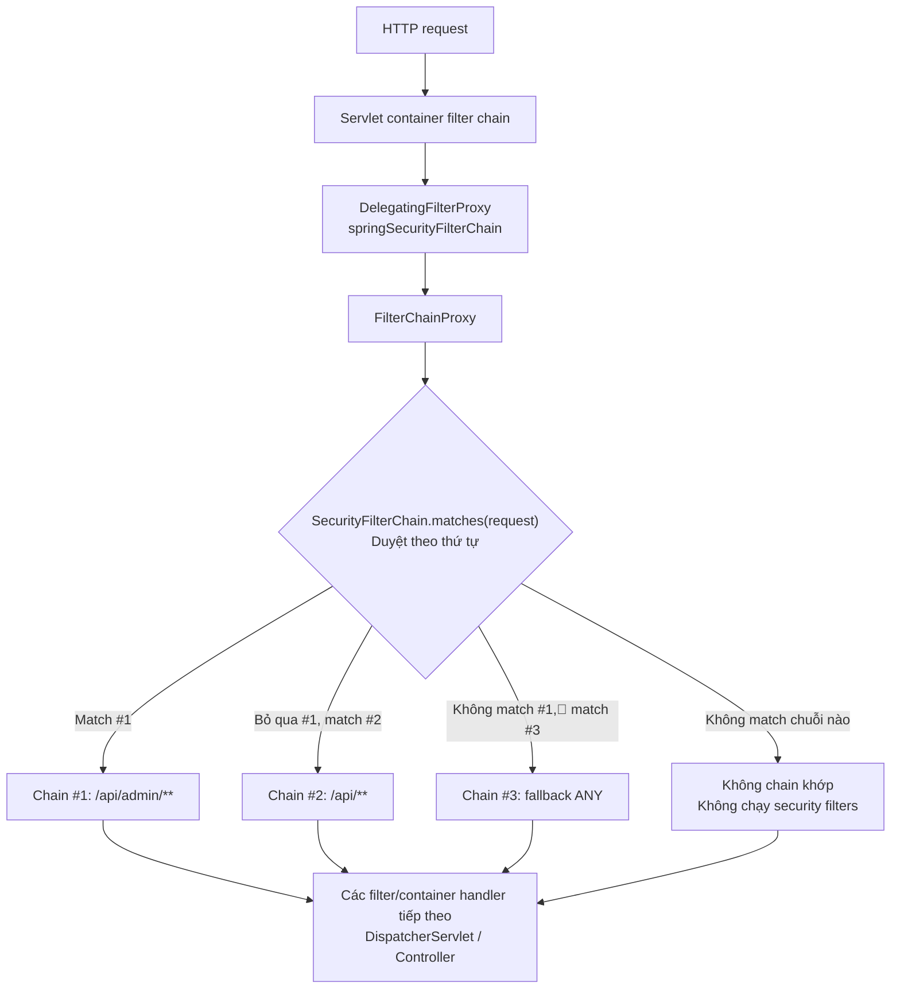

# Chọn chuỗi đầu tiên khớp yêu cầu và hậu quả khi không chuỗi nào khớp

## Mục tiêu bài học

Trong Spring Security cho **Servlet/MVC**, một ứng dụng có thể khai báo nhiều `SecurityFilterChain`: một chuỗi bảo vệ API nội bộ, một chuỗi cho trang quản trị, một chuỗi cho tài nguyên công khai và một chuỗi mặc định bảo vệ phần còn lại. Khi HTTP request đi vào, `FilterChainProxy` **duyệt danh sách theo thứ tự và chọn chuỗi đầu tiên có `matches(request) == true`**. Chỉ các security filters trong chuỗi đã chọn mới được áp dụng. Các chuỗi đứng sau **không được chạy bổ sung**, kể cả khi URL cũng khớp chúng.

Hệ quả bảo mật lớn nhất: **nếu không một `SecurityFilterChain` nào khớp request, request không được các bộ lọc bảo mật của Spring Security bảo vệ**. Điều này không đồng nghĩa request tự nhận HTTP 200, vì MVC/controller, servlet container hoặc các middleware khác vẫn có thể trả 404/403/lỗi. Nhưng **Spring Security không áp dụng authentication, authorization, CSRF, headers và các filter khác của chuỗi bảo mật cho request không khớp**. Vì vậy một cấu hình chỉ chứa `.securityMatcher("/api/**")` có thể làm các URL ngoài `/api/**` nằm ngoài vùng bảo vệ một cách vô ý.

Bài này đặt đúng trọng tâm **“Chọn chuỗi đầu tiên khớp yêu cầu và hậu quả khi không chuỗi nào khớp”**, thuộc mục **Kiến trúc Servlet**. Mã sử dụng **Java 17, Spring Boot 3.5.0, Spring Security 6.5.x, Spring MVC/Servlet**. Lab đi từ `DelegatingFilterProxy` đến `FilterChainProxy`, phân biệt `securityMatcher` với `requestMatchers`, trình bày thứ tự `@Order`, viết ba chuỗi có catch-all, và có test độc lập chứng minh lỗ hổng *no matching chain* mà **không cố tình để ứng dụng web thực hành bị hở**.

Sau bài, bạn sẽ:

1. Giải thích Servlet filter chain bên ngoài khác `SecurityFilterChain` bên trong Spring Security.
2. Mô tả chính xác thuật toán chọn **first matching chain**, không cộng dồn filters và không fallback sau khi xác thực/authorization thất bại trong chuỗi đã chọn.
3. Chọn thứ tự cụ thể-trước, rộng-sau; phân biệt `@Order(1)`, `@Order(2)` và chain không ghi `@Order`.
4. Phân biệt **chain-level** `http.securityMatcher(...)` với **authorization rule-level** `authorizeHttpRequests(...).requestMatchers(...)`.
5. Hiểu `anyRequest().denyAll()` chỉ áp dụng cho những request **đã vào được chính chuỗi đó**.
6. Phân biệt không có chain khớp, `permitAll`, `web.ignoring`, 401, 403 và 404.
7. Thiết kế fallback/catch-all chain không khai báo `securityMatcher` để bảo vệ toàn bộ URL còn lại.
8. Hiểu lý do login/logout endpoint do security filters cung cấp cũng bị giới hạn bởi matcher của chuỗi.
9. Tạo Spring Boot app có ba chuỗi, marker header chỉ dùng để học và tests chứng minh chuỗi được chọn.
10. Viết unit tests của `FilterChainProxy` cho first match và no match, không biến ví dụ thiếu bảo vệ thành một endpoint thực tế.

## 1. Luồng thực thi từ Servlet container đến SecurityFilterChain

### 1.1. Có nhiều khái niệm “filter chain” khác nhau

Trong một ứng dụng Servlet, trình duyệt không gọi `AuthenticationManager` hay `SecurityFilterChain` trực tiếp. Request đầu tiên đi qua chuỗi `jakarta.servlet.Filter` của Servlet container. Spring Security thường được liên kết vào chuỗi bên ngoài bằng một `DelegatingFilterProxy` mang tên `springSecurityFilterChain`, rồi delegate tới Spring bean `FilterChainProxy`.



**Chú ý:** Sơ đồ thể hiện các đường **thay thế nhau**, không phải một request đồng thời đi qua Chain #1, #2 và #3. Mỗi `SecurityFilterChain` chứa **danh sách security filters riêng** như `SecurityContextHolderFilter`, `CsrfFilter`, `BasicAuthenticationFilter`, `ExceptionTranslationFilter` và `AuthorizationFilter` tùy cấu hình. Không phải chain nào cũng có cùng tập filters.

### 1.2. Vai trò chính của FilterChainProxy

`org.springframework.security.web.FilterChainProxy` giữ danh sách `SecurityFilterChain` đã được Spring quản lý. Nó:

- Phối hợp lựa chọn chain cho request theo các `RequestMatcher`.
- Chỉ lấy danh sách filters từ **chain đầu tiên khớp**.
- Áp dụng danh sách ấy theo thứ tự filter nội bộ tương ứng.
- Cho request đi tiếp về phía Servlet container/application khi các filters gọi `chain.doFilter(...)`.
- Sử dụng `HttpFirewall` để chuẩn hóa/kiểm tra request trước quá trình matching theo cấu hình.

**Không nên tự tạo thêm một FilterChainProxy thứ hai** hoặc tự đăng ký Spring Security filters thẳng vào Servlet container để giải quyết một matcher sai. Điều đó có thể tạo hai vòng xử lý, gây context/exception/session semantics khó dự đoán. Với ứng dụng Spring Boot thông thường, bạn chỉ khai báo các bean `SecurityFilterChain` và để framework tổ chức lớp proxy.

### 1.3. Một SecurityFilterChain có những gì?

Ở mức interface:

```java
public interface SecurityFilterChain {
    boolean matches(HttpServletRequest request);
    List<Filter> getFilters();
}
```

Đây là **hình dạng API rút gọn**, không phải code cần tự định nghĩa lại. Một chain chứa:

1. **`RequestMatcher` cấp chuỗi:** quyết định có áp dụng chain cho HTTP request cụ thể không.
2. **Danh sách Servlet filters:** các bước bảo mật thực thi nếu chain được chọn.

Ví dụ một chain cho `/api/admin/**` có thể bắt buộc HTTP Basic và `ROLE_ADMIN`; chain `/api/**` còn lại chỉ đòi `authenticated()`; fallback có thể từ chối mọi request ngoài whitelist. Một request được chọn vào chain admin **không còn cơ hội dùng chain API rộng hơn khi bị 403**.

## 2. Thuật toán first match: điều gì thực sự xảy ra?

### 2.1. Pseudocode

```java
// Pseudocode: không phải code nội bộ đầy đủ của FilterChainProxy.
for (SecurityFilterChain candidate : orderedChains) {
    if (candidate.matches(request)) {
        List<Filter> selected = candidate.getFilters();
        runOnlyTheseSecurityFilters(selected, request, response);
        return;
    }
}

// Không có candidate nào matches(request).
continueOriginalServletFilterChain(request, response);
```

Những tên `runOnlyTheseSecurityFilters` và `continueOriginalServletFilterChain` chỉ mô tả ý tưởng; đây **không phải API của Spring Security**. Implementation thực còn xử lý firewall, decorated chain, exception handling và cleanup.

### 2.2. “Đầu tiên khớp” là theo thứ tự, không theo độ dài URL

Giả sử:

| Thứ tự | Matcher | Chính sách |
| --- | --- | --- |
| 1 | `/api/**` | `authenticated()` |
| 2 | `/api/admin/**` | `hasRole("ADMIN")` |
| 3 | `any request` | `denyAll()` |

Một request `GET /api/admin/report` khớp **cả matcher 1, 2 và 3**, nhưng **chain 1 thắng** vì đứng trước. Chain 2 có rule ROLE_ADMIN **không chạy**, và chain 3 không cứu được. Nếu chain 1 chỉ đòi `authenticated()`, người dùng thường có ROLE_USER đã login có thể tới controller admin nếu không có các lớp bảo vệ khác. Đây là lỗi **shadowing bởi matcher rộng**.

Thiết kế đúng:

| Thứ tự | Matcher | Chính sách |
| --- | --- | --- |
| 1 | `/api/admin/**` | `hasRole("ADMIN")` |
| 2 | `/api/**` | `authenticated()` hoặc whitelist trong chain |
| 3 | `any request` | `denyAll()` với whitelist public thật sự |

Mẫu **most specific first, catch-all last** không được framework tự áp dụng bằng cách suy đoán “matcher nào dài hơn”; bạn phải thiết lập thứ tự bean có chủ đích.

### 2.3. Match một lần, không có “thử chain sau nếu thất bại”

Giả sử `GET /api/admin/report` vào chain #1 và HTTP Basic xác thực user `learner` thành công nhưng thiếu ROLE_ADMIN:

```text
request -> chain #1 matches "/api/admin/**"
          -> authentication: learner hợp lệ
          -> authorization: thiếu ROLE_ADMIN
          -> HTTP 403

KHÔNG CÓ:
          -> thử chain #2 "/api/**"
          -> vì chain #2 chỉ cần authenticated nên chuyển thành HTTP 200
```

Chọn chain là **quyết định routing security filter** trước authorization. Nó không phải load balancing, không phải một chuỗi providers được thử đến khi có kết quả hợp lệ.

Tương tự, nếu password sai trong chain đã chọn và Basic entry point trả 401, FilterChainProxy **không** tìm chain kế tiếp để thử credential mechanism khác. Các chain có matcher trùng nhau phải được đánh giá trước khi viết logic xác thực.

### 2.4. First matching chain không phải first matching authorization rule

Bên **trong một chain đã chọn**, `authorizeHttpRequests(...)` có danh sách `requestMatchers(...)` để chọn **quy tắc phân quyền**. Thứ tự các rule này cũng quan trọng, nhưng chúng hoạt động ở một lớp khác:

```text
Lớp 1: FilterChainProxy chọn 1 SecurityFilterChain
         theo securityMatcher + @Order

Lớp 2: Filters của chain đó xử lý authentication,
         CSRF, context, exception translation...

Lớp 3: AuthorizationFilter áp rule requestMatchers,
         hasRole, authenticated, permitAll, denyAll...
```

Không dùng một thuật ngữ “URL matcher” cho cả ba mà không nói rõ đang ở lớp nào.

## 3. securityMatcher khác requestMatchers và anyRequest

### 3.1. http.securityMatcher(...) chọn phạm vi chain

Ví dụ:

```java
@Bean
@Order(1)
SecurityFilterChain adminChain(HttpSecurity http) throws Exception {
    return http
        .securityMatcher("/api/admin/**")
        .authorizeHttpRequests(auth -> auth
            .anyRequest().hasRole("ADMIN")
        )
        .httpBasic(Customizer.withDefaults())
        .build();
}
```

Đây là một **fragment bean**; cần imports/bean cấu hình bên ngoài như lab ở mục 9. Ý nghĩa:

- Chain chỉ được xét là phù hợp khi request khớp `/api/admin/**`.
- `anyRequest().hasRole("ADMIN")` áp cho mọi request **đã vào chain này**, không bao phủ `/public/**` hay `/api/user/**`.
- `@Order(1)` ưu tiên bean này khi có chain khớp cạnh tranh.
- `httpBasic(...)` có hiệu lực theo filter chain này, không tự áp đặt cho những URL không khớp.

### 3.2. authorizeHttpRequests.requestMatchers(...) chọn rule trong chain

Ví dụ:

```java
http
    .securityMatcher("/api/**")
    .authorizeHttpRequests(auth -> auth
        .requestMatchers("/api/public/**").permitAll()
        .requestMatchers("/api/admin/**").hasRole("ADMIN")
        .anyRequest().authenticated()
    );
```

Ở đây `securityMatcher("/api/**")` là **cổng ngoài**. Một request `/outside` không tới các authorization rules trên dù chúng có `anyRequest()`.

Trong chain, rule cụ thể cần đứng trước rule rộng. Nếu bạn đặt `.requestMatchers("/api/**").permitAll()` trước `.requestMatchers("/api/admin/**").hasRole("ADMIN")`, URL admin sẽ bị permit sớm nếu cùng một authorization rule set.

**Nguyên tắc:** mặc định chỉ một chain có thể xử lý một request; bên trong chain đó, chỉ rule authorization phù hợp đầu tiên được sử dụng theo `RequestMatcherDelegatingAuthorizationManager`.

### 3.3. Bảng khác biệt

| Tên | Chọn cái gì? | Phạm vi | Nếu không khớp? |
| --- | --- | --- | --- |
| `http.securityMatcher("/api/**")` | Có chọn **SecurityFilterChain** này không? | Toàn bộ chain + mọi security filters của nó | `FilterChainProxy` xem tiếp chain sau. |
| `http.securityMatchers(...)` | Một hoặc nhiều matchers cấp chain | Toàn bộ chain | Xem tiếp chain sau nếu không khớp. |
| `authorizeHttpRequests(...).requestMatchers(...)` | Authorization rule bên **trong chain đã chọn** | Quyền truy cập request của chain | Xem rule kế tiếp trong **cùng** chain. |
| `authorizeHttpRequests(...).anyRequest()` | Fallback **authorization rule** | Chỉ trong chain đã chọn | Không thay thế catch-all chain. |
| `@Order` | Vị trí chain bean trong danh sách | Ưu tiên xét chain | Không tự phân quyền. |
| `permitAll()` | Cho phép theo authorization rule | Vẫn đi qua security filters trong chain | Không phải bypass toàn bộ Spring Security. |
| `web.ignoring()` | Loại request khỏi security filtering theo cách cấu hình | Không chạy các filters bị bỏ qua | Cần thận trọng hơn permitAll. |

### 3.4. Một chain không đặt securityMatcher sẽ match tất cả theo mặc định

Nếu bạn tạo bean:

```java
@Bean
SecurityFilterChain fallback(HttpSecurity http) throws Exception {
    return http
        .authorizeHttpRequests(auth -> auth
            .requestMatchers("/public/**").permitAll()
            .anyRequest().denyAll()
        )
        .build();
}
```

Không có `http.securityMatcher(...)`, chain này dùng **matcher mặc định khớp mọi request** theo Spring Security Java configuration thông thường. Nó là **catch-all** hợp lý khi được đặt cuối danh sách.

**Lưu ý:** catch-all vẫn là một SecurityFilterChain có filters. Nó có thể `denyAll()` hoặc `authenticated()` sau whitelist; không tự có policy từ các chain đứng trước.

### 3.5. Có catch-all không đồng nghĩa “mọi URL phải login”

Một fallback có thể dùng:

```java
.authorizeHttpRequests(auth -> auth
    .requestMatchers("/public/**").permitAll()
    .anyRequest().denyAll()
)
```

Như vậy URL public được phép trong phạm vi **có Spring Security filters**, còn URL khác bị từ chối. Đây là một thiết kế **default deny** có chủ đích.

Ngược lại, fallback `.anyRequest().permitAll()` vẫn tránh được no-chain situation, nhưng có thể mở URL mới nếu bạn quên rule. Catch-all **mạnh hay yếu** phụ thuộc policy bên trong, không chỉ việc nó có mặt.

## 4. Khi không một SecurityFilterChain nào khớp: hậu quả cụ thể

### 4.1. Ví dụ cấu hình thiếu catch-all

```java
// CẢNH BÁO: fragment minh họa lỗi kiến trúc,
// KHÔNG dùng làm SecurityConfig chạy thực tế.
@Bean
SecurityFilterChain onlyApi(HttpSecurity http) throws Exception {
    return http
        .securityMatcher("/api/**")
        .authorizeHttpRequests(auth -> auth
            .anyRequest().authenticated()
        )
        .httpBasic(Customizer.withDefaults())
        .build();
}
```

Với **chỉ một chain như trên**:

- `GET /api/orders` vào chain và phải qua authentication.
- `GET /admin/export` **không khớp** chain `/api/**`.
- `GET /settings` **không khớp**.
- `GET /favicon.ico` cũng có thể **không khớp**.

Nếu controller `GET /admin/export` có tồn tại và không có lớp bảo vệ nào khác, request có thể đi tới controller **mà không bị Spring Security authorization chặn**. Đây là một cấu hình **có nguy cơ bypass**.

**Kết quả không bắt buộc là 200:** Nếu không có controller cho `/admin/export`, DispatcherServlet có thể trả 404. Một gateway/WAF/container filter hoặc method security độc lập cũng có thể chặn request, nhưng bạn **không được dựa vào các trường hợp ấy để thay thế chain coverage**.

### 4.2. Có springSecurityFilterChain ở container cũng chưa đủ

Ngay cả khi `DelegatingFilterProxy` vẫn được gọi cho mọi URL, bên trong `FilterChainProxy` có thể **không tìm được SecurityFilterChain phù hợp** và cho request đi tiếp **không chạy security filters**.

Do đó những câu sau đều sai:

- “Spring Security starter đã có, vậy mọi URL chắc chắn được bảo vệ.”
- “Request đi qua FilterChainProxy, vậy nó đã đi qua AuthorizationFilter.”
- “Tôi có `anyRequest().authenticated()` trong chain `/api/**`, vậy mọi endpoint đều cần login.”
- “Tất cả chain sẽ chạy lần lượt nên chain mặc định phía sau vẫn bảo vệ URL admin.”

### 4.3. No match khác với bị từ chối bởi AuthorizationFilter

| Tình huống | Spring Security filters có áp dụng? | Kết quả điển hình |
| --- | :---: | --- |
| Không có SecurityFilterChain nào khớp | **Không** có filter list của chain | Có thể 200/404/khác do app; không có rule Spring Security của chain. |
| Chain khớp, rule `permitAll()` | **Có** | Có thể 200/404/khác; không yêu cầu quyền ở rule đó. |
| Chain khớp, `authenticated()` và guest | **Có** | Thường 401 (Basic) hoặc redirect 302 (form). |
| Chain khớp, user login nhưng thiếu `ROLE_ADMIN` | **Có** | Thường 403. |
| Chain khớp, `anyRequest().denyAll()` | **Có** | Authenticated user thường 403; guest có thể nhận entry point tương ứng. |
| Chain khớp, authentication thành công, MVC không có endpoint | **Có** | Thường 404. |
| `web.ignoring()` | Security filters bị bỏ qua theo cấu hình | Không giống permitAll; có nguy cơ mất security headers/CSRF/authorization. |

**Quan trọng về mã HTTP:** Không thể nhìn một status 200/401/403/404 đơn lẻ rồi kết luận chắc chain nào đã được chọn. Dùng test trên request thật, danh sách chain, logs có kiểm soát hoặc marker test để kiểm chứng.

### 4.4. Khi nào no-match là chủ ý?

Đôi khi hệ thống chủ động bỏ qua Spring Security cho một nhánh do lớp khác chịu trách nhiệm hoặc cho static resources. Tuy nhiên, một **khoảng trống** không được ghi nhận trong cấu hình là vấn đề nghiêm trọng; URL mới có thể được tạo sau này và trở thành công khai.

Ngay cả với static resources, **`permitAll()` trong một chain** thường tốt hơn loại khỏi chain toàn bộ, vì vẫn giữ các defense-in-depth filters/headers phù hợp. Không biến “đây là ảnh/CSS” thành lý do mặc định dùng web.ignoring() cho cả `/**`.

## 5. Quy tắc sắp xếp SecurityFilterChain bằng @Order

### 5.1. Thứ tự được xác định bởi bean order

Với nhiều bean `SecurityFilterChain`, Spring Security thu thập chúng thành danh sách đã sắp xếp theo cơ chế Spring ordering:

```java
@Bean
@Order(1)
SecurityFilterChain adminChain(HttpSecurity http) throws Exception { ... }

@Bean
@Order(2)
SecurityFilterChain apiChain(HttpSecurity http) throws Exception { ... }

@Bean
SecurityFilterChain fallbackChain(HttpSecurity http) throws Exception { ... }
```

Đây là **fragment mô tả chữ ký**, dấu `...` không phải Java hợp lệ; phần lab cung cấp file hoàn chỉnh. Nguyên tắc:

- Số thứ tự nhỏ hơn được xét trước.
- `@Order(1)` trước `@Order(2)`.
- Bean không đặt order thường ở cuối so với những bean có order ưu tiên rõ ràng.
- Không nên dựa vào thứ tự khai báo method trong class hoặc tên method để xác định ưu tiên.

**Không sử dụng hai chains có cùng order và matchers giao nhau** rồi mong ưu tiên ổn định theo tên bean. Thiết kế matchers disjoint hoặc gán order rõ ràng và có regression tests.

### 5.2. Bảng ví dụ thứ tự tốt

| Bean | @Order | Matcher | Ý định |
| --- | --- | --- | --- |
| `adminChain` | 1 | `/api/admin/**` | Chỉ ROLE_ADMIN. |
| `apiChain` | 2 | `/api/**` | Người dùng đã xác thực; whitelist API public cụ thể. |
| `fallbackChain` | mặc định cuối | match any request | Public whitelist hẹp; mọi URL khác denyAll. |

Một request đến `/api/admin/ping` khớp ba matchers nhưng **chỉ adminChain chạy**. Một request đến `/api/user/ping` không khớp adminChain, khớp apiChain, nên **chỉ apiChain chạy**. Một request `/public/ping` không khớp hai chain trước, nên vào fallbackChain.

### 5.3. Nếu đảo order, mất gì?

Nếu `apiChain` được xét trước `adminChain`, request `/api/admin/ping` sẽ bị chuỗi rộng bắt mất. Nếu chuỗi rộng chỉ có `anyRequest().authenticated()`, learner có thể truy cập vào controller admin dù `adminChain` đòi ROLE_ADMIN. **Chain sau không tự vá quy tắc của chain trước.**

Nếu `fallbackChain` với matcher any-request đứng trước các chain khác, nó sẽ bắt **mọi request**; API/admin chains trở thành dead config. Một fallback `denyAll()` đứng đầu có thể khiến toàn app từ chối; một fallback `permitAll()` đứng đầu có thể mở toàn app. Cả hai là lỗi thứ tự, nhưng mức độ rủi ro khác nhau.

### 5.4. URL matching còn phụ thuộc path/method/dispatcher

Các matcher có thể được cấu hình theo path, HTTP method, servletPath và loại dispatch. Đừng chỉ nhìn chuỗi literal `"/api/**"` trong log và cho rằng đã hiểu mọi trường hợp. Một request đi qua reverse proxy, có context path hoặc đường dẫn được encode có thể có semantics khác so với URL bạn nhìn trong browser.

Ưu tiên các matcher Spring Security chính thức, tránh tự so `request.getRequestURI().startsWith("/api")`: điều đó có thể nhầm `/apiculture` với `/api`, bỏ qua context path, hoặc xử lý encoding/canonicalization thiếu nhất quán. Đặc biệt kiểm thử encoded slashes, path traversal, double slashes và dấu `;` theo chính sách firewall/router của ứng dụng.

## 6. Thứ tự chain khác thứ tự filter trong một chain

### 6.1. Hai loại thứ tự

- **Chain order:** bean `SecurityFilterChain` nào được thử trước? Do `@Order`/ordering và `RequestMatcher` của chain.
- **Filter order:** trong **chain đã chọn**, `SecurityContextHolderFilter`, `CsrfFilter`, `BasicAuthenticationFilter`, `ExceptionTranslationFilter`, `AuthorizationFilter`... chạy theo trật tự nào? Do `HttpSecurity`/filter registration của framework.

```text
@Order(1) adminChain   --> [SecurityContext, CSRF, Basic, ... Authorization]
@Order(2) apiChain     --> [SecurityContext, CSRF, Basic, ... Authorization]
fallbackChain          --> [SecurityContext, CSRF, Basic, ... Authorization]

Request /api/admin/ping
    -> chỉ filters trong adminChain
    -> KHÔNG chạy apiChain/fallbackChain nữa
```

Một custom filter `addFilterBefore(..., BasicAuthenticationFilter.class)` chỉ thay vị trí **trong chain chứa nó**, không khiến chain đó được chọn trước một chain bean khác.

### 6.2. Filters không tự được chia sẻ giữa các chain

Nếu chain A bật Basic, chain B chỉ bật form login, request tới chain B không tự thừa hưởng `BasicAuthenticationFilter` từ chain A. Ngược lại, một `AuthenticationManager` hoặc `UserDetailsService` có thể được dùng chung nếu bạn cấu hình, nhưng chia sẻ dependency **không phải cộng dồn filter**.

**Hệ quả:** việc thiếu một filter bảo vệ cụ thể trong chain đã chọn không được chain sau bù. Cần test riêng từng vùng URL và từng mechanism.

### 6.3. No-match và Spring Security firewall

`FilterChainProxy` có thể vẫn thực hiện một số thao tác ở lớp wrapper/firewall trước khi xác định match. Nhưng khi **không có chain**, các security filters và authorization rules **không được áp**. Không nên tuyên bố rằng “không có bất kỳ xử lý nào của Spring Security từng chạy”; câu chính xác là **không chain nào được chọn và không chạy danh sách filters của chain**.

### 6.4. Filter không gọi doFilter thì sao?

Khi một filter trong chain quyết định trả 401/403/redirect mà **không gọi `chain.doFilter(...)`**, luồng xuống các filters/handler phía sau dừng theo semantics Servlet Filter. Không phải Spring Security sẽ “thử chain khác” vì filter trước không cho request đi tiếp.

## 7. Login/logout endpoint cũng bị giới hạn bởi securityMatcher

### 7.1. Vì sao POST /login có thể thành 404?

Một số filters tự cung cấp HTTP endpoints. Ví dụ form login thường có:

- Trang đăng nhập `GET /login` (generated login page nếu dùng default page).
- Bộ xử lý `POST /login` do `UsernamePasswordAuthenticationFilter` nhận.
- Logout handling theo URL và phương thức cấu hình.

Giả sử app **chỉ có chain**:

```java
http
    .securityMatcher("/secured/**")
    .formLogin(Customizer.withDefaults());
```

Các endpoint mặc định `/login` **không nằm trong `/secured/**`**, vì vậy request đến `/login` không đi qua form-login filters của chain này. Có thể nhận 404 dù code có `formLogin()`, tùy các controller/chain khác. Không chỉ có vấn đề “chưa permitAll”; đây là **chain-level matching issue**.

### 7.2. Cách xử lý

Khi cần form login trên một chain giới hạn prefix, hãy chủ động cấu hình URL login phù hợp scope chain, và cung cấp trang đăng nhập nếu dùng custom loginPage:

```java
http
    .securityMatcher("/secured/**")
    .formLogin(form -> form
        .loginPage("/secured/login")
        .loginProcessingUrl("/secured/login")
        .permitAll()
    );
```

Đây là fragment: khi đặt custom `loginPage`, ứng dụng phải **tự cung cấp GET endpoint/page đó**; Spring Security vẫn cung cấp filter xử lý POST login URL theo config.

Cũng cần xem xét logout URL/CSRF, public assets của login page, request cache và session policy. Không chuyển `securityMatcher` thành `/**` chỉ để form login chạy nếu nó vô tình làm thay đổi trust boundary của các API khác.

### 7.3. Basic auth đơn giản hơn cho bài lab multiple chains

Lab bên dưới dùng HTTP Basic để tránh đăng ký POST login/default page khác nhau theo chain. HTTP Basic không tạo `/login`; mỗi request có thể gửi `Authorization: Basic ...` và Basic filter kiểm tra credentials trong chain đã được chọn.

Điều đó **không thay đổi first-match rule**: một request vào adminChain được xử lý bởi Basic/authorization của adminChain, không bởi apiChain.

## 8. Thiết kế an toàn: fallback chain, whitelist tối thiểu và defense-in-depth

Một cấu hình có thể phát triển theo hướng sau:

```text
adminChain:    /api/admin/**  -> ROLE_ADMIN
apiChain:      /api/**        -> public info permitAll, còn lại authenticated
fallbackChain: any request    -> /public/ping permitAll, còn lại denyAll
```

Nếu sau này thêm `/internal/export` mà developer quên security matcher, **fallbackChain vẫn chặn** (thường 403 cho user đã authenticated). Không có catch-all, URL này có thể được controller phục vụ công khai.

### 8.1. Permit public URL trong catch-all, không bỏ Security hoàn toàn

Ví dụ `/public/ping` có thể dùng `permitAll` trong fallback, giữ một số security filters/headers/CORS/CSRF handling có cấu hình trong chain. Với `web.ignoring`, chuỗi Spring Security có thể bị bỏ qua. Vì vậy không dùng ignoring rộng để sửa một lỗi 401 trên static page.

### 8.2. Tại sao denyAll ở fallback?

`anyRequest().denyAll()` là nguyên tắc bảo vệ “không khai báo thì không được dùng”. Nó đặc biệt hữu ích với nhiều chuỗi khi phạm vi application tiếp tục mở rộng mà không ai nhớ sửa authorization cho mỗi endpoint mới.

Trong một số sản phẩm, fallback `anyRequest().authenticated()` là hợp lý nếu muốn tất cả URL còn lại được phép cho user đã login. Nhưng vẫn phải biết các lớp authorization sau đó. **Không có một fallback policy đúng cho mọi app**; quan trọng là có catch-all và các rule rõ ràng.

### 8.3. Không dùng method security làm lý do bỏ chain coverage

`@PreAuthorize` ở service có thể còn chặn một lời gọi nhất định ngay cả khi URL không có chain, nhưng nhiều endpoint có thể không qua proxy/method được gắn annotation. Thiếu chain cũng có thể bỏ các lớp CSRF, security headers, authentication và exception translation.

Một ứng dụng Servlet vẫn cần security filter chain coverage được kiểm chứng ở HTTP boundary. Method security là defense-in-depth cho các use cases cần thiết.

### 8.4. Không dùng CORS làm authorization

Browser có thể chặn JavaScript đọc response vì CORS, nhưng server vẫn có thể phục vụ request tới caller ngoài browser. Nếu URL nằm ngoài chain, CORS không thay cơ chế xác thực. Tương tự, network-level API gateway hữu ích nhưng không nên là bằng chứng mặc định rằng app không cần kiểm soát URL.

## 9. Project chạy được: ba SecurityFilterChain, thấy rõ chain nào được chọn

### 9.1. Mô hình và quy tắc

Ứng dụng Spring MVC có **3 SecurityFilterChain beans**:

1. `@Order(1)`: `/api/admin/**`, yêu cầu `ROLE_ADMIN`.
2. `@Order(2)`: `/api/**`, cho phép duy nhất `GET /api/public/info` không cần login; URL khác cần login.
3. **Fallback không securityMatcher**: cho phép duy nhất `GET /public/ping`; còn lại từ chối.

Hai user demo:

- `learner` / `learner-pass` → `ROLE_USER`.
- `admin` / `admin-pass` → `ROLE_USER` và `ROLE_ADMIN`.

Dùng HTTP Basic, stateless ở mỗi chain. Mỗi chain có một **filter đánh dấu header `X-Demo-Security-Chain`** để học và test; marker được tạo bởi code server và **không phải role, không phải token xác thực**. Trong sản phẩm, không cần expose chain nội bộ qua response header.

### 9.2. Dự kiến phân tuyến

| Request | Chain được chọn | Guest | learner | admin |
| --- | --- | :---: | :---: | :---: |
| `GET /api/admin/ping` | ADMIN_CHAIN | 401 | **403** | 200 |
| `GET /api/user/ping` | API_CHAIN | 401 | 200 | 200 |
| `GET /api/public/info` | API_CHAIN | 200 | 200 | 200 |
| `GET /public/ping` | FALLBACK_CHAIN | 200 | 200 | 200 |
| `GET /misc/diagnostic` | FALLBACK_CHAIN | policy deny; thường 401/403 | **403** | **403** |
| `GET /api/admin/not-created` | ADMIN_CHAIN | 401 | 403 | **404** do MVC không có handler |
| `GET /api/user/not-created` | API_CHAIN | 401 | **404** do MVC không có handler | 404 |

**Điều cần quan sát:** Admin URL với learner bị 403 và marker ADMIN_CHAIN; nó **không** chuyển sang API_CHAIN dù `/api/**` cũng khớp. URL ngoài `/api/**` vẫn được fallback chain chặn nếu chưa whitelist, thay vì “bị bỏ qua khỏi Spring Security”.

### 9.3. Cấu trúc thư mục

```text
first-match-chain-lab/
├── pom.xml
└── src/
    ├── main/java/com/example/firstmatch/
    │   ├── FirstMatchApplication.java
    │   ├── SecurityConfig.java
    │   ├── ChainMarkerFilter.java
    │   └── DemoController.java
    └── test/java/com/example/firstmatch/
        ├── MultipleChainsHttpTest.java
        └── FilterChainProxySelectionTest.java
```

### 9.4. pom.xml

```xml
<project xmlns="http://maven.apache.org/POM/4.0.0"
         xmlns:xsi="http://www.w3.org/2001/XMLSchema-instance"
         xsi:schemaLocation="http://maven.apache.org/POM/4.0.0 https://maven.apache.org/xsd/maven-4.0.0.xsd">
    <modelVersion>4.0.0</modelVersion>

    <parent>
        <groupId>org.springframework.boot</groupId>
        <artifactId>spring-boot-starter-parent</artifactId>
        <version>3.5.0</version>
        <relativePath/>
    </parent>

    <groupId>com.example</groupId>
    <artifactId>first-match-chain-lab</artifactId>
    <version>1.0.0</version>

    <properties>
        <java.version>17</java.version>
    </properties>

    <dependencies>
        <dependency>
            <groupId>org.springframework.boot</groupId>
            <artifactId>spring-boot-starter-web</artifactId>
        </dependency>
        <dependency>
            <groupId>org.springframework.boot</groupId>
            <artifactId>spring-boot-starter-security</artifactId>
        </dependency>
        <dependency>
            <groupId>org.springframework.boot</groupId>
            <artifactId>spring-boot-starter-test</artifactId>
            <scope>test</scope>
        </dependency>
        <dependency>
            <groupId>org.springframework.security</groupId>
            <artifactId>spring-security-test</artifactId>
            <scope>test</scope>
        </dependency>
    </dependencies>

    <build>
        <plugins>
            <plugin>
                <groupId>org.springframework.boot</groupId>
                <artifactId>spring-boot-maven-plugin</artifactId>
            </plugin>
        </plugins>
    </build>
</project>
```

Parent Spring Boot quản lý versions tương thích. `3.5.0` được chọn để minh họa API Spring Security 6.5; ứng dụng thật cần dùng **bản vá đang được hỗ trợ**, không giữ phiên bản demo khi có security fixes. Lab là Servlet MVC, không dùng `SecurityWebFilterChain` của WebFlux.

### 9.5. FirstMatchApplication.java

```java
package com.example.firstmatch;

import org.springframework.boot.SpringApplication;
import org.springframework.boot.autoconfigure.SpringBootApplication;

@SpringBootApplication
public class FirstMatchApplication {

    public static void main(String[] args) {
        SpringApplication.run(FirstMatchApplication.class, args);
    }
}
```

Các file Java còn lại đặt cùng package `com.example.firstmatch` để được component scan/config xử lý. `SpringBootApplication` là entry point.

### 9.6. ChainMarkerFilter.java

```java
package com.example.firstmatch;

import java.io.IOException;

import jakarta.servlet.FilterChain;
import jakarta.servlet.ServletException;
import jakarta.servlet.http.HttpServletRequest;
import jakarta.servlet.http.HttpServletResponse;

import org.springframework.web.filter.OncePerRequestFilter;

public final class ChainMarkerFilter extends OncePerRequestFilter {

    private final String chainName;

    public ChainMarkerFilter(String chainName) {
        this.chainName = chainName;
    }

    @Override
    protected void doFilterInternal(
            HttpServletRequest request,
            HttpServletResponse response,
            FilterChain filterChain)
            throws ServletException, IOException {

        response.setHeader("X-Demo-Security-Chain", chainName);
        filterChain.doFilter(request, response);
    }
}
```

Filter này chỉ thêm một response header để bài test biết **chuỗi nào đã thực sự chạy**. Không dùng `@Component` hoặc đăng ký nó làm global Servlet Filter; các instance sẽ được thêm trực tiếp **vào từng SecurityFilterChain** để không xuất hiện ngoài chuỗi đang học.

Đặt marker **trước `BasicAuthenticationFilter`** giúp cả request bị Basic authentication từ chối có thể mang header marker, làm minh chứng cho chain đã chọn. Header này chỉ dùng trong demo; không đặt chain name nội bộ vào response production nếu không có yêu cầu/đánh giá.

### 9.7. SecurityConfig.java

```java
package com.example.firstmatch;

import org.springframework.context.annotation.Bean;
import org.springframework.context.annotation.Configuration;
import org.springframework.core.annotation.Order;
import org.springframework.http.HttpMethod;

import org.springframework.security.config.Customizer;
import org.springframework.security.config.annotation.web.builders.HttpSecurity;
import org.springframework.security.config.annotation.web.configurers.AbstractHttpConfigurer;
import org.springframework.security.config.http.SessionCreationPolicy;
import org.springframework.security.core.userdetails.User;
import org.springframework.security.core.userdetails.UserDetailsService;
import org.springframework.security.crypto.factory.PasswordEncoderFactories;
import org.springframework.security.crypto.password.PasswordEncoder;
import org.springframework.security.provisioning.InMemoryUserDetailsManager;
import org.springframework.security.web.SecurityFilterChain;
import org.springframework.security.web.authentication.www.BasicAuthenticationFilter;

@Configuration(proxyBeanMethods = false)
public class SecurityConfig {

    @Bean
    PasswordEncoder passwordEncoder() {
        return PasswordEncoderFactories.createDelegatingPasswordEncoder();
    }

    @Bean
    UserDetailsService users(PasswordEncoder encoder) {
        return new InMemoryUserDetailsManager(
            User.withUsername("learner")
                .password(encoder.encode("learner-pass"))
                .roles("USER")
                .build(),
            User.withUsername("admin")
                .password(encoder.encode("admin-pass"))
                .roles("USER", "ADMIN")
                .build()
        );
    }

    @Bean
    @Order(1)
    SecurityFilterChain adminChain(HttpSecurity http)
            throws Exception {

        return http
            .securityMatcher("/api/admin/**")
            .sessionManagement(session -> session
                .sessionCreationPolicy(SessionCreationPolicy.STATELESS)
            )
            .authorizeHttpRequests(auth -> auth
                .anyRequest().hasRole("ADMIN")
            )
            .httpBasic(Customizer.withDefaults())
            .formLogin(AbstractHttpConfigurer::disable)
            .addFilterBefore(
                new ChainMarkerFilter("ADMIN_CHAIN"),
                BasicAuthenticationFilter.class
            )
            .build();
    }

    @Bean
    @Order(2)
    SecurityFilterChain apiChain(HttpSecurity http)
            throws Exception {

        return http
            .securityMatcher("/api/**")
            .sessionManagement(session -> session
                .sessionCreationPolicy(SessionCreationPolicy.STATELESS)
            )
            .authorizeHttpRequests(auth -> auth
                .requestMatchers(
                    HttpMethod.GET, "/api/public/info"
                ).permitAll()
                .anyRequest().authenticated()
            )
            .httpBasic(Customizer.withDefaults())
            .formLogin(AbstractHttpConfigurer::disable)
            .addFilterBefore(
                new ChainMarkerFilter("API_CHAIN"),
                BasicAuthenticationFilter.class
            )
            .build();
    }

    @Bean
    SecurityFilterChain fallbackChain(HttpSecurity http)
            throws Exception {

        // KHÔNG gọi securityMatcher ở đây:
        // giữ RequestMatcher mặc định là any request.
        return http
            .sessionManagement(session -> session
                .sessionCreationPolicy(SessionCreationPolicy.STATELESS)
            )
            .authorizeHttpRequests(auth -> auth
                .requestMatchers(
                    HttpMethod.GET, "/public/ping"
                ).permitAll()
                .anyRequest().denyAll()
            )
            .httpBasic(Customizer.withDefaults())
            .formLogin(AbstractHttpConfigurer::disable)
            .addFilterBefore(
                new ChainMarkerFilter("FALLBACK_CHAIN"),
                BasicAuthenticationFilter.class
            )
            .build();
    }
}
```

**Cách đọc SecurityConfig đúng thứ tự:**

1. `adminChain` có `@Order(1)` và matcher hẹp nhất `/api/admin/**`. Mọi request vào chain đó phải có `ROLE_ADMIN`.
2. `apiChain` có `@Order(2)` và matcher rộng hơn `/api/**`. Public info được phép theo **authorization rule của chính API chain**; các URL khác phải đăng nhập.
3. `fallbackChain` không có `securityMatcher`, nên matcher mặc định bao phủ mọi request còn lại. `denyAll()` chặn URL chưa khai báo, trừ `GET /public/ping`.
4. Mỗi chain bật HTTP Basic và stateless; không có form login redirect trong lab.
5. Mỗi chain có **một** marker filter. Vì marker không phải bean global, nó chỉ hoạt động khi chain chứa nó được chọn.
6. `PasswordEncoder` và `UserDetailsService` dùng chung cho authentication, nhưng filter chains vẫn **độc lập** về URL, policy và danh sách filters.
7. Không disable CSRF một cách toàn cục: lab chỉ phục vụ GET. Khi thêm POST/PUT/PATCH/DELETE, cần xem CSRF theo client credentials (cookie/session/Basic) và threat model, không tắt chỉ vì test POST bị 403.
8. Không đăng ký thêm SecurityFilterChain từ nơi khác; nếu Boot có custom chain beans như trên, Boot default web security chain phù hợp sẽ nhường chỗ, nên fallback **phải do chính bạn chủ động khai báo**.
9. `anyRequest().denyAll()` chỉ thuộc fallbackChain, không có quyền chặn một request đã khớp adminChain/apiChain.

**Một sự cố thường gặp:** developer thêm `.securityMatcher("/public/**")` vào fallbackChain để “cho đúng tên”. Khi đó URL `/misc/diagnostic` không khớp bất kỳ chain nào; không còn default deny. Vì vậy giữ catch-all **không có securityMatcher** là một phần quan trọng của thiết kế.

### 9.8. DemoController.java

```java
package com.example.firstmatch;

import org.springframework.web.bind.annotation.GetMapping;
import org.springframework.web.bind.annotation.RestController;

@RestController
public class DemoController {

    @GetMapping("/api/admin/ping")
    public String adminPing() {
        return "admin-ok";
    }

    @GetMapping("/api/user/ping")
    public String userPing() {
        return "user-ok";
    }

    @GetMapping("/api/public/info")
    public String publicInfo() {
        return "api-public";
    }

    @GetMapping("/public/ping")
    public String publicPing() {
        return "pong";
    }

    @GetMapping("/misc/diagnostic")
    public String diagnostic() {
        // Route tồn tại nhưng fallbackChain denyAll chặn nó.
        return "should-not-leak";
    }
}
```

Điểm nổi bật là `/misc/diagnostic` **có controller thật**. Nếu bỏ fallback chain mà không bổ sung bảo vệ khác, route có thể bị truy cập công khai dù hai chain đầu chỉ match `/api/**`. Trong cấu hình an toàn hiện tại, nó bị default deny.

## 10. MockMvc: chứng minh chọn chain và HTTP status

### 10.1. MultipleChainsHttpTest.java

```java
package com.example.firstmatch;

import org.junit.jupiter.api.Test;
import org.springframework.beans.factory.annotation.Autowired;
import org.springframework.boot.test.autoconfigure.web.servlet.AutoConfigureMockMvc;
import org.springframework.boot.test.context.SpringBootTest;
import org.springframework.test.web.servlet.MockMvc;

import static org.springframework.security.test.web.servlet.request
    .SecurityMockMvcRequestPostProcessors.httpBasic;
import static org.springframework.test.web.servlet.request.MockMvcRequestBuilders.get;
import static org.springframework.test.web.servlet.result.MockMvcResultMatchers.content;
import static org.springframework.test.web.servlet.result.MockMvcResultMatchers.header;
import static org.springframework.test.web.servlet.result.MockMvcResultMatchers.status;

@SpringBootTest
@AutoConfigureMockMvc
class MultipleChainsHttpTest {

    @Autowired
    MockMvc mvc;

    @Test
    void anonymousAdminUrlUsesAdminChainAndChallenges()
            throws Exception {

        mvc.perform(get("/api/admin/ping"))
            .andExpect(status().isUnauthorized())
            .andExpect(header().string(
                "X-Demo-Security-Chain", "ADMIN_CHAIN"
            ));
    }

    @Test
    void learnerCannotUseAdminChainEvenThoughApiWouldAcceptLogin()
            throws Exception {

        mvc.perform(get("/api/admin/ping")
                .with(httpBasic("learner", "learner-pass")))
            .andExpect(status().isForbidden())
            .andExpect(header().string(
                "X-Demo-Security-Chain", "ADMIN_CHAIN"
            ));
    }

    @Test
    void adminCanUseAdminChain() throws Exception {
        mvc.perform(get("/api/admin/ping")
                .with(httpBasic("admin", "admin-pass")))
            .andExpect(status().isOk())
            .andExpect(content().string("admin-ok"))
            .andExpect(header().string(
                "X-Demo-Security-Chain", "ADMIN_CHAIN"
            ));
    }

    @Test
    void learnerUsesApiChainForOrdinaryApi() throws Exception {
        mvc.perform(get("/api/user/ping")
                .with(httpBasic("learner", "learner-pass")))
            .andExpect(status().isOk())
            .andExpect(content().string("user-ok"))
            .andExpect(header().string(
                "X-Demo-Security-Chain", "API_CHAIN"
            ));
    }

    @Test
    void anonymousApiPrivateIsChallengedByApiChain()
            throws Exception {

        mvc.perform(get("/api/user/ping"))
            .andExpect(status().isUnauthorized())
            .andExpect(header().string(
                "X-Demo-Security-Chain", "API_CHAIN"
            ));
    }

    @Test
    void apiPublicRulePermitsAnonymousWithinApiChain()
            throws Exception {

        mvc.perform(get("/api/public/info"))
            .andExpect(status().isOk())
            .andExpect(content().string("api-public"))
            .andExpect(header().string(
                "X-Demo-Security-Chain", "API_CHAIN"
            ));
    }

    @Test
    void invalidCredentialsStillFailOnPermitAllEndpoint()
            throws Exception {

        mvc.perform(get("/api/public/info")
                .with(httpBasic("learner", "wrong-pass")))
            .andExpect(status().isUnauthorized())
            .andExpect(header().string(
                "X-Demo-Security-Chain", "API_CHAIN"
            ));
    }

    @Test
    void publicRootUsesFallbackChain() throws Exception {
        mvc.perform(get("/public/ping"))
            .andExpect(status().isOk())
            .andExpect(content().string("pong"))
            .andExpect(header().string(
                "X-Demo-Security-Chain", "FALLBACK_CHAIN"
            ));
    }

    @Test
    void fallbackDeniesRealControllerWithRegularUser()
            throws Exception {

        mvc.perform(get("/misc/diagnostic")
                .with(httpBasic("learner", "learner-pass")))
            .andExpect(status().isForbidden())
            .andExpect(header().string(
                "X-Demo-Security-Chain", "FALLBACK_CHAIN"
            ));
    }

    @Test
    void fallbackDeniesRealControllerEvenForAdmin()
            throws Exception {

        mvc.perform(get("/misc/diagnostic")
                .with(httpBasic("admin", "admin-pass")))
            .andExpect(status().isForbidden())
            .andExpect(header().string(
                "X-Demo-Security-Chain", "FALLBACK_CHAIN"
            ));
    }

    @Test
    void fallbackProtectsUnknownPathForLoggedInUser()
            throws Exception {

        mvc.perform(get("/new-feature/not-approved")
                .with(httpBasic("learner", "learner-pass")))
            .andExpect(status().isForbidden())
            .andExpect(header().string(
                "X-Demo-Security-Chain", "FALLBACK_CHAIN"
            ));
    }

    @Test
    void adminPathStillSelectsAdminChainWhenMvcHandlerMissing()
            throws Exception {

        mvc.perform(get("/api/admin/does-not-exist")
                .with(httpBasic("admin", "admin-pass")))
            .andExpect(status().isNotFound())
            .andExpect(header().string(
                "X-Demo-Security-Chain", "ADMIN_CHAIN"
            ));
    }

    @Test
    void authenticatedApiPathWithoutHandlerGivesMvcNotFound()
            throws Exception {

        mvc.perform(get("/api/user/does-not-exist")
                .with(httpBasic("learner", "learner-pass")))
            .andExpect(status().isNotFound())
            .andExpect(header().string(
                "X-Demo-Security-Chain", "API_CHAIN"
            ));
    }

    @Test
    void wrongBasicPasswordIs401NotASecondChainAttempt()
            throws Exception {

        mvc.perform(get("/api/admin/ping")
                .with(httpBasic("admin", "wrong-pass")))
            .andExpect(status().isUnauthorized())
            .andExpect(header().string(
                "X-Demo-Security-Chain", "ADMIN_CHAIN"
            ));
    }
}
```

Đây là **14 HTTP integration tests**. Chúng kiểm tra:

- `@Order(1)` admin chain đứng trước `@Order(2)` API chain.
- Dù `/api/admin/ping` cũng khớp `/api/**`, learner bị 403 trong ADMIN_CHAIN, không được thử API_CHAIN.
- `permitAll()` trong API_CHAIN cho guest vào public-info; request có Basic credentials sai vẫn có thể bị BasicAuthenticationFilter từ chối.
- URL public bên ngoài API đi qua **FALLBACK_CHAIN**, không phải “không có bảo vệ”.
- Một controller tồn tại ở `/misc/diagnostic` vẫn bị catch-all default deny.
- MVC 404 là **routing result sau khi chain đã được chọn**, không phải bằng chứng không chain.
- HTTP header marker cho biết chuỗi nào chạy, nhưng chỉ nên được dùng trong lab.

Các assertions là **kỳ vọng của code**, không phải log Maven đã thực thi. Khi nâng phiên bản hoặc thay matcher/filter chain, chạy lại tests để phát hiện thay đổi hành vi trước deploy.

## 11. Unit test độc lập chứng minh no-match mà không mở lỗ hổng trong app

Ứng dụng thật ở mục 9 có fallback nên **mọi request bình thường đều có chain**. Để học hệ quả no-match một cách an toàn, ta tạo một `FilterChainProxy` **chỉ tồn tại bên trong JUnit test**, với một hoặc hai `DefaultSecurityFilterChain` đơn giản. Không tạo thêm bean web security cho runtime.

Trong test này, một `jakarta.servlet.Filter` nhỏ chỉ tăng bộ đếm. Khi request không khớp matcher nào, bộ đếm security filter không tăng, nhưng **Servlet FilterChain gốc vẫn được gọi**.

### 11.1. FilterChainProxySelectionTest.java

```java
package com.example.firstmatch;

import java.io.IOException;
import java.util.ArrayList;
import java.util.List;
import java.util.concurrent.atomic.AtomicInteger;

import jakarta.servlet.Filter;
import jakarta.servlet.FilterChain;
import jakarta.servlet.ServletException;

import org.junit.jupiter.api.Test;
import org.springframework.mock.web.MockHttpServletRequest;
import org.springframework.mock.web.MockHttpServletResponse;
import org.springframework.security.web.DefaultSecurityFilterChain;
import org.springframework.security.web.FilterChainProxy;
import org.springframework.security.web.SecurityFilterChain;
import org.springframework.security.web.util.matcher.RequestMatcher;

import static org.assertj.core.api.Assertions.assertThat;

class FilterChainProxySelectionTest {

    private MockHttpServletRequest request(String path) {
        MockHttpServletRequest request =
            new MockHttpServletRequest("GET", path);
        request.setServletPath(path);
        return request;
    }

    private Filter recorder(String label, List<String> visited) {
        return (req, res, chain) -> {
            visited.add(label);
            chain.doFilter(req, res);
        };
    }

    private void send(
            FilterChainProxy proxy,
            String path,
            FilterChain applicationChain)
            throws ServletException, IOException {

        proxy.doFilter(
            request(path),
            new MockHttpServletResponse(),
            applicationChain
        );
    }

    @Test
    void firstMatchingChainWinsEvenIfLaterChainAlsoMatches()
            throws Exception {

        List<String> visited = new ArrayList<>();

        RequestMatcher narrow =
            req -> req.getServletPath().startsWith("/api/admin/");
        RequestMatcher broad =
            req -> req.getServletPath().startsWith("/api/");

        SecurityFilterChain admin =
            new DefaultSecurityFilterChain(
                narrow, recorder("admin", visited)
            );
        SecurityFilterChain api =
            new DefaultSecurityFilterChain(
                broad, recorder("api", visited)
            );

        FilterChainProxy proxy =
            new FilterChainProxy(List.of(admin, api));

        send(proxy, "/api/admin/report", (req, res) -> { });

        assertThat(visited).containsExactly("admin");
        // Không có "api": chỉ lấy filters của chain đầu tiên.
    }

    @Test
    void broadMatcherFirstShadowsSpecificAdminMatcher()
            throws Exception {

        List<String> visited = new ArrayList<>();

        SecurityFilterChain broadFirst =
            new DefaultSecurityFilterChain(
                req -> req.getServletPath().startsWith("/api/"),
                recorder("broad", visited)
            );
        SecurityFilterChain narrowSecond =
            new DefaultSecurityFilterChain(
                req -> req.getServletPath().startsWith("/api/admin/"),
                recorder("admin", visited)
            );

        FilterChainProxy proxy =
            new FilterChainProxy(List.of(
                broadFirst, narrowSecond
            ));

        send(proxy, "/api/admin/report", (req, res) -> { });

        assertThat(visited).containsExactly("broad");
        // Đây là nguy cơ cấu hình: admin policy ở chain sau bị che.
    }

    @Test
    void requestWithoutMatchingChainSkipsSecurityFilters()
            throws Exception {

        AtomicInteger securityCalls = new AtomicInteger();
        AtomicInteger applicationCalls = new AtomicInteger();

        Filter countingFilter = (req, res, chain) -> {
            securityCalls.incrementAndGet();
            chain.doFilter(req, res);
        };

        SecurityFilterChain onlyProtected =
            new DefaultSecurityFilterChain(
                req -> req.getServletPath().startsWith("/only/"),
                countingFilter
            );

        FilterChainProxy proxy =
            new FilterChainProxy(onlyProtected);

        send(proxy, "/outside", (req, res) -> {
            applicationCalls.incrementAndGet();
        });

        assertThat(securityCalls.get()).isZero();
        assertThat(applicationCalls.get()).isEqualTo(1);
        // Request đi xuống application mà security filter không chạy.
    }

    @Test
    void sameProxyDoesRunSecurityFilterForMatchingUrl()
            throws Exception {

        AtomicInteger securityCalls = new AtomicInteger();
        AtomicInteger applicationCalls = new AtomicInteger();

        Filter countingFilter = (req, res, chain) -> {
            securityCalls.incrementAndGet();
            chain.doFilter(req, res);
        };

        SecurityFilterChain onlyProtected =
            new DefaultSecurityFilterChain(
                req -> req.getServletPath().startsWith("/only/"),
                countingFilter
            );

        FilterChainProxy proxy =
            new FilterChainProxy(onlyProtected);

        send(proxy, "/only/report", (req, res) -> {
            applicationCalls.incrementAndGet();
        });

        assertThat(securityCalls.get()).isEqualTo(1);
        assertThat(applicationCalls.get()).isEqualTo(1);
    }

    @Test
    void finalCatchAllMakesAnOtherwiseUnmatchedUrlCovered()
            throws Exception {

        List<String> visited = new ArrayList<>();

        SecurityFilterChain onlyApi =
            new DefaultSecurityFilterChain(
                req -> req.getServletPath().startsWith("/api/"),
                recorder("api", visited)
            );
        SecurityFilterChain anyRequest =
            new DefaultSecurityFilterChain(
                req -> true,
                recorder("fallback", visited)
            );

        FilterChainProxy proxy =
            new FilterChainProxy(List.of(onlyApi, anyRequest));

        send(proxy, "/misc/diagnostic", (req, res) -> { });

        assertThat(visited).containsExactly("fallback");
    }
}
```

Đây là **5 tests cấp FilterChainProxy**. Chúng minh họa rõ:

1. **First match:** chỉ marker "admin" chạy, dù matcher "/api/" phía sau cũng khớp.
2. **Wrong order:** matcher rộng đứng trước sẽ che matcher hẹp.
3. **No match:** không security filter nào được gọi, nhưng application filter chain vẫn nhận request.
4. **Có match:** security filter chạy như dự kiến.
5. **Catch-all:** URL nằm ngoài "/api/" vẫn có security filter trong fallback.

**Tổng nhóm test của project: 19 phương thức @Test** (14 HTTP integration + 5 FilterChainProxy unit). Không cần mở một endpoint không được bảo vệ trong runtime app để chứng minh no-match.

**Lưu ý về matcher trong unit test:** lambda `req.getServletPath().startsWith(...)` chỉ là một predicate trong một JUnit test **cô lập**, không phải khuyến nghị tự dùng startsWith thay Spring Security path matchers ở ứng dụng thực. Trong SecurityConfig chạy thật, bài dùng `securityMatcher("/api/**")` để framework xử lý matching.

## 12. Chạy Maven và dùng curl quan sát lựa chọn chain

### 12.1. Lệnh build và test

Cần Java 17+ và Maven. Tại thư mục `first-match-chain-lab`:

```bash
java -version
mvn -version
mvn test
mvn spring-boot:run
```

Kết quả mong đợi là Maven nhận 19 tests (14 HTTP + 5 unit) và ứng dụng khởi động ở localhost:8080 nếu port chưa bị dùng. **Đây là expectation theo source, không phải bằng chứng một lần build đã thực thi**.

### 12.2. Lệnh curl

Trong terminal khác:

```bash
curl -i http://localhost:8080/api/admin/ping

curl -i -u learner:learner-pass \
    http://localhost:8080/api/admin/ping

curl -i -u admin:admin-pass \
    http://localhost:8080/api/admin/ping

curl -i -u learner:learner-pass \
    http://localhost:8080/api/user/ping

curl -i http://localhost:8080/api/public/info

curl -i http://localhost:8080/public/ping

curl -i -u learner:learner-pass \
    http://localhost:8080/misc/diagnostic

curl -i -u admin:admin-pass \
    http://localhost:8080/api/admin/does-not-exist
```

Trên Windows PowerShell, có thể dùng `curl.exe` và viết mỗi lệnh trên một dòng. HTTP Basic truyền Base64 chứ **không mã hóa password**, vì vậy chỉ dùng tài khoản demo trên localhost; hệ thống thật cần HTTPS/TLS và không đưa credentials vào logs/shell history.

### 12.3. Đọc response theo chain marker

Với admin hợp lệ:

```http
HTTP/1.1 200 OK
X-Demo-Security-Chain: ADMIN_CHAIN

admin-ok
```

Với learner vào admin endpoint:

```http
HTTP/1.1 403 Forbidden
X-Demo-Security-Chain: ADMIN_CHAIN
```

Với learner vào user endpoint:

```http
HTTP/1.1 200 OK
X-Demo-Security-Chain: API_CHAIN

user-ok
```

Với guest gọi `/public/ping`:

```http
HTTP/1.1 200 OK
X-Demo-Security-Chain: FALLBACK_CHAIN

pong
```

Đây là **các response minh họa chứa những phần cần quan sát**, không phải toàn bộ headers hoặc transcript lấy từ server đã chạy. Đặc biệt, real response có thể thêm cache-control, X-Content-Type-Options, Content-Type, Content-Length và các header khác. HTTP status/body/header marker trên phù hợp với logic lab.

### 12.4. Vì sao không bắt chain qua status 404?

Khi admin gọi `/api/admin/does-not-exist`, marker là ADMIN_CHAIN nhưng MVC trả 404 vì không có controller. Nếu chỉ thấy 404, bạn có thể tưởng chain không chạy. Ngược lại, một URL không chain nào khớp cũng có thể 404 nếu thiếu handler.

**Đừng lấy 404 làm bằng chứng security.** Dùng test ngăn bypass ở routes tồn tại, kiểm tra whitelist/default deny và xác minh chain selection theo request thực.

## 13. Có thể test chọn chain mà không dùng marker header không?

Marker là công cụ học tập. Trong dự án thực, có các cách khác:

1. Dùng `FilterChainProxy#getFilterChains()` để xem danh sách beans/chains thực tế.
2. Với một `MockHttpServletRequest` có đủ method/path/servletPath/dispatcher info, gọi `chain.matches(request)` và xác định **chain đầu tiên** có kết quả true.
3. Dùng Spring Security debug/trace logging **trên môi trường kiểm thử** để xem thử matcher và chuỗi được dùng.
4. Viết MockMvc tests với các principal/roles khác nhau, kiểm tra 200/401/403 trên **controller thực sự tồn tại**.
5. Khi cần test logic internals ở mức nhỏ, dùng `FilterChainProxy` độc lập như mục 11.

Không nên chỉ gọi `FilterChainProxy.getFilters(String url)` rồi coi kết quả đúng cho mọi HTTP method/dispatcher/servletPath. JavaDoc ghi nhận đây là convenience method chủ yếu cho testing, và một **URL string có thể không mang đủ thông tin của một HTTP request thật**. Với các rule dựa method/headers/context path, ưu tiên request-based tests.

### 13.1. Test ma trận URL và principal

Một test suite cho production nên có ma trận:

| Nhóm | Guest | User | Admin | Resource owner khác tenant |
| --- | --- | --- | --- | --- |
| Public endpoints | Có thể 200 theo whitelist | Có thể 200 | Có thể 200 | Không lộ dữ liệu riêng |
| Protected API | 401/redirect theo cơ chế | 200 nếu có quyền | 200 nếu có quyền | 403/404 theo policy tài nguyên |
| Admin API | 401/redirect | 403 | 200 | Kiểm tra tenant/action cụ thể |
| URL chưa khai báo | Bị từ chối/challenge | Bị từ chối | Bị từ chối | Bị từ chối |
| Login/logout endpoints | Theo flow xác thực/CSRF | Theo flow | Theo flow | Không có bypass |
| Method ngoài scope | 403/405 theo chain/handler/CSRF | Không được mở ngoài ý định | Không được mở ngoài ý định | Không được mở |

**Không khẳng định mọi endpoint luôn trả một status cố định** vì entry point, CSRF, MVC mapping và exception handling có thể khác nhau. Điều phải test là security boundary: request trái policy không được xem dữ liệu hoặc gây side effects.

## 14. Những góc cạnh khi triển khai thực tế

### 14.1. Chain match trước MVC controller resolution

`FilterChainProxy` thường chạy trước `DispatcherServlet`, nên nó chọn chain dựa trên request chứ không biết controller sau này có tồn tại hay không. Một URL không có handler vẫn có thể bị chặn 401/403 trước khi MVC trả 404.

Điều này cũng có nghĩa một developer thêm controller mới **không tự tạo security chain mới**. Catch-all bảo đảm route mới vẫn nằm trong một phạm vi được bảo vệ.

### 14.2. Một chain có thể chứa zero filters

Theo contract, một `SecurityFilterChain` có thể có danh sách filter rỗng. Nếu nó là **first match**, FilterChainProxy cũng không tìm chain sau để ghép filters; request sẽ đi tiếp không có filters của chain ấy. Đây khác với việc matcher của chuỗi đó trả false.

Vì vậy không chỉ đếm số bean SecurityFilterChain. Cần biết chain đầu tiên khớp là gì và nó có những filters/bảo vệ nào.

### 14.3. Cách dùng requestMatcher theo HTTP method

Một chain có thể chỉ khớp một HTTP method và URL cụ thể. Ví dụ một chain cho GET API có thể bỏ lỡ POST nếu không có fallback. Đừng dùng `.securityMatcher(...)` có method filter quá hẹp rồi tưởng authorization của chain vẫn chặn các methods còn lại.

Nếu chỉ muốn cấm POST ở URL có GET handler, thường cần **chain vẫn khớp đường dẫn** và đặt rule authorization/CSRF/method policy có chủ đích, thay vì bỏ POST khỏi mọi chain.

### 14.4. Dispatcher types FORWARD, ERROR và ASYNC

Servlet request có dispatcher types như REQUEST, FORWARD, ERROR, ASYNC. Matcher/filter behavior có thể khác theo dispatch và container. Đừng chỉ kiểm thử một GET trực tiếp rồi mặc định mọi error dispatch có cùng context/policy. Spring Security có hướng dẫn riêng về authorize dispatches và cách cho phép FORWARD/ERROR phù hợp nếu application cần.

Không giải quyết vòng lặp 403/404 bằng cách `permitAll()` mọi dispatch mà chưa xác định route/filter nào đang bị chặn.

### 14.5. Context path, Servlet path, reverse proxy

Browser thấy `https://example.com/app/api/...` không có nghĩa matcher trong app luôn phải khai báo `/app/api/**`. Với Servlet context path `/app`, matching thường dựa vào path trong ứng dụng theo semantics của matcher. Một proxy có thể rewrite path trước khi tới app.

Hãy test **URI thực tế mà Servlet container nhận**, không chỉ URL public nhìn thấy qua CDN/gateway. Đặc biệt cảnh giác với URL normalization, encoded path và firewall policies; không tự thay mọi matcher bằng `String.startsWith`.

### 14.6. Multiple HttpSecurity instances và bean scopes

Mỗi `SecurityFilterChain` được xây bằng một `HttpSecurity` tương ứng do Spring Security config infrastructure cung cấp. Đừng tự dùng một `HttpSecurity` singleton đã build rồi tiếp tục sửa nó để tạo thêm chain khác. Theo pattern bean methods của Spring Security, mỗi phương thức `@Bean SecurityFilterChain ...(HttpSecurity http)` nhận builder phù hợp và gọi `http.build()`.

Các authentication dependencies như `UserDetailsService`/`PasswordEncoder` có thể là singleton được dùng chung. Nhưng nếu có realm/mức tin cậy khác nhau, hãy cấu hình `AuthenticationManager`/providers đúng cho từng chain.

### 14.7. Session vs stateless khác với chain selection

`SessionCreationPolicy.STATELESS` không làm Spring Security tự chọn chain khác. Nó tác động tới cách Spring Security sử dụng session cho context; chain selection vẫn dựa trên `RequestMatcher` và `@Order`.

Một request có Basic credentials hợp lệ có thể tạo Authentication cho chain hiện tại dù không có HttpSession. Nếu URL không khớp chain nào, Basic filter không chạy, dù client có gửi header `Authorization`.

### 14.8. Async/error handling và filter registration

Nếu bạn tự đăng ký một `OncePerRequestFilter` thành Spring bean `@Component` và đồng thời chèn nó vào một SecurityFilterChain, nó có thể bị Servlet container auto-register **ngoài** Spring Security, khiến marker/log xuất hiện ở mọi URL và phá suy luận về first match. Lab tránh điều này bằng cách tạo instance bằng `new ChainMarkerFilter(...)` chỉ trong `addFilterBefore`.

Production nên kiểm soát filter registration/dispatch types và tránh những filter trùng lặp không chủ đích.

## 15. Những lỗi thường gặp

### Lỗi 1 — Tưởng mọi SecurityFilterChain khớp đều chạy

Sai. `FilterChainProxy` chọn **đầu tiên khớp**. Chain đứng sau không cộng dồn filters/authorization.

### Lỗi 2 — Để /api/** trước /api/admin/**

Matcher rộng che matcher hẹp. Admin policy ở chain sau không có tác dụng. Đặt matcher cụ thể hơn và priority trước.

### Lỗi 3 — Cho catch-all any-request đứng đầu

Nó bắt tất cả request; các chain chuyên biệt không bao giờ được chọn. Đặt fallback cuối.

### Lỗi 4 — Không khai báo catch-all

URL ngoài các securityMatcher có thể **không được bảo vệ bởi Spring Security**. Cần bổ sung chain mặc định với whitelist và default deny/authenticated policy.

### Lỗi 5 — Tưởng anyRequest().denyAll() trong chain API bảo vệ toàn site

Nó chỉ áp cho request đã vào chain API. URL ngoài `/api/**` không tới rule đó.

### Lỗi 6 — Dùng requestMatchers thay securityMatcher để tạo nhiều chain

`requestMatchers` bên trong `authorizeHttpRequests` chọn rule, không xác định phạm vi của chain bean. Cần hiểu hai lớp matching.

### Lỗi 7 — Dùng @Order để thay authorization

`@Order` chỉ định thứ tự xét chain; không áp ROLE_ADMIN hay xác minh password.

### Lỗi 8 — Cố thử chain sau khi nhận 403

Không có cơ chế fallback sang chain khác khi authorization thất bại. Điều chỉnh policy của **chain đã chọn**, không dựa vào chain sau.

### Lỗi 9 — Coi 404 là bằng chứng an toàn

404 có thể chỉ vì MVC không có controller; một controller mới được thêm sau này có thể lộ nếu URL không có chain. Test routes hiện có và catch-all coverage.

### Lỗi 10 — Dùng web.ignoring cho cả /static/** mà không đánh giá

Bỏ qua Spring Security filters có thể bỏ security headers và cơ chế bảo vệ khác. Thường nên dùng permitAll.

### Lỗi 11 — Cấu hình formLogin trong /secured/** nhưng vẫn dùng /login mặc định

/login nằm ngoài chain, filter login không xử lý URL. Cần configure login URL/page phù hợp hoặc bố trí chain.

### Lỗi 12 — Quên rằng CSRF cũng thuộc chain đã chọn

Nếu URL không khớp chain nào, CsrfFilter của các chain không chạy. Một public endpoint có side effect ngoài chain có thể mất CSRF defense.

### Lỗi 13 — Tưởng CORS là authentication

CORS là browser cross-origin policy, không bảo đảm API không được caller trực tiếp truy cập. Dùng auth/authorization thực trong chain.

### Lỗi 14 — Tự so requestURI.startsWith và nhầm path prefix

`/api` có thể bị lẫn với `/apiculture`, context path/proxy rewrite không được xét. Dùng RequestMatcher framework và test.

### Lỗi 15 — Để hai chains @Order bằng nhau cùng khớp URL

Thứ tự có thể không đúng ý định. Đặt priority rõ, loại overlap không cần thiết và test.

### Lỗi 16 — Marker filter vừa là global bean vừa là chain filter

Có thể chạy ngoài selected chain, khiến debug kết luận sai. Chỉ đăng ký một chỗ theo lifecycle mong muốn.

### Lỗi 17 — Chỉ test 200 của admin và user

Thiếu negative tests sẽ không phát hiện learner lọt vào admin, unknown URL bị mở hoặc auth fail được chain khác chấp nhận. Test 401, 403, 404 và fallback.

### Lỗi 18 — Không test các HTTP methods và dispatcher types

GET có chain nhưng POST/ERROR dispatch có thể khác khi matcher giới hạn method/dispatcher. Tạo coverage matrix theo threat model.

### Lỗi 19 — Xem application.properties spring.security.* là thay thế cho chain coverage

Có user/password properties không bảo đảm mọi path được match/authorize. Đọc beans SecurityFilterChain thực tế.

### Lỗi 20 — Trộn HTTP Basic, form login và JWT không phân vùng rõ

Một mechanism có thể chỉ tồn tại trong chain tương ứng. Xác định mỗi prefix/realm/entry point và fallback rõ ràng.

### Lỗi 21 — Tưởng STATELESS có nghĩa không cần FilterChainProxy

Stateless vẫn cần authentication/authorization filters trên từng request. Session policy khác với chain selection.

### Lỗi 22 — Thay đổi một securityMatcher mà không regression test URL khác

Matcher của chain có thể làm endpoints rơi ra khỏi coverage, đặc biệt login/logout/admin mới. Có ma trận tests theo vùng và chức năng.

### Lỗi 23 — Một filter trả response sớm thì thử chain tiếp theo

Khi filter không gọi `doFilter`, xử lý downstream dừng; FilterChainProxy không tìm chain mới.

### Lỗi 24 — Nghĩ controller annotation luôn đủ

Method security có giá trị nhưng không thay CSRF, security context persistence, firewall, headers và auth ở HTTP boundary. Duy trì chain coverage.

## 16. Bài tập thực hành kèm hướng giải

### Bài 1 — Dự đoán chain trước khi chạy

Với ba chains `/api/admin/**` → `/api/**` → any request, tự ghi kết quả cho `/api/admin/export`, `/api/orders`, `/public/ping` và `/new-page`. **Đáp án:** lần lượt adminChain, apiChain, fallbackChain, fallbackChain.

### Bài 2 — Đảo thứ tự API và admin

Trong một test cô lập, đặt broad API matcher trước admin matcher. Xác minh request `/api/admin/report` chỉ gọi security filter của broad chain. **Đáp án:** matcher đầu tiên thắng, chính là lý do cần ưu tiên hẹp-trước.

Không cố tình deploy cấu hình sai lên production để quan sát, vì có thể mở admin data.

### Bài 3 — Bỏ catch-all trong một unit test

Tạo FilterChainProxy với **chỉ matcher /only/** và gửi request `/outside`. Ghi số lần gọi security filter và application chain. **Đáp án:** security filter = 0, application chain = 1. Không khẳng định 200 vì test filter-level không có MVC.

### Bài 4 — Thêm một controller mới

Thêm `GET /misc/report` vào DemoController nhưng **không đổi security config**. Với credentials admin, dự đoán response. **Đáp án:** fallbackChain khớp và `denyAll()` trả 403 cho user đã login; endpoint không tự mở.

### Bài 5 — Thêm public endpoint API

Muốn `GET /api/public/version` công khai nhưng vẫn chạy Spring Security filters, thêm rule `.requestMatchers(HttpMethod.GET, "/api/public/version").permitAll()` **trước** `.anyRequest().authenticated()` trong apiChain; thêm controller handler và test. Không tạo securityMatcher riêng nếu không cần chain khác.

### Bài 6 — Chỉ định login URL dưới prefix

Đổi một chain thành `securityMatcher("/secure/**")` + form login; chọn `/secure/login` cho loginPage/loginProcessingUrl, cung cấp GET page, test POST login/CSRF và session fixation protection. **Đáp án:** default `/login` không thể do chain giới hạn prefix đó xử lý.

### Bài 7 — Phân biệt 403 và 404

Gọi `/api/admin/not-created` bằng admin: chọn adminChain rồi MVC 404. Gọi cùng URL bằng learner: chọn adminChain rồi authorization 403. **Kết luận:** status phụ thuộc nhiều tầng; chain selection diễn ra trước MVC mapping.

### Bài 8 — HTTP method mismatch

Thêm chain chỉ match GET `/api/reports/**` nhưng quên POST; không có fallback thì POST có thể ra ngoài security. **Hướng giải:** bảo đảm chain bao phủ các methods phù hợp hoặc có fallback denyAll, thêm negative tests cho POST/PUT/DELETE và CSRF.

### Bài 9 — Giữ security headers cho public assets

Thử `permitAll` trên `/public/**` trong fallback và so với `web.ignoring` bằng integration tests khi cần. **Kết luận:** permitAll cho qua authorization nhưng vẫn giữ chain filters; ignoring bỏ qua bảo vệ theo config.

### Bài 10 — Bảo mật tenant và resource

Thêm `GET /api/orders/{id}`. Dù user đã authenticated trong apiChain, service còn phải kiểm tra owner/tenant. **Đáp án:** chain first match chỉ định filters và policy ban đầu, không tự giải quyết object-level authorization/IDOR.

## 17. Câu hỏi tự kiểm tra

**1. Ai chọn SecurityFilterChain?**  
`FilterChainProxy` dùng `matches(request)` trên danh sách các chuỗi theo thứ tự.

**2. Nếu hai chuỗi cùng khớp, cả hai có chạy không?**  
Không. Chỉ chuỗi đầu tiên được chọn.

**3. Nếu chain #1 match nhưng trả 403, chain #2 có được thử không?**  
Không. Chain selection đã kết thúc; 403 là kết quả authorization của chain đã chọn.

**4. Điều gì xảy ra khi không có chain nào match?**  
Request không đi qua các security filters của Spring Security chains và tiếp tục vào container/application; 200 hay 404/khác tùy handler và các bảo vệ ngoài.

**5. Có `anyRequest().denyAll()` trong chain `/api/**` thì `/admin/**` có an toàn không?**  
Không bảo đảm. `anyRequest()` chỉ áp dụng trong chain đã được chọn; `/admin/**` không match `/api/**`.

**6. Vì sao nên có catch-all chain không đặt securityMatcher?**  
Để mọi request chưa khớp chuỗi chuyên biệt vẫn được một chain bảo vệ theo policy rõ ràng.

**7. `@Order(1)` có nghĩa URL cần ROLE_ADMIN không?**  
Không. Nó chỉ sắp thứ tự xét chain. ROLE_ADMIN do authorization rule quyết định.

**8. `securityMatcher` khác `requestMatchers` thế nào?**  
securityMatcher chọn chain; requestMatchers trong authorizeHttpRequests chọn authorization rule bên trong chain.

**9. Vì sao matcher hẹp thường đứng trước?**  
Để matcher rộng không “nuốt” URL nhạy cảm khiến policy riêng không chạy.

**10. `permitAll()` có bỏ qua CSRF và security headers không?**  
Không; nó chỉ cho phép ở authorization rule, trong khi filters của chain vẫn áp dụng theo cấu hình.

**11. Nếu trang `/login` trả 404 với chain chỉ match `/secured/**`, có thể do gì?**  
Các filter cung cấp endpoint login không được chạy cho URL ngoài securityMatcher; phải điều chỉnh URL/chain và cung cấp custom page nếu cần.

**12. 404 có chứng minh request đã bị Spring Security chặn không?**  
Không. 404 có thể từ MVC sau một chain được chọn hoặc từ URL không có chain nhưng không có handler.

**13. HTTP Basic thành công trên `/api/user/**` có khiến `/api/admin/**` tự chấp nhận user không?**  
Không. Admin chain có rule riêng; first match vào admin chain không fallback qua user chain.

**14. Thêm một controller mới ngoài `/api/**` có thể bị lộ nếu không có catch-all không?**  
Có. URL không match chain nào không được security filters bảo vệ, dù framework vẫn đăng ký FilterChainProxy.

**15. Stateless ảnh hưởng điều gì?**  
Cách security context được lưu/khôi phục giữa requests, không thay luật chọn chain.

**16. Cách test an toàn no-match?**  
Tạo FilterChainProxy/DefaultSecurityFilterChain trong unit test cô lập; assert security filter không chạy nhưng application chain vẫn chạy.

**17. Vì sao marker filter không được đăng ký global?**  
Nó phải chỉ chạy trong selected security chain; global registration có thể khiến request không match vẫn mang marker giả.

**18. Production nên kiểm tra thêm gì ngoài first match?**  
Authorization owner/tenant, CSRF, các methods, dispatchers, reverse proxy paths, auth mechanisms, logs, default deny và updates của routes.

## 18. Checklist trước khi deploy nhiều SecurityFilterChain

- [ ] Liệt kê tất cả `SecurityFilterChain` beans và thứ tự `@Order`; tránh priorities trùng nhau khi matchers overlap.
- [ ] Đặt matcher hẹp/nhiều đặc quyền trước matcher rộng.
- [ ] Bảo đảm có fallback/catch-all **không securityMatcher** đứng cuối, với policy phù hợp.
- [ ] Xác nhận `anyRequest()` được hiểu đúng là phạm vi **chain đã chọn**.
- [ ] Xác nhận `requestMatchers` có thứ tự đúng **bên trong** authorization rule set.
- [ ] Với mỗi route nhạy cảm, test status và identity/role trên request thật.
- [ ] Với mỗi route mới/không khai báo, test default deny thay vì chỉ mong 404.
- [ ] Đối chiếu tất cả methods: GET, POST, PUT, PATCH, DELETE, OPTIONS khi phù hợp.
- [ ] Đối chiếu context path, servletPath, dispatcher types, reverse proxy/path normalization.
- [ ] Kiểm tra form login/logout/OAuth2 callback URLs có nằm trong chain chứa filter tương ứng.
- [ ] Không dùng `web.ignoring` rộng khi `permitAll` là đủ.
- [ ] Không tự thêm một global filter hoặc FilterChainProxy gây chạy trùng.
- [ ] Đảm bảo security mechanisms (Basic, form, JWT, CSRF, CORS, headers) tồn tại trong đúng chain.
- [ ] Kiểm tra 401, 403, 404 theo entry point/authorization/MVC; không nhầm ý nghĩa status.
- [ ] Kiểm tra authorization theo tenant/owner/resource, không chỉ role và chain.
- [ ] Dùng Spring Security debug/trace logs trong test có kiểm soát; không log password/token.
- [ ] Khi nâng Spring Security/Boot hoặc thay matcher, chạy regression test toàn bộ URL matrix.
- [ ] Nếu dùng gateway/WAF, vẫn kiểm chứng security boundary của ứng dụng, không tin mỗi lớp ngoài.

## Kết luận

**`FilterChainProxy` chỉ chọn một `SecurityFilterChain`: chuỗi đầu tiên khớp request theo thứ tự đã cấu hình.** Nó không gom security filters từ các chuỗi sau, không thử chain thứ hai khi chain thứ nhất xác thực thất bại hoặc trả 403, và không suy “matcher cụ thể hơn” nếu bạn đặt một matcher rộng lên trước.

Nếu **không có chain nào khớp**, request không chạy các security filters của Spring Security chains; một controller tồn tại ở URL ấy có thể bị lộ nếu không còn lớp bảo vệ khác. Cách phòng tránh là **xây chains chuyên biệt có thứ tự rõ ràng, rồi kết thúc bằng một catch-all SecurityFilterChain** không đặt `securityMatcher` với whitelist và `anyRequest().denyAll()` hoặc policy thích hợp. `requestMatchers` và `anyRequest` trong authorization chỉ kiểm soát requests nằm trong **chain đã chọn**, không thay catch-all coverage.

Project Java 17/Spring Boot cho thấy learner vào admin URL bị 403 trong ADMIN_CHAIN, không được “rơi xuống” API_CHAIN; public URL vẫn có FALLBACK_CHAIN; URL mới ngoài API bị default deny. Unit tests của `FilterChainProxy` chứng minh tình huống no-match trực tiếp mà không biến server đang học thành một app cố tình mở security hole. Đây là nền tảng để đọc cấu hình nhiều `HttpSecurity` an toàn và debug các trường hợp 401, 403, 404 khó hiểu.

## Tài liệu chính thức

- [Spring Security 6.5 — Java Configuration: Multiple HttpSecurity Instances, securityMatcher và requestMatchers](https://docs.spring.io/spring-security/reference/6.5/servlet/configuration/java.html)
- [Spring Security 6.5 — Servlet Architecture và Multiple SecurityFilterChain](https://docs.spring.io/spring-security/reference/6.5/servlet/architecture.html)
- [Spring Security 6.5 — FilterChainProxy JavaDoc: First Match](https://docs.spring.io/spring-security/reference/6.5/api/java/org/springframework/security/web/FilterChainProxy.html)
- [Spring Security 6.5 — SecurityFilterChain JavaDoc](https://docs.spring.io/spring-security/reference/6.5/api/java/org/springframework/security/web/SecurityFilterChain.html)
- [Spring Security 6.5 — Authorize HttpServletRequests](https://docs.spring.io/spring-security/reference/6.5/servlet/authorization/authorize-http-requests.html)
- [Spring Security 6.5 — Servlet Authentication Architecture](https://docs.spring.io/spring-security/reference/6.5/servlet/authentication/architecture.html)
- [Spring Security 6.5 — CSRF Protection](https://docs.spring.io/spring-security/reference/6.5/servlet/exploits/csrf.html)
- [Spring Security 6.5 — HTTP Basic Authentication](https://docs.spring.io/spring-security/reference/6.5/servlet/authentication/passwords/basic.html)
- [Spring Security 6.5 — Servlet Test & MockMvc](https://docs.spring.io/spring-security/reference/6.5/servlet/test/mockmvc/index.html)
