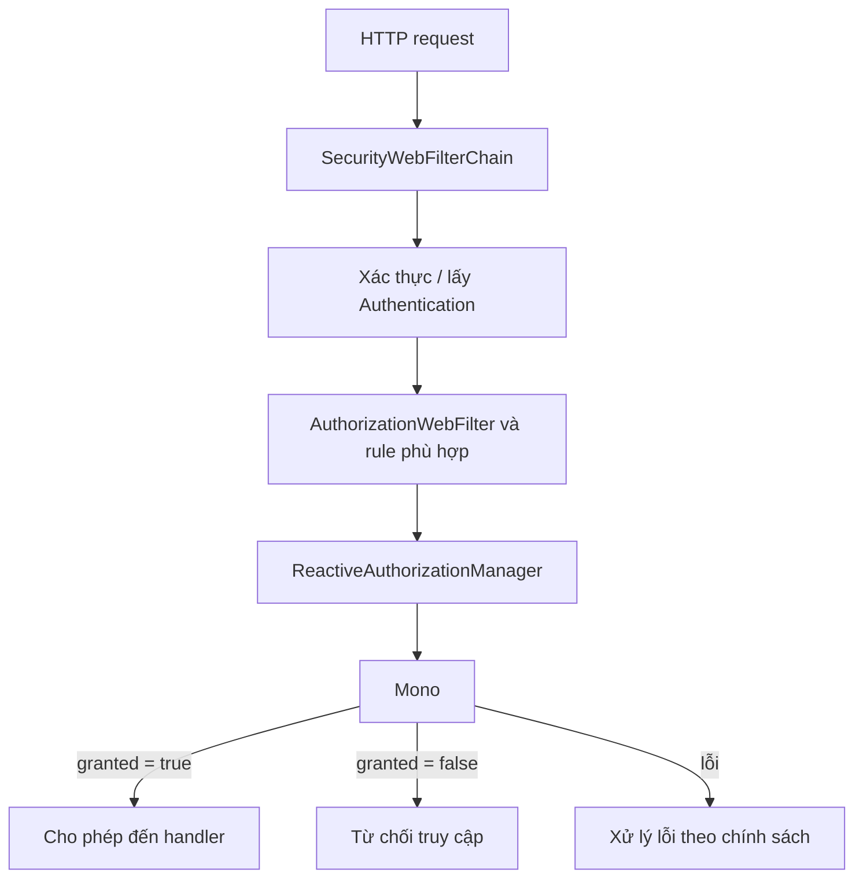

# ReactiveAuthorizationManager và quyết định quyền truy cập bất đồng bộ

> **Phạm vi:** Spring Security trên **Spring WebFlux (reactive)**, tập trung vào việc quyết định một yêu cầu HTTP có được truy cập tài nguyên hay không. Ví dụ Java bên dưới dùng API Spring Security **7.x**, Java 17+; với dự án 6.x cần đối chiếu phiên bản API ở phần lưu ý tương thích.

## 1. Mục tiêu học tập

Sau bài này, bạn có thể:

- Phân biệt **authentication** (xác định người dùng là ai) và **authorization** (người dùng có được thực hiện hành động trên tài nguyên cụ thể không).
- Giải thích vai trò của `ReactiveAuthorizationManager<T>` trong chuỗi xử lý WebFlux và cách `Mono` biểu diễn quyết định bất đồng bộ.
- Đọc và viết chính sách quyền truy cập theo URL, HTTP method, authority, role và quyền trên một đối tượng.
- Kết hợp một nguồn kiểm tra quyền reactive (R2DBC, `WebClient`, v.v.) mà không `block()`, không tự `subscribe()`.
- Phân biệt kết quả **allow**, **deny**, **không đưa ra quyết định** và **lỗi kiểm tra**, đồng thời kiểm thử các tình huống 401/403.

## 2. Bài toán và vị trí trong kiến trúc reactive

Ví dụ: người dùng `alice` gửi `GET /api/documents/d1`. Hệ thống đã xác thực Alice, nhưng việc xem `d1` còn phụ thuộc vào chủ sở hữu tài liệu hoặc dữ liệu quyền trong một dịch vụ khác. Một yêu cầu đã xác thực **không đồng nghĩa** với yêu cầu được phép truy cập.

Trong ứng dụng servlet, quy trình thường dựa trên `HttpSecurity`, `SecurityFilterChain` và bộ lọc servlet. Trong WebFlux, các thành phần tương ứng là `ServerHttpSecurity`, `SecurityWebFilterChain` và `WebFilter`. Không trộn hai kiểu cấu hình này.



Tại bước phân quyền, Spring Security cung cấp danh tính hiện tại dưới dạng reactive publisher và ngữ cảnh tài nguyên cần kiểm tra. Manager mô tả *cách* ra quyết định; framework thực hiện subscribe, kết hợp các filter và chuyển lỗi thành phản hồi HTTP phù hợp.

Một quyết định có thể cần tra cứu quyền ở cơ sở dữ liệu, hỏi dịch vụ policy hoặc kiểm tra trạng thái tài nguyên. Mô hình reactive cho phép ghép các thao tác đó qua `Mono`/`Flux` mà không chiếm giữ luồng chờ I/O.

## 3. Hợp đồng `ReactiveAuthorizationManager<T>`

Trong Spring Security 7.x, giao diện chính có dạng:

```java
public interface ReactiveAuthorizationManager<T> {
    Mono<AuthorizationResult> authorize(
        Mono<Authentication> authentication, T object);

    // Ngoài ra có phương thức mặc định verify(...)
}
```

*Đây là chữ ký API rút gọn để giải thích, không phải một tệp mã nguồn độc lập.*

| Thành phần | Ý nghĩa |
| --- | --- |
| `T` | Kiểu đối tượng hoặc ngữ cảnh đang được phân quyền; cho HTTP WebFlux thường gặp `AuthorizationContext`. |
| `Mono<Authentication>` | Publisher chứa thông tin xác thực, chẳng hạn tên người dùng và `GrantedAuthority`. Có thể không phát giá trị trong ngữ cảnh chưa xác thực. |
| `AuthorizationContext` | Cung cấp `getExchange()` để xem yêu cầu/response và `getVariables()` để lấy biến từ pattern URL đã match. |
| `Mono<AuthorizationResult>` | Publisher phát ra kết quả; `AuthorizationResult.isGranted()` cho biết được phép hay bị từ chối. |
| `AuthorizationDecision` | Cài đặt `AuthorizationResult` phổ biến: `new AuthorizationDecision(true/false)`. |
| `verify(...)` | Hỗ trợ yêu cầu thực thi quyền: hoàn tất rỗng nếu được cấp, phát lỗi nếu bị từ chối. |

Bốn trạng thái cần hiểu rõ:

1. **`new AuthorizationDecision(true)`:** cấp quyền.
2. **`new AuthorizationDecision(false)`:** từ chối quyền; đây là cách rõ ràng nhất khi dữ liệu người dùng/tài nguyên không hợp lệ.
3. **`Mono.empty()`:** manager *không đưa ra quyết định* (abstain); ý nghĩa cuối cùng phụ thuộc tầng gọi và cách phối hợp nhiều manager. Không dùng trạng thái này như một cách ngầm bảo đảm “deny”.
4. **`Mono.error(...)`:** kiểm tra không thể hoàn tất. Đây là lỗi trong chuỗi reactive, khác về ngữ nghĩa với một quyết định từ chối hợp lệ. Cần có chính sách xử lý lỗi, tránh tự động “allow” khi kho quyền gặp sự cố.

**Khác biệt theo phiên bản:** API 6.x từng sử dụng `check(Mono<Authentication>, T)` trả `Mono<AuthorizationDecision>`; từ 6.4 có API `authorize` mới, và ở 7.x hãy triển khai `authorize` trả `Mono<AuthorizationResult>`. Khi sao chép ví dụ trên mạng có `check`, luôn kiểm tra Javadoc đúng phiên bản.

## 4. Luật có sẵn trong `authorizeExchange`

Với phần lớn yêu cầu, chưa cần tự viết manager. Spring Security đã cung cấp:

- `permitAll()` / `denyAll()`: cho phép hoặc từ chối vô điều kiện ở rule đó.
- `authenticated()`: yêu cầu danh tính đã xác thực.
- `hasAuthority("SCOPE_documents:read")`: so khớp **chính xác** chuỗi authority.
- `hasRole("ADMIN")`: thông thường kiểm tra authority `ROLE_ADMIN`; không truyền thêm tiền tố `ROLE_`.
- `access(customManager)`: giao quyền quyết định cho chính sách tùy chỉnh.

Ví dụ cấu hình tối thiểu để thấy thứ tự luật:

```java
import org.springframework.context.annotation.Bean;
import org.springframework.context.annotation.Configuration;
import org.springframework.http.HttpMethod;
import org.springframework.security.config.annotation.web.reactive.EnableWebFluxSecurity;
import org.springframework.security.config.web.server.ServerHttpSecurity;
import org.springframework.security.web.server.SecurityWebFilterChain;

@Configuration
@EnableWebFluxSecurity
class BasicRulesConfig {
    @Bean
    SecurityWebFilterChain chain(ServerHttpSecurity http) {
        return http.authorizeExchange(ex -> ex
                .pathMatchers("/health").permitAll()
                .pathMatchers(HttpMethod.GET, "/api/reports/**")
                    .hasAuthority("SCOPE_reports:read")
                .pathMatchers("/api/admin/**").hasRole("ADMIN")
                .anyExchange().denyAll()
            )
            .build();
    }
}
```

`BasicRulesConfig.java` là một class cấu hình đầy đủ trong ứng dụng WebFlux **đã có cơ chế xác thực** (ví dụ OAuth2 Resource Server hoặc HTTP Basic). Đoạn này chỉ minh họa phân quyền, không tự tạo cơ chế đăng nhập.

**Thứ tự rất quan trọng:** các matcher được xét theo thứ tự khai báo, rule khớp đầu tiên quyết định chính sách áp dụng. Đặt `anyExchange()` cuối cùng; nếu đặt một rule tổng quát trước rule chi tiết, rule chi tiết có thể không được dùng. Với endpoint nhạy cảm, `denyAll()` cuối cùng giúp không vô tình mở quyền cho URL chưa phân loại.

## 5. Ví dụ hoàn chỉnh: kiểm tra quyền sở hữu tài liệu

Giả sử API `GET /api/documents/{id}` chỉ cho phép người sở hữu đọc tài liệu. Ta tách rõ ba trách nhiệm: cấu hình HTTP security, chính sách phân quyền reactive và nguồn dữ liệu quyền. Ví dụ dùng bộ nhớ để dễ chạy và kiểm tra; việc thay bằng kho dữ liệu reactive được giải thích ở mục 6.

Tạo dự án Spring Boot dùng **Java 17+** với dependency **Spring Reactive Web (WebFlux)** và **Spring Security**. Đặt các class sau trong package `demo`; mỗi khối có tên tệp tương ứng. Chọn phiên bản Spring Boot đi cùng Spring Security 7.x.

### 5.1. Điểm khởi động

`src/main/java/demo/ReactiveAuthorizationDemoApplication.java`:

```java
package demo;

import org.springframework.boot.SpringApplication;
import org.springframework.boot.autoconfigure.SpringBootApplication;

@SpringBootApplication
public class ReactiveAuthorizationDemoApplication {
    public static void main(String[] args) {
        SpringApplication.run(ReactiveAuthorizationDemoApplication.class, args);
    }
}
```

### 5.2. Nguồn quyền truy cập

`src/main/java/demo/DocumentPermissionService.java`:

```java
package demo;

import java.util.Map;
import org.springframework.stereotype.Service;
import reactor.core.publisher.Mono;

@Service
public class DocumentPermissionService {
    private final Map<String, String> owners = Map.of(
        "d1", "alice",
        "d2", "bob"
    );

    public Mono<Boolean> canRead(String username, String documentId) {
        return Mono.fromSupplier(() ->
            username.equals(owners.get(documentId))
        );
    }
}
```

`Mono.fromSupplier` trì hoãn phép tra cứu bộ nhớ đến lúc có subscription. Phép kiểm tra này **không có I/O** và không mô phỏng độ trễ mạng; nó chỉ làm ví dụ vận hành được. Trong hệ thống thực, phương thức này nên nối trực tiếp đến repository/WebClient reactive khi chính sách đòi hỏi I/O.

Khi `documentId` không có trong map, `owners.get(documentId)` trả `null`; `username.equals(null)` trả `false`. Vì thế tài liệu không tồn tại không được cấp quyền bởi manager này.

### 5.3. Manager tùy chỉnh

`src/main/java/demo/DocumentReadAuthorizationManager.java`:

```java
package demo;

import org.springframework.security.authorization.AuthorizationDecision;
import org.springframework.security.authorization.AuthorizationResult;
import org.springframework.security.authorization.ReactiveAuthorizationManager;
import org.springframework.security.core.Authentication;
import org.springframework.security.web.server.authorization.AuthorizationContext;
import org.springframework.stereotype.Component;
import reactor.core.publisher.Mono;

@Component
public final class DocumentReadAuthorizationManager
        implements ReactiveAuthorizationManager<AuthorizationContext> {

    private final DocumentPermissionService permissions;

    public DocumentReadAuthorizationManager(
            DocumentPermissionService permissions) {
        this.permissions = permissions;
    }

    @Override
    public Mono<AuthorizationResult> authorize(
            Mono<Authentication> authentication,
            AuthorizationContext context) {

        Object rawId = context.getVariables().get("id");
        if (!(rawId instanceof String documentId) || documentId.isBlank()) {
            return Mono.just(new AuthorizationDecision(false));
        }

        return authentication
            .filter(Authentication::isAuthenticated)
            .flatMap(auth -> permissions.canRead(auth.getName(), documentId))
            .map(allowed ->
                (AuthorizationResult) new AuthorizationDecision(
                    Boolean.TRUE.equals(allowed)))
            .defaultIfEmpty(new AuthorizationDecision(false));
    }
}
```

Giải thích từng bước:

1. `context.getVariables().get("id")` lấy biến `{id}` từ matcher `/api/documents/{id}`; nếu biến thiếu, trả deny rõ ràng.
2. `authentication` là `Mono<Authentication>`, được xử lý bằng toán tử Reactor; không cần gọi `block()` để lấy tên người dùng.
3. `flatMap` dùng khi `permissions.canRead(...)` trả về một `Mono<Boolean>`. Dùng `map` ở đây sẽ tạo `Mono<Mono<Boolean>>`, không phải kết quả quyền.
4. `AuthorizationDecision` chuyển kết quả boolean thành một `AuthorizationResult`; phép ép kiểu thể hiện đúng kiểu trả về trong API 7.x.
5. `defaultIfEmpty(false decision)` bảo đảm publisher không có `Authentication` hoặc service không phát giá trị sẽ bị từ chối, thay vì trở thành một quyết định mơ hồ.

Trong ví dụ, chỉ các tên người dùng có trong map được cấp quyền, nên cả trường hợp người dùng ẩn danh cũng không được cấp quyền dù trạng thái `Authentication.isAuthenticated()` của một số token ẩn danh có thể mang giá trị `true`. Với chính sách yêu cầu xác thực thật, nên để bộ lọc xác thực và quy tắc phân quyền xử lý đầy đủ điều kiện đó.

### 5.4. Cấu hình WebFlux Security

`src/main/java/demo/SecurityConfig.java`:

```java
package demo;

import org.springframework.context.annotation.Bean;
import org.springframework.context.annotation.Configuration;
import org.springframework.http.HttpMethod;
import org.springframework.security.config.Customizer;
import org.springframework.security.config.annotation.web.reactive.EnableWebFluxSecurity;
import org.springframework.security.config.web.server.ServerHttpSecurity;
import org.springframework.security.core.userdetails.User;
import org.springframework.security.core.userdetails.UserDetails;
import org.springframework.security.crypto.factory.PasswordEncoderFactories;
import org.springframework.security.crypto.password.PasswordEncoder;
import org.springframework.security.provisioning.MapReactiveUserDetailsService;
import org.springframework.security.web.server.SecurityWebFilterChain;

@Configuration
@EnableWebFluxSecurity
public class SecurityConfig {

    @Bean
    SecurityWebFilterChain securityWebFilterChain(
            ServerHttpSecurity http,
            DocumentReadAuthorizationManager documentRead) {

        return http
            .authorizeExchange(ex -> ex
                .pathMatchers("/public").permitAll()
                .pathMatchers(HttpMethod.GET, "/api/documents/{id}")
                    .access(documentRead)
                .anyExchange().denyAll()
            )
            .httpBasic(Customizer.withDefaults())
            .build();
    }

    @Bean
    PasswordEncoder passwordEncoder() {
        return PasswordEncoderFactories.createDelegatingPasswordEncoder();
    }

    @Bean
    MapReactiveUserDetailsService users(PasswordEncoder encoder) {
        UserDetails alice = User.withUsername("alice")
            .password(encoder.encode("pass-alice"))
            .roles("READER")
            .build();

        UserDetails bob = User.withUsername("bob")
            .password(encoder.encode("pass-bob"))
            .roles("READER")
            .build();

        return new MapReactiveUserDetailsService(alice, bob);
    }
}
```

`MapReactiveUserDetailsService` và mật khẩu cố định **chỉ dùng cho demo**. Ứng dụng thật cần kho tài khoản, cách mã hóa mật khẩu, luồng đăng nhập hoặc xác thực JWT phù hợp. Cả Alice và Bob đều có role `READER`; điều làm họ nhận quyết định khác nhau ở endpoint tài liệu là **quyền trên đối tượng `d1`**, không phải role.

### 5.5. HTTP handler

`src/main/java/demo/DocumentController.java`:

```java
package demo;

import org.springframework.web.bind.annotation.GetMapping;
import org.springframework.web.bind.annotation.PathVariable;
import org.springframework.web.bind.annotation.RestController;
import reactor.core.publisher.Mono;

@RestController
public class DocumentController {

    @GetMapping("/public")
    public Mono<String> publicInfo() {
        return Mono.just("public");
    }

    @GetMapping("/api/documents/{id}")
    public Mono<String> read(@PathVariable String id) {
        return Mono.just("document:" + id);
    }
}
```

Để chạy dự án Maven có Maven Wrapper, dùng:

```bash
./mvnw spring-boot:run
```

Sau đó thử:

```bash
curl -i http://localhost:8080/public
curl -i http://localhost:8080/api/documents/d1
curl -i -u alice:pass-alice http://localhost:8080/api/documents/d1
curl -i -u bob:pass-bob http://localhost:8080/api/documents/d1
curl -i -u alice:pass-alice http://localhost:8080/api/documents/d2
curl -i -u alice:pass-alice http://localhost:8080/api/documents/unknown
```

Kỳ vọng trong cấu hình HTTP Basic của ví dụ:

| Request | Dự kiến | Vì sao |
| --- | --- | --- |
| `GET /public` không credentials | `200`, body `public` | Rule `permitAll`. |
| `GET /api/documents/d1` không credentials | `401` | Không có xác thực hợp lệ cho endpoint bảo vệ. |
| Alice đọc `d1` | `200`, body `document:d1` | Map quyền có `d1 -> alice`. |
| Bob đọc `d1` | `403` | Xác thực thành công nhưng không là chủ sở hữu. |
| Alice đọc `d2` | `403` | `d2` thuộc về Bob. |
| Alice đọc ID không tồn tại | `403` | Chính sách trả `false`; ví dụ không tiết lộ tài nguyên có tồn tại hay không. |

HTTP status được ánh xạ bởi thành phần xác thực/giải quyết từ chối của Spring Security và có thể khác nếu ứng dụng cấu hình entry point, exception handler hoặc nhiều security chain khác.

## 6. Quyết định quyền thực sự bất đồng bộ

Bộ nhớ trong mục 5 không tạo I/O. Trên hệ thống thật, kiểm tra quyền thường gọi database hoặc một policy service. Chữ ký nên vẫn là `Mono<Boolean>` và dùng một **client reactive thực sự**, ví dụ:

```java
// Minh họa bên trong DocumentPermissionService nếu repository là R2DBC.
// documentRepository.findById(id) trả Mono<Document>.
public Mono<Boolean> canRead(String username, String id) {
    return documentRepository.findById(id)
        .map(document -> username.equals(document.getOwnerUsername()))
        .defaultIfEmpty(false);
}
```

Đoạn này **không độc lập để biên dịch**: `documentRepository`, `Document` và thuộc tính chủ sở hữu cần được định nghĩa theo domain thực tế. Điểm quan trọng là `flatMap` trong manager sẽ chờ bất đồng bộ kết quả repository mà **không chặn luồng**.

Nếu tra quyền qua HTTP, dùng `WebClient` và chuyển phản hồi thành `Mono<Boolean>`. Cần cân nhắc xác thực giữa các dịch vụ, timeout, cache/TTL, giới hạn tải, kiểm toán và việc quyền có thể thay đổi giữa hai lần kiểm tra.

Một chính sách xử lý lỗi mang tính *fail closed* có thể biểu diễn:

```java
// Đoạn minh họa cần ghép với repository reactive của ứng dụng.
return documentRepository.findById(id)
    .map(document -> username.equals(document.getOwnerUsername()))
    .defaultIfEmpty(false)
    .timeout(java.time.Duration.ofSeconds(2))
    .onErrorReturn(false);
```

`onErrorReturn(false)` cố ý **từ chối** khi lỗi/timeout. Đây là lựa chọn nghiệp vụ cần ghi log và quan sát: nó biến lỗi hạ tầng thành kết quả “không đủ quyền”, nên có thể che khuất sự cố vận hành nếu không có metrics/log phù hợp. Một lựa chọn khác là giữ `Mono.error` để hệ thống báo lỗi dịch vụ, nhưng tuyệt đối không “allow” khi không kiểm chứng được quyền. Không dùng `Thread.sleep`, JDBC blocking hay HTTP client đồng bộ trên event loop.

## 7. Tại sao `map`, `flatMap`, `defer` và Reactor Context quan trọng?

- `map` chuyển **giá trị đồng bộ**: `Mono<Boolean>` thành `Mono<AuthorizationResult>`.
- `flatMap` nối một hàm trả **Publisher khác**: từ `Authentication` sang `Mono<Boolean>` của permission service.
- `Mono.defer` / `Mono.fromSupplier` trì hoãn việc tạo/đọc dữ liệu tới subscription, giúp tránh đọc trạng thái quá sớm; chúng **không tự biến một tác vụ blocking thành nonblocking**.
- `ReactiveSecurityContextHolder` đưa `SecurityContext` qua **Reactor Context**. Không giả định `SecurityContextHolder` dựa trên ThreadLocal có cùng hành vi như đường servlet, nhất là khi chuyển scheduler.
- Framework là bên subscribe chuỗi phân quyền. Tự gọi `subscribe()` trong manager dễ tách công việc ra khỏi luồng lỗi, request và security context.

Ví dụ minh họa lấy principal từ reactive context:

```java
import org.springframework.security.core.context.ReactiveSecurityContextHolder;
import reactor.core.publisher.Mono;

Mono<String> currentUsername() {
    return ReactiveSecurityContextHolder.getContext()
        .map(ctx -> ctx.getAuthentication().getName());
}
```

Đây là **phương thức minh họa**, cần đặt trong một class Java và gọi ở ngữ cảnh đã có Spring Security Reactor Context. Trong `ReactiveAuthorizationManager` đã nhận sẵn `Mono<Authentication>`, nên dùng trực tiếp tham số đó thay vì tự truy xuất context lần nữa.

## 8. Phân quyền HTTP và phương thức khác nhau thế nào?

`SecurityWebFilterChain` giải quyết quyền trên **request**: đường dẫn, HTTP method, header hoặc ngữ cảnh exchange. `@EnableReactiveMethodSecurity` cho phép kiểm tra ở **service method**, giúp giữ ranh giới bảo vệ khi business logic được gọi từ nhiều entry point.

```java
// Thêm @EnableReactiveMethodSecurity vào một lớp @Configuration.
import org.springframework.security.access.prepost.PreAuthorize;
import reactor.core.publisher.Mono;

@PreAuthorize("hasRole('READER')")
public Mono<String> findDocument(String documentId) {
    return documentRepository.findById(documentId)
        .map(Object::toString);
}
```

Đây là ví dụ **phương thức minh họa**: cần đặt trong Spring-managed bean, có `documentRepository` đúng kiểu và bật `@EnableReactiveMethodSecurity`. Kiểm tra role ở service **không thay thế** kiểm tra quyền sở hữu từng tài liệu. Phương thức reactive nên trả `Mono`/`Flux` để tương tác với Reactor Context; lưu ý self-invocation trong cùng bean có thể bỏ qua Spring AOP proxy.

Một kiến trúc thường dùng là kiểm tra coarse-grained (đã đăng nhập, endpoint, role/scope) tại HTTP, còn quyền cụ thể theo đối tượng được thực thi trong service/domain; tránh đặt toàn bộ luật nghiệp vụ chỉ tại controller.

## 9. Bẫy phổ biến và cách xử lý

| Sai lầm | Hệ quả | Cách đúng |
| --- | --- | --- |
| Dùng `HttpSecurity`/`SecurityFilterChain` cho WebFlux | Cấu hình nhầm kiến trúc servlet | Dùng `ServerHttpSecurity`/`SecurityWebFilterChain`. |
| Dùng `check`/`Mono<AuthorizationDecision>` từ ví dụ 6.x trong code 7.x | Không khớp API/không compile | 7.x: `authorize` và `Mono<AuthorizationResult>`. |
| `.map(auth -> permissionService.canRead(...))` | Tạo `Mono<Mono<Boolean>>` | Dùng `flatMap` khi hàm trả `Mono`. |
| `.block()` trong manager hoặc WebFlux handler | Chặn event loop, giảm khả năng chịu tải, có thể lỗi runtime | Nối operator reactive xuyên suốt. |
| Gọi `subscribe()` bằng tay | Tách khỏi chuỗi bảo mật, mất kiểm soát lỗi/context | Trả publisher cho framework. |
| `hasRole("ROLE_ADMIN")` | Có thể tạo kiểm tra tiền tố sai | Dùng `hasRole("ADMIN")` hoặc `hasAuthority("ROLE_ADMIN")`. |
| Cho phép khi repository rỗng hoặc lỗi | Lỗ hổng khi thiếu dữ liệu policy | Deny rõ ràng; định nghĩa chính sách lỗi. |
| Đặt `anyExchange().permitAll()` đầu tiên | Rule bảo vệ phía sau không có tác dụng | Rule cụ thể trước, fallback ở cuối. |
| Dựa vào role để kiểm tra chủ sở hữu `documentId` | Người có role vẫn đọc tài liệu của người khác | Kiểm tra quyền theo tài nguyên thực, gắn với user hiện tại. |
| Xem `Mono.empty()` là deny tuyệt đối | Nhầm “không có quyết định” với “từ chối” | Trả `AuthorizationDecision(false)` khi thực sự phải từ chối. |

### Checklist triển khai

1. Xác định đối tượng bảo vệ (request, document, tenant, hành động) và chính sách mặc định khi thiếu dữ liệu.
2. Chọn matcher đúng URL + HTTP method; xác nhận thứ tự các rule và fallback.
3. Tách nguồn dữ liệu quyền reactive, dùng `flatMap` và kiểm tra user–resource trong cùng luồng.
4. Xử lý explicit deny, publisher rỗng, lỗi, timeout và identity không hợp lệ.
5. Kiểm thử ít nhất: public, chưa xác thực, đúng quyền, sai quyền, resource không tồn tại, policy service lỗi.
6. Nếu dùng multi-tenant, không chỉ dựa vào tên người dùng hay ID trong URL: kiểm tra luôn tenant/owner thực trong dữ liệu.
7. Theo dõi latency, số lần denied, lỗi/timeout của dịch vụ policy mà không log token hay dữ liệu nhạy cảm.

## 10. Tự kiểm tra hiểu bài

**Câu 1.** Tại sao `Mono<Boolean>` của service quyền cần `flatMap` sau `Mono<Authentication>`?  
**Đáp án:** Vì service trả publisher; `flatMap` nối publisher này vào chuỗi, còn `map` sẽ giữ publisher lồng nhau.

**Câu 2.** Người dùng đã login nhưng cố đọc tài liệu người khác: kết quả nào?  
**Đáp án:** Manager nên trả `AuthorizationDecision(false)`; với cấu hình HTTP Basic thông thường, phản hồi là `403`.

**Câu 3.** Kho quyền không trả hàng nào thì có nên `Mono.empty()` từ manager không?  
**Đáp án:** Không nên nếu yêu cầu là fail closed. Dùng `defaultIfEmpty(false)` ở tầng permission, cuối cùng phát một deny rõ ràng.

**Câu 4.** `Mono.fromSupplier(() -> jdbcRepository.find(...))` có biến JDBC thành I/O nonblocking không?  
**Đáp án:** Không. Nó chỉ dời thời điểm thực thi; JDBC vẫn blocking. Cần R2DBC hoặc một adapter/scheduler có kiểm soát khi buộc phải làm việc với nguồn blocking, và không chạy trực tiếp trên event loop.

## Tài liệu chính thức

- [Spring Security Javadoc — ReactiveAuthorizationManager](https://docs.spring.io/spring-security/reference/api/java/org/springframework/security/authorization/ReactiveAuthorizationManager.html)
- [Spring Security — Authorize ServerHttpRequest](https://docs.spring.io/spring-security/reference/reactive/authorization/authorize-http-requests.html)
- [Spring Security — EnableReactiveMethodSecurity](https://docs.spring.io/spring-security/reference/reactive/authorization/method.html)
- [Spring Security — WebFlux Security](https://docs.spring.io/spring-security/reference/reactive/configuration/webflux.html)
