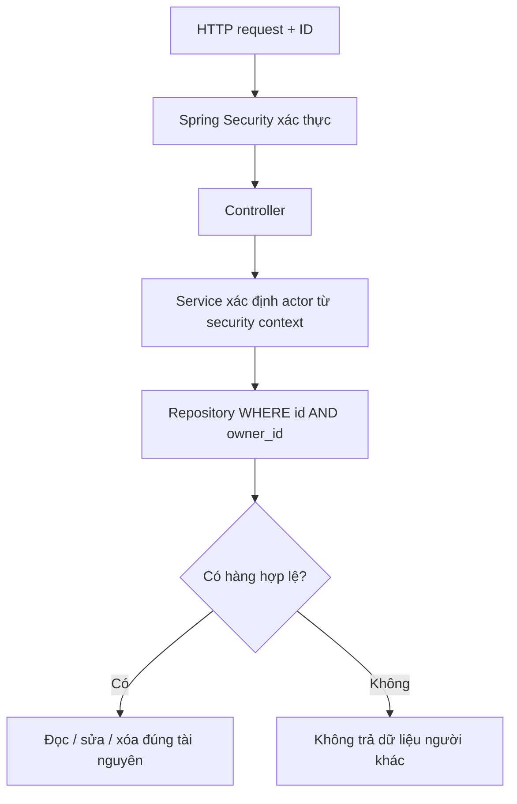

# Quyền sở hữu tài nguyên và ngăn truy cập dữ liệu của người khác

> **Ngữ cảnh:** Phân quyền trong Spring Security (Spring MVC/Servlet). Trọng tâm là quyền truy cập **mỗi bản ghi/tài nguyên cụ thể**, chứ không chỉ kiểm tra người dùng đã đăng nhập hay có role hay chưa. Ví dụ thực hành dùng Java 17, Spring Boot 3.5.x, Spring Security 6.5.x, Spring Data JPA và H2. Tên tài nguyên "note" chỉ là ví dụ; nguyên tắc tương tự áp dụng cho hóa đơn, hồ sơ, đơn hàng, tệp, bình luận, tác vụ và dữ liệu thuộc tenant.

## 1. Học xong cần hiểu điều gì?

- Phân biệt **authentication**, quyền theo chức năng/role và **object-level authorization** (quyền trên tài nguyên cụ thể).
- Nhận diện lỗ hổng **IDOR** (Insecure Direct Object Reference) / **BOLA** (Broken Object Level Authorization): thay ID để xem, sửa, tải xuống hoặc xóa dữ liệu của người khác.
- Ràng buộc mọi thao tác đọc/ghi bằng **danh tính đã được server xác thực** và quan hệ chủ sở hữu/quyền chia sẻ trong dữ liệu.
- Viết truy vấn truy cập có điều kiện `resource_id + owner_id`, truy vấn danh sách theo người dùng, lệnh cập nhật/xóa có điều kiện và phản hồi lỗi phù hợp.
- Kết hợp tầng HTTP, service, repository, Spring Security method security và kiểm thử các trường hợp được phép/bị từ chối.
- Nhận biết các tình huống phức tạp: nhiều tenant, chia sẻ tài nguyên, thay chủ sở hữu, cache, xử lý bất đồng bộ và cạnh tranh dữ liệu.

## 2. Bài toán: đăng nhập rồi vẫn có thể truy cập dữ liệu người khác

Giả sử API trả một ghi chú:

```http
GET /api/notes/101
Authorization: Basic ...
```

Alice sở hữu ghi chú `101`, Bob sở hữu ghi chú `102`. Nếu server chỉ kiểm tra "đã đăng nhập" và thực hiện:

```java
// Mẫu nguy hiểm: chỉ kiểm tra ID, không kiểm tra người có quyền.
Note note = noteRepository.findById(requestedId).orElseThrow();
return note.getBody();
```

thì Bob có thể yêu cầu `/api/notes/101` và nhận dữ liệu của Alice. Bob **không cần đoán mật khẩu Alice**: anh ta đã có phiên đăng nhập hợp lệ, nhưng bị thiếu kiểm tra quyền đối với đối tượng cụ thể.

Đây là **BOLA/IDOR**. ID có thể là số tăng dần, UUID, slug, tên tệp hoặc mã trong JSON: **ID khó đoán không thay thế authorization**. Cùng lỗ hổng còn xuất hiện khi sửa đường dẫn tải file, thay `ownerId` trong request body, đổi tham số `userId` trong query, thay ID lồng nhau, hoặc sử dụng API bulk/export.

Cần phân biệt ba câu hỏi:

| Câu hỏi | Ví dụ | Kiểm tra ở đâu? |
| --- | --- | --- |
| **Authentication:** Ai đang gọi? | Alice đã xác thực? | Spring Security (session, Basic, OAuth2/JWT...). |
| **Function-level authorization:** Được dùng chức năng không? | Alice có `SCOPE_notes:write`? | HTTP rules hoặc method security. |
| **Object-level authorization:** Được tác động lên bản ghi này không? | Note `101` thuộc Alice hoặc đã chia sẻ cho Alice? | Policy trên tài nguyên tại service/repository. |

Người dùng có cùng `ROLE_USER` thường đều được mở endpoint, nhưng **không có quyền đối với cùng tập dữ liệu**. Quyền sở hữu là một chính sách trên đối tượng; role chỉ mô tả một khả năng tổng quát.

## 3. Mô hình quyền: owner, tenant, hành động và chia sẻ

Quy tắc đơn giản nhất:

```text
allow(actor, action, resource)
    = actor đã xác thực
      AND action được phép trên resource
      AND resource.ownerId == actor.id
```

Trong thực tế, chính sách có thể là:

```text
allow = authenticated
    AND đúng tenant
    AND (
        actor là owner
        OR actor được cấp quyền qua ACL/share
        OR actor là quản trị viên đúng phạm vi
    )
    AND hành động được phép (read/write/delete)
    AND tài nguyên đang ở trạng thái cho phép thao tác
```

- **Owner:** người sở hữu theo quy tắc nghiệp vụ. `createdBy` chưa chắc luôn là owner hiện tại: tài nguyên có thể được chuyển nhượng, do tổ chức sở hữu hoặc có nhiều người được quyền quản lý.
- **Actor/principal:** danh tính do hệ thống xác thực. Lấy từ `SecurityContext`, token đã được kiểm chứng hoặc một cơ chế nhận dạng nội bộ đáng tin cậy; không tin `userId` hay `ownerId` tự khai trong URL/body.
- **Tenant:** ranh giới giữa tổ chức/khách hàng. Một người trùng username ở hai tenant không có nghĩa được truy cập chéo tenant. Ưu tiên định danh người dùng ổn định, toàn cục hoặc cặp `tenantId + userId` được xác thực.
- **Action:** `read`, `write`, `delete`, `share`, `export`... không mặc định có quyền sửa chỉ vì có quyền đọc.
- **ACL / relationship-based access:** ví dụ người xem được chia sẻ tài liệu, thành viên dự án, người phụ trách đơn hàng. Lúc này "chỉ owner mới được đọc" là quá chặt; thay bằng policy rõ ràng và kiểm thử từng quan hệ.

Nguyên tắc nền tảng: **deny by default**, **least privilege**, kiểm tra quyền **trên server cho mọi yêu cầu**, và không để các đường vào khác nhau áp dụng chính sách khác nhau.

## 4. Chỗ nào phải thực thi quyền trong Spring Security?

### 4.1. HTTP security là cửa đầu

```java
http.authorizeHttpRequests(auth -> auth
    .requestMatchers("/api/notes/**").authenticated()
    .anyRequest().denyAll()
);
```

Đây là cấu hình **minh họa** bên trong `SecurityFilterChain`. Nó loại bỏ truy cập chưa xác thực vào các URL ghi chú, nhưng **không biết** ghi chú `101` thuộc Alice hay Bob. Chỉ thay `authenticated()` bằng `hasRole("USER")` cũng không giải quyết BOLA.

### 4.2. Service là nơi giữ quy tắc nghiệp vụ

Controller nhận ID và dữ liệu yêu cầu; service quyết định tài nguyên nào được nhìn thấy hoặc sửa; repository truy vấn theo điều kiện giới hạn quyền. Nhiều controller, batch job hoặc endpoint khác cùng gọi service thì dùng chung một chính sách.



Bằng cách thêm điều kiện owner/tenant vào **truy vấn**, ta tránh tải bản ghi của người khác rồi mới lọc ở controller. Với thao tác ghi, điều kiện quyền ngay trong SQL `UPDATE`/`DELETE` còn giúp kiểm tra và ghi là một bước nguyên tử trong cơ sở dữ liệu.

### 4.3. Method security hỗ trợ nhưng phải dùng đúng

`@EnableMethodSecurity` bật các annotation như `@PreAuthorize` và `@PostAuthorize`. Chẳng hạn, `@PreAuthorize("isAuthenticated()")` bảo vệ một service khỏi lời gọi không xác thực; một expression khác có thể kiểm tra role/scope hoặc bean quyền.

Có thể dùng `@PostAuthorize` để so sánh owner trên **kết quả của phương thức đọc**, nhưng **không dùng nó làm điểm kiểm tra duy nhất cho thao tác ghi**: phương thức có thể đã cập nhật database trước khi interceptor kiểm tra kết quả. Tương tự, chỉ đặt `@PreAuthorize("#ownerId == authentication.name")` khi `ownerId` đến từ request **không đủ**, vì kẻ tấn công tự gửi đúng tên mình trong khi ID tài nguyên thuộc người khác.

## 5. Ví dụ thực hành hoàn chỉnh: API ghi chú chỉ truy cập tài nguyên của chính mình

Ví dụ này dùng **Spring MVC + Spring Data JPA** (blocking, phù hợp Servlet) và database H2 nội bộ. Mọi truy vấn dữ liệu cần dùng actor được lấy **bên trong service** từ `SecurityContextHolder`; client **không được truyền ownerId** để chọn chủ sở hữu. Đây là ứng dụng demo có thể chạy bằng Maven khi tạo các tệp dưới đây.

### 5.1. Tạo `pom.xml`

```xml
<?xml version="1.0" encoding="UTF-8"?>
<project xmlns="http://maven.apache.org/POM/4.0.0"
         xmlns:xsi="http://www.w3.org/2001/XMLSchema-instance"
         xsi:schemaLocation="http://maven.apache.org/POM/4.0.0 https://maven.apache.org/xsd/maven-4.0.0.xsd">
    <modelVersion>4.0.0</modelVersion>
    <parent>
        <groupId>org.springframework.boot</groupId>
        <artifactId>spring-boot-starter-parent</artifactId>
        <version>3.5.0</version>
        <relativePath/>
    </parent>
    <groupId>demo</groupId>
    <artifactId>owned-notes</artifactId>
    <version>0.0.1-SNAPSHOT</version>
    <properties><java.version>17</java.version></properties>
    <dependencies>
        <dependency>
            <groupId>org.springframework.boot</groupId>
            <artifactId>spring-boot-starter-web</artifactId>
        </dependency>
        <dependency>
            <groupId>org.springframework.boot</groupId>
            <artifactId>spring-boot-starter-security</artifactId>
        </dependency>
        <dependency>
            <groupId>org.springframework.boot</groupId>
            <artifactId>spring-boot-starter-data-jpa</artifactId>
        </dependency>
        <dependency>
            <groupId>com.h2database</groupId>
            <artifactId>h2</artifactId>
            <scope>runtime</scope>
        </dependency>
        <dependency>
            <groupId>org.springframework.boot</groupId>
            <artifactId>spring-boot-starter-test</artifactId>
            <scope>test</scope>
        </dependency>
        <dependency>
            <groupId>org.springframework.security</groupId>
            <artifactId>spring-security-test</artifactId>
            <scope>test</scope>
        </dependency>
    </dependencies>
    <build>
        <plugins>
            <plugin>
                <groupId>org.springframework.boot</groupId>
                <artifactId>spring-boot-maven-plugin</artifactId>
            </plugin>
        </plugins>
    </build>
</project>
```

Đây là bản demo dùng Spring Boot `3.5.0` có thật; khi triển khai thực tế cần dùng bản bảo trì phù hợp trong dòng phiên bản đã chọn và cập nhật các bản vá bảo mật.

Tạo `src/main/resources/application.properties`:

```properties
spring.datasource.url=jdbc:h2:mem:ownershipdb;DB_CLOSE_DELAY=-1
spring.datasource.driver-class-name=org.h2.Driver
spring.jpa.hibernate.ddl-auto=create-drop
spring.jpa.open-in-view=false
```

`create-drop` và H2 in-memory chỉ dùng cho thử nghiệm. Chúng xóa dữ liệu khi ứng dụng kết thúc; không dùng làm nơi lưu dữ liệu thực.

### 5.2. Entity: owner là dữ liệu do server quản lý

`src/main/java/demo/ownership/Note.java`:

```java
package demo.ownership;

import jakarta.persistence.Column;
import jakarta.persistence.Entity;
import jakarta.persistence.GeneratedValue;
import jakarta.persistence.GenerationType;
import jakarta.persistence.Id;
import jakarta.persistence.Table;

@Entity
@Table(name = "notes")
public class Note {
    @Id
    @GeneratedValue(strategy = GenerationType.IDENTITY)
    private Long id;

    @Column(nullable = false, updatable = false)
    private String ownerId;

    @Column(nullable = false, length = 2000)
    private String body;

    protected Note() {
    }

    public Note(String ownerId, String body) {
        this.ownerId = ownerId;
        this.body = body;
    }

    public Long getId() {
        return id;
    }

    public String getOwnerId() {
        return ownerId;
    }

    public String getBody() {
        return body;
    }
}
```

Không có setter `setOwnerId`. Trường owner được gán khi tạo bản ghi từ danh tính đã xác thực, tránh tình huống client đổi owner bằng JSON. Nếu nghiệp vụ cho phép chuyển quyền sở hữu, hãy làm bằng **lệnh riêng có kiểm tra quyền chuyển nhượng**, thay vì cập nhật tự do một trường.

### 5.3. Repository: luôn giới hạn theo owner

`src/main/java/demo/ownership/NoteRepository.java`:

```java
package demo.ownership;

import java.util.List;
import java.util.Optional;
import org.springframework.data.jpa.repository.JpaRepository;
import org.springframework.data.jpa.repository.Modifying;
import org.springframework.data.jpa.repository.Query;
import org.springframework.data.repository.query.Param;

public interface NoteRepository extends JpaRepository<Note, Long> {
    Optional<Note> findByIdAndOwnerId(Long id, String ownerId);

    List<Note> findByOwnerIdOrderByIdAsc(String ownerId);

    @Modifying(clearAutomatically = true, flushAutomatically = true)
    @Query("""
        update Note n
           set n.body = :body
         where n.id = :id
           and n.ownerId = :ownerId
        """)
    int updateOwnedBody(
        @Param("id") Long id,
        @Param("ownerId") String ownerId,
        @Param("body") String body
    );

    @Modifying(clearAutomatically = true, flushAutomatically = true)
    @Query("""
        delete from Note n
         where n.id = :id
           and n.ownerId = :ownerId
        """)
    int deleteOwned(
        @Param("id") Long id,
        @Param("ownerId") String ownerId
    );
}
```

Điểm cốt lõi là `WHERE id = ? AND owner_id = ?`. Một ID tồn tại trong cơ sở dữ liệu nhưng thuộc user khác sẽ trả về `Optional.empty()` hoặc số hàng bị ảnh hưởng `0`. Vì thế người không đủ quyền không nhận được dữ liệu để phân biệt bản ghi "không tồn tại" và "thuộc người khác" trong ví dụ.

Với lệnh cập nhật/xóa, số hàng bị ảnh hưởng `1` nghĩa là có hàng khớp điều kiện và đã thực hiện thao tác; `0` nghĩa là không có hàng nào phù hợp. Cách này tránh lỗ hổng kiểu **kiểm tra owner ở bước SELECT rồi UPDATE chỉ theo ID**, vì owner có thể đổi giữa hai bước.

### 5.4. DTO: chỉ cho client cung cấp nội dung

`src/main/java/demo/ownership/NoteRequest.java`:

```java
package demo.ownership;

public record NoteRequest(String body) {
}
```

`src/main/java/demo/ownership/NoteResponse.java`:

```java
package demo.ownership;

public record NoteResponse(Long id, String body) {
}
```

Input không có `ownerId` hoặc `tenantId`. DTO phản hồi cũng không trả dữ liệu nội bộ không cần thiết. Trong ứng dụng thật, dùng thêm Bean Validation, giới hạn kích thước request và whitelist trường được sửa.

### 5.5. Service: lấy actor từ context, kiểm tra ở mọi thao tác

`src/main/java/demo/ownership/NoteService.java`:

```java
package demo.ownership;

import java.util.List;
import org.springframework.http.HttpStatus;
import org.springframework.security.access.prepost.PreAuthorize;
import org.springframework.security.core.context.SecurityContextHolder;
import org.springframework.stereotype.Service;
import org.springframework.transaction.annotation.Transactional;
import org.springframework.web.server.ResponseStatusException;

@Service
@PreAuthorize("isAuthenticated()")
@Transactional(readOnly = true)
public class NoteService {
    private final NoteRepository notes;

    public NoteService(NoteRepository notes) {
        this.notes = notes;
    }

    public List<NoteResponse> list() {
        return notes.findByOwnerIdOrderByIdAsc(actor())
            .stream()
            .map(NoteService::toResponse)
            .toList();
    }

    public NoteResponse get(Long id) {
        return notes.findByIdAndOwnerId(id, actor())
            .map(NoteService::toResponse)
            .orElseThrow(NoteService::hidden);
    }

    @Transactional
    public NoteResponse create(String body) {
        Note saved = notes.save(new Note(actor(), checkedBody(body)));
        return toResponse(saved);
    }

    @Transactional
    public NoteResponse update(Long id, String body) {
        String owner = actor();
        int changed = notes.updateOwnedBody(id, owner, checkedBody(body));
        if (changed == 0) {
            throw hidden();
        }
        return notes.findByIdAndOwnerId(id, owner)
            .map(NoteService::toResponse)
            .orElseThrow(NoteService::hidden);
    }

    @Transactional
    public void delete(Long id) {
        if (notes.deleteOwned(id, actor()) == 0) {
            throw hidden();
        }
    }

    private static String actor() {
        return SecurityContextHolder.getContext()
            .getAuthentication()
            .getName();
    }

    private static NoteResponse toResponse(Note note) {
        return new NoteResponse(note.getId(), note.getBody());
    }

    private static String checkedBody(String body) {
        if (body == null || body.isBlank() || body.length() > 2000) {
            throw new ResponseStatusException(
                HttpStatus.BAD_REQUEST,
                "body must contain 1 to 2000 characters");
        }
        return body;
    }

    private static ResponseStatusException hidden() {
        return new ResponseStatusException(
            HttpStatus.NOT_FOUND,
            "Note not found");
    }
}
```

**Tại sao cách này an toàn hơn `findById(id)`?**

1. `@PreAuthorize("isAuthenticated()")` yêu cầu danh tính xác thực trước khi gọi các phương thức service từ bên ngoài proxy Spring. Chú ý: annotation này chỉ có tác dụng khi đã bật `@EnableMethodSecurity`; method security dùng Spring AOP nên **self-invocation trong cùng bean có thể bỏ qua interceptor**.
2. `actor()` lấy principal do Spring Security xác thực; không nhận `ownerId` từ URL, DTO, header không tin cậy hoặc một tham số controller.
3. `list()` truy vấn **chỉ tập dữ liệu của actor**. Tránh tải toàn bộ danh sách rồi lọc trong Java: cách đó có thể rò rỉ qua phân trang, thống kê, cache hoặc mapper.
4. `get()` truy vấn cùng lúc theo ID và owner. Dù ID đúng nhưng owner khác, kết quả là `404`.
5. `create()` tự đặt owner khi lưu; client không thể tạo ghi chú dưới tên người khác chỉ bằng cách thêm JSON.
6. `update()` và `delete()` đặt điều kiện owner **trong câu lệnh ghi** và xác nhận số hàng bị ảnh hưởng. Nếu không khớp, trả `404`.
7. `@Transactional` bảo vệ thao tác ghi trong giao dịch. Các phương thức đọc dùng `readOnly=true`; ghi dùng `@Transactional` riêng để override.

Ví dụ dùng `SecurityContextHolder` bởi đây là **Spring MVC/Servlet**. Trong WebFlux/Reactor, không sao chép cách dựa trên ThreadLocal này; hãy dùng `ReactiveSecurityContextHolder`/`Mono<Authentication>` và repository reactive tương ứng.

### 5.6. Controller: chỉ điều phối, không quyết định owner thay service

`src/main/java/demo/ownership/NoteController.java`:

```java
package demo.ownership;

import java.util.List;
import org.springframework.http.HttpStatus;
import org.springframework.web.bind.annotation.DeleteMapping;
import org.springframework.web.bind.annotation.GetMapping;
import org.springframework.web.bind.annotation.PatchMapping;
import org.springframework.web.bind.annotation.PathVariable;
import org.springframework.web.bind.annotation.PostMapping;
import org.springframework.web.bind.annotation.RequestBody;
import org.springframework.web.bind.annotation.RequestMapping;
import org.springframework.web.bind.annotation.ResponseStatus;
import org.springframework.web.bind.annotation.RestController;

@RestController
@RequestMapping("/api/notes")
public class NoteController {
    private final NoteService service;

    public NoteController(NoteService service) {
        this.service = service;
    }

    @GetMapping
    public List<NoteResponse> list() {
        return service.list();
    }

    @GetMapping("/{id}")
    public NoteResponse get(@PathVariable Long id) {
        return service.get(id);
    }

    @PostMapping
    @ResponseStatus(HttpStatus.CREATED)
    public NoteResponse create(@RequestBody NoteRequest request) {
        return service.create(request.body());
    }

    @PatchMapping("/{id}")
    public NoteResponse update(
            @PathVariable Long id,
            @RequestBody NoteRequest request) {
        return service.update(id, request.body());
    }

    @DeleteMapping("/{id}")
    @ResponseStatus(HttpStatus.NO_CONTENT)
    public void delete(@PathVariable Long id) {
        service.delete(id);
    }
}
```

Không nên gọi repository trực tiếp từ controller để "tiết kiệm" service; một endpoint bị bỏ quên kiểm tra owner có thể phá vỡ toàn bộ chính sách.

### 5.7. Security và dữ liệu thử

`src/main/java/demo/ownership/SecurityConfig.java`:

```java
package demo.ownership;

import org.springframework.context.annotation.Bean;
import org.springframework.context.annotation.Configuration;
import org.springframework.security.config.Customizer;
import org.springframework.security.config.annotation.method.configuration.EnableMethodSecurity;
import org.springframework.security.config.annotation.web.builders.HttpSecurity;
import org.springframework.security.core.userdetails.User;
import org.springframework.security.core.userdetails.UserDetails;
import org.springframework.security.crypto.factory.PasswordEncoderFactories;
import org.springframework.security.crypto.password.PasswordEncoder;
import org.springframework.security.provisioning.InMemoryUserDetailsManager;
import org.springframework.security.web.SecurityFilterChain;

@Configuration
@EnableMethodSecurity
public class SecurityConfig {
    @Bean
    SecurityFilterChain filterChain(HttpSecurity http) throws Exception {
        return http
            .authorizeHttpRequests(auth -> auth
                .requestMatchers("/api/notes", "/api/notes/**")
                    .authenticated()
                .anyRequest().denyAll()
            )
            .httpBasic(Customizer.withDefaults())
            .build();
    }

    @Bean
    PasswordEncoder passwordEncoder() {
        return PasswordEncoderFactories.createDelegatingPasswordEncoder();
    }

    @Bean
    InMemoryUserDetailsManager users(PasswordEncoder encoder) {
        UserDetails alice = User.withUsername("alice")
            .password(encoder.encode("demo-alice"))
            .roles("USER")
            .build();
        UserDetails bob = User.withUsername("bob")
            .password(encoder.encode("demo-bob"))
            .roles("USER")
            .build();
        return new InMemoryUserDetailsManager(alice, bob);
    }
}
```

Tất cả API ghi chú đều yêu cầu xác thực. Alice và Bob có **cùng role `USER`**; việc không thể đọc tài nguyên của nhau đến từ điều kiện owner trong repository, không phải do phân biệt role.

**CSRF được giữ bật mặc định** trong ví dụ. Vì vậy, yêu cầu `POST/PATCH/DELETE` từ HTTP client thường cần token CSRF hợp lệ (nếu không thường nhận `403` trước khi đến service). Các lệnh `curl` bên dưới chỉ minh họa **GET**; bài kiểm thử tích hợp ở mục 6 dùng `with(csrf())` cho thao tác ghi. Không tắt CSRF một cách máy móc trong ứng dụng dùng cookie/session hoặc HTTP Basic mà browser có thể tự gửi credentials.

`src/main/java/demo/ownership/OwnedNotesApplication.java`:

```java
package demo.ownership;

import org.springframework.boot.CommandLineRunner;
import org.springframework.boot.SpringApplication;
import org.springframework.boot.autoconfigure.SpringBootApplication;
import org.springframework.context.annotation.Bean;

@SpringBootApplication
public class OwnedNotesApplication {
    public static void main(String[] args) {
        SpringApplication.run(OwnedNotesApplication.class, args);
    }

    @Bean
    CommandLineRunner seed(NoteRepository notes) {
        return args -> {
            notes.save(new Note("alice", "Alice private note"));
            notes.save(new Note("bob", "Bob private note"));
        };
    }
}
```

Với database H2 rỗng vừa tạo, hai bản ghi demo được sinh ID `1` (Alice) và `2` (Bob). Tài khoản/mật khẩu cố định và seed data chỉ dùng trong môi trường học tập. Production cần IdP/kho user thật, secret management, TLS và database lâu bền.

### 5.8. Chạy và quan sát

Thư mục nguồn phải đúng cấu trúc `src/main/java/demo/ownership/...` và `src/main/resources/application.properties`. Dùng JDK 17+ và Maven:

```bash
mvn test
mvn spring-boot:run
```

Ở terminal khác:

```bash
# Alice đọc note của mình: 200
curl -i -u alice:demo-alice http://localhost:8080/api/notes/1

# Alice đổi ID sang bản ghi của Bob: 404, không thấy body Bob
curl -i -u alice:demo-alice http://localhost:8080/api/notes/2

# Bob đọc note của mình: 200
curl -i -u bob:demo-bob http://localhost:8080/api/notes/2

# Không đăng nhập: 401
curl -i http://localhost:8080/api/notes/1

# Danh sách Alice: chỉ những note của Alice
curl -i -u alice:demo-alice http://localhost:8080/api/notes
```

Với H2 sạch của demo, hai GET hợp lệ trả JSON lần lượt có dạng:

```json
{"id":1,"body":"Alice private note"}
```

```json
{"id":2,"body":"Bob private note"}
```

Lệnh Alice đọc `/api/notes/2` trả `404` vì SQL không tìm được hàng khớp **cả ID 2 và owner Alice**; nó không chứng minh bản ghi 2 không tồn tại toàn cục. Tùy chính sách API, một trường hợp đã xác thực nhưng không có quyền có thể trả `403 Forbidden`. Đối với tài nguyên nhạy cảm, `404 Not Found` thường được dùng để không tiết lộ sự tồn tại của tài nguyên người khác. Dù chọn `403` hay `404`, phải **không trả payload**, owner hay thông tin lỗi tiết lộ dữ liệu.

## 6. Kiểm thử IDOR/BOLA bằng Spring Security Test

Thêm file `src/test/java/demo/ownership/OwnedNotesAuthorizationTest.java`:

```java
package demo.ownership;

import org.junit.jupiter.api.Test;
import org.springframework.beans.factory.annotation.Autowired;
import org.springframework.boot.test.autoconfigure.web.servlet.AutoConfigureMockMvc;
import org.springframework.boot.test.context.SpringBootTest;
import org.springframework.http.MediaType;
import org.springframework.test.web.servlet.MockMvc;
import org.springframework.transaction.annotation.Transactional;

import static org.springframework.security.test.web.servlet.request.SecurityMockMvcRequestPostProcessors.csrf;
import static org.springframework.security.test.web.servlet.request.SecurityMockMvcRequestPostProcessors.user;
import static org.springframework.test.web.servlet.request.MockMvcRequestBuilders.get;
import static org.springframework.test.web.servlet.request.MockMvcRequestBuilders.patch;
import static org.springframework.test.web.servlet.result.MockMvcResultMatchers.jsonPath;
import static org.springframework.test.web.servlet.result.MockMvcResultMatchers.status;

@SpringBootTest
@AutoConfigureMockMvc
@Transactional
class OwnedNotesAuthorizationTest {
    @Autowired
    MockMvc mvc;

    @Test
    void unauthenticatedRequestIsRejected() throws Exception {
        mvc.perform(get("/api/notes/1"))
            .andExpect(status().isUnauthorized());
    }

    @Test
    void aliceCanReadOnlyHerOwnNote() throws Exception {
        mvc.perform(get("/api/notes/1").with(user("alice")))
            .andExpect(status().isOk())
            .andExpect(jsonPath("$.body").value("Alice private note"));

        mvc.perform(get("/api/notes/2").with(user("alice")))
            .andExpect(status().isNotFound());
    }

    @Test
    void bobCannotChangeAlicesNote() throws Exception {
        mvc.perform(patch("/api/notes/1")
                .with(user("bob"))
                .with(csrf())
                .contentType(MediaType.APPLICATION_JSON)
                .content("{\"body\":\"Overwritten\"}"))
            .andExpect(status().isNotFound());

        mvc.perform(get("/api/notes/1").with(user("alice")))
            .andExpect(status().isOk())
            .andExpect(jsonPath("$.body").value("Alice private note"));
    }

    @Test
    void aliceCanChangeHerOwnNote() throws Exception {
        mvc.perform(patch("/api/notes/1")
                .with(user("alice"))
                .with(csrf())
                .contentType(MediaType.APPLICATION_JSON)
                .content("{\"body\":\"Updated by Alice\"}"))
            .andExpect(status().isOk())
            .andExpect(jsonPath("$.body").value("Updated by Alice"));
    }

    @Test
    void aliceListContainsNoBobsNote() throws Exception {
        mvc.perform(get("/api/notes").with(user("alice")))
            .andExpect(status().isOk())
            .andExpect(jsonPath("$[0].body").value("Alice private note"))
            .andExpect(jsonPath("$.length()").value(1));
    }
}
```

Các test dùng `user("alice")`/`user("bob")` để tạo authentication trong MockMvc và `csrf()` để cho phép đi qua bộ lọc CSRF, từ đó thực sự kiểm tra authorization ở service/repository. `@Transactional` trên test giúp các thay đổi ghi được rollback sau từng test. Nếu chạy qua HTTP client hoặc stack asynchronous thực sự, phải thiết kế cách cô lập database test riêng.

Một ma trận kiểm thử thực tế cần thêm:

| Trường hợp | Mong đợi |
| --- | --- |
| Ẩn danh truy cập bản ghi bảo vệ | `401` trong ví dụ HTTP Basic |
| Owner đọc/sửa/xóa chính tài nguyên | Thành công theo chức năng |
| User khác đọc/sửa/xóa tài nguyên | Bị từ chối; dữ liệu gốc không đổi |
| Owner truyền ID không tồn tại | `404` |
| User thêm `ownerId` khác vào request tạo/sửa | Không được chuyển quyền sở hữu |
| Danh sách, tìm kiếm, thống kê, export của một user | Không chứa bản ghi người khác |
| User thuộc tenant A dùng ID tài nguyên tenant B | Bị từ chối |
| Quyền share bị thu hồi giữa các yêu cầu | Lần yêu cầu tiếp theo tuân theo quyền mới |
| CSRF token thiếu trên phương thức ghi có bảo vệ CSRF | `403`, chưa vào logic ghi |
| Race khi chủ sở hữu đổi trong lúc cập nhật | Không ghi sai người; kiểm tra được điều kiện tại thời điểm cập nhật |

**Đặc biệt:** Không chỉ kiểm thử request đọc; BOLA trên `PATCH`, `DELETE`, `POST /api/notes/{id}/share` và bulk API gây mất hoặc sửa dữ liệu nghiêm trọng hơn.

## 7. SQL bảo vệ đối tượng: đọc, danh sách và ghi

### 7.1. Đọc một đối tượng

```sql
SELECT id, body
FROM notes
WHERE id = :noteId AND owner_id = :actorId;
```

Không chạy `SELECT * FROM notes WHERE id = :noteId` rồi tin controller sẽ nhớ kiểm tra `note.getOwnerId()`. Việc đọc quá nhiều dữ liệu trước khi kiểm quyền còn dễ rò rỉ qua log, mapper, cache, metrics hoặc exception.

### 7.2. Danh sách và phân trang

```sql
SELECT id, body
FROM notes
WHERE owner_id = :actorId
ORDER BY id
LIMIT :pageSize OFFSET :offset;
```

Cả truy vấn danh sách **và truy vấn đếm tổng số phần tử** phải có cùng điều kiện owner/tenant. Lọc sau khi `Page` đã tính `totalElements` làm lộ thống kê và khiến phân trang sai.

### 7.3. Cập nhật/xóa có điều kiện

```sql
UPDATE notes
SET body = :newBody
WHERE id = :noteId AND owner_id = :actorId;

DELETE FROM notes
WHERE id = :noteId AND owner_id = :actorId;
```

Đọc số hàng bị ảnh hưởng để biết có cập nhật/xóa thành công không. Với trường hợp thay đổi owner, thu hồi quyền share hay trạng thái tài nguyên, thiết kế giao dịch, khóa/optimistic locking hoặc lệnh `UPDATE ... WHERE ...` có điều kiện đủ đầy để tránh **time-of-check to time-of-use (TOCTOU)**.

### 7.4. Nhiều tenant

Nếu mỗi note còn thuộc một công ty, thay điều kiện bằng:

```sql
SELECT id, body
FROM notes
WHERE id = :noteId
  AND tenant_id = :trustedTenantId
  AND owner_id = :trustedUserId;
```

`trustedTenantId` phải đến từ quan hệ membership đã được server kiểm chứng hoặc claims đã xác thực và được kiểm tra đúng ngữ cảnh. Đừng tin header `X-Tenant-Id`, query `?tenant=...` hay trường `tenantId` từ payload chỉ vì chúng có vẻ hợp lệ.

Đối với quyền nhóm hoặc chia sẻ, thay so sánh owner cố định bằng truy vấn quan hệ được ủy quyền (ví dụ `EXISTS` trong bảng ACL với `actorId`, `action` và `resourceId`), vẫn giới hạn tenant và trạng thái hiệu lực. Kiểm tra truy cập trước khi sinh URL tải file có chữ ký; URL đã phát hành cũng cần TTL và phạm vi hẹp.

## 8. Chọn 401, 403 hay 404?

| HTTP status | Ý nghĩa | Tình huống điển hình |
| --- | --- | --- |
| `401 Unauthorized` | Chưa có/không có xác thực hợp lệ | Không credentials, token hết hạn hoặc sai chữ ký |
| `403 Forbidden` | Danh tính hợp lệ nhưng không được thực hiện hành động | Thiếu role/scope/permission; API công khai quy tắc từ chối |
| `404 Not Found` | Tài nguyên không hiển thị với caller | ID không tồn tại hoặc bản ghi thuộc người khác khi cần che giấu sự tồn tại |
| `400 Bad Request` | Request không hợp lệ | Body null, quá dài, tham số sai kiểu |
| `200/201/204` | Thao tác hợp lệ | Đọc/cập nhật; tạo; xóa không trả body |

`401` là thuật ngữ HTTP mang tên "Unauthorized" nhưng về mặt ứng dụng thường chỉ **vấn đề xác thực**; `403` mới là **không đủ quyền**. `404` dùng che dấu tài nguyên là một **chính sách thiết kế API**, không tự động ngăn mọi kênh suy đoán tồn tại (ví dụ độ trễ/tần suất lỗi khác biệt). Tránh phản hồi kiểu "note này thuộc bob@example.com" khi caller không có quyền.

## 9. Những lỗ hổng phát sinh ngoài endpoint `GET /{id}`

**Mass assignment / over-posting:** Controller nhận nguyên entity JPA với `ownerId`, `tenantId`, `status` hoặc `isAdmin` từ JSON rồi gọi `save(entity)`. Hãy tạo DTO chỉ gồm trường được phép, tự gán owner, validate mọi chuyển đổi trạng thái đặc quyền.

**API lồng nhau:** URL `/users/{userId}/notes/{noteId}` phải xác nhận quan hệ giữa `userId`, `noteId` và actor; chỉ kiểm tra actor có quyền với `userId` là chưa đủ nếu note không thuộc user đó. Tương tự `/projects/{projectId}/tasks/{taskId}` phải xác minh task thuộc project và actor có quyền trên project/task.

**Bulk operations:** `PATCH /api/notes/bulk` nhận một mảng ID. Không kiểm tra một ID rồi cập nhật tất cả. Có thể dùng `UPDATE ... WHERE id IN (...) AND owner_id = :actor`, kiểm tra `affectedRows` và định nghĩa rõ toàn bộ request bị từ chối hay chỉ cập nhật phần hợp lệ. Tránh làm nửa vời khi nghiệp vụ yêu cầu tính nguyên tử.

**File download và object storage:** Không đưa thẳng key file từ request vào đường dẫn bucket hoặc filesystem. Tra metadata file đã giới hạn owner/tenant/quyền share trước khi stream nội dung hay sinh presigned URL. Cân nhắc chống path traversal, TTL và quyền truy cập tệp bản gốc/thumbnail/export.

**Cache:** Cache danh sách hoặc dữ liệu theo `resourceId` không đủ nếu các caller có quyền khác nhau. Cache kết quả có liên quan quyền phải đưa actor/tenant/action vào key hoặc tách data cache với authorization check; có chiến lược invalidation khi quyền thay đổi.

**Async/background jobs:** Sau khi rời request, không mặc định `SecurityContextHolder` vẫn hiện diện. Job phải nhận danh tính/ngữ cảnh đã được kiểm chứng và thực thi chính sách phù hợp ở thời điểm hành động; không dùng một service account quyền rộng để bỏ qua chính sách của người yêu cầu.

**Logging và audit:** Ghi actor ID, tenant, resource ID, action, kết quả allow/deny và correlation ID ở mức phù hợp; không ghi access token, mật khẩu hoặc nội dung nhạy cảm. Audit giúp truy vết hành vi trái phép nhưng không thay thế việc kiểm quyền trước khi xử lý.

**Tìm kiếm và báo cáo:** `/search`, dashboard, số liệu tổng hợp, preview, GraphQL resolver và export có thể truy cập cùng tài nguyên từ lối khác. Mọi điểm đọc phải đi qua chính sách nhất quán.

## 10. Những sai lầm thường gặp

| Sai lầm | Vì sao sai | Cách xử lý |
| --- | --- | --- |
| Dùng `authenticated()` hoặc `ROLE_USER` làm điều kiện duy nhất | Mọi user đăng nhập đều qua cùng rule | Thêm kiểm tra owner/tenant/ACL trên resource |
| Tin `ownerId` từ body/query/path | Caller tự sửa được | Lấy actor/tenant đáng tin cậy từ security context/membership |
| Gọi `findById(id)` rồi trả entity thẳng | Chưa ràng buộc owner | Dùng `findByIdAndOwnerId(id, actor)` |
| Dùng UUID thay cho phân quyền | UUID vẫn bị lộ, chia sẻ hoặc đoán qua kênh khác | Kiểm tra quyền với mọi ID |
| Chỉ bảo vệ `GET` | `PATCH`/`DELETE` vẫn sửa/xóa dữ liệu | Áp dụng cùng policy cho mọi method và action |
| Chỉ kiểm tra owner rồi `UPDATE WHERE id` | Quyền có thể đổi giữa lúc kiểm và ghi | Gộp điều kiện trong SQL ghi; dùng transaction khi cần |
| Lọc danh sách sau khi phân trang | Lộ `totalElements` và sai page | Filter ở truy vấn database trước khi count/page |
| Dùng `@PostAuthorize` trên hàm đã ghi DB | Phản hồi bị chặn nhưng side effect có thể đã xảy ra | Kiểm tra trước khi ghi/điều kiện trong SQL |
| Bỏ qua tenant vì owner giống nhau | Truy cập chéo tổ chức | Mọi truy vấn có ranh giới tenant đã xác thực |
| Trả thông tin owner khi deny | Tiết lộ metadata | Lỗi an toàn và nhất quán |
| Dùng Spring MVC `SecurityContextHolder` y nguyên trong WebFlux | ThreadLocal không mang ngữ cảnh reactive đúng cách | Dùng Reactor context và reactive API |
| Tắt CSRF để test `POST` dễ hơn | Có thể mở đường CSRF nếu browser tự gửi credentials | Dùng `csrf()` trong MockMvc và thiết kế bảo vệ đúng với authentication |

## 11. Tự kiểm tra hiểu bài

1. **Alice có `ROLE_USER`, Bob có `ROLE_USER`. Vì sao Alice vẫn không được xem note Bob?** Vì role chỉ cho phép truy cập chức năng; service/repository kiểm tra quan hệ owner của từng note.
2. **Nếu Bob sửa URL từ `/notes/2` thành `/notes/1`, đổi sang UUID có đủ an toàn không?** Không. ID chỉ là cách định vị; vẫn phải kiểm tra quyền server-side.
3. **Tại sao `UPDATE ... WHERE id = :id AND owner_id = :actor` tốt hơn kiểm tra owner rồi `UPDATE ... WHERE id = :id`?** Vì điều kiện owner được kiểm tra cùng lệnh thay đổi dữ liệu, giảm khoảng trống TOCTOU.
4. **Có nên để client gửi `ownerId` lúc tạo note?** Không trong chính sách owner hiện tại: backend suy ra owner từ danh tính đã xác thực. Trường hợp tạo thay người khác phải là một chức năng được ủy quyền riêng.
5. **Khi note tồn tại nhưng thuộc user khác, trả 403 hay 404?** Tùy hợp đồng API và mức độ cần che giấu sự tồn tại; cả hai đều phải không tiết lộ dữ liệu hoặc nội dung nhạy cảm.
6. **Vì sao không dùng `@PostAuthorize` để bảo vệ một thao tác chuyển tiền?** Vì nó có thể kiểm tra sau khi hành động/ghi đã xảy ra; cần kiểm tra quyền trước tác dụng phụ và/hoặc đặt điều kiện trong transaction.
7. **Nếu user được quyền đọc nhưng không được sửa note được chia sẻ thì sao?** Policy phải xét cả `action`; quyền `read` không tự suy ra `write`.

## 12. Checklist áp dụng trong dự án thật

- [ ] Liệt kê mọi endpoint, action và luồng truy cập gián tiếp (file, batch, export, search).
- [ ] Xác định owner/tenant/membership/ACL thực tế cho từng tài nguyên; không nhầm `createdBy` với chủ sở hữu.
- [ ] Xác thực danh tính trước, ánh xạ sang user ID ổn định; lấy tenant từ nguồn được kiểm chứng.
- [ ] Đưa điều kiện phân quyền vào truy vấn đọc, count, phân trang, cập nhật và xóa.
- [ ] Bảo đảm chuyển owner/chia sẻ/thu hồi quyền có giao dịch và kiểm tra riêng.
- [ ] Giữ DTO input hẹp, chặn mass assignment, validate ID/body.
- [ ] Quy định nhất quán `401`/`403`/`404` và không rò rỉ metadata.
- [ ] Kiểm thử chéo hai hoặc nhiều tài khoản, hai tenant, các thao tác đọc/ghi và case race.
- [ ] Xem xét cache key, background jobs, object storage, token hết hạn và audit.
- [ ] Đảm bảo toàn bộ entry point đi qua cùng lớp chính sách; code review tìm các lời gọi `findById`/`save`/`deleteById` đi vòng qua quyền.

## Tài liệu tham khảo

- [OWASP API Security Top 10 — API1:2023 Broken Object Level Authorization](https://owasp.org/API-Security/editions/2023/en/0xa1-broken-object-level-authorization/)
- [Spring Security 6.5 — Method Security](https://docs.spring.io/spring-security/reference/6.5/servlet/authorization/method-security.html)
- [Spring Security 6.5 — Authorize HttpServletRequests](https://docs.spring.io/spring-security/reference/6.5/servlet/authorization/authorize-http-requests.html)
- [Spring Security 6.5 — Cross Site Request Forgery](https://docs.spring.io/spring-security/reference/6.5/servlet/exploits/csrf.html)
- [Spring Data JPA — JPA Query Methods](https://docs.spring.io/spring-data/jpa/reference/jpa/query-methods.html)
