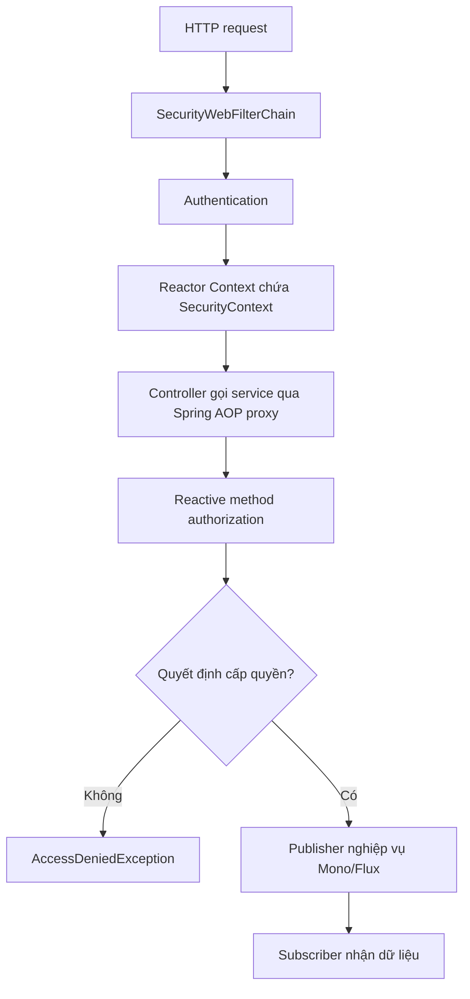

# @EnableReactiveMethodSecurity và yêu cầu riêng của phương thức reactive

> **Bối cảnh:** Spring Security với **Spring WebFlux**, Java 17+, Project Reactor và phương thức trả `Mono`/`Flux`. Bài giải thích cách kích hoạt phân quyền ở tầng phương thức, cách nó sử dụng **Reactor Context**, điều kiện để annotation hoạt động chính xác, cách triển khai chính sách đồng bộ/bất đồng bộ và cách kiểm thử. Ví dụ đầy đủ dùng **Spring Boot 3.5.0 / Spring Security 6.x**. Ứng dụng Spring MVC/Servlet dùng `@EnableMethodSecurity` và cách quản lý context khác; không lấy ví dụ servlet áp nguyên xi cho WebFlux.

## 1. Tình huống cần bảo vệ phương thức

Giả sử ứng dụng có các đầu vào HTTP, message consumer và một job nội bộ đều gọi phương thức:

```java
public Mono<String> generatePayrollReport() {
    return reportRepository.fetchPayrollReport();
}
```

Chặn `/api/payroll/**` ở HTTP có giá trị, nhưng không bảo vệ được trường hợp phương thức service bị gọi từ một entry point khác. **Method security** gắn chính sách với lời gọi phương thức Spring-managed bean, chẳng hạn:

```java
@PreAuthorize("hasRole('PAYROLL')")
public Mono<String> generatePayrollReport() {
    return reportRepository.fetchPayrollReport();
}
```

Khi caller không có quyền, phương thức phải bị chặn trước khi công việc nhạy cảm được thực hiện. Khi caller có quyền, service tạo một publisher mà Reactor sẽ thực thi khi có subscription.

Phân biệt:

| Tầng | Câu hỏi | Công cụ |
| --- | --- | --- |
| Authentication | Ai đang gọi? | WebFlux authentication filter, Basic, OAuth2 Resource Server, v.v. |
| HTTP authorization | Caller được vào route này không? | `ServerHttpSecurity.authorizeExchange(...)`, `SecurityWebFilterChain` |
| Method authorization | Caller được gọi nghiệp vụ này không? | `@EnableReactiveMethodSecurity`, `@PreAuthorize`, `@PostAuthorize` |
| Object-level authorization | Caller được đọc/sửa bản ghi cụ thể không? | SpEL gọi policy bean, repository/service có điều kiện owner/tenant |

Thực tế nên dùng **cả HTTP và method security** khi cần: HTTP bảo vệ mặt ngoài; service giữ ranh giới nghiệp vụ khi nhiều nơi cùng gọi. Một annotation role chưa tự giải quyết quyền sở hữu từng đối tượng.

## 2. `@EnableReactiveMethodSecurity` là gì?

`@EnableReactiveMethodSecurity` bật các interceptor phân quyền dựa trên Spring AOP cho **Spring-managed bean** có phương thức reactive. Với Spring Security 6.x, viết:

```java
@Configuration
@EnableReactiveMethodSecurity
public class ReactiveMethodSecurityConfig {
}
```

Đoạn trên là **mẫu cấu hình tối thiểu**, cần các import và ngữ cảnh Spring khi đưa vào dự án. Trong ví dụ ứng dụng hoàn chỉnh ở mục 5, annotation nằm cùng class cấu hình WebFlux.

Bản hiện đại dùng các thành phần dựa trên `AuthorizationManager`. Từ Spring Security 6.0, `useAuthorizationManager` mặc định là `true`, vì thế cách viết `@EnableReactiveMethodSecurity` là đủ; tài liệu mẫu cũ đôi khi ghi `@EnableReactiveMethodSecurity(useAuthorizationManager = true)`. Tránh tự sao chép các interceptor hoặc cấu hình `useAuthorizationManager=false` từ phiên bản cũ nếu không có lý do tương thích rõ ràng.

Khi bật method security, những annotation thường dùng gồm:

- `@PreAuthorize("hasRole('ADMIN')")`: kiểm tra **trước** khi phương thức được gọi.
- `@PreAuthorize("hasAuthority('SCOPE_reports:read')")`: kiểm tra authority theo chuỗi chính xác.
- `@PreAuthorize("isAuthenticated()")`: yêu cầu danh tính được xác thực.
- `@PreAuthorize("@policy.canRead(authentication, #id)")`: gọi bean chính sách tùy chỉnh; với cơ chế dựa trên AuthorizationManager, biểu thức có thể trả `Boolean` hoặc `Mono<Boolean>`.
- `@PostAuthorize(...)`: kiểm tra sau khi có kết quả để quyết định kết quả có được đưa cho caller hay không.
- `@PreFilter` và `@PostFilter`: lọc đầu vào/đầu ra collection khi phù hợp, nhưng không thay thế chính sách truy vấn dữ liệu và phân trang.

Trong SpEL, `hasRole('ADMIN')` theo mặc định kiểm tra authority `ROLE_ADMIN`. `hasAuthority('ROLE_ADMIN')` là cách viết trực tiếp cùng authority đó; đừng truyền `ROLE_ADMIN` vào `hasRole` vì tiền tố role mặc định được xử lý riêng.

**Quan trọng:** Chỉ khai báo `spring-boot-starter-security` chưa tự bật method security. Phải chủ động dùng `@EnableReactiveMethodSecurity` trong cấu hình.

## 3. Vì sao method security trong reactive khác servlet?

### 3.1. Danh tính đi cùng **subscription**, không gắn chặt với luồng

Trong stack Servlet truyền thống, `SecurityContextHolder` thường sử dụng dữ liệu dựa trên `ThreadLocal`. Trong Reactor, dữ liệu có thể đi qua nhiều scheduler, nên không thể mặc định nhận đúng security context từ một `ThreadLocal` ở bất kỳ bước bất đồng bộ nào.

Spring Security reactive đưa `SecurityContext` qua **Reactor Context**, truy xuất bằng `ReactiveSecurityContextHolder`. WebFlux Security thường thiết lập context từ quá trình authentication qua `ReactorContextWebFilter`.



Điều quan trọng ở đây là **context gắn với luồng reactive ở thời điểm subscription**. Bởi vậy, cách viết dưới đây có thể lấy danh tính hiện tại khi publisher được subscribe:

```java
import org.springframework.security.core.context.ReactiveSecurityContextHolder;
import reactor.core.publisher.Mono;

public Mono<String> currentUsername() {
    return ReactiveSecurityContextHolder.getContext()
        .map(ctx -> ctx.getAuthentication().getName());
}
```

Đây là **phương thức minh họa** phải đặt trong một class; nó chỉ phát tên người dùng nếu subscriber có security context phù hợp.

### 3.2. Kiểu trả về cần là reactive publisher

Theo hợp đồng method security reactive của Spring Security, phương thức Java được bảo vệ nên trả về một `org.reactivestreams.Publisher`, thường là:

```java
Mono<Account> readAccount(String id);
Flux<Account> listAccounts();
Mono<Void> deleteAccount(String id);
```

Điều này cho phép Spring Security tích hợp authorization với Reactor Context và thời điểm subscription. Hàm trả `String`, `Account`, `void` hoặc `CompletableFuture<Account>` không tương đương một publisher cho mục đích này. Với Kotlin coroutine, cơ chế dựa trên AuthorizationManager hỗ trợ các hàm coroutine trong phạm vi được tài liệu phiên bản chỉ rõ; bài này tập trung vào Java Reactor.

**Không "bọc cho có" sau khi đã chạy nghiệp vụ:**

```java
// SAI về tính lazy: thao tác nhạy cảm có thể chạy ngay.
@PreAuthorize("hasRole('ADMIN')")
public Mono<String> bad() {
    String result = blockingExport();
    return Mono.just(result);
}
```

`Mono.just` chỉ tạo publisher từ một **giá trị đã được tính xong**. Với I/O reactive, return trực tiếp publisher hoặc xây dựng pipeline; với I/O blocking bắt buộc, thiết kế adapter và scheduler phù hợp, không chạy lệnh blocking trên event loop.

### 3.3. Không tự `block()` hoặc `subscribe()` để kiểm quyền

```java
// SAI: block trong chuỗi WebFlux có thể chặn event loop.
boolean allowed = permissionService.canRead(user, id).block();

// SAI: tự subscribe làm tách luồng lỗi và context khỏi request.
permissionService.canRead(user, id).subscribe(allowed -> { /* ... */ });
```

Thay vào đó, để publisher permission được trả vào chuỗi authorization qua `Mono<Boolean>` hoặc dùng `flatMap` trong service. Spring Security là thành phần điều phối subscription. `Mono.defer` không tự biến JDBC hoặc HTTP client đồng bộ thành nonblocking.

## 4. Dòng thời gian của `@PreAuthorize` và `@PostAuthorize`

### `@PreAuthorize`

Spring AOP áp interceptor lên lời gọi đi qua proxy; interceptor tính biểu thức khi có authentication và ngữ cảnh phương thức phù hợp. Nếu không đủ quyền, luồng phát `AccessDeniedException` và logic nghiệp vụ không nên được thực thi. Với Reactor, caller thường thấy lỗi ở **subscription**, không phải lúc chỉ giữ biến `Mono`.

### `@PostAuthorize`

Interceptor đánh giá quyền dựa trên kết quả sau khi publisher nghiệp vụ tạo giá trị. Chẳng hạn một read-only query có thể kiểm tra người đang xem có quyền trên object vừa đọc:

```java
// Minh họa: Document phải có getOwnerUsername() và service truy vấn reactive.
@PostAuthorize("returnObject.ownerUsername == authentication.name")
public Mono<Document> loadDocument(String id) {
    return documentRepository.findById(id);
}
```

Đoạn trên **không tự biên dịch độc lập** vì `Document` và `documentRepository` thuộc domain giả định. Biểu thức `returnObject` cần kiểm tra theo kiểu dữ liệu và cách interceptor xử lý kết quả của phiên bản Spring Security đang chạy.

**Không dùng `@PostAuthorize` làm tuyến phòng thủ duy nhất cho thao tác ghi, chuyển tiền, gửi email hay xóa:** phương thức có thể tạo side effect trước khi kết quả bị chặn. Đối với thao tác thay đổi dữ liệu, kiểm quyền *trước khi thực hiện* và, nếu có thể, ràng buộc quyền trong điều kiện cập nhật/transaction.

### Tầng kiểm quyền nào diễn ra trước?

Khi controller gọi service, bộ lọc HTTP có thể kiểm trước `authenticated()` hoặc route/role, sau đó proxy method kiểm lại role/scope/object-level. Nếu HTTP không cho đi qua, service không được gọi. Nếu HTTP cho đi qua nhưng method security từ chối, caller vẫn nhận lỗi phân quyền. Kiểm tra theo route và method có thể khác nhau hợp lý: controller chỉ là một trong nhiều nơi gọi service.

## 5. Dự án Spring Boot WebFlux có thể chạy

Ví dụ minh họa:

- `GET /api/public/ping` công khai.
- `GET /api/private/hello` dành cho người đã đăng nhập, đọc principal từ Reactor Context.
- `GET /api/private/report` yêu cầu role `ANALYST` tại **phương thức service**, mặc dù HTTP chỉ yêu cầu đã đăng nhập.

Hai người dùng thử nghiệm: `viewer` (role VIEWER) và `analyst` (roles VIEWER, ANALYST). Mật khẩu cố định chỉ dành cho localhost.

### 5.1. Cấu trúc

```text
reactive-method-security-demo/
├── pom.xml
└── src/
    ├── main/java/demo/method/
    │   ├── ReactiveMethodApplication.java
    │   ├── SecurityConfig.java
    │   ├── ReportService.java
    │   └── DemoController.java
    └── test/java/demo/method/
        └── ReactiveMethodSecurityTest.java
```

### 5.2. Maven dependencies

Tạo `pom.xml`:

```xml
<?xml version="1.0" encoding="UTF-8"?>
<project xmlns="http://maven.apache.org/POM/4.0.0"
         xmlns:xsi="http://www.w3.org/2001/XMLSchema-instance"
         xsi:schemaLocation="http://maven.apache.org/POM/4.0.0 https://maven.apache.org/xsd/maven-4.0.0.xsd">
    <modelVersion>4.0.0</modelVersion>
    <parent>
        <groupId>org.springframework.boot</groupId>
        <artifactId>spring-boot-starter-parent</artifactId>
        <version>3.5.0</version>
        <relativePath/>
    </parent>
    <groupId>demo</groupId>
    <artifactId>reactive-method-security-demo</artifactId>
    <version>0.0.1-SNAPSHOT</version>
    <properties>
        <java.version>17</java.version>
    </properties>
    <dependencies>
        <dependency>
            <groupId>org.springframework.boot</groupId>
            <artifactId>spring-boot-starter-webflux</artifactId>
        </dependency>
        <dependency>
            <groupId>org.springframework.boot</groupId>
            <artifactId>spring-boot-starter-security</artifactId>
        </dependency>
        <dependency>
            <groupId>org.springframework.boot</groupId>
            <artifactId>spring-boot-starter-test</artifactId>
            <scope>test</scope>
        </dependency>
        <dependency>
            <groupId>org.springframework.security</groupId>
            <artifactId>spring-security-test</artifactId>
            <scope>test</scope>
        </dependency>
        <dependency>
            <groupId>io.projectreactor</groupId>
            <artifactId>reactor-test</artifactId>
            <scope>test</scope>
        </dependency>
    </dependencies>
    <build>
        <plugins>
            <plugin>
                <groupId>org.springframework.boot</groupId>
                <artifactId>spring-boot-maven-plugin</artifactId>
            </plugin>
        </plugins>
    </build>
</project>
```

Dùng starter **WebFlux**, không thêm `spring-boot-starter-web` vào demo này vì điều đó có thể khiến Boot chọn MVC nếu cả hai web stack có mặt. `reactor-test` cung cấp `StepVerifier` khi muốn test publisher trực tiếp.

### 5.3. Entry point

`src/main/java/demo/method/ReactiveMethodApplication.java`:

```java
package demo.method;

import org.springframework.boot.SpringApplication;
import org.springframework.boot.autoconfigure.SpringBootApplication;

@SpringBootApplication
public class ReactiveMethodApplication {
    public static void main(String[] args) {
        SpringApplication.run(ReactiveMethodApplication.class, args);
    }
}
```

### 5.4. Cấu hình WebFlux và method security

`src/main/java/demo/method/SecurityConfig.java`:

```java
package demo.method;

import org.springframework.context.annotation.Bean;
import org.springframework.context.annotation.Configuration;
import org.springframework.security.config.Customizer;
import org.springframework.security.config.annotation.method.configuration.EnableReactiveMethodSecurity;
import org.springframework.security.config.annotation.web.reactive.EnableWebFluxSecurity;
import org.springframework.security.config.web.server.ServerHttpSecurity;
import org.springframework.security.core.userdetails.User;
import org.springframework.security.core.userdetails.UserDetails;
import org.springframework.security.crypto.factory.PasswordEncoderFactories;
import org.springframework.security.crypto.password.PasswordEncoder;
import org.springframework.security.provisioning.MapReactiveUserDetailsService;
import org.springframework.security.web.server.SecurityWebFilterChain;

@Configuration
@EnableWebFluxSecurity
@EnableReactiveMethodSecurity
public class SecurityConfig {

    @Bean
    SecurityWebFilterChain securityWebFilterChain(ServerHttpSecurity http) {
        return http
            .authorizeExchange(exchange -> exchange
                .pathMatchers("/api/public/ping").permitAll()
                .pathMatchers("/api/private/**").authenticated()
                .anyExchange().denyAll()
            )
            .httpBasic(Customizer.withDefaults())
            .build();
    }

    @Bean
    PasswordEncoder passwordEncoder() {
        return PasswordEncoderFactories.createDelegatingPasswordEncoder();
    }

    @Bean
    MapReactiveUserDetailsService users(PasswordEncoder encoder) {
        UserDetails viewer = User.withUsername("viewer")
            .password(encoder.encode("viewer-demo"))
            .roles("VIEWER")
            .build();
        UserDetails analyst = User.withUsername("analyst")
            .password(encoder.encode("analyst-demo"))
            .roles("VIEWER", "ANALYST")
            .build();
        return new MapReactiveUserDetailsService(viewer, analyst);
    }
}
```

Hai annotation làm hai việc khác nhau:

- `@EnableWebFluxSecurity`: kích hoạt security filter cho HTTP WebFlux.
- `@EnableReactiveMethodSecurity`: kích hoạt **authorization interceptor** cho method trong Spring bean.

Rule HTTP cho mọi `/api/private/**` chỉ là `authenticated()`, vì vậy chính annotation ở `ReportService` sẽ phân biệt viewer với analyst. Đây là lựa chọn có chủ đích để thấy rõ tác dụng của method security, không phải khuyến nghị luôn mở mọi route private bằng một rule rộng.

`MapReactiveUserDetailsService` và mật khẩu inline phục vụ demo. Trong môi trường thật nên dùng IdP/OAuth2/JWT, secret quản lý tập trung và cơ chế xác thực thích hợp. Nếu sử dụng credential được trình duyệt tự gửi, phải đánh giá CSRF; ví dụ chỉ có các endpoint GET không thay đổi trạng thái.

### 5.5. Service có hai cách áp policy

`src/main/java/demo/method/ReportService.java`:

```java
package demo.method;

import org.springframework.security.access.prepost.PreAuthorize;
import org.springframework.security.core.context.ReactiveSecurityContextHolder;
import org.springframework.stereotype.Service;
import reactor.core.publisher.Mono;

@Service
public class ReportService {

    @PreAuthorize("isAuthenticated()")
    public Mono<String> hello() {
        return ReactiveSecurityContextHolder.getContext()
            .map(ctx -> "hello:" + ctx.getAuthentication().getName());
    }

    @PreAuthorize("hasRole('ANALYST')")
    public Mono<String> confidentialReport() {
        return Mono.just("report:restricted");
    }
}
```

`hello()` đọc user từ Reactor Context **tại subscription**. `confidentialReport()` chỉ phát chuỗi báo cáo nếu người gọi có `ROLE_ANALYST`; người chỉ có `ROLE_VIEWER` bị từ chối.

Nếu bỏ `@EnableReactiveMethodSecurity` trong `SecurityConfig`, `@PreAuthorize` sẽ không còn cơ chế method-security tương ứng; khi đó HTTP rule chỉ yêu cầu login và người dùng viewer có thể vượt qua phân quyền chuyên biệt của service. Một regression test phải phát hiện cấu hình thiếu này.

### 5.6. Controller không tự lặp logic kiểm quyền của service

`src/main/java/demo/method/DemoController.java`:

```java
package demo.method;

import org.springframework.web.bind.annotation.GetMapping;
import org.springframework.web.bind.annotation.RequestMapping;
import org.springframework.web.bind.annotation.RestController;
import reactor.core.publisher.Mono;

@RestController
@RequestMapping("/api")
public class DemoController {

    private final ReportService reports;

    public DemoController(ReportService reports) {
        this.reports = reports;
    }

    @GetMapping("/public/ping")
    public Mono<String> ping() {
        return Mono.just("pong");
    }

    @GetMapping("/private/hello")
    public Mono<String> hello() {
        return reports.hello();
    }

    @GetMapping("/private/report")
    public Mono<String> report() {
        return reports.confidentialReport();
    }
}
```

Controller nhận một `ReportService` được Spring quản lý, vì thế lời gọi đi qua proxy áp dụng method security. Gọi bằng `new ReportService()` hoặc self-invocation giữa hai phương thức trong chính service có thể bỏ qua interception.

### 5.7. Chạy chương trình

Từ thư mục chứa `pom.xml`:

```bash
mvn test
mvn spring-boot:run
```

Sau khi server khởi động, thử qua HTTP:

```bash
curl -i http://localhost:8080/api/public/ping
curl -i http://localhost:8080/api/private/hello
curl -i -u viewer:viewer-demo http://localhost:8080/api/private/hello
curl -i -u viewer:viewer-demo http://localhost:8080/api/private/report
curl -i -u analyst:analyst-demo http://localhost:8080/api/private/report
```

Kết quả **dự kiến** với HTTP Basic của ví dụ:

| Request | HTTP | Phần body khi thành công | Giải thích |
| --- | --- | --- | --- |
| Anonymous GET `/api/public/ping` | 200 | `pong` | Route `permitAll` |
| Anonymous GET `/api/private/hello` | 401 | Không có dữ liệu private | HTTP yêu cầu xác thực |
| Viewer GET `/api/private/hello` | 200 | `hello:viewer` | Role không hạn chế thêm, service yêu cầu authentication |
| Viewer GET `/api/private/report` | 403 | Không có `report:restricted` | HTTP cho qua, method `@PreAuthorize` từ chối |
| Analyst GET `/api/private/report` | 200 | `report:restricted` | Có `ROLE_ANALYST` |

Đây là **kỳ vọng theo cấu hình và mã nguồn**, không phải log của một lần chạy Maven đã được thực hiện trong bài đọc. Nếu ứng dụng có custom entry point/exception handler, status hoặc body lỗi có thể khác; phải đảm bảo tài nguyên không bị tiết lộ.

## 6. Kiểm thử end-to-end với WebTestClient

Viết `src/test/java/demo/method/ReactiveMethodSecurityTest.java`:

```java
package demo.method;

import org.junit.jupiter.api.Test;
import org.springframework.beans.factory.annotation.Autowired;
import org.springframework.boot.test.autoconfigure.web.reactive.AutoConfigureWebTestClient;
import org.springframework.boot.test.context.SpringBootTest;
import org.springframework.test.web.reactive.server.WebTestClient;

@SpringBootTest(webEnvironment = SpringBootTest.WebEnvironment.RANDOM_PORT)
@AutoConfigureWebTestClient
class ReactiveMethodSecurityTest {

    @Autowired
    WebTestClient client;

    @Test
    void publicPingWorks() {
        client.get().uri("/api/public/ping")
            .exchange()
            .expectStatus().isOk()
            .expectBody(String.class).isEqualTo("pong");
    }

    @Test
    void privateHelloNeedsAuthentication() {
        client.get().uri("/api/private/hello")
            .exchange()
            .expectStatus().isUnauthorized();
    }

    @Test
    void viewerCanReadOwnPrincipalFromReactorContext() {
        client.get().uri("/api/private/hello")
            .headers(headers -> headers.setBasicAuth(
                "viewer", "viewer-demo"))
            .exchange()
            .expectStatus().isOk()
            .expectBody(String.class).isEqualTo("hello:viewer");
    }

    @Test
    void viewerIsDeniedByMethodSecurity() {
        client.get().uri("/api/private/report")
            .headers(headers -> headers.setBasicAuth(
                "viewer", "viewer-demo"))
            .exchange()
            .expectStatus().isForbidden();
    }

    @Test
    void analystMayReadReport() {
        client.get().uri("/api/private/report")
            .headers(headers -> headers.setBasicAuth(
                "analyst", "analyst-demo"))
            .exchange()
            .expectStatus().isOk()
            .expectBody(String.class)
            .isEqualTo("report:restricted");
    }
}
```

Bài test này cần **HTTP vào ứng dụng WebFlux thật** trên random port; `@AutoConfigureWebTestClient` tự cấu hình client cho môi trường Spring Boot test. Nó xác minh cả filter, authentication, proxy method security và dòng dữ liệu Reactor Context.

Mục tiêu quan trọng là **test viewer được HTTP rule cho qua nhưng method-level policy vẫn trả 403**. Nếu bỏ annotation, bỏ `@EnableReactiveMethodSecurity`, cấu hình sai role hoặc controller gọi service không qua proxy, test này có thể thất bại và phát hiện rủi ro.

Đối với service có policy đọc theo đối tượng, cần test nhiều user/tenant và tài nguyên khác nhau; một test role-only không chứng minh policy theo owner.

## 7. Kiểm thử publisher trực tiếp bằng StepVerifier

Nếu bạn có service bean thật đã được Spring AOP proxy, có thể mô phỏng danh tính trong Reactor Context để kiểm tra publisher mà không cần gọi HTTP. Ví dụ sau giả định một biến `reports` chứa bean `ReportService` lấy từ Spring context:

```java
import org.springframework.security.access.AccessDeniedException;
import org.springframework.security.authentication.TestingAuthenticationToken;
import org.springframework.security.core.Authentication;
import org.springframework.security.core.context.ReactiveSecurityContextHolder;
import reactor.test.StepVerifier;

Authentication viewer = new TestingAuthenticationToken(
    "viewer", "unused", "ROLE_VIEWER");

StepVerifier.create(
    reports.confidentialReport()
        .contextWrite(
            ReactiveSecurityContextHolder.withAuthentication(viewer)))
    .expectError(AccessDeniedException.class)
    .verify();
```

Đây là **đoạn kiểm thử minh họa**, không phải tệp `.java` độc lập: cần đặt trong một test có Spring context, inject bean `ReportService` và thêm `reactor-test`. `contextWrite` đặt authentication cho subscriber; chỉ thiết lập `SecurityContextHolder` dạng ThreadLocal sẽ không tái hiện đúng ngữ cảnh Reactor của request WebFlux.

Một trường hợp hợp lệ:

```java
Authentication analyst = new TestingAuthenticationToken(
    "analyst", "unused", "ROLE_ANALYST");

StepVerifier.create(
    reports.confidentialReport()
        .contextWrite(
            ReactiveSecurityContextHolder.withAuthentication(analyst)))
    .expectNext("report:restricted")
    .verifyComplete();
```

Tùy proxy/interceptor và test setup, kiểm tra quyền có thể được biểu diễn bằng publisher lỗi hoặc ném exception lúc gọi phương thức. Với cơ chế method security reactive dựa trên AuthorizationManager của ví dụ, ứng dụng nên giữ publisher và dùng `StepVerifier` để xác minh tín hiệu, thay vì tự `block()`.

## 8. Custom authorization trả `Mono<Boolean>`

Nhiều chính sách không đủ đơn giản để diễn đạt bằng role: đọc tài liệu phụ thuộc người sở hữu, dự án, trạng thái hoặc quyền chia sẻ trong database. Spring Security 6.x với cơ chế AuthorizationManager có thể gọi **bean SpEL trả publisher**:

```java
@PreAuthorize("@documentGuard.canRead(authentication, #id)")
public Mono<Document> readDocument(String id) {
    return documentRepository.findById(id);
}
```

Đây là **phương thức minh họa**, chưa phải class biên dịch được vì `Document` và `documentRepository` là thành phần miền nghiệp vụ. `authentication` là người gọi đã được xác thực trong biểu thức; `#id` là tham số method.

Bean phân quyền có thể là:

```java
import org.springframework.security.core.Authentication;
import org.springframework.stereotype.Component;
import reactor.core.publisher.Mono;

@Component("documentGuard")
public class DocumentGuard {

    private final DocumentPermissionRepository permissions;

    public DocumentGuard(DocumentPermissionRepository permissions) {
        this.permissions = permissions;
    }

    public Mono<Boolean> canRead(
            Authentication authentication, String id) {

        if (authentication == null || !authentication.isAuthenticated()) {
            return Mono.just(false);
        }

        return permissions.existsByDocumentIdAndUsername(
                id, authentication.getName())
            .defaultIfEmpty(false)
            .onErrorReturn(false);
    }
}
```

Đoạn `DocumentGuard` minh họa cách kết nối chính sách; cần có interface `DocumentPermissionRepository` với phương thức reactive `Mono<Boolean> existsByDocumentIdAndUsername(String id, String username)` và dữ liệu quyền được quản trị đúng. Không giả định tên một Spring Data generated query tự động luôn trả `Mono<Boolean>` trong mọi store; hãy định nghĩa repository theo API của kho dữ liệu thật.

**Vì sao dùng `Mono<Boolean>`?**

1. `canRead` có thể đọc R2DBC, gọi service bằng `WebClient` hoặc truy cập nguồn policy reactive mà không chặn event loop.
2. `defaultIfEmpty(false)` xử lý tình huống không phát kết quả thành **deny rõ ràng**.
3. `onErrorReturn(false)` minh họa chính sách **fail closed**: nếu nguồn quyền lỗi, không cấp quyền. Tuy nhiên điều đó có thể che lỗi hạ tầng thành 403; production cần log/metrics, timeout phù hợp và chính sách thống nhất về lỗi dịch vụ. Không tự động đổi lỗi thành `true`.
4. Khi method có quyền, truy vấn nghiệp vụ trong method vẫn cần lọc resource theo tenant/owner và kiểm soát tính nhất quán. Authorization không thay thế data isolation ở repository.

Nếu cần phân biệt hết hạn token, người dùng ẩn danh hoặc dữ liệu tenant, hãy thực hiện các kiểm tra trên security context/claims đáng tin cậy. Đừng tin owner ID chỉ vì client gửi cùng `documentId`. Với tài nguyên chia sẻ, biểu thức policy phải xét cả **action** (`read`/`write`) và quan hệ người dùng–tài nguyên.

**Điểm tinh tế:** Hệ thống method security hiện đại còn cho phép quyết định kiểu `AuthorizationDecision` và `Mono.empty()` mang ý nghĩa abstain. Nhưng đối với quyền nhạy cảm cần deny, trả `Mono.just(false)` rõ ràng hơn là để chuỗi không đưa ra quyết định.

## 9. Kiểm tra Reactor Context và vấn đề mất ngữ cảnh

### 9.1. Context được truyền theo publisher

Với WebFlux Security, context được thiết lập khi HTTP request được xác thực. Một pipeline thông thường duy trì nó qua `map`, `flatMap`, `filter` và các operator Reactor thích hợp. Chuyển scheduler bằng `publishOn` không mặc nhiên có nghĩa mất Reactor Context; nhưng dùng callback ngoài Reactor, thread tự tạo hoặc đăng ký một subscription tách rời có thể làm đứt liên hệ với security context.

Ví dụ truy xuất có fallback an toàn:

```java
Mono<String> principalName() {
    return ReactiveSecurityContextHolder.getContext()
        .map(ctx -> ctx.getAuthentication().getName())
        .switchIfEmpty(Mono.error(
            new org.springframework.security.access.AccessDeniedException(
                "Security context required")));
}
```

Đây là **method minh họa** dùng Reactor publisher; các import, class bao và exception mapping phụ thuộc ứng dụng.

### 9.2. `contextWrite` thuộc subscriber, không phải biến global

```java
Authentication auth = new TestingAuthenticationToken(
    "alice", "unused", "ROLE_READER");

Mono<String> message =
    ReactiveSecurityContextHolder.getContext()
        .map(ctx -> ctx.getAuthentication().getName())
        .contextWrite(
            ReactiveSecurityContextHolder.withAuthentication(auth));
```

Đây cũng là **đoạn minh họa** cần các import và nơi khởi tạo phù hợp. Khi subscribe `message`, Reactor context chứa `auth` ở phần pipeline được cấu hình. Điều này rất hữu ích cho unit test; ứng dụng thực không nên tự tạo authentication giả từ username được client gửi.

### 9.3. Không đặt tài nguyên/bảo mật ngoài publisher

Tránh:

```java
public Mono<String> wrong() {
    String user = SecurityContextHolder.getContext()
        .getAuthentication().getName();
    return externalReactiveClient.fetch(user);
}
```

Trong WebFlux, `SecurityContextHolder` kiểu ThreadLocal có thể rỗng, lỗi hoặc phản ánh một thread khác. Thay bằng `ReactiveSecurityContextHolder.getContext().flatMap(...)` để lấy đúng authentication theo subscriber.

### 9.4. Đặc biệt với `Mono.defer`

`Mono.defer` giúp trì hoãn việc **tạo** publisher tới subscription:

```java
public Mono<String> delayed() {
    return Mono.defer(() -> client.fetchReport());
}
```

Đây là đoạn minh họa cần một `client` reactive có sẵn. `Mono.defer` không biến tác vụ blocking thành nonblocking; nếu `client.fetchReport()` sử dụng JDBC hoặc HTTP client đồng bộ, phải dùng API reactive thật hoặc thiết kế adapter blocking có giới hạn (ví dụ boundedElastic cho trường hợp cần thiết).

## 10. Lỗi thường gặp và cách phòng tránh

| Sai lầm | Hệ quả | Cách sửa |
| --- | --- | --- |
| Chỉ thêm `@PreAuthorize` nhưng quên `@EnableReactiveMethodSecurity` | Annotation không có interceptor tương ứng | Bật method security, thêm regression test |
| Dùng `@EnableMethodSecurity` như cấu hình chính cho WebFlux | Lẫn mô hình servlet và reactive | Với Java WebFlux, dùng `@EnableReactiveMethodSecurity` |
| Bảo vệ service method nhưng trả `String`/`void` thay `Mono`/`Flux` | Không thỏa mô hình reactive context của method security | Trả Publisher; với Kotlin coroutine theo hỗ trợ phiên bản |
| Dùng `SecurityContextHolder` ThreadLocal trong callback Reactor | Sai/thiếu authentication khi đổi thread | Dùng `ReactiveSecurityContextHolder` hoặc tham số auth đáng tin cậy |
| Tự `subscribe()` bên trong service/guard | Mất liên hệ error, cancellation, context của caller | Trả publisher cho Spring/Reactor |
| Gọi `block()` ở event loop | Chặn luồng, suy giảm throughput hoặc lỗi runtime | Chuyển sang API reactive và ghép với `flatMap` |
| Đặt `Mono.just(blockingCall())` | Blocking call chạy ngay khi xây publisher | Dùng reactive client; không "bọc" blocking vào `just` |
| Controller gọi `this.securedMethod()` trên cùng bean | Self-invocation có thể bỏ qua proxy AOP | Gọi qua bean/proxy riêng và test |
| Tạo service bằng `new` thay vì inject bean | Không được Spring áp method interceptor | Inject Spring-managed service |
| Coi role `VIEWER` là đủ để đọc mọi document | Thiếu object-level policy | Kiểm tra owner/tenant/ACL theo resource |
| Chỉ dùng `@PostAuthorize` trên lệnh ghi | Side effect có thể xảy ra trước khi từ chối | Kiểm quyền trước hành động/đặt trong SQL transaction |
| Trả `Mono.empty()` từ guard khi thật sự muốn deny | "Không quyết định" không đồng nghĩa deny rõ ràng | Trả `Mono.just(false)` |
| Tắt HTTP security vì đã có method security | Mất lớp authentication/route, lộ endpoint chưa annotate | Dùng kết hợp HTTP và method security |
| Cho test dùng `@WithMockUser` nhưng không phủ HTTP thật | Có thể không phát hiện lỗi authentication filter/chain | Kết hợp test publisher và integration WebTestClient |
| Chỉ test người có quyền | Không phát hiện thiếu annotation hoặc sai role | Test anonymous, user thường và role có quyền |

## 11. Trạng thái lỗi và cách hiểu

Ở HTTP WebFlux với HTTP Basic thường gặp:

- **401 Unauthorized:** request chưa xác thực hợp lệ hoặc credentials sai; thường do authentication entry point.
- **403 Forbidden:** đã xác thực nhưng method security/HTTP authorization từ chối. `AccessDeniedException` trong pipeline được Spring Security xử lý theo cấu hình.
- **404 Not Found:** không có handler hoặc service cố tình che giấu tài nguyên; không mặc định đồng nghĩa đã kiểm quyền.
- **5xx:** lỗi hệ thống, ví dụ policy service không khả dụng nếu chọn truyền lỗi thay vì fail-closed deny.

Cần phân biệt **denied** với lỗi phụ thuộc bên ngoài. Nếu permission service timeout, một API có thể trả 403 khi chính sách đổi mọi lỗi thành deny, hoặc 5xx khi giữ exception; cả hai đều phải **không cấp quyền**. Không tiết lộ thông tin nội bộ/authorization decision nhạy cảm trong error body.

Nếu gọi service ngoài HTTP (unit test, background worker, messaging), có thể nhận `AccessDeniedException` trực tiếp ở subscriber; phải truyền security context hợp lệ thay vì giả định luôn có HTTP filter tạo context.

## 12. Phạm vi của Spring AOP và những điểm dễ "lọt"

**Chỉ Spring-managed beans:** một class tạo bằng `new` không có method security proxy. Nếu hai phương thức của cùng bean gọi nhau bằng `this.method()`, lời gọi nội bộ thường không đi qua proxy, khiến annotation bị bỏ qua.

**Method visibility và proxy:** public method của bean là lựa chọn ổn định nhất cho ví dụ. Final class/final method, private method và cách proxy theo interface/class có thể ảnh hưởng việc interceptor có thực sự được áp dụng hay không. Khi dùng Kotlin, cần hiểu cơ chế class/method `final` mặc định và plugin mở class của Spring, hoặc dùng coroutine phù hợp.

**Bất đồng bộ bên ngoài Reactor:** `@Async`, `CompletableFuture`, thread thủ công, event handler callback và message consumer không tự mang cùng Reactor Context như request HTTP. Cần mô hình truyền actor/context đã kiểm chứng rõ ràng; không dùng service account có quyền cao để vô tình bỏ qua người khởi tạo yêu cầu.

**Transaction:** Spring ReactiveTransactionManager phối hợp với Reactor context; Spring Data JPA/JDBC dựa trên transaction kiểu thread-bound và blocking. Không giả định `@Transactional` với một repository JDBC sẽ tự thành transaction reactive. Dữ liệu quyền và dữ liệu nghiệp vụ có thể đổi trong thời gian một pipeline chạy; với thao tác ghi nhạy cảm, kết hợp policy với điều kiện SQL, lock/version hoặc transactional consistency theo yêu cầu.

**Reactive streams không phải cơ chế giữ quyền vĩnh viễn:** Một `Flux` stream dài có thể đã được cấp quyền ở đầu subscription, trong khi quyền bị thu hồi về sau. Nếu cần chính sách hiệu lực theo từng message, thêm kiểm tra/reauthorization trong logic nghiệp vụ; không mặc định annotation đầu phương thức đánh giá lại quyền ở từng item.

**Giữ scope phù hợp:** Spring Security phân quyền cho lời gọi phương thức; không tự lọc toàn bộ dữ liệu trong repository. Khi trả danh sách hoặc phân trang, chỉ truy vấn dữ liệu caller có quyền nhìn, tránh lọc ở cuối và làm lộ `totalElements`.

## 13. Quy trình áp dụng vào dự án

1. **Xác định phương thức nhạy cảm:** read, mutate, export, admin, operation theo tenant/resource. Đưa chính sách vào service dùng chung để không phụ thuộc mỗi controller.
2. **Bật đúng cấu hình:** `@EnableWebFluxSecurity` cho WebFlux HTTP, `@EnableReactiveMethodSecurity` cho reactive method. Kiểm tra Spring AOP proxy được tạo cho bean.
3. **Giữ chữ ký reactive:** phương thức được bảo vệ trả `Mono`/`Flux`; đường xử lý quyền và I/O dùng publisher không blocking.
4. **Chọn biểu thức đơn giản trước:** role/scope bằng `hasRole`/`hasAuthority`; quyền động dùng policy bean trả `Mono<Boolean>`.
5. **Kiểm tra danh tính qua context:** dùng `ReactiveSecurityContextHolder` hoặc authentication từ framework, không tin username/tenant từ request.
6. **Thiết kế deny và lỗi:** khi không có quyền, không có authentication, repository không tìm ra permission hay timeout; không cho qua khi thiếu dữ liệu.
7. **Test cả hai lớp:** HTTP integration bằng `WebTestClient` và service publisher bằng `StepVerifier`; có test đảm bảo user đăng nhập nhưng không đủ role nhận 403.
8. **Kiểm thử tính nhất quán:** caller khác nhau, owner/tenant khác nhau, quyền bị thu hồi, callback ngoài Reactor, service gọi nội bộ và profile production.
9. **Quan sát vận hành:** metric số deny, thời gian policy lookup, lỗi/timeout; không log token, secret hay dữ liệu cá nhân nhạy cảm.

## 14. Tự kiểm tra

**Câu 1. Vì sao phải dùng `@EnableReactiveMethodSecurity` nếu đã có `@EnableWebFluxSecurity`?**  
Hai annotation kích hoạt hai tầng khác nhau. WebFlux security bảo vệ request; reactive method security bật interceptor AOP cho service method có annotation.

**Câu 2. Khi dùng Spring WebFlux, phương thức có `@PreAuthorize` nên trả về kiểu nào?**  
`Mono<T>`, `Flux<T>` hoặc một `Publisher` phù hợp để Spring Security kết hợp quyết định với Reactor Context. Không coi `String`/`CompletableFuture` như một publisher tương đương.

**Câu 3. Tại sao `SecurityContextHolder.getContext()` có thể không có danh tính đúng trong reactive pipeline?**  
Vì ThreadLocal không phải Reactor Context; publisher có thể được chạy qua nhiều scheduler. Dùng `ReactiveSecurityContextHolder`.

**Câu 4. Có thể cho `@PreAuthorize` gọi một bean trả `Mono<Boolean>` không?**  
Có với reactive method security dựa trên AuthorizationManager; cơ chế này phù hợp cho policy kiểm tra quyền qua database/client reactive mà không `block()`.

**Câu 5. Nếu viewer đăng nhập thành công và HTTP rule `authenticated()` nhưng thiếu role ANALYST thì sao?**  
Method `@PreAuthorize("hasRole('ANALYST')")` từ chối, thường thành 403 trong ứng dụng HTTP Basic demo.

**Câu 6. Vì sao gọi `this.securedMethod()` từ trong cùng bean nguy hiểm?**  
Self-invocation không đi qua proxy Spring AOP, nên annotation có thể không được áp dụng.

**Câu 7. Khi nào `@PostAuthorize` không đủ an toàn?**  
Khi phương thức có side effect trước khi kết quả được kiểm tra, như chuyển tiền, xóa bản ghi hoặc gửi dữ liệu; phải kiểm quyền trước và có điều kiện ghi phù hợp.

**Câu 8. Nếu quyền đọc một tài liệu phụ thuộc database, nên trả false, empty hay true khi DB không trả hàng?**  
Với chính sách fail closed, trả **false** rõ ràng; không cho phép khi thiếu permission. Xử lý lỗi infrastructure/timeout theo quy ước hệ thống nhưng tuyệt đối không cấp quyền.

## 15. Tài liệu chính thức

- [Spring Security 6.5 — EnableReactiveMethodSecurity](https://docs.spring.io/spring-security/reference/6.5/reactive/authorization/method.html): Reactor Context, kiểu trả về Publisher, `@PreAuthorize`, bean policy trả `Mono<Boolean>`, before/after interceptors.
- [Spring Security — WebFlux Security](https://docs.spring.io/spring-security/reference/reactive/configuration/webflux.html): `@EnableWebFluxSecurity`, `ServerHttpSecurity` và `SecurityWebFilterChain`.
- [Spring Security — Reactive HTTP Authorization](https://docs.spring.io/spring-security/reference/reactive/authorization/authorize-http-requests.html): khác biệt request security với method security.
- [Spring Security — Reactive Authentication Architecture](https://docs.spring.io/spring-security/reference/reactive/authentication/architecture.html): security context và xác thực.
- [Reactor — Context Reference](https://projectreactor.io/docs/core/release/reference/advancedFeatures/context.html): nguyên tắc Context theo subscriber.
