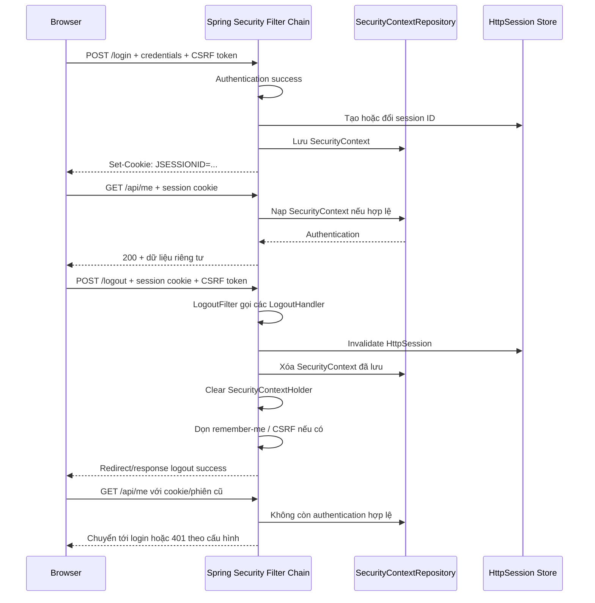

# Đăng xuất cần xử lý ngữ cảnh, phiên và cookie liên quan

> **Chủ đề:** Spring Security – fundamentals / **Đăng nhập và đăng xuất**. Trọng tâm là logout an toàn ở ứng dụng **Spring MVC/Servlet** dùng `HttpSession`, security context và cookie. Bài dùng Java 17, Spring Boot 3.5.0, Spring Security 6.x, MockMvc và Spring Security Test. Những hệ thống dùng WebFlux, OAuth2/OIDC hoặc JWT stateless được phân biệt riêng; không dùng hướng dẫn của Servlet như một lời giải chung cho mọi kiểu xác thực.

## 1. Kết quả học tập

Sau bài này, bạn có thể:

1. Giải thích vì sao “đăng xuất” không đơn thuần là đổi giao diện sang trạng thái chưa đăng nhập hoặc xóa một cookie.
2. Phân biệt `Authentication`, `SecurityContext`, `SecurityContextHolder`, `SecurityContextRepository`, `HttpSession`, `JSESSIONID`, remember-me token, CSRF token và access/refresh token.
3. Hiểu luồng logout mặc định do `LogoutFilter` điều phối, vai trò của `LogoutHandler`, `SecurityContextLogoutHandler`, `CsrfLogoutHandler` và `LogoutSuccessHandler`.
4. Tùy chỉnh logout bằng `HttpSecurity.logout(...)` mà không làm mất bước dọn ngữ cảnh/phiên.
5. Hiểu tại sao POST logout nên được bảo vệ bằng CSRF khi browser tự gửi cookie xác thực.
6. Xóa cookie đúng cách (tên, Path, Domain, Secure, SameSite), nhận biết hạn chế khi cookie do servlet container/proxy quản lý.
7. Kiểm thử logout thật: trạng thái phiên bị invalidate, endpoint riêng tư không còn được truy cập qua phiên cũ, lỗi CSRF không vô tình đăng xuất, phiên khác không bị tác động ngoài chính sách.
8. Xác định các phần cần thu hồi **riêng** nếu bật remember-me, SSO, Spring Session phân tán, JWT hoặc refresh token.

## 2. Logout thực chất phải chấm dứt những gì?

Giả sử Alice đăng nhập trên trình duyệt. Spring Security đã lưu danh tính xác thực và quyền vào security context; context có thể được lưu trong một HTTP session mà trình duyệt tham chiếu bằng cookie phiên.

Nếu bạn chỉ cập nhật frontend:

```javascript
// SAI nếu coi đây là toàn bộ logout:
localStorage.removeItem("userProfile");
window.location.href = "/login";
```

thì browser vẫn có thể gửi cookie phiên còn hiệu lực cho server. Một request mới tới `/api/me` có thể được xác thực như trước. Tương tự, nếu frontend chỉ xóa cookie mà không vô hiệu session tại server, một bản sao cookie ID đã bị lộ có thể tiếp tục được dùng đến khi phiên hết hạn (tùy thiết kế session store).

Một logout phía server đúng cần giải quyết **những trạng thái thật sự đang dùng để xác thực request**:

| Thành phần | Tác dụng | Yêu cầu khi logout |
| --- | --- | --- |
| `Authentication` | Danh tính, authorities của request hiện tại | Không còn được sử dụng sau logout |
| `SecurityContextHolder` | Nơi Spring Security truy cập context của luồng request | Xóa context hiện tại |
| `SecurityContextRepository` | Cơ chế lưu/khôi phục context giữa các request | Xóa context đã lưu; tránh tự khôi phục sau logout |
| `HttpSession` | Phiên server-side, thường chứa security context | Invalidate phiên hiện tại nếu dùng session |
| `JSESSIONID` hoặc `SESSION` | Cookie chỉ đến session trong container/Spring Session | Hết giá trị khi session bị invalidate; dọn cookie browser phù hợp |
| Remember-me cookie/token | Có thể xác thực lại mà không nhập mật khẩu | Cleanup/revoke theo loại remember-me đã cấu hình |
| CSRF token | Chứng minh request state-changing đến từ client hợp lệ | Dọn token của phiên cũ; cấp token mới khi cần |
| Custom app cookies | Ví dụ tùy chọn UI, dữ liệu liên kết danh tính | Xóa những cookie thuộc chính sách logout, không xóa bừa cookie khác |
| Access/refresh token | Credential của OAuth2/JWT nếu hệ thống dùng | Cần chiến lược revoke riêng; session logout không tự thu hồi mọi token |
| Phiên khác/SSO | Có thể tồn tại ở thiết bị hoặc ứng dụng khác | Phải có yêu cầu và cơ chế logout-all/SSO cụ thể |

**Điểm cần nhớ:** Nếu backend không còn chấp nhận ID session cũ, việc cookie vẫn hiển thị trên browser không đồng nghĩa phiên vẫn xác thực. Ngược lại, nếu backend còn chấp nhận token hoặc session cũ, việc giao diện hiện “đã logout” không có ý nghĩa bảo mật.

## 3. Sơ đồ vòng đời đăng nhập – đăng xuất



Dòng cuối không nhất thiết trả đúng `401`: ứng dụng sử dụng **form login** thường chuyển hướng **302 tới `/login`**, trong khi API thuần HTTP Basic hoặc Bearer token thường dùng 401 khi chưa có credentials hợp lệ. Bài kiểm thử cần bám hợp đồng thực tế, không kết luận chỉ từ một status.

## 4. Spring Security xử lý logout chuẩn như thế nào?

### 4.1. `LogoutFilter` là điểm vào mặc định

Trong Spring Security Servlet, `LogoutFilter` phát hiện request khớp URL/matcher logout (mặc định thường là `/logout`) và thực hiện chuỗi `LogoutHandler` trước khi gọi `LogoutSuccessHandler`.

Với cấu hình mặc định có CSRF:

- `GET /logout` thường hiển thị trang xác nhận giúp lấy CSRF token;
- `POST /logout` **kèm CSRF token hợp lệ** mới thực sự logout;
- Sau khi dọn trạng thái, form-login flow mặc định thường redirect đến `/login?logout`.

Khi CSRF bị tắt, hành vi GET logout có thể khác. Không suy diễn từ ví dụ khi ứng dụng dùng custom matcher, OAuth2 hoặc filter chain khác.

### 4.2. Các handler dọn trạng thái

Spring Security cung cấp các thành phần có trách nhiệm riêng:

| Thành phần | Chức năng |
| --- | --- |
| `SecurityContextLogoutHandler` | Invalidate `HttpSession` (mặc định), xóa authentication, dọn context hiện hành và context repository phù hợp |
| `CsrfLogoutHandler` | Xóa CSRF token cũ trong CSRF token repository để phiên mới không tái dùng |
| `RememberMeServices` khi có cấu hình | Thực hiện cleanup remember-me liên quan đến logout |
| `LogoutSuccessEventPublishingLogoutHandler` | Phát sự kiện logout success để hệ thống khác có thể quan sát |
| `CookieClearingLogoutHandler` | Yêu cầu client xóa cookie được chỉ định qua response header |
| `HeaderWriterLogoutHandler` | Viết header như `Clear-Site-Data` theo cấu hình |
| `LogoutSuccessHandler` | Quyết định response cuối: redirect, status hoặc xử lý sau logout |

`LogoutHandler` được thiết kế cho công việc cleanup; handler không nên tự ném lỗi không được kiểm soát làm bỏ dở chuỗi dọn trạng thái. Với hệ thống cần gọi dịch vụ từ xa để revoke token, cần định nghĩa rõ chiến lược lỗi, timeout và theo dõi; không âm thầm khẳng định logout hoàn tất toàn bộ nếu một nguồn revocation quan trọng bị lỗi.

**Thứ tự quan trọng:** Handler chuẩn dọn state trước, sau đó mới chạy success handler để phản hồi. Custom logout endpoint tạo trong controller không tự động được hưởng toàn bộ cơ chế này nếu bạn chỉ gọi một lệnh đơn lẻ.

### 4.3. Security context và session không là một biến

`SecurityContextHolder.clearContext()` chỉ dọn context đang gắn với luồng request theo chiến lược giữ context. Nó **không tương đương** việc xóa context tồn tại trong session repository.

`request.getSession().invalidate()` hủy HTTP session nhưng code tự viết chỉ gọi nó vẫn có thể bỏ quên thao tác cần thiết trên security context, remember-me hoặc CSRF. Cách đơn giản, khó bỏ sót nhất là **dùng logout DSL chuẩn**.

Vì thế, không tạo `@PostMapping("/logout")` với nội dung:

```java
// SAI: chỉ chỉnh giao diện/phản hồi mà không thực hiện logout.
@PostMapping("/logout")
public String fakeLogout() {
    return "logged out";
}
```

Nếu nhất thiết phải có custom endpoint, phải gọi các logout components tương ứng và thiết lập authorization/CSRF đúng cách; tài liệu Spring Security khuyến nghị tận dụng DSL thay vì tự tái tạo mọi bước.

## 5. Ví dụ Spring Boot 3.5.0 chạy được: login, logout và kiểm thử

Mục tiêu ví dụ: xây dựng một ứng dụng MVC có form login, lưu security context trong `HttpSession`, một API riêng tư `/api/me`, logout chuẩn qua `POST /logout` và trang xác nhận `/logged-out`.

Cấu hình **không tắt CSRF** và **không bỏ qua Spring Security filter chain**. Không bật remember-me trong demo để tập trung vào security context/session; mục 9 giải thích cách xử lý khi tính năng đó được thêm vào.

### 5.1. Cấu trúc tệp

```text
logout-state-demo/
├── pom.xml
└── src/
    ├── main/
    │   ├── java/demo/logout/
    │   │   ├── LogoutStateApplication.java
    │   │   ├── SecurityConfig.java
    │   │   └── AccountController.java
    │   └── resources/application.properties
    └── test/java/demo/logout/
        └── LogoutFlowTest.java
```

Cần JDK 17+, Maven 3.9+. Chỉ đặt một `@SpringBootApplication` trong gói `demo.logout`. Ví dụ sử dụng ứng dụng đơn JVM với session Servlet container; khi triển khai multi-node cần thiết kế session store phù hợp.

### 5.2. `pom.xml`

```xml
<?xml version="1.0" encoding="UTF-8"?>
<project xmlns="http://maven.apache.org/POM/4.0.0"
         xmlns:xsi="http://www.w3.org/2001/XMLSchema-instance"
         xsi:schemaLocation="http://maven.apache.org/POM/4.0.0 https://maven.apache.org/xsd/maven-4.0.0.xsd">
    <modelVersion>4.0.0</modelVersion>
    <parent>
        <groupId>org.springframework.boot</groupId>
        <artifactId>spring-boot-starter-parent</artifactId>
        <version>3.5.0</version>
        <relativePath/>
    </parent>
    <groupId>demo</groupId>
    <artifactId>logout-state-demo</artifactId>
    <version>0.0.1-SNAPSHOT</version>
    <properties>
        <java.version>17</java.version>
    </properties>
    <dependencies>
        <dependency>
            <groupId>org.springframework.boot</groupId>
            <artifactId>spring-boot-starter-web</artifactId>
        </dependency>
        <dependency>
            <groupId>org.springframework.boot</groupId>
            <artifactId>spring-boot-starter-security</artifactId>
        </dependency>
        <dependency>
            <groupId>org.springframework.boot</groupId>
            <artifactId>spring-boot-starter-test</artifactId>
            <scope>test</scope>
        </dependency>
        <dependency>
            <groupId>org.springframework.security</groupId>
            <artifactId>spring-security-test</artifactId>
            <scope>test</scope>
        </dependency>
    </dependencies>
    <build>
        <plugins>
            <plugin>
                <groupId>org.springframework.boot</groupId>
                <artifactId>spring-boot-maven-plugin</artifactId>
            </plugin>
        </plugins>
    </build>
</project>
```

Maven dependency Spring Boot cố định ở `3.5.0` giúp ví dụ dễ tái tạo; môi trường production phải dùng bản phát hành/bản vá được hỗ trợ tương thích với hệ thống.

### 5.3. Lớp khởi động

`src/main/java/demo/logout/LogoutStateApplication.java`:

```java
package demo.logout;

import org.springframework.boot.SpringApplication;
import org.springframework.boot.autoconfigure.SpringBootApplication;

@SpringBootApplication
public class LogoutStateApplication {
    public static void main(String[] args) {
        SpringApplication.run(LogoutStateApplication.class, args);
    }
}
```

### 5.4. Cấu hình bảo mật

`src/main/java/demo/logout/SecurityConfig.java`:

```java
package demo.logout;

import org.springframework.context.annotation.Bean;
import org.springframework.context.annotation.Configuration;
import org.springframework.security.config.Customizer;
import org.springframework.security.config.annotation.web.configuration.EnableWebSecurity;
import org.springframework.security.config.annotation.web.builders.HttpSecurity;
import org.springframework.security.core.userdetails.User;
import org.springframework.security.core.userdetails.UserDetails;
import org.springframework.security.core.userdetails.UserDetailsService;
import org.springframework.security.crypto.factory.PasswordEncoderFactories;
import org.springframework.security.crypto.password.PasswordEncoder;
import org.springframework.security.provisioning.InMemoryUserDetailsManager;
import org.springframework.security.web.SecurityFilterChain;

@Configuration
@EnableWebSecurity
public class SecurityConfig {

    @Bean
    SecurityFilterChain securityFilterChain(HttpSecurity http)
            throws Exception {
        return http
            .authorizeHttpRequests(auth -> auth
                .requestMatchers("/login", "/logged-out", "/error")
                    .permitAll()
                .requestMatchers("/api/**").authenticated()
                .anyRequest().denyAll()
            )
            .formLogin(Customizer.withDefaults())
            .logout(logout -> logout
                .logoutUrl("/logout")
                .invalidateHttpSession(true)
                .clearAuthentication(true)
                .logoutSuccessUrl("/logged-out")
                // Chỉ dùng với cookie ứng dụng tự quản lý khi cần:
                .deleteCookies("custom-app-cookie")
            )
            .build();
    }

    @Bean
    PasswordEncoder passwordEncoder() {
        return PasswordEncoderFactories
            .createDelegatingPasswordEncoder();
    }

    @Bean
    UserDetailsService users(PasswordEncoder passwordEncoder) {
        UserDetails alice = User.withUsername("alice")
            .password(passwordEncoder.encode("alice-demo"))
            .roles("USER")
            .build();
        return new InMemoryUserDetailsManager(alice);
    }
}
```

Giải thích:

1. `requestMatchers("/api/**").authenticated()` yêu cầu đăng nhập với toàn bộ API riêng tư.
2. `formLogin(...)` dùng flow form login mặc định; Spring Security cung cấp trang `/login` khi chưa có trang custom.
3. `logoutUrl("/logout")` định nghĩa request kích hoạt `LogoutFilter`. Khi CSRF bật, thực hiện logout bằng `POST` và token CSRF hợp lệ.
4. `invalidateHttpSession(true)` và `clearAuthentication(true)` cho thấy chủ ý logout; đây cũng là hành vi mặc định phù hợp của `SecurityContextLogoutHandler`.
5. `logoutSuccessUrl("/logged-out")` redirect đến endpoint công khai sau khi handlers chạy.
6. `deleteCookies("custom-app-cookie")` chỉ minh họa cho **cookie tùy chỉnh** do ứng dụng quản lý, không phải điều kiện bắt buộc để invalidate `HttpSession`. Demo không tạo cookie này, vì thế khai báo này không ảnh hưởng bảo mật login/logout.
7. CSRF mặc định **vẫn bật**. Không gọi `csrf.disable()` chỉ để khiến `POST /logout` dễ thử hơn.
8. Mật khẩu được mã hóa bằng `DelegatingPasswordEncoder`. User và mật khẩu tĩnh chỉ dành cho demo; production cần hệ thống quản lý danh tính và secret an toàn.

**Vì sao không cần thêm một controller `@PostMapping("/logout")`?** `LogoutFilter` chịu trách nhiệm nhận URL và thực hiện cleanup. Một controller trùng đường dẫn có thể không được gọi vì filter đã xử lý request trước MVC. Trong Spring Security 6.x, `LogoutFilter` nằm trước `AuthorizationFilter`; do đó `/logout` thường không cần khai `permitAll` riêng trong request authorization.

### 5.5. Controller

`src/main/java/demo/logout/AccountController.java`:

```java
package demo.logout;

import java.util.Map;
import org.springframework.security.core.Authentication;
import org.springframework.web.bind.annotation.GetMapping;
import org.springframework.web.bind.annotation.RestController;

@RestController
public class AccountController {

    @GetMapping("/api/me")
    public Map<String, String> me(Authentication authentication) {
        return Map.of("username", authentication.getName());
    }

    @GetMapping("/logged-out")
    public String loggedOut() {
        return "signed-out";
    }
}
```

Phương thức `me` chỉ được gọi thành công sau khi HTTP security kiểm tra authentication. `loggedOut` không truy cập context cũ và không trả dữ liệu riêng tư.

### 5.6. Cấu hình phiên/cookie cho môi trường local

`src/main/resources/application.properties`:

```properties
server.servlet.session.timeout=20m
server.servlet.session.cookie.http-only=true
server.servlet.session.cookie.same-site=lax
```

Đối với production **sau HTTPS**, có thể thêm:

```properties
server.servlet.session.cookie.secure=true
server.servlet.session.cookie.http-only=true
server.servlet.session.cookie.same-site=lax
server.servlet.session.timeout=20m
```

**Không tự bật `Secure=true` trên local HTTP rồi kết luận cookie lỗi**, vì browser chỉ gửi Secure cookie qua kết nối an toàn. Trong production cần TLS và proxy configuration đúng để ứng dụng nhận biết request secure. `SameSite` chỉ là một lớp giảm nguy cơ cross-site; nó không thay thế CSRF token. `HttpOnly` không ngăn mọi kiểu XSS; nó chỉ hạn chế script đọc cookie.

## 6. Kiểm thử Spring Security logout với MockMvc

Tạo `src/test/java/demo/logout/LogoutFlowTest.java`:

```java
package demo.logout;

import org.junit.jupiter.api.Test;
import org.springframework.beans.factory.annotation.Autowired;
import org.springframework.boot.test.autoconfigure.web.servlet.AutoConfigureMockMvc;
import org.springframework.boot.test.context.SpringBootTest;
import org.springframework.mock.web.MockHttpSession;
import org.springframework.test.web.servlet.MockMvc;
import org.springframework.test.web.servlet.MvcResult;

import static org.assertj.core.api.Assertions.assertThat;
import static org.springframework.security.test.web.servlet.request.SecurityMockMvcRequestBuilders.formLogin;
import static org.springframework.security.test.web.servlet.request.SecurityMockMvcRequestPostProcessors.csrf;
import static org.springframework.security.test.web.servlet.response.SecurityMockMvcResultMatchers.authenticated;
import static org.springframework.test.web.servlet.request.MockMvcRequestBuilders.get;
import static org.springframework.test.web.servlet.request.MockMvcRequestBuilders.post;
import static org.springframework.test.web.servlet.result.MockMvcResultMatchers.jsonPath;
import static org.springframework.test.web.servlet.result.MockMvcResultMatchers.redirectedUrl;
import static org.springframework.test.web.servlet.result.MockMvcResultMatchers.status;

@SpringBootTest
@AutoConfigureMockMvc
class LogoutFlowTest {

    @Autowired
    MockMvc mvc;

    private MockHttpSession login() throws Exception {
        MvcResult result = mvc.perform(
                formLogin().user("alice").password("alice-demo"))
            .andExpect(authenticated())
            .andReturn();

        MockHttpSession session = (MockHttpSession)
            result.getRequest().getSession(false);

        assertThat(session).isNotNull();
        return session;
    }

    @Test
    void currentSessionIsInvalidatedAfterLogout() throws Exception {
        MockHttpSession session = login();

        mvc.perform(get("/api/me").session(session))
            .andExpect(status().isOk())
            .andExpect(jsonPath("$.username").value("alice"));

        mvc.perform(post("/logout")
                .session(session)
                .with(csrf()))
            .andExpect(status().is3xxRedirection())
            .andExpect(redirectedUrl("/logged-out"));

        assertThat(session.isInvalid()).isTrue();

        // Không truyền session cũ đã bị invalidate vào request MockMvc
        // vì MockHttpSession không còn là một session hợp lệ.
        mvc.perform(get("/api/me"))
            .andExpect(status().is3xxRedirection());
    }

    @Test
    void missingCsrfCannotLogOutUser() throws Exception {
        MockHttpSession session = login();

        mvc.perform(post("/logout").session(session))
            .andExpect(status().isForbidden());

        assertThat(session.isInvalid()).isFalse();

        mvc.perform(get("/api/me").session(session))
            .andExpect(status().isOk())
            .andExpect(jsonPath("$.username").value("alice"));
    }

    @Test
    void loggingOutOneSessionDoesNotInvalidateAnother() throws Exception {
        MockHttpSession browserA = login();
        MockHttpSession browserB = login();

        assertThat(browserA.getId()).isNotEqualTo(browserB.getId());

        mvc.perform(post("/logout")
                .session(browserA)
                .with(csrf()))
            .andExpect(status().is3xxRedirection());

        assertThat(browserA.isInvalid()).isTrue();

        mvc.perform(get("/api/me").session(browserB))
            .andExpect(status().isOk())
            .andExpect(jsonPath("$.username").value("alice"));
    }

    @Test
    void anonymousCannotAccessPrivateApi() throws Exception {
        mvc.perform(get("/api/me"))
            .andExpect(status().is3xxRedirection());
    }
}
```

### 6.1. Vì sao các test này quan trọng?

- **Đăng nhập thật trong MockMvc:** `formLogin()` tạo authentication bằng form-login flow của Spring Security, không tự đặt `@WithMockUser` rồi lầm tưởng có session được login handler lưu.
- **Bảo đảm server-side logout:** `session.isInvalid()` chứng minh `MockHttpSession` được đánh dấu invalidated. Điều này khác với việc chỉ assert response có chuỗi “logged out”.
- **Kiểm tra vùng riêng tư:** `/api/me` không thể truy cập khi không còn session/credential hợp lệ.
- **CSRF là điều kiện đầu vào:** POST logout thiếu token trả 403, phiên phải còn sống. Nếu chỉ kiểm status 403 mà không kiểm trạng thái session thì chưa chứng minh logic chính xác.
- **Không tự đăng xuất mọi thiết bị:** hai lần login tạo hai session độc lập; logout browser A không invalidate browser B. Muốn chức năng “logout mọi thiết bị” phải thiết kế revoke-all riêng.
- **Lưu ý test cookie thật:** MockMvc không mô phỏng hoàn hảo mọi hành vi của browser/servlet container đối với `Set-Cookie`, Path, Domain và Secure. Khi cần kiểm thử xóa cookie, chạy integration test qua HTTP server/proxy thực.

Chạy:

```bash
mvn test
mvn spring-boot:run
```

Nếu mã và môi trường đáp ứng cấu hình nêu trên, **bốn phương thức test** được dự kiến thành công. Đây là kết quả mong đợi từ mã nguồn; bài này **không tuyên bố đã chạy Maven và nhận kết quả thực tế**.

### 6.2. Kiểm thử thủ công bằng trình duyệt

1. Mở `http://localhost:8080/login`, đăng nhập `alice` / `alice-demo`.
2. Truy cập `/api/me` để xác nhận response chứa username.
3. Mở trang xác nhận logout tại `/logout` nếu sử dụng flow mặc định; form logout có CSRF token do Spring Security cung cấp.
4. Gửi POST logout hợp lệ. Browser được chuyển tới `/logged-out`.
5. Truy cập lại `/api/me` mà không đăng nhập. Ứng dụng phải chuyển về login; không trả dữ liệu cũ.
6. Lặp lại với hai browser profile hoặc hai cookie jar độc lập để xác nhận logout một phiên không làm hủy phiên khác theo chính sách mặc định.

Không mô phỏng bằng cách **chỉ dùng GET `/logout` và giả định đó luôn là thao tác logout** khi CSRF bật. Khi dùng `curl`, phải quản lý cookie jar và CSRF token đúng; `curl -i /logout` không chứng minh logout thực sự đã xảy ra.

## 7. Phân biệt clearing context, invalidating session và xóa cookie

### 7.1. Chỉ xóa `SecurityContextHolder` có thể chưa đủ

Một đoạn code thường thấy:

```java
SecurityContextHolder.clearContext();
```

Đây là **câu lệnh minh họa**, phải đặt trong class/method với import phù hợp. Nó có thể xóa context ở luồng hiện tại, nhưng **không bảo đảm** session đã bị hủy hoặc repository không còn lưu context. Nếu request khác nạp lại context từ session còn tồn tại, người dùng có thể được xác thực lại từ trạng thái cũ.

### 7.2. Chỉ invalidate session có thể bỏ sót remember-me

```java
request.getSession(false).invalidate();
```

Đây là **đoạn minh họa, không dùng nguyên xi**: `getSession(false)` có thể trả `null`; người dùng cũng có thể có remember-me cookie để tạo authentication mới sau khi session cũ bị hủy. Hơn nữa, việc tự invalidate session có thể bỏ sót cleanup context hiện hành và CSRF repository.

Với custom endpoint trong tình huống bắt buộc, tài liệu Spring Security đề nghị gọi `SecurityContextLogoutHandler`. Nhưng hãy xem cách tích hợp các logout handlers liên quan nếu ứng dụng bật thêm remember-me/custom token để không làm kém hành vi chuẩn.

### 7.3. Chỉ xóa cookie có thể chưa revoke state tại server

Để browser xóa cookie, response cần thiết lập cookie cùng **tên, Path và Domain phù hợp** với cookie gốc, có `Max-Age=0` hoặc Expires quá khứ:

```http
Set-Cookie: JSESSIONID=; Path=/; Max-Age=0; HttpOnly
```

Đây chỉ là **ví dụ header**, không phải cấu hình chính xác cho mọi app. Nếu cookie ban đầu được đặt `Path=/myapp` hoặc có `Domain=example.com`, response cần phù hợp với phạm vi đó để xóa đúng cookie. Cũng phải xét secure context và chính sách browser. Spring Security `deleteCookies(...)` được triển khai bằng cookie-clearing handler với giả định về path; **không phải** một cam kết xóa được mọi cookie trên mọi servlet container/proxy. Kiểm thử thật trong môi trường triển khai.

Mặt khác, browser không có cookie cũ nữa nhưng **bản sao session ID còn ở thiết bị khác hoặc log bị lộ** vẫn có thể truy cập nếu server-side session chưa invalidate. Vì vậy, **server-side invalidation mới là bước cốt lõi** của logout dựa trên session.

### 7.4. Không cần xóa mọi cookie của cùng domain

Một ứng dụng có thể có:

- Cookie session `JSESSIONID` hoặc `SESSION`;
- Cookie nhớ đăng nhập;
- Cookie CSRF;
- Cookie tùy chọn giao diện;
- Cookie phục vụ ứng dụng khác trên cùng domain.

Xóa hết cookie bằng các header rộng có thể ảnh hưởng SSO hoặc sản phẩm khác không liên quan. Hãy liệt kê rõ cookie nào là **credential**, cookie nào chứa dữ liệu nhạy cảm và cookie nào cần xóa theo chính sách. Với multi-app cùng domain, đánh giá cẩn thận Path/Domain trước khi dùng thao tác xóa toàn site.

## 8. `Clear-Site-Data`: khả năng và giới hạn

Spring Security có `HeaderWriterLogoutHandler` phối hợp `ClearSiteDataHeaderWriter` để phát header:

```http
Clear-Site-Data: "cookies"
```

Ví dụ cấu hình **thay thế** hoặc bổ sung trong `SecurityConfig`:

```java
import org.springframework.security.web.authentication.logout.HeaderWriterLogoutHandler;
import org.springframework.security.web.header.writers.ClearSiteDataHeaderWriter;
import org.springframework.security.web.header.writers.ClearSiteDataHeaderWriter.Directive;

// Đặt khi xây SecurityFilterChain:
HeaderWriterLogoutHandler clearCookies =
    new HeaderWriterLogoutHandler(
        new ClearSiteDataHeaderWriter(Directive.COOKIES));

http.logout(logout -> logout.addLogoutHandler(clearCookies));
```

Đây là **đoạn cấu hình minh họa**, không phải file Java độc lập: phải tích hợp đúng vào builder `HttpSecurity` của ứng dụng, tránh tạo thêm chain trùng lặp.

Có thể dùng `Directive.ALL` để yêu cầu browser xóa nhiều loại dữ liệu hơn, nhưng phạm vi tác động rộng và có thể ảnh hưởng sản phẩm khác cùng website. Browser và version quyết định mức hỗ trợ header; không coi đây là bảo đảm duy nhất. Header hoạt động ở phía client và **không thay thế việc invalidate session ở server**. Thử qua HTTPS và browser thực, quan sát cookie/storage trước-sau rồi quyết định phạm vi.

## 9. Remember-me: nguồn tự đăng nhập lại sau logout

### 9.1. Vì sao phải xét remember-me riêng?

Khi bật chức năng “Ghi nhớ đăng nhập”, trình duyệt có thể giữ **remember-me cookie** lâu hơn session. Nếu server chỉ invalidate `HttpSession`, request sau vẫn có thể được tự động xác thực bằng remember-me credential còn hợp lệ.

Spring Security hỗ trợ nhớ đăng nhập dựa trên chữ ký hash và loại persistent token có token repository. Các implementation `RememberMeServices` tích hợp với cơ chế logout chuẩn để dọn trạng thái liên quan.

**Điểm cần phân biệt:** dọn remember-me **của request hiện tại** không có nghĩa đã vô hiệu toàn bộ remember-me tokens trên mọi thiết bị. Với persistent token, phạm vi thu hồi phụ thuộc thiết kế token store và chính sách của sản phẩm.

### 9.2. Cấu hình remember-me phải nhất quán với logout

Khi chọn bật remember-me:

```java
// Minh họa trong HttpSecurity DSL, không phải demo chạy ở mục 5.
http.rememberMe(remember -> remember
    .userDetailsService(userDetailsService)
    .key(rememberMeSigningKey)
);
```

Đây là **đoạn cấu hình phụ thuộc biến** `userDetailsService` và `rememberMeSigningKey`, chưa phải class chạy độc lập. Secret phải có độ entropy đủ lớn, ổn định qua các node và lưu bằng secret manager; không hardcode trong source.

Cần test:

1. Đăng nhập với tùy chọn remember-me thực sự được gửi.
2. Xác nhận khi session hết mà cookie remember-me còn hợp lệ, ứng dụng có thể tự xác thực lại theo chính sách.
3. Logout qua `LogoutFilter`.
4. Thử dùng lại cookie remember-me đã bị cleanup; không được tự đăng nhập lại sau logout.
5. Nếu có chức năng logout-all, phải thu hồi theo account/device trong remember-me token store, không chỉ xóa cookie hiện tại.

Với token hash-based, cách vô hiệu hóa tập trung có thể cần đổi key hoặc password tùy chính sách, tác động đến nhiều phiên/tài khoản. Với persistent token, có thể thu hồi các bản ghi token theo username/series trong server-side store khi đáp ứng nghiệp vụ. Không nên thiết kế thủ công việc xóa token mà bỏ kiểm tra chủ sở hữu.

## 10. CSRF và ý nghĩa của POST logout

### 10.1. Tại sao GET logout dễ gây rủi ro?

Nếu một trang bên ngoài có thể khiến browser của người dùng gửi GET tới URL logout, kẻ khác có thể gây **logout CSRF**: ép người dùng bị đăng xuất hoặc ảnh hưởng flow thao tác. Logout là thay đổi trạng thái bảo mật, vì thế **GET không nên được dùng tùy tiện như một hành động thay đổi trạng thái**.

Khi CSRF được bật, Spring Security mặc định yêu cầu POST logout với CSRF token hợp lệ. Mẫu HTML form do Spring Security tạo có thể đưa token này vào form.

```html
<form method="post" action="/logout">
    <input type="hidden" name="_csrf" value="TOKEN_FROM_SERVER">
    <button type="submit">Đăng xuất</button>
</form>
```

Đây là **template minh họa**, không dùng literal `TOKEN_FROM_SERVER` trong ứng dụng thật. Spring MVC/Thymeleaf có cơ chế lấy CSRF token từ request và render; tên parameter/header phụ thuộc `CsrfTokenRepository`.

### 10.2. Test thiếu CSRF không phải test thành công của logout

```java
mvc.perform(post("/logout").session(session))
    .andExpect(status().isForbidden());
```

Đoạn trên chỉ chứng minh **CSRF filter** từ chối request thiếu token, không chứng minh logout handler đã chạy. Muốn kiểm tra logout, cần:

```java
mvc.perform(post("/logout")
        .session(session)
        .with(csrf()))
    .andExpect(status().is3xxRedirection());
```

Sau đó xác minh session đã invalidated và request dùng danh tính cũ không truy cập dữ liệu private. Đây là lý do bộ test trong mục 6 kiểm tra **cả hai trường hợp**.

### 10.3. Single-page application

SPA dùng cookie-based authentication cần quản lý CSRF token sau login/logout vì token có thể bị xóa hoặc thay đổi cùng session. Không cố tái dùng CSRF token thuộc một phiên đã logout rồi kết luận backend lỗi. Khi thiết kế repository trong cookie (`CookieCsrfTokenRepository`) hoặc session, phải đồng bộ flow lấy token mới, đặc biệt khi client không reload trang.

CORS và SameSite hỗ trợ các mục tiêu khác nhau; **không cái nào tự thay thế toàn bộ CSRF protection**. Nếu ứng dụng API thực sự stateless và chỉ nhận Bearer token từ header do JavaScript chủ động gửi, đánh giá CSRF theo mối đe dọa cụ thể, không rập khuôn áp hoặc tắt mặc định.

## 11. LogoutSuccessHandler và LogoutHandler tùy chỉnh

### 11.1. Redirect hay HTTP 204?

Ứng dụng web truyền thống thường cần redirect:

```java
.logout(logout -> logout
    .logoutSuccessUrl("/logged-out")
)
```

REST API/SPA có thể muốn status không có nội dung:

```java
import org.springframework.security.web.authentication.logout.HttpStatusReturningLogoutSuccessHandler;

// Cấu hình bên trong HttpSecurity DSL:
.logout(logout -> logout
    .logoutSuccessHandler(
        new HttpStatusReturningLogoutSuccessHandler(
            org.springframework.http.HttpStatus.NO_CONTENT))
)
```

Đây là cấu hình **thay thế** cho flow redirect của demo, không bật cả hai hình thức success trong cùng một chain. Chỉ đổi response success handler không có nghĩa các bước dọn context/phiên bị bỏ; DSL vẫn điều phối handlers chuẩn nếu bạn không vô hiệu hóa chúng.

### 11.2. Custom cleanup và khả năng lỗi

Có thể cần xóa một cookie ứng dụng, revoke refresh token, hủy session ở một hệ thống phụ hoặc phát audit event. Nếu đó là thao tác *bắt buộc* để coi logout thành công, hãy xác định cách xử lý lỗi, retry có kiểm soát, idempotency và dữ liệu audit. `LogoutHandler` trong Spring Security được thiết kế để cleanup và không nên phát exception làm đứt luồng dọn bảo mật.

Đừng đặt logic phức tạp, chậm và dễ lỗi trực tiếp trong logout filter mà không quản lý timeout. Một hệ thống dùng OAuth2 có thể yêu cầu lệnh revoke phía authorization server hoặc back-channel logout; những thao tác đó cần chính sách riêng về độ tin cậy và trạng thái nhất quán.

Nếu xây custom `LogoutSuccessHandler`, bảo đảm nó **không trả kết quả thành công giả** trước khi các yêu cầu thu hồi bắt buộc được đáp ứng. Phân biệt “logout local đã hoàn tất” với “toàn bộ session/token thuộc các hệ thống ngoài đã được thu hồi”.

## 12. Đăng xuất phiên hiện tại khác với logout-all

Logout mặc định có phạm vi **session hiện tại**. Người dùng có thể còn phiên hợp lệ ở điện thoại, browser profile khác hoặc máy tính khác:

```text
Alice:
  Laptop A -> session S1
  Phone B  -> session S2
  Tablet C -> session S3

POST /logout trên Laptop A
  -> vô hiệu S1
  -> S2, S3 không tự động bị thu hồi
```

Muốn “đăng xuất khỏi tất cả thiết bị”, cần thiết kế API/logic riêng với các ràng buộc:

- Tìm tất cả session của **principal hiện tại**, không tin `userId` được gửi trong request.
- Vô hiệu hóa ở session store hoặc đánh dấu phiên expired với cơ chế kiểm tra request tiếp theo.
- Với multi-node, cần registry/session store chia sẻ (ví dụ Spring Session với Redis), không dựa vào list lưu riêng trong JVM.
- Thực hiện thu hồi remember-me và refresh tokens nếu có.
- Xác định cách xử lý login đồng thời/revocation race; với yêu cầu khẩn cấp, dùng phiên bản bảo mật hoặc epoch được server kiểm tra.
- Với tài khoản đặc quyền, cân nhắc recent authentication/MFA trước logout-all hoặc thay đổi credential.
- Ghi audit an toàn nhưng không log session ID/cookie/token thô.

Không phát lộ raw session identifier trong API “các thiết bị đang đăng nhập”. Session ID có thể đóng vai trò bearer credential; nếu cần UI chọn phiên, dùng handle công khai riêng được ánh xạ server-side và kiểm tra owner trước khi revoke.

## 13. Spring Session, Redis và servlet container

### 13.1. Session lưu ở đâu?

Trong một ứng dụng MVC cơ bản, `HttpSession` có thể nằm trong bộ nhớ servlet container. Khi mở rộng thành nhiều node, việc logout ở node A không được tự động xem như đã thu hồi mọi bản sao dữ liệu ở node B nếu hệ thống không có session store chung hoặc cơ chế đồng bộ thích hợp.

Spring Session có thể lưu session trong Redis/JDBC và thay đổi cách ID phiên được phát hành, truy vấn và hết hạn. Cookie thường gặp khi dùng Spring Session là `SESSION` thay vì `JSESSIONID`, tùy cấu hình. Vì vậy:

- **Đừng hardcode** rằng mọi deployment đều dùng tên `JSESSIONID`.
- **Đừng chỉ xóa cookie** mà quên invalidate session ở repository dùng chung.
- Kiểm tra flow khi logout qua load balancer, sau đó request tiếp qua node khác.
- Xác định chính sách cleanup của session store: TTL, index principal, event hết hạn, duplicate sessions, race và network failure.
- Không cho phép fail-open khi kho kiểm tra revocation không khả dụng nếu tài nguyên cần bảo mật.

### 13.2. Cấu hình minh họa cho Spring Session Redis

Ứng dụng có thể dùng starter Spring Session Redis phù hợp với Spring Boot, Redis server đang hoạt động và cấu hình kết nối an toàn. Ví dụ:

```xml
<!-- Ví dụ phụ thuộc bổ sung cho triển khai Redis, không áp dụng demo local nếu chưa chạy Redis. -->
<dependency>
    <groupId>org.springframework.boot</groupId>
    <artifactId>spring-boot-starter-session-data-redis</artifactId>
</dependency>
```

```properties
spring.data.redis.host=redis.internal.example
spring.data.redis.port=6379
spring.session.redis.namespace=myapp:session
server.servlet.session.timeout=20m
```

Host trên chỉ là **minh họa**. Khi dùng Redis thật, cấu hình authentication/TLS, namespace, eviction policy, TTL, serialization và quan sát độ sẵn sàng. Integration test phải chạy trên ít nhất hai instance/backend nếu mục tiêu là bảo đảm thu hồi qua cluster.

## 14. JWT, OAuth2 và OIDC: logout local không đồng nghĩa token revocation

Đây là phần rất quan trọng khi sản phẩm kết hợp session cookie với đăng nhập SSO hoặc API Bearer token.

### 14.1. JWT stateless

Nếu resource server chỉ xác thực JWT bằng chữ ký, issuer, audience và `exp`, thì **xóa `SecurityContext` hoặc invalidate `HttpSession` của một web app khác không tự làm JWT đã phát hành mất hiệu lực**.

Ví dụ token JWT còn hạn 20 phút:

```text
12:00 -> Authorization server cấp JWT hợp lệ tới 12:20
12:05 -> User logout, client xóa token local
12:06 -> Bản sao token cũ vẫn còn ở thiết bị khác
12:07 -> Resource server chỉ kiểm chữ ký và exp
         -> Có thể tiếp tục chấp nhận JWT cũ đến 12:20
```

Các lựa chọn đáp ứng nhu cầu revoke:

- Access token sống ngắn giúp thu hẹp cửa sổ rủi ro, **không** bảo đảm logout tức thì.
- Revoke refresh token để không lấy được access token mới, nhưng access JWT cũ có thể còn hiệu lực.
- Kiểm tra denylist theo `jti` hoặc security version/epoch trên mỗi request.
- Dùng opaque token introspection hoặc validation có state để server biết token đã bị revoke.
- Với hệ thống phân tán, định nghĩa SLA về độ trễ cache/revocation propagation và kịch bản network failure.

### 14.2. OAuth2 Login và OIDC

Ứng dụng có thể đăng nhập bằng một OpenID Provider (IdP), sau đó tạo **session cục bộ** để giữ authentication:

```text
Browser -> ứng dụng Spring Security (session local)
        -> Identity Provider (SSO session)
        -> OAuth2 client / resource servers khác
```

Logout khỏi session local **không nhất thiết** logout ở IdP hoặc các ứng dụng khác. Khi sản phẩm yêu cầu logout toàn SSO, cần triển khai cơ chế theo chuẩn/IdP hỗ trợ, ví dụ:

- RP-initiated logout / OIDC client-initiated logout;
- front-channel hoặc back-channel logout nếu được các bên hỗ trợ;
- revoke OAuth2 tokens/authorized clients phù hợp;
- xác minh callback, state, redirect URI và logout event thật sự đã được xử lý.

Spring Security có `OidcClientInitiatedLogoutSuccessHandler` cho kịch bản OIDC client-initiated logout trong điều kiện phù hợp. **Không coi việc chỉ redirect browser tới trang login của app là đã chấm dứt SSO session**. Tùy provider, người dùng có thể đăng nhập lại ngay do SSO vẫn còn hiệu lực.

### 14.3. HTTP Basic

Nếu ứng dụng dùng HTTP Basic, browser/client có thể tiếp tục gửi header `Authorization: Basic ...` trên request mới, kể cả sau khi session local bị hủy. Đăng xuất dựa trên session **không thể vô hiệu hóa mật khẩu/credentials** còn hợp lệ. Cần xác định chính sách client xóa credential và, khi cần, đổi mật khẩu/thu hồi tài khoản.

## 15. Những sai lầm thường gặp

| Sai lầm | Hậu quả | Cách đúng |
| --- | --- | --- |
| Frontend chỉ chuyển hướng `/login` | Session/token có thể vẫn hợp lệ | Logout phải có cơ chế revoke phía server |
| Chỉ gọi `SecurityContextHolder.clearContext()` | Context lưu ở session/repository có thể còn | Dùng `LogoutFilter` + các handler chuẩn |
| Chỉ gọi `request.getSession().invalidate()` | Có thể bỏ remember-me và context cleanup | Dùng logout DSL hoặc tích hợp handlers đầy đủ |
| Xóa `JSESSIONID` trong browser là đủ | Server session có thể còn, bản sao cookie vẫn dùng được | Invalidate server session trước |
| Tự viết `@PostMapping("/logout")` nhưng bỏ `SecurityContextLogoutHandler` | Người dùng có thể vẫn được xác thực ở request sau | Dùng DSL chuẩn hoặc gọi handler phù hợp |
| Dùng GET để thay đổi trạng thái logout khi bật cookie auth | Tăng nguy cơ logout CSRF | POST với CSRF token hợp lệ |
| Bỏ CSRF chỉ để test POST logout | Dễ có lỗ hổng request giả mạo | Dùng `with(csrf())` trong MockMvc |
| Chỉ assert response “logged out” | Có thể chưa xóa session/context | Assert session invalidated và API private bị từ chối |
| Xóa cookie không khớp Path/Domain | Cookie cũ có thể vẫn nằm trong browser | Kiểm tra Set-Cookie thực tế, cùng phạm vi cookie |
| Dùng `Clear-Site-Data: "all"` tùy tiện | Xóa cache/storage của cả dữ liệu không liên quan | Đánh giá phạm vi và browser support |
| Quên remember-me | Browser có thể tự xác thực lại | Dọn/revoke remember-me theo implementation |
| Logout hiện tại được mô tả thành logout mọi thiết bị | Các session khác vẫn hợp lệ | Thiết kế logout-all riêng |
| Không xét JWT đã cấp trước logout | Access token còn hiệu lực đến hết `exp` | TTL ngắn, denylist/introspection/version tùy SLA |
| Chỉ test một node khi dùng session Redis | Có thể bỏ sót lỗi thu hồi xuyên node | Test qua load balancer/multi-node |
| Log toàn bộ `Cookie` hoặc Authorization header | Rò rỉ credential | Redact ID/token, audit metadata an toàn |
| Tin rằng xóa session hủy request đang xử lý | Tác vụ đã qua authorization có thể tiếp tục | Đặt kiểm quyền tại bước nghiệp vụ/commit nhạy cảm |

## 16. Checklist code review và kiểm thử

### 16.1. Checklist về security context và session

- [ ] Logout thật sự đi qua `LogoutFilter` hoặc luồng handler được triển khai đầy đủ, không phải chỉ qua controller trả thông báo.
- [ ] `SecurityContextHolder` và `SecurityContextRepository` không giữ authentication được tái dùng sau logout.
- [ ] `HttpSession` hiện tại bị invalidate khi chính sách là session-based logout.
- [ ] Kiểm thử request mới với session/cookie cũ không thể đọc dữ liệu riêng tư.
- [ ] Không dùng thông tin từ request body để quyết định session của người khác bị revoke.
- [ ] Nếu có remember-me, kiểm tra phiên không tự đăng nhập lại bằng remember-me token cũ.
- [ ] Nếu có nhiều instance, kiểm thử logout qua các node khác nhau.
- [ ] Định nghĩa chính sách xử lý active concurrent requests trước/sau thời điểm revoke.

### 16.2. Checklist về cookie, CSRF và browser

- [ ] Cookie session dùng `Secure` trên HTTPS, `HttpOnly` và `SameSite` phù hợp.
- [ ] Cookie được xóa theo đúng tên và phạm vi Path/Domain.
- [ ] POST logout có CSRF protection nếu browser tự gửi credential.
- [ ] Không coi 403 do thiếu CSRF là thành công của logout handler.
- [ ] Logout success không trả lại private data hoặc session ID.
- [ ] Nếu có `Clear-Site-Data`, phạm vi xóa phù hợp ứng dụng và browser support đã được thử.
- [ ] SPA biết cách lấy CSRF token mới sau login/logout.
- [ ] Không ghi raw cookie/Authorization token vào log hoặc audit.

### 16.3. Checklist về token và hệ sinh thái

- [ ] Xác định cơ chế xác thực đang dùng: form session, Basic, remember-me, OAuth2/OIDC hay JWT.
- [ ] Với remember-me, phân biệt logout current và revoke mọi token.
- [ ] Với JWT, không hứa thu hồi access token ngay nếu resource server chỉ kiểm `exp`.
- [ ] Với OIDC, xác định rõ local logout, IdP logout và logout tại các relying parties khác.
- [ ] Với sự kiện đổi mật khẩu, mất thiết bị hoặc khóa account, có chính sách revoke đúng phạm vi.
- [ ] Có test cho logout nhiều thiết bị, race, role thay đổi và token/session bị lộ theo mức rủi ro.
- [ ] Ghi log audit: actor, thời điểm, loại logout, kết quả; không đưa credential vào log.

## 17. Tự kiểm tra kiến thức

**1. Vì sao chỉ chuyển giao diện sang trang login không được coi là logout?**  
Vì session hoặc token có thể vẫn được server chấp nhận và trình duyệt vẫn gửi credential cũ.

**2. `SecurityContextLogoutHandler` làm việc gì?**  
Dọn authentication/security context, lưu trữ context phù hợp và invalidate HTTP session theo cấu hình; nó là thành phần nền tảng của logout Servlet.

**3. Khi CSRF bật, GET `/logout` có nhất thiết logout không?**  
Không. Thông thường GET hiển thị trang xác nhận; POST kèm CSRF token mới thực hiện logout.

**4. Nếu sau POST logout server trả 302 thì đã chứng minh session bị xóa chưa?**  
Chưa. Phải kiểm trạng thái session/context và request dùng credential cũ không vào API riêng tư.

**5. `HttpSession.invalidate()` và `deleteCookies("JSESSIONID")` có giống nhau không?**  
Không. Một bên vô hiệu state ở server, bên kia yêu cầu browser xóa cookie; để an toàn cần hiểu vai trò và giới hạn của cả hai.

**6. Vì sao remember-me phải được xét riêng?**  
Vì remember-me token có thể tồn tại sau khi session hết; nếu chưa revoke đúng, browser tự xác thực lại.

**7. Logout ở laptop có tự logout ở điện thoại không?**  
Không theo session logout hiện tại mặc định; cần chính sách và cơ chế revoke-all.

**8. Tại sao khi đã revoke refresh token mà access JWT cũ vẫn có thể gọi API?**  
Vì resource server chỉ kiểm chữ ký/`exp` sẽ tiếp tục chấp nhận token còn hạn nếu không có denylist/introspection/version.

**9. Khi dùng Spring Session, tên cookie có chắc là `JSESSIONID` không?**  
Không. Có thể là `SESSION` hoặc tên cấu hình khác; phải xác nhận từ response/browser thực.

**10. Vì sao `@PostMapping("/logout")` tự viết cần thận trọng?**  
Vì nó có thể bỏ qua LogoutFilter và các cleanup handlers chuẩn, khiến context, remember-me hoặc CSRF token còn hiệu lực.

## 18. Tài liệu tham khảo

- [Spring Security — Handling Logouts](https://docs.spring.io/spring-security/reference/servlet/authentication/logout.html): `LogoutFilter`, `SecurityContextLogoutHandler`, CSRF, logout success, cookie deletion và `Clear-Site-Data`.
- [Spring Security — Session Management](https://docs.spring.io/spring-security/reference/servlet/authentication/session-management.html): vòng đời `HttpSession`, session fixation và session invalidation.
- [Spring Security — CSRF](https://docs.spring.io/spring-security/reference/servlet/exploits/csrf.html): trạng thái token, logout request và cách test CSRF.
- [Spring Security — Remember-Me Authentication](https://docs.spring.io/spring-security/reference/servlet/authentication/rememberme.html): token/cookie có khả năng tự đăng nhập lại.
- [Spring Security — Testing Logout](https://docs.spring.io/spring-security/reference/servlet/test/mockmvc/authentication.html): MockMvc, `formLogin`, `logout()` và test authentication.
- [Spring Session — Spring Security Integration](https://docs.spring.io/spring-session/reference/spring-security.html): session store chia sẻ và tích hợp logout/concurrent sessions.
- [OWASP Session Management Cheat Sheet](https://cheatsheetseries.owasp.org/cheatsheets/Session_Management_Cheat_Sheet.html): quản lý session ID, cookie, logout và phiên hết hạn.
