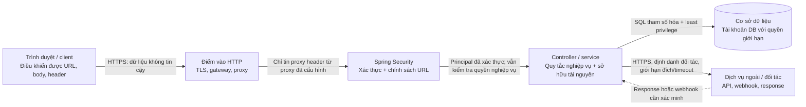

# Ranh giới tin cậy giữa trình duyệt, ứng dụng, cơ sở dữ liệu và dịch vụ ngoài

## Mục tiêu của bài

Trong một hệ thống web, request đi từ trình duyệt đến ứng dụng; ứng dụng lại truy vấn cơ sở dữ liệu và gọi các dịch vụ bên ngoài. Mỗi chặng đều mang theo dữ liệu, danh tính và quyền hạn khác nhau. Nếu ứng dụng mặc nhiên tin rằng dữ liệu đã đi qua một tầng thì an toàn, một đầu vào do kẻ tấn công điều khiển có thể vượt qua ranh giới và biến thành câu lệnh SQL, quyền truy cập dữ liệu, yêu cầu HTTP nội bộ hoặc hành động có đặc quyền.

Bài học này giúp bạn:

1. Xác định **trust boundary (ranh giới tin cậy)** và phân biệt nó với ranh giới mạng, process, service hay lớp Java.
2. Vẽ luồng dữ liệu giữa **browser → ứng dụng → database → dịch vụ ngoài**, xác định nơi cần xác thực, phân quyền, kiểm tra dữ liệu và giới hạn đặc quyền.
3. Giải thích các lỗi như **IDOR/BOLA, SQL injection, CSRF, SSRF, tin cậy nhầm dữ liệu từ bên thứ ba** bằng nguyên nhân chung: vượt ranh giới mà thiếu kiểm tra.
4. Hiểu Spring Security bảo vệ ranh giới **HTTP → ứng dụng** thế nào và vì sao vẫn cần kiểm soát ở controller/service, tầng dữ liệu và khi gọi dịch vụ ngoài.
5. Thực hành với Spring Boot, Spring Security và JDBC để kiểm chứng một người dùng không thể đọc dữ liệu của người khác chỉ bằng cách thay ID trên URL.

Ví dụ sử dụng **Java 17, Spring Boot 3.x, Spring MVC/Servlet và Spring Security 6.x**; các nguyên tắc tư duy bảo mật vẫn áp dụng với những stack khác.

## 1. Trust boundary là gì?

**Ranh giới tin cậy** là điểm mà dữ liệu, yêu cầu hoặc quyền điều khiển đi từ một bên có giả định bảo mật này sang một bên có giả định bảo mật khác. Qua ranh giới đó, phía nhận **phải tự kiểm tra những điều kiện cần thiết** trước khi sử dụng dữ liệu hoặc thực hiện hành động.

Ví dụ, ứng dụng đã đăng nhập cho người dùng `alice`. Trình duyệt gửi:

```http
GET /api/orders/200
Authorization: Basic <credentials>
```

Ở đây có ít nhất hai câu hỏi độc lập:

- **Authentication:** request này thật sự đại diện cho ai?
- **Authorization:** người đó có quyền xem đơn hàng `200` không?

Xác thực thành công **không** chứng minh người dùng sở hữu mọi đơn hàng có thể đoán ra ID. Từ dữ liệu client gửi lên đến câu lệnh truy vấn có quyền đọc database chính là một lần chuyển qua ranh giới tin cậy.

Một nguyên tắc hữu ích: **“Đã được gửi bởi trình duyệt”, “đã qua HTTPS”, “đã ở trong database”, “được trả về từ đối tác”, “đã xác thực” đều không đồng nghĩa với “được phép tin hoàn toàn”.**

### Ranh giới khác với vùng mạng như thế nào?

Phân vùng mạng (`browser` ở Internet, ứng dụng ở private network, database ở subnet riêng) có thể giúp bảo vệ hệ thống. Nhưng trust boundary vẫn tồn tại **ngay trong cùng một ứng dụng**: dữ liệu JSON có thể được parse thành DTO hợp lệ nhưng vẫn chưa đủ điều kiện để cập nhật số dư; một method service có thể được gọi từ hai controller có mức quyền khác nhau; dữ liệu đã lưu trong bảng có thể chứa HTML độc hại nếu hiển thị nguyên dạng.

**Không có một mức “trusted/untrusted” tuyệt đối cho mọi mục đích.** Một username lấy từ phiên xác thực do server quản lý có thể đáng tin hơn username người dùng tự điền; nhưng username đó cũng không tự cấp quyền admin. Một kết quả SQL có thể đúng là lấy từ database, nhưng giá trị chuỗi chứa trong đó vẫn cần mã hóa khi xuất ra HTML.

## 2. Bản đồ các ranh giới trong ứng dụng web



Sơ đồ là luồng khái niệm. Trong Spring MVC chạy trên Servlet, các security filter nằm trong servlet filter chain trước khi `DispatcherServlet` gọi controller; vị trí gateway/proxy, thứ tự filter và việc chia service tùy cách triển khai.

| Ranh giới | Dữ liệu/điều khiển đi qua | Phía nhận cần kiểm tra | Rủi ro khi tin nhầm |
| --- | --- | --- | --- |
| Trình duyệt → ứng dụng | URL, ID, cookie, token, JSON, file upload, HTTP headers | Danh tính, quyền với tài nguyên, định dạng, kích thước, CSRF khi phù hợp | IDOR/BOLA, nâng quyền, dữ liệu độc hại, CSRF |
| Reverse proxy → ứng dụng | `Forwarded`, `X-Forwarded-For`, hostname, protocol | Chỉ chấp nhận metadata từ proxy tin cậy, cấu hình đúng chuỗi proxy | Giả IP nguồn, sinh redirect sai, lách giới hạn dựa trên IP |
| Ứng dụng → database | Truy vấn và tài khoản kết nối DB | Truy vấn tham số hóa, quyền truy vấn, giới hạn dữ liệu theo người dùng/tenant | SQL injection, đọc vượt phạm vi, xóa/sửa hàng loạt |
| Database → ứng dụng/HTML | Dữ liệu đã lưu, có thể do người dùng nhập | Quy tắc nghiệp vụ, encoding theo nơi hiển thị, giới hạn nội dung | Stored XSS, dữ liệu sai ngữ cảnh, lộ thông tin |
| Ứng dụng → dịch vụ ngoài | URL, request, API key, dữ liệu cá nhân | Đúng endpoint, xác thực TLS, quyền egress, timeout, chỉ gửi trường cần thiết | SSRF, rò token/PII, gọi hệ thống nội bộ |
| Dịch vụ ngoài → ứng dụng | JSON, status, redirect, webhook | Chữ ký hoặc cơ chế xác thực thích hợp, schema, kích thước, freshness/replay | Dữ liệu giả, cấp quyền sai, thực thi giao dịch lặp |

Ranh giới cần bảo vệ dựa vào **ai điều khiển dữ liệu hoặc thao tác** và **đặc quyền mới mà dữ liệu sắp được hưởng**. Đây là câu hỏi cốt lõi của threat modeling.

## 3. Trình duyệt → ứng dụng: người dùng có thể thay mọi dữ liệu họ gửi

### 3.1. Frontend không phải bộ kiểm soát quyền đáng tin cậy

Một form có thể ẩn nút “Xóa”, khóa input `role`, dùng JavaScript kiểm tra số tiền hoặc chỉ cho phép chọn một số ID. Nhưng người dùng vẫn có thể sửa request bằng DevTools, curl, script hoặc client tự viết.

Ví dụ nguy hiểm:

```json
{
  "orderId": 200,
  "owner": "alice",
  "role": "ADMIN",
  "price": 0
}
```

Không được coi các trường `owner`, `role` hoặc `price` trong body là chân lý nghiệp vụ. Server cần lấy danh tính từ cơ chế xác thực, tra quyền từ nguồn tin cậy và tính lại giá trị do server sở hữu. Kiểm tra phía browser giúp trải nghiệm người dùng nhưng không thay thế kiểm tra phía server.

### 3.2. HTTPS, CORS, CSRF và XSS giải quyết các vấn đề khác nhau

| Cơ chế | Chống lại điều gì? | Không thay thế được điều gì? |
| --- | --- | --- |
| **HTTPS/TLS** | Giảm nguy cơ nghe lén, sửa nội dung khi truyền; xác thực endpoint nếu kiểm tra chứng chỉ đúng | Không chứng minh nội dung request hợp lệ hoặc người dùng được phép làm thao tác |
| **Authentication** | Xác định danh tính của request, ví dụ session, HTTP Basic, bearer token | Không tự quyết định tài nguyên nào của ai được đọc/sửa |
| **Authorization** | Cho phép hoặc từ chối thao tác theo quyền, đối tượng, tenant, ngữ cảnh | Không tự chống SQL injection, XSS hay SSRF |
| **CORS** | Điều khiển những origin được browser cho phép đọc response qua cross-origin JS, với các quy tắc nhất định | Không phải firewall; curl/server khác không bị browser CORS chặn; không đủ để phân quyền |
| **CSRF protection** | Giảm nguy cơ website khác kích hoạt thao tác bằng thông tin xác thực được browser tự đính kèm, nhất là cookie phiên | Không thay thế XSS protection hay authorization |
| **Output encoding / CSP** | Giảm rủi ro script độc hại thực thi khi hiển thị dữ liệu, tạo nhiều lớp chống XSS | Không thay thế kiểm tra quyền API hoặc CSRF |

Ví dụ: một SPA dùng session cookie để cập nhật địa chỉ giao hàng. Browser thường tự gửi cookie phù hợp với request; vì vậy server phải xét nguy cơ CSRF cho thao tác thay đổi trạng thái. `SameSite` của cookie có ích, nhưng không nên được coi là lý do mặc định loại bỏ CSRF protection. Nếu attacker khai thác XSS ở cùng origin, họ có thể làm nhiều hành động trong ngữ cảnh phiên người dùng; CORS không ngăn được XSS cùng origin.

Với bearer token gửi tường minh qua header, mô hình CSRF có thể khác cookie tự động, nhưng phải đánh giá cách browser lưu/gửi token và các luồng hỗ trợ. Không mặc định tắt CSRF chỉ vì API dùng JSON.

### 3.3. Spring Security bảo vệ điểm vào nào?

Với ứng dụng **Spring MVC/Servlet**:

```text
Client
  -> Servlet container
  -> DelegatingFilterProxy / FilterChainProxy
  -> SecurityFilterChain (xác thực, phân quyền request, CSRF, ...)
  -> DispatcherServlet
  -> Controller
  -> Service
```

Spring Security tạo/duy trì `Authentication` trong ngữ cảnh bảo mật và kiểm tra quy tắc như `authenticated()`, `hasRole(...)` hoặc `hasAuthority(...)`. **Kiểm soát truy cập URL** rất quan trọng nhưng chưa đủ khi quyền phụ thuộc ID thực tế trong database.

Ví dụ:

```java
.requestMatchers("/api/orders/**").authenticated()
```

Điều này yêu cầu đăng nhập, nhưng vẫn cho phép người dùng đã đăng nhập **thử ID bất kỳ**. Service phải kiểm tra người đó có quan hệ hợp lệ với đơn hàng; cách chắc chắn thường là kết hợp điều kiện sở hữu/tenant ngay trong truy vấn dữ liệu hoặc kiểm tra quyền bằng policy nghiệp vụ.

Một server có thể không tiết lộ liệu ID thuộc người khác có tồn tại hay không bằng cách trả `404 Not Found` cho cả “không tồn tại” và “không thuộc người gọi”. Lựa chọn trả `403` hay `404` là chính sách API; điều quan trọng là **không trả dữ liệu ngoài quyền**.

## 4. Ứng dụng → cơ sở dữ liệu: khác nhau giữa quyền của connection và quyền người dùng

Ứng dụng kết nối database bằng một **service account**. Account này thường có quyền đọc/sửa trên nhiều hàng, trong khi người dùng cuối chỉ nên tác động đến một phần rất nhỏ. Nếu ứng dụng dùng đặc quyền kết nối để chạy truy vấn theo ID mà client cung cấp, nó có thể trở thành **confused deputy**: thành phần có quyền thực hiện thao tác thay cho người gọi mà không kiểm tra người gọi có quyền không.

### 4.1. Chống SQL injection bằng truy vấn tham số hóa

**Sai: nối input vào câu SQL**

```java
String sql = "SELECT id, label FROM purchase_orders WHERE id = " + idFromRequest;
```

Nếu đầu vào không được kiểm soát, ký tự do người dùng nhập có thể trở thành cú pháp SQL. Validate kiểu dữ liệu là hữu ích, nhưng biện pháp căn bản là **bind parameter**:

```java
jdbcTemplate.query(
    "SELECT id, label FROM purchase_orders WHERE id = ? AND owner_username = ?",
    (rs, row) -> new OrderView(rs.getLong("id"), rs.getString("label")),
    requestedId,
    authenticatedUsername
);
```

`?` tách dữ liệu khỏi cấu trúc câu lệnh. Điều kiện `owner_username = ?` **thêm kiểm soát phạm vi**: ngay cả khi attacker biết ID của người khác, query không trả về hàng đó. Hai cơ chế giải quyết hai nguy cơ khác nhau: tham số hóa chống SQL injection; kiểm tra ownership/tenant chống truy cập sai quyền.

Đối với tên bảng/cột hoặc thứ tự sort mà SQL parameter không bind được, dùng allowlist mapping giá trị hợp lệ sang identifier tĩnh. Đừng lấy chuỗi bất kỳ từ client nối vào `ORDER BY` hay tên bảng.

### 4.2. Database có thể giữ dữ liệu không đáng tin cậy

Đã lưu trong DB không có nghĩa là an toàn để đưa thẳng lên trang web. Ví dụ một ô ghi chú được người dùng nhập có chứa HTML/script. Nếu frontend lấy chuỗi đó và gán vào `innerHTML`, có thể tạo **stored XSS**. Dùng hiển thị text an toàn và output encoding theo ngữ cảnh; khi buộc hiển thị HTML, áp dụng sanitizer phù hợp.

Tương tự, nội dung DB lấy từ quy trình import, đồng bộ đối tác hoặc user cũ không nên tự động được coi là quyền, câu lệnh hoặc cấu hình. Nguồn gốc và nơi sử dụng dữ liệu quyết định kiểm tra cần thiết.

### 4.3. Giới hạn đặc quyền DB và phạm vi truy vấn

Các lớp phòng vệ bổ sung:

- Dùng account riêng theo ứng dụng/môi trường, chỉ cấp quyền cần thiết; không dùng tài khoản DBA cho web runtime.
- Áp `WHERE owner_id = ?` hoặc `tenant_id = ?` cho từng truy vấn theo phạm vi; với hệ thống phức tạp có thể cân nhắc row-level security của DB như lớp bổ sung, cần cấu hình và kiểm thử riêng.
- Giới hạn số bản ghi/page size, thời gian truy vấn, khối lượng upload và quyền gọi stored procedure.
- Đặt DB trong mạng kiểm soát truy cập; bật TLS khi kết nối qua đường truyền cần bảo vệ.
- Không đưa password DB vào source code, JSON response hoặc log; sử dụng secret manager/cơ chế cấu hình bảo mật thích hợp.
- Ghi audit cho thao tác nhạy cảm nhưng tránh log password, token, dữ liệu cá nhân không cần thiết.

**Input validation**, **SQL parameterization**, **authorization** và **DB least privilege** cần phối hợp; một lớp không thể thay thế các lớp còn lại.

## 5. Ứng dụng → dịch vụ ngoài: hướng gọi ra cũng là ranh giới tin cậy

Một ứng dụng có thể có quyền truy cập mạng nội bộ, metadata service của môi trường cloud, database hoặc API đối tác. Nếu endpoint công khai cho phép người dùng điều khiển URL mà server sẽ tải, quyền mạng của server có thể bị lợi dụng để gọi đến những nơi client không được phép truy cập: **server-side request forgery (SSRF)**.

### 5.1. Ví dụ sai và cách định hướng sửa

**Nguy hiểm:** lấy URL do client gửi rồi cho server tải trực tiếp.

```java
// Minh họa lỗi thiết kế: không dùng cho hệ thống thật.
String target = request.getParameter("url");
String body = httpClient.send(
    HttpRequest.newBuilder(URI.create(target)).GET().build(),
    HttpResponse.BodyHandlers.ofString()
).body();
```

Không chỉ URL với `localhost` mới nguy hiểm. Redirect, DNS rebinding, địa chỉ IP nội bộ, IPv6, encoding và các phương thức truy cập tài nguyên không được dự tính cũng có thể làm bộ kiểm tra chuỗi đơn giản bị qua mặt.

Hướng thiết kế an toàn hơn:

1. Định nghĩa trước **đích được phép** trong cấu hình server; client chọn một mã nghiệp vụ như `carrier=partnerA`, không chọn hostname hoặc URL tùy ý.
2. Không tự động theo redirect đến đích ngoài phạm vi cho phép; kiểm tra scheme, host, port, địa chỉ IP đã resolve và các lần chuyển hướng theo nhu cầu thực tế.
3. Dùng **HTTPS** và kiểm tra chứng chỉ; nếu đối tác yêu cầu, dùng cơ chế xác thực client thích hợp (API key, OAuth2 client credentials, mTLS).
4. Đặt timeout, giới hạn kích thước response và số lần retry. Retry các thao tác thay đổi trạng thái cần xét idempotency.
5. Phân quyền mạng egress để process không thể kết nối dịch vụ nhạy cảm ngoài nhu cầu; không phụ thuộc duy nhất vào kiểm tra URL trong code.
6. Xem dữ liệu trả về là input từ bên thứ ba: parse schema, giới hạn độ dài/kiểu dữ liệu, không biến các trường đối tác thành role/SQL/đường dẫn/file tùy ý.
7. Chỉ gửi những dữ liệu tối thiểu đối tác cần; không forward nguyên header `Authorization` của người dùng hoặc cookie phiên sang đối tác.

### 5.2. Ví dụ client Java 17 với đích cố định

Đoạn sau là **lớp minh họa độc lập về outbound transport**, có thể biên dịch cùng Java 17; tên miền `partner.example` chỉ là placeholder tài liệu, vì vậy không có dịch vụ thật để gọi thử. Ở hệ thống thật, cần thêm chính sách egress/DNS, xác thực đối tác, giới hạn response và parse/validate nội dung.

```java
import java.io.IOException;
import java.net.URI;
import java.net.http.HttpClient;
import java.net.http.HttpRequest;
import java.net.http.HttpResponse;
import java.time.Duration;

public final class PartnerClient {
    private final URI endpoint = URI.create("https://partner.example/api/status");
    private final HttpClient client = HttpClient.newBuilder()
            .connectTimeout(Duration.ofSeconds(3))
            .followRedirects(HttpClient.Redirect.NEVER)
            .build();

    public String getStatus() throws IOException, InterruptedException {
        HttpRequest request = HttpRequest.newBuilder(endpoint)
                .timeout(Duration.ofSeconds(5))
                .header("Accept", "application/json")
                .GET()
                .build();

        HttpResponse<String> response =
                client.send(request, HttpResponse.BodyHandlers.ofString());

        if (response.statusCode() != 200) {
            throw new IOException("Partner unavailable");
        }
        return response.body(); // Input chưa được xác minh schema/giới hạn!
    }
}
```

Lớp này **không lấy URL từ request người dùng**, tự động redirect bị tắt và có thời gian chờ. Tuy vậy, nó **chưa phải client production hoàn chỉnh**: `ofString()` có thể đọc response lớn vào bộ nhớ; cần giới hạn kích thước body, kiểm tra Content-Type/schema, xử lý lỗi, xác thực đối tác và egress policy. Mã `200` chỉ nói HTTP request được xử lý ở cấp giao thức, không chứng minh dữ liệu đối tác đúng sự thật.

### 5.3. Dịch vụ ngoài → ứng dụng: webhook cũng là request từ một bên khác

Giả sử cổng thanh toán gọi `POST /webhooks/payment` với payload báo “đã thanh toán”. Không được cập nhật trạng thái đơn hàng chỉ vì JSON có `status=PAID`.

Cần xác nhận endpoint có đúng cơ chế xác thực do đối tác định nghĩa hay không (ví dụ HMAC signature trên **raw body** với secret dùng riêng); kiểm tra timestamp và chống replay/duplicate; đối chiếu ID giao dịch, đơn vị tiền, số tiền, trạng thái và merchant với bản ghi nội bộ. Thực hiện cập nhật idempotent, ghi audit thích hợp và kiểm tra thứ tự/sự kiện trễ. Không lấy tham số từ webhook để bỏ qua những đối chiếu này.

Với webhook, `permitAll()` nếu cần bỏ yêu cầu đăng nhập người dùng thông thường **không đồng nghĩa** với “không xác thực”: chính webhook handler vẫn phải xác minh danh tính nguồn và tính toàn vẹn payload bằng cơ chế thích hợp. Không dùng `Origin` hay chỉ IP làm bằng chứng tuyệt đối về người gửi.

## 6. Ví dụ chạy được: xác thực ở HTTP, giới hạn dữ liệu tại DB

Mục tiêu: người dùng `alice` đăng nhập có thể xem bản ghi của mình, nhưng **không** xem được bản ghi của `bob` dù biết đúng ID. Ví dụ này thực thi phần ranh giới **browser → Spring Security → Spring MVC → database** bằng H2 in-memory. Dịch vụ ngoài đã được trình bày riêng ở mục 5 vì endpoint đối tác thực cần hợp đồng, credentials và môi trường mạng riêng.

Cấu hình dùng HTTP Basic để dễ kiểm chứng với curl, **không dùng cookie phiên do một frontend thực tế quản lý**. Chỉ triển khai endpoint `GET` và giữ cơ chế CSRF mặc định; vì không tạo request thay đổi trạng thái, ví dụ không cần tắt CSRF. Mật khẩu thử nghiệm và H2 chỉ dành cho môi trường cục bộ.

### 6.1. Cấu trúc project

```text
trust-boundary-demo/
├── pom.xml
└── src/main/
    ├── java/com/example/boundary/
    │   ├── DemoApplication.java
    │   ├── SecurityConfig.java
    │   └── OrderController.java
    └── resources/
        ├── application.properties
        ├── schema.sql
        └── data.sql
```

### 6.2. Maven `pom.xml`

```xml
<project xmlns="http://maven.apache.org/POM/4.0.0"
         xmlns:xsi="http://www.w3.org/2001/XMLSchema-instance"
         xsi:schemaLocation="http://maven.apache.org/POM/4.0.0 https://maven.apache.org/xsd/maven-4.0.0.xsd">
    <modelVersion>4.0.0</modelVersion>
    <parent>
        <groupId>org.springframework.boot</groupId>
        <artifactId>spring-boot-starter-parent</artifactId>
        <version>3.5.0</version>
        <relativePath/>
    </parent>
    <groupId>com.example</groupId>
    <artifactId>trust-boundary-demo</artifactId>
    <version>1.0.0</version>
    <properties>
        <java.version>17</java.version>
    </properties>
    <dependencies>
        <dependency>
            <groupId>org.springframework.boot</groupId>
            <artifactId>spring-boot-starter-web</artifactId>
        </dependency>
        <dependency>
            <groupId>org.springframework.boot</groupId>
            <artifactId>spring-boot-starter-security</artifactId>
        </dependency>
        <dependency>
            <groupId>org.springframework.boot</groupId>
            <artifactId>spring-boot-starter-jdbc</artifactId>
        </dependency>
        <dependency>
            <groupId>com.h2database</groupId>
            <artifactId>h2</artifactId>
            <scope>runtime</scope>
        </dependency>
    </dependencies>
    <build>
        <plugins>
            <plugin>
                <groupId>org.springframework.boot</groupId>
                <artifactId>spring-boot-maven-plugin</artifactId>
            </plugin>
        </plugins>
    </build>
</project>
```

Spring Boot quản lý phiên bản dependency tương thích qua parent/BOM. Version `3.5.0` là một điểm tham chiếu Boot 3.x của ví dụ; khi triển khai thật nên chọn phiên bản vá còn được hỗ trợ. Ví dụ sử dụng Spring MVC/Servlet, không dùng các API reactive tương ứng của WebFlux.

### 6.3. `DemoApplication.java`

```java
package com.example.boundary;

import org.springframework.boot.SpringApplication;
import org.springframework.boot.autoconfigure.SpringBootApplication;

@SpringBootApplication
public class DemoApplication {
    public static void main(String[] args) {
        SpringApplication.run(DemoApplication.class, args);
    }
}
```

### 6.4. `SecurityConfig.java`

```java
package com.example.boundary;

import org.springframework.context.annotation.Bean;
import org.springframework.context.annotation.Configuration;
import org.springframework.http.HttpMethod;
import org.springframework.security.config.Customizer;
import org.springframework.security.config.annotation.web.builders.HttpSecurity;
import org.springframework.security.config.annotation.web.configurers.AbstractHttpConfigurer;
import org.springframework.security.core.userdetails.User;
import org.springframework.security.core.userdetails.UserDetailsService;
import org.springframework.security.crypto.bcrypt.BCryptPasswordEncoder;
import org.springframework.security.crypto.password.PasswordEncoder;
import org.springframework.security.provisioning.InMemoryUserDetailsManager;
import org.springframework.security.web.SecurityFilterChain;

@Configuration(proxyBeanMethods = false)
public class SecurityConfig {
    @Bean
    SecurityFilterChain securityFilterChain(HttpSecurity http) throws Exception {
        http
            .authorizeHttpRequests(auth -> auth
                .requestMatchers(HttpMethod.GET, "/api/orders/**").authenticated()
                .anyRequest().denyAll()
            )
            .httpBasic(Customizer.withDefaults())
            .formLogin(AbstractHttpConfigurer::disable);
        return http.build();
    }

    @Bean
    PasswordEncoder passwordEncoder() {
        return new BCryptPasswordEncoder();
    }

    @Bean
    UserDetailsService users(PasswordEncoder encoder) {
        return new InMemoryUserDetailsManager(
            User.withUsername("alice")
                .password(encoder.encode("alice-password"))
                .roles("USER").build(),
            User.withUsername("bob")
                .password(encoder.encode("bob-password"))
                .roles("USER").build()
        );
    }
}
```

Ở ranh giới HTTP, Spring Security xác thực credentials và cung cấp `Authentication`. Rule `authenticated()` trả lời “đã đăng nhập chưa?”. Chưa có quy tắc nào xác nhận “đơn hàng này thuộc ai”; bước đó nằm ở truy vấn database. `anyRequest().denyAll()` tránh vô tình mở một endpoint ngoài những đường dẫn đã chỉ định.

Không dùng tài khoản hard-code và HTTP Basic không mã hóa ở tầng ứng dụng cho hệ thống thật; hãy dùng phương thức đăng nhập phù hợp và HTTPS, quản lý secret đúng cách. `BCryptPasswordEncoder` ở đây để minh họa không lưu mật khẩu dạng plaintext trong `UserDetails`.

### 6.5. `OrderController.java`

```java
package com.example.boundary;

import java.util.List;

import org.springframework.http.ResponseEntity;
import org.springframework.jdbc.core.JdbcTemplate;
import org.springframework.security.core.Authentication;
import org.springframework.web.bind.annotation.GetMapping;
import org.springframework.web.bind.annotation.PathVariable;
import org.springframework.web.bind.annotation.RestController;

@RestController
public class OrderController {
    private final JdbcTemplate jdbc;

    public OrderController(JdbcTemplate jdbc) {
        this.jdbc = jdbc;
    }

    @GetMapping("/api/orders/{id}")
    public ResponseEntity<OrderView> getOrder(
            @PathVariable long id,
            Authentication authentication) {

        String currentUser = authentication.getName();

        List<OrderView> results = jdbc.query(
            """
            SELECT id, label
            FROM purchase_orders
            WHERE id = ? AND owner_username = ?
            """,
            (rs, rowNum) -> new OrderView(
                rs.getLong("id"),
                rs.getString("label")
            ),
            id,
            currentUser
        );

        if (results.isEmpty()) {
            return ResponseEntity.notFound().build();
        }
        return ResponseEntity.ok(results.get(0));
    }

    public record OrderView(long id, String label) {}
}
```

**Ba điều phải chú ý trong đoạn code:**

1. `id` từ URL là input do client điều khiển; Spring chỉ chuyển nó thành `long`, **không** chứng minh client có quyền với ID đó.
2. `currentUser` lấy từ `Authentication` đã được Security filter thiết lập sau xác thực. Không đọc username từ query parameter hoặc body tùy ý.
3. Câu SQL dùng hai tham số, bao gồm `owner_username`, để **giới hạn hàng ngay khi lấy dữ liệu**. Response chỉ chứa `id` và `label` cần thiết; không xuất dữ liệu nội bộ như `owner_username` hay cấu trúc DB không cần thiết.

Nếu ID không tồn tại **hoặc** thuộc người khác, response là `404`. Đây là lựa chọn có chủ ý để tránh tiết lộ quyền sở hữu hoặc sự tồn tại của bản ghi. Với ứng dụng thật, chính sách quyền có thể phức tạp hơn (owner, delegate, admin, tenant, trạng thái đơn), cần định nghĩa và kiểm thử tại tầng nghiệp vụ.

### 6.6. `application.properties`, `schema.sql` và `data.sql`

`application.properties`:

```properties
spring.datasource.url=jdbc:h2:mem:boundary_demo;DB_CLOSE_DELAY=-1
spring.datasource.driver-class-name=org.h2.Driver
spring.datasource.username=sa
spring.datasource.password=
spring.sql.init.mode=always
```

`schema.sql`:

```sql
CREATE TABLE purchase_orders (
    id BIGINT PRIMARY KEY,
    owner_username VARCHAR(60) NOT NULL,
    label VARCHAR(120) NOT NULL
);
```

`data.sql`:

```sql
INSERT INTO purchase_orders (id, owner_username, label)
VALUES
    (100, 'alice', 'Alice order'),
    (200, 'bob', 'Bob order');
```

Spring Boot khởi tạo H2 từ hai file SQL ở `resources` theo cấu hình này. Tài khoản `sa` và database trong bộ nhớ giúp học tập; với DB sản xuất phải đặt tài khoản kết nối có đặc quyền tối thiểu, kiểm soát mạng và quản lý secret.

### 6.7. Chạy và kiểm tra qua ranh giới

Cần JDK 17+ và Maven; từ thư mục `trust-boundary-demo` chạy:

```bash
mvn spring-boot:run
```

Mở terminal khác (trên PowerShell dùng `curl.exe` thay cho alias `curl`):

```bash
curl -i http://localhost:8080/api/orders/100
curl -i -u alice:alice-password http://localhost:8080/api/orders/100
curl -i -u alice:alice-password http://localhost:8080/api/orders/200
curl -i -u bob:bob-password http://localhost:8080/api/orders/200
curl -i -u alice:wrong-password http://localhost:8080/api/orders/100
```

| Gọi API | Trạng thái mong đợi | Điều chứng minh |
| --- | --- | --- |
| Không credentials, `GET /api/orders/100` | `401 Unauthorized` | Spring Security bảo vệ ranh giới HTTP |
| Alice đọc ID `100` | `200 OK`, JSON `{"id":100,"label":"Alice order"}` | Đã xác thực và được phép đọc hàng của Alice |
| Alice đọc ID `200` | `404 Not Found` | Đăng nhập hợp lệ vẫn không vượt qua ownership trong SQL |
| Bob đọc ID `200` | `200 OK`, JSON `{"id":200,"label":"Bob order"}` | Cùng endpoint, quyền phụ thuộc danh tính hiện tại |
| Alice dùng sai password | `401 Unauthorized` | Không qua được bước xác thực |

Mã `200` hoặc `404` như bảng là kỳ vọng với chính xác file cấu hình trong bài; header HTTP khác có thể phụ thuộc môi trường. Ví dụ chỉ dùng `GET`, nên không kết luận từ bài này rằng CSRF hay các thao tác ghi đã được xử lý đầy đủ.

Thử một thay đổi **chỉ trên môi trường học tập**: bỏ điều kiện `AND owner_username = ?` cùng argument `currentUser` trong câu SQL, khởi động lại và gọi Alice đọc ID `200`. Khi đó query chỉ còn lọc theo ID và có thể trả đơn của Bob. Sự khác biệt chứng minh `authenticated()` ở filter **không đủ** để bảo vệ tài nguyên nhiều người dùng. Sau thử nghiệm, khôi phục điều kiện ownership.

## 7. Tình huống trước–sau khi vượt ranh giới

### Tình huống A: client tự nhận quyền quản trị

**Trước:** backend nhận JSON `{"role":"ADMIN"}` rồi ghi trực tiếp vào bảng người dùng vì frontend đã ẩn trường role. **Sai ở ranh giới:** dữ liệu browser được coi là quyết định cấp quyền.

**Sau:** endpoint tự lấy người gọi từ security context; chỉ chính sách server (ví dụ một workflow admin có kiểm tra `hasAuthority(...)`, quyền và audit) mới quyết định việc gán role. DTO công khai không có trường mà client không được tự chọn.

### Tình huống B: đọc thông tin tài khoản khác

**Trước:** `GET /api/accounts/42` chỉ cần `authenticated()`, service chạy `SELECT * WHERE id = 42`. **Sai ở ranh giới:** account DB có thể đọc mọi hàng; người dùng cuối không có quyền tương đương.

**Sau:** kiểm tra quyền sở hữu/tenant ở service và query; nếu dùng `@PreAuthorize`, phải thực sự bật method security bằng `@EnableMethodSecurity` và bảo đảm lời gọi đi qua proxy. Không coi annotation là biện pháp thay thế việc giới hạn query cho các luồng truy cập khác.

### Tình huống C: server tải URL tùy ý

**Trước:** `POST /preview` nhận `url` bất kỳ, backend dùng quyền truy cập mạng nội bộ để tải URL. **Sai ở ranh giới:** một client không có quyền truy cập mạng nội bộ đã điều khiển thành phần có quyền đó.

**Sau:** chỉ chấp nhận ID hoặc mã endpoint đã được server định nghĩa; hạn chế redirect, URL/IP/port, cấu hình egress; giới hạn dữ liệu trả về; không chuyển tiếp session/token sang host lạ.

### Tình huống D: tin trạng thái thanh toán từ webhook

**Trước:** một request gửi `{"orderId":100,"paid":true}` là đủ để đánh dấu thanh toán. **Sai ở ranh giới:** JSON từ Internet được trao quyền đổi trạng thái tài chính.

**Sau:** xác thực chữ ký webhook theo hợp đồng đối tác, chống replay, tra giao dịch thực, đối chiếu amount/currency/order và xử lý idempotent. Đăng nhập người dùng và xác thực webhook là hai cơ chế danh tính khác nhau.

## 8. Cách xác định và bảo vệ ranh giới trong thiết kế

Khi thiết kế một tính năng, thử đi theo dữ liệu từ nguồn đến hành động:

1. **Ai tạo hoặc sửa được dữ liệu?** User, browser, proxy, scheduler, DB operator, hệ thống đối tác hay queue? “Dữ liệu đến từ hệ thống nội bộ” vẫn cần xem quyền của bên ghi.
2. **Dữ liệu sẽ được dùng làm gì?** Hiển thị, tìm kiếm, quyết định role, lập SQL, chọn URL, gọi lệnh, cập nhật giao dịch, gửi cho đối tác?
3. **Phía nhận có đặc quyền nào nhiều hơn phía gửi?** DB connection quyền rộng, secret của server, mạng nội bộ, quyền admin hoặc khả năng gọi thanh toán.
4. **Điểm xác thực và phân quyền nào kiểm chứng điều đó?** Spring Security URL rule, method security, ownership/tenant policy, dữ liệu từ server, chữ ký webhook, client authentication.
5. **Biện pháp xử lý input và output nào cần có?** Kiểu/độ dài/allowlist, parameterized SQL, escaping, giới hạn upload, schema response, timeout và bounded response.
6. **Nếu một lớp bị bỏ qua thì điều gì hạn chế thiệt hại?** Quyền DB tối thiểu, network segmentation/egress, quotas, audit, rate limiting, transaction checks.
7. **Kiểm chứng bằng test âm như thế nào?** User A thử ID của B; credentials sai; request ghi thiếu CSRF token khi dùng cookie; payload SQL đặc biệt; partner response sai schema; webhook gửi lặp/giả chữ ký.

Một threat model gọn cho API có thể lưu theo bảng:

| Tài sản | Đường dữ liệu | Kẻ tấn công có thể kiểm soát | Chính sách bảo vệ | Test âm |
| --- | --- | --- | --- | --- |
| Đơn hàng | Browser → API → DB | `orderId`, body, header | Authenticated principal + owner/tenant query | Alice không đọc được đơn của Bob |
| Session | Browser → API | Cookie và request cross-site | Cookie attributes phù hợp + CSRF theo mô hình session | POST thiếu token bị từ chối |
| Database | API → DB | Giá trị filter/sort từ client | Bind parameter + allowlist identifier + quyền DB | Payload injection không đổi cú pháp SQL |
| Network nội bộ | API → đối tác | Mã yêu cầu hoặc URL nếu thiết kế sai | Fixed destination + egress + timeout | Không thể chỉ định loopback/internal URL |
| Trạng thái thanh toán | Đối tác → webhook → DB | Payload và tần suất gọi | Xác thực chữ ký + kiểm tra sự kiện/idempotency | Webhook giả/lặp không tạo thanh toán mới |

Bảng này không phải danh mục đủ cho mọi hệ thống; nó giúp chỉ ra **nguồn không tin cậy, đích có đặc quyền và kiểm tra cần đặt đúng nơi**.

## 9. Những nhầm lẫn phổ biến

1. **“HTTPS biến client thành đáng tin cậy.”** HTTPS chủ yếu bảo vệ kênh truyền và xác thực endpoint. Người dùng có thể chủ động gửi input độc hại qua một kết nối HTTPS hoàn toàn hợp lệ.
2. **“Đã login là có thể truy cập mọi ID.”** Login xác nhận người gọi, không xác nhận quyền sở hữu từng bản ghi. Đây là nguồn gốc thường gặp của IDOR/BOLA.
3. **“CORS ngăn người ngoài gọi API.”** CORS là quy tắc browser áp khi đọc response cross-origin; server khác hoặc curl vẫn có thể gửi request. API vẫn phải xác thực và phân quyền.
4. **“Dữ liệu từ database sạch hơn dữ liệu client.”** Dữ liệu lưu trữ có thể bắt nguồn từ chính client, file import hoặc đối tác; cần xử lý theo nơi sử dụng, đặc biệt khi đưa vào HTML.
5. **“Parameterized SQL đã chặn mọi lộ dữ liệu.”** Nó chống injection vào cấu trúc câu SQL; vẫn phải lọc theo owner/tenant và giới hạn quyền database.
6. **“Server nội bộ có thể gọi URL nào cũng an toàn.”** Server có thể có quyền mạng vượt xa client; URL hoặc redirect do client điều khiển có thể tạo SSRF.
7. **“Đối tác trả HTTP 200 thì kết quả đã đúng.”** Phải kiểm tra danh tính đối tác, schema, nội dung, phạm vi tin cậy và quy tắc nghiệp vụ.
8. **“Spring Security bảo vệ tất cả các ranh giới thay ứng dụng.”** Spring Security xử lý nhiều cơ chế xác thực/phân quyền; code nghiệp vụ vẫn phải chống truy cập sai owner/tenant, SQL injection, SSRF và dữ liệu trả về không hợp lệ.
9. **“Tắt một nút frontend là đủ chặn một hành động.”** Client có thể tự tạo request. Backend phải kiểm tra quyền tại thời điểm thực hiện hành động.
10. **“Đã ở mạng private thì có thể bỏ xác thực giữa các service.”** Mạng riêng là một lớp phòng vệ; danh tính service, quyền, cấu hình proxy và trust của dữ liệu vẫn cần kiểm soát theo hệ thống.

## 10. Câu hỏi tự kiểm tra

**Câu 1.** User Alice đã đăng nhập; tại sao `GET /api/orders/200` vẫn có thể phải bị từ chối?  
**Giải thích:** `authenticated()` chỉ đảm bảo có danh tính; quyền với đơn hàng cụ thể phải lấy từ chính sách sở hữu/tenant hoặc vai trò hợp lệ.

**Câu 2.** Nếu SQL đã dùng placeholder `?`, liệu Alice có tự động bị chặn xem dữ liệu Bob?  
**Giải thích:** Không. Placeholder ngăn dữ liệu trở thành cú pháp SQL, nhưng chính sách quyền cần điều kiện như `owner_username = ?` hoặc một bước authorization tương đương.

**Câu 3.** Nếu API chỉ cho phép CORS từ `https://app.example`, một chương trình curl ở máy khác có gửi request được không?  
**Giải thích:** Có. CORS không thay thế xác thực hay firewall; nó là cơ chế được browser thực thi đối với các tình huống cross-origin cụ thể.

**Câu 4.** Client gửi URL để backend tải một ảnh; ranh giới nào đáng chú ý?  
**Giải thích:** Đầu vào của client được sử dụng để điều khiển outbound HTTP request có quyền mạng của server. Cần kiểm soát đích, redirect, DNS/egress và kích thước response để hạn chế SSRF.

**Câu 5.** Vì sao webhook có chữ ký hợp lệ vẫn cần kiểm tra nghiệp vụ?  
**Giải thích:** Chữ ký xác nhận một thuộc tính nguồn/tính toàn vẹn theo hợp đồng, không đảm bảo orderId, amount, currency, trạng thái và thứ tự sự kiện phù hợp với bản ghi của ứng dụng.

**Câu 6.** Có nên dùng `@PreAuthorize` là đủ để loại bỏ điều kiện tenant trong mọi truy vấn?  
**Giải thích:** Không nên mặc định như vậy. Quyền trong annotation cần được bật và thực thi qua đúng đường gọi; ràng buộc query theo tenant/owner và quyền DB tối thiểu làm giảm nguy cơ lỗi ở các luồng khác.

## Kết luận

**Ranh giới tin cậy xuất hiện mỗi khi dữ liệu hoặc yêu cầu đi vào một thành phần có quyền mới.** Với ứng dụng Spring MVC, Spring Security xác thực và áp chính sách ở điểm vào HTTP; controller/service kiểm tra quyền nghiệp vụ theo tài nguyên; tầng database thực thi truy vấn tham số hóa và nguyên tắc đặc quyền tối thiểu; khi đi ra hoặc nhận dữ liệu từ dịch vụ ngoài phải kiểm soát endpoint, danh tính, dữ liệu, timeout và tác động nghiệp vụ. Thiết kế tốt không hỏi “dữ liệu đã đi qua hệ thống của mình chưa?”, mà hỏi **“ai điều khiển dữ liệu này, nó sắp được hưởng quyền gì, và kiểm tra nào chứng minh hành động được phép?”**