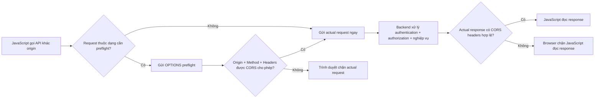
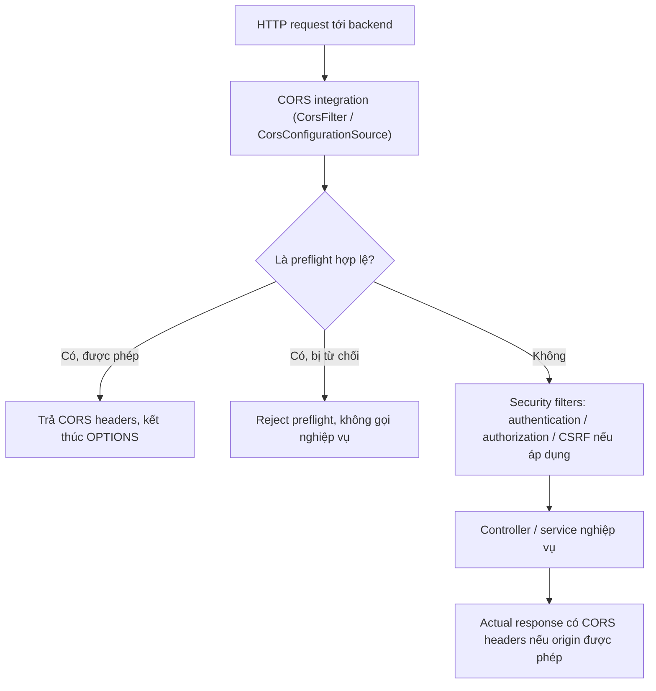

# Phân biệt yêu cầu trực tiếp với preflight OPTIONS

> **Ngữ cảnh:** Spring Security – fundamentals / **CORS**. Bài phân biệt yêu cầu cross-origin mà trình duyệt gửi **trực tiếp** với yêu cầu cần gửi **preflight OPTIONS** trước, sau đó áp dụng trong Spring MVC và Spring Security. Ví dụ sử dụng Java 17, Spring Boot 3.5.0, Spring Security 6.x, MockMvc và một trang frontend chạy ở cổng khác. Các token cố định trong bản demo chỉ dùng cho **localhost**, không triển khai production.

## 1. Mục tiêu

Sau bài này, bạn sẽ biết:

1. Xác định một request có **cross-origin** hay không dựa trên **scheme, hostname và port**, không chỉ tên miền.
2. Phân biệt request CORS **gửi trực tiếp** (còn thường được gọi là *simple request*) với request **preflighted**, và hiểu rằng cả hai đều phải chịu kiểm tra CORS đối với JavaScript.
3. Nhận diện ba header của preflight: `Origin`, `Access-Control-Request-Method` và `Access-Control-Request-Headers`.
4. Đọc phản hồi preflight có `Access-Control-Allow-Origin`, `Access-Control-Allow-Methods`, `Access-Control-Allow-Headers`, `Access-Control-Max-Age`.
5. Hiểu vì sao preflight **không phải request nghiệp vụ**, không mang session cookie/Authorization từ request chính và không cần authentication.
6. Hiểu thứ tự xử lý CORS trước Spring Security authentication/authorization; biết vì sao **OPTIONS 401/302** có thể làm frontend lỗi.
7. Phân biệt lỗi **preflight bị từ chối**, **actual request trả 401/403**, **actual response không có CORS header** và **lỗi mạng**.
8. Biết cách cấu hình `CorsConfigurationSource`, `SecurityFilterChain.cors(...)`, origin/method/header đúng phạm vi.
9. Kiểm thử luồng bằng MockMvc, curl và trình duyệt thật mà không hiểu nhầm curl đang thực thi chính sách của browser.
10. Không sử dụng CORS để thay cho authentication, authorization hoặc CSRF.

## 2. Trước hết: Cross-origin là gì?

Một **origin** là bộ ba:

```text
scheme + hostname + port
```

Ví dụ trang đang chạy tại `http://localhost:3000`:

| URL đích | Có cùng origin với trang? | Vì sao |
| --- | --- | --- |
| `http://localhost:3000/api` | Có | Cùng scheme, host và port |
| `http://localhost:8080/api` | **Không** | Port khác |
| `https://localhost:3000/api` | **Không** | Scheme khác |
| `http://127.0.0.1:3000/api` | **Không** | Host khác |
| `http://localhost:3000/another/path` | Có | Path không thuộc phép so sánh origin |
| `https://api.example.test` từ `https://app.example.test` | **Không** | Subdomain/hostname khác |

**Cross-origin khác cross-site.** Một request có thể **cross-origin nhưng same-site**, chẳng hạn hai subdomain hoặc hai cổng thuộc cùng site. CORS dựa vào **origin**; các thuộc tính cookie `SameSite` dựa trên khái niệm **site** với quy tắc riêng. Không được đồng nhất chúng.

Khi JavaScript gọi `fetch()` hay `XMLHttpRequest` tới origin khác, trình duyệt thực hiện mô hình **Cross-Origin Resource Sharing (CORS)**. Server quyết định origin/method/header nào được phép thông qua **response headers**; trình duyệt kiểm tra và quyết định JavaScript có được tiếp cận kết quả không.

**CORS là cơ chế do trình duyệt thực thi.** Một HTTP client như curl, Postman hoặc backend Java có thể gửi request mà không bị browser CORS policy ràng buộc. Vì vậy CORS không thể thay authentication hay kiểm tra quyền tại backend.

## 3. Hai lộ trình dễ nhầm

### 3.1. Yêu cầu cross-origin được gửi trực tiếp

Ví dụ JavaScript chạy từ `http://localhost:3000`:

```javascript
const response = await fetch("http://localhost:8080/api/public", {
  method: "GET",
  credentials: "omit"
});
console.log(await response.json());
```

Với một `GET` không có request header bất thường, trình duyệt thường **gửi ngay GET đến server**, không gửi `OPTIONS` trước. Request sẽ có header `Origin` cho CORS context.

```http
GET /api/public HTTP/1.1
Host: localhost:8080
Origin: http://localhost:3000
Accept: */*
```

Nếu origin được cho phép, response có thể là:

```http
HTTP/1.1 200 OK
Access-Control-Allow-Origin: http://localhost:3000
Content-Type: application/json

{"service":"cors-demo"}
```

JavaScript đọc JSON thành công. Nếu server **không** gửi `Access-Control-Allow-Origin` phù hợp, trình duyệt không cho JavaScript đọc response, **dù GET đã thực sự được gửi**.

Điều quan trọng: **“không preflight” không có nghĩa “bỏ qua CORS”.** Chỉ là browser không cần hỏi quyền trước; nó vẫn **kiểm response của actual request** theo CORS.

### 3.2. Yêu cầu cần preflight OPTIONS trước

Giả sử frontend muốn gọi một POST JSON và kèm Bearer token:

```javascript
const response = await fetch("http://localhost:8080/api/messages", {
  method: "POST",
  credentials: "omit",
  headers: {
    "Authorization": "Bearer local-write-token",
    "Content-Type": "application/json",
    "X-Request-ID": "browser-demo-1"
  },
  body: JSON.stringify({ text: "Xin chào" })
});
console.log(response.status, await response.json());
```

Các header `Authorization`, `X-Request-ID` và `Content-Type: application/json` khiến request này thuộc loại **cần preflight** khi đi cross-origin. Trình duyệt gửi một request `OPTIONS` để **hỏi** server trước khi gửi POST thật.

```http
OPTIONS /api/messages HTTP/1.1
Host: localhost:8080
Origin: http://localhost:3000
Access-Control-Request-Method: POST
Access-Control-Request-Headers: authorization,content-type,x-request-id
```

Nếu CORS policy cho phép, server có thể trả:

```http
HTTP/1.1 200 OK
Access-Control-Allow-Origin: http://localhost:3000
Access-Control-Allow-Methods: GET,POST
Access-Control-Allow-Headers: authorization,content-type,x-request-id
Access-Control-Max-Age: 600
Vary: Origin
Vary: Access-Control-Request-Method
Vary: Access-Control-Request-Headers
```

Sau khi kiểm preflight thành công, trình duyệt mới gửi **POST thực tế**:

```http
POST /api/messages HTTP/1.1
Host: localhost:8080
Origin: http://localhost:3000
Authorization: Bearer local-write-token
Content-Type: application/json
X-Request-ID: browser-demo-1

{"text":"Xin chào"}
```

Response nghiệp vụ vẫn phải có CORS header phù hợp, ví dụ:

```http
HTTP/1.1 200 OK
Access-Control-Allow-Origin: http://localhost:3000
Access-Control-Expose-Headers: X-Demo-Receipt
X-Demo-Receipt: accepted-1
Content-Type: application/json

{"actor":"demo-writer","text":"Xin chào","number":1}
```

**Preflight thành công không bảo đảm POST thành công.** Request thực tế còn phải vượt qua authentication (token hợp lệ), authorization (scope/role/owner phù hợp), validation và nghiệp vụ. Nếu không có token, actual POST có thể là **401** dù preflight trước đó đã **200**.

### 3.3. Sơ đồ so sánh



Nhánh cuối là nơi nhiều người nhầm: với một request gửi **trực tiếp**, server **có thể đã thực hiện side effect** rồi browser mới chặn JavaScript đọc response. Vì vậy CORS **không phải** CSRF protection.

## 4. Điều kiện khiến browser preflight

Đối với cross-origin `fetch`/XHR thông thường, nhóm request không cần preflight phải đáp ứng các điều kiện **CORS-safelisted**. Danh sách dưới đây là cách nhớ thực dụng; còn có chi tiết giới hạn giá trị/kích thước header và các tình huống browser đặc thù theo Fetch Standard.

### 4.1. Method

Các method CORS-safelisted điển hình:

- `GET`;
- `HEAD`;
- `POST`.

`PUT`, `PATCH`, `DELETE` và các method khác thường kích hoạt preflight khi dùng cross-origin. **OPTIONS** bản thân cũng có thể là một method thực tế được client gửi, không mặc nhiên là preflight; phải xét các header đặc trưng.

### 4.2. Header

Một số request header safelisted thường thấy:

- `Accept`;
- `Accept-Language`;
- `Content-Language`;
- `Content-Type` **chỉ với các MIME type safelisted** và điều kiện giá trị tương ứng;
- Một số trường hợp `Range` phù hợp.

Ba `Content-Type` phổ biến **không tự làm POST cần preflight**:

```text
application/x-www-form-urlencoded
multipart/form-data
text/plain
```

Ngược lại, `application/json` không thuộc ba kiểu content type này nên **POST JSON cross-origin** thông thường sẽ cần preflight.

Các header không safelisted như:

```text
Authorization
X-Request-ID
X-Requested-With
X-CSRF-TOKEN
```

thường kích hoạt preflight. `Content-Type: application/json` cũng đủ làm điều đó, ngay cả khi không có custom header nào khác.

Browser có thể tự thêm một số header hệ thống mà không phải header do mã JavaScript kiểm soát; không nên suy luận đơn giản rằng “có bất kỳ header nào” thì đều preflight. Phải xét header nào thuộc **CORS-unsafe request-header names** theo chuẩn Fetch.

### 4.3. Bảng quyết định

| Request từ `http://localhost:3000` tới `http://localhost:8080` | Dự kiến preflight? | Lý do |
| --- | --- | --- |
| GET, không custom header | **Không** | Method/header safelisted |
| GET với `Authorization: Bearer ...` | **Có** | Authorization không safelisted |
| HEAD, không custom header | **Không** | Safelisted |
| POST, `Content-Type: application/x-www-form-urlencoded` | **Không** | Dạng form thông thường |
| POST, `Content-Type: text/plain` | **Không** | Dạng safelisted |
| POST, `Content-Type: multipart/form-data` theo form browser chuẩn | Thường **không** | MIME type safelisted, nếu không có yếu tố kích hoạt khác |
| POST, `Content-Type: application/json` | **Có** | JSON không thuộc safelisted Content-Type |
| POST với `X-Request-ID` | **Có** | Custom header |
| PUT/PATCH/DELETE | **Có** | Method không safelisted |
| GET với `credentials: "include"`, không thêm unsafe header | **Không chỉ vì credentials** | Cookie được browser xử lý theo policy riêng |
| POST với `Authorization` và `Content-Type: application/json` | **Có** | Cả hai đều đủ kích hoạt |
| PUT **cùng origin** | **Không phải CORS preflight** | Không phải cross-origin CORS request |
| curl gửi POST JSON | **Không tự sinh preflight** | curl không là trình duyệt |
| OPTIONS có `Origin` và `Access-Control-Request-Method` | **Đang biểu diễn preflight** | Hai header chỉ rõ method muốn thử |

**Quan trọng:** Cần preflight không có nghĩa “request nguy hiểm”; không cần preflight cũng không chứng minh “request an toàn”. Một form POST có `application/x-www-form-urlencoded` hoàn toàn có thể sửa dữ liệu nhạy cảm mà không preflight.

## 5. Phân biệt `Origin`, `Access-Control-Request-*` và `Access-Control-Allow-*`

### 5.1. Header trong actual request

- `Origin`: origin của trang gửi request; browser kiểm soát trong CORS context.
- `Authorization`: token/credential của actual request nếu client sử dụng.
- `Content-Type`: format body của actual request.
- Các header nghiệp vụ khác: trace ID, idempotency key, v.v.

Actual request **không tự nhiên mang** `Access-Control-Request-Method`; header đó dùng trong **preflight hỏi quyền**, không phải lệnh nghiệp vụ bình thường.

### 5.2. Header trong preflight OPTIONS

| Header | Do ai gửi? | Ý nghĩa |
| --- | --- | --- |
| `Origin` | Browser | Nguồn muốn truy cập |
| `Access-Control-Request-Method` | Browser | Method của request **sắp gửi**, ví dụ POST |
| `Access-Control-Request-Headers` | Browser nếu cần | Danh sách tên header không safelisted mà request thật định dùng |

Request preflight **không chứa body nghiệp vụ**, **không mang access token trong `Authorization`** và theo mô hình CORS chuẩn **không gửi cookie/session credential** của actual request. Vì thế **không được yêu cầu preflight phải đăng nhập thành công**. Việc kiểm token và role phải thực hiện ở **actual request**.

Một preflight có `Access-Control-Request-Headers: authorization` chỉ đang **xin phép gửi header Authorization** ở bước sau; nó **không chứng minh token đã hợp lệ** và không có nghĩa OPTIONS đã authenticated.

### 5.3. Header trong preflight response

| Header | Mục đích |
| --- | --- |
| `Access-Control-Allow-Origin` | Origin được phép; có thể là origin cụ thể hoặc `*` trong trường hợp được phép |
| `Access-Control-Allow-Methods` | Các **actual HTTP methods** được phép, ví dụ POST |
| `Access-Control-Allow-Headers` | Các request header được phép dùng ở actual request |
| `Access-Control-Max-Age` | Thời gian browser có thể cache kết quả preflight (giới hạn có thể do browser áp) |
| `Access-Control-Allow-Credentials` | Cho phép browser nhận credentialed cross-origin response khi `true` và origin cụ thể |
| `Vary` | Báo cho HTTP caches rằng response có thể khác theo Origin/Requested Method/Requested Headers |

**Bẫy thường gặp:** Response preflight có `Access-Control-Allow-Methods: POST` là đúng, **không bắt buộc** phải ghi `OPTIONS` ở đó. Browser đang hỏi “được gửi POST không?”, không phải “server có cho dùng OPTIONS làm nghiệp vụ không?”.

### 5.4. Header trong actual response

Actual response thường cần `Access-Control-Allow-Origin` để JavaScript có thể đọc. Nếu client dùng chế độ credentials được cho phép, cần `Access-Control-Allow-Credentials: true` và origin cụ thể. Đối với response custom headers, `Access-Control-Expose-Headers` quyết định những header không safelisted nào JavaScript được đọc:

```http
Access-Control-Allow-Origin: http://localhost:3000
Access-Control-Expose-Headers: X-Demo-Receipt
X-Demo-Receipt: accepted-1
```

Không nhầm `Access-Control-Allow-Headers` (request headers được phép) với `Access-Control-Expose-Headers` (response headers JavaScript được đọc).

## 6. Bốn câu hỏi độc lập khi kiểm một cross-origin request

1. **Origin có được CORS policy cho phép không?** Nếu không, browser không cho JavaScript truy cập response; nếu request cần preflight, actual request thường **không được gửi**.
2. **Method và request headers có được CORS policy cho phép không?** Đặc biệt quan trọng khi preflight; ví dụ policy chỉ cho GET sẽ không chấp thuận `Access-Control-Request-Method: DELETE`.
3. **Actual request có xác thực hợp lệ không?** Bearer/JWT/session/HTTP Basic được kiểm theo security config. Một preflight 200 không trả lời câu hỏi này.
4. **User/client có quyền đối với thao tác và resource không?** Scope/role/owner/tenant kiểm tra ở backend. Một origin được phép không tự động được cấp quyền ghi dữ liệu.

Ví dụ:

```text
Preflight: 200 OK
  -> origin/method/header được phép

Actual POST: 401 Unauthorized
  -> thiếu/invalid access token

Actual POST: 403 Forbidden
  -> token hợp lệ nhưng không có quyền
     (hoặc CSRF chặn nếu đó là cookie-auth request không có token CSRF)

Actual POST: 200 OK
  -> request vượt qua CORS + các kiểm tra nghiệp vụ
```

Nếu actual response trả 401/403 nhưng **không có CORS header phù hợp**, browser JavaScript có thể chỉ thấy lỗi CORS thay vì đọc được status/body. Cấu hình CORS cần áp dụng cả error responses cho phép frontend xử lý login/permission một cách chính xác.

## 7. CORS cần được xử lý trước Spring Security

Spring Security nói rõ: **CORS phải được xử lý trước các kiểm tra security** vì một preflight thông thường **không có cookie `JSESSIONID`**. Nếu server áp authentication cho OPTIONS trước CORS, nó có thể trả 401 hoặc redirect 302 tới `/login`, khiến browser dừng lại trước khi actual POST đến backend.

Sơ đồ xử lý mong muốn:



### 7.1. Cấu hình đúng trong Spring MVC + Spring Security

Với Spring Security 6.x trên Servlet stack, cấu hình thường là:

```java
http.cors(org.springframework.security.config.Customizer.withDefaults());
```

Cùng với một `UrlBasedCorsConfigurationSource` được Spring quản lý, hoặc CORS của Spring MVC được tích hợp đúng. Điều này giúp preflight đi qua xử lý CORS trước khi auth. Nếu dùng nhiều `SecurityFilterChain`, cần bảo đảm chain được chọn thật sự tích hợp CORS; đừng giả định khai `@CrossOrigin` trên controller đủ nếu request đã bị filter chặn trước đó.

### 7.2. Vì sao chỉ `permitAll OPTIONS` không đủ?

Ví dụ:

```java
// KHÔNG phải cấu hình CORS đầy đủ:
.requestMatchers(org.springframework.http.HttpMethod.OPTIONS, "/**")
.permitAll()
```

Rule này chỉ nói về **HTTP authorization**. Nó **không** xác định origin nào được phép, method/header nào được browser chấp thuận, và không tự phát các response header cần thiết. Có thể khiến OPTIONS qua authorization nhưng frontend vẫn lỗi preflight vì thiếu `Access-Control-Allow-Origin` hoặc `Access-Control-Allow-Headers`.

Ngược lại, có CORS policy đúng **không có nghĩa mọi actual request được permitAll**; actual request vẫn phải authentication/authorization.

### 7.3. `@CrossOrigin` và `CorsConfigurationSource`

`@CrossOrigin` có thể phù hợp với ứng dụng MVC nhỏ nếu chính sách theo controller/method. Nhưng trong ứng dụng đã dùng Spring Security, xử lý từ filter chain có thể diễn ra **trước khi request đến controller**. Tích hợp CORS chính xác giữa Spring MVC và Spring Security là yêu cầu quan trọng.

Một `CorsConfigurationSource` có giá trị khi muốn chính sách thống nhất cho một vùng API, không để mỗi controller cấu hình chồng chéo origin. Không nên đồng thời tạo nhiều `CorsFilter` hoặc vừa khai chính sách toàn cục vừa policy controller mâu thuẫn nếu chưa hiểu thứ tự phối hợp của framework.

## 8. Bài thực hành Java 17: GET trực tiếp, POST cần preflight

Ví dụ tạo một **Spring MVC API stateless chỉ nhận Bearer token** đối với thao tác ghi. CORS cho phép frontend `http://localhost:3000` gọi API `http://localhost:8080`.

Ba endpoint:

- `GET /api/public`: public, GET cross-origin không custom header thường được browser gửi trực tiếp.
- `POST /api/public/echo` với `text/plain`: public, không ghi dữ liệu; minh họa một POST safelisted có thể gửi trực tiếp.
- `POST /api/messages` với `application/json`, `Authorization` và `X-Request-ID`: kích hoạt preflight OPTIONS; actual POST cần quyền `SCOPE_messages.write` và tăng bộ đếm mô phỏng.

**Giới hạn an toàn:** Bean introspector trong demo chỉ chấp nhận một chuỗi cố định `local-write-token`, **không phải** Authorization Server hoặc token hệ thống thật. Chỉ chạy trên localhost để học CORS/Spring Security, tuyệt đối không deploy token giả hoặc hardcode secret ở production.

### 8.1. Cấu trúc dự án

```text
cors-preflight-demo/
├── pom.xml
├── frontend/
│   └── index.html
└── src/
    ├── main/java/demo/cors/
    │   ├── CorsPreflightApplication.java
    │   ├── SecurityConfig.java
    │   └── ApiController.java
    └── test/java/demo/cors/
        └── CorsPreflightTest.java
```

### 8.2. Maven `pom.xml`

```xml
<?xml version="1.0" encoding="UTF-8"?>
<project xmlns="http://maven.apache.org/POM/4.0.0"
         xmlns:xsi="http://www.w3.org/2001/XMLSchema-instance"
         xsi:schemaLocation="http://maven.apache.org/POM/4.0.0 https://maven.apache.org/xsd/maven-4.0.0.xsd">
  <modelVersion>4.0.0</modelVersion>
  <parent>
    <groupId>org.springframework.boot</groupId>
    <artifactId>spring-boot-starter-parent</artifactId>
    <version>3.5.0</version>
    <relativePath/>
  </parent>
  <groupId>demo</groupId>
  <artifactId>cors-preflight-demo</artifactId>
  <version>0.0.1-SNAPSHOT</version>
  <properties>
    <java.version>17</java.version>
  </properties>
  <dependencies>
    <dependency>
      <groupId>org.springframework.boot</groupId>
      <artifactId>spring-boot-starter-web</artifactId>
    </dependency>
    <dependency>
      <groupId>org.springframework.boot</groupId>
      <artifactId>spring-boot-starter-oauth2-resource-server</artifactId>
    </dependency>
    <dependency>
      <groupId>org.springframework.boot</groupId>
      <artifactId>spring-boot-starter-test</artifactId>
      <scope>test</scope>
    </dependency>
    <dependency>
      <groupId>org.springframework.security</groupId>
      <artifactId>spring-security-test</artifactId>
      <scope>test</scope>
    </dependency>
  </dependencies>
  <build>
    <plugins>
      <plugin>
        <groupId>org.springframework.boot</groupId>
        <artifactId>spring-boot-maven-plugin</artifactId>
      </plugin>
    </plugins>
  </build>
</project>
```

### 8.3. Main class

`src/main/java/demo/cors/CorsPreflightApplication.java`:

```java
package demo.cors;

import org.springframework.boot.SpringApplication;
import org.springframework.boot.autoconfigure.SpringBootApplication;

@SpringBootApplication
public class CorsPreflightApplication {
    public static void main(String[] args) {
        SpringApplication.run(CorsPreflightApplication.class, args);
    }
}
```

### 8.4. `SecurityConfig.java` — cấu hình CORS tường minh

`src/main/java/demo/cors/SecurityConfig.java`:

```java
package demo.cors;

import java.util.List;
import java.util.Map;

import org.springframework.context.annotation.Bean;
import org.springframework.context.annotation.Configuration;
import org.springframework.http.HttpMethod;
import org.springframework.security.config.Customizer;
import org.springframework.security.config.annotation.web.configuration.EnableWebSecurity;
import org.springframework.security.config.annotation.web.builders.HttpSecurity;
import org.springframework.security.config.http.SessionCreationPolicy;
import org.springframework.security.core.authority.SimpleGrantedAuthority;
import org.springframework.security.oauth2.core.DefaultOAuth2AuthenticatedPrincipal;
import org.springframework.security.oauth2.server.resource.introspection.BadOpaqueTokenException;
import org.springframework.security.oauth2.server.resource.introspection.OpaqueTokenIntrospector;
import org.springframework.security.web.SecurityFilterChain;
import org.springframework.web.cors.CorsConfiguration;
import org.springframework.web.cors.UrlBasedCorsConfigurationSource;

@Configuration
@EnableWebSecurity
public class SecurityConfig {

    @Bean
    UrlBasedCorsConfigurationSource corsConfigurationSource() {
        CorsConfiguration cors = new CorsConfiguration();

        // Phải khớp chính xác scheme + hostname + port.
        cors.setAllowedOrigins(List.of("http://localhost:3000"));

        // Đây là các method của ACTUAL request.
        // Không cần thêm OPTIONS chỉ vì browser có preflight.
        cors.setAllowedMethods(List.of("GET", "POST"));

        cors.setAllowedHeaders(List.of(
            "Authorization", "Content-Type", "X-Request-ID"));

        // Chỉ cho JavaScript đọc header tùy chỉnh này.
        cors.setExposedHeaders(List.of("X-Demo-Receipt"));

        // Demo không dùng cookie/session hoặc credentials tự động.
        cors.setAllowCredentials(false);
        cors.setMaxAge(600L);

        UrlBasedCorsConfigurationSource source =
            new UrlBasedCorsConfigurationSource();
        source.registerCorsConfiguration("/api/**", cors);
        return source;
    }

    @Bean
    SecurityFilterChain securityFilterChain(HttpSecurity http)
            throws Exception {
        return http
            .cors(Customizer.withDefaults())
            .sessionManagement(session -> session
                .sessionCreationPolicy(SessionCreationPolicy.STATELESS))
            // Chỉ miễn CSRF cho hai POST demo không nhận browser cookie.
            // KHÔNG copy ngoại lệ này cho các API session-cookie.
            .csrf(csrf -> csrf
                .ignoringRequestMatchers(
                    "/api/messages", "/api/public/echo"))
            .authorizeHttpRequests(auth -> auth
                .requestMatchers(HttpMethod.GET, "/api/public")
                    .permitAll()
                .requestMatchers(HttpMethod.POST, "/api/public/echo")
                    .permitAll()
                .requestMatchers(HttpMethod.POST, "/api/messages")
                    .hasAuthority("SCOPE_messages.write")
                .anyRequest().denyAll()
            )
            .oauth2ResourceServer(oauth2 -> oauth2
                .opaqueToken(Customizer.withDefaults()))
            .build();
    }

    @Bean
    OpaqueTokenIntrospector demoIntrospector() {
        return token -> {
            if (!"local-write-token".equals(token)) {
                throw new BadOpaqueTokenException(
                    "Token inactive in local demo");
            }
            return new DefaultOAuth2AuthenticatedPrincipal(
                "demo-writer",
                Map.of(
                    "sub", "demo-writer",
                    "scope", "messages.write"
                ),
                List.of(new SimpleGrantedAuthority(
                    "SCOPE_messages.write"))
            );
        };
    }
}
```

**Giải thích từng bước:**

1. `UrlBasedCorsConfigurationSource` giới hạn CORS vào `/api/**`. Chúng ta không cần cho phép mọi path chỉ vì website có một frontend.
2. `setAllowedOrigins` sử dụng **origin cụ thể**, tránh nhầm `localhost:3000` với `localhost:8080`.
3. `setAllowedMethods` cho phép actual GET và POST; **OPTIONS không cần** xuất hiện ở `Access-Control-Allow-Methods` để preflight OPTIONS được xử lý.
4. `setAllowedHeaders` cho phép `Authorization`, `Content-Type`, `X-Request-ID` mà browser báo trong `Access-Control-Request-Headers`.
5. `setExposedHeaders` giúp JavaScript đọc `X-Demo-Receipt` từ actual response. Đây không phải quyền dùng request header.
6. `setAllowCredentials(false)` vì demo dùng `fetch(...credentials: "omit")` và chỉ gửi Bearer header chủ động; server không dựa vào session cookie. Nếu sản phẩm thật cần cookie cross-origin, cấu hình sẽ **khác**, cần cả CSRF và chính sách cookie/credentials.
7. `cors(Customizer.withDefaults())` tích hợp CORS với Spring Security; preflight hợp lệ được xử lý trước auth.
8. `STATELESS` và `opaqueToken(...)` định nghĩa authentication cho actual request Bearer token ở API ghi. Bean introspector là **mô phỏng local** và phải được thay bằng AS/introspection hoặc JWT decoder hợp lệ khi dùng thật.
9. `csrf.ignoringRequestMatchers` có phạm vi **hai endpoint demo** sử dụng Bearer-only/không tự gửi cookie. Nếu bất kỳ route nào bắt đầu chấp nhận session cookie hoặc HTTP Basic tự gửi từ browser, phải đánh giá và áp CSRF protection tương ứng. Tránh dùng `csrf.disable()` toàn ứng dụng để chữa lỗi preflight.
10. `anyRequest().denyAll()` tiếp tục bảo vệ các path không được phép; CORS không thay authorization.

### 8.5. Controller: quan sát thao tác có chạy không

`src/main/java/demo/cors/ApiController.java`:

```java
package demo.cors;

import java.util.Map;
import java.util.concurrent.atomic.AtomicInteger;

import org.springframework.http.ResponseEntity;
import org.springframework.security.core.Authentication;
import org.springframework.web.bind.annotation.GetMapping;
import org.springframework.web.bind.annotation.PostMapping;
import org.springframework.web.bind.annotation.RequestBody;
import org.springframework.web.bind.annotation.RequestMapping;
import org.springframework.web.bind.annotation.RestController;

@RestController
@RequestMapping("/api")
public class ApiController {

    private final AtomicInteger counter = new AtomicInteger();

    @GetMapping("/public")
    public Map<String, String> publicInfo() {
        return Map.of("service", "cors-demo");
    }

    @PostMapping(path = "/public/echo",
                 consumes = "text/plain")
    public Map<String, String> echo(@RequestBody String text) {
        return Map.of("echo", text);
    }

    @PostMapping(path = "/messages",
                 consumes = "application/json")
    public ResponseEntity<Map<String, Object>> accept(
            @RequestBody Message message,
            Authentication authentication) {
        int number = counter.incrementAndGet();

        return ResponseEntity.ok()
            .header("X-Demo-Receipt", "accepted-" + number)
            .body(Map.of(
                "actor", authentication.getName(),
                "text", message.text(),
                "number", number
            ));
    }

    // Quan sát trong test: OPTIONS không được làm tăng counter.
    int acceptedCount() {
        return counter.get();
    }

    void resetCount() {
        counter.set(0);
    }

    public record Message(String text) {
    }
}
```

Bài demo dùng **bộ đếm in-memory**, không tạo bản ghi thật hay xử lý tài sản. `/api/public/echo` chỉ phản hồi lại chuỗi, không có side effect server-side. `/api/messages` là nơi một actual POST hợp lệ tăng bộ đếm; preflight không được gọi method này.

**Bẫy:** CORS preflight thành công mà actual POST thiếu Bearer token thì không được tăng counter. CORS không làm ai đó “đăng nhập”; scope `messages.write` vẫn là điều kiện độc lập.

### 8.6. Frontend HTML để quan sát trong Developer Tools

`frontend/index.html`:

```html
<!doctype html>
<html lang="vi">
<head>
  <meta charset="UTF-8">
  <title>CORS direct vs preflight</title>
</head>
<body>
  <h1>CORS: yêu cầu trực tiếp và preflight OPTIONS</h1>
  <p>Frontend: http://localhost:3000;
     API: http://localhost:8080</p>

  <button id="direct-get">GET trực tiếp</button>
  <button id="direct-post">POST text/plain trực tiếp</button>
  <button id="preflight-post">POST JSON cần preflight</button>
  <pre id="output"></pre>

  <script>
    const base = "http://localhost:8080";
    const output = document.getElementById("output");

    async function show(promise) {
      try {
        const response = await promise;
        const text = await response.text();
        output.textContent =
          "HTTP " + response.status + "\n" +
          text + "\nreceipt=" +
          (response.headers.get("X-Demo-Receipt") || "(không có)");
      } catch (error) {
        output.textContent =
          "Browser không cung cấp response: " + String(error);
      }
    }

    document.getElementById("direct-get").onclick = () =>
      show(fetch(base + "/api/public", {
        method: "GET",
        credentials: "omit"
      }));

    document.getElementById("direct-post").onclick = () =>
      show(fetch(base + "/api/public/echo", {
        method: "POST",
        credentials: "omit",
        headers: { "Content-Type": "text/plain" },
        body: "Hello from frontend"
      }));

    document.getElementById("preflight-post").onclick = () =>
      show(fetch(base + "/api/messages", {
        method: "POST",
        credentials: "omit",
        headers: {
          "Authorization": "Bearer local-write-token",
          "Content-Type": "application/json",
          "X-Request-ID": "frontend-demo-1"
        },
        body: JSON.stringify({ text: "Hello from POST" })
      }));
  </script>
</body>
</html>
```

**Bảo mật:** `local-write-token` là chuỗi mô phỏng đã được hardcode và thấy rõ trong browser, chỉ để học tại localhost. Trong hệ thống thật, JavaScript không được nắm secrets của confidential client; Bearer token phải đến từ luồng cấp quyền phù hợp và được bảo vệ theo threat model. Không copy frontend mẫu vào production.

### 8.7. Chạy hai origin

Tại thư mục gốc project:

```bash
mvn test
mvn spring-boot:run
```

Ở terminal khác trong cùng thư mục:

```bash
python -m http.server 3000 --directory frontend
```

Nếu hệ điều hành dùng `python3` thay vì `python`, đổi câu lệnh tương ứng. Mở `http://localhost:3000` trong **browser thực**, mở Developer Tools → Network và thử ba nút:

- **GET trực tiếp:** thấy GET `/api/public`, không cần OPTIONS trong trường hợp thông thường.
- **POST text/plain:** thấy POST `/api/public/echo` không có preflight trong điều kiện request safelisted.
- **POST JSON với Authorization:** thấy OPTIONS `/api/messages` rồi POST `/api/messages`; preflight không mang bearer token, actual POST mang token.

Nếu không thấy OPTIONS trong lần gọi thứ hai hoặc thứ ba sau khi đã gọi trước đó, kiểm tra **preflight cache** và Developer Tools; không tự kết luận browser bỏ CORS. Trình duyệt có thể cache kết quả preflight theo `Access-Control-Max-Age` và giới hạn riêng. Để so sánh dễ hơn, mở một browser profile mới hoặc dùng DevTools tùy công cụ, đồng thời kiểm tra Network filters.

### 8.8. Tại sao 2 POST có xử lý khác?

Cả hai đều có `method="POST"` trong `fetch`, nhưng:

```text
POST /api/public/echo:
  Content-Type = text/plain
  custom header = không
  -> safelisted request trong ví dụ
  -> không cần preflight

POST /api/messages:
  Content-Type = application/json
  Authorization = Bearer ...
  X-Request-ID = ...
  -> request không còn safelisted
  -> browser preflight trước actual POST
```

**Đừng suy ra POST text/plain là an toàn hơn về nghiệp vụ.** Nó chỉ khác cơ chế CORS. Một POST safelisted vẫn cần authentication/authorization/CSRF nếu có browser credential tự gửi và dữ liệu nhạy cảm.

## 9. Kiểm thử tích hợp với MockMvc

Tạo `src/test/java/demo/cors/CorsPreflightTest.java`:

```java
package demo.cors;

import org.junit.jupiter.api.BeforeEach;
import org.junit.jupiter.api.Test;
import org.springframework.beans.factory.annotation.Autowired;
import org.springframework.boot.test.autoconfigure.web.servlet.AutoConfigureMockMvc;
import org.springframework.boot.test.context.SpringBootTest;
import org.springframework.http.HttpHeaders;
import org.springframework.http.MediaType;
import org.springframework.test.web.servlet.MockMvc;

import static org.hamcrest.Matchers.containsString;
import static org.assertj.core.api.Assertions.assertThat;
import static org.springframework.test.web.servlet.request.MockMvcRequestBuilders.get;
import static org.springframework.test.web.servlet.request.MockMvcRequestBuilders.options;
import static org.springframework.test.web.servlet.request.MockMvcRequestBuilders.post;
import static org.springframework.test.web.servlet.result.MockMvcResultMatchers.header;
import static org.springframework.test.web.servlet.result.MockMvcResultMatchers.jsonPath;
import static org.springframework.test.web.servlet.result.MockMvcResultMatchers.status;

@SpringBootTest
@AutoConfigureMockMvc
class CorsPreflightTest {

    private static final String FRONTEND = "http://localhost:3000";

    @Autowired MockMvc mvc;
    @Autowired ApiController controller;

    @BeforeEach
    void resetCounter() {
        controller.resetCount();
    }

    @Test
    void simpleGetReturnsAllowOriginWithoutAnOptionsRequest()
            throws Exception {
        mvc.perform(get("/api/public")
                .header(HttpHeaders.ORIGIN, FRONTEND))
            .andExpect(status().isOk())
            .andExpect(header().string(
                HttpHeaders.ACCESS_CONTROL_ALLOW_ORIGIN, FRONTEND))
            .andExpect(jsonPath("$.service").value("cors-demo"));
    }

    @Test
    void safelistedPostStillReceivesCorsResponse()
            throws Exception {
        mvc.perform(post("/api/public/echo")
                .header(HttpHeaders.ORIGIN, FRONTEND)
                .contentType(MediaType.TEXT_PLAIN)
                .content("hello"))
            .andExpect(status().isOk())
            .andExpect(header().string(
                HttpHeaders.ACCESS_CONTROL_ALLOW_ORIGIN, FRONTEND))
            .andExpect(jsonPath("$.echo").value("hello"));
    }

    @Test
    void preflightIsAcceptedWithoutBearerTokenOrCookies()
            throws Exception {
        mvc.perform(options("/api/messages")
                .header(HttpHeaders.ORIGIN, FRONTEND)
                .header(HttpHeaders.ACCESS_CONTROL_REQUEST_METHOD, "POST")
                .header(HttpHeaders.ACCESS_CONTROL_REQUEST_HEADERS,
                    "authorization,content-type,x-request-id"))
            .andExpect(status().isOk())
            .andExpect(header().string(
                HttpHeaders.ACCESS_CONTROL_ALLOW_ORIGIN, FRONTEND))
            .andExpect(header().string(
                HttpHeaders.ACCESS_CONTROL_ALLOW_METHODS,
                containsString("POST")))
            .andExpect(header().exists(
                HttpHeaders.ACCESS_CONTROL_ALLOW_HEADERS))
            .andExpect(header().doesNotExist(
                HttpHeaders.ACCESS_CONTROL_ALLOW_CREDENTIALS));

        assertThat(controller.acceptedCount()).isZero();
    }

    @Test
    void foreignOriginCannotPassPreflight() throws Exception {
        mvc.perform(options("/api/messages")
                .header(HttpHeaders.ORIGIN, "http://evil.example.test")
                .header(HttpHeaders.ACCESS_CONTROL_REQUEST_METHOD, "POST")
                .header(HttpHeaders.ACCESS_CONTROL_REQUEST_HEADERS,
                    "authorization,content-type"))
            .andExpect(status().isForbidden())
            .andExpect(header().doesNotExist(
                HttpHeaders.ACCESS_CONTROL_ALLOW_ORIGIN));

        assertThat(controller.acceptedCount()).isZero();
    }

    @Test
    void unsupportedHeaderCannotPassPreflight() throws Exception {
        mvc.perform(options("/api/messages")
                .header(HttpHeaders.ORIGIN, FRONTEND)
                .header(HttpHeaders.ACCESS_CONTROL_REQUEST_METHOD, "POST")
                .header(HttpHeaders.ACCESS_CONTROL_REQUEST_HEADERS,
                    "x-not-allowed"))
            .andExpect(status().isForbidden());

        assertThat(controller.acceptedCount()).isZero();
    }

    @Test
    void actualPostNeedsAuthenticationEvenWhenCorsIsAllowed()
            throws Exception {
        mvc.perform(post("/api/messages")
                .header(HttpHeaders.ORIGIN, FRONTEND)
                .contentType(MediaType.APPLICATION_JSON)
                .content("{\"text\":\"hello\"}"))
            .andExpect(status().isUnauthorized())
            .andExpect(header().string(
                HttpHeaders.ACCESS_CONTROL_ALLOW_ORIGIN, FRONTEND));

        assertThat(controller.acceptedCount()).isZero();
    }

    @Test
    void actualPostWithTokenAndScopeRunsBusinessCode()
            throws Exception {
        mvc.perform(post("/api/messages")
                .header(HttpHeaders.ORIGIN, FRONTEND)
                .header(HttpHeaders.AUTHORIZATION,
                    "Bearer local-write-token")
                .header("X-Request-ID", "test-1")
                .contentType(MediaType.APPLICATION_JSON)
                .content("{\"text\":\"hello\"}"))
            .andExpect(status().isOk())
            .andExpect(header().string(
                HttpHeaders.ACCESS_CONTROL_ALLOW_ORIGIN, FRONTEND))
            .andExpect(header().string(
                HttpHeaders.ACCESS_CONTROL_EXPOSE_HEADERS,
                containsString("X-Demo-Receipt")))
            .andExpect(header().string(
                "X-Demo-Receipt", "accepted-1"))
            .andExpect(jsonPath("$.actor").value("demo-writer"))
            .andExpect(jsonPath("$.text").value("hello"))
            .andExpect(jsonPath("$.number").value(1));

        assertThat(controller.acceptedCount()).isEqualTo(1);
    }

    @Test
    void directHttpClientWithoutOriginStillNeedsAuth()
            throws Exception {
        mvc.perform(post("/api/messages")
                .contentType(MediaType.APPLICATION_JSON)
                .content("{\"text\":\"hello\"}"))
            .andExpect(status().isUnauthorized())
            .andExpect(header().doesNotExist(
                HttpHeaders.ACCESS_CONTROL_ALLOW_ORIGIN));

        assertThat(controller.acceptedCount()).isZero();
    }
}
```

### 9.1. Bài test chứng minh điều gì?

- **CORS direct:** GET/POST `text/plain` có thể trả response với Allow-Origin mà test không cần gửi OPTIONS trước. **MockMvc không phải trình duyệt**, nên test chỉ xác minh server xử lý đúng request/response; browser mới là thành phần quyết định preflight.
- **Preflight:** OPTIONS hợp lệ được xử lý **không cần Bearer token** và không gọi controller ghi dữ liệu (counter vẫn 0).
- **Origin lạ hoặc header lạ:** preflight bị từ chối, nghiệp vụ không chạy.
- **Actual authentication:** preflight được cho phép không khiến actual POST thiếu token được cấp quyền; actual POST trả 401 nhưng vẫn có CORS response header cho phép frontend đọc kết quả lỗi.
- **Actual authorization:** token demo hợp lệ với scope phù hợp thì POST chạy và tăng counter.
- **Request không có Origin:** một HTTP client thông thường không chịu CORS browser policy, nhưng vẫn phải xác thực khi gọi API riêng tư.

**Lưu ý:** Các request MockMvc không sinh tự động một OPTIONS rồi POST như browser. Mỗi test ở đây gửi **một** request do test định nghĩa. Để kiểm thứ tự phát sinh preflight, sử dụng browser thật hoặc một công cụ browser automation.

### 9.2. Dự kiến kết quả

| Test | HTTP dự kiến | Counter sau request |
| --- | --- | --- |
| GET public từ origin cho phép | 200 | 0 |
| POST text/plain public | 200 | 0 |
| Preflight hợp lệ không token | 200 | 0 |
| Preflight origin lạ | 403 | 0 |
| Preflight header không được cho phép | 403 | 0 |
| Actual POST JSON không token | 401 | 0 |
| Actual POST JSON có Bearer demo | 200 | 1 |
| POST không Origin và không token | 401 | 0 |

Đây là các **kết quả dự kiến khi chạy đúng mã nguồn**, không phải stdout Maven được thực thi trong bài học này. Mã đã được trình bày đủ cấu trúc để tạo project; nếu áp dụng vào môi trường khác, cần kiểm tra framework version và custom error/entry-point handlers trước khi thay đổi assertion.

## 10. Dùng curl đọc CORS headers, nhưng không nhầm curl với browser

### 10.1. Yêu cầu trực tiếp

```bash
curl -i http://localhost:8080/api/public \
  -H "Origin: http://localhost:3000"
```

Xem header `Access-Control-Allow-Origin` và response JSON. curl **không** kiểm xem browser sẽ đọc response hay không; nó chỉ in các header.

### 10.2. Mô phỏng preflight

```bash
curl -i -X OPTIONS http://localhost:8080/api/messages \
  -H "Origin: http://localhost:3000" \
  -H "Access-Control-Request-Method: POST" \
  -H "Access-Control-Request-Headers: authorization,content-type,x-request-id"
```

Trên Windows PowerShell, có thể cần dùng `curl.exe` thay vì alias `curl`; dùng các cú pháp xuống dòng phù hợp với shell đang dùng. Kết quả dự kiến có `Access-Control-Allow-Origin`, `Access-Control-Allow-Methods` chứa POST, `Access-Control-Allow-Headers` tương ứng, `Access-Control-Max-Age` và HTTP 200.

**Đây chỉ là curl giả lập request OPTIONS**; curl không tự sinh preflight khi bạn gửi POST JSON.

### 10.3. Gửi actual POST riêng

```bash
curl -i -X POST http://localhost:8080/api/messages \
  -H "Origin: http://localhost:3000" \
  -H "Authorization: Bearer local-write-token" \
  -H "Content-Type: application/json" \
  -H "X-Request-ID: curl-1" \
  --data '{"text":"hello"}'
```

Kết quả dự kiến HTTP 200 và body JSON. Nếu bỏ Authorization, actual request dự kiến 401. curl **vẫn gửi POST**, ngay cả khi bạn chưa thực hiện lệnh OPTIONS và ngay cả khi origin không được server chấp nhận. Điều đó chứng minh CORS không phải lớp bảo vệ chống client tùy ý.

### 10.4. Lệnh OPTIONS không có header preflight

```bash
curl -i -X OPTIONS http://localhost:8080/api/messages
```

Đây là **HTTP OPTIONS thông thường**, không phải browser CORS preflight, bởi vì không có `Origin` và `Access-Control-Request-Method`. Nó có thể được server/router/security xử lý khác. Vì thế đừng dùng “curl OPTIONS trả 401/403” làm bằng chứng rằng browser preflight thật đã thất bại, nếu bạn không tái hiện đúng các header của preflight.

## 11. Khả năng cache preflight

Browser có thể lưu kết quả preflight thành công theo `Access-Control-Max-Age`:

```http
Access-Control-Max-Age: 600
```

Ý nghĩa: browser có thể tái sử dụng quyết định preflight trong một khoảng thời gian được phép, tùy quy tắc cache key và giới hạn của trình duyệt. Đây **không phải** cache response nghiệp vụ, cũng không làm access token hết hạn chậm hơn.

Hệ quả khi debug:

- Lần đầu bạn thấy OPTIONS rồi POST; lần tiếp theo có thể chỉ thấy POST.
- Thay CORS policy ở backend nhưng browser vẫn dùng preflight cache trong giới hạn: thử môi trường browser mới/đợi cache hết hạn, không khẳng định backend không nhận cấu hình.
- Cache cho phép method/header không có nghĩa người dùng giữ quyền: **actual POST vẫn kiểm authentication/authorization mọi lần**.
- Khi policy khác theo Origin, cần bảo đảm response có `Vary` phù hợp để shared proxies/CDN không phát nhầm headers.
- Không xem `Access-Control-Max-Age` là thời hạn authentication hay phiên đăng nhập.

## 12. Credentialed CORS: cookie là một vấn đề riêng

Ví dụ trên cố ý dùng `credentials: "omit"` và backend chỉ nhận Bearer token ở actual request, nên `setAllowCredentials(false)` phù hợp. Nhưng nhiều ứng dụng dùng cookie session và SPA ở origin khác.

Một cấu hình **minh họa** (không ghép nguyên xi vào demo Bearer-only) có thể là:

```java
CorsConfiguration config = new CorsConfiguration();
config.setAllowedOrigins(List.of("https://app.example.test"));
config.setAllowedMethods(List.of("GET", "POST", "PUT", "DELETE"));
config.setAllowedHeaders(List.of("Content-Type", "X-CSRF-TOKEN"));
config.setAllowCredentials(true);
```

Đây là **đoạn cấu hình**, chưa phải class độc lập; cần import, bean CorsConfigurationSource, HTTPS, cookie policy và CSRF integration tương ứng.

Khi frontend muốn gửi cookie cross-origin:

```javascript
await fetch("https://api.example.test/account", {
  method: "POST",
  credentials: "include",
  headers: {
    "Content-Type": "application/json",
    "X-CSRF-TOKEN": csrfTokenFromServer
  },
  body: JSON.stringify({ displayName: "Alice" })
});
```

**Phải** xem xét tất cả:

1. `credentials: "include"` điều khiển việc browser gửi cookie/credential trong cross-origin fetch, nhưng cookie còn phụ thuộc `SameSite`, `Secure`, Path/Domain và third-party cookie policies.
2. Server cần `Access-Control-Allow-Credentials: true` và `Access-Control-Allow-Origin` **khớp origin cụ thể**, không dùng wildcard `*` với credentialed response.
3. **Preflight vẫn không mang cookie session**; không yêu cầu OPTIONS phải authenticated.
4. **Actual POST mang cookie** vẫn cần CSRF token nếu cookie tự động được browser gửi. CORS **không** thay CSRF protection.
5. Cho phép một origin đọc response nhạy cảm có rủi ro riêng: không nới origin sang mọi subdomain hoặc `*` khi xử lý credentialed user data.
6. `SameSite=Lax` hạn chế nhiều cross-site cookie flows; nhưng **same-site không đồng nghĩa same-origin**, nên vẫn phải thiết kế CSRF đúng.

Nếu request chỉ thay `credentials: "omit"` thành `"include"` mà method/header vẫn safelisted, điều này **không tự tạo preflight**. Nhưng yêu cầu của CORS response sẽ khắt khe hơn, và cookie có thể được browser gửi trên actual request nếu policy cho phép.

## 13. CORS không phải authentication, authorization hay CSRF

### 13.1. Origin header không xác định danh tính

Một client không phải browser có thể giả lập `Origin`:

```bash
curl -i http://localhost:8080/api/public \
  -H "Origin: http://localhost:3000"
```

Vì vậy backend không được coi "Origin có trong allowlist" như bằng chứng request đến từ user có quyền. Origin filtering cho browser có ý nghĩa kiểm soát **truy cập response qua JavaScript**, không chứng minh danh tính hay cấp scope.

### 13.2. CORS không chặn mọi side effect

Một POST safelisted (ví dụ form HTML urlencoded) có thể đi **trực tiếp** tới server trước khi browser đánh giá response. Nếu server sử dụng cookie tự động gửi và không có CSRF protection, một website lạ có thể kích hoạt thao tác. Dù response bị browser chặn, **thao tác nghiệp vụ có thể đã xảy ra**.

Cần các lớp độc lập:

- Authentication: ai là actor?
- Authorization: actor được làm gì với resource nào?
- CSRF protection: với browser cookie-auth, request state-changing có token/chứng cứ chủ động hợp lệ không?
- CORS: JavaScript ở origin nào được gửi request có những đặc điểm nào và đọc response nào?

### 13.3. Preflight không phải “đăng nhập trước”

Preflight OPTIONS không phải là nơi kiểm JWT hay mật khẩu. Nếu login filter redirect `OPTIONS /api/messages` tới `/login`, browser không thể tiến hành actual POST. Thay vì `permitAll("/**")` hoặc tắt toàn bộ security, hãy cấu hình CORS ở đúng tầng, rồi giữ rule authentication cho actual endpoint.

## 14. Những lỗi thường gặp và cách khoanh vùng

| Hiện tượng | Nguyên nhân khả dĩ | Cách xác minh |
| --- | --- | --- |
| OPTIONS 401 | Authentication xử lý preflight trước CORS | Kiểm `http.cors()`, filter order, CORS source |
| OPTIONS 302 về `/login` | Preflight bị coi như browser session request chưa login | CORS phải xử lý OPTIONS trước form login |
| OPTIONS 403 và body “Invalid CORS request” | Origin, method hoặc header không có trong allowlist | So sánh ba header preflight với config |
| OPTIONS 200 nhưng browser không gửi POST | Thiếu Allow-Methods/Allow-Headers/Allow-Origin hoặc credentials mismatch | Xem Network response headers và console |
| OPTIONS 200, POST 401 | Preflight hợp lệ nhưng actual không authenticated | Kiểm Bearer/session credentials trên actual |
| OPTIONS 200, POST 403 | Actual thiếu quyền, CSRF hoặc policy nghiệp vụ | Tách role/scope, CSRF, custom filters |
| GET trả 200 trong server log nhưng JS báo CORS | Actual response thiếu Allow-Origin/credential headers | Kiểm actual response, reverse proxy |
| POST text/plain không thấy OPTIONS | Request safelisted | Bình thường, nhưng vẫn cần CORS response |
| POST application/json có OPTIONS | Content-Type không safelisted | Bình thường |
| Thêm `Authorization` vào GET thì xuất hiện OPTIONS | Authorization header không safelisted | Bình thường |
| Không thấy OPTIONS lần thứ hai | Preflight cache | Kiểm `Access-Control-Max-Age` và browser |
| Chỉ curl thành công, browser thất bại | curl không thực thi CORS | Kiểm bằng browser và đúng Origin |
| `Access-Control-Allow-Origin: *` + credentials | Browser không chấp nhận credentialed wildcard | Liệt kê origin cụ thể |
| `Access-Control-Allow-Headers` chứa Authorization nhưng POST 401 | Header được phép gửi ≠ token hợp lệ | Kiểm xác thực actual |
| `Access-Control-Allow-Methods` không có OPTIONS | Không nhất thiết sai | Danh sách method của actual request |
| `Access-Control-Expose-Headers` thiếu | JS không đọc được custom response header | Thêm header vào exposed headers, không mở quyền vô hạn |
| API dùng `@CrossOrigin` nhưng OPTIONS vẫn 401 | Request bị chặn trước MVC | Tích hợp CORS ở Spring Security filter |
| Thêm `OPTIONS /** permitAll` nhưng browser vẫn lỗi | Thiếu CORS response headers thực sự | Cấu hình CorsConfigurationSource |
| `mode: "no-cors"` “hết lỗi” nhưng JS không đọc body | Opaque response, không giải quyết quyền CORS | Bật CORS đúng ở server |
| Chỉ cho `http://localhost:3000` nhưng frontend dùng `127.0.0.1` | Origin không khớp | So scheme/host/port chính xác |
| Proxy/CDN cache nhầm Allow-Origin | Thiếu Vary/response policy ở proxy | Kiểm `Vary`, cache key, trusted forwarding headers |
| Client gửi request không có `Origin` rồi bị 401 | Đây không phải CORS error | Kiểm actual authentication |
| OPTIONS bị nginx/gateway trả 405 | Proxy không chuyển hoặc không xử lý preflight | Kiểm cấu hình gateway trước Spring |

### 14.1. Quy trình debug trong Network tab

1. Xác định **origin của trang** đang chạy (scheme + hostname + port).
2. Xác định **URL request** (có redirect không? path có đúng không?).
3. Kiểm **method và request headers** của JavaScript; quyết định có thuộc preflighted request không.
4. Nếu có OPTIONS, mở nó và xem `Origin`, `Access-Control-Request-Method`, `Access-Control-Request-Headers`; kiểm status và allow headers phản hồi.
5. Nếu OPTIONS fail, backend có thể **chưa nhận actual request**. Không đi sửa POST controller khi chưa xử lý lỗi CORS.
6. Nếu OPTIONS pass, mở **actual GET/POST** và kiểm 401/403/500 cùng response CORS headers; xác thực và nghiệp vụ là bước khác.
7. Kiểm cookie/session/Authorization **ở actual request**; không tìm credentials trong OPTIONS.
8. Kiểm `Vary`, preflight cache, gateway và proxy. Tái hiện bằng browser sau khi sửa.
9. Chạy regression tests: origin lạ, header lạ, method không cho phép, actual thiếu token và actual được phép.

### 14.2. Khi server không log thấy OPTIONS

Không thấy OPTIONS có nhiều khả năng:

- Request **không cần preflight**, ví dụ GET đơn giản.
- Browser **đang dùng preflight cache**.
- Request **cùng origin**.
- Một proxy, CDN hoặc gateway **xử lý OPTIONS trước backend**.
- Developer Tools đang ẩn preflight theo filter.
- Browser/chính sách mạng chặn trước khi request tới ứng dụng.

Không mặc định kết luận “CORS đã tắt”. Hãy nhìn **Browser Network + gateway log + backend log** cùng lúc khi điều tra.

## 15. Checklist bảo mật và code review

- [ ] Tính đúng cross-origin từ scheme + hostname + port; không nhầm site với origin.
- [ ] Biết request nào safelisted và request nào cần preflight do method/header/content type.
- [ ] Preflight được xử lý trước authentication; không bắt OPTIONS phải có `JSESSIONID`/Bearer token.
- [ ] CORS source cho đúng vùng path, với allowed origins/methods/headers tối thiểu.
- [ ] Không dùng `OPTIONS permitAll` làm thay thế cấu hình CORS.
- [ ] Không bật `Access-Control-Allow-Credentials: true` kèm wildcard origin `*`.
- [ ] Không chấp nhận mọi origin từ request nếu app có dữ liệu/cookie nhạy cảm.
- [ ] Actual request vẫn authentication, authorization và CSRF nếu có browser cookie-auth.
- [ ] Tất cả error responses dành cho origin được phép có CORS headers phù hợp.
- [ ] Preflight không tạo side effect và không chuyển request body sang business controller.
- [ ] Không dùng GET cho thay đổi trạng thái chỉ vì GET không preflight.
- [ ] Test preflight origin/method/header được cho phép và bị từ chối.
- [ ] Test actual thiếu token, token sai, thiếu scope, quyền trên object.
- [ ] Test direct request không preflight nhưng vẫn phải có CORS response header.
- [ ] Kiểm `Access-Control-Expose-Headers` cho custom response headers cần đọc.
- [ ] Kiểm `Access-Control-Max-Age`, `Vary` và cache behavior qua proxy/CDN.
- [ ] Không trộn cấu hình CORS giữa controller, MVC, Security và reverse proxy một cách mâu thuẫn.
- [ ] Đối với API session-cookie và SPA, thiết kế `credentials`, `SameSite`, `Secure` và CSRF token đồng bộ.
- [ ] Không tắt Spring Security, CSRF hoặc authentication chỉ để “cho hết lỗi CORS”.

## 16. Câu hỏi tự kiểm tra

**1. Vì sao GET từ `localhost:3000` tới `localhost:8080` là cross-origin?**  
Do port khác; origin gồm scheme, hostname và port.

**2. GET không custom header có luôn bị OPTIONS trước không?**  
Không. Nó thường được gửi trực tiếp trong CORS, nhưng actual response vẫn phải vượt kiểm tra CORS.

**3. Điều gì khiến POST JSON khác POST form-urlencoded?**  
`application/json` không phải Content-Type safelisted; `application/x-www-form-urlencoded` có thể safelisted nếu không có yếu tố kích hoạt khác.

**4. Thêm `Authorization` vào một GET có thể sinh preflight không?**  
Có. `Authorization` là request header không safelisted.

**5. Vì sao OPTIONS preflight không có Bearer token?**  
Nó chỉ hỏi server có cho phép actual method/headers từ origin này không. Actual request mới mang token và được xác thực.

**6. Preflight 200 thì POST chắc chắn 200 không?**  
Không. Actual POST còn chịu authentication, authorization, validation, CSRF nếu áp dụng và logic nghiệp vụ.

**7. `Access-Control-Allow-Methods` cần liệt kê OPTIONS để preflight thành công không?**  
Không nhất thiết. Header này liệt kê **actual HTTP methods** được phép như POST; OPTIONS là phương thức dùng để hỏi.

**8. Nếu GET đã tạo side effect rồi browser báo CORS error, dữ liệu đã thay đổi chưa?**  
Có thể đã thay đổi. CORS chặn JavaScript đọc response, không rollback side effect của actual request.

**9. curl POST JSON có tự gửi OPTIONS không?**  
Không. curl không tự thực thi thuật toán preflight của trình duyệt; muốn thử OPTIONS phải gửi thủ công đúng headers.

**10. Khi dùng cookie cross-origin với `credentials: "include"`, có được dùng `Access-Control-Allow-Origin: *` không?**  
Không cho credentialed browser response. Phải cho phép origin cụ thể và xử lý `Access-Control-Allow-Credentials` đúng.

**11. CORS có thay thế CSRF không?**  
Không. Cookie-auth form POST có thể được gửi trực tiếp từ browser trước khi CORS response bị kiểm; cần CSRF protection riêng.

**12. Nếu thấy OPTIONS 401, bước sửa đầu tiên nên là gì?**  
Kiểm CORS integration và filter order ở Spring Security/gateway để preflight được xử lý trước auth; không bỏ toàn bộ security.

**13. `Access-Control-Request-Headers: authorization` trên OPTIONS chứng minh token được phép dùng API không?**  
Không. Nó chỉ yêu cầu browser được *gửi header đó* ở actual request; token/role được backend kiểm riêng.

**14. `Access-Control-Max-Age` ảnh hưởng gì?**  
Browser có thể cache preflight decision, khiến request sau không gửi lại OPTIONS; nó không cache hoặc gia hạn authentication.

**15. Vì sao thử `mode: "no-cors"` không phải cách sửa CORS?**  
Vì trình duyệt thường trả opaque response, giới hạn headers/method và JavaScript không đọc được body; server cần chính sách CORS phù hợp.

## 17. Tài liệu tham khảo chính thức

- [MDN — Cross-Origin Resource Sharing (CORS)](https://developer.mozilla.org/en-US/docs/Web/HTTP/Guides/CORS): request safelisted, preflight, request/response headers, credentials và các ví dụ thực tế.
- [MDN — Preflight request](https://developer.mozilla.org/en-US/docs/Glossary/Preflight_request): vai trò của `OPTIONS`, `Access-Control-Request-Method`, `Access-Control-Request-Headers` và preflight cache.
- [WHATWG Fetch Standard](https://fetch.spec.whatwg.org/): thuật toán CORS, CORS-safelisted request-header, preflight và credentials mode.
- [Spring Security — Servlet CORS](https://docs.spring.io/spring-security/reference/servlet/integrations/cors.html): xử lý CORS trước security, `CorsFilter`, `CorsConfigurationSource`.
- [Spring Framework — CORS for Spring MVC](https://docs.spring.io/spring-framework/reference/web/webmvc-cors.html): `CorsConfiguration`, `@CrossOrigin`, cấu hình global, origin/credentials/methods.
- [Spring Framework 6.2 — CorsConfiguration API](https://docs.spring.io/spring-framework/docs/6.2.0/javadoc-api/org/springframework/web/cors/CorsConfiguration.html): `setAllowedOrigins`, `setAllowedHeaders`, `setMaxAge`, `setAllowCredentials`.
- [Spring Security — HTTP Authorization](https://docs.spring.io/spring-security/reference/servlet/authorization/authorize-http-requests.html): authentication/authorization độc lập với CORS.
- [OWASP — Cross-Site Request Forgery Prevention](https://cheatsheetseries.owasp.org/cheatsheets/Cross-Site_Request_Forgery_Prevention_Cheat_Sheet.html): lý do CORS và SameSite không thay thế CSRF protection.
