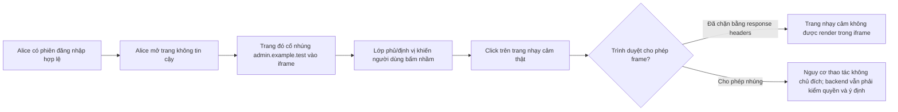
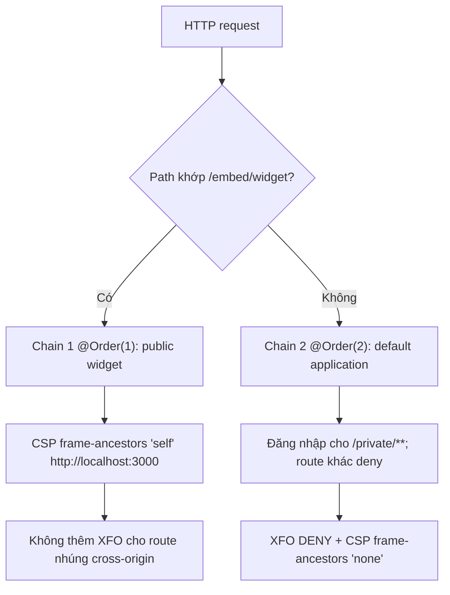

# X-Frame-Options, CSP frame-ancestors và chống clickjacking

> **Ngữ cảnh:** Spring Security – fundamentals / **Bảo vệ trình duyệt**. Bài này trình bày vì sao một trang HTML nhạy cảm không nên cho website khác nhúng tùy ý, cách cấu hình **`X-Frame-Options`** và **`Content-Security-Policy: frame-ancestors`**, cũng như cách kiểm thử phòng chống **clickjacking** trong Spring Security Servlet. Ví dụ dùng **Java 17, Spring Boot 3.5.0, Spring Security 6.x, Maven, JUnit 5 và MockMvc**. Tình huống cấp quyền cho iframe bên ngoài là một **ngoại lệ được kiểm soát**, không phải cấu hình mặc định.

## 1. Mục tiêu học tập

Sau bài này, bạn có thể:

1. Mô tả được clickjacking (UI redress): người dùng bị dụ tương tác với một trang thật nhưng đang được nhúng/che phủ bởi giao diện của kẻ tấn công.
2. Hiểu tại sao **authentication, authorization và CSRF** không loại bỏ mọi rủi ro clickjacking.
3. Chọn đúng giữa `X-Frame-Options: DENY`, `SAMEORIGIN`, CSP `frame-ancestors 'none'`, `'self'` hoặc danh sách origin đáng tin cậy.
4. Phân biệt `frame-ancestors` với `frame-src` và hiểu cách kiểm **tất cả ancestors** trong iframe lồng nhau.
5. Giải thích quy tắc ưu tiên giữa CSP `frame-ancestors` **được enforce** và `X-Frame-Options`, cùng hạn chế của trình duyệt cũ.
6. Cấu hình Spring Security `HttpSecurity.headers(...)` để bảo vệ trang nhạy cảm; thiết kế ngoại lệ **chỉ cho một trang widget công khai** thay vì tắt bảo vệ toàn hệ thống.
7. Kiểm thử đúng **HTTP response headers**, khả năng truy cập route và hành vi iframe trong **trình duyệt thật**; không suy luận chỉ từ HTTP 200.
8. Nhận diện cấu hình sai như `ALLOW-FROM`, dùng `<meta>` thay HTTP header, `frame-src` thay `frame-ancestors`, CSP quá rộng, hoặc header bị proxy ghi đè.
9. Phân biệt bảo vệ anti-framing với kiểm tra xác thực, phân quyền theo đối tượng, CSRF, SameSite, CSP script sources và xác nhận giao dịch nhạy cảm.

## 2. Clickjacking là gì?

**Clickjacking** (còn gọi **UI redress attack**) khai thác cách người dùng nhìn và tương tác với giao diện. Kẻ tấn công xây dựng một trang nhìn có vẻ vô hại, rồi cố nhúng trang đích thật vào `iframe`, đặt vị trí, độ mờ, kích thước hoặc các lớp phủ để người dùng vô tình bấm vào một điều khiển trên trang thật.

Hãy tưởng tượng Alice đang đăng nhập vào trang quản trị nội bộ ở `https://admin.example.test`. Một trang ngoài có thể cố nhúng màn hình “Cấp quyền cho người khác” vào iframe và đánh lừa Alice bấm vào nút thật, trong khi Alice nghĩ mình đang bấm “Xem phần thưởng”.



Điểm rất quan trọng:

- Trang nhạy cảm bị nhúng là **trang thật**. Nếu browser có session cookie đủ điều kiện, backend có thể coi request từ iframe là request đã đăng nhập.
- Kẻ tấn công **không nhất thiết đọc được HTML** trong iframe do Same-Origin Policy. Việc điều khiển vị trí/ánh nhìn/nhấp chuột vẫn có thể là mục tiêu.
- Cookie `SameSite` có thể hạn chế tình huống gửi cookie cross-site, nhưng **không** giải quyết mọi trường hợp (chẳng hạn môi trường cùng site khác origin, các luồng không cần cookie hoặc các cơ chế UI redress khác).
- CSRF token bảo vệ nhiều **request thay đổi trạng thái** trước sự giả mạo từ site ngoài. Nhưng nếu người dùng thực sự bấm vào một form/nút trên **trang thật bên trong iframe**, form đó có thể mang CSRF token hợp lệ. Do vậy CSRF và anti-clickjacking là **hai lớp phòng thủ độc lập**.
- Một trang chỉ đọc vẫn có thể gây rủi ro nếu nội dung nhạy cảm được trộn vào trải nghiệm của kẻ khác hoặc bị lợi dụng bởi kỹ thuật side-channel; đừng chỉ bảo vệ trang có nút POST.

**Mục tiêu anti-framing:** ngăn browser **render trang đích bên trong frame không được cho phép**. Đây không phải cách chặn API từ curl/Postman hay thay thế việc kiểm tra quyền tại server.

## 3. Ai có trách nhiệm gửi header?

Hãy phân biệt hai website:

```text
Website A: https://attacker.example
  <iframe src="https://admin.example.test/account/security"></iframe>

Website B: https://admin.example.test/account/security
  Trả HTML nhạy cảm cùng các response security headers
```

Chính **response của trang B** phải gửi `X-Frame-Options` hoặc CSP `frame-ancestors` để báo cho browser **ai được nhúng B**. Chèn một CSP vào trang A không bảo đảm B được bảo vệ. Gửi header chỉ trên `/login` nhưng bỏ qua `/account/security` cũng không đủ.

Cấu hình anti-framing cần được áp dụng cho **mọi HTML document thực sự cần bảo vệ**, bao gồm login, tài khoản, admin, consent, payment/transfer, các trang lỗi có dữ liệu nhạy cảm và những response sau redirect. Đối với SPA, phải xem xét **document shell HTML** cùng những nơi browser có thể tải giao diện thực, không chỉ các response JSON.

Một request cùng origin được mở **trực tiếp ở tab trên cùng** không phải là một hành động nhúng. Những header nói trên chủ yếu hạn chế các ngữ cảnh nhúng như `iframe`/`frame` (và CSP `frame-ancestors` còn áp dụng cho `object`/`embed` theo đặc tả).

## 4. `X-Frame-Options`: cơ chế lâu đời, đơn giản

`X-Frame-Options` (XFO) là HTTP **response header** báo browser có cho phép trang được hiển thị trong frame hay không.

### 4.1. `DENY`

```http
HTTP/1.1 200 OK
Content-Type: text/html
X-Frame-Options: DENY
```

Ý nghĩa: **không cho website nào nhúng** document, kể cả một trang khác **cùng origin**. Phù hợp với màn hình đăng nhập, thanh toán, chỉnh quyền hoặc các trang không có nhu cầu nhúng thật.

### 4.2. `SAMEORIGIN`

```http
X-Frame-Options: SAMEORIGIN
```

Ý nghĩa thực dụng: chỉ cho nội dung nhúng khi các điều kiện **same-origin** theo browser được đáp ứng. Đây không phải “cùng site”, “cùng domain gốc” hay “cùng công ty”; khác scheme, hostname hoặc port là khác origin.

Ví dụ trang `https://app.example.test` không có quyền nhúng một trang `https://admin.example.test` chỉ vì cả hai đều kết thúc bằng `example.test`. `SAMEORIGIN` không hỗ trợ allowlist nhiều origin bất kỳ.

Với frame lồng nhau, hành vi triển khai XFO `SAMEORIGIN` từng có khác biệt giữa browser/phiên bản, nên không dùng nó như cơ chế tinh vi để thiết kế cross-origin embedding. Khi có yêu cầu nhúng phức tạp, chọn CSP `frame-ancestors` và kiểm thử trên browser được hỗ trợ.

### 4.3. `ALLOW-FROM uri` đã lỗi thời

Có thể gặp cấu hình cũ:

```http
X-Frame-Options: ALLOW-FROM https://partner.example.test
```

**Không sử dụng làm thiết kế hiện đại.** `ALLOW-FROM` đã lỗi thời/không được browser hiện đại hỗ trợ đáng tin cậy. Một browser không hiểu giá trị có thể không áp được chính sách chặn mà bạn tưởng đã cấu hình.

Cũng không có cú pháp XFO hợp lệ như:

```http
X-Frame-Options: SAMEORIGIN https://partner.example.test
```

XFO không phải là nơi liệt kê nhiều origin. Đối với nhu cầu ngoại lệ, dùng CSP `frame-ancestors`.

### 4.4. Đây là HTTP header, không phải HTML meta

**Sai:**

```html
<meta http-equiv="X-Frame-Options" content="DENY">
```

Browser không dùng meta tag đó để thực thi XFO. Header cần nằm trong **HTTP response** của document, được phát bởi Spring Security, server hoặc reverse proxy đáng tin cậy.

## 5. CSP `frame-ancestors`: chính sách hiện đại và linh hoạt

**Content Security Policy (CSP)** cho phép site khai báo các nguồn được phép trong nhiều ngữ cảnh. Directive `frame-ancestors` định nghĩa **những parent/ancestor origin có thể nhúng document này**.

### 5.1. Chặn mọi frame

```http
Content-Security-Policy: frame-ancestors 'none'
```

Ý nghĩa tương đương về mục tiêu với `X-Frame-Options: DENY`. Từ khóa `'none'` cần dấu nháy đơn theo cú pháp CSP. Đây là lựa chọn khuyến nghị cho document không có nhu cầu nhúng.

### 5.2. Chỉ cho cùng origin

```http
Content-Security-Policy: frame-ancestors 'self'
```

Chỉ cho một document có ancestor khớp origin của document đó. `'self'` cần dấu nháy đơn. Dùng khi hệ thống có dashboard nội bộ được phép nhúng UI cùng origin nhưng không muốn website ngoài điều khiển ngữ cảnh frame.

### 5.3. Cho một hoặc một vài origin tin cậy

```http
Content-Security-Policy: frame-ancestors 'self' https://portal.example.test
```

Document có thể được nhúng từ chính origin và origin `https://portal.example.test`, với điều kiện **tất cả ancestor** đều thuộc danh sách cho phép. Không cần và không nên tự động bật cho mọi subdomain nếu chỉ có một portal được phê duyệt.

Một ví dụ mở rộng có nhiều bên:

```http
Content-Security-Policy: frame-ancestors 'self' https://portal.example.test https://reports.partner.example
```

Các origin trong ví dụ là giả định. Trong sản phẩm thật, danh sách phải đến từ **yêu cầu tích hợp đã được duyệt**, có chủ sở hữu, scope và test. Đừng lấy một giá trị origin do client gửi lên rồi chép thẳng vào CSP header để tạo phản hồi “động”; đó có thể biến allowlist thành chính sách cho phép chính kẻ tấn công.

### 5.4. Tại sao phải kiểm **mọi ancestor**, không chỉ parent trực tiếp?

CSP `frame-ancestors` yêu cầu **tất cả browsing contexts cha** phù hợp với source list.

Ví dụ:

```text
TOP:   https://evil.example
  |
  +--> IFRAME: https://portal.example.test
         |
         +--> IFRAME: https://app.example.test/embed/widget
```

Nếu widget chỉ cho phép `'self' https://portal.example.test`, nó vẫn bị chặn ở cấu trúc trên vì **top ancestor** `https://evil.example` không được cho phép, dù immediate parent là portal hợp lệ. Đây là điểm mạnh hơn việc chỉ kiểm `Referer` hoặc `window.parent` của ứng dụng.

Với thiết kế hợp pháp có nested frames, cần dự tính mọi origin tổ tiên có thể xuất hiện. Nhưng không nên mở allowlist rộng chỉ để “chữa iframe bị chặn” mà chưa hiểu ai đang bao bọc UI.

### 5.5. `frame-ancestors` KHÁC `frame-src`

Đây là lỗi rất phổ biến:

| Directive | Nó kiểm soát câu hỏi nào? | Đặt ở document nào? |
| --- | --- | --- |
| `frame-ancestors` | **Ai được nhúng trang này?** | Response của trang **bị nhúng** |
| `frame-src` | **Trang này được tải iframe từ đâu?** | Response của trang **chứa iframe** |
| `child-src` | Hạn chế một số nguồn nội dung con theo CSP, có quan hệ fallback với các directive khác | Response của trang chứa tài nguyên con |
| `default-src` | Fallback cho một số fetch directives | Không phải fallback cho `frame-ancestors` |

Ví dụ:

```http
Content-Security-Policy: frame-src https://trusted-widget.example
```

Nó cho biết document **được nhúng widget nào**, **không** ngăn trang lạ nhúng chính document ấy.

Ngược lại:

```http
Content-Security-Policy: frame-ancestors 'none'
```

ngăn document bị nhúng, nhưng **không tự giới hạn** iframe mà document đó tải vào.

### 5.6. Không có fallback từ `default-src`

Ví dụ sau nhìn có vẻ nghiêm ngặt nhưng **không chặn trang bị nhúng** chỉ bằng CSP:

```http
Content-Security-Policy: default-src 'none'
```

Vì `frame-ancestors` **không fallback** về `default-src`. Muốn chống clickjacking bằng CSP, phải khai báo **tường minh**:

```http
Content-Security-Policy: default-src 'none'; frame-ancestors 'none'
```

Đừng áp `default-src 'none'` cho toàn app chỉ từ ví dụ này nếu chưa hoàn thiện allowlist các script/style/font/image của ứng dụng; các directive về content loading phải được triển khai theo chính sách CSP riêng.

### 5.7. Không khai bằng `<meta>`

**Sai:**

```html
<meta http-equiv="Content-Security-Policy"
      content="frame-ancestors 'none'">
```

`frame-ancestors` **không được hỗ trợ trong meta-delivered CSP**. Phải gửi bằng HTTP response header:

```http
Content-Security-Policy: frame-ancestors 'none'
```

Ngoài ra, `frame-ancestors` có đặc điểm **không hoạt động như một directive giám sát trong policy report-only** theo đặc tả CSP: không được dựa vào `Content-Security-Policy-Report-Only: frame-ancestors ...` để bảo vệ trang. Hãy dùng **enforcing** `Content-Security-Policy`, sau đó kiểm thử hành vi frame trong browser thực.

## 6. Khi dùng cả XFO và CSP, chính sách nào thắng?

Với browser hiện đại, khi response có **enforced CSP `frame-ancestors`**, tiêu chuẩn yêu cầu browser **bỏ qua `X-Frame-Options`** cho việc quyết định cho phép frame. Tuy nhiên các browser cũ từng không tuân theo quy tắc này, nên hai header nên được thiết kế **không mâu thuẫn** khi có thể.

| XFO | Enforced CSP `frame-ancestors` | Hành vi mục tiêu và lưu ý |
| --- | --- | --- |
| `DENY` | `'none'` | **Khuyến nghị** cho trang không bao giờ nhúng; chính sách nhất quán |
| `SAMEORIGIN` | `'self'` | Phù hợp khi thực sự cần embedding cùng origin |
| `DENY` | `'self'` | Browser hiện đại có thể cho same-origin, browser cũ có thể chặn vì XFO |
| `SAMEORIGIN` | `'none'` | Browser hiện đại chặn hết, browser cũ có thể cho same-origin |
| **Không phát XFO** | `'self' https://portal.example.test` | Cho embedded route chuyên dụng; phụ thuộc khả năng CSP của browser |
| **Không phát cả hai** | **Không có** | Không có lớp phòng vệ frame-header đáng tin cậy |

**Quy tắc thực hành:**

1. Các trang tài khoản/admin/login/consent/payment **không cần nhúng**: cấu hình `X-Frame-Options: DENY` **và** `Content-Security-Policy: frame-ancestors 'none'`.
2. Các trang cần nhúng **nội bộ cùng origin**: cân nhắc XFO `SAMEORIGIN` cùng CSP `'self'` nếu yêu cầu chức năng rõ ràng.
3. Một **widget công khai** phải nhúng vào origin bên ngoài được phê duyệt: dùng CSP allowlist **chỉ tại route widget**; XFO `DENY`/`SAMEORIGIN` không biểu diễn được ngoại lệ cross-origin. Có thể cần bỏ XFO tại route này, chấp nhận ranh giới hỗ trợ browser và kiểm thử riêng.
4. Không tắt toàn bộ HTTP security headers chỉ để giải quyết một iframe tích hợp.

## 7. Spring Security hỗ trợ gì theo mặc định?

Spring Security **Servlet** thường thêm header:

```http
X-Frame-Options: DENY
```

vào các HTTP response thuộc security filter chain theo cấu hình mặc định. Điều này bảo vệ khá tốt những trang **không cần được nhúng**. Tuy nhiên Spring Security **không tự thêm một CSP hoàn chỉnh** theo mặc định, vì ứng dụng phải quyết định chính sách nguồn và nhu cầu nhúng.

Một số security response headers mặc định khác có thể gồm `X-Content-Type-Options`, `Cache-Control` và HSTS trên HTTPS. Không nên làm mất chúng bằng cách tắt tất cả headers chỉ để đổi XFO.

### 7.1. Cấu hình XFO `DENY` tường minh

Trong bean `SecurityFilterChain`:

```java
http.headers(headers -> headers
    .frameOptions(frame -> frame.deny())
);
```

Đây là **đoạn minh họa DSL**, không phải file Java độc lập. `deny()` khiến client được hướng dẫn không cho nhúng HTML.

### 7.2. Cấu hình XFO `SAMEORIGIN`

```java
http.headers(headers -> headers
    .frameOptions(frame -> frame.sameOrigin())
);
```

Chỉ dùng khi có lý do chức năng và kiểm thử các iframe được cho phép. Không dùng `SAMEORIGIN` theo thói quen cho tất cả trang nhạy cảm; nếu không cần iframe, `DENY` là chính sách đơn giản hơn.

### 7.3. Cấu hình CSP `frame-ancestors`

```java
http.headers(headers -> headers
    .contentSecurityPolicy(csp -> csp
        .policyDirectives("frame-ancestors 'none'"))
);
```

Với Spring Security 6.x, `policyDirectives(...)` đặt nội dung `Content-Security-Policy` do ứng dụng chỉ định. Không ngầm hiểu đoạn code đã xác lập `script-src`, `style-src`, `object-src`, `connect-src` hay các directive khác: nó chỉ định **một** directive anti-framing.

### 7.4. Đặt cả hai trên các trang nhạy cảm

```java
http.headers(headers -> headers
    .frameOptions(frame -> frame.deny())
    .contentSecurityPolicy(csp -> csp
        .policyDirectives("frame-ancestors 'none'"))
);
```

Đây là cấu hình điển hình cho nhóm trang không cần nhúng. Giữ những default headers còn lại, không gọi `headers.disable()` hoặc `defaultsDisabled()` nếu không có nhu cầu rõ ràng.

### 7.5. Nếu ứng dụng dùng WebFlux?

Code Servlet ở trên dùng `HttpSecurity` và `SecurityFilterChain`. WebFlux dùng `ServerHttpSecurity` và `SecurityWebFilterChain`, với API cấu hình frame options khác (chẳng hạn `mode(...)`). Không copy nguyên cấu hình Servlet vào WebFlux và giả định sẽ biên dịch hoặc hoạt động đúng.

## 8. Dự án Java 17 có thể dựng lại: chặn dashboard, chỉ cho nhúng widget

### 8.1. Bài toán

Ứng dụng ở `http://localhost:8080` cung cấp:

- `GET /private/dashboard`: giao diện **chỉ cho người đã xác thực**, **tuyệt đối không cho nhúng**.
- `GET /embed/widget`: một widget HTML **công khai, chỉ đọc**, được phép nhúng từ chính origin hoặc **portal được phê duyệt** `http://localhost:3000`.
- Các URL khác không có trong hợp đồng bị từ chối theo chính sách.

Chọn hai `SecurityFilterChain` có thứ tự rõ ràng:



**Lưu ý:** Hai chain là cách **cố tình khác chính sách theo path**, không phải khuyến nghị tách mọi endpoint thành một chain. Trong hệ thống lớn, có thể thực hiện cùng mục tiêu bằng kiến trúc reverse proxy/security headers theo route, miễn là có test và không để phạm vi bảo vệ bị hở.

### 8.2. Cấu trúc tệp

```text
frame-headers-demo/
├── pom.xml
├── embedder/
│   └── index.html
└── src/
    ├── main/
    │   └── java/demo/frame/
    │       ├── FrameHeadersApplication.java
    │       ├── SecurityConfig.java
    │       └── PageController.java
    └── test/java/demo/frame/
        └── FrameHeadersTest.java
```

Yêu cầu JDK 17+ và Maven 3.9+. Spring Boot `3.5.0` được dùng làm bản cố định của demo; trước khi triển khai production, cần cập nhật bản vá đang được hỗ trợ, kiểm tra dependency và chính sách bảo mật.

### 8.3. `pom.xml`

```xml
<?xml version="1.0" encoding="UTF-8"?>
<project xmlns="http://maven.apache.org/POM/4.0.0"
         xmlns:xsi="http://www.w3.org/2001/XMLSchema-instance"
         xsi:schemaLocation="http://maven.apache.org/POM/4.0.0 https://maven.apache.org/xsd/maven-4.0.0.xsd">
    <modelVersion>4.0.0</modelVersion>
    <parent>
        <groupId>org.springframework.boot</groupId>
        <artifactId>spring-boot-starter-parent</artifactId>
        <version>3.5.0</version>
        <relativePath/>
    </parent>
    <groupId>demo</groupId>
    <artifactId>frame-headers-demo</artifactId>
    <version>0.0.1-SNAPSHOT</version>
    <properties>
        <java.version>17</java.version>
    </properties>
    <dependencies>
        <dependency>
            <groupId>org.springframework.boot</groupId>
            <artifactId>spring-boot-starter-web</artifactId>
        </dependency>
        <dependency>
            <groupId>org.springframework.boot</groupId>
            <artifactId>spring-boot-starter-security</artifactId>
        </dependency>
        <dependency>
            <groupId>org.springframework.boot</groupId>
            <artifactId>spring-boot-starter-test</artifactId>
            <scope>test</scope>
        </dependency>
        <dependency>
            <groupId>org.springframework.security</groupId>
            <artifactId>spring-security-test</artifactId>
            <scope>test</scope>
        </dependency>
    </dependencies>
    <build>
        <plugins>
            <plugin>
                <groupId>org.springframework.boot</groupId>
                <artifactId>spring-boot-maven-plugin</artifactId>
            </plugin>
        </plugins>
    </build>
</project>
```

### 8.4. Entry point

`src/main/java/demo/frame/FrameHeadersApplication.java`:

```java
package demo.frame;

import org.springframework.boot.SpringApplication;
import org.springframework.boot.autoconfigure.SpringBootApplication;

@SpringBootApplication
public class FrameHeadersApplication {
    public static void main(String[] args) {
        SpringApplication.run(FrameHeadersApplication.class, args);
    }
}
```

### 8.5. `SecurityConfig.java`: hai chain có header chính sách khác nhau

`src/main/java/demo/frame/SecurityConfig.java`:

```java
package demo.frame;

import org.springframework.context.annotation.Bean;
import org.springframework.context.annotation.Configuration;
import org.springframework.core.annotation.Order;
import org.springframework.security.config.annotation.web.configuration.EnableWebSecurity;
import org.springframework.security.config.annotation.web.builders.HttpSecurity;
import org.springframework.security.core.userdetails.User;
import org.springframework.security.core.userdetails.UserDetails;
import org.springframework.security.core.userdetails.UserDetailsService;
import org.springframework.security.crypto.factory.PasswordEncoderFactories;
import org.springframework.security.crypto.password.PasswordEncoder;
import org.springframework.security.provisioning.InMemoryUserDetailsManager;
import org.springframework.security.web.SecurityFilterChain;

@Configuration
@EnableWebSecurity
public class SecurityConfig {

    @Bean
    @Order(1)
    SecurityFilterChain widgetChain(HttpSecurity http) throws Exception {
        return http
            // Chỉ dành cho widget công khai cần iframe bên ngoài.
            .securityMatcher("/embed/widget")
            .authorizeHttpRequests(auth -> auth
                .anyRequest().permitAll())
            .headers(headers -> headers
                // Không để XFO DENY/SAMEORIGIN cản portal khác origin.
                // Chỉ disable XFO tại chain này, KHÔNG disable mọi header.
                .frameOptions(frame -> frame.disable())
                .contentSecurityPolicy(csp -> csp
                    .policyDirectives(
                        "frame-ancestors 'self' http://localhost:3000"))
            )
            .build();
    }

    @Bean
    @Order(2)
    SecurityFilterChain appChain(HttpSecurity http) throws Exception {
        return http
            .authorizeHttpRequests(auth -> auth
                .requestMatchers("/error").permitAll()
                .requestMatchers("/private/**").authenticated()
                .anyRequest().denyAll())
            .formLogin(form -> form.permitAll())
            .headers(headers -> headers
                .frameOptions(frame -> frame.deny())
                .contentSecurityPolicy(csp -> csp
                    .policyDirectives("frame-ancestors 'none'"))
            )
            .build();
    }

    @Bean
    PasswordEncoder passwordEncoder() {
        return PasswordEncoderFactories
            .createDelegatingPasswordEncoder();
    }

    @Bean
    UserDetailsService userDetailsService(PasswordEncoder encoder) {
        UserDetails user = User.withUsername("alice")
            .password(encoder.encode("alice-demo"))
            .roles("USER")
            .build();
        return new InMemoryUserDetailsManager(user);
    }
}
```

**Vì sao cấu hình này có ý nghĩa?**

1. Spring Security chọn **SecurityFilterChain đầu tiên có matcher khớp** request. `widgetChain` ở `@Order(1)` áp dụng đúng cho `/embed/widget`.
2. `widgetChain` chỉ cho phép một **widget public**; không bật session login hoặc thêm role giả cho external portal.
3. `frameOptions(...disable())` chỉ tắt XFO **ở route ngoại lệ**, để browser hiện đại dùng CSP `frame-ancestors` allowlist cross-origin. Nếu giữ XFO DENY/SAMEORIGIN, browser cũ có thể chặn iframe dù CSP cho phép; cần định nghĩa browser support rõ ràng.
4. `appChain` bắt phần còn lại; trang `/private/**` cần xác thực và có **cả DENY + 'none'**. Mọi URL không khớp hợp đồng đều `denyAll()`.
5. Không có lệnh `headers().disable()` toàn cục. Các security headers mặc định khác được giữ trong phạm vi cấu hình.
6. Demo dùng account tĩnh để local test. Production phải có identity provider/password storage phù hợp, TLS/HTTPS, cookie policy và quyền nghiệp vụ đúng.
7. **Không cấu hình CSP `frame-ancestors` chỉ ở trang cha**. Policy phải nằm trong response của chính widget/dashboard.
8. Nếu deployment thêm gateway/CDN, kiểm tra chúng không loại bỏ hoặc thay đổi các header của từng route.

**Lựa chọn product:** Widget được nhúng là **thành phần chỉ đọc, không chứa token/session/action nhạy cảm**. Nếu yêu cầu một iframe đăng nhập từ portal bên ngoài, đừng chỉ mở thêm origin; cần phân tích cookie third-party, CSRF, session, phân quyền giữa hai hệ thống, khả năng token lộ qua frame và clickjacking tại portal.

### 8.6. Controller trả HTML cố định, không có dữ liệu nhạy cảm

`src/main/java/demo/frame/PageController.java`:

```java
package demo.frame;

import org.springframework.http.MediaType;
import org.springframework.http.ResponseEntity;
import org.springframework.security.core.Authentication;
import org.springframework.web.bind.annotation.GetMapping;
import org.springframework.web.bind.annotation.RestController;

@RestController
public class PageController {

    @GetMapping(value = "/embed/widget",
                produces = MediaType.TEXT_HTML_VALUE)
    public ResponseEntity<String> widget() {
        String html = """
            <!doctype html>
            <html lang="vi">
            <head>
              <meta charset="UTF-8">
              <title>Widget công khai</title>
            </head>
            <body>
              <h2>Widget chỉ đọc</h2>
              <p>Không có phiên hoặc dữ liệu bí mật trong widget này.</p>
            </body>
            </html>
            """;

        return ResponseEntity.ok()
            .contentType(MediaType.TEXT_HTML)
            .body(html);
    }

    @GetMapping(value = "/private/dashboard",
                produces = MediaType.TEXT_HTML_VALUE)
    public ResponseEntity<String> dashboard(
            Authentication authentication) {

        String html = """
            <!doctype html>
            <html lang="vi">
            <head>
              <meta charset="UTF-8">
              <title>Dashboard riêng tư</title>
            </head>
            <body>
              <h1>Dashboard nội bộ</h1>
              <p>Trang này không được phép xuất hiện trong iframe.</p>
            </body>
            </html>
            """;

        return ResponseEntity.ok()
            .contentType(MediaType.TEXT_HTML)
            .body(html);
    }
}
```

Controller không dùng thông tin `authentication.getName()` để ghép HTML nên tránh đưa dữ liệu người dùng vào markup không escape. Trong ứng dụng thật, luôn dùng template engine/output encoding đúng khi render dữ liệu.

`/private/dashboard` yêu cầu authentication do `appChain` xử lý. `/embed/widget` công khai nhưng không có form thao tác, không chấp nhận thông tin bí mật từ người dùng. **“Công khai” không đồng nghĩa “cho mọi origin nhúng”**; CSP vẫn giới hạn origin đã duyệt.

### 8.7. Trang portal dùng iframe để kiểm chứng trình duyệt

Tạo `embedder/index.html`:

```html
<!doctype html>
<html lang="vi">
<head>
  <meta charset="UTF-8">
  <title>Portal thử iframe</title>
  <style>
    iframe { width: 95%; height: 210px; border: 1px solid #aaa; }
    .box { margin: 16px 0; }
  </style>
</head>
<body>
  <h1>Portal localhost:3000</h1>
  <p>Đây là ví dụ nhúng đã được phía API phê duyệt.</p>

  <div class="box">
    <h2>Được phép: widget công khai</h2>
    <iframe title="Widget được phép"
            src="http://localhost:8080/embed/widget"></iframe>
  </div>

  <div class="box">
    <h2>Bị chặn: dashboard nhạy cảm</h2>
    <iframe title="Dashboard phải bị chặn"
            src="http://localhost:8080/private/dashboard"></iframe>
  </div>
</body>
</html>
```

Dùng tên `localhost` nhất quán: `127.0.0.1` **khác origin**, nên `http://127.0.0.1:3000` sẽ không khớp allowlist `http://localhost:3000`. Không sử dụng wildcard để “chữa” một sai khác hostname do môi trường thử.

### 8.8. Chạy demo

Trong thư mục gốc project:

```bash
mvn test
mvn spring-boot:run
```

Trong terminal thứ hai:

```bash
python -m http.server 3000 --directory embedder
```

Nếu môi trường dùng `python3`, thay tên lệnh tương ứng. Mở `http://localhost:3000` trên browser:

1. **Widget công khai** ở `/embed/widget` có thể hiển thị trong iframe vì origin của portal được liệt kê trong CSP.
2. **Dashboard nhạy cảm** ở `/private/dashboard` **không được render trong iframe** do XFO DENY và CSP `'none'`.
3. Mở trực tiếp `http://localhost:8080/private/dashboard` ở tab top-level; đăng nhập bằng tài khoản demo `alice` / `alice-demo` nếu cần. Sau login trang được tải bình thường ở top-level, nhưng vẫn **bị chặn khi nhúng**.
4. Mở Developer Tools → Console/Network; thông báo browser có thể nói không được frame vì `frame-ancestors 'none'` hoặc `X-Frame-Options`.
5. Thử mở portal trên origin **không được cấp** như `http://localhost:3001` (server riêng nếu có): widget cũng phải bị chặn bởi CSP allowlist. Không cần triển khai bản 3001 để chạy bộ unit/integration tests.

**Cần phân biệt:** browser có thể nhận HTTP 200 và **vẫn không render iframe** vì policy được thực thi tại client. Chỉ thấy 200 trong log backend không chứng minh clickjacking protection hỏng. Cũng đừng coi “trang trắng trong iframe” là đủ QA: phải kiểm HTTP response header và thông báo từ browser, đồng thời loại trừ lỗi authentication/network.

### 8.9. Kết quả dự kiến

| URL khi được mở | Top-level tab | iframe trên `localhost:3000` | Nguyên nhân |
| --- | --- | --- | --- |
| `/embed/widget` | Hiển thị công khai | **Cho phép** | CSP allowlist portal |
| `/private/dashboard` chưa login | Redirect login | **Không cho render trang nhạy cảm** | Authentication + policy anti-framing ở app/login |
| `/private/dashboard` sau login | Hiển thị nếu authenticated | **Chặn** | XFO DENY + CSP `'none'` |
| `/embed/widget` trên portal `localhost:3001` | Hiển thị khi mở trực tiếp | **Chặn** | CSP không cho ancestor `localhost:3001` |
| `/unknown` | Bị từ chối | Bị từ chối | `denyAll` đối với URL ngoài hợp đồng |

Đây là **kỳ vọng thiết kế**, không phải kết quả của một lần browser automation được thực thi trong bài học này.

## 9. Kiểm thử response header bằng JUnit 5 và MockMvc

Tạo `src/test/java/demo/frame/FrameHeadersTest.java`:

```java
package demo.frame;

import org.junit.jupiter.api.Test;
import org.springframework.beans.factory.annotation.Autowired;
import org.springframework.boot.test.autoconfigure.web.servlet.AutoConfigureMockMvc;
import org.springframework.boot.test.context.SpringBootTest;
import org.springframework.http.HttpHeaders;
import org.springframework.http.MediaType;
import org.springframework.test.web.servlet.MockMvc;

import static org.hamcrest.Matchers.containsString;
import static org.springframework.security.test.web.servlet.request
    .SecurityMockMvcRequestPostProcessors.user;
import static org.springframework.test.web.servlet.request
    .MockMvcRequestBuilders.get;
import static org.springframework.test.web.servlet.result
    .MockMvcResultMatchers.content;
import static org.springframework.test.web.servlet.result
    .MockMvcResultMatchers.header;
import static org.springframework.test.web.servlet.result
    .MockMvcResultMatchers.status;

@SpringBootTest
@AutoConfigureMockMvc
class FrameHeadersTest {

    @Autowired
    MockMvc mvc;

    @Test
    void publicWidgetHasCspAllowlistWithoutXfo() throws Exception {
        mvc.perform(get("/embed/widget"))
            .andExpect(status().isOk())
            .andExpect(content()
                .contentTypeCompatibleWith(MediaType.TEXT_HTML))
            .andExpect(header().string(
                HttpHeaders.CONTENT_SECURITY_POLICY,
                "frame-ancestors 'self' http://localhost:3000"))
            .andExpect(header().doesNotExist("X-Frame-Options"))
            .andExpect(content().string(
                containsString("Widget chỉ đọc")));
    }

    @Test
    void privateDashboardIsProtectedFromEveryFrame()
            throws Exception {
        mvc.perform(get("/private/dashboard")
                .with(user("alice").roles("USER")))
            .andExpect(status().isOk())
            .andExpect(header().string(
                "X-Frame-Options", "DENY"))
            .andExpect(header().string(
                HttpHeaders.CONTENT_SECURITY_POLICY,
                "frame-ancestors 'none'"))
            .andExpect(content().string(
                containsString("Dashboard nội bộ")));
    }

    @Test
    void springSecurityKeepsOtherDefaultHeaders()
            throws Exception {
        mvc.perform(get("/private/dashboard")
                .with(user("alice").roles("USER")))
            .andExpect(status().isOk())
            .andExpect(header().string(
                "X-Content-Type-Options", "nosniff"))
            .andExpect(header().exists(
                HttpHeaders.CACHE_CONTROL));
    }

    @Test
    void widgetPolicyDoesNotTrustArbitraryOriginHeader()
            throws Exception {
        mvc.perform(get("/embed/widget")
                .header(HttpHeaders.ORIGIN, "https://evil.example.test"))
            .andExpect(status().isOk())
            .andExpect(header().string(
                HttpHeaders.CONTENT_SECURITY_POLICY,
                "frame-ancestors 'self' http://localhost:3000"));
    }

    @Test
    void anonymousCannotReadPrivateDashboard()
            throws Exception {
        mvc.perform(get("/private/dashboard"))
            .andExpect(status().is3xxRedirection());
    }

    @Test
    void unapprovedRouteIsDeniedEvenForAuthenticatedUser()
            throws Exception {
        mvc.perform(get("/unapproved/path")
                .with(user("alice").roles("USER")))
            .andExpect(status().isForbidden());
    }
}
```

### 9.1. Bộ test chứng minh điều gì?

- Endpoint widget public có **CSP cho đúng portal** và **không có XFO** xung đột tại route ngoại lệ.
- Trang private có **cả XFO DENY và CSP `'none'`**.
- Các security headers mặc định khác không bị xóa vô ý khi custom XFO/CSP.
- Gửi một header `Origin` giả ở request **không làm server tự sửa allowlist CSP**; chính browser mới kiểm nguồn ancestor của iframe khi render.
- Authentication và `denyAll()` vẫn được áp dụng độc lập với frame policy.
- Hai `SecurityFilterChain` không làm private route rơi vào widget chain.

**Giới hạn:** MockMvc **không phải browser** và không thực hiện thuật toán kiểm iframe. Nó chỉ xác nhận server phát đúng HTTP headers. Phải kết hợp với test trong Chrome/Firefox/Edge được hỗ trợ để xác minh hành vi render iframe và nested frames.

### 9.2. Chạy test

```bash
mvn test
```

Dự kiến class `FrameHeadersTest` có **6 test method** thành công khi project đúng mã và các phiên bản tương thích. Đây là **kỳ vọng từ mã nguồn**, không phải kết quả Maven đã được thực thi trong bài đọc này.

### 9.3. Kiểm tra header qua curl

Đối với widget public:

```bash
curl -i http://localhost:8080/embed/widget
```

Kỳ vọng tìm thấy:

```http
Content-Security-Policy: frame-ancestors 'self' http://localhost:3000
```

và **không** có `X-Frame-Options` do route widget đã disable riêng XFO.

Với trang private, có thể đăng nhập qua form/browser thật và xem Network response, hoặc dùng test MockMvc với `with(user(...))` như ở trên. Nếu chỉ dùng curl chưa login:

```bash
curl -i http://localhost:8080/private/dashboard
```

bạn thường thấy redirect tới `/login` thay vì HTML riêng tư. Đọc header trên redirect có ích nhưng **không thay thế** kiểm response HTML sau khi người dùng đã đăng nhập.

**Không nhầm:** curl có thể in HTTP 200 và HTML của widget mà không quan tâm trang nào đang nhúng nó. Cơ chế chống frame được **browser** áp dụng khi render document trong iframe.

## 10. Tại sao không đặt ngoại lệ iframe cho cả ứng dụng?

Giả sử hệ thống có trang hợp tác đối tác cần nhúng một biểu đồ. Một cách sửa lỗi vội vàng là:

```java
// KHÔNG NÊN áp toàn cục chỉ vì một widget cần nhúng.
http.headers(headers -> headers
    .frameOptions(frame -> frame.disable())
);
```

Nếu không có CSP thay thế, cách này có thể khiến **mọi trang thuộc chain** bị nhúng tùy ý, bao gồm login, admin, change password, consent và account settings.

Thay vì vậy, hãy xác định:

| Câu hỏi kiến trúc | Cách ra quyết định an toàn |
| --- | --- |
| Widget nào thực sự cần nhúng? | Tạo route độc lập, ví dụ `/embed/widget` |
| Widget có chứa PII hoặc cho thực hiện hành động không? | Nếu có, cần đánh giá rủi ro cao hơn; có thể không cho nhúng |
| Ai được nhúng? | Allowlist origin cụ thể đã được duyệt |
| Có nested iframe không? | Xác minh **tất cả ancestor** |
| Browser cũ có được hỗ trợ không? | Xác định hành vi khi không hỗ trợ CSP và XFO khác |
| Cookie/session có được gửi trong iframe không? | Phân tích `SameSite`, third-party cookie, CSRF, bảo vệ token |
| Proxy/CDN có chỉnh header không? | So sánh response thực ở biên internet và ứng dụng |
| Làm sao test không vô tình mở trang private? | Regression test cho cả widget và các trang bị chặn |

Nếu không có nhu cầu nhúng, chính sách đơn giản nhất là **`DENY` + `frame-ancestors 'none'`**. Với chức năng nhúng phức tạp, nên cân nhắc **tách riêng origin dành cho widget** để giới hạn phạm vi tác động thay vì nới toàn bộ origin chứa ứng dụng đăng nhập.

## 11. Những điều anti-framing KHÔNG giải quyết

### 11.1. Không thay thế authentication và authorization

Một API `/admin/grant` không thể được bảo vệ chỉ bằng XFO/CSP: curl và backend không bị các header này ngăn gửi request. Bắt buộc có authentication, role/permission, tenant/resource ownership, validation và audit phía server.

### 11.2. Không thay thế CSRF

Browser có thể gửi một request state-changing tới backend theo cơ chế credential; CSRF token bảo vệ request khỏi bị gửi không chủ đích theo kênh cross-site. Anti-framing chặn một kịch bản UI redress, nhưng không bao phủ mọi request giả mạo không cần iframe.

### 11.3. Không thay thế CSP chống XSS

Một response có:

```http
Content-Security-Policy: frame-ancestors 'none'
```

không tự hạn chế việc tải script từ nguồn lạ và không chống mọi XSS. Muốn CSP giảm rủi ro XSS, cần thiết kế thêm `script-src`, `object-src`, nonce/hash và các directive phù hợp; việc này đòi hỏi kiểm kê resource và test để không làm hỏng giao diện.

### 11.4. Không thay thế SameSite

`SameSite=Strict` hoặc `Lax` giúp kiểm soát khi cookie được gửi theo site context. Nhưng anti-framing vẫn cần khi một website có thể nhúng UI cùng-site nhưng khác-origin; và SameSite không phân biệt mọi trường hợp nhấp chuột bị lừa.

### 11.5. Không chặn mọi UI redress

**DoubleClickjacking** và các kỹ thuật thao tác nhiều cửa sổ có thể lợi dụng UI top-level, không phải iframe nhúng. XFO và `frame-ancestors` không phải hàng rào bao trùm. Đối với thao tác tài chính/đặc quyền, sử dụng **xác thực lại, xác nhận giao dịch gắn với chi tiết, MFA/step-up auth, transaction authorization** và giới hạn quyền theo nghiệp vụ.

### 11.6. Không bảo vệ tuyệt đối mọi WebView/embedded browser

Hành vi hỗ trợ security headers phụ thuộc trình duyệt, phiên bản và các chính sách WebView. Chỉ nêu “có header” là chưa đủ để cam kết trên mọi client. Định nghĩa browser matrix và test trên các nền tảng thực tế được hỗ trợ.

## 12. Debug lỗi iframe với DevTools

Khi một trang iframe hiển thị trắng hoặc browser báo không thể hiển thị:

1. **Xác định URL document bị nhúng:** kiểm cả redirect chain. Có thể iframe ban đầu trỏ `/embed/widget` nhưng backend redirect tới `/login`, nơi áp XFO DENY.
2. **Mở response của chính document bị nhúng** trong Network tab, xem `X-Frame-Options` và `Content-Security-Policy`. Đừng chỉ xem header của trang cha.
3. **Đọc console:** thông báo “Refused to frame...” thường chỉ ra CSP `frame-ancestors` hoặc XFO.
4. **So sánh toàn bộ origin:** `http` vs `https`, hostname, subdomain và port. `localhost:3000` khác `localhost:3001`.
5. **Kiểm iframe lồng nhau:** mọi ancestor có phù hợp CSP allowlist không?
6. **Kiểm nhiều CSP headers:** nếu server/proxy phát **nhiều enforced CSP policies**, browser áp dụng các policy cùng nhau; một policy chứa `frame-ancestors 'none'` có thể vẫn chặn dù policy khác cho phép portal.
7. **Kiểm XFO mâu thuẫn:** browser hiện đại thường ưu tiên enforced CSP `frame-ancestors`, nhưng client cũ có thể theo XFO. Phải test browser support thật.
8. **Kiểm meta tags:** không dùng `<meta http-equiv>` để thực thi `frame-ancestors` hoặc XFO.
9. **Kiểm CDN/reverse proxy:** có thể thêm `X-Frame-Options: DENY` toàn cục lên widget hoặc loại bỏ CSP header riêng của route.
10. **Không sửa bằng cách tắt all security headers**. Sửa matcher/header cho đúng endpoint và viết regression test.
11. **Kiểm CSP `frame-src` phía parent** nếu iframe vẫn bị chặn: bên cạnh policy `frame-ancestors` của child, trang cha cũng có thể tự cấm tải iframe khác origin qua `frame-src`. Hai policy áp dụng ở hai phía khác nhau.
12. **Kiểm cookies và auth:** nếu iframe có login state khác do `SameSite`/third-party cookie policy, trang nhận được có thể là login page (vốn bị chặn), không phải widget.

### 12.1. Ma trận triệu chứng

| Triệu chứng | Nguyên nhân thường gặp | Hành động |
| --- | --- | --- |
| iframe ẩn nhưng mở trực tiếp bình thường | XFO/CSP `frame-ancestors` | Kiểm response headers của child |
| Browser console nói `frame-ancestors 'none'` | Child cấm mọi ancestor | Giữ chính sách nếu trang nhạy cảm; không mở bừa |
| Widget portal hợp lệ vẫn trắng | XFO DENY từ proxy, CSP khác, redirect login | Kiểm từng response qua gateway |
| iframe từ portal `localhost:3001` bị chặn | Allowlist chỉ có `localhost:3000` | Đúng theo policy; không tự nới allowlist |
| Thấy HTTP 200 trong server log nhưng iframe không hiện | Browser chặn render sau HTTP response | Dùng browser DevTools, không chỉ log backend |
| Đã thêm `frame-src` nhưng site vẫn bị nhúng | Nhầm directive | Dùng `frame-ancestors` trên trang bị nhúng |
| Đã thêm `default-src 'none'` nhưng vẫn bị nhúng | Không fallback | Thêm `frame-ancestors` tường minh |
| Đã thêm meta CSP nhưng vẫn bị nhúng | `frame-ancestors` không áp qua meta | Phát HTTP CSP header |
| Đã thêm `ALLOW-FROM` nhưng không hiệu quả | Giá trị XFO lỗi thời | Dùng CSP allowlist |
| Kiểm bằng curl thấy content bình thường | curl không thực thi frame policy | Test browser thực |
| Login page hiện trong iframe rồi bị chặn | Frame đi vào flow auth/redirect | Cân nhắc widget public/standalone hoặc flow riêng |
| Chỉ một môi trường bị lỗi | Gateway/Ingress/CDN header khác | So response thực của mọi môi trường |

## 13. Chiến lược triển khai theo từng loại trang

| Nhóm trang | Chính sách thường phù hợp | Lưu ý |
| --- | --- | --- |
| Login/account/password reset | XFO `DENY` + CSP `frame-ancestors 'none'` | Không nên nhúng giao diện lấy credential |
| Admin và cấp quyền | XFO `DENY` + CSP `'none'` | Kết hợp MFA/reauth cho thao tác nhạy cảm |
| Consent/OAuth authorization page | XFO `DENY` + CSP `'none'` nếu không có yêu cầu đặc biệt | Tránh UI redress khiến người dùng chấp thuận nhầm |
| Payment/change email/transfer | XFO `DENY` + CSP `'none'` | CSRF và transaction authorization vẫn cần |
| Dashboard nội bộ nhúng **cùng origin** | XFO `SAMEORIGIN` + CSP `'self'` | Kiểm nested frames và thật sự chỉ same-origin |
| Widget public chỉ đọc nhúng vào portal đã duyệt | CSP `'self' https://portal.example.test`; xử lý XFO riêng tại route | Không dùng chung policy nới lỏng với trang private |
| Tài liệu public không cần iframe | XFO `DENY` + CSP `'none'` | Deny by default để tránh mở ngoài ý muốn |
| API JSON thuần | Anti-framing không phải ranh giới chính | Cần auth/authz, CORS, CSRF tùy credential; ưu tiên bảo vệ HTML documents |

**Chú ý:** Đây là đề xuất chính sách ban đầu, không phải một luật chung cho mọi sản phẩm. Một số hệ thống có widget nhúng được xác thực/chữ ký riêng, hoặc có browser/WebView cũ. Khi đó phải có mô hình tin cậy và kiểm thử được phê duyệt, không nới cấu hình dựa vào việc “iframe đang trắng”.

## 14. Kiểm thử hồi quy cần có

| Ca kiểm thử | Kỳ vọng |
| --- | --- |
| GET public widget | HTTP 200; CSP đúng allowlist; không có XFO xung đột |
| Widget trong iframe portal đúng origin | Render được trên browser được hỗ trợ |
| Widget trong iframe từ origin lạ | Bị browser chặn theo CSP |
| Widget trong nested iframe có ancestor lạ | Bị chặn dù direct parent hợp lệ |
| GET dashboard authenticated | HTTP 200; XFO DENY; CSP `'none'` |
| Dashboard trong iframe cùng origin | Vẫn bị chặn vì DENY/`'none'` |
| Dashboard trong iframe cross-origin | Bị chặn |
| GET dashboard anonymous | Không lộ nội dung; redirect/login theo flow |
| Đường dẫn không đăng ký | Bị authorization từ chối |
| XFO/CSP sau login redirect | Trang đích vẫn có header đúng |
| Header trên response lỗi và reverse proxy | Không bị ghi đè hoặc vô tình bỏ bảo vệ |
| Cấu hình nhiều CSP headers | Không có policy ngoài ý muốn tạo xung đột |
| Browser mới/cũ trong support matrix | Kết quả theo chính sách đã công bố |
| Test clickjacking với session thực | Không thể render trang nhạy cảm dù đã đăng nhập |
| Các HTTP POST thay đổi trạng thái | Vẫn chịu CSRF/authz, không chỉ dựa vào anti-frame |
| Deployment qua CDN, ingress, proxy | Header ở client cuối trùng với policy dự kiến |

Ngoài unit/integration test, có thể dùng browser automation để thử nhúng trang vào một iframe từ các origin được phép và không được phép. Nhưng một script nhìn vào `iframe.contentDocument` từ origin ngoài có thể bị chặn bởi Same-Origin Policy ngay cả **khi iframe đã render thành công**; vì vậy không sử dụng khả năng đọc DOM cross-origin như bằng chứng duy nhất của clickjacking protection. Dùng console, screenshots, browser security events và response headers.

## 15. Checklist code review

- [ ] Đã xác định những HTML documents cần anti-framing, nhất là login, admin, payment và màn hình đổi quyền.
- [ ] Khi không cần nhúng, bật **`X-Frame-Options: DENY`** và **enforced CSP `frame-ancestors 'none'`**.
- [ ] Nếu cần cùng origin, xem xét `SAMEORIGIN` cùng `'self'` và kiểm thử đầy đủ frame ancestors.
- [ ] Nếu cần external widget, tách route và lập allowlist **origin cụ thể**, không tắt XFO/CSP toàn hệ thống.
- [ ] Không dùng `ALLOW-FROM`; không viết danh sách origin vào `X-Frame-Options`.
- [ ] Không dùng `<meta>` để phát XFO hoặc CSP `frame-ancestors`.
- [ ] Không nhầm `frame-src`, `child-src`, `default-src` với `frame-ancestors`.
- [ ] Đã kiểm tra nested frames với các parent/ancestor origin được phép.
- [ ] Đã kiểm tra cả khi có **nhiều enforced CSP policies** từ backend/proxy.
- [ ] Giữ nguyên các security headers khác khi sửa XFO/CSP trong Spring Security.
- [ ] Không vô hiệu `headers()` hoặc thay filter chain mặc định chỉ để “sửa iframe”.
- [ ] Đã kiểm tra header trong **HTTP response cuối cùng** qua TLS/CDN/proxy, không chỉ MockMvc.
- [ ] Có integration test các route nhạy cảm và route ngoại lệ, cả authenticated và anonymous.
- [ ] Có browser test frame được phép/bị chặn; không chỉ kiểm HTTP 200 hoặc CORS.
- [ ] Không coi anti-framing thay thế authentication, authorization, CSRF hoặc MFA.
- [ ] Với widget có user data, đã đánh giá cookie/third-party restrictions, privacy và rủi ro chia sẻ nội dung.
- [ ] Đã lập danh sách browser/WebView được hỗ trợ và kiểm hành vi với các phiên bản mục tiêu.
- [ ] Có quy trình rà soát allowlist định kỳ khi portal/đối tác thay đổi domain.
- [ ] Security headers áp trên cả đường login, redirect sau login và các trang lỗi nhạy cảm.

## 16. Câu hỏi tự kiểm tra

**1. Clickjacking khác CSRF ở đâu?**  
Clickjacking đánh lừa người dùng thao tác trên UI thật qua việc nhúng/che phủ; CSRF lợi dụng request có credential browser gửi không chủ đích. Hai kiểu tấn công có thể giao nhau nhưng không đồng nhất, nên cần phòng vệ riêng.

**2. Trang không cần iframe nên dùng `X-Frame-Options` nào?**  
`DENY`, và nên bổ sung enforced CSP `frame-ancestors 'none'` để bảo vệ nhất quán hơn.

**3. `SAMEORIGIN` có cho `https://portal.example.test` nhúng `https://admin.example.test` không?**  
Không chỉ vì chung domain gốc: đó là hai hostname/origin khác nhau.

**4. Vì sao `ALLOW-FROM` không phải lựa chọn cho portal đối tác?**  
Nó đã lỗi thời và không được browser hiện đại hỗ trợ đáng tin cậy. Dùng CSP `frame-ancestors` với origin allowlist.

**5. `frame-src` có chặn website khác nhúng trang của mình không?**  
Không. `frame-src` giới hạn iframe mà trang **của mình tải**; `frame-ancestors` giới hạn **ai được nhúng trang của mình**.

**6. Chỉ khai `default-src 'none'` đã chặn mọi iframe nhúng mình chưa?**  
Chưa. `frame-ancestors` không fallback về `default-src`, phải khai tường minh.

**7. Dùng `<meta http-equiv="Content-Security-Policy" content="frame-ancestors 'none'">` có hiệu lực không?**  
Không. `frame-ancestors` phải nằm trong HTTP CSP header được enforce.

**8. Khi response có cả CSP `frame-ancestors 'self'` và XFO DENY, browser hiện đại xử lý thế nào?**  
Theo tiêu chuẩn, enforced CSP `frame-ancestors` chi phối và XFO bị bỏ qua, nhưng browser cũ có thể theo XFO, nên cần tránh xung đột nếu hỗ trợ legacy.

**9. Nếu iframe có immediate parent được phép nhưng một ancestor cao hơn không được phép thì sao?**  
CSP `frame-ancestors` có thể từ chối vì kiểm **mọi ancestor**.

**10. Tại sao cần test browser sau khi MockMvc đã xác nhận header?**  
MockMvc chỉ kiểm HTTP response; chính browser thực thi chính sách render iframe. Kết quả còn phụ thuộc redirects, nested frames, proxy và version.

**11. HTTP 200 trong iframe có chứng minh clickjacking protection thất bại không?**  
Không. Browser có thể nhận 200 rồi quyết định không render document vì XFO/CSP.

**12. Nếu chỉ một widget được đối tác nhúng, có nên gọi `frameOptions.disable()` toàn bộ app không?**  
Không. Chỉ xử lý ngoại lệ ở route widget, vẫn chặn mọi trang nhạy cảm khác.

**13. CORS cho origin đối tác có làm iframe render được không?**  
Không mặc nhiên. CORS kiểm việc JavaScript đọc response cross-origin; việc nhúng HTML bị ràng buộc bởi `frame-ancestors` của child và `frame-src` của parent.

**14. Cookie `SameSite=Strict` có thay anti-clickjacking headers không?**  
Không. SameSite hạn chế cookie được gửi trong một số bối cảnh; không tự ngăn mọi UI redress hoặc iframe public.

**15. Anti-framing có thay việc kiểm role/owner/CSRF cho nút chuyển tiền được không?**  
Không. Server vẫn phải xác minh danh tính, quyền, ý định giao dịch và dữ liệu nghiệp vụ.

## 17. Tài liệu tham khảo chính thức

- [Spring Security 6.5 — Servlet Security HTTP Response Headers](https://docs.spring.io/spring-security/reference/6.5/servlet/exploits/headers.html): header mặc định `X-Frame-Options: DENY`, `frameOptions(...)`, `contentSecurityPolicy(...)`.
- [MDN — X-Frame-Options](https://developer.mozilla.org/en-US/docs/Web/HTTP/Reference/Headers/X-Frame-Options): `DENY`, `SAMEORIGIN`, `ALLOW-FROM` lỗi thời và giới hạn.
- [MDN — CSP frame-ancestors](https://developer.mozilla.org/en-US/docs/Web/HTTP/Reference/Headers/Content-Security-Policy/frame-ancestors): `'none'`, `'self'`, source expressions, kiểm mọi ancestor, không fallback từ `default-src`, không dùng meta.
- [W3C — Content Security Policy Level 2](https://www.w3.org/TR/CSP2/): `frame-ancestors`, cách enforce và quan hệ với XFO.
- [OWASP — Clickjacking Defense Cheat Sheet](https://cheatsheetseries.owasp.org/cheatsheets/Clickjacking_Defense_Cheat_Sheet.html): anti-framing headers, legacy caveats, SameSite và doubleclickjacking.
- [OWASP — Content Security Policy Cheat Sheet](https://cheatsheetseries.owasp.org/cheatsheets/Content_Security_Policy_Cheat_Sheet.html): CSP và giới hạn của defense in depth.
- [Spring Security — Multiple HttpSecurity Instances](https://docs.spring.io/spring-security/reference/servlet/configuration/java.html#_multiple_httpsecurity_instances): `@Order` và `securityMatcher` cho những chuỗi filter khác nhau.
- [Spring Security — Testing with MockMvc](https://docs.spring.io/spring-security/reference/servlet/test/mockmvc/index.html): security filter chain trong integration tests và `SecurityMockMvcRequestPostProcessors.user`.
