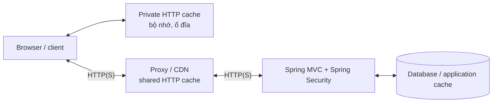

# Cache trình duyệt, proxy và dữ liệu phản hồi nhạy cảm

## Mục tiêu học tập

HTTP cache giúp giảm độ trễ và lượng dữ liệu truyền giữa trình duyệt, CDN, reverse proxy và ứng dụng. Tuy nhiên, một phản hồi chứa tên người dùng, số dư, đơn hàng, token hoặc thông tin cá nhân không được phép tái sử dụng sai ngữ cảnh. Một cấu hình cache sai có thể khiến người sau nhìn thấy dữ liệu của người trước, dù bước đăng nhập và phân quyền ở server được viết đúng.

Sau bài học, bạn có thể:

1. Phân biệt **browser cache (private cache)**, **shared cache của proxy/CDN**, **cache ở ứng dụng** và các cơ chế khác như back/forward cache hoặc Service Worker Cache Storage.
2. Giải thích các chỉ thị `Cache-Control`: `no-store`, `no-cache`, `private`, `public`, `max-age`, `s-maxage`, `must-revalidate` và `immutable`.
3. Hiểu khi nào cache có thể phục vụ bản sao, khi nào phải liên hệ server để revalidate bằng `ETag`/`If-None-Match` hay `Last-Modified`/`If-Modified-Since`.
4. Phân tích rủi ro khi HTTP response phụ thuộc **người dùng đã đăng nhập, cookie, `Authorization`, vai trò, tenant** hoặc dữ liệu nhạy cảm.
5. Biết Spring Security thêm cache headers mặc định ở đâu, khi nào Spring MVC hoặc ứng dụng ghi đè chúng, và cách đặt chính sách riêng cho API riêng tư so với tài nguyên công khai.
6. Viết và kiểm thử ứng dụng Spring Boot 3.x / Spring Security 6.x / Java 17 có API nhạy cảm `no-store` và API công khai được cache hữu hạn.

Trọng tâm là **HTTP response caching** trong hệ thống Spring MVC/Servlet. Việc dùng Redis, Caffeine hoặc `@Cacheable` cho dữ liệu nội bộ là một vấn đề khác: header gửi cho trình duyệt không tự quản lý cache nằm trong service, và ngược lại.

## 1. Cache là gì và vì sao có rủi ro bảo mật?

Cache giữ bản sao một phản hồi nhằm tái sử dụng ở request sau, tránh phải tính lại hoặc tải lại toàn bộ dữ liệu. Với cùng tài nguyên công khai, đây là tối ưu hiệu năng hợp lý:

```text
Lần 1: browser --GET /assets/app.a1b2.js--> server
                    <--200 + nội dung JS--

Lần 2: browser -- có bản sao còn hạn --> dùng cache
                    (có thể không gửi HTTP request mới)
```

Nhưng với một endpoint khác:

```text
GET /api/profile
Cookie: SESSION=...của Alice...

200 OK
{"username":"alice","balance":500000}
```

Nếu proxy chung cho nhiều người lưu response trên dưới một cache key không phân biệt người dùng, Bob có thể nhận lại dữ liệu của Alice khi gọi cùng URL. Thậm chí nếu cache chỉ ở trình duyệt, một người khác dùng cùng thiết bị hoặc hồ sơ browser cũng có thể gặp dữ liệu cũ nếu chính sách lưu không phù hợp.

**Hai quyết định phải tách riêng:**

- **Ai được yêu cầu tạo phản hồi?** Authentication/authorization của server quyết định.
- **Phản hồi này có được lưu và tái sử dụng không?** HTTP cache policy và cấu hình của từng tầng quyết định.

Đăng nhập hợp lệ không tự loại bỏ nguy cơ dữ liệu nhạy cảm bị lưu. Ngược lại, đặt `Cache-Control: no-store` cũng **không** thay thế xác thực, phân quyền, quản lý session hay che giấu bí mật ở client.

## 2. Các tầng cache trong đường đi HTTP



Sơ đồ là mô hình khái quát; browser có thể truy cập thẳng ứng dụng hoặc đi qua nhiều gateway/CDN, và cơ chế cache cụ thể tùy triển khai.

| Tầng | Ai thường sử dụng? | Điểm cần kiểm soát |
| --- | --- | --- |
| **Private HTTP cache** | Một user agent/hồ sơ trình duyệt | Có được phép giữ phản hồi không? Bao lâu? Có cần revalidation không? |
| **Shared HTTP cache** | Proxy chung, CDN, reverse proxy cho nhiều client | Chỉ lưu nội dung công khai hoặc nội dung đã cô lập theo đúng cache key/quy tắc; không tái sử dụng dữ liệu người dùng khác. |
| **Application/server cache** | Spring service, Redis, Caffeine, ORM cache, gateway nội bộ | Khóa cache phải tính đến user/tenant/quyền nếu dữ liệu phụ thuộc các yếu tố ấy; chính sách invalidation và quyền truy cập riêng. |
| **Service Worker Cache Storage** | Script của web app có quyền quản lý response theo logic lập trình | Không mặc định coi nó tuân theo cùng vòng đời với HTTP cache; ứng dụng phải thiết kế quy tắc lưu/xóa phù hợp. |
| **Back/forward cache (bfcache), history, tab memory** | Browser giữ trạng thái trang để điều hướng nhanh | Không phải HTTP cache thông thường; `no-store` không phải cam kết xóa mọi trạng thái giao diện/DOM khỏi bộ nhớ. |
| **Log, monitoring, download, ảnh chụp màn hình** | Người dùng, máy chủ, thiết bị, hạ tầng vận hành | Cache headers không có chức năng xóa dữ liệu khỏi những nơi này. |

Với dữ liệu có tính bí mật cao, cân nhắc **nhiều lớp**: hạn chế lưu HTTP response, ngăn chia sẻ qua CDN, không đưa token vào URL, không log dữ liệu nhạy cảm, xử lý logout/session, và thiết kế giao diện không hiển thị quá nhiều dữ liệu sau khi phiên hết hạn.

### 2.1. Private cache và shared cache không đồng nghĩa

Private cache trong chuẩn HTTP phục vụ một người dùng; shared cache có thể phục vụ **nhiều** người. Chỉ thị `private` nghĩa là **shared cache không được lưu** phản hồi đó, nhưng **private cache vẫn có thể lưu**. Đối với dữ liệu cực nhạy cảm, `private` là chưa đủ nếu mục tiêu là ngăn lưu ở cả hai loại cache; khi đó cân nhắc `no-store`.

Với CDN, “private” không có nghĩa dữ liệu được mã hóa, cũng không có nghĩa CDN đã cấp quyền riêng cho Alice. Đây là **chỉ dẫn về phạm vi lưu trong HTTP cache**, không phải nhãn phân loại dữ liệu hoặc bằng chứng xác thực.

## 3. Một HTTP cache quyết định dùng bản sao như thế nào?

HTTP cache xét phương thức request, URI, một số trường request được chỉ định qua `Vary`, trạng thái phản hồi, thời gian còn hợp lệ (freshness), các directive và quy định khác của HTTP caching. Tùy cấu hình CDN, cache key có thể được tùy biến; vì thế không thể tự suy rằng “URL giống nhau thì chắc chắn an toàn”.

```text
GET /public/catalog
       |
       v
Cache có response phù hợp?
       |
       +-- Không --> gửi đến origin --> nhận 200 --> lưu nếu được phép
       |
       +-- Có:
             |
             +-- Còn fresh và được phép reuse --> trả bản đã lưu
             |
             +-- Stale / yêu cầu revalidate --> gửi conditional request
                          |
                          +-- 304 Not Modified --> cập nhật metadata,
                          |                       tái sử dụng body đã lưu
                          |
                          +-- 200 OK, body mới --> thay hoặc cập nhật cache
```

**Fresh** nghĩa là bản sao còn hợp lệ theo tuổi tối đa/quy tắc freshness, không đồng nghĩa dữ liệu server chưa từng thay đổi. **Stale** nghĩa là đã quá hạn; tùy directive và trường hợp, cache phải revalidate trước khi reuse, dù một số cơ chế cho phép phục vụ stale trong phạm vi quy định.

### 3.1. Ví dụ thời gian với `max-age=60`

Tại 10:00:00 server trả:

```http
HTTP/1.1 200 OK
Cache-Control: public, max-age=60
Content-Type: application/json

{"catalogVersion":"v1"}
```

Một cache tuân chuẩn có thể dùng lại phản hồi trong khoảng fresh mà không hỏi server. Đến khi stale, nó có thể yêu cầu nội dung mới hoặc revalidate. Nếu v1 bị thay ở server sau 15 giây, người dùng vẫn có thể nhận v1 trong phần thời gian freshness còn lại. Vì vậy hãy chọn TTL phù hợp với **độ cũ tối đa có thể chấp nhận** của dữ liệu công khai.

Với phản hồi cá nhân hóa, rủi ro không chỉ là *stale* mà còn là *cross-user reuse*. Dữ liệu không được phép lộ không nên được đánh đổi bằng TTL ngắn; giảm từ 1 giờ xuống 10 giây vẫn có khoảng thời gian rò rỉ.

## 4. Hiểu chính xác các chỉ thị `Cache-Control`

| Directive | Ý nghĩa đối với HTTP cache | Trường hợp sử dụng / cảnh báo |
| --- | --- | --- |
| `no-store` | Yêu cầu cache **không lưu** phản hồi (và request liên quan theo quy định). Áp dụng cả private và shared HTTP cache. | Lựa chọn phù hợp cho API có dữ liệu bí mật/cá nhân, token, tài liệu nhạy cảm; không phải cơ chế xóa dữ liệu đã lưu trước đó. |
| `no-cache` | **Cho phép lưu**, nhưng **không được reuse** nếu chưa revalidate thành công với server gốc. | Hợp lý khi vẫn muốn caching/revalidation nhưng luôn kiểm tra trước khi sử dụng. Tên dễ gây hiểu nhầm. |
| `private` | Không cho shared cache lưu; private cache có thể lưu theo quy tắc khác. | Phản hồi dành riêng người dùng nhưng mức nhạy cảm cho phép browser lưu; không phải lựa chọn tương đương `no-store`. |
| `public` | Cho phép shared cache lưu theo các điều kiện caching; có thể thay đổi quy tắc cache với request có `Authorization`. | Chỉ dùng cho phản hồi thực sự công khai, không phụ thuộc user, role, tenant hoặc dữ liệu cá nhân. |
| `max-age=60` | Thời gian freshness tối đa 60 giây tính theo thời gian cache, xét thêm `Age` và metadata liên quan. | Danh mục công khai, response ít đổi, với TTL có chủ đích. |
| `s-maxage=300` | Freshness cho **shared cache**, ghi đè `max-age`/`Expires` ở shared cache. | CDN/proxy công khai; rất nguy hiểm nếu áp vào response tùy người dùng. |
| `must-revalidate` | Khi response đã stale, cache không được reuse trước khi revalidation thành công; **không cấm lưu**. | Dữ liệu cần kiểm tra lại nghiêm ngặt khi hết hạn; lưu ý chuẩn HTTP có quy định đặc biệt với shared cache và `Authorization`. |
| `immutable` | Cho biết nội dung được kỳ vọng không đổi trong thời gian fresh. | Tài nguyên tĩnh có tên chứa content hash, ví dụ `app.a1b2c3.js`; không dùng cho response cá nhân hoặc tài nguyên đổi mà URL giữ nguyên. |
| `no-transform` | Yêu cầu intermediary không biến đổi nội dung theo nghĩa HTTP. | Không ngăn lưu/tái sử dụng; không phải một chế độ riêng tư. |

**Các khẳng định cần nhớ:**

- `Cache-Control: no-cache` **không có nghĩa** “không lưu”.
- `Cache-Control: max-age=0` có nghĩa response gần như lập tức stale và có thể cần revalidation; **không có nghĩa** “không lưu”.
- `Cache-Control: must-revalidate` ngăn reuse khi stale nếu chưa revalidate; **không có nghĩa** “không lưu”.
- `Cache-Control: private` cấm shared cache lưu nhưng vẫn cho private cache có khả năng lưu.
- `Cache-Control: no-store` là chỉ thị trọng tâm nếu chính sách yêu cầu không lưu bản sao HTTP ở bất kỳ loại cache tuân chuẩn nào.

### 4.1. Ba cấu hình tiêu biểu

**API dữ liệu cá nhân:**

```http
Cache-Control: no-store
```

**Nội dung dành cho một người dùng nhưng được phép lưu trong browser và phải revalidate:**

```http
Cache-Control: private, no-cache
```

Cấu hình thứ hai không thích hợp khi dữ liệu tuyệt đối không được giữ trong cache ở thiết bị. Ngoài ra, server cần kiểm tra quyền truy cập trước khi cho phép dùng lại phản hồi sau revalidation.

**Tài nguyên tĩnh công khai, có content hash trong URL:**

```http
Cache-Control: public, max-age=31536000, immutable
```

Chỉ dùng khi tên tệp thực sự thay đổi nếu nội dung thay đổi, chẳng hạn `app.6f20c1.js`. Nếu file `app.js` bị ghi đè mà URL không đổi, thời gian cache một năm có thể khiến người dùng giữ bản cũ rất lâu.

### 4.2. `Pragma` và `Expires` có ý nghĩa gì?

Bạn có thể thấy:

```http
Cache-Control: no-cache, no-store, max-age=0, must-revalidate
Pragma: no-cache
Expires: 0
```

Đây là tập header mặc định thường gặp ở Spring Security cho các phản hồi cần ngăn HTTP caching. `Cache-Control` là cơ chế hiện đại và có ưu tiên theo quy tắc HTTP cache; `Pragma: no-cache` chủ yếu để tương thích lịch sử (đặc biệt về **request**), còn `Expires` là header thời hạn kiểu cũ. Đừng chỉ đặt `Pragma` rồi cho rằng đã giải quyết đầy đủ yêu cầu không lưu sensitive response.

`Expires: 0` trong bộ header thường được dùng để biểu thị phản hồi đã hết hạn; các client nên xử lý theo `Cache-Control` hiện hành khi có chỉ thị liên quan.

### 4.3. `Vary` bổ sung cache key, không làm dữ liệu trở thành public

Ví dụ server có thể trả:

```http
Vary: Accept-Language
Cache-Control: public, max-age=120
```

Điều này cho biết phản hồi có thể khác nhau theo ngôn ngữ request, nên một cache tuân chuẩn phải xem xét `Accept-Language` khi so sánh bản đã lưu với request sau.

Với dữ liệu nhạy cảm, việc thêm `Vary: Cookie` hoặc `Vary: Authorization` **không tự bảo đảm** chống rò thông tin: shared cache/CDN có thể có quy tắc cache key riêng, credentials có thể thay đổi, và sai một điều kiện là đủ gây lộ. Ưu tiên **`no-store` đối với phản hồi thật sự nhạy cảm**, cùng cấu hình CDN không lưu response đó.

## 5. Cache với `Authorization`, cookie và `Set-Cookie`

### 5.1. Response nhận từ request có `Authorization`

Theo RFC 9111, shared cache có hạn chế nghiêm ngặt đối với việc dùng lại response của request có header `Authorization`. Tuy nhiên **không nên coi chỉ riêng sự hiện diện của `Authorization` là chính sách `no-store`**: cache private vẫn có thể lưu, và một số response directive như `public`, `s-maxage` hoặc `must-revalidate` có ngữ nghĩa cho phép shared caching dưới những điều kiện chuẩn quy định.

Ví dụ sau là cấu hình nguy hiểm nếu body có dữ liệu riêng của Alice:

```http
GET /api/me
Authorization: Bearer <token-cua-Alice>

HTTP/1.1 200 OK
Cache-Control: public, max-age=600

{"name":"Alice","role":"USER"}
```

Vấn đề là phản hồi mang tính cá nhân nhưng được gắn chỉ dẫn cache công khai. Đừng áp `public` hoặc `s-maxage` trên endpoint trả theo principal/tenant.

### 5.2. Cookie không tự biến response thành private

Ứng dụng đăng nhập bằng cookie:

```http
GET /api/me
Cookie: SESSION=<opaque-session-id>
```

Request có cookie **không tự động** buộc mọi HTTP cache phải loại bỏ response. Tương tự, RFC 9111 nêu rõ chỉ có header `Set-Cookie` trên response **không tự cấm caching**. Phải phát chính sách phù hợp, kiểm tra hành vi thực tế của proxy/CDN, và tránh cấu hình “cache mọi GET” cho endpoint cá nhân.

**Sai tư duy:** “Đã trả cookie session thì reverse proxy tự hiểu đây là nội dung riêng”.

**Đúng tư duy:** URL nào trả dữ liệu cá nhân phải có policy rõ ràng; CDN phải biết không được cache loại response đó, độc lập với việc request sử dụng cookie hay bearer token.

### 5.3. Phản hồi có phụ thuộc role/tenant/locale không?

Không chỉ `/api/me` mới cá nhân hóa:

- `GET /api/orders/42` có thể trả body khác nhau tùy người gọi có sở hữu đơn hay không.
- `GET /dashboard` có thể chứa biểu đồ của từng tenant.
- `GET /admin/reports` phụ thuộc quyền `ADMIN`.
- `GET /prices` có thể thay theo hợp đồng/nhóm khách hàng và không còn là nội dung public.
- `GET /features` có thể trả cấu hình thử nghiệm hoặc quyền truy cập tùy người dùng.

Nếu một URL sinh ra **nhiều representation khác nhau theo người gọi**, hãy đánh giá rủi ro shared-cache reuse. Trong trường hợp nhạy cảm, response `no-store` giúp loại bỏ một lớp rủi ro nhưng **server vẫn phải kiểm tra authorization cho từng request**.

## 6. ETag, Last-Modified và mã `304 Not Modified`

### 6.1. Revalidation diễn ra ra sao?

Server trả một tài nguyên có thể lưu:

```http
HTTP/1.1 200 OK
Cache-Control: public, max-age=0, must-revalidate
ETag: "catalog-v7"
Content-Type: application/json

{"version":7}
```

Khi cần xác thực lại, client gửi:

```http
GET /public/catalog HTTP/1.1
If-None-Match: "catalog-v7"
```

Nếu representation thực tế chưa thay đổi và các điều kiện hợp lệ, server có thể trả:

```http
HTTP/1.1 304 Not Modified
ETag: "catalog-v7"
```

Response `304` **không gửi lại body của representation**. Cache dùng body đã lưu trước đó và cập nhật metadata theo quy tắc. Bởi vậy, `304` không có nghĩa “không có dữ liệu”; dữ liệu có thể đang nằm trong cache.

Với `Last-Modified`, client có thể dùng `If-Modified-Since`. Hai cách có mục đích tương tự nhưng khác cơ chế validator. `ETag` nên biểu diễn phiên bản của representation phù hợp, không đơn giản là một mã bí mật người dùng.

### 6.2. Revalidation không được bỏ qua phân quyền

Với một tài nguyên nhạy cảm có điều kiện:

```text
Alice từng có quyền xem /api/reports/9.
Sau đó quyền của Alice bị thu hồi.
Alice gửi lại If-None-Match từ bản đã xem.
```

Server **phải xét quyền hiện tại** trước khi quyết định xử lý dữ liệu hay trả `304` có thể khiến client dùng lại một body cũ. Nếu ứng dụng trả `304` chỉ vì ETag trùng mà bỏ qua authorization, điều đó có thể duy trì quyền truy cập không còn hợp lệ.

Với dữ liệu nhạy cảm, `no-store` thường dễ giải thích và kiểm thử hơn việc xây hệ thống revalidation/permission phức tạp. Nếu sản phẩm thật sự cần private caching để tối ưu, hãy xác định rõ bản nào được lưu, hết hạn khi nào, điều kiện revalidation, scope user/tenant và hành vi khi quyền thay đổi.

### 6.3. Hai lưu ý dễ bỏ sót

1. Gửi `no-store` ở phản hồi **mới** không tự xóa bản cache **cũ** đã lưu với policy trước đó. Khi đổi chính sách cache sau sự cố, cần xem xét version URL, invalidation/purge CDN, logout/session handling và vòng đời client.
2. `304` vẫn là một response HTTP cần xử lý đúng headers và chính sách caching; không tự cho rằng body bằng rỗng đồng nghĩa không có rủi ro thông tin.

## 7. Spring Security và cache headers mặc định

Spring Security hỗ trợ các security response headers. Với cấu hình Servlet thông thường khi header support đang bật, Spring Security mặc định gửi nhóm header kiểm soát cache như:

```http
Cache-Control: no-cache, no-store, max-age=0, must-revalidate
Pragma: no-cache
Expires: 0
```

Mục tiêu là bảo vệ nội dung người dùng khỏi bị HTTP cache lưu và tái sử dụng một cách không chủ đích. Cơ chế này liên quan đến `HeaderWriterFilter` và cấu hình HTTP security headers; nó hoạt động cùng servlet filter chain của Spring Security, trước/bao quanh xử lý MVC.

**Một điểm rất quan trọng:** khi ứng dụng đã **chủ động đặt `Cache-Control`** cho response, Spring Security có thể nhường việc quyết định cache cho header đó. Vì vậy, dù Security mặc định có `no-store`, một controller/static-resource handler/response filter tùy biến vẫn có thể cho phép caching nếu nó xuất header thích hợp.

Không nên mặc định suy luận rằng:

- “Đã cài starter Security thì toàn bộ response không bao giờ được cache.”
- “Bất cứ response nào có `SecurityFilterChain` đều an toàn ngay cả khi controller đặt `public`.”
- “Tắt cache headers mặc định của Security sẽ chỉ ảnh hưởng CSS/JS.”
- “Nếu response có `200` thì các header bảo mật chắc chắn đã đúng.”

**Nguồn tham khảo chính thức:** [Spring Security — HTTP Response Headers](https://docs.spring.io/spring-security/reference/servlet/exploits/headers.html).

### 7.1. Cách tùy chỉnh hợp lý

Nếu muốn cache **tài nguyên công khai**, hãy đặt cache policy rõ ràng **chỉ ở các response đó**, ví dụ CSS/JS có content hash hoặc một catalog giống nhau với mọi người.

Nếu muốn API riêng tư **không lưu**, đặt `Cache-Control: no-store` rõ trong response là cách thể hiện contract của endpoint; giữ cả mặc định của Spring Security như lớp an toàn bổ sung.

Tránh tắt toàn cục bằng:

```java
// CẢNH BÁO: đoạn minh họa lựa chọn không nên dùng tùy tiện.
http.headers(headers -> headers.cacheControl(cache -> cache.disable()));
```

Nếu tắt ở toàn bộ ứng dụng, bạn phải tự đảm bảo **mọi** endpoint nhạy cảm đều phát cache headers thích hợp, kể cả các lỗi, redirect và route mới thêm. Tốt hơn nên thay đổi chính sách theo tài nguyên cụ thể, và kiểm thử các header ở response thực tế.

### 7.2. Spring MVC hỗ trợ `CacheControl`

Spring Framework cung cấp API `org.springframework.http.CacheControl` để gắn `Cache-Control` cho `ResponseEntity` hoặc cấu hình MVC/static resource:

```java
ResponseEntity.ok()
    .cacheControl(CacheControl.noStore())
    .body(profile);
```

Với phản hồi công khai:

```java
ResponseEntity.ok()
    .cacheControl(CacheControl.maxAge(Duration.ofSeconds(60)).cachePublic())
    .body(catalog);
```

Các phương thức này kiểm soát **HTTP response header**, không tự chèn auth check, không tự tạo CDN cache key, và không tự xóa Redis cache.

**Nguồn tham khảo chính thức:** [Spring Framework — HTTP Caching](https://docs.spring.io/spring-framework/reference/web/webmvc/mvc-caching.html).

## 8. Ví dụ chạy được với Java 17, Spring Boot 3.x và Spring Security

### 8.1. Yêu cầu của bài thực hành

Tạo ứng dụng Servlet/MVC với hai endpoint GET:

- `GET /api/profile`: cần đăng nhập; trả dữ liệu của người gọi; phải có `Cache-Control: no-store`.
- `GET /public/catalog`: công khai và giống nhau với mọi người; cho phép cache với `Cache-Control: max-age=60, public`.

Đăng nhập demo bằng HTTP Basic để curl dễ quan sát. Không tắt CSRF; lab chỉ dùng GET. Không nên dùng tài khoản hard-code và HTTP Basic qua HTTP công khai trong sản phẩm thật; với production hãy dùng HTTPS, xác thực/session/token phù hợp và secret management.

Cấu trúc thư mục:

```text
cache-security-lab/
├── pom.xml
└── src/
    ├── main/java/com/example/cachelab/
    │   ├── CacheLabApplication.java
    │   ├── SecurityConfig.java
    │   └── DemoController.java
    └── test/java/com/example/cachelab/
        └── CacheHeadersTest.java
```

### 8.2. `pom.xml`

```xml
<project xmlns="http://maven.apache.org/POM/4.0.0"
         xmlns:xsi="http://www.w3.org/2001/XMLSchema-instance"
         xsi:schemaLocation="http://maven.apache.org/POM/4.0.0 https://maven.apache.org/xsd/maven-4.0.0.xsd">
    <modelVersion>4.0.0</modelVersion>

    <parent>
        <groupId>org.springframework.boot</groupId>
        <artifactId>spring-boot-starter-parent</artifactId>
        <version>3.5.0</version>
        <relativePath/>
    </parent>

    <groupId>com.example</groupId>
    <artifactId>cache-security-lab</artifactId>
    <version>1.0.0</version>

    <properties>
        <java.version>17</java.version>
    </properties>

    <dependencies>
        <dependency>
            <groupId>org.springframework.boot</groupId>
            <artifactId>spring-boot-starter-web</artifactId>
        </dependency>
        <dependency>
            <groupId>org.springframework.boot</groupId>
            <artifactId>spring-boot-starter-security</artifactId>
        </dependency>
        <dependency>
            <groupId>org.springframework.boot</groupId>
            <artifactId>spring-boot-starter-test</artifactId>
            <scope>test</scope>
        </dependency>
        <dependency>
            <groupId>org.springframework.security</groupId>
            <artifactId>spring-security-test</artifactId>
            <scope>test</scope>
        </dependency>
    </dependencies>

    <build>
        <plugins>
            <plugin>
                <groupId>org.springframework.boot</groupId>
                <artifactId>spring-boot-maven-plugin</artifactId>
            </plugin>
        </plugins>
    </build>
</project>
```

Dùng bộ dependency Spring tương thích do Spring Boot parent/BOM quản lý. `3.5.0` là một phiên bản Boot 3.x cụ thể cho ví dụ; khi làm dự án thật hãy chọn bản vá phù hợp còn được hỗ trợ.

### 8.3. `CacheLabApplication.java`

```java
package com.example.cachelab;

import org.springframework.boot.SpringApplication;
import org.springframework.boot.autoconfigure.SpringBootApplication;

@SpringBootApplication
public class CacheLabApplication {
    public static void main(String[] args) {
        SpringApplication.run(CacheLabApplication.class, args);
    }
}
```

Spring Boot khởi chạy application context; Spring MVC ánh xạ đường dẫn vào controller; Spring Security áp chính sách truy cập và thêm security headers trong servlet filter chain.

### 8.4. `SecurityConfig.java`

```java
package com.example.cachelab;

import org.springframework.context.annotation.Bean;
import org.springframework.context.annotation.Configuration;
import org.springframework.http.HttpMethod;
import org.springframework.security.config.Customizer;
import org.springframework.security.config.annotation.web.builders.HttpSecurity;
import org.springframework.security.config.annotation.web.configurers.AbstractHttpConfigurer;
import org.springframework.security.core.userdetails.User;
import org.springframework.security.core.userdetails.UserDetailsService;
import org.springframework.security.crypto.bcrypt.BCryptPasswordEncoder;
import org.springframework.security.crypto.password.PasswordEncoder;
import org.springframework.security.provisioning.InMemoryUserDetailsManager;
import org.springframework.security.web.SecurityFilterChain;

@Configuration(proxyBeanMethods = false)
public class SecurityConfig {

    @Bean
    SecurityFilterChain securityFilterChain(HttpSecurity http) throws Exception {
        return http
            .authorizeHttpRequests(auth -> auth
                .requestMatchers(HttpMethod.GET, "/public/catalog").permitAll()
                .requestMatchers(HttpMethod.GET, "/api/profile").authenticated()
                .anyRequest().denyAll()
            )
            .httpBasic(Customizer.withDefaults())
            .formLogin(AbstractHttpConfigurer::disable)
            .build();
    }

    @Bean
    PasswordEncoder passwordEncoder() {
        return new BCryptPasswordEncoder();
    }

    @Bean
    UserDetailsService users(PasswordEncoder encoder) {
        return new InMemoryUserDetailsManager(
            User.withUsername("alice")
                .password(encoder.encode("demo-secret"))
                .roles("USER")
                .build(),
            User.withUsername("bob")
                .password(encoder.encode("demo-secret"))
                .roles("USER")
                .build()
        );
    }
}
```

Chú ý:

- `/api/profile` chỉ cho người đã xác thực; việc lấy username từ `Authentication` giúp response phụ thuộc đúng danh tính hiện tại.
- `/public/catalog` là công khai; dữ liệu endpoint này phải thật sự giống nhau với tất cả người gọi mới phù hợp chính sách shared caching.
- `.anyRequest().denyAll()` hạn chế các route phát sinh ngoài phạm vi lab.
- Không sửa cấu hình headers mặc định của Security: đó là chủ ý. Controller sẽ chọn cache policy cụ thể cho từng response.
- `PasswordEncoder` ở đây dùng BCrypt; mật khẩu demo chỉ dùng cục bộ, không dùng production.
- Với API có POST/PUT/DELETE, cần thiết kế thêm CSRF theo loại credentials; chuyện cache không tự quyết định CSRF.

### 8.5. `DemoController.java`

```java
package com.example.cachelab;

import java.time.Duration;
import java.util.List;

import org.springframework.http.CacheControl;
import org.springframework.http.ResponseEntity;
import org.springframework.security.core.Authentication;
import org.springframework.web.bind.annotation.GetMapping;
import org.springframework.web.bind.annotation.RestController;

@RestController
public class DemoController {

    @GetMapping("/api/profile")
    public ResponseEntity<Profile> profile(Authentication auth) {
        Profile result = new Profile(auth.getName(), "PERSONAL");
        return ResponseEntity.ok()
            .cacheControl(CacheControl.noStore())
            .body(result);
    }

    @GetMapping("/public/catalog")
    public ResponseEntity<List<Product>> catalog() {
        List<Product> result = List.of(
            new Product("book-1", "Java fundamentals"),
            new Product("book-2", "Spring web")
        );

        return ResponseEntity.ok()
            .cacheControl(
                CacheControl.maxAge(Duration.ofSeconds(60)).cachePublic()
            )
            .body(result);
    }

    public record Profile(String username, String accountType) {}
    public record Product(String id, String name) {}
}
```

`@GetMapping` và `ResponseEntity` thuộc Spring MVC/Framework, còn `Authentication` đến từ Spring Security. Những record `Profile`/`Product` được Jackson của Spring Boot web starter chuyển thành JSON.

Hai dòng quan trọng:

```java
CacheControl.noStore()
CacheControl.maxAge(Duration.ofSeconds(60)).cachePublic()
```

Dòng đầu đưa ra hợp đồng **không lưu HTTP response cá nhân**. Dòng sau cho phép **lưu response catalog công khai trong 60 giây**. Spring Security vẫn xử lý authentication/authorization; cache policy không cho phép client tự vượt qua policy.

### 8.6. Kiểm thử tự động bằng MockMvc

`CacheHeadersTest.java`:

```java
package com.example.cachelab;

import org.junit.jupiter.api.Test;
import org.springframework.beans.factory.annotation.Autowired;
import org.springframework.boot.test.autoconfigure.web.servlet.AutoConfigureMockMvc;
import org.springframework.boot.test.context.SpringBootTest;
import org.springframework.test.web.servlet.MockMvc;

import static org.hamcrest.Matchers.containsString;
import static org.springframework.security.test.web.servlet.request.SecurityMockMvcRequestPostProcessors.httpBasic;
import static org.springframework.test.web.servlet.request.MockMvcRequestBuilders.get;
import static org.springframework.test.web.servlet.result.MockMvcResultMatchers.header;
import static org.springframework.test.web.servlet.result.MockMvcResultMatchers.jsonPath;
import static org.springframework.test.web.servlet.result.MockMvcResultMatchers.status;

@SpringBootTest
@AutoConfigureMockMvc
class CacheHeadersTest {

    @Autowired
    MockMvc mvc;

    @Test
    void privateProfileUsesNoStore() throws Exception {
        mvc.perform(get("/api/profile").with(httpBasic("alice", "demo-secret")))
            .andExpect(status().isOk())
            .andExpect(header().string("Cache-Control", "no-store"))
            .andExpect(jsonPath("$.username").value("alice"));

        mvc.perform(get("/api/profile").with(httpBasic("bob", "demo-secret")))
            .andExpect(status().isOk())
            .andExpect(header().string("Cache-Control", "no-store"))
            .andExpect(jsonPath("$.username").value("bob"));
    }

    @Test
    void anonymousUserCannotViewProfile() throws Exception {
        mvc.perform(get("/api/profile"))
            .andExpect(status().isUnauthorized());
    }

    @Test
    void publicCatalogHasExplicitPublicTtl() throws Exception {
        mvc.perform(get("/public/catalog"))
            .andExpect(status().isOk())
            .andExpect(header().string("Cache-Control", containsString("max-age=60")))
            .andExpect(header().string("Cache-Control", containsString("public")))
            .andExpect(jsonPath("$[0].id").value("book-1"));
    }
}
```

Kiểm thử chứng minh rằng **cùng URL `/api/profile` trả dữ liệu khác nhau cho Alice và Bob nhưng đều có `no-store`**. Endpoint công khai ngược lại cho phép cache hữu hạn. MockMvc kiểm tra response của ứng dụng; muốn biết CDN hoặc browser có thực sự lưu/tái sử dụng như thế nào, còn cần kiểm thử tích hợp với hạ tầng đó.

### 8.7. Chạy ứng dụng và quan sát response

Từ thư mục dự án, dùng JDK 17+ và Maven:

```bash
mvn test
mvn spring-boot:run
```

Trong một terminal khác:

```bash
curl -i http://localhost:8080/public/catalog
curl -i http://localhost:8080/api/profile
curl -i -u alice:demo-secret http://localhost:8080/api/profile
curl -i -u bob:demo-secret http://localhost:8080/api/profile
```

Trên PowerShell, dùng `curl.exe` nếu lệnh `curl` bị ánh xạ sang `Invoke-WebRequest`.

Kỳ vọng theo cấu hình và dependency trong bài:

| Request | HTTP status | Cache header quan trọng | Body đáng chú ý |
| --- | --- | --- | --- |
| Anonymous `GET /public/catalog` | `200` | `Cache-Control` chứa `max-age=60` và `public` | Danh sách hai sản phẩm; giống nhau với mọi user. |
| Anonymous `GET /api/profile` | `401` (HTTP Basic challenge) | Security default thường phát headers chống caching | Không trả profile cá nhân. |
| Alice `GET /api/profile` | `200` | `Cache-Control: no-store` | `{"username":"alice","accountType":"PERSONAL"}` |
| Bob `GET /api/profile` | `200` | `Cache-Control: no-store` | `{"username":"bob","accountType":"PERSONAL"}` |

Có thể có thêm các header bảo mật, thời gian, Content-Length/Transfer-Encoding phụ thuộc môi trường. Không nên cố viết cứng toàn bộ response vào bài kiểm thử. Đừng xem việc gọi curl hai lần nhanh như nhau là bằng chứng về browser caching: curl thông thường **không tự là HTTP cache của trình duyệt**.

**Điều cần quan sát:** cùng một Spring Security filter chain bảo vệ các endpoint, nhưng **cache semantics được quyết định bởi response cụ thể**. Đây là cách vừa bảo vệ dữ liệu cá nhân, vừa giữ lợi ích caching cho nội dung public.

## 9. Kiểm thử trên browser, proxy và CDN

### 9.1. Browser DevTools

Một cách quan sát cơ bản:

1. Mở tab Network, giữ nguyên trạng thái **Disable cache** khi muốn kiểm tra chính sách caching (không bật nó trong lúc thử reuse).
2. Gọi một resource public được phép cache; xem `Cache-Control`, `Age` nếu có, `ETag`/`Last-Modified`, cột Size hoặc dấu hiệu “from memory cache”/“from disk cache” tùy browser.
3. Gọi `/api/profile` sau khi đăng nhập; xác nhận response phát `no-store`. Đăng xuất/đổi user và thử lại với phiên khác, quan sát response phải qua kiểm tra xác thực và trả dữ liệu đúng người.
4. Thử reload thường, điều hướng qua trang khác, dùng Back/Forward, mở phiên browser mới. **HTTP cache và bfcache khác nhau**; kết quả của thao tác Back không thể được diễn giải chỉ bằng `Cache-Control`.
5. Xem có Service Worker nào chặn request hoặc lưu response vào Cache Storage không. Nếu có, kiểm thử policy của worker riêng.

Lưu ý bước 1: DevTools có lựa chọn **Disable cache**. Bật lựa chọn này có thể khiến bạn tưởng server luôn gửi request mới, ngay cả khi cache policy cho phép lưu. Kiểm tra header với DevTools vẫn hữu ích, nhưng kiểm thử reuse cần ở trạng thái cache được bật.

### 9.2. Proxy/CDN: kiểm tra cache theo thực tế triển khai

Với public content có CDN, quan sát response headers như `Age`, `Via` và các header riêng của nhà cung cấp như `X-Cache` hoặc trạng thái cache. Không có một tên header chung bắt buộc cho mọi CDN.

Kiểm tra các điểm:

- Route nhạy cảm `/api/profile`, `/api/orders/**`, `/admin/**` có bị đặt quy tắc “cache all” hay TTL bắt buộc không?
- CDN có tôn trọng `Cache-Control: no-store` và `private` từ origin không, hay có rule tùy biến ghi đè?
- Cache key có bao gồm những phần cần thiết cho tài nguyên công khai (host, path, query, `Vary`) và không bỏ qua thông tin quyết định nội dung?
- Có rule cho `Set-Cookie`, `Cookie` hoặc `Authorization` làm thay đổi cách cache không? Không dựa vào default mà không kiểm chứng.
- Đường đi khi trả `401`/`403`/`404`, redirect đến login, preview hoặc attachment nhạy cảm có bị cache sai không?
- Khi phát hiện sai, có cơ chế purge/invalidate và kiểm chứng ở từng POP/edge location không?

**Nguyên tắc ưu tiên:** với endpoint bí mật, cấu hình CDN **bypass cache** phù hợp và phát `no-store` từ origin. Đừng cố “cache chung nhưng tách theo session cookie” khi không có nhu cầu và kiểm chứng bảo mật đủ mạnh.

### 9.3. Cách thử negative case

Giả sử API `GET /api/invoices/100` trả hóa đơn theo ownership:

- Alice đăng nhập, lấy hóa đơn Alice; response phải có policy riêng tư phù hợp.
- Alice đăng xuất, Bob đăng nhập, thử cùng URL. Bob phải bị server từ chối nếu không có quyền, **không nhận bản cached body của Alice**.
- Thử request có và không có `Authorization`, với các cookie phiên khác nhau.
- Thử dùng hai thiết bị/browser profile hoặc hai client đi qua **cùng CDN edge** nếu có.
- Thử thông báo lỗi, response redirect, điều kiện `If-None-Match` và đường dẫn alternate.
- Thử sau khi quyền bị thu hồi hoặc tenant thay đổi; nếu có caching hợp lệ, hệ thống vẫn phải duy trì chính sách quyền.

Kiểm thử này phát hiện vấn đề **tái sử dụng response giữa người dùng**. Test chỉ xác thực `Cache-Control` ở unit level chưa thể thay thế end-to-end test trên proxy/CDN thực.

## 10. Những lỗi triển khai phổ biến và cách sửa

### Lỗi 1: “Có HTTPS thì cache an toàn”

**Sai:** TLS bảo vệ dữ liệu khi truyền và giúp xác thực máy chủ, nhưng browser/proxy/CDN vẫn có thể lưu bản sao trong các điều kiện thích hợp. **Sửa:** xác định loại dữ liệu và chính sách caching riêng; bảo vệ logs, downloads và quyền truy cập hạ tầng.

### Lỗi 2: “`no-cache` nghĩa là cấm lưu”

**Sai:** `no-cache` cho phép lưu, chỉ yêu cầu revalidation trước khi dùng lại. **Sửa:** dùng `no-store` khi không được phép giữ bản sao HTTP; dùng `private, no-cache` khi có nhu cầu browser lưu nhưng phải kiểm tra lại.

### Lỗi 3: “Đã đăng nhập thì CDN chắc chắn không cache”

**Sai:** một số cơ chế có mặc định hạn chế, nhưng policy và cấu hình CDN có thể thay đổi; đặc biệt cookie không tự khóa caching. **Sửa:** response riêng tư phải có headers rõ ràng, cấu hình CDN bypass và negative test đa người dùng.

### Lỗi 4: “Đã có `Cache-Control` của Spring Security nên controller đặt gì cũng không sao”

**Sai:** Spring Security thường nhường cho response do ứng dụng đã đặt cache policy riêng. **Sửa:** review code set header, MVC resource handler, response advice và gateway/CDN; kiểm tra headers đầu ra thực tế.

### Lỗi 5: “`private` và `no-store` giống nhau”

**Sai:** `private` vẫn cho private cache có thể lưu. **Sửa:** chọn theo mục đích: cấm shared cache hay cấm cả private HTTP cache.

### Lỗi 6: “`Vary: Cookie` là đủ để cache an toàn dữ liệu của từng user”

**Sai:** `Vary` là điều kiện chọn representation cache; không phải authorization hay chính sách bí mật tuyệt đối. **Sửa:** dữ liệu nhạy cảm `no-store`; nếu bắt buộc cá nhân hóa caching, thiết kế cache key, scope, invalidation và kiểm thử nghiêm ngặt.

### Lỗi 7: “Logout xóa hết cache và browser history”

**Sai:** logout thường vô hiệu session/token phía server theo cơ chế tương ứng. Nó không tự xóa mọi HTTP cache, bfcache, Service Worker storage, downloads, screenshots hay dữ liệu đã log. **Sửa:** hạn chế lưu ngay từ đầu, bảo vệ session, dọn state client do ứng dụng sở hữu khi phù hợp, đồng thời không hứa hẹn xóa mọi bản sao.

### Lỗi 8: “Trả `304` luôn an toàn vì không có body”

**Sai:** client có thể dùng lại body đã lưu. **Sửa:** vẫn kiểm tra quyền hiện tại và validator đúng representation; tránh thiết kế 304 cho dữ liệu nhạy cảm nếu không cần.

### Lỗi 9: “Đặt `no-store` cho toàn bộ website là tốt nhất”

Không nhất thiết. Với CSS/JS có content hash, static assets công khai, cache dài giúp hiệu năng đáng kể. **Sửa:** tách resource public bất biến, trang HTML có chính sách phù hợp, và dữ liệu người dùng nhạy cảm. Phân loại theo **bản chất response**, không theo đuôi file một cách máy móc.

### Lỗi 10: “Header `Cache-Control` điều khiển cả `@Cacheable`”

**Sai:** HTTP response cache và cache server-side là hai cơ chế tách biệt. **Sửa:** audit cả hai: `no-store` cho response browser không sửa một key Redis chứa dữ liệu tenant A; server-side cache phải được khóa và phân quyền đúng phạm vi.

## 11. Chọn chính sách theo loại tài nguyên

| Loại response | Mức nhạy cảm | Cách tiếp cận thông thường | Ghi chú |
| --- | --- | --- | --- |
| HTML chứa dữ liệu tài khoản, lịch sử giao dịch, báo cáo riêng | Cao | `Cache-Control: no-store` | Kèm authz, TLS, chính sách không lưu ở CDN. |
| JSON `/api/me`, hóa đơn, token, thông tin cá nhân | Cao | `Cache-Control: no-store` | Không dùng `public`/`s-maxage`. |
| Redirect chứa thông tin đăng nhập, OTP, callback có mã nhạy cảm | Cao | Không lưu phản hồi, giảm dữ liệu trong URL và logs | Cần đánh giá cả referer, history và cơ chế OAuth/OIDC liên quan. |
| Thông tin cá nhân ít nhạy cảm, sản phẩm cho phép offline | Có điều kiện | Có thể `private, no-cache` nếu rủi ro chấp nhận được | Đánh giá explicit storage requirements, quyền thay đổi, sử dụng chung thiết bị. |
| HTML shell của SPA công khai, URL không đổi khi deploy | Không chứa dữ liệu cá nhân | Thường revalidate hoặc TTL ngắn | Tránh mắc kẹt bản HTML trỏ đến asset đã cũ. |
| JS/CSS/ảnh công khai có tên content-hash | Công khai | `public, max-age=31536000, immutable` | Tên đổi khi nội dung đổi. |
| Catalog công khai hoặc API dữ liệu không phụ thuộc user | Công khai | TTL hữu hạn như `public, max-age=60` | Kiểm tra license, dữ liệu chính xác, yêu cầu độ mới và cache invalidation. |
| JSON “public” nhưng thay theo role/tenant/giá hợp đồng | Có yếu tố cá nhân | Xác định lại phạm vi, thường `no-store` | Đừng căn cứ vào tên endpoint; cần xét representation thực tế. |
| File download riêng tư | Cao | `no-store`, kiểm tra quyền truy cập | Trình duyệt vẫn có thể lưu file tải về theo hành động người dùng; cache policy không xóa download. |
| Error page tiết lộ dữ liệu, stack trace hoặc thông tin request | Cao | Tránh tiết lộ thông tin, `no-store` khi phù hợp | Bảo vệ cả response lỗi và các đường dẫn fallback. |

Bảng là gợi ý thiết kế; quyết định cuối cần dựa trên dữ liệu, hành vi sản phẩm, browser được hỗ trợ và hạ tầng triển khai.

## 12. Cache poisoning, cache deception và các trường hợp nâng cao

Các lỗ hổng caching đôi khi không đến từ việc lập trình viên quên `no-store`, mà do **client, proxy và ứng dụng diễn giải request khác nhau**.

- **Web cache poisoning:** một đầu vào do người gọi điều khiển ảnh hưởng đến response nhưng không được cache key phân biệt đúng; bản response bị tác động sau đó có thể được cung cấp cho client khác.
- **Web cache deception:** một URL/path trông như tài nguyên tĩnh có thể khiến proxy cache một phản hồi động riêng tư vì rule nhận dạng đường dẫn chưa đúng.
- **Host/header confusion:** nếu proxy lấy một số header khỏi cache key nhưng backend dùng chúng để tạo absolute URL hoặc nội dung, response có thể bị trộn hoặc sai.
- **Query normalization:** proxy bỏ qua hoặc chuẩn hóa query khác với backend, làm hai request ứng dụng hiểu khác nhau lại dùng chung bản cache.
- **Content negotiation:** response phụ thuộc `Accept-Language`, `Accept-Encoding` hay `Origin` cần xem xét `Vary` và hành vi cache phù hợp.

Ví dụ rủi ro thiết kế:

```text
Proxy rule: mọi URL kết thúc bằng ".css" được cache public.
Backend: /users/profile.css thực chất trả dữ liệu tài khoản theo session.
```

Ở đây proxy phân loại theo suffix đường dẫn, còn backend phân loại theo endpoint/danh tính. Hai cách hiểu khác nhau có thể tạo lỗi bảo mật. **Cách phòng vệ:** response nhạy cảm có `no-store`; proxy/CDN không ép cache những route này; định nghĩa rõ đường dẫn tài nguyên tĩnh, cache key, forwarded headers và test các biến thể path/query.

Không cố sửa các vấn đề cache poisoning bằng cách tăng TTL hoặc đưa toàn bộ header client vào cache key. Những thay đổi đó có thể tạo hệ quả hiệu năng và bảo mật khác; ưu tiên thu hẹp nguồn dữ liệu được phép ảnh hưởng representation và kiểm tra chính sách giữa các tầng.

## 13. Threat model ngắn cho tính năng có response nhạy cảm

Khi triển khai API, ghi lại tối thiểu:

| Câu hỏi | Ví dụ câu trả lời | Kiểm thử/biện pháp |
| --- | --- | --- |
| **Ai được xem?** | Chỉ người sở hữu đơn hàng hoặc nhân viên có quyền cụ thể | Authentication + authorization theo owner/tenant. |
| **Dữ liệu có nhạy cảm không?** | Địa chỉ, lịch sử mua hàng, số dư, token | `Cache-Control: no-store`; giảm dữ liệu trong response/log. |
| **Ai có thể lưu bản sao?** | Browser, CDN, reverse proxy, Service Worker | Kiểm tra origin headers, CDN rules, client storage. |
| **Khóa cache gồm gì?** | Host/path/query; một số biến thể header | Public response có cache key đúng; private response bypass. |
| **Khi nào quyền hết hiệu lực?** | Logout, khóa tài khoản, thay đổi vai trò/tenant | Không tái dùng bản nhạy cảm; recheck quyền hiện tại. |
| **Có những response ngoài đường thành công?** | `302` login, `401`, `403`, `404`, export | Review cả lỗi, redirect và download. |
| **Cần giữ bản công khai bao lâu?** | Catalog chấp nhận cũ tối đa 1 phút | `max-age=60`, purge khi cần. |
| **Có công cụ quan sát?** | MockMvc, DevTools, log CDN, curl | Kiểm thử trên đủ client và shared cache thực tế. |

Quy trình review theo thứ tự dễ vận hành:

1. **Phân loại response**: public bất biến, public thay đổi, dành riêng người dùng, hay bí mật.
2. **Xác định đường đi**: browser → CDN/proxy → Spring Security → controller/service; có Service Worker hoặc response cache khác không?
3. **Chọn headers**: với dữ liệu bí mật, `no-store`; với static hash public, TTL dài; các trường hợp còn lại có policy rõ.
4. **Kiểm tra quyền server**: người không đủ quyền không tạo/nhận được representation nhạy cảm kể cả qua conditional request.
5. **Kiểm tra rule proxy/CDN**: không cache những route bí mật, không ghi đè origin policy ngoài dự kiến.
6. **Thực hiện negative test**: hai user khác nhau, đã logout, đã thu hồi quyền, response lỗi và URL/path biến thể.
7. **Xác minh sau deploy**: đo đúng header HTTP thực nhận từ client và cache status tại gateway/CDN, không chỉ unit test service.

## 14. Câu hỏi tự kiểm tra

**1. `no-cache` có ngăn browser lưu JSON không?**  
Không. Nó buộc cache revalidate trước khi dùng lại. Muốn cấm lưu bản sao HTTP, xem xét `no-store`.

**2. `private` có an toàn tuyệt đối cho thông tin tài chính không?**  
Không. Nó chặn shared cache lưu, nhưng private cache có thể lưu. Dữ liệu rất nhạy cảm thường cần `no-store`, cùng những lớp bảo vệ khác.

**3. Nếu response có `Set-Cookie`, proxy chắc chắn không cache?**  
Không. `Set-Cookie` không tự cấm caching theo chuẩn. Cần `Cache-Control` phù hợp và chính sách CDN đúng.

**4. Nếu một request mang `Authorization` thì có thể bỏ qua kiểm tra cache headers?**  
Không. Shared cache có quy tắc chuẩn hạn chế reuse, nhưng private cache và một số directive tạo ngoại lệ; không nên coi auth header tương đương `no-store`.

**5. Vì sao response `304` vẫn có thể liên quan đến dữ liệu nhạy cảm?**  
Vì client có thể lấy body từ cache đã lưu. Quyết định trả 304 cần tôn trọng quyền hiện tại và đúng representation.

**6. `Vary: Cookie` có thay cho phân quyền tài nguyên không?**  
Không. `Vary` là quy tắc chọn bản đã cache; authorization phải được thực thi ở server.

**7. Có nên đặt `public, max-age=31536000, immutable` cho `app.js` khi deploy luôn ghi đè cùng URL?**  
Không. TTL dài chỉ hợp lý khi URL versioned/content-hashed và nội dung không đổi tại cùng URL trong thời gian fresh.

**8. Vì sao Spring Security default có `no-store` mà API vẫn có thể trả `public, max-age=60`?**  
Vì ứng dụng có thể chủ động đặt `Cache-Control` cho từng response; Security nhường cho header đó. Phải audit cache policy được phát ra thực tế.

**9. `Cache-Control: no-store` có xóa Redis, file tải xuống, browser history và bfcache không?**  
Không. Nó là chỉ thị cho HTTP cache; các bộ lưu trữ/cơ chế khác phải được quản lý riêng và không được coi là đã xóa.

**10. Sau khi Alice đăng xuất, Bob gọi cùng URL với session khác nhưng nhận body của Alice từ CDN, lỗi nằm ở đâu?**  
Đó là lỗi tái sử dụng response riêng tư ở shared cache, có thể do header cache, rule CDN hoặc cache key. Cần dừng caching endpoint nhạy cảm, sửa cấu hình và xử lý bản cache đã tồn tại; đồng thời kiểm tra quyền server.

## Kết luận

Cache tối ưu hiệu năng bằng cách **tái sử dụng response**, nhưng quyết định tái sử dụng chỉ an toàn khi xét đúng **phạm vi dữ liệu và danh tính người nhận**. Với Spring MVC/Spring Security, authentication và authorization bảo vệ ai được truy cập; `Cache-Control` và cấu hình browser/proxy/CDN quyết định phản hồi có được lưu hoặc dùng lại; những cơ chế như Service Worker, bfcache và cache server-side cần đánh giá riêng.

Hãy nhớ ba quy tắc thực hành: **response có dữ liệu nhạy cảm → cân nhắc `no-store` và bypass shared cache; tài nguyên công khai bất biến có content hash → có thể cache dài; mọi cache policy đều phải được kiểm chứng ở response thực và trên đường đi qua hạ tầng**. Không dùng sự hiện diện của cookie, TLS, `Authorization` hay Spring Security starter như bằng chứng rằng caching chắc chắn an toàn.

## Tài liệu tham khảo

- [RFC 9111 — HTTP Caching](https://www.rfc-editor.org/rfc/rfc9111.html): ngữ nghĩa lưu, freshness, revalidation, shared/private cache và directive.
- [Spring Security — Security HTTP Response Headers](https://docs.spring.io/spring-security/reference/features/exploits/headers.html): cache headers mặc định của Spring Security.
- [Spring Security — Servlet HTTP Response Headers](https://docs.spring.io/spring-security/reference/servlet/exploits/headers.html): cấu hình cache headers trong filter chain.
- [Spring Framework — HTTP Caching](https://docs.spring.io/spring-framework/reference/web/webmvc/mvc-caching.html): `CacheControl`, `ResponseEntity` và conditional request trong MVC.
- [MDN — HTTP Caching](https://developer.mozilla.org/en-US/docs/Web/HTTP/Guides/Caching): ví dụ theo hành vi browser và phân biệt các chỉ thị thường gặp.
