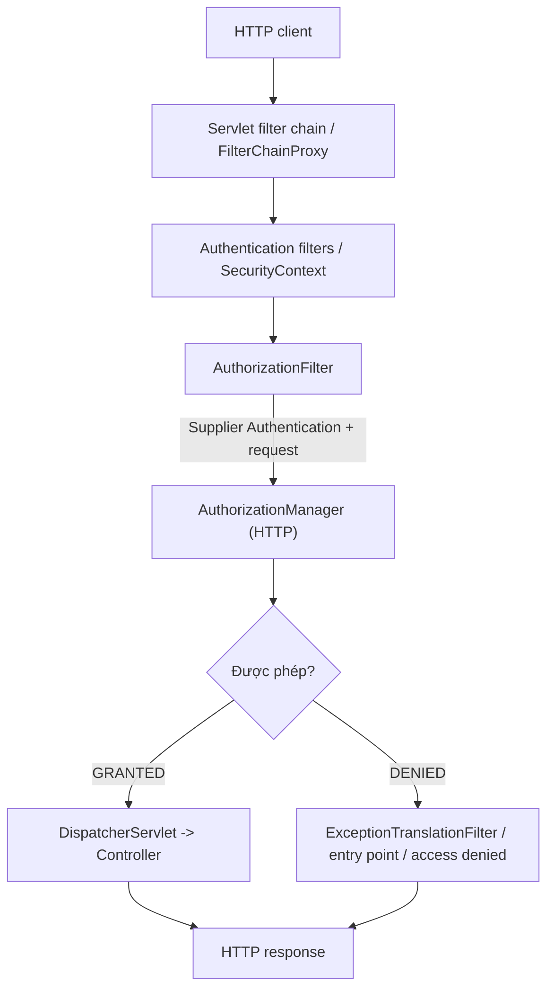

# AuthorizationManager trong quá trình quyết định quyền truy cập

## Mục tiêu học tập

Khi một request đã đến Spring Security, câu hỏi “người dùng là ai?” và “người đó có quyền làm việc này không?” được xử lý ở những bước khác nhau. `AuthenticationManager` thường liên quan đến việc **xác thực danh tính**; còn `AuthorizationManager` là hợp đồng để Spring Security **đánh giá quyền truy cập** vào một đối tượng được bảo vệ. Đối tượng ấy có thể là HTTP request, một lời gọi phương thức hoặc một tài nguyên thuộc cơ chế tích hợp khác.

Bài này tập trung vào vị trí của `AuthorizationManager` trong bản đồ thành phần của **Spring Security Servlet**, cách nó ra quyết định, cách chọn policy, cách kết hợp với method security và cách tự triển khai một manager có ngữ cảnh. Ví dụ sử dụng **Java 17, Spring Boot 3.x, Spring Security 6.5.x và Spring MVC**.

Sau khi học, bạn có thể:

1. Đọc được luồng `SecurityContextHolder → AuthorizationFilter → AuthorizationManager → allow/deny → controller`.
2. Phân biệt `AuthenticationManager`, `AuthorizationManager`, `SecurityFilterChain`, `RequestMatcher` và `ExceptionTranslationFilter`.
3. Hiểu ý nghĩa `Supplier<Authentication>`, `AuthorizationDecision`, `AuthorizationResult`, `granted`, `denied` và `abstain`.
4. Biết DSL `authorizeHttpRequests(...)` tạo và kết hợp các authorization manager như thế nào, vì sao **thứ tự matcher** và **mặc định từ chối** quan trọng.
5. Hiểu mối quan hệ giữa HTTP authorization và method authorization dùng `@EnableMethodSecurity`, `@PreAuthorize`, `@PostAuthorize`.
6. Viết manager tùy chỉnh cho quyền đọc báo cáo theo username/role, kiểm tra cả **401**, **403**, **200**, đồng thời bảo vệ tại tầng service.

> **Giới hạn phiên bản:** Dòng 6.5 vẫn có `AuthorizationManager#check(...)` là phương thức cần hiện thực và `authorize(...)` là phương thức mặc định được thêm sau này; một số tài liệu Spring Security 7.x thể hiện `authorize(...)` là phương thức chính. Ví dụ code cụ thể bên dưới cố ý theo API 6.5.x. Khi nâng cấp major version, phải đối chiếu JavaDoc của phiên bản đang chạy.

## 1. AuthorizationManager là gì?

`AuthorizationManager<T>` nằm trong package `org.springframework.security.authorization`. Nó nhận thông tin về danh tính hiện tại cùng một **secure object** kiểu `T` và quyết định có được phép thực hiện thao tác đó hay không.

Có thể hình dung hợp đồng quyết định:

```text
                         +---------------------+
Authentication ---------->|                     |
(nhận qua Supplier)        | AuthorizationManager |--> GRANTED / DENIED / ABSTAIN
                          |                     |
Secure object ----------->|                     |
(request / invocation)    +---------------------+
```

Mỗi lần thực thi một rule, Spring Security có thể hỏi manager tương ứng. Manager **không tự chạy controller**, **không tự xác thực password** và **không tự tạo session**. Nó đưa ra kết quả cho thành phần gọi nó, chẳng hạn `AuthorizationFilter` hoặc một method security interceptor, để hệ thống quyết định tiếp tục hay từ chối.

### 1.1. So sánh những tên gần giống nhau

| Thành phần | Câu hỏi nó giải quyết | Ví dụ |
| --- | --- | --- |
| `AuthenticationManager` | Credentials/chứng cứ định danh có hợp lệ không? | `ProviderManager` gọi `AuthenticationProvider` để xác thực username/password. |
| `Authentication` | Hiện tại ai đang được biểu diễn? Có những authority nào? | Principal `alice`, authorities `REPORT_READ` và `ROLE_USER`. |
| `SecurityContextHolder` | Lấy ngữ cảnh bảo mật hiện tại ở Servlet flow như thế nào? | Security filter truy xuất `Authentication` khi cần. |
| `AuthorizationManager<T>` | Danh tính đó có được thao tác lên đối tượng `T` không? | Alice được đọc `/api/reports/alice`, bị từ chối với báo cáo Bob. |
| `SecurityFilterChain` | HTTP request sẽ đi qua những filter bảo mật nào? | Authentication filter, CSRF protection, `AuthorizationFilter`… |
| `RequestMatcher` | Request này khớp quy tắc/chain nào? | `/api/**`, HTTP method GET, đường dẫn có biến `{owner}`. |
| `ExceptionTranslationFilter` | Chuyển lỗi auth/authz trong filter chain thành xử lý HTTP như thế nào? | Bắt ngoại lệ và gọi entry point hoặc access-denied handler phù hợp. |
| Method security interceptor | Quyền trước/sau invocation được kiểm tra ra sao? | `@PreAuthorize` kiểm tra trước khi gọi service; `@PostAuthorize` kiểm tra kết quả. |

**Authentication là đầu vào cho authorization**, nhưng một người đã đăng nhập không đồng nghĩa có toàn quyền. Ví dụ, `alice` và `bob` đều có authority `REPORT_READ` nhưng chỉ nên đọc báo cáo mình sở hữu, trừ khi chính sách cho phép quản trị viên truy cập thay.

### 1.2. Manager không quyết định tất cả chỉ qua role

Một authorization decision có thể sử dụng:

- Danh tính `Authentication#getName()`.
- Authorities trong `Authentication#getAuthorities()`.
- Đặc điểm HTTP request: method, path, biến đường dẫn, hoặc thuộc tính được server kiểm soát.
- Tham số phương thức, giá trị trả về, ownership/tenant và trạng thái tài nguyên.
- Policy từ database hoặc một policy engine chuyên dụng, khi thiết kế thực sự yêu cầu.

**Role-based access control (RBAC)** chỉ là một cách đưa ra quyết định. **Attribute-based (ABAC)** hoặc quan hệ owner/tenant thường cần thêm thông tin về tài nguyên thực và chính sách nghiệp vụ. Một URL chứa tên owner không tự chứng minh người đó thật sự sở hữu bản ghi trong database.

## 2. Hợp đồng API và kết quả quyết định

### 2.1. `AuthorizationManager<T>` trên Spring Security 6.5

API khái quát có các phương thức sau (rút gọn để đọc cơ chế; không phải một file Java độc lập):

```java
public interface AuthorizationManager<T> {
    AuthorizationDecision check(
            Supplier<Authentication> authentication,
            T object);

    default AuthorizationResult authorize(
            Supplier<Authentication> authentication,
            T object) {
        // Mặc định 6.5 chuyển qua check(...).
    }

    default void verify(
            Supplier<Authentication> authentication,
            T object) {
        // Ném AccessDeniedException nếu kết quả từ chối.
    }
}
```

Trên **6.5.x**, `check(...)` đã được đánh dấu deprecated để hướng tới API mới hơn, nhưng vẫn là hợp đồng cần hiện thực khi implements trực tiếp interface trong ví dụ này. `authorize(...)` là đường API mới (từ 6.4) và `AuthorizationResult` là kiểu kết quả tổng quát hơn; với Java code nhắm đến Spring Security 7.x cần kiểm tra phiên bản vì chữ ký interface đã tiến hóa.

**`T` có ý nghĩa thực tế:**

- `AuthorizationManager<RequestAuthorizationContext>`: quyết định quyền cho HTTP request, với ngữ cảnh chứa request và những path variables do matcher trích xuất.
- `AuthorizationManager<MethodInvocation>`: quyết định trước lời gọi method, có thể xét method và arguments.
- `AuthorizationManager<MethodInvocationResult>`: có thể xét cả kết quả sau khi method thực thi.

Tên generic giúp diễn đạt **đối tượng đang được bảo vệ**; nó không có nghĩa manager tự tìm các đối tượng trong hệ thống hoặc tự thay đổi business logic.

### 2.2. Vì sao truyền `Supplier<Authentication>`?

Thay vì bắt buộc truy xuất `Authentication` ngay từ đầu cho mọi request, Spring Security đưa vào một hàm cung cấp giá trị khi manager thực sự cần:

```java
Supplier<Authentication> authSupplier = /* do framework cung cấp */;
Authentication current = authSupplier.get(); // chỉ đọc khi cần
```

Đoạn trên là **minh họa ý tưởng**, không phải code tự tạo supplier trong ứng dụng.

Các rule như `permitAll()` hoặc `denyAll()` có thể quyết định mà **không cần** đọc session/security context. Khi manager custom cần username hay authority, nó mới gọi `authentication.get()`. Cơ chế lazy lookup giúp tiết kiệm công việc và tách caller khỏi cách lưu `Authentication`.

**Không giả định `Authentication` luôn là người dùng đã đăng nhập thật.** Spring Security Servlet có thể sử dụng anonymous authentication; `AnonymousAuthenticationToken` có thể biểu diễn request ẩn danh. Một manager custom phải phân biệt anonymous với authenticated principal phù hợp, không chỉ dựa bừa vào `isAuthenticated()`.

### 2.3. Granted, denied và abstain

Về mặt nguyên tắc:

| Kết quả | Ý nghĩa | Hành vi cần lưu ý |
| --- | --- | --- |
| `AuthorizationDecision(true)` | Manager đồng ý cho phép thao tác. | Caller tiếp tục nếu không có kiểm tra khác từ chối. |
| `AuthorizationDecision(false)` | Manager từ chối. | Với `verify(...)` hoặc interceptor/filter thích hợp, sinh `AccessDeniedException`. |
| `null` | Manager không đưa ra quyết định (*abstain*). | **Không đồng nghĩa với deny**, cũng không mặc định nên dùng như chính sách bảo mật. Caller/composition quyết định xử lý. |

Không nên viết manager trả `null` khi thiếu username/biến đường dẫn rồi cho rằng request tự bị từ chối. Với một policy nhạy cảm, nên có **quy tắc từ chối rõ ràng** khi input cần thiết thiếu hoặc không hợp lệ.

Ví dụ ý nghĩa đơn giản:

```java
return new AuthorizationDecision(permitted);
```

`permitted` là boolean do policy đã tính ra. `AuthorizationDecision` ghi nhận kết quả; nó không thay thế bước tra dữ liệu đúng quyền sở hữu, không kiểm chứng transaction và không biến quyền trên URL thành quyền với mọi object.

### 2.4. Phân biệt 401 và 403

Khi một manager từ chối, ý nghĩa nghiệp vụ là **quyền không đạt**. Mã HTTP cuối cùng còn phụ thuộc trạng thái xác thực và cơ chế xử lý lỗi:

- **401 Unauthorized**: thường được trả khi request chưa cung cấp hoặc cung cấp credentials không hợp lệ và authentication entry point yêu cầu đăng nhập. Với HTTP Basic có thể kèm `WWW-Authenticate`.
- **403 Forbidden**: thường được trả khi danh tính đã xác thực nhưng không đủ quyền; hoặc một bộ bảo vệ khác từ chối request (ví dụ CSRF).
- Trong API sử dụng cookie/form login, request chưa xác thực có thể nhận **302 redirect** đến trang đăng nhập thay vì 401. Không cố suy toàn bộ HTTP status từ một giá trị `AuthorizationDecision`.

Một policy HTTP thường đi qua `ExceptionTranslationFilter` để đổi ngoại lệ thành xử lý phù hợp; khi gọi method ngoài bối cảnh HTTP, lỗi phân quyền có thể phải được bên gọi tự xử lý.

## 3. Vị trí AuthorizationManager trong HTTP request Servlet

### 3.1. Luồng tổng quát



Sơ đồ mô tả vai trò của các thành phần, **không cố định mọi thứ tự filter hoặc gọi trực tiếp filter**. Trong Servlet stack, `FilterChainProxy` chọn `SecurityFilterChain` phù hợp; các authentication filters và phần xử lý `SecurityContext` cung cấp thông tin người dùng khi đến bước kiểm tra quyền.

Quy trình với `authorizeHttpRequests(...)`:

1. Servlet container nhận HTTP request; Spring Security filter chain được áp dụng nếu request khớp chain đã định nghĩa.
2. Cơ chế xác thực phù hợp có thể xử lý session, HTTP Basic, bearer token... và tạo/khôi phục `Authentication`.
3. `AuthorizationFilter` chuẩn bị `Supplier<Authentication>` từ ngữ cảnh bảo mật, chuyển nó cùng request cho `AuthorizationManager`.
4. Manager tổng hợp các rule đã cấu hình, tìm rule khớp và đánh giá điều kiện.
5. Nếu cho phép, filter chain tiếp tục để Spring MVC có thể gọi controller. Nếu từ chối, ngoại lệ và cơ chế xử lý bảo mật quyết định HTTP response.
6. Nếu method security được bật, khi controller gọi một Spring-managed service qua proxy, **một lần kiểm tra quyền khác** có thể xảy ra ngay trước (hoặc sau) method.

**Quyền tại HTTP và quyền tại method là hai điểm kiểm tra.** Quyết định cho request đi qua không có nghĩa mọi method hoặc mọi dòng dữ liệu sau đó đều được cấp quyền.

### 3.2. `AuthorizationFilter` và `ExceptionTranslationFilter`

Với DSL `authorizeHttpRequests(...)`, Spring Security hiện đại sử dụng `AuthorizationFilter` và hệ thống `AuthorizationManager`. Tài liệu cũ có thể nói về `FilterSecurityInterceptor`, `AccessDecisionManager`, `AccessDecisionVoter` và `SecurityMetadataSource`: đây là nhóm API liên quan kiến trúc authorization trước đó. Không nên dùng hướng dẫn cho `authorizeRequests(...)` cũ làm chuẩn hiện tại mà không xét phiên bản.

`AuthorizationFilter` chạy gần cuối Spring Security filter chain theo cấu hình mặc định. Điều này cho phép các bước xác thực và phòng vệ phía trước hoạt động trước khi kết luận quyền truy cập. **Filter tự thêm vào chain phải được đặt có chủ đích**; đặt sau `AuthorizationFilter` không tự động biến filter đó thành chốt phân quyền độc lập.

`ExceptionTranslationFilter` không tự quyết định policy nghiệp vụ. Nó phản ứng với `AuthenticationException`/`AccessDeniedException` được ném qua chuỗi filter: nếu request cần xác thực, nó có thể gọi `AuthenticationEntryPoint`; nếu đã xác thực nhưng thiếu quyền, nó có thể gọi `AccessDeniedHandler`. Thành phần này giải thích vì sao cùng “từ chối truy cập” có thể thành 401 hoặc 403 theo tình trạng người gọi và cơ chế login.

### 3.3. Nhiều SecurityFilterChain và thứ tự match

Một ứng dụng Servlet có thể có nhiều `SecurityFilterChain`, ví dụ chain cho `/api/**` và chain cho HTML pages. `FilterChainProxy` chọn **chain phù hợp đầu tiên** theo thứ tự. **Bên trong chain đó**, `RequestMatcherDelegatingAuthorizationManager` chọn rule phù hợp theo thứ tự khai báo trong `authorizeHttpRequests`.

Hai mức chọn cần được phân biệt:

```text
HTTP request
  |
  v
FilterChainProxy: chọn SecurityFilterChain phù hợp đầu tiên
  |
  v
AuthorizationFilter của chain ấy
  |
  v
RequestMatcherDelegatingAuthorizationManager:
     chọn rule requestMatcher phù hợp đầu tiên
  |
  +-- permitAll / authenticated / hasRole / custom access(...)
  |
  v
Allow hoặc deny
```

Đừng dùng `securityMatcher("/api/**")` và `requestMatchers("/api/**")` như từ đồng nghĩa:

- `securityMatcher` xác định request nào **thuộc một SecurityFilterChain**.
- `requestMatchers` trong `authorizeHttpRequests` xác định **policy authorization trong chain đã được chọn**.

Một chain có `securityMatcher` quá hẹp có thể làm request đi vào chain khác hoặc không được Spring Security bảo vệ như mong đợi. Kiểm tra thứ tự chain và default rule là một phần quan trọng của thiết kế bảo mật.

## 4. Những AuthorizationManager thường gặp

Spring Security cung cấp các cơ chế để tạo manager cho các điều kiện phổ biến:

| API / triển khai | Câu hỏi chính | Ví dụ |
| --- | --- | --- |
| `AuthenticatedAuthorizationManager` | Người gọi có thỏa trạng thái xác thực yêu cầu không? | `authenticated()`, `fullyAuthenticated()` hoặc tình huống remember-me theo cấu hình. |
| `AuthorityAuthorizationManager` | Có một trong những authority/role được yêu cầu không? | `hasAuthority("REPORT_READ")`, `hasRole("ADMIN")`. |
| `RequestMatcherDelegatingAuthorizationManager` | HTTP request khớp rule nào, và rule đó giao cho manager nào? | `/public/**` public, `/admin/**` cần ADMIN, `/api/**` cần login. |
| `WebExpressionAuthorizationManager` | Đánh giá một biểu thức authorization ở web layer. | Các migration case cần biểu thức có biến URL; ưu tiên API manager rõ kiểu nếu hợp lý. |
| `PreAuthorizeAuthorizationManager` | Method invocation có qua kiểm tra `@PreAuthorize` trước khi chạy không? | `hasAuthority('REPORT_READ')` với service method. |
| `PostAuthorizeAuthorizationManager` | Giá trị đã được method trả về có được trả cho caller không? | Kiểm tra ownership sau khi method tính kết quả. |
| `SecuredAuthorizationManager` / `Jsr250AuthorizationManager` | Đánh giá các annotation tương ứng khi tính năng được bật. | `@Secured` / `@RolesAllowed` trong cấu hình phù hợp. |

Các rule ngôn ngữ cao cấp như `permitAll`, `denyAll`, `authenticated`, `hasRole` thường **đã đủ cho API đơn giản**; không cần tự viết manager cho mọi điều kiện. Viết custom `AuthorizationManager` khi cần truy cập ngữ cảnh, policy chung, logic có kiểm thử riêng hoặc tích hợp với hệ thống quyết định quyền khác.

### 4.1. Role và authority

`GrantedAuthority` đại diện quyền dưới dạng chuỗi. Thông thường `hasRole("ADMIN")` tương ứng một kiểm tra authority `ROLE_ADMIN` (theo prefix mặc định); `hasAuthority("REPORT_READ")` khớp **chính xác** chuỗi `REPORT_READ`. Tùy cấu hình role prefix, hành vi `hasRole` có thể thay đổi.

Ví dụ:

```java
User.withUsername("alice")
    .password(encoded)
    .authorities("REPORT_READ")
    .build();

User.withUsername("admin")
    .password(encoded)
    .authorities("REPORT_READ", "ROLE_ADMIN")
    .build();
```

Đây là **đoạn minh họa dùng biến `encoded`**, không phải class Java độc lập. Alice có quyền `REPORT_READ` nhưng không có `ROLE_ADMIN`. Admin có cả hai authority. Không trộn `roles("ADMIN")` với `authorities("ROLE_ADMIN")` mà quên cơ chế prefix.

### 4.2. Logic “AND” và “OR” phải được thiết kế có chủ đích

Ví dụ một endpoint chỉ cho **người có REPORT_READ và là owner**, hoặc admin được phép theo policy:

```text
allow =
  authenticated
  AND REPORT_READ
  AND (username == resource.owner OR has ROLE_ADMIN)
```

Nếu chỉ dùng `authenticated()`, policy bỏ qua cả quyền chức năng lẫn ownership. Nếu chỉ dùng `hasRole("ADMIN")`, user thường có thể bị chặn dù được phép đọc tài nguyên của mình. Nếu kết hợp theo `OR` sai chỗ, có thể mở quyền vượt thiết kế.

Với dữ liệu thực, ownership nên dựa trên bản ghi **do server/DB quản lý**, không chỉ trên một chuỗi do client gửi. Quyền theo path variable hữu ích cho bài lab và một số route identity-scoped, nhưng service vẫn phải đảm bảo object trả ra thuộc scope hợp lệ.

## 5. Cấu hình AuthorizationManager qua DSL `authorizeHttpRequests`

Cấu hình cơ bản:

```java
http.authorizeHttpRequests(auth -> auth
    .requestMatchers("/public/**").permitAll()
    .requestMatchers("/admin/**").hasRole("ADMIN")
    .requestMatchers("/api/**").authenticated()
    .anyRequest().denyAll()
);
```

Đây là một **đoạn code cấu hình**, không phải chương trình Java độc lập. Nó minh họa 4 lựa chọn:

1. `permitAll()` dành cho endpoint chủ đích công khai.
2. `hasRole("ADMIN")` cho nhóm endpoint quản trị.
3. `authenticated()` bắt buộc có danh tính đã xác thực cho các request API khác.
4. `anyRequest().denyAll()` từ chối mọi request chưa khớp rule trước đó.

**Thứ tự rất quan trọng.** Nếu đặt `.requestMatchers("/**").permitAll()` ở đầu, các quy tắc bảo vệ phía sau không có cơ hội kiểm tra request tương ứng. Một rule như `.requestMatchers("/api/**").authenticated()` đặt trước `.requestMatchers("/api/admin/**").hasRole("ADMIN")` có thể cho phép mọi người đã đăng nhập đi qua endpoint admin, vì rule `/api/**` đã khớp trước.

**Không được suy luận từ route name.** Một method controller nằm trong package `admin` hoặc trả dữ liệu nhạy cảm không tự nhận được policy phù hợp. Hãy kiểm tra đường dẫn, HTTP method, dispatcher và cách matcher thực tế chạy.

### 5.1. Các dispatch khác nhau

`AuthorizationFilter` có thể tham gia kiểm tra trên các dispatcher types như `REQUEST`, `ERROR` và `FORWARD`. Ví dụ Spring Boot chuyển một lỗi đến `/error` qua `ERROR` dispatch. Nếu rule mặc định từ chối không xét tình huống này, response có thể bị ảnh hưởng bởi một lần authorization bổ sung.

Trong ứng dụng thực, có thể khai báo rõ:

```java
.dispatcherTypeMatchers(DispatcherType.ERROR, DispatcherType.FORWARD).permitAll()
```

Cần import `jakarta.servlet.DispatcherType` (Boot 3.x sử dụng Jakarta). Cho phép dispatch nội bộ theo type là lựa chọn cần review theo ứng dụng; nó không đồng nghĩa mở các endpoint quản trị cho HTTP request trực tiếp loại `REQUEST`.

### 5.2. `permitAll` và `web.ignoring`

Hai cách không tương đương:

- `permitAll()`: request vẫn đi qua Spring Security filter chain, nên các security response headers và các cơ chế khác vẫn có thể hoạt động; riêng quyết định authorization cho phép truy cập.
- Bỏ qua hoàn toàn bằng `web.ignoring()`: request không được xử lý bởi Spring Security filter chain tương ứng, khiến nhiều cơ chế bảo mật cũng bị bỏ qua.

Với public endpoints và static resources, `permitAll` thường là lựa chọn dễ kiểm soát hơn. Nếu cần bỏ qua vì lý do đặc biệt, phải hiểu đầy đủ những filter sẽ không chạy.

## 6. Method security: cùng ý tưởng manager, điểm kiểm tra khác

HTTP authorization bảo vệ **đường vào**. Method authorization bảo vệ **lời gọi phương thức** trên Spring-managed bean, thường ở tầng service, trước và/hoặc sau khi method chạy. Điều này có giá trị vì một service có thể được gọi từ controller, background job, message consumer hoặc một đường đi khác không qua URL rule tương tự.

Bật phương thức:

```java
@Configuration
@EnableMethodSecurity
class MethodSecurityConfiguration {
}
```

Ví dụ rút gọn trên cần import annotation tương ứng và một module Spring có cấu hình; trong ứng dụng runnable ở phần 8, ta đặt `@EnableMethodSecurity` trong `SecurityConfig`.

### 6.1. Luồng `@PreAuthorize`

```text
Controller gọi service proxy
      |
      v
AuthorizationManagerBeforeMethodInterceptor
      |
      v
PreAuthorizeAuthorizationManager
      |
      +--> evaluate expression với Authentication + MethodInvocation
      |
      +--> deny: AccessDeniedException
      |
      v
Gọi method thật khi được phép
```

`@PreAuthorize("hasAuthority('REPORT_READ')")` có nghĩa **kiểm tra quyền trước khi chạy method**. Trong hệ thống chuẩn, lời gọi service bị từ chối không được phép thực hiện các side effects bên trong method đó.

### 6.2. Luồng `@PostAuthorize` và giới hạn

`@PostAuthorize` đánh giá **sau khi method đã trả về**, có thể xét `returnObject`. Ví dụ học thuật:

```java
@PostAuthorize("returnObject.owner == authentication.name")
public Report readReport(long id) {
    return repository.findById(id).orElseThrow();
}
```

Đây là **đoạn minh họa**, `Report`/`repository` chưa được định nghĩa. Nó cho thấy người dùng có thể bị chặn **khi chuẩn bị nhận kết quả**, nhưng method đã chạy. Vì vậy không dùng `@PostAuthorize` làm biện pháp bảo vệ duy nhất cho **ghi tiền, gửi email, cập nhật database hoặc các thao tác có side effect**, vì hành động có thể đã xảy ra trước khi kiểm tra.

Với query trả danh sách lớn, đừng fetch cả tenant khác rồi dựa vào post-filter/annotation để “lọc an toàn”: hãy giới hạn quyền ngay ở query và service.

### 6.3. Proxy/AOP và self-invocation

Method security tiêu chuẩn dựa trên Spring AOP proxy. Nếu một method trong bean gọi trực tiếp method khác của chính bean đó qua `this.securedMethod()`, lời gọi nội bộ có thể **không đi qua proxy**, nên interceptor cần thiết không được chạy.

Tương tự, tự `new Service()` ngoài Spring container hoặc gọi code từ nơi không có security context cũng khiến giả định của method security có thể sai. Với chức năng nhạy cảm, kiểm thử cả đường gọi từ controller, service khác và background flow. Đừng coi sự tồn tại của annotation là bằng chứng mọi cách gọi đều được bảo vệ.

### 6.4. Phân quyền URL và method phối hợp thế nào?

| Kiểm tra | Dữ liệu chính | Giá trị |
| --- | --- | --- |
| Request authorization | Method, URL pattern, request context, authentication | Chặn truy cập sớm trước controller; áp các rule rộng dễ audit. |
| Before-method authorization | Authentication, tham số method, quy tắc service | Chặn trước khi thực thi nghiệp vụ, giúp tái sử dụng policy qua nhiều entry point. |
| After-method authorization | Authentication và kết quả trả về | Ngăn caller nhận một đối tượng không được phép, nhưng chưa chắc ngăn side effect. |
| Repository/DB scoping | Điều kiện owner/tenant, service account privilege | Chỉ trả/ghi các hàng mà nghiệp vụ cho phép, giảm nguy cơ lộ dữ liệu do query quá rộng. |

Một quyết định **allowed** ở URL không hủy những kiểm tra phía dưới. Nhiều kiểm tra ở các layer có thể cùng áp dụng, và chỉ một kiểm tra từ chối là đủ để ngăn thao tác.

## 7. Khi nào cần viết AuthorizationManager tùy chỉnh?

Không phải lúc nào cũng cần:

- Nếu chỉ cần “đã login”, dùng `authenticated()`.
- Nếu chỉ cần role/authority cố định, dùng `hasRole(...)` hoặc `hasAuthority(...)`.
- Nếu cần một biểu thức method đủ rõ, dùng `@PreAuthorize(...)` và bật method security.
- Nếu logic cần **ngữ cảnh riêng**, có kiểm thử độc lập và được dùng nhiều nơi, custom manager giúp đặt policy thành một thành phần có thể thay thế và quan sát.

Trường hợp hợp lý gồm policy theo tổ chức/tenant, ownership mà manager có đủ dữ liệu tin cậy, điều kiện nhiều quyền, truy vấn policy service hoặc tích hợp hệ thống ngoài. **Không nên gọi remote authorization service cho mọi request mà không có timeout, chính sách lỗi, giới hạn tải và quan sát**, vì lỗi remote có thể làm request treo hoặc quyền bị xử lý sai.

### 7.1. Quy tắc an toàn khi thiết kế custom manager

1. **Xác định object kiểu `T`** mà manager thật sự nhận; đừng cast request sai kiểu.
2. **Lấy danh tính từ Supplier/Authentication**; không đọc header `X-User` hay query `user` do client tự khai làm bằng chứng.
3. **Chặn anonymous khi policy yêu cầu login**; không chỉ kiểm tra `isAuthenticated()` rồi bỏ qua loại Authentication.
4. **Không coi path variable là ownership thực** nếu dữ liệu thực nằm trong DB; phải có bước xác minh theo tài nguyên.
5. **Trả explicit deny** khi thiếu biến/ngữ cảnh cần thiết. Đừng mặc định `null` là deny.
6. **Không cấp quyền theo lỗi**: khi policy store không truy cập được, cần fail closed đối với nghiệp vụ nhạy cảm theo yêu cầu hệ thống.
7. **Giữ side effects ngoài quyết định**: authorization manager nên đánh giá policy; tránh tự cập nhật dữ liệu hoặc gây hành động nghiệp vụ.
8. **Phân biệt audit với dữ liệu nhạy cảm**: có thể log decision, policy, request id hoặc actor id an toàn, không log password, token hoặc nội dung bí mật.

## 8. Ví dụ đầy đủ — Custom AuthorizationManager cho HTTP và Method Security

### 8.1. Bài toán

Ứng dụng có 3 tài khoản thử nghiệm:

- `alice` và `bob` đều có authority `REPORT_READ`.
- `admin` có `REPORT_READ` và `ROLE_ADMIN`.

Endpoints:

- `GET /public/ping`: ai cũng truy cập được.
- `GET /api/reports/{owner}`: chỉ owner hoặc ADMIN được đi qua **HTTP authorization manager**.
- `GET /admin/ping`: chỉ ADMIN được truy cập bằng built-in manager.
- `ReportService.readForOwner(...)`: kiểm tra **method authorization** để xác nhận `REPORT_READ` và owner/admin trước khi trả nội dung.

Ví dụ dùng map dữ liệu tĩnh ở service để tập trung vào luồng policy, không dùng database thật. Trong sản phẩm, cần xác minh owner theo bản ghi server quản lý và truy vấn giới hạn tenant; không dựa độc nhất vào tên trong URL.

### 8.2. Cấu trúc dự án

```text
authorization-manager-lab/
├── pom.xml
└── src/
    ├── main/java/com/example/authz/
    │   ├── AuthzApplication.java
    │   ├── SecurityConfig.java
    │   ├── ReportOwnerAuthorizationManager.java
    │   ├── ReportService.java
    │   └── DemoController.java
    └── test/java/com/example/authz/
        └── AuthorizationManagerTest.java
```

### 8.3. `pom.xml`

```xml
<project xmlns="http://maven.apache.org/POM/4.0.0"
         xmlns:xsi="http://www.w3.org/2001/XMLSchema-instance"
         xsi:schemaLocation="http://maven.apache.org/POM/4.0.0 https://maven.apache.org/xsd/maven-4.0.0.xsd">
    <modelVersion>4.0.0</modelVersion>

    <parent>
        <groupId>org.springframework.boot</groupId>
        <artifactId>spring-boot-starter-parent</artifactId>
        <version>3.5.0</version>
        <relativePath/>
    </parent>

    <groupId>com.example</groupId>
    <artifactId>authorization-manager-lab</artifactId>
    <version>1.0.0</version>

    <properties>
        <java.version>17</java.version>
    </properties>

    <dependencies>
        <dependency>
            <groupId>org.springframework.boot</groupId>
            <artifactId>spring-boot-starter-web</artifactId>
        </dependency>
        <dependency>
            <groupId>org.springframework.boot</groupId>
            <artifactId>spring-boot-starter-security</artifactId>
        </dependency>
        <dependency>
            <groupId>org.springframework.boot</groupId>
            <artifactId>spring-boot-starter-test</artifactId>
            <scope>test</scope>
        </dependency>
        <dependency>
            <groupId>org.springframework.security</groupId>
            <artifactId>spring-security-test</artifactId>
            <scope>test</scope>
        </dependency>
    </dependencies>

    <build>
        <plugins>
            <plugin>
                <groupId>org.springframework.boot</groupId>
                <artifactId>spring-boot-maven-plugin</artifactId>
            </plugin>
        </plugins>
    </build>
</project>
```

Spring Boot BOM chọn phiên bản thư viện Spring Security tương thích. Với parent 3.5.0, ví dụ nằm trong thế hệ Spring Security 6.5; khi dùng thực tế nên nâng lên bản vá được hỗ trợ, tránh tự ghép ngẫu nhiên Boot và Security không cùng thế hệ.

### 8.4. `AuthzApplication.java`

```java
package com.example.authz;

import org.springframework.boot.SpringApplication;
import org.springframework.boot.autoconfigure.SpringBootApplication;

@SpringBootApplication
public class AuthzApplication {
    public static void main(String[] args) {
        SpringApplication.run(AuthzApplication.class, args);
    }
}
```

`@SpringBootApplication` khởi động Spring Framework context và cấu hình web; nó không viết hộ policy của ứng dụng. Chính các bean Security bên dưới cung cấp quyết định cho request.

### 8.5. `ReportOwnerAuthorizationManager.java`

```java
package com.example.authz;

import java.util.function.Supplier;

import org.springframework.security.authentication.AnonymousAuthenticationToken;
import org.springframework.security.authorization.AuthorizationDecision;
import org.springframework.security.authorization.AuthorizationManager;
import org.springframework.security.core.Authentication;
import org.springframework.security.core.GrantedAuthority;
import org.springframework.security.web.access.intercept.RequestAuthorizationContext;
import org.springframework.stereotype.Component;

@Component
public class ReportOwnerAuthorizationManager
        implements AuthorizationManager<RequestAuthorizationContext> {

    @Override
    @SuppressWarnings("deprecation") // Spring Security 6.5 yêu cầu check(...).
    public AuthorizationDecision check(
            Supplier<Authentication> authentication,
            RequestAuthorizationContext context) {

        Authentication current = authentication.get();

        if (current == null
                || current instanceof AnonymousAuthenticationToken
                || !current.isAuthenticated()) {
            return new AuthorizationDecision(false);
        }

        String owner = context.getVariables().get("owner");
        if (owner == null || owner.isBlank()) {
            return new AuthorizationDecision(false);
        }

        boolean isOwner = owner.equals(current.getName());

        boolean isAdmin = current.getAuthorities().stream()
                .map(GrantedAuthority::getAuthority)
                .anyMatch("ROLE_ADMIN"::equals);

        return new AuthorizationDecision(isOwner || isAdmin);
    }
}
```

**Phân tích từng bước:**

1. Spring Security gọi manager khi HTTP request khớp rule dành cho `/api/reports/{owner}`.
2. `authentication.get()` truy cập `Authentication` chỉ khi policy cần. Nếu là anonymous, thiếu hoặc không hợp lệ, manager trả **deny**.
3. `context.getVariables().get("owner")` lấy path variable từ `RequestMatcher` tương ứng. Nếu chưa có biến, manager từ chối rõ ràng.
4. `isOwner` so tên owner trong URL với tên principal. `isAdmin` kiểm tra authority `ROLE_ADMIN`.
5. Manager trả `AuthorizationDecision(true/false)`. Nó **không** tự gửi response 403; `AuthorizationFilter`/exception handling thực thi kết quả.
6. Quy tắc này bảo vệ **địa chỉ theo username**. Trong hệ thống có ID tài nguyên thật như `/api/reports/42`, không dùng phép so username với path để suy quyền; cần kiểm tra owner thực từ DB/service.

`@SuppressWarnings("deprecation")` được đặt đúng tại phương thức vì `check(...)` bị deprecated trong dòng 6.5 khi `authorize(...)` được bổ sung. Đây là lựa chọn **tương thích có chủ đích với 6.5**, không phải lời khuyên sử dụng API deprecated vô thời hạn.

### 8.6. `SecurityConfig.java`

```java
package com.example.authz;

import jakarta.servlet.DispatcherType;

import org.springframework.context.annotation.Bean;
import org.springframework.context.annotation.Configuration;
import org.springframework.http.HttpMethod;
import org.springframework.security.config.Customizer;
import org.springframework.security.config.annotation.method.configuration.EnableMethodSecurity;
import org.springframework.security.config.annotation.web.builders.HttpSecurity;
import org.springframework.security.config.annotation.web.configurers.AbstractHttpConfigurer;
import org.springframework.security.core.userdetails.User;
import org.springframework.security.core.userdetails.UserDetailsService;
import org.springframework.security.crypto.bcrypt.BCryptPasswordEncoder;
import org.springframework.security.crypto.password.PasswordEncoder;
import org.springframework.security.provisioning.InMemoryUserDetailsManager;
import org.springframework.security.web.SecurityFilterChain;

@Configuration(proxyBeanMethods = false)
@EnableMethodSecurity
public class SecurityConfig {

    @Bean
    SecurityFilterChain securityFilterChain(
            HttpSecurity http,
            ReportOwnerAuthorizationManager reportOwnerManager)
            throws Exception {

        return http
            .authorizeHttpRequests(auth -> auth
                .dispatcherTypeMatchers(
                    DispatcherType.ERROR, DispatcherType.FORWARD
                ).permitAll()
                .requestMatchers(HttpMethod.GET, "/public/ping").permitAll()
                .requestMatchers(HttpMethod.GET, "/admin/**").hasRole("ADMIN")
                .requestMatchers(
                    HttpMethod.GET, "/api/reports/{owner}"
                ).access(reportOwnerManager)
                .anyRequest().denyAll()
            )
            .httpBasic(Customizer.withDefaults())
            .formLogin(AbstractHttpConfigurer::disable)
            .build();
    }

    @Bean
    PasswordEncoder passwordEncoder() {
        return new BCryptPasswordEncoder();
    }

    @Bean
    UserDetailsService userDetailsService(PasswordEncoder encoder) {
        return new InMemoryUserDetailsManager(
            User.withUsername("alice")
                .password(encoder.encode("alice-pass"))
                .authorities("REPORT_READ")
                .build(),
            User.withUsername("bob")
                .password(encoder.encode("bob-pass"))
                .authorities("REPORT_READ")
                .build(),
            User.withUsername("admin")
                .password(encoder.encode("admin-pass"))
                .authorities("REPORT_READ", "ROLE_ADMIN")
                .build()
        );
    }
}
```

Điểm then chốt:

- `@EnableMethodSecurity` làm các annotation như `@PreAuthorize` có hiệu lực đối với lời gọi qua proxy.
- `/admin/**` dùng rule có sẵn `hasRole("ADMIN")`; `/api/reports/{owner}` dùng custom manager qua `.access(reportOwnerManager)`.
- `requestMatchers` là phần lựa chọn rule. Biến `owner` trong URL được truyền vào `RequestAuthorizationContext` cho manager.
- `.anyRequest().denyAll()` ngăn endpoint mới vô tình public khi developer thêm controller mà quên policy.
- Cho phép `ERROR`/`FORWARD` internal dispatch có chủ đích trong lab để không đổi response lỗi thành từ chối do rule path chung.
- HTTP Basic dùng cho thử nghiệm curl; trong production cần HTTPS, identity provider/credential storage và chiến lược login/token phù hợp.
- Không tắt CSRF trong ví dụ; chỉ có endpoint GET. Nếu thêm POST/PUT/DELETE, cần đánh giá CSRF theo cách client gửi credentials, không xem quyền URL là giải pháp CSRF.

### 8.7. `ReportService.java`

```java
package com.example.authz;

import java.util.Map;

import org.springframework.security.access.prepost.PreAuthorize;
import org.springframework.security.core.parameters.P;
import org.springframework.stereotype.Service;

@Service
public class ReportService {

    private final Map<String, String> reports = Map.of(
        "alice", "Report for alice",
        "bob", "Report for bob"
    );

    @PreAuthorize(
        "hasAuthority('REPORT_READ') and " +
        "(#owner == authentication.name or hasRole('ADMIN'))"
    )
    public String readForOwner(@P("owner") String owner) {
        return reports.get(owner);
    }
}
```

Dù HTTP manager vừa cho phép đi qua, `ReportService` vẫn bảo vệ business operation:

- `hasAuthority('REPORT_READ')` yêu cầu quyền đọc báo cáo.
- `#owner == authentication.name or hasRole('ADMIN')` yêu cầu đúng owner hoặc admin.
- `@P("owner")` giúp Spring Security có tên parameter cho SpEL mà không phụ thuộc việc suy tên qua metadata của compiler.
- Method trả chuỗi `null` nếu owner không nằm trong tập dữ liệu mẫu; controller sẽ chuyển thành 404.

**Vì sao lặp policy ở hai điểm?** Request manager minh họa cách bảo vệ HTTP boundary, còn method security bảo vệ service khi được gọi qua **một entry point khác**. Với ứng dụng lớn nên thiết kế policy chung để không lệch hai bản sao logic; ví dụ này giữ biểu thức ngắn để thấy rõ hai cơ chế vận hành.

Trong môi trường có DB, logic tại service cần bảo đảm **owner là thuộc tính thật của bản ghi**, kiểm tra quyền theo resource ID và áp giới hạn tenant trong query. Map chỉ mô phỏng dữ liệu tĩnh của một bài học.

### 8.8. `DemoController.java`

```java
package com.example.authz;

import org.springframework.http.ResponseEntity;
import org.springframework.web.bind.annotation.GetMapping;
import org.springframework.web.bind.annotation.PathVariable;
import org.springframework.web.bind.annotation.RestController;

@RestController
public class DemoController {

    private final ReportService reportService;

    public DemoController(ReportService reportService) {
        this.reportService = reportService;
    }

    @GetMapping("/public/ping")
    public String ping() {
        return "pong";
    }

    @GetMapping("/admin/ping")
    public String adminPing() {
        return "admin";
    }

    @GetMapping("/api/reports/{owner}")
    public ResponseEntity<String> report(@PathVariable String owner) {
        String value = reportService.readForOwner(owner);
        if (value == null) {
            return ResponseEntity.notFound().build();
        }
        return ResponseEntity.ok(value);
    }
}
```

Controller không tự parse password hoặc quyết định “ai được vào URL” bằng if tùy ý. Request authorization đã được Spring Security xử lý trước khi đến controller. Khi controller gọi `reportService.readForOwner(owner)` qua bean proxy, method security tiếp tục kiểm tra quyền nghiệp vụ.

**Phân biệt ba phạm vi:** request matcher quyết định route; method interceptor quyết định việc gọi service; dữ liệu giả lập quyết định báo cáo có tồn tại không. Từ chối quyền không đồng nhất với “không tìm thấy tài nguyên”.

### 8.9. Test tích hợp bằng MockMvc

`AuthorizationManagerTest.java`:

```java
package com.example.authz;

import org.junit.jupiter.api.Test;
import org.springframework.beans.factory.annotation.Autowired;
import org.springframework.boot.test.autoconfigure.web.servlet.AutoConfigureMockMvc;
import org.springframework.boot.test.context.SpringBootTest;
import org.springframework.test.web.servlet.MockMvc;

import static org.springframework.security.test.web.servlet.request
        .SecurityMockMvcRequestPostProcessors.httpBasic;
import static org.springframework.test.web.servlet.request.MockMvcRequestBuilders.get;
import static org.springframework.test.web.servlet.result.MockMvcResultMatchers.content;
import static org.springframework.test.web.servlet.result.MockMvcResultMatchers.status;

@SpringBootTest
@AutoConfigureMockMvc
class AuthorizationManagerTest {

    @Autowired
    MockMvc mvc;

    @Test
    void publicEndpointNeedsNoCredentials() throws Exception {
        mvc.perform(get("/public/ping"))
            .andExpect(status().isOk())
            .andExpect(content().string("pong"));
    }

    @Test
    void unauthenticatedRequestIsChallenged() throws Exception {
        mvc.perform(get("/api/reports/alice"))
            .andExpect(status().isUnauthorized());
    }

    @Test
    void ownerCanReadOwnReport() throws Exception {
        mvc.perform(get("/api/reports/alice")
                .with(httpBasic("alice", "alice-pass")))
            .andExpect(status().isOk())
            .andExpect(content().string("Report for alice"));
    }

    @Test
    void ownerCannotReadAnotherUsersReport() throws Exception {
        mvc.perform(get("/api/reports/bob")
                .with(httpBasic("alice", "alice-pass")))
            .andExpect(status().isForbidden());
    }

    @Test
    void anotherOwnerCanReadOwnReport() throws Exception {
        mvc.perform(get("/api/reports/bob")
                .with(httpBasic("bob", "bob-pass")))
            .andExpect(status().isOk())
            .andExpect(content().string("Report for bob"));
    }

    @Test
    void adminCanReadAnyExistingReport() throws Exception {
        mvc.perform(get("/api/reports/alice")
                .with(httpBasic("admin", "admin-pass")))
            .andExpect(status().isOk())
            .andExpect(content().string("Report for alice"));
    }

    @Test
    void ordinaryUserCannotVisitAdminRoute() throws Exception {
        mvc.perform(get("/admin/ping")
                .with(httpBasic("alice", "alice-pass")))
            .andExpect(status().isForbidden());
    }

    @Test
    void adminCanVisitAdminRoute() throws Exception {
        mvc.perform(get("/admin/ping")
                .with(httpBasic("admin", "admin-pass")))
            .andExpect(status().isOk())
            .andExpect(content().string("admin"));
    }

    @Test
    void unknownOwnerIsNotFoundToAdmin() throws Exception {
        mvc.perform(get("/api/reports/unknown")
                .with(httpBasic("admin", "admin-pass")))
            .andExpect(status().isNotFound());
    }
}
```

**Vì sao cần đủ các negative test?**

- `401` chứng minh thiếu login không được đi qua.
- `403` của Alice khi đọc Bob chứng minh **đã xác thực vẫn có thể không đủ quyền**.
- `200` của admin chứng minh policy có ngoại lệ role đúng ý định.
- `403` ở `/admin/ping` cho user thường chứng minh built-in role manager khác custom owner manager.
- `404` với owner không tồn tại chứng minh quyền đọc không làm một resource tự xuất hiện.

MockMvc test đi qua filter chain của ứng dụng với `spring-security-test`, không cần khởi chạy HTTP server thực. Test này không thay thế kiểm thử proxy/CDN, persistence và các biến thể route production.

### 8.10. Chạy ứng dụng và gửi HTTP request

Yêu cầu JDK 17+ và Maven. Từ thư mục dự án:

```bash
mvn test
mvn spring-boot:run
```

Gửi request trong terminal khác (trên PowerShell dùng `curl.exe` thay `curl` nếu cần):

```bash
curl -i http://localhost:8080/public/ping
curl -i http://localhost:8080/api/reports/alice
curl -i -u alice:alice-pass http://localhost:8080/api/reports/alice
curl -i -u alice:alice-pass http://localhost:8080/api/reports/bob
curl -i -u bob:bob-pass http://localhost:8080/api/reports/bob
curl -i -u admin:admin-pass http://localhost:8080/api/reports/alice
curl -i -u alice:alice-pass http://localhost:8080/admin/ping
curl -i -u admin:admin-pass http://localhost:8080/admin/ping
```

**Kết quả kỳ vọng** (lược bỏ header phụ thuộc môi trường):

| Request | HTTP status | Body khi thành công | Giải thích |
| --- | --- | --- | --- |
| Anonymous `/public/ping` | 200 | `pong` | `permitAll`. |
| Anonymous `/api/reports/alice` | 401 | Không trả báo cáo | Chưa xác thực; HTTP Basic entry point. |
| Alice đọc `/api/reports/alice` | 200 | `Report for alice` | Custom manager nhận diện owner; service cho phép. |
| Alice đọc `/api/reports/bob` | 403 | Không trả báo cáo | Manager từ chối trước controller. |
| Bob đọc `/api/reports/bob` | 200 | `Report for bob` | Đúng owner, có REPORT_READ. |
| Admin đọc `/api/reports/alice` | 200 | `Report for alice` | ROLE_ADMIN được phép theo policy, vẫn có REPORT_READ. |
| Alice đọc `/admin/ping` | 403 | Không trả nội dung admin | Built-in `hasRole("ADMIN")` từ chối. |
| Admin đọc `/admin/ping` | 200 | `admin` | Đủ ROLE_ADMIN. |

Không đưa mật khẩu demo vào hệ thống thật; HTTP Basic không mã hóa credentials ở tầng ứng dụng và chỉ nên dùng trên HTTPS ngoài môi trường local. Ở các ứng dụng dùng session/form-login, cách xử lý “chưa xác thực” có thể chuyển hướng login thay vì trả 401.

## 9. Tự kiểm tra quyết định của manager trong lab

Hãy lần theo request `GET /api/reports/bob` của Alice:

1. HTTP Basic authentication thành công: `Authentication` có `getName() = "alice"`, `getAuthorities() = ["REPORT_READ"]`.
2. `AuthorizationFilter` nhận `GET /api/reports/bob`. `RequestMatcherDelegatingAuthorizationManager` tìm rule `/api/reports/{owner}`.
3. Matcher cung cấp biến `owner = "bob"` cho `ReportOwnerAuthorizationManager`.
4. Manager gọi supplier để đọc `Authentication`. Alice không anonymous và đã xác thực.
5. `isOwner = false` vì `"bob" != "alice"`.
6. `isAdmin = false` vì Alice không có `ROLE_ADMIN`.
7. `AuthorizationDecision(false)` làm request bị từ chối. `ExceptionTranslationFilter` xử lý lỗi thành 403 vì request đã xác thực.
8. Controller và `ReportService.readForOwner(...)` **không chạy** trong luồng này.

Thử request `GET /api/reports/alice` của Alice:

1. Matcher vẫn là một rule đó, nhưng `owner = "alice"`.
2. `isOwner = true`, custom manager trả cho phép.
3. Controller gọi `reportService.readForOwner("alice")`.
4. `@PreAuthorize` kiểm tra `REPORT_READ` và owner; cả hai đúng.
5. Service trả `Report for alice`; HTTP status là 200.

Trường hợp admin đọc Bob:

1. `isOwner = false` nhưng `isAdmin = true`, HTTP manager cho phép.
2. Method security nhận `hasRole('ADMIN') = true` và `REPORT_READ = true`.
3. Dữ liệu mẫu có Bob nên service trả `Report for bob`.

**Điểm mấu chốt:** quyết định authorization là kết quả của **policy đang áp vào đối tượng cụ thể** tại một thời điểm, không đơn giản là trạng thái “logged in”.

## 10. Những lỗi thường gặp khi tự viết AuthorizationManager

### Lỗi 1 — Dùng manager để xác thực mật khẩu

`AuthorizationManager` không phải nơi kiểm tra password hoặc phát token. Việc xác thực thuộc các authentication components tương ứng. Manager chỉ sử dụng danh tính/authority đã được xác lập khi đưa ra quyết định.

### Lỗi 2 — Chỉ kiểm tra `isAuthenticated()`

Một số cơ chế anonymous tạo `Authentication` có `isAuthenticated()` mang giá trị khiến kiểm tra hời hợt bị hiểu sai. Hãy dùng built-in `authenticated()` khi cần, hoặc xử lý rõ anonymous/trust resolver trong custom manager.

### Lỗi 3 — Trả `null` khi thiếu dữ liệu

`null` là abstain, không bảo đảm deny. Khi thiếu owner/tenant hoặc policy service trả kết quả không chắc chắn, **chọn quy tắc xử lý có chủ đích**, thông thường là từ chối với dữ liệu nhạy cảm.

### Lỗi 4 — Đặt matcher rộng trước matcher hẹp

`/api/**` trước `/api/admin/**` có thể bắt request trước rule admin. Luôn kiểm tra thứ tự first-match và bổ sung `anyRequest().denyAll()`.

### Lỗi 5 — Tưởng `securityMatcher` chính là `requestMatchers`

`securityMatcher` chọn chain, còn `requestMatchers` chọn rule trong chain. Sai ở tầng chain có thể làm request không đi qua những filter hoặc policy đã dự tính.

### Lỗi 6 — Tưởng URL owner là bằng chứng ownership

`/reports/alice` chỉ là chuỗi client gửi trong path. Trong ứng dụng thật, phải xác minh bản ghi thuộc Alice bằng dữ liệu đáng tin cậy, điều kiện tenant/owner của query, hoặc service policy phù hợp.

### Lỗi 7 — Tin `@PreAuthorize` tự bật theo starter

`spring-boot-starter-security` không tự bật method security. Cần `@EnableMethodSecurity`, đồng thời đảm bảo lời gọi qua bean proxy.

### Lỗi 8 — Gọi secured method bằng `this.method()`

Self-invocation có thể không đi qua proxy; annotation sẽ không được thực thi như bạn tưởng. Tách service đúng trách nhiệm, gọi qua Spring bean hoặc dùng cách tích hợp method security phù hợp.

### Lỗi 9 — Sử dụng `@PostAuthorize` để ngăn thao tác ghi

Method có side effects có thể đã chạy trước khi kiểm tra hậu điều kiện. Hãy đặt authorization **trước** thao tác nguy hiểm, và dùng after-method policy cho những bài toán kiểm tra kết quả phù hợp.

### Lỗi 10 — Gán permission dựa trên dữ liệu client tự nhận

Header `X-Role: ADMIN`, body `{"tenant":"customerA"}` hay query `?owner=alice` không phải nguồn quyền. Phải dùng principal đã xác thực, policy và dữ liệu owner/tenant do server kiểm chứng.

### Lỗi 11 — Lỗi policy service dẫn đến “mặc định cho phép”

Nếu custom manager gọi policy service bên ngoài, timeout hoặc lỗi kết nối không nên vô tình thành permit. Chọn failure behavior rõ ràng, timeout hữu hạn, tránh rò rỉ lý do nhạy cảm và kiểm tra khi dịch vụ bên ngoài không khả dụng.

### Lỗi 12 — Chỉ test trường hợp được phép

Một bài test 200 không chứng minh permission boundary đúng. Kiểm tra anonymous, authenticated nhưng thiếu quyền, role khác, path không khớp, method khác, biến owner thiếu, cùng tình huống quyền bị thu hồi.

## 11. Khi cần quan sát và debug authorization

Các bước kiểm tra sự cố theo thứ tự:

1. **Xác nhận HTTP request thực**: method, normalized path, context path, servlet path, proxy và dispatcher type.
2. **Xác nhận filter chain được chọn**: có nhiều chain hay một chain, thứ tự `@Order`, `securityMatcher`.
3. **Xác nhận danh tính sau authentication**: principal name, authentication type, authority đã cấp (không log password/token).
4. **Xác nhận rule request matcher đầu tiên** áp cho URL, đặc biệt khi có wildcard và path variable.
5. **Xác nhận manager tính điều kiện nào**: owner, role, tenant, trạng thái tài nguyên; nếu custom dùng remote service, kiểm tra timeout và kết quả.
6. **Xác nhận method security có bật và đi qua proxy**; xem có interceptor nào từ chối sau khi HTTP filter cho phép.
7. **Phân biệt lỗi 401/403 với 404/500**. Một 403 có thể do authorization, CSRF hoặc lớp security khác; một 500 có thể do lỗi code hoặc dependency thay vì “không được phép”.
8. **Kiểm tra test âm thực**: user A không truy cập được tài nguyên của B, quyền cũ bị thu hồi không được tái sử dụng, request có path biến thể vẫn bị kiểm soát.

Có thể bật logging chẩn đoán theo cấu hình Spring Security ở môi trường phát triển và dùng `MockMvc` + `spring-security-test` để mô phỏng principal. Không đưa toàn bộ credentials, bearer token, session id hoặc dữ liệu bí mật vào log chỉ để debug.

### 11.1. Khi thấy 403 dù endpoint được permitAll

Hãy kiểm tra:

- `permitAll` có nằm trong **đúng chain** được `FilterChainProxy` chọn không?
- Có rule wildcard đứng trước nên bắt request trước không?
- Có `@PreAuthorize`/method interceptor từ chối sau khi controller gọi service không?
- Request là POST/PUT/DELETE và **CSRF protection** đang từ chối không?
- Có một lần `ERROR`/`FORWARD` dispatch bị rule khác từ chối không?
- Controller/service có tự ném `AccessDeniedException` theo chính sách nghiệp vụ không?

Đừng mặc định “permitAll rồi vẫn 403” là bug Spring Security. Nó thường là hệ quả nhiều tầng bảo vệ đang hoạt động.

### 11.2. Khi API trả 401 dù client gửi `Authorization`

Header có mặt chưa chứng minh credentials hợp lệ. Xem loại scheme (Basic/Bearer), token expiry/audience, bộ lọc xác thực, các bean provider tương ứng và thông tin người gọi mà SecurityContext thực sự nhận. `AuthorizationManager` không phải nơi biến một bearer token sai thành token hợp lệ.

## 12. Nâng cấp từ AccessDecisionManager/AccessDecisionVoter

Các ví dụ Spring Security cũ có luồng:

```text
FilterSecurityInterceptor
  -> SecurityMetadataSource + ConfigAttribute
  -> AccessDecisionManager
  -> AccessDecisionVoter(s)
```

Trong cấu hình `authorizeHttpRequests` hiện đại, tư duy thường là:

```text
AuthorizationFilter
  -> AuthorizationManager
  -> AuthorizationDecision / AuthorizationResult
```

Đây là bước đơn giản hóa API quyết định quyền. Một số hệ thống legacy vẫn hoạt động với các thành phần cũ tùy phiên bản/config; không nên xem chúng là engine bắt buộc của thiết kế mới.

Khi migration:

- Nhận diện policy từ voter/decision manager và map thành những `AuthorizationManager` tương đương.
- Kiểm tra chính sách combine, xử lý abstain, default deny và thứ tự matcher; đừng đổi `OR` thành `AND` mà không chủ ý.
- Giữ cùng hành vi HTTP status/exception handling và các test quyền đã có.
- Với Spring Security 6.5, chọn chữ ký `check(...)` phù hợp; khi chuyển 7.x, tham khảo API `authorize(...)` mới của phiên bản đích.
- Ưu tiên cấu hình bean rõ ràng, có unit/integration test, tránh tạo lớp adapter chỉ để đổi tên mà không hiểu semantics.

## 13. Tự kiểm tra kiến thức

**Câu 1.** `AuthenticationManager` và `AuthorizationManager` khác nhau thế nào?  
**Đáp án:** AuthenticationManager xử lý chứng cứ xác thực danh tính; AuthorizationManager dùng danh tính cùng secure object để quyết định quyền thực hiện thao tác.

**Câu 2.** Tại sao manager nhận `Supplier<Authentication>` thay vì bắt buộc nhận đối tượng trực tiếp?  
**Đáp án:** Giúp deferred lookup; những rule không cần danh tính như `permitAll` có thể không phải đọc authentication/session.

**Câu 3.** `AuthorizationDecision(false)` có trực tiếp gửi HTTP 403 không?  
**Đáp án:** Không. Manager trả kết quả; filter/interceptor và exception handling tiếp tục xử lý, có thể ra 401/403/redirect tùy trạng thái và cơ chế login.

**Câu 4.** Nếu manager trả `null` thì có chắc request bị từ chối?  
**Đáp án:** Không. `null` là abstain; cần xem caller/composition. Với policy nhạy cảm, không nên dùng null như cách fail closed không kiểm soát.

**Câu 5.** `/api/**.authenticated()` đã đủ chặn Alice xem báo cáo Bob chưa?  
**Đáp án:** Chưa. Cả hai đã login; cần kiểm tra owner/tenant và những quyền nghiệp vụ cần thiết.

**Câu 6.** Custom manager của ví dụ lấy owner từ đâu, và giới hạn quan trọng nhất là gì?  
**Đáp án:** Từ biến path `{owner}` được matcher trích; nó là input URL của client, không chứng minh ownership của mọi bản ghi DB. Service/DB phải đảm bảo nguồn dữ liệu đúng phạm vi.

**Câu 7.** Khi đặt `/api/**` trước `/api/admin/**` thì có thể xảy ra điều gì?  
**Đáp án:** Rule rộng khớp trước và rule admin không được xét, dẫn đến lỗi policy. Hãy đặt rule cụ thể trước và default deny.

**Câu 8.** `@PreAuthorize` hoạt động ngay sau khi thêm Spring Security starter chưa?  
**Đáp án:** Chưa. Cần bật method security bằng `@EnableMethodSecurity` và bảo đảm lời gọi đi qua Spring AOP proxy hoặc cơ chế tích hợp tương ứng.

**Câu 9.** Khi nào `@PostAuthorize` không đủ để bảo vệ thao tác?  
**Đáp án:** Khi method có side effects; nó kiểm tra sau khi method chạy, nên không bảo đảm ngăn hành động ghi dữ liệu đã thực hiện.

**Câu 10.** Vì sao Bob có thể bị 403 khi gọi `/api/reports/alice` dù credentials hợp lệ?  
**Đáp án:** Xác thực chỉ chứng minh Bob là Bob. Manager áp owner/admin policy nên Bob không được đọc báo cáo Alice.

## Kết luận

`AuthorizationManager` là điểm tập trung hóa **quyết định quyền** trong Spring Security hiện đại. Nó nhận ngữ cảnh danh tính khi cần và đối tượng đang được bảo vệ, rồi trả kết quả để HTTP filter hoặc method interceptor cho phép tiếp tục hay từ chối. Với HTTP Servlet, `AuthorizationFilter` sử dụng policy từ `authorizeHttpRequests`; với method security, các interceptor dựa trên `AuthorizationManager` bảo vệ lời gọi và kết quả theo annotation.

Để triển khai an toàn, hãy phân biệt authentication với authorization, hiểu hai mức chọn **SecurityFilterChain** và **request rule**, áp least privilege/default deny, kiểm tra ownership từ nguồn tin cậy, bảo vệ service khi có nhiều đường gọi và có negative test cho mọi ranh giới quyền. Khi tự viết manager, xử lý anonymous và dữ liệu thiếu bằng quyết định rõ ràng, không dùng abstain ngoài ý muốn và không đánh đồng permit ở một tầng với toàn quyền trên dữ liệu.

## Tài liệu đọc thêm

- [Spring Security 6.5 — Authorization Architecture](https://docs.spring.io/spring-security/reference/6.5/servlet/authorization/architecture.html)
- [Spring Security 6.5 — Authorize HttpServletRequests](https://docs.spring.io/spring-security/reference/6.5/servlet/authorization/authorize-http-requests.html)
- [Spring Security 6.5 — Method Security](https://docs.spring.io/spring-security/reference/6.5/servlet/authorization/method-security.html)
- [Spring Security 6.5 — AuthorizationManager JavaDoc](https://docs.spring.io/spring-security/reference/6.5/api/java/org/springframework/security/authorization/AuthorizationManager.html)
