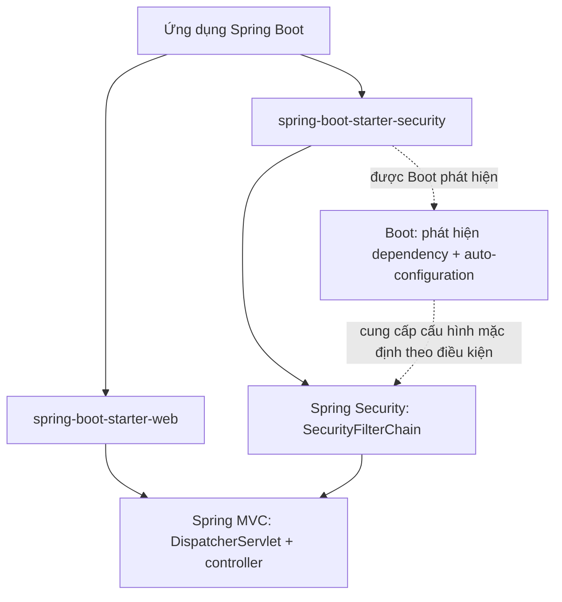
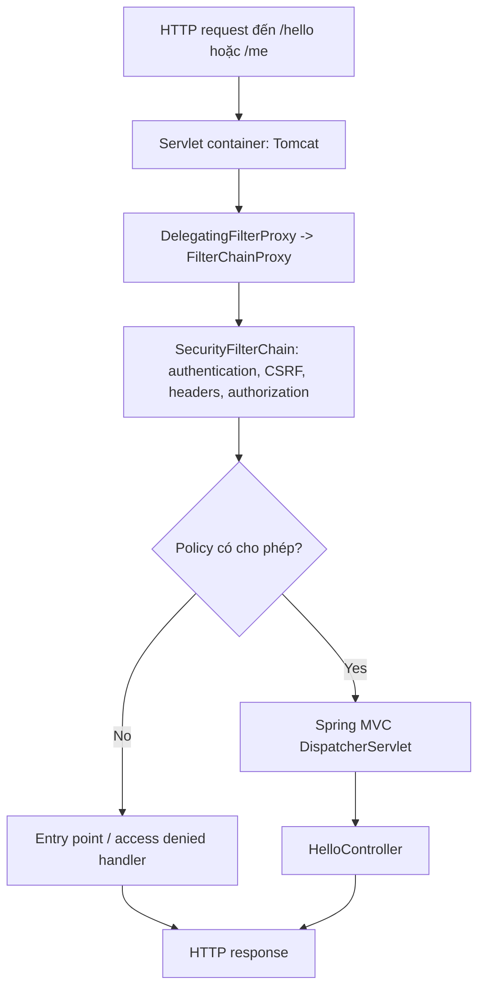

# Thêm spring-boot-starter-security vào ứng dụng web đầu tiên

## Bạn sẽ làm được gì sau bài này?

Một ứng dụng Spring Boot mới có thể chạy vài endpoint HTTP chỉ với `spring-boot-starter-web`. Khi thêm `spring-boot-starter-security`, hành vi của ứng dụng thay đổi ngay cả khi bạn **chưa viết lớp bảo mật nào**: Spring Boot phát hiện Spring Security trên classpath, kích hoạt tích hợp bảo mật mặc định và yêu cầu xác thực với các request web thông thường.

Bài thực hành hướng dẫn theo thứ tự:

1. Tạo ứng dụng Spring MVC đơn giản chạy trên Java 17 và Spring Boot 3.x.
2. Chạy ứng dụng **trước khi** thêm starter Security, quan sát endpoint truy cập công khai.
3. Thêm dependency `spring-boot-starter-security`; quan sát HTTP 401, trang đăng nhập mặc định, tài khoản `user` và mật khẩu được tạo lúc khởi động.
4. Dùng curl để đăng nhập bằng HTTP Basic.
5. Tạo một bean `SecurityFilterChain` để công khai `GET /hello` và bảo vệ `GET /me`.
6. Thay tài khoản sinh tự động bằng `UserDetailsService` in-memory và `PasswordEncoder` để thử nghiệm có thể lặp lại.
7. Viết test MockMvc chứng minh endpoint public, endpoint cần đăng nhập và trường hợp mật khẩu sai.
8. Giải thích những mặc định cần hiểu trước khi triển khai thật: authentication, authorization, CSRF, session, security headers và quyền truy cập theo URL.

**Phạm vi:** Spring Boot **3.5.0** (dòng 3.x), Spring Framework 6.x, Spring Security 6.x, **Java 17**, Maven và stack **Servlet/Spring MVC**. Đây là một bộ phiên bản cụ thể có thể học theo; dự án thực tế nên chọn bản vá đang được hỗ trợ. Các tên API cho Spring Boot 4.x/Spring Security 7.x hoặc WebFlux có thể khác.

Không cần có cơ sở dữ liệu, dịch vụ OAuth2 hay hệ thống đăng nhập sản xuất để hoàn thành bài. Tài khoản và mật khẩu ví dụ chỉ dùng trên localhost.

## 1. Ba lớp trách nhiệm cần nắm trước khi thêm dependency

| Thành phần | Trong bài thực hành làm gì? | Điều cần nhớ |
| --- | --- | --- |
| **Spring Framework / Spring MVC** | Khởi tạo bean, ánh xạ `GET /hello` và `GET /me` đến controller. | `@RestController` hoặc `@GetMapping` không tự cấp quyền truy cập. |
| **Spring Security** | Dùng Servlet filters để xác thực người gọi và xét policy authorization trước khi request vào controller. | Là bộ thư viện và các thành phần bảo mật; không phải tính năng “bật sẵn” chỉ vì có Spring MVC. |
| **Spring Boot** | Quản lý dependency qua starter/BOM; phát hiện Security trên classpath; auto-configure một số bean và mặc định để bạn bắt đầu nhanh. | Boot tích hợp và cấu hình Security; logic xác thực/phân quyền do các thành phần Security thực thi. |

`spring-boot-starter-security` là **starter dependency**, không phải một annotation. Nó kéo vào các module Spring Security cần cho cấu hình bảo mật web cơ bản và để Spring Boot nhận diện khả năng tự cấu hình. Khi tự khai báo bean bảo mật, bạn vẫn dùng Spring Security; chỉ những phần auto-configuration tương ứng của Boot sẽ nhường chỗ.

Sơ đồ đơn giản:



Sơ đồ mô tả **trách nhiệm vận hành**, không phải mọi cạnh phụ thuộc Maven.

## 2. Chuẩn bị môi trường và dự án

Cần:

- **JDK 17 trở lên**: `java -version` phải cho thấy phiên bản tương thích.
- **Apache Maven**: `mvn -version` phải chạy được, hoặc dùng Maven Wrapper `./mvnw` nếu dự án có sẵn.
- Một editor/IDE bất kỳ; có thể dùng terminal và curl để kiểm thử.
- Cổng `8080` chưa bị ứng dụng khác sử dụng, hoặc thay đổi bằng `server.port` nếu cần.

Kiểm tra:

```bash
java -version
mvn -version
```

Tạo project Spring Boot với group `com.example`, artifact `first-security-app`, package `com.example.firstsecurity`, Java 17. Nếu dùng [Spring Initializr](https://start.spring.io/), có thể chọn dependency **Spring Web** trước, rồi thêm **Spring Security** ở bước tiếp theo để so sánh hành vi. Bài dưới dùng Maven cho phép bạn thấy rõ chính xác dependency đã thay đổi.

Cấu trúc cuối cùng:

```text
first-security-app/
├── pom.xml
└── src/
    ├── main/
    │   └── java/com/example/firstsecurity/
    │       ├── FirstSecurityApplication.java
    │       ├── HelloController.java
    │       └── SecurityConfig.java
    └── test/
        └── java/com/example/firstsecurity/
            └── SecurityIntegrationTest.java
```

Trong **bước đầu**, chưa có `SecurityConfig.java` và `SecurityIntegrationTest.java`. Hai file này chỉ được thêm sau khi bạn quan sát hành vi mặc định.

### 2.1. `pom.xml` ban đầu: chỉ có Spring Web

```xml
<project xmlns="http://maven.apache.org/POM/4.0.0"
         xmlns:xsi="http://www.w3.org/2001/XMLSchema-instance"
         xsi:schemaLocation="http://maven.apache.org/POM/4.0.0 https://maven.apache.org/xsd/maven-4.0.0.xsd">
    <modelVersion>4.0.0</modelVersion>

    <parent>
        <groupId>org.springframework.boot</groupId>
        <artifactId>spring-boot-starter-parent</artifactId>
        <version>3.5.0</version>
        <relativePath/>
    </parent>

    <groupId>com.example</groupId>
    <artifactId>first-security-app</artifactId>
    <version>1.0.0</version>

    <properties>
        <java.version>17</java.version>
    </properties>

    <dependencies>
        <dependency>
            <groupId>org.springframework.boot</groupId>
            <artifactId>spring-boot-starter-web</artifactId>
        </dependency>
    </dependencies>

    <build>
        <plugins>
            <plugin>
                <groupId>org.springframework.boot</groupId>
                <artifactId>spring-boot-maven-plugin</artifactId>
            </plugin>
        </plugins>
    </build>
</project>
```

Để Maven tự lấy phiên bản dependency từ parent/BOM. Không cần tự ghi phiên bản Spring Framework hoặc Spring Security khác với bộ mà Boot đang quản lý.

### 2.2. `FirstSecurityApplication.java`

```java
package com.example.firstsecurity;

import org.springframework.boot.SpringApplication;
import org.springframework.boot.autoconfigure.SpringBootApplication;

@SpringBootApplication
public class FirstSecurityApplication {
    public static void main(String[] args) {
        SpringApplication.run(FirstSecurityApplication.class, args);
    }
}
```

`@SpringBootApplication` giúp Spring Boot tạo application context, thực hiện component scanning và auto-configuration. Các lớp còn lại đặt trong cùng package hoặc package con để được phát hiện.

### 2.3. `HelloController.java`

```java
package com.example.firstsecurity;

import java.util.Map;

import org.springframework.security.core.Authentication;
import org.springframework.web.bind.annotation.GetMapping;
import org.springframework.web.bind.annotation.RestController;

@RestController
public class HelloController {

    @GetMapping("/hello")
    public Map<String, String> hello() {
        return Map.of("message", "Hello, Spring!");
    }

    @GetMapping("/me")
    public Map<String, String> me(Authentication authentication) {
        return Map.of("username", authentication.getName());
    }
}
```

**Chú ý để chạy đúng bước đầu:** `HelloController.java` ở trên **đã import `Authentication` của Spring Security**, nên khi `pom.xml` chỉ có Spring Web thì file chưa biên dịch được. Để thực hiện so sánh trước/sau **chính xác**, hãy bắt đầu bằng phiên bản controller sau; sau khi thêm starter mới thay bằng controller có `/me` ở trên:

```java
package com.example.firstsecurity;

import java.util.Map;

import org.springframework.web.bind.annotation.GetMapping;
import org.springframework.web.bind.annotation.RestController;

@RestController
public class HelloController {

    @GetMapping("/hello")
    public Map<String, String> hello() {
        return Map.of("message", "Hello, Spring!");
    }
}
```

Như vậy ở **giai đoạn chưa có Security**, bạn có một ứng dụng Spring MVC độc lập và chạy được. `/me` được thêm sau khi Security đã có mặt và biết cách cung cấp `Authentication`.

### 2.4. Chạy ứng dụng chưa có Security

Tại thư mục có `pom.xml`:

```bash
mvn spring-boot:run
```

Mở terminal khác:

```bash
curl -i http://localhost:8080/hello
```

Kỳ vọng:

```http
HTTP/1.1 200
Content-Type: application/json

{"message":"Hello, Spring!"}
```

Đây là **trích đoạn minh họa** của response; server thực có thể thêm header hoặc định dạng mã status khác. Điểm quan sát là `GET /hello` trả `200 OK` **mà không cần credentials**.

Tên đường dẫn `/hello`, `/admin` hay `/private` không tự làm một endpoint bị khóa. Muốn có cơ chế xác thực/phân quyền của Spring Security, phải thêm dependency và cấu hình thích hợp.

## 3. Thêm `spring-boot-starter-security`

Dừng ứng dụng bằng `Ctrl+C`. Trong khối `<dependencies>` của `pom.xml`, thêm đúng dependency:

```xml
<dependency>
    <groupId>org.springframework.boot</groupId>
    <artifactId>spring-boot-starter-security</artifactId>
</dependency>
```

**Không cần thêm `<version>`** nếu dự án đã sử dụng Spring Boot parent/BOM như ví dụ. Đây là cách Boot quản lý một nhóm phiên bản Spring Security tương thích với framework và starter web.

Phần dependencies lúc này tối thiểu là:

```xml
<dependencies>
    <dependency>
        <groupId>org.springframework.boot</groupId>
        <artifactId>spring-boot-starter-web</artifactId>
    </dependency>
    <dependency>
        <groupId>org.springframework.boot</groupId>
        <artifactId>spring-boot-starter-security</artifactId>
    </dependency>
</dependencies>
```

Giữ controller chỉ có `/hello` và **chưa tạo `SecurityConfig`**. Chạy lại:

```bash
mvn spring-boot:run
```

Bây giờ cùng một URL `http://localhost:8080/hello` đã được Spring Security bảo vệ mặc định.

### 3.1. Maven thực sự đã kéo thêm gì?

Bạn có thể xem cây dependency:

```bash
mvn dependency:tree
```

Trong phần liên quan, Maven sẽ cho thấy starter Security cùng những module Spring Security thích hợp cho web và cấu hình. Tên/phiên bản chính xác nên lấy từ output của dự án, không cài riêng phiên bản `spring-security-core`, `spring-security-web` hoặc `spring-security-config` theo suy đoán.

Về mặt vai trò, starter làm ba việc đáng chú ý: (1) đưa thư viện Security lên classpath; (2) giúp Boot bật auto-configuration khi điều kiện phù hợp; (3) cho phép bạn khai báo các bean cấu hình như `SecurityFilterChain`, `UserDetailsService` và `PasswordEncoder` sau này.

### 3.2. Mặc định nào xuất hiện?

Với một ứng dụng **Servlet web thông thường**, khi chưa khai báo security beans khác:

- Boot cấu hình bảo vệ các request web bằng Spring Security; phần lớn endpoint, kể cả `/hello`, yêu cầu đăng nhập.
- Boot có thể tạo một `UserDetailsService` in-memory gồm người dùng mặc định tên **`user`**, mật khẩu ngẫu nhiên.
- Mật khẩu demo được thông báo ở log khi startup, thường với dòng bắt đầu bằng `Using generated security password:`.
- Tùy loại request/`Accept`, client có thể nhận HTTP Basic challenge hoặc luồng form-based login. Browser mở trang có thể được chuyển đến trang `/login` do Spring Security tạo.
- CSRF protection, một số security response headers và các cơ chế filter liên quan được cấu hình theo mặc định thích hợp của Spring Security Servlet.

Vì vậy, **chỉ thêm starter đã làm thay đổi hành vi HTTP**, dù controller không sửa một dòng nào.

**Lưu ý:** nếu bạn đã tự cấu hình `SecurityFilterChain` hoặc thêm cơ chế identity cụ thể trước đó, hành vi sẽ khác. Danh sách này áp dụng cho bài lab ban đầu, không được dùng như cam kết về mọi ứng dụng Boot.

## 4. Thử login mặc định do Boot tạo

### 4.1. Đọc mật khẩu sinh tự động

Sau khi khởi động ứng dụng mới có Security starter, tìm trong log:

```text
Using generated security password: <mật-khẩu-ngẫu-nhiên>
```

Đây là định dạng ví dụ; phần giữa dấu ngoặc cần thay bằng giá trị thực trong log **của chính lần khởi động đó**. Tài khoản mặc định là:

```text
Username: user
Password: giá trị ngẫu nhiên từ log startup
```

Không chép mật khẩu minh họa của tài liệu hay mật khẩu ở lần chạy trước. Mật khẩu này dành cho thử nghiệm, không phải tài khoản vận hành thực.

Nếu không thấy dòng mật khẩu, hãy kiểm tra xem ứng dụng đã tự cung cấp `UserDetailsService`, `AuthenticationProvider`, `AuthenticationManager` hoặc cấu hình khiến Boot không tạo user mặc định chưa; cấu hình log cũng có thể ẩn thông báo. Đừng vội cho rằng mật khẩu là `user` hoặc `password`.

### 4.2. Truy cập bằng curl

Với curl thông thường:

```bash
curl -i -H "Accept: application/json" http://localhost:8080/hello
```

Kỳ vọng: **401 Unauthorized**, request chưa được xác thực. Với một số tổ hợp `Accept`, entry point hoặc browser, có thể nhận redirect **302** đến trang login thay vì 401; đó là sự khác nhau về cơ chế login/content negotiation, không phải lỗi controller.

Thử credentials mặc định (thay `YOUR_GENERATED_PASSWORD` bằng giá trị thực):

```bash
curl -i -u "user:YOUR_GENERATED_PASSWORD" http://localhost:8080/hello
```

Kỳ vọng: **200 OK** với nội dung JSON cũ.

`curl -u` dùng HTTP Basic: curl tạo header `Authorization: Basic ...` từ username/password. Việc mã hóa Base64 ở HTTP Basic **không phải mã hóa bảo mật**; ngoài localhost cần chạy qua HTTPS để bảo vệ credentials khi truyền.

Trên Windows PowerShell, dùng `curl.exe` nếu `curl` đang là alias của `Invoke-WebRequest`:

```powershell
curl.exe -i http://localhost:8080/hello
```

### 4.3. Thử bằng trình duyệt

Mở `http://localhost:8080/hello`:

- Với một request điều hướng HTML chưa xác thực, bạn thường được đưa đến form login mặc định.
- Dùng `user` và mật khẩu sinh trong log.
- Sau khi đăng nhập, Spring Security xử lý phiên xác thực và có thể điều hướng về trang đã yêu cầu.

Cơ chế browser/form khác HTTP Basic của curl. Không suy rằng “curl 401 nhưng browser 302” nghĩa là ứng dụng dùng hai chính sách authorization khác nhau; sự khác biệt thường đến từ entry point và content negotiation.

## 5. Một request đi qua thành phần nào?



Với Spring MVC, controller được gọi **sau** những kiểm tra trong servlet security filter chain. Những khái niệm quan trọng:

| Tên | Nhiệm vụ |
| --- | --- |
| `DelegatingFilterProxy` | Cầu nối giữa Servlet container và bean filter do Spring quản lý. |
| `FilterChainProxy` | Tập hợp/chọn `SecurityFilterChain` phù hợp với request. |
| `SecurityFilterChain` | Chuỗi filter và cấu hình bảo mật cho request phù hợp; ứng dụng có thể khai báo nhiều chain. |
| Authentication filter/provider | Lấy credentials, xác thực và tạo/khôi phục `Authentication`. |
| `SecurityContext` / `SecurityContextHolder` | Giữ thông tin authentication đang có hiệu lực trong luồng thực thi phù hợp. |
| `AuthorizationFilter` / authorization manager | Kiểm tra người gọi có được phép thực hiện request theo rule không. |
| `ExceptionTranslationFilter` và các handler/entry point | Dịch ngoại lệ security thành phản hồi HTTP thích hợp như 401, 403 hoặc redirect login. |
| `DispatcherServlet` | Tìm Spring MVC handler/controller và thực hiện sau khi request được cho đi tiếp. |

Bước login/xác thực không đồng nghĩa authorization: một user có thể đăng nhập thành công nhưng vẫn bị cấm gọi endpoint cần role `ADMIN`. Trong bài đầu, mặc định “đã đăng nhập” đủ cho mọi URL; ta sẽ thay bằng policy có endpoint công khai và endpoint riêng tư.

**Không viết filter thủ công** chỉ để “bật security”; starter cùng Boot/Security đã cung cấp tích hợp filter chain. Viết thêm filter chỉ khi thực sự có yêu cầu xác thực/quan sát riêng và hiểu thứ tự filter.

## 6. Cấu hình rõ ràng endpoint nào public và private

Ở bước này, ta thay người dùng sinh ngẫu nhiên bằng tài khoản demo cố định (mật khẩu được encode bằng BCrypt), đồng thời chỉ yêu cầu login đối với `/me`. Chúng ta chọn HTTP Basic để kết quả khi thử bằng curl dễ dự đoán.

### 6.1. Thay `HelloController.java` bằng bản đầy đủ

```java
package com.example.firstsecurity;

import java.util.Map;

import org.springframework.security.core.Authentication;
import org.springframework.web.bind.annotation.GetMapping;
import org.springframework.web.bind.annotation.RestController;

@RestController
public class HelloController {

    @GetMapping("/hello")
    public Map<String, String> hello() {
        return Map.of("message", "Hello, Spring!");
    }

    @GetMapping("/me")
    public Map<String, String> me(Authentication authentication) {
        return Map.of("username", authentication.getName());
    }
}
```

`Authentication` được Spring Security cung cấp cho request đã đăng nhập. Trong ví dụ, `GET /me` phải đi qua auth filter và rule `authenticated()` trước khi controller đọc `authentication.getName()`.

Không lấy username từ tham số `?user=learner` rồi cho rằng đó là danh tính đã xác thực. Client có thể tự sửa request; controller chỉ nên lấy principal từ cơ chế bảo mật đáng tin cậy.

### 6.2. Tạo `SecurityConfig.java`

```java
package com.example.firstsecurity;

import org.springframework.context.annotation.Bean;
import org.springframework.context.annotation.Configuration;
import org.springframework.security.config.Customizer;
import org.springframework.security.config.annotation.web.builders.HttpSecurity;
import org.springframework.security.config.annotation.web.configurers.AbstractHttpConfigurer;
import org.springframework.security.core.userdetails.User;
import org.springframework.security.core.userdetails.UserDetailsService;
import org.springframework.security.crypto.bcrypt.BCryptPasswordEncoder;
import org.springframework.security.crypto.password.PasswordEncoder;
import org.springframework.security.provisioning.InMemoryUserDetailsManager;
import org.springframework.security.web.SecurityFilterChain;

@Configuration(proxyBeanMethods = false)
public class SecurityConfig {

    @Bean
    SecurityFilterChain securityFilterChain(HttpSecurity http) throws Exception {
        return http
            .authorizeHttpRequests(auth -> auth
                .requestMatchers("/hello").permitAll()
                .requestMatchers("/me").authenticated()
                .anyRequest().denyAll()
            )
            .httpBasic(Customizer.withDefaults())
            .formLogin(AbstractHttpConfigurer::disable)
            .build();
    }

    @Bean
    PasswordEncoder passwordEncoder() {
        return new BCryptPasswordEncoder();
    }

    @Bean
    UserDetailsService users(PasswordEncoder encoder) {
        return new InMemoryUserDetailsManager(
            User.withUsername("learner")
                .password(encoder.encode("demo-password"))
                .roles("USER")
                .build()
        );
    }
}
```

Giải thích từng dòng quan trọng:

1. `@Configuration` và `@Bean` thuộc Spring Framework; Spring quản lý các đối tượng cấu hình Security.
2. Bean `SecurityFilterChain` do bạn khai báo **thay thế cấu hình chain web mặc định** của Boot. Nó không gỡ bỏ Spring Security, mà trao quyền định nghĩa request rules cho ứng dụng.
3. `.requestMatchers("/hello").permitAll()` cho mọi người truy cập `/hello`. Request vẫn đi qua security filters; `permitAll` khác với bỏ qua toàn bộ Security.
4. `.requestMatchers("/me").authenticated()` yêu cầu người dùng đã đăng nhập.
5. `.anyRequest().denyAll()` đặt chính sách rõ ràng cho các URL chưa định nghĩa: từ chối thay vì vô tình công khai.
6. `.httpBasic(Customizer.withDefaults())` bật xác thực bằng HTTP Basic.
7. `.formLogin(AbstractHttpConfigurer::disable)` **chỉ tắt form login** để lab dùng Basic có hành vi rõ ràng; không tắt Spring Security và không tắt CSRF.
8. Bean `UserDetailsService` cung cấp tài khoản demo `learner`. Vì ứng dụng đã tự khai báo nguồn người dùng, Boot sẽ **không còn tạo** user mặc định `user` và mật khẩu ngẫu nhiên ở bước trước.
9. `PasswordEncoder` sử dụng BCrypt; `User.withUsername(...).password(...)` nhận chuỗi đã encode. Mỗi lần khởi động BCrypt có thể tạo hash khác do salt, nhưng password nguồn `demo-password` vẫn được đối chiếu đúng.

**Chỉ sử dụng mật khẩu hard-code này cho lab chạy cục bộ.** Hệ thống thật cần nguồn người dùng hoặc identity provider, quản lý secret, HTTPS và các chính sách tài khoản phù hợp.

### 6.3. Chạy lại và kiểm tra chính sách

Dừng ứng dụng rồi chạy lại:

```bash
mvn spring-boot:run
```

Trong terminal khác:

```bash
curl -i http://localhost:8080/hello
curl -i http://localhost:8080/me
curl -i -u learner:demo-password http://localhost:8080/me
curl -i -u learner:wrong-password http://localhost:8080/me
```

Kỳ vọng với **đúng code này**:

| Request | HTTP status | Nội dung/ý nghĩa |
| --- | --- | --- |
| Không credentials, `GET /hello` | **200 OK** | JSON `{"message":"Hello, Spring!"}`. |
| Không credentials, `GET /me` | **401 Unauthorized** | Basic challenge; không trả tên người dùng. |
| `learner:demo-password`, `GET /me` | **200 OK** | JSON `{"username":"learner"}`. |
| `learner:wrong-password`, `GET /me` | **401 Unauthorized** | Sai password; không truy cập được. |

Có thể có thêm các header như `WWW-Authenticate`, `Cache-Control`, `X-Content-Type-Options` hoặc thông tin server phụ thuộc cấu hình. Bảng chỉ nêu các chi tiết cần quan sát; không cần ép response byte-for-byte trùng một bản log minh họa.

Vì đã **tắt form login** trong cấu hình custom, browser lúc này có thể hiện HTTP Basic challenge thay vì trang login HTML. Sự khác biệt là do bạn đã chọn cơ chế auth, không phải do thêm/bớt `@RestController`.

## 7. Kiểm thử tự động bằng MockMvc

Kiểm thử bảo mật không nên chỉ có trường hợp “user hợp lệ được truy cập”. Cần kiểm tra cả **anonymous**, **credentials sai** và route public sau khi đã bật Security.

### 7.1. Thêm dependency cho test vào `pom.xml`

Đây là khối `<dependencies>` **đầy đủ ở trạng thái cuối** của project; có thể thay trực tiếp khối dependencies hiện tại bằng:

```xml
<dependencies>
    <dependency>
        <groupId>org.springframework.boot</groupId>
        <artifactId>spring-boot-starter-web</artifactId>
    </dependency>
    <dependency>
        <groupId>org.springframework.boot</groupId>
        <artifactId>spring-boot-starter-security</artifactId>
    </dependency>
    <dependency>
        <groupId>org.springframework.boot</groupId>
        <artifactId>spring-boot-starter-test</artifactId>
        <scope>test</scope>
    </dependency>
    <dependency>
        <groupId>org.springframework.security</groupId>
        <artifactId>spring-security-test</artifactId>
        <scope>test</scope>
    </dependency>
</dependencies>
```

Giữ nguyên phần `parent`, `properties` và `build` trong `pom.xml` ban đầu.

- `spring-boot-starter-test` mang đến JUnit, Spring test support và các thành phần kiểm thử.
- `spring-security-test` bổ sung tiện ích tạo request đã xác thực hoặc principal giả lập như `httpBasic(...)`, `@WithMockUser`.
- `MockMvc` cho phép kiểm tra Spring MVC cùng Spring Security filter chain trong ứng dụng test context, không cần khởi tạo server network thật.

### 7.2. `SecurityIntegrationTest.java`

```java
package com.example.firstsecurity;

import org.junit.jupiter.api.Test;
import org.springframework.beans.factory.annotation.Autowired;
import org.springframework.boot.test.autoconfigure.web.servlet.AutoConfigureMockMvc;
import org.springframework.boot.test.context.SpringBootTest;
import org.springframework.test.web.servlet.MockMvc;

import static org.springframework.security.test.web.servlet.request.SecurityMockMvcRequestPostProcessors.httpBasic;
import static org.springframework.test.web.servlet.request.MockMvcRequestBuilders.get;
import static org.springframework.test.web.servlet.result.MockMvcResultMatchers.jsonPath;
import static org.springframework.test.web.servlet.result.MockMvcResultMatchers.status;

@SpringBootTest
@AutoConfigureMockMvc
class SecurityIntegrationTest {

    @Autowired
    MockMvc mvc;

    @Test
    void helloIsPublic() throws Exception {
        mvc.perform(get("/hello"))
            .andExpect(status().isOk())
            .andExpect(jsonPath("$.message").value("Hello, Spring!"));
    }

    @Test
    void meRejectsAnonymousRequest() throws Exception {
        mvc.perform(get("/me"))
            .andExpect(status().isUnauthorized());
    }

    @Test
    void meAcceptsValidBasicCredentials() throws Exception {
        mvc.perform(get("/me")
                .with(httpBasic("learner", "demo-password")))
            .andExpect(status().isOk())
            .andExpect(jsonPath("$.username").value("learner"));
    }

    @Test
    void meRejectsInvalidPassword() throws Exception {
        mvc.perform(get("/me")
                .with(httpBasic("learner", "wrong-password")))
            .andExpect(status().isUnauthorized());
    }
}
```

Từ thư mục dự án:

```bash
mvn test
```

**Kỳ vọng:** Maven báo build/test thành công, bốn test case đều pass trên bộ mã và dependency nêu trong bài. Đầu ra chi tiết phụ thuộc bản Maven và các plugin; điều đáng quan tâm là **không có failure/error**. Đây là hành vi dự kiến khi bạn chạy project; nếu một test fail, hãy xem response thực và tìm sai lệch về policy, dependencies hoặc phiên bản.

Các test chứng minh:

- Endpoint public vẫn hoạt động sau khi thêm starter.
- Endpoint protected không được phép truy cập ẩn danh.
- Credentials hợp lệ tạo danh tính `learner`.
- Mật khẩu sai không thể truy cập protected endpoint.

Khi ứng dụng lớn hơn, cần test thêm role/authority, owner/tenant, CSRF với request ghi, đường dẫn chưa định nghĩa và lỗi/redirect. Đừng chỉ test HTTP 200.

## 8. Những mặc định bảo mật cần hiểu khi mới bắt đầu

### 8.1. Authentication khác authorization

- **Authentication (xác thực):** “Ai đang gửi request?” `Authentication` sau đăng nhập chứa thông tin principal và authorities.
- **Authorization (phân quyền):** “Người này có được gọi endpoint/thao tác hay không?” `permitAll()`, `authenticated()`, `hasRole(...)`, `hasAuthority(...)` là những điều kiện thường gặp.

`authenticated()` nghĩa là đã có danh tính hợp lệ theo cơ chế Security; **không có nghĩa** có quyền xem mọi tài nguyên. Một người dùng `learner` đã đăng nhập không nên đọc đơn hàng của người dùng khác chỉ bằng cách thay ID trên URL. Kiểm tra sở hữu tài nguyên/tenant cần bổ sung ở service/query khi có dữ liệu thật.

### 8.2. Quy tắc `requestMatchers` có thứ tự

DSL `authorizeHttpRequests` xét các rule theo thứ tự khớp; rule quá rộng đặt trước có thể khiến rule sau không được áp dụng như bạn dự tính.

Ví dụ **không nên**:

```java
.authorizeHttpRequests(auth -> auth
    .requestMatchers("/**").permitAll()
    .requestMatchers("/admin/**").hasRole("ADMIN")
)
```

Rule `/**` có thể khớp trước, làm policy `/admin/**` phía sau không có tác dụng. Hãy đặt rule cụ thể trước và bổ sung fallback:

```java
.authorizeHttpRequests(auth -> auth
    .requestMatchers("/hello").permitAll()
    .requestMatchers("/admin/**").hasRole("ADMIN")
    .anyRequest().authenticated()
)
```

Hai đoạn là **fragment của cấu hình `HttpSecurity`**, không phải chương trình Java độc lập. Trong một sản phẩm nhiều route, lựa chọn `authenticated()` hay `denyAll()` ở fallback phải dựa trên chủ đích; “từ chối tất cả route chưa khai báo” thường rõ ràng hơn với API nhạy cảm.

### 8.3. CSRF: vì sao POST có thể bị 403?

Spring Security Servlet thường **bật CSRF protection mặc định** đối với các request thay đổi trạng thái cần bảo vệ, chẳng hạn POST/PUT/PATCH/DELETE. Điều này rất quan trọng với ứng dụng có session cookie được browser tự gửi.

Bài lab chỉ dùng `GET`, vì vậy chưa cần gửi CSRF token. Nếu bạn thêm:

```java
@PostMapping("/orders")
public String createOrder() {
    return "created";
}
```

đây chỉ là **đoạn minh họa** cần đặt trong controller cùng import `PostMapping`; khi gọi POST mà không có CSRF token cần thiết, bạn có thể gặp **403 Forbidden** ngay cả khi đã xác thực. Không vội “sửa lỗi” bằng `csrf.disable()` toàn cục. Hãy xem cách client xác thực (session cookie, HTTP Basic, bearer token...), browser có tự gửi credentials hay không, và cấu hình CSRF token phù hợp kiến trúc.

**HTTP Basic không tự làm mọi ứng dụng miễn nhiễm CSRF** nếu browser có thể tự dùng credentials. Quyết định bật/tắt/ngoại lệ CSRF phải dựa trên mô hình đe dọa và cách client thực sự hoạt động.

### 8.4. Security headers

Spring Security hỗ trợ nhiều response headers giúp giảm rủi ro trình duyệt, trong đó có cache headers chống lưu response nhạy cảm trong cấu hình Servlet thông thường, header chống MIME sniffing và một số cơ chế khác theo phiên bản. Đừng giả định mọi HTTP response đều có CSP do ứng dụng mong muốn: **Content Security Policy** thường cần được thiết kế và cấu hình riêng.

Khi ứng dụng tự đặt headers, bộ mặc định của Security có thể nhường theo luật cấu hình. Hãy quan sát response cuối qua curl/DevTools, đặc biệt trên những endpoint chứa dữ liệu cá nhân hoặc tài nguyên tĩnh công khai.

### 8.5. Session, form login và HTTP Basic

Lab custom dùng Basic để dễ học, nhưng các ứng dụng có nhiều lựa chọn:

| Cơ chế | Dùng trong tình huống nào? | Điểm phải kiểm soát |
| --- | --- | --- |
| HTTP Basic | Thử nghiệm, tooling hoặc API nội bộ phù hợp | Cần HTTPS, không lưu credentials cứng trong source, kiểm soát client. |
| Form login + session | Ứng dụng web server-rendered/browser | Cookie attributes, session fixation/expiration, logout, CSRF. |
| OAuth2/OIDC login | Đăng nhập qua identity provider | Redirect, state/nonce, callback, issuer/client config và session. |
| Bearer access token | API có authorization server/resource server | Chữ ký/issuer/audience/expiry/scope, tránh lộ token và bảo vệ TLS. |

Thêm starter Security **không có nghĩa** ứng dụng đã được thiết kế đúng cho OAuth2, API stateless, JWT, social login hoặc production session. Đây là các bài toán cấu hình tiếp theo.

### 8.6. Khi nào cần `@EnableMethodSecurity`?

Starter Security cung cấp kiểm tra ở HTTP layer theo `SecurityFilterChain`. Để dùng các annotation phân quyền ở method như `@PreAuthorize` trong thiết kế thông thường, cần bật method security:

```java
@Configuration
@EnableMethodSecurity
public class MethodSecurityConfig {
}
```

Đây là ví dụ ngắn, cần import các annotation của Spring/Spring Security nếu đặt vào project. Method security thường dùng Spring AOP proxy; lời gọi self-invocation `this.securedMethod()` trong cùng bean có thể bỏ qua proxy. Với bài đầu tiên bạn chưa cần annotation này; chỉ thêm khi đã hiểu nhu cầu bảo vệ service.

## 9. Vì sao tạo SecurityFilterChain thì cấu hình mặc định thay đổi?

Khi chỉ thêm starter, Boot cấp **chain mặc định** để tất cả request phải đăng nhập. Khi ứng dụng tự cung cấp bean `SecurityFilterChain`:

1. Spring Framework đăng ký bean do bạn tạo.
2. Spring Boot nhận thấy ứng dụng đã cung cấp filter chain và auto-configuration web security mặc định tương ứng **back off**.
3. Spring Security tiếp tục vận hành chain bạn cấu hình; `FilterChainProxy` dùng chain đó để bảo vệ request phù hợp.
4. **UserDetailsService mặc định không nhất thiết bị tắt chỉ vì bạn có SecurityFilterChain.** Trong bài này, nó nhường chỗ **vì ta cũng khai báo `UserDetailsService` riêng**.

Cần phân biệt hai điều kiện auto-configuration:

| Bạn tự khai báo gì? | Kết quả thường gặp ở Spring Boot 3.5 Servlet |
| --- | --- |
| Không có bean Security nào, có starter | Boot cấp filter chain web và tài khoản phát triển mặc định theo điều kiện. |
| Bean `SecurityFilterChain` | Chain web mặc định của Boot nhường chỗ; ứng dụng định nghĩa URL rules. |
| Bean `UserDetailsService` / `AuthenticationProvider` / `AuthenticationManager` | Cấu hình người dùng in-memory mặc định của Boot nhường chỗ theo điều kiện. |
| Cả `SecurityFilterChain` và `UserDetailsService` (bài lab) | Ứng dụng tự quyết định cả URL policy lẫn nguồn tài khoản học tập. |

Đây là lý do sửa một bean có thể thay đổi hành vi mà bạn không hề thêm filter thủ công. Với ứng dụng thực tế, hãy xem báo cáo auto-configuration/bean definitions và test startup để tránh giả định sai.

## 10. Dùng Gradle thì thêm starter thế nào?

Nếu project đã có cấu hình Spring Boot Gradle và dependency management phù hợp, trong `build.gradle` (Groovy DSL) thêm:

```groovy
dependencies {
    implementation 'org.springframework.boot:spring-boot-starter-web'
    implementation 'org.springframework.boot:spring-boot-starter-security'

    testImplementation 'org.springframework.boot:spring-boot-starter-test'
    testImplementation 'org.springframework.security:spring-security-test'
}
```

Đây là **đoạn dependencies**, không phải toàn bộ file Gradle độc lập; phần plugins, repositories và Java toolchain tùy project. Thông thường Boot plugin/BOM quản lý version, tránh gắn version độc lập cho Security starter nếu không có lý do rõ ràng.

Kotlin DSL `build.gradle.kts` tương ứng:

```kotlin
dependencies {
    implementation("org.springframework.boot:spring-boot-starter-web")
    implementation("org.springframework.boot:spring-boot-starter-security")

    testImplementation("org.springframework.boot:spring-boot-starter-test")
    testImplementation("org.springframework.security:spring-security-test")
}
```

Trình tự quan sát vẫn giống Maven: trước starter endpoint public; sau starter web security mặc định yêu cầu đăng nhập; sau custom chain thì từng URL được kiểm soát theo rule.

## 11. Các lỗi phổ biến khi thêm Security starter

### Lỗi 1 — “Vừa thêm starter là API hỏng, toàn 401”

Thông thường đây là **mặc định có chủ đích**: request phải được xác thực khi có Spring Security. Kiểm tra log đã sinh user/password chưa, thử Basic credentials đúng và định nghĩa `SecurityFilterChain` cho public endpoints cần thiết.

### Lỗi 2 — “Browser redirect /login nhưng curl trả 401, có phải sai không?”

Không hẳn. Security có thể chọn entry point dựa trên `Accept` và kiểu client. Browser với request HTML thường đi vào form login; curl/API client có thể nhận Basic challenge. Khi đã custom chỉ Basic và disable form login như lab, không nên kỳ vọng trang `/login` mặc định còn hoạt động.

### Lỗi 3 — “Tôi đã viết SecurityFilterChain nhưng vẫn trông chờ rule mặc định”

Khi bạn tự cung cấp chain, **bạn chịu trách nhiệm xác định chính sách request**. Nếu chỉ cấu hình `permitAll` cho một nhóm URL mà quên fallback, hành vi các URL khác có thể không giống trước. Luôn review tất cả routes và test đường chưa khai báo.

### Lỗi 4 — “Thêm @EnableWebSecurity mới bật được Spring Security trong Boot?”

Với Spring Boot Servlet có starter và auto-configuration thích hợp, bạn thường **không cần** thêm `@EnableWebSecurity` chỉ để nhận chain mặc định. Việc tạo config bean theo cách của bài đủ cho lab. Dùng các annotation cấu hình chỉ khi hiểu sự tích hợp và mức quyền muốn kiểm soát.

### Lỗi 5 — “Dùng User.withDefaultPasswordEncoder() cho production”

Ví dụ tutorial có thể dùng builder hỗ trợ demo nhưng không nên coi đó là giải pháp mật khẩu production. Trong bài này, `PasswordEncoder` dùng BCrypt và `InMemoryUserDetailsManager` chỉ lưu user thử nghiệm trong RAM. Sản phẩm thật cần store thích hợp, chính sách password và vận hành an toàn.

### Lỗi 6 — “Đặt username/password trong application.properties rồi commit”

Cấu hình `spring.security.user.name` và `spring.security.user.password` có thể giúp lab nhanh, nhưng **không nên lưu secret thật trong repository**. Với sản phẩm, dùng external configuration, secret manager và cơ chế quản lý danh tính chuyên dụng.

### Lỗi 7 — “POST bị 403 nên phải tắt Security”

Có thể CSRF đang chặn request, có thể role chưa đủ hoặc authorization rule không khớp. Xem HTTP method, credentials, token, filter chain, logs và exception trước khi thay đổi. Không tắt CSRF/authorization toàn cục để làm test xanh.

### Lỗi 8 — “CORS khiến API bị 401/403”

CORS và authentication/authorization là các vấn đề khác nhau. Một frontend ở `http://localhost:5173` gọi backend `http://localhost:8080` là **cross-origin vì port khác**, có thể cần cấu hình CORS. Nhưng ngay cả khi CORS cho phép, `/me` vẫn yêu cầu xác thực. Đừng dùng `permitAll` để giải quyết một lỗi preflight CORS mà chưa xác định nguyên nhân.

### Lỗi 9 — “Đặt `anyRequest().permitAll()` để sửa 401”

Thao tác đó làm các endpoint được phép đi qua lớp URL authorization. Với một API có dữ liệu người dùng, đây là thay đổi chính sách quan trọng; hãy cho phép đúng những URL public và bảo vệ những URL còn lại. Trong lab, `/hello` public và `/me` authenticated.

### Lỗi 10 — “Tên package không liên quan đến việc tìm config”

Nếu `SecurityConfig` nằm ngoài package được Spring Boot component scan, bean `SecurityFilterChain`/`UserDetailsService` có thể không được phát hiện, khiến bạn tưởng code cấu hình không hoạt động. Đặt các lớp dưới package gốc `com.example.firstsecurity` hoặc cấu hình scanning rõ ràng.

### Lỗi 11 — “Tôi muốn 404 nhưng lại nhận 403 ở URL chưa có handler”

Vì `.anyRequest().denyAll()` áp dụng trước MVC routing, những request chưa được cho phép có thể bị chặn trước khi Spring MVC xác định 404. Một số lần `ERROR` dispatch còn trải qua authorization. Nếu ứng dụng cần chính sách lỗi cụ thể, hãy thiết kế route/error dispatch và kiểm tra status theo nhu cầu; không nên nới toàn bộ quyền chỉ để buộc server trả 404.

### Lỗi 12 — “Security bảo vệ luôn mọi service call và dữ liệu DB”

Security filter chain bảo vệ request phù hợp; các thao tác nghiệp vụ nhạy cảm có thể cần method security và kiểm tra owner/tenant trong service/query. Một endpoint đã đăng nhập vẫn cần kiểm soát dữ liệu theo principal.

## 12. Lộ trình khi chuyển từ lab sang ứng dụng thật

Starter cho bạn một điểm khởi đầu, nhưng production cần hoàn thiện những yếu tố sau:

1. **Chọn cơ chế đăng nhập phù hợp:** session form login, identity provider OIDC, resource server JWT hoặc hệ thống khác theo kiến trúc. Không dùng tài khoản test in-memory như một kho người dùng production.
2. **Bảo vệ credentials:** luôn dùng HTTPS/TLS khi truyền username/password/token; không để secret trong code, logs hay query strings.
3. **Thiết kế quyền:** role/authority cho khả năng chức năng, owner/tenant cho tài nguyên, mặc định hạn chế và kiểm tra những đường đi thay thế vào service.
4. **Xác định trạng thái phiên:** session timeout, logout, invalidation, cookie Secure/HttpOnly/SameSite phù hợp, phòng chống CSRF khi browser gửi cookie tự động.
5. **Đánh giá CORS và header:** chỉ cho phép origins thực sự cần; cấu hình response headers, caching dữ liệu cá nhân và CSP khi sản phẩm yêu cầu.
6. **Chống brute-force và lạm dụng:** rate limiting, khóa/tạm hoãn phù hợp, MFA theo độ nhạy cảm và audit an toàn.
7. **Kiểm thử tiêu cực:** không credentials, sai password, thiếu role, không có ownership, request có dấu hiệu CSRF, đường dẫn chưa cho phép và proxy/forwarded headers.
8. **Quản lý dependency:** nâng bản vá Boot/Security được hỗ trợ, chạy dependency scan, test sau mỗi lần upgrade, tránh nhặt ngẫu nhiên version của các module Spring.
9. **Quan sát vận hành:** ghi nhận lỗi 401/403, auth failures và thay đổi quyền mà không log password, bearer token, session ID hoặc dữ liệu nhạy cảm.
10. **Áp least privilege nhiều lớp:** web URL rules, service methods, database roles, network access và secret access đều phải theo phạm vi cần thiết.

Việc thêm một dependency là bước đầu của thiết kế bảo mật; chính policy và những kiểm thử xác minh nó mới quyết định ứng dụng có hành vi đúng hay không.

## 13. Tự kiểm tra hiểu biết

**Câu 1.** Chỉ có `spring-boot-starter-web` và một `@RestController` thì `GET /hello` có tự bắt đăng nhập không?

**Đáp án:** Không. Spring MVC ánh xạ request, nhưng không tự bật Spring Security authentication/authorization nếu thiếu tích hợp bảo mật.

**Câu 2.** Sau khi thêm `spring-boot-starter-security` mà chưa viết config, vì sao `/hello` trở thành endpoint được bảo vệ?

**Đáp án:** Boot nhận thấy Security trên classpath và cấp web security config mặc định theo điều kiện; Spring Security filter chain yêu cầu xác thực request.

**Câu 3.** Tài khoản mặc định là gì và mật khẩu ở đâu?

**Đáp án:** Trong cấu hình demo thông thường, username là `user`; password được sinh ngẫu nhiên và hiển thị ở log khởi động. Không dùng credentials minh họa từ tài liệu hoặc lần chạy trước.

**Câu 4.** Nếu curl nhận 401 nhưng trình duyệt chuyển đến trang login, hai request có nhất thiết đang dùng policy khác nhau không?

**Đáp án:** Không. Có thể cùng yêu cầu “phải đăng nhập” nhưng cơ chế entry point phản hồi khác nhau theo client/`Accept`.

**Câu 5.** `permitAll()` có hoàn toàn bỏ qua các filter bảo mật không?

**Đáp án:** Không. Request vẫn đi qua Spring Security filter chain; rule authorization cho phép truy cập. Điều này khác `web.ignoring()`.

**Câu 6.** Khi khai báo `SecurityFilterChain` riêng, user mặc định của Boot chắc chắn biến mất chưa?

**Đáp án:** Chưa chắc. Bean `SecurityFilterChain` làm Boot nhường web chain mặc định, còn nguồn user mặc định có điều kiện auto-configuration riêng. Trong lab, `UserDetailsService` custom mới là lý do user sinh tự động nhường chỗ.

**Câu 7.** Vì sao trong lab lại dùng `PasswordEncoder`?

**Đáp án:** Security cần đối chiếu credentials theo chính sách mã hóa mật khẩu. BCrypt là cơ chế hash mật khẩu có salt, thay vì lưu/so sánh plaintext trong cấu hình user test. Tài khoản in-memory vẫn chỉ dành cho demo.

**Câu 8.** Vì sao thêm Security starter có thể dẫn tới HTTP 403 khi gửi POST?

**Đáp án:** Một nguyên nhân thường gặp là CSRF protection mặc định từ chối request không có token đúng; cũng có thể do authorization. Cần xem cơ chế xác thực và filter chain trước khi sửa.

**Câu 9.** `/me` trả username qua `Authentication` có an toàn hơn lấy username từ query `?user=...` không?

**Đáp án:** Có về mặt danh tính của request. `Authentication` do cơ chế Security xác lập; client tự sửa query dễ dàng nên không thể coi query là nguồn xác thực. Nhưng với tài nguyên nghiệp vụ khác, vẫn cần kiểm tra quyền theo dữ liệu thực.

**Câu 10.** Vì sao test phải có cả login hợp lệ và password sai?

**Đáp án:** Chỉ test `200` chứng minh đường đi hợp lệ hoạt động. Negative test `401` cho anonymous và password sai chứng minh endpoint được bảo vệ theo kỳ vọng.

## Kết luận

Thêm `spring-boot-starter-security` là thao tác nhỏ nhưng tạo thay đổi lớn ở tầng HTTP: ứng dụng Spring Boot 3.x thường yêu cầu người dùng đăng nhập trước khi gọi endpoint, tạo tài khoản phát triển `user` và chọn form login hoặc HTTP Basic tùy client. Khi cần thiết kế thật, bạn khai báo `SecurityFilterChain` để xác định URL nào công khai, URL nào cần danh tính/quyền; khai báo `UserDetailsService` hoặc cơ chế xác thực tương ứng để quản lý người dùng. 

Bài lab hoàn chỉnh có `GET /hello` trả 200 không cần login, `GET /me` trả 401 với anonymous hoặc sai mật khẩu và trả 200 với `learner:demo-password`, cùng bốn test MockMvc kiểm tra chính sách. Đây là nền tảng để tiến tới quản lý người dùng thật, roles/authorities, method security, OAuth2/OIDC, API token và bảo vệ dữ liệu theo owner/tenant.

## Tài liệu chính thức

- [Spring Boot 3.5 — Spring Security auto-configuration](https://docs.spring.io/spring-boot/3.5/reference/web/spring-security.html): mặc định khi Security nằm trên classpath; user sinh ngẫu nhiên; điều kiện thay thế `SecurityFilterChain` và `UserDetailsService`.
- [Spring Security — Hello Spring Security](https://docs.spring.io/spring-security/reference/servlet/getting-started.html): mặc định bảo vệ request, login và trải nghiệm chạy thử.
- [Spring Security — Java Configuration](https://docs.spring.io/spring-security/reference/servlet/configuration/java.html): cấu hình `HttpSecurity`, `SecurityFilterChain`, form login và HTTP Basic.
- [Spring Security — Authorize HttpServletRequests](https://docs.spring.io/spring-security/reference/servlet/authorization/authorize-http-requests.html): `permitAll`, `authenticated`, `requestMatchers` và chính sách quyền theo URL.
- [Spring Security — Testing](https://docs.spring.io/spring-security/reference/servlet/test/index.html): `MockMvc`, `spring-security-test` và các kiểm thử chính sách.
