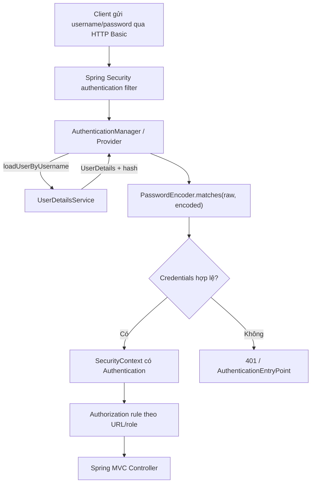

# Khai báo tài khoản mẫu và PasswordEncoder cho môi trường học tập

## Mục tiêu và phạm vi

Khi học Spring Security lần đầu, bạn cần một cách có thể lặp lại để đăng nhập bằng hai hoặc ba tài khoản, quan sát 401/403 và hiểu vì sao mật khẩu không được lưu dưới dạng văn bản gốc. Trong ứng dụng Spring Boot dùng username/password, bộ ba `UserDetails`, `UserDetailsService` và `PasswordEncoder` là điểm xuất phát thuận tiện. `InMemoryUserDetailsManager` giúp khai báo người dùng ngay trong bộ nhớ để học tập, còn `PasswordEncoder` đảm nhiệm việc biến mật khẩu nhập vào thành dạng lưu trữ và đối chiếu mật khẩu lúc đăng nhập.

Bài này hướng dẫn cấu hình **Java 17 + Spring Boot 3.5.x + Spring Security 6.5.x + Spring MVC/Servlet + Maven**. Các API dùng trong ví dụ thuộc dòng Spring Boot 3.x; nếu bạn dùng Boot 4/Security 7 hoặc WebFlux, hãy đối chiếu tài liệu đúng phiên bản. Nội dung **chỉ dành cho môi trường học tập/local**: username và password cố định trong source là dữ liệu thử nghiệm, không phải cách quản lý tài khoản và secret của ứng dụng thật.

Sau bài này, bạn có thể:

1. Phân biệt xác thực (**authentication**) với phân quyền (**authorization**).
2. Phân biệt mật khẩu gốc (**raw password**), mật khẩu đã hash (**encoded password**) và thao tác `matches()`.
3. Khai báo hai tài khoản bằng `UserDetails` / `InMemoryUserDetailsManager`.
4. Đăng ký bean `PasswordEncoder` bằng `PasswordEncoderFactories.createDelegatingPasswordEncoder()` và hiểu định dạng `{bcrypt}...`.
5. Cấu hình `SecurityFilterChain` cho endpoint công khai, endpoint yêu cầu đăng nhập và endpoint cần vai trò ADMIN.
6. Dùng curl và MockMvc xác nhận trường hợp thành công, sai mật khẩu, người dùng ẩn danh và thiếu quyền.
7. Giải thích vì sao `{noop}`, `NoOpPasswordEncoder` và mật khẩu ghi thẳng vào Git không phù hợp cho production.

## 1. Các thành phần làm việc với nhau như thế nào?

Trong Spring Security, ba phần thường xuất hiện gần nhau nhưng không thực hiện cùng một công việc:

| Thành phần | Trách nhiệm | Ví dụ |
| --- | --- | --- |
| `UserDetails` | Đại diện một người dùng cho quá trình xác thực, gồm username, mật khẩu **đã mã hóa/hash** và authorities cùng các trạng thái tài khoản. | `User.withUsername("learner")...build()` |
| `UserDetailsService` | Tải `UserDetails` theo username. Nó **không trực tiếp đối chiếu mật khẩu**. | `loadUserByUsername("learner")` |
| `InMemoryUserDetailsManager` | Một implementation của `UserDetailsService` và `UserDetailsManager`, giữ người dùng trong bộ nhớ tiến trình. | `new InMemoryUserDetailsManager(learner, admin)` |
| `PasswordEncoder` | Cung cấp `encode(raw)` và `matches(raw, encoded)`; có thể hỗ trợ kiểm tra nhu cầu nâng cấp hash qua `upgradeEncoding(...)`. | `DelegatingPasswordEncoder` / `BCryptPasswordEncoder` |
| `AuthenticationProvider` | Dùng các thành phần thích hợp để xác minh credentials. | `DaoAuthenticationProvider` có thể tải user và gọi encoder kiểm tra password. |
| `AuthenticationManager` | Điều phối việc xác thực qua một hoặc nhiều provider. | `ProviderManager` trong mô hình phổ biến. |
| `SecurityFilterChain` | Áp các HTTP security filters và chính sách URL. | `/me` cần login; `/admin/hello` cần `ROLE_ADMIN`. |

Luồng khái quát khi sử dụng HTTP Basic:



Sơ đồ cho thấy trách nhiệm và **không phải thứ tự lớp bên trong mọi cơ chế xác thực**. Một ứng dụng có thể dùng form login, session, JWT, OAuth2 hoặc cơ chế khác thay HTTP Basic. `PasswordEncoder` đặc biệt liên quan đến xác thực dựa trên mật khẩu; không phải mọi loại token đều cần encoder này.

### 1.1. Authentication không phải authorization

- **Authentication:** `learner` có cung cấp đúng mật khẩu của `learner` không?
- **Authorization:** `learner` đã đăng nhập có được xem `/admin/hello` không?

Một tài khoản đăng nhập thành công vẫn có thể nhận `403 Forbidden` khi thiếu quyền. Còn request thiếu hoặc sai credentials thường nhận `401 Unauthorized` khi dùng HTTP Basic. Nếu ứng dụng dùng form login, client chưa đăng nhập có thể được redirect đến trang login thay vì 401.

## 2. PasswordEncoder làm gì và không làm gì?

### 2.1. Password hash khác mã hóa đảo ngược

Với lưu trữ mật khẩu, hệ thống thường không cần khôi phục lại mật khẩu gốc. Ta chỉ cần kiểm tra người dùng vừa nhập có đúng so với giá trị đã lưu hay không. Bởi vậy Spring Security dùng `PasswordEncoder` làm hợp đồng cho các thuật toán **hash mật khẩu có cost**, thay vì giữ plaintext hoặc dùng mã hóa hai chiều có thể giải mã.

```text
Khi tạo tài khoản (demo):
  rawPassword = "learner-pass"
      |
      v
  encoder.encode(rawPassword)
      |
      v
  encodedPassword = "{bcrypt}$2a$10$..."   (giá trị minh họa)
      |
      v
  UserDetails.password(encodedPassword)

Khi đăng nhập:
  rawPassword từ client
      |
      v
  encoder.matches(rawPassword, storedEncodedPassword)
      |
      +-- true  -> credentials đúng
      +-- false -> credentials sai
```

**Không làm như sau:**

```java
// Sai về nguyên tắc với thuật toán có salt ngẫu nhiên.
boolean valid = encoder.encode(inputPassword).equals(storedPassword);
```

Lý do: thuật toán như bcrypt thường sinh **salt ngẫu nhiên** khi encode; hai lần hash cùng mật khẩu có thể tạo hai chuỗi khác nhau. `matches(raw, stored)` dùng tham số/cấu trúc được lưu trong hash để xác minh đúng.

### 2.2. Ba method quan trọng

```java
public interface PasswordEncoder {
    String encode(CharSequence rawPassword);
    boolean matches(CharSequence rawPassword, String encodedPassword);
    default boolean upgradeEncoding(String encodedPassword) {
        return false;
    }
}
```

Đây là **chữ ký rút gọn để học**, không phải file Java cần sao chép vào project.

- `encode(...)`: tạo biểu diễn để lưu của mật khẩu đầu vào.
- `matches(...)`: so mật khẩu gốc vừa nhập với chuỗi đã lưu, trả về true/false khi định dạng và encoder phù hợp.
- `upgradeEncoding(...)`: gợi ý rằng biểu diễn đang lưu nên được chuyển sang cách encoding mới. Phương thức này **không tự cập nhật database** hoặc tự thay đổi mọi mật khẩu trong hệ thống.

Mật khẩu sau khi hash **không phải token để đăng nhập**. Không gửi hash cho client và cũng không coi việc biết một chuỗi hash là quyền được truy cập tài khoản.

### 2.3. Vì sao bcrypt phù hợp cho ví dụ?

`BCryptPasswordEncoder` dùng thuật toán bcrypt, có salt ngẫu nhiên và công việc tính toán có chủ đích để làm chậm việc thử nhiều mật khẩu khi dữ liệu bị lộ. Một hash bcrypt thường mang thông tin version và cost trong chuỗi lưu, ví dụ bắt đầu bằng `$2a$10$...`.

- **Salt** không phải secret: nó ngăn cùng mật khẩu mặc định luôn tạo đúng cùng hash và gây khó cho bảng hash dựng sẵn.
- **Work factor / strength** làm tăng chi phí tính toán. Cost cao hơn làm chậm cả kẻ tấn công lẫn server khi kiểm tra đăng nhập, nên phải đo với phần cứng và lưu lượng thực tế.
- Hash không thay được chính sách mật khẩu, MFA, chống brute force trên endpoint đăng nhập, bảo vệ database và cập nhật dependency.

Trong lab, để đơn giản và dễ theo dõi, ta dùng encoder do Spring Security tạo sẵn với bcrypt cho mật khẩu mới. Hệ thống thật cần lựa chọn thuật toán/cost theo yêu cầu, đo thời gian hash và có kế hoạch nâng cấp mật khẩu cũ.

## 3. Hai cách cấu hình PasswordEncoder và điểm dễ nhầm

### 3.1. Khuyến khích cho bài thực hành: DelegatingPasswordEncoder

Spring Security cung cấp:

```java
@Bean
PasswordEncoder passwordEncoder() {
    return PasswordEncoderFactories.createDelegatingPasswordEncoder();
}
```

Import cần thiết:

```java
import org.springframework.context.annotation.Bean;
import org.springframework.security.crypto.factory.PasswordEncoderFactories;
import org.springframework.security.crypto.password.PasswordEncoder;
```

Đây là **fragment của một lớp `@Configuration`**; lớp chạy được đầy đủ sẽ xuất hiện ở phần thực hành.

`PasswordEncoderFactories.createDelegatingPasswordEncoder()` tạo một `DelegatingPasswordEncoder`. Trong cấu hình phổ biến của Spring Security 6.5, encoder dùng cho **hash mới** là bcrypt, và chuỗi lưu có prefix định danh thuật toán:

```text
{bcrypt}$2a$10$...
\______/\____________/
   id     bcrypt hash
```

Prefix `{bcrypt}` giúp encoder chọn đúng implementation để kiểm tra. Khi hệ thống cần giữ nhiều kiểu hash từ các giai đoạn nâng cấp, cách định danh này hỗ trợ một chiến lược chuyển đổi dần thay vì coi mọi chuỗi là cùng một định dạng.

**Cần nhớ:** `{bcrypt}` là **một phần của chuỗi lưu** khi dùng DelegatingPasswordEncoder, không phải mật khẩu người dùng phải gõ. Mật khẩu được nhập vẫn là `learner-pass`.

### 3.2. Một lựa chọn đơn giản: BCryptPasswordEncoder trực tiếp

Cũng có thể khai báo:

```java
@Bean
PasswordEncoder passwordEncoder() {
    return new BCryptPasswordEncoder();
}
```

Với bean này, `encode("learner-pass")` thường trả chuỗi bắt đầu bằng `$2a$...` **không có** prefix `{bcrypt}` do DelegatingPasswordEncoder quản lý. Cách này hợp lý cho một hệ thống đơn giản chỉ dùng bcrypt và không có nhiều hash format cần hỗ trợ.

Hai cách không nên pha trộn tùy tiện:

| Cách encode lúc lưu | Chuỗi lưu thường gặp | Encoder dùng để matches |
| --- | --- | --- |
| `DelegatingPasswordEncoder` mặc định | `{bcrypt}$2a$...` | `DelegatingPasswordEncoder` hiểu `{bcrypt}` |
| `BCryptPasswordEncoder` trực tiếp | `$2a$...` | `BCryptPasswordEncoder` trực tiếp |
| `{noop}learner-pass` (chỉ minh họa) | Gần như plaintext | DelegatingPasswordEncoder có thể nhận diện `noop` nhưng **không an toàn** |

Nếu dùng DelegatingPasswordEncoder để đối chiếu một chuỗi bcrypt **không có** `{id}`, nó có thể báo lỗi không tìm thấy encoder tương ứng với id. Đây là lỗi cấu hình format, không phải do người dùng nhập sai password. Giải pháp phải nằm ở **đồng bộ thuật toán và format lưu**, không phải tắt kiểm tra mật khẩu.

Trong bài lab, ta **chỉ dùng `DelegatingPasswordEncoder`** để từ đầu đến cuối không bị lệch định dạng.

### 3.3. Vì sao tránh `{noop}` và NoOpPasswordEncoder?

Bạn có thể gặp đoạn tutorial:

```java
User.withUsername("learner")
    .password("{noop}learner-pass")
    .roles("USER")
    .build();
```

Đây là **fragment minh họa điều không nên áp dụng**. `{noop}` báo cho DelegatingPasswordEncoder biết không cần hash mật khẩu lưu; vì vậy giá trị có tính chất plaintext. `NoOpPasswordEncoder` cũng không bảo vệ mật khẩu đã lưu.

Dùng `{noop}` có thể giúp demo rất ngắn, nhưng nó khiến người học quen với hành vi không phù hợp để lưu mật khẩu. Bài này sử dụng encoder có hash để hình thành thói quen đúng từ đầu.

### 3.4. User.withDefaultPasswordEncoder() có nên dùng?

`User.withDefaultPasswordEncoder()` là builder tiện lợi cho bài học. Nó encode password trong quá trình dựng `UserDetails`; nhưng raw password **vẫn xuất hiện trong source/compiled artifact** nếu bạn ghi trực tiếp:

```java
UserDetails user = User.withDefaultPasswordEncoder()
    .username("learner")
    .password("learner-pass")
    .roles("USER")
    .build();
```

Do đó chức năng này **không phải giải pháp quản lý secret cho production**. Trong lab, ta dùng bean encoder riêng để thấy trực tiếp chỗ hash và cho phép test encoder. Cả hai cách vẫn cần lưu ý raw password hard-code chỉ là dữ liệu học tập.

## 4. Ứng dụng Spring Boot hoàn chỉnh: hai tài khoản và ba endpoint

### 4.1. Kịch bản muốn quan sát

| Endpoint | Ai được gọi? | Điều bạn sẽ thấy |
| --- | --- | --- |
| `GET /public/ping` | Mọi người, kể cả anonymous | HTTP 200 và body `pong`. |
| `GET /me` | Người dùng đã xác thực | HTTP 200, JSON chứa username và authorities của người đang đăng nhập. |
| `GET /admin/hello` | Người có role ADMIN | HTTP 200 khi đăng nhập bằng admin; người dùng thường nhận 403. |
| Các request khác | Bị từ chối theo rule mặc định của lab | Không vô tình mở endpoint mới. |

Hai tài khoản mẫu:

- `learner` / `learner-pass`: role USER.
- `admin` / `admin-pass`: roles USER và ADMIN.

**Tất cả credentials ở đây chỉ hợp lệ trong ứng dụng local của bài học.** Không dùng lại tên và mật khẩu này cho hạ tầng thật.

### 4.2. Cấu trúc thư mục

```text
password-encoder-lab/
├── pom.xml
└── src/
    ├── main/java/com/example/passwordlab/
    │   ├── PasswordLabApplication.java
    │   ├── SecurityConfig.java
    │   └── DemoController.java
    └── test/java/com/example/passwordlab/
        ├── PasswordEncoderTest.java
        └── SecurityHttpTest.java
```

### 4.3. pom.xml (Maven + Java 17)

```xml
<project xmlns="http://maven.apache.org/POM/4.0.0"
         xmlns:xsi="http://www.w3.org/2001/XMLSchema-instance"
         xsi:schemaLocation="http://maven.apache.org/POM/4.0.0 https://maven.apache.org/xsd/maven-4.0.0.xsd">
    <modelVersion>4.0.0</modelVersion>
    <parent>
        <groupId>org.springframework.boot</groupId>
        <artifactId>spring-boot-starter-parent</artifactId>
        <version>3.5.0</version>
        <relativePath/>
    </parent>

    <groupId>com.example</groupId>
    <artifactId>password-encoder-lab</artifactId>
    <version>1.0.0</version>

    <properties>
        <java.version>17</java.version>
    </properties>

    <dependencies>
        <dependency>
            <groupId>org.springframework.boot</groupId>
            <artifactId>spring-boot-starter-web</artifactId>
        </dependency>
        <dependency>
            <groupId>org.springframework.boot</groupId>
            <artifactId>spring-boot-starter-security</artifactId>
        </dependency>
        <dependency>
            <groupId>org.springframework.boot</groupId>
            <artifactId>spring-boot-starter-test</artifactId>
            <scope>test</scope>
        </dependency>
        <dependency>
            <groupId>org.springframework.security</groupId>
            <artifactId>spring-security-test</artifactId>
            <scope>test</scope>
        </dependency>
    </dependencies>

    <build>
        <plugins>
            <plugin>
                <groupId>org.springframework.boot</groupId>
                <artifactId>spring-boot-maven-plugin</artifactId>
            </plugin>
        </plugins>
    </build>
</project>
```

Starter Security cung cấp module xác thực/bảo mật web cơ bản. Không đặt phiên bản riêng cho các module Spring Security trong cùng dự án Boot nếu không có yêu cầu tương thích đặc biệt; parent/BOM của Boot sẽ chọn một bộ phiên bản phù hợp. Version `3.5.0` là **mốc ví dụ**, khi dùng thực tế nên cập nhật bản vá còn được hỗ trợ.

### 4.4. PasswordLabApplication.java

```java
package com.example.passwordlab;

import org.springframework.boot.SpringApplication;
import org.springframework.boot.autoconfigure.SpringBootApplication;

@SpringBootApplication
public class PasswordLabApplication {
    public static void main(String[] args) {
        SpringApplication.run(PasswordLabApplication.class, args);
    }
}
```

Lớp này nằm trong package gốc `com.example.passwordlab`. Spring Boot component scan sẽ tìm các component/configuration cùng package và các package con, bao gồm `SecurityConfig` và `DemoController`.

### 4.5. SecurityConfig.java: bean PasswordEncoder + UserDetailsService + SecurityFilterChain

```java
package com.example.passwordlab;

import org.springframework.context.annotation.Bean;
import org.springframework.context.annotation.Configuration;
import org.springframework.security.config.Customizer;
import org.springframework.security.config.annotation.web.builders.HttpSecurity;
import org.springframework.security.config.annotation.web.configurers.AbstractHttpConfigurer;
import org.springframework.security.core.userdetails.User;
import org.springframework.security.core.userdetails.UserDetails;
import org.springframework.security.core.userdetails.UserDetailsService;
import org.springframework.security.crypto.factory.PasswordEncoderFactories;
import org.springframework.security.crypto.password.PasswordEncoder;
import org.springframework.security.provisioning.InMemoryUserDetailsManager;
import org.springframework.security.web.SecurityFilterChain;

@Configuration(proxyBeanMethods = false)
public class SecurityConfig {

    @Bean
    PasswordEncoder passwordEncoder() {
        return PasswordEncoderFactories.createDelegatingPasswordEncoder();
    }

    @Bean
    UserDetailsService userDetailsService(PasswordEncoder encoder) {
        UserDetails learner = User.withUsername("learner")
            .password(encoder.encode("learner-pass"))
            .roles("USER")
            .build();

        UserDetails admin = User.withUsername("admin")
            .password(encoder.encode("admin-pass"))
            .roles("USER", "ADMIN")
            .build();

        return new InMemoryUserDetailsManager(learner, admin);
    }

    @Bean
    SecurityFilterChain securityFilterChain(HttpSecurity http)
            throws Exception {

        return http
            .authorizeHttpRequests(auth -> auth
                .requestMatchers("/public/ping").permitAll()
                .requestMatchers("/admin/hello").hasRole("ADMIN")
                .requestMatchers("/me").authenticated()
                .anyRequest().denyAll()
            )
            .httpBasic(Customizer.withDefaults())
            .formLogin(AbstractHttpConfigurer::disable)
            .build();
    }
}
```

**Đọc cấu hình theo trách nhiệm:**

1. `passwordEncoder()` đăng ký bean `PasswordEncoder`. Spring quản lý bean; mã sử dụng factory tạo `DelegatingPasswordEncoder` với encoder cho hash mới là bcrypt.
2. `userDetailsService(PasswordEncoder encoder)` nhận encoder từ dependency injection. Cả hai mật khẩu demo được hash **trước khi** đưa vào `UserDetails`.
3. `User.withUsername("learner")` tạo `UserDetails` cho người học; `.roles("USER")` cấp authority `ROLE_USER` theo prefix mặc định.
4. `User.withUsername("admin")` tạo tài khoản có `ROLE_USER` và `ROLE_ADMIN`, vì `.roles("USER", "ADMIN")` thêm prefix `ROLE_`.
5. `InMemoryUserDetailsManager` giữ hai đối tượng trong bộ nhớ. Nó không tạo bảng SQL và không lưu dữ liệu lâu dài.
6. `securityFilterChain(...)` đặt chính sách request: public, logged-in và admin.
7. `.httpBasic(...)` chọn Basic để curl dễ quan sát. `.formLogin(AbstractHttpConfigurer::disable)` chỉ tắt trang login form cho bài demo; nó **không** tắt Spring Security, CSRF hoặc authorization.
8. `.anyRequest().denyAll()` là fallback thận trọng: các đường dẫn mới chưa được khai báo sẽ không tự có quyền truy cập.

**Lưu ý về default user của Boot:** khi không tự khai báo nguồn người dùng, Boot thường tạo một user `user` với password ngẫu nhiên in log. Khi đã có bean `UserDetailsService` của ứng dụng như trên, auto-configuration cấp user mặc định tương ứng **nhường chỗ**. Vì vậy trong lab này bạn dùng `learner` hoặc `admin`, không cần tìm mật khẩu sinh ngẫu nhiên.

### 4.6. DemoController.java

```java
package com.example.passwordlab;

import java.util.List;
import java.util.Map;

import org.springframework.security.core.Authentication;
import org.springframework.security.core.GrantedAuthority;
import org.springframework.web.bind.annotation.GetMapping;
import org.springframework.web.bind.annotation.RestController;

@RestController
public class DemoController {

    @GetMapping("/public/ping")
    public String ping() {
        return "pong";
    }

    @GetMapping("/me")
    public Map<String, Object> me(Authentication authentication) {
        List<String> authorities = authentication.getAuthorities()
            .stream()
            .map(GrantedAuthority::getAuthority)
            .sorted()
            .toList();

        return Map.of(
            "username", authentication.getName(),
            "authorities", authorities
        );
    }

    @GetMapping("/admin/hello")
    public String adminHello() {
        return "Hello, admin";
    }
}
```

`/me` lấy tên và authority từ `Authentication` đã được Spring Security thiết lập. Nó **không lấy username từ query string hoặc JSON body** vì người dùng có thể tự điền giá trị bất kỳ vào request.

Sử dụng `List#toList()` yêu cầu Java 16+, vì vậy Java 17 đáp ứng. `Map.of` và Spring Boot JSON mapper sẽ chuyển dữ liệu thành JSON. Code không trả password hash từ `UserDetails`.

### 4.7. Chạy ứng dụng và kiểm tra thủ công

Từ thư mục `password-encoder-lab`:

```bash
mvn spring-boot:run
```

Mở terminal khác. Trong PowerShell, nên dùng `curl.exe` thay vì alias `curl` của một số phiên bản Windows PowerShell:

```bash
curl -i http://localhost:8080/public/ping
curl -i http://localhost:8080/me
curl -i -u learner:learner-pass http://localhost:8080/me
curl -i -u learner:wrong-pass http://localhost:8080/me
curl -i -u learner:learner-pass http://localhost:8080/admin/hello
curl -i -u admin:admin-pass http://localhost:8080/admin/hello
```

Kết quả kỳ vọng:

| Request | HTTP status | Ý nghĩa |
| --- | --- | --- |
| `GET /public/ping`, anonymous | **200 OK** | Body `pong`, vì `permitAll()`. |
| `GET /me`, anonymous | **401 Unauthorized** | Chưa cung cấp Basic credentials hợp lệ. |
| `GET /me`, learner đúng password | **200 OK** | JSON có `username=learner` và `authorities=["ROLE_USER"]`. |
| `GET /me`, learner sai password | **401 Unauthorized** | Password verification thất bại. |
| `GET /admin/hello`, learner hợp lệ | **403 Forbidden** | Learner đã đăng nhập nhưng thiếu `ROLE_ADMIN`. |
| `GET /admin/hello`, admin hợp lệ | **200 OK** | Body `Hello, admin`. |

Với `GET /me` cho admin, authorities được sort nên có thể nhận JSON chứa `["ROLE_ADMIN","ROLE_USER"]`. Thứ tự field trong JSON map không nên được dùng làm contract; chỉ cần kiểm tra giá trị. Các header HTTP bổ sung phụ thuộc web container, Spring Security và cấu hình.

**Cảnh báo về curl:** `curl -u` tạo header HTTP Basic bằng Base64 từ username/password. **Base64 không phải mã hóa bảo mật**; khi dùng credentials thật, bắt buộc cân nhắc HTTPS/TLS, cách lưu secret ở client và nguy cơ lộ trong shell history. Ví dụ `http://localhost:8080` chỉ dành cho máy học tập cục bộ.

## 5. Kiểm thử PasswordEncoder độc lập với request HTTP

Bạn cần chứng minh cả **đúng mật khẩu thì khớp** và **sai mật khẩu thì không khớp**. Không so sánh hai chuỗi hash bằng nhau vì salt có thể khác nhau.

### 5.1. PasswordEncoderTest.java

```java
package com.example.passwordlab;

import org.junit.jupiter.api.Test;
import org.springframework.beans.factory.annotation.Autowired;
import org.springframework.boot.test.context.SpringBootTest;
import org.springframework.security.crypto.password.PasswordEncoder;

import static org.assertj.core.api.Assertions.assertThat;

@SpringBootTest
class PasswordEncoderTest {

    @Autowired
    PasswordEncoder encoder;

    @Test
    void encodedPasswordContainsAlgorithmIdAndMatches() {
        String encoded = encoder.encode("learner-pass");

        assertThat(encoded).startsWith("{bcrypt}");
        assertThat(encoder.matches("learner-pass", encoded)).isTrue();
        assertThat(encoder.matches("wrong-pass", encoded)).isFalse();
    }

    @Test
    void encodedPasswordIsNotStoredAsPlaintext() {
        String encoded = encoder.encode("admin-pass");

        assertThat(encoded).isNotEqualTo("admin-pass");
        assertThat(encoded).startsWith("{bcrypt}");
        assertThat(encoder.matches("admin-pass", encoded)).isTrue();
    }
}
```

Đây là kiểm thử bean `PasswordEncoder` thực tế đã đăng ký trong application context, không phải mock. Với factory dùng trong ví dụ, `{bcrypt}` là id cho hash mới. Nếu đổi encoder trong production, test về prefix phải thay theo policy tương ứng.

**Không ghi hash hoặc mật khẩu vào log chỉ để chứng minh test.** Điều cần kiểm tra là encode tạo representation thích hợp và `matches` phản hồi đúng. Ngay cả hash có salt cũng là dữ liệu xác thực cần quản lý thận trọng.

### 5.2. Vì sao kết quả encode không có “stdout cố định”?

Bcrypt dùng salt ngẫu nhiên. Hai lần chạy:

```java
String first = encoder.encode("learner-pass");
String second = encoder.encode("learner-pass");
```

có thể cho hai chuỗi khác nhau nhưng:

```java
encoder.matches("learner-pass", first);  // true
encoder.matches("learner-pass", second); // true
```

Vì thế một README đúng **không in ra chuỗi bcrypt cố định** như đầu ra bắt buộc của code. Kiểm thử `startsWith("{bcrypt}")` và `matches(...)` phản ánh cơ chế chính xác hơn. Khi di chuyển từ môi trường học tập sang DB, bạn lưu hash đã tạo, không re-encode mật khẩu mỗi khi đọc nó.

## 6. Kiểm thử HTTP authentication và authorization bằng MockMvc

### 6.1. SecurityHttpTest.java

```java
package com.example.passwordlab;

import org.junit.jupiter.api.Test;
import org.springframework.beans.factory.annotation.Autowired;
import org.springframework.boot.test.autoconfigure.web.servlet.AutoConfigureMockMvc;
import org.springframework.boot.test.context.SpringBootTest;
import org.springframework.test.web.servlet.MockMvc;

import static org.springframework.security.test.web.servlet.request
        .SecurityMockMvcRequestPostProcessors.httpBasic;
import static org.springframework.test.web.servlet.request.MockMvcRequestBuilders.get;
import static org.springframework.test.web.servlet.result.MockMvcResultMatchers.content;
import static org.springframework.test.web.servlet.result.MockMvcResultMatchers.jsonPath;
import static org.springframework.test.web.servlet.result.MockMvcResultMatchers.status;

@SpringBootTest
@AutoConfigureMockMvc
class SecurityHttpTest {

    @Autowired
    MockMvc mvc;

    @Test
    void publicRouteIsAccessibleToAnonymous() throws Exception {
        mvc.perform(get("/public/ping"))
            .andExpect(status().isOk())
            .andExpect(content().string("pong"));
    }

    @Test
    void meRejectsMissingCredentials() throws Exception {
        mvc.perform(get("/me"))
            .andExpect(status().isUnauthorized());
    }

    @Test
    void meAcceptsCorrectPassword() throws Exception {
        mvc.perform(get("/me")
                .with(httpBasic("learner", "learner-pass")))
            .andExpect(status().isOk())
            .andExpect(jsonPath("$.username").value("learner"))
            .andExpect(jsonPath("$.authorities[0]").value("ROLE_USER"));
    }

    @Test
    void meRejectsWrongPassword() throws Exception {
        mvc.perform(get("/me")
                .with(httpBasic("learner", "wrong-pass")))
            .andExpect(status().isUnauthorized());
    }

    @Test
    void learnerCannotAccessAdminEndpoint() throws Exception {
        mvc.perform(get("/admin/hello")
                .with(httpBasic("learner", "learner-pass")))
            .andExpect(status().isForbidden());
    }

    @Test
    void adminCanAccessAdminEndpoint() throws Exception {
        mvc.perform(get("/admin/hello")
                .with(httpBasic("admin", "admin-pass")))
            .andExpect(status().isOk())
            .andExpect(content().string("Hello, admin"));
    }

    @Test
    void unknownUsernameCannotLogIn() throws Exception {
        mvc.perform(get("/me")
                .with(httpBasic("unknown", "any-password")))
            .andExpect(status().isUnauthorized());
    }
}
```

MockMvc sử dụng Spring web application context với Spring Security filter chain khi được auto-configure, không cần mở cổng mạng. `httpBasic(...)` tạo credentials trong request và đi qua cơ chế xác thực được cấu hình. Vì thế test sai mật khẩu **thực sự kiểm tra nhánh đăng nhập thất bại** trong lab.

Để kiểm thử **phân quyền mà không quan tâm cách password được kiểm tra**, Spring Security Test còn có `@WithMockUser` hoặc `user(...)`. Chúng hữu ích cho unit/integration test policy, nhưng **không thay thế test HTTP Basic với PasswordEncoder thật** nếu mục tiêu bài là chứng minh mật khẩu đúng/sai.

### 6.2. Chạy test

```bash
mvn test
```

Kỳ vọng dự án compile thành công và **9 test** trong hai lớp trên (2 test encoder + 7 test HTTP) đều pass. Chi tiết output Maven/Surefire có thể khác giữa máy; điều cần quan sát là không có test failure/error. Đây là kết quả mong đợi của cấu hình đã trình bày, không phải log được lấy từ một lượt chạy sẵn.

Nếu test không pass, hãy kiểm tra lần lượt package/class name, dependency `spring-security-test`, encoder bean, user definitions, actual HTTP status và request matcher order trước khi thay đổi policy.

## 7. Hiểu AuthenticationProvider dùng PasswordEncoder khi đăng nhập

Ứng dụng mẫu ở trên không cần tự viết `AuthenticationManager` hay `DaoAuthenticationProvider` chỉ để Basic login. Spring Security và Boot có thể xây dựng cơ chế xác thực dựa trên `UserDetailsService` và `PasswordEncoder` có sẵn.

Luồng khái quát:

```text
Client GET /me + Authorization: Basic ...
             |
             v
BasicAuthenticationFilter
             |
             v
AuthenticationManager
             |
             v
DaoAuthenticationProvider (trong cấu hình phù hợp)
             |
             +--> UserDetailsService.loadUserByUsername("learner")
             |          |
             |          v
             |      UserDetails (có encoded password + authorities)
             |
             +--> PasswordEncoder.matches(raw, encoded)
             |
             +--> credentials sai: AuthenticationException
             |
             +--> đúng: authenticated Authentication
             |
             v
AuthorizationFilter kiểm tra .authenticated()
             |
             v
Controller /me
```

Tên filter/provider và cơ chế tạo chúng có thể khác theo cách cấu hình, nhưng **hợp đồng** của `UserDetailsService` và `PasswordEncoder` vẫn rõ ràng.

Một chi tiết cần nhớ: `UserDetailsService#loadUserByUsername` trả dữ liệu cần xác thực, **không phải policy phân quyền tài nguyên**. Nếu service trả user có `ROLE_USER`, Security có thể so role cho `/admin/hello`; nhưng khi API trả dữ liệu theo order ID hoặc tenant, bạn vẫn cần kiểm tra quyền sở hữu ở tầng service/DB.

### 7.1. UserDetails chứa gì?

Một `UserDetails` có các thành phần như:

- `username`.
- `password`: **encoded**, không phải raw password theo thiết kế xác thực an toàn.
- `authorities`: tập quyền/role của user.
- Các trạng thái như enabled, account non-locked, account non-expired, credentials non-expired.

Với `User.withUsername(...).roles(...)`, các trạng thái thường được tạo mặc định ở dạng cho phép; ứng dụng thật cần quản lý các trạng thái account tương ứng nếu có khóa, hết hạn hoặc vô hiệu hóa. `InMemoryUserDetailsManager` hỗ trợ lưu user trong tiến trình cho lab nhưng **không tự lưu trạng thái ra database**.

### 7.2. Vai trò và authority

Trong ví dụ:

```java
.roles("USER")
```

sẽ tạo authority `ROLE_USER` theo prefix mặc định. Tương tự:

```java
.roles("USER", "ADMIN")
```

tạo `ROLE_USER` và `ROLE_ADMIN`.

Với policy:

```java
.requestMatchers("/admin/hello").hasRole("ADMIN")
```

Spring Security thường xét authority `ROLE_ADMIN`. Nếu bạn cấp `authorities("ADMIN")` mà không có `ROLE_ADMIN`, rule `hasRole("ADMIN")` có thể không match. Đừng trộn tên role và authority mà không hiểu prefix. Với quyền chi tiết như `READ_REPORT`, thường dùng `hasAuthority("READ_REPORT")` và cấp đúng chuỗi authority đó.

## 8. Khi nào Boot còn sinh user mặc định?

Nếu chỉ thêm `spring-boot-starter-security` vào web app và **chưa** cung cấp nguồn user, trong cấu hình Servlet Boot thường tạo user `user` với mật khẩu ngẫu nhiên được in ở startup log. Khi bạn khai báo `UserDetailsService` như bài lab, cơ chế user mặc định của Boot sẽ nhường chỗ.

Các tình huống thường gặp:

| Điều bạn cấu hình | Nguồn user / hành vi thông thường |
| --- | --- |
| Chỉ thêm Security starter, không có custom auth beans | Boot có thể tạo user `user` và password ngẫu nhiên cho môi trường phát triển. |
| Chỉ tạo `SecurityFilterChain` custom, không tạo nguồn user riêng | URL policy thay đổi, nhưng user mặc định vẫn có thể được Boot tạo theo điều kiện độc lập. |
| Tạo bean `UserDetailsService` custom | Boot không cần tạo `UserDetailsService` in-memory mặc định nữa. |
| Tạo `AuthenticationProvider` hoặc `AuthenticationManager` phù hợp | Có thể làm auto-config user mặc định back off theo điều kiện của Boot. |
| Cấu hình OAuth2 resource server/client hoặc SAML liên quan | Quy tắc auto-configuration thay đổi; đừng mặc định luôn có `user`. |

Tham khảo [Spring Boot 3.5 — Spring Security](https://docs.spring.io/spring-boot/3.5/reference/web/spring-security.html).

### 8.1. Cách nhanh bằng application.properties cho lab rất nhỏ

Khi **chưa có** `UserDetailsService` custom, có thể chỉnh user mặc định với:

```properties
spring.security.user.name=demo
spring.security.user.password=demo-pass
spring.security.user.roles=USER
```

Đây là **một phương án riêng cho lab**, không phải phần phải thêm vào project chính ở mục 4. Những property này cấu hình user mặc định của Boot khi auto-configuration phù hợp, không tạo user thứ ba bên cạnh `learner`/`admin` khi custom service đã thay thế nó.

Không commit secret thật vào `application.properties`. Việc các property có thể cấu hình dễ dàng chỉ giúp thử nghiệm, không phải chiến lược secret management hay user management cho production.

## 9. Đối chiếu hai kiểu lưu mật khẩu

Bảng sau phân biệt các cách thường gặp khi đọc tutorial hoặc code cũ:

| Ví dụ | Có hash thật? | Format | Đánh giá |
| --- | --- | --- | --- |
| `password(encoder.encode("demo"))` với DelegatingPasswordEncoder | Có | `{bcrypt}$2a$...` theo default hiện tại | Phù hợp cho bài học, thể hiện rõ encode/matches. |
| `password(new BCryptPasswordEncoder().encode("demo"))` | Có | `$2a$...` | Có thể dùng với BCryptPasswordEncoder tương ứng; cần giữ nhất quán format. |
| `password("{noop}demo")` | Không | Plaintext có marker `{noop}` | Chỉ để hiểu legacy/demo, không dùng để lưu mật khẩu thật. |
| `User.withDefaultPasswordEncoder().password("demo")` | Có | Thường dùng format có id, ví dụ `{bcrypt}...` | Tiện cho getting started nhưng raw password vẫn hard-code. |
| `password("demo")` không có encoder phù hợp | Không rõ / thường sai config | Plaintext không prefix | Có thể gây lỗi `There is no PasswordEncoder mapped...` hoặc xác thực thất bại, không nên dùng. |

Đừng chỉ đổi `PasswordEncoder` bean trong một ứng dụng thật đang có dữ liệu user. Nếu trước đó database lưu hash không prefix hoặc dùng thuật toán khác, thay đổi matcher ngay có thể làm toàn bộ user không login được. Cần thiết kế migration theo format cũ/mới và kiểm thử cả hai.

### 9.1. Một ví dụ encode/matches sai và đúng

**Sai:**

```java
// Không dùng làm kiểm tra bcrypt.
String stored = encoder.encode("demo");
boolean matches = encoder.encode("demo").equals(stored);
```

**Đúng:**

```java
String stored = encoder.encode("demo");
boolean matches = encoder.matches("demo", stored);
```

Hai đoạn này là fragment; giá trị `encoder` phải là bean hoặc instance encoder thích hợp. Với bộ encoder trong bài, đoạn đúng trả `true` cho `matches`; so sánh hai lần `encode` có thể trả false do salt khác nhau.

## 10. Khái niệm advanced nên biết, chưa cần triển khai trong lab

### 10.1. Đổi mật khẩu và nâng cấp hash

Một ứng dụng thật cần luồng đổi/reset mật khẩu an toàn, có xác minh danh tính và giới hạn lạm dụng. `PasswordEncoder#upgradeEncoding(stored)` chỉ hỗ trợ đánh giá việc hash đang lưu có nên đổi theo policy không. Để nâng cấp, ứng dụng có thể encode lại **mật khẩu gốc vừa được xác thực** và lưu hash mới qua service/repository đúng cách. Không thể “đổi bcrypt hash thành plaintext” để hash lại sau khi người dùng đã đi khỏi.

`UserDetailsPasswordService` là một điểm tích hợp có thể được dùng để cập nhật encoded password trong những luồng xác thực phù hợp. Khi dữ liệu user nằm ở DB, cần transaction, audit, xử lý lỗi và quyền ghi thích hợp; không mong đợi chỉ thêm encoder là migration tự hoàn tất.

### 10.2. Chi phí hash và tấn công brute force

Bcrypt được thiết kế làm chậm việc thử mật khẩu. Thời gian mã hóa/đối chiếu phụ thuộc cost và phần cứng; đặt cost quá cao có thể ảnh hưởng throughput, độ trễ đăng nhập và rủi ro quá tải khi có nhiều request đăng nhập. Vì thế:

- Chọn thuật toán/cost theo guidance và benchmark của môi trường.
- Dùng TLS cho login và chống brute force online bằng các giới hạn thích hợp.
- Bổ sung MFA khi mức rủi ro yêu cầu.
- Không log raw password hoặc hash; kiểm soát quyền truy cập kho dữ liệu.
- Theo dõi vòng đời dependency và có kế hoạch nâng cấp hash.

Một SHA-256 đơn thuần không tự trở thành lựa chọn tốt để lưu mật khẩu chỉ vì nó là thuật toán hash mật mã; các thuật toán password hashing có salt và cost (bcrypt, scrypt, Argon2, PBKDF2 trong bối cảnh phù hợp) giải quyết bài toán khác với hash tốc độ cao.

### 10.3. InMemoryUserDetailsManager không phải user store production

Với hệ thống thật, user có thể cần tạo/đổi mật khẩu, lock/unlock, reset password, MFA, liên kết định danh và audit. `InMemoryUserDetailsManager` chỉ lưu trong bộ nhớ của một process:

- Dữ liệu không tự tồn tại qua restart nếu chỉ khởi tạo lại từ code.
- Nhiều instance có bộ nhớ riêng, không tự đồng bộ.
- Sửa user trong RAM không đồng nghĩa cập nhật database/identity provider.
- Việc sửa username/password hard-code đòi hỏi triển khai lại artifact.
- Một người có quyền đọc source/compiled artifact có thể thấy raw password thử nghiệm ngay cả khi encoder đã hash dữ liệu in-memory.

Khi tiến tới production, lựa chọn thường là `JdbcUserDetailsManager`, custom `UserDetailsService` từ repository, external identity provider hoặc giải pháp xác thực chuyên biệt khác; đòi hỏi schema, secret management, policy và test riêng. Trong bài này, **không cần xây bảng user** chỉ để hiểu PasswordEncoder.

### 10.4. HTTP Basic và form login dùng encoder theo ý nghĩa tương tự

Trong Basic login, credentials đi trong header `Authorization`. Trong form login, chúng có thể đến từ request form được xử lý bởi authentication filter. Dù nguồn raw password khác nhau, provider kiểu username/password vẫn có thể dùng `UserDetailsService` và `PasswordEncoder` để xác minh.

Các API dùng bearer JWT/OAuth2 resource server thường xác minh token theo cơ chế khác, không “hash JWT bằng PasswordEncoder” để xác thực chữ ký. Đừng đặt PasswordEncoder vào mọi yêu cầu authentication chỉ vì nó có chữ “security”.

## 11. Lỗi phổ biến khi khai báo tài khoản mẫu

### Lỗi 1 — Lưu plaintext và mong Spring Security tự nhận

Ví dụ `.password("secret")` mà không có format và encoder tương thích có thể làm xác thực lỗi. **Cách sửa:** chọn encoder rõ ràng, encode khi tạo `UserDetails`, và dùng cùng chính sách khi matches.

### Lỗi 2 — Dùng DelegatingPasswordEncoder với hash thiếu `{id}`

Encoder không biết thuật toán tương ứng, có thể từ chối xử lý. **Cách sửa:** thống nhất format lưu và có kế hoạch migrate dữ liệu cũ; trong lab dùng duy nhất factory encoder.

### Lỗi 3 — Hash hai lần khi đăng nhập

Nhiều bạn lấy password người dùng vừa nhập, gọi `encode(...)` rồi so chuỗi với DB. **Cách sửa:** gọi `matches(raw, encoded)`.

### Lỗi 4 — Dùng `{noop}` vì demo ngắn

Nó bỏ qua hash, để password đọc được trong store. **Cách sửa:** dùng bcrypt/delegating trong bài học để không hình thành thói quen plaintext.

### Lỗi 5 — Tưởng Hash = mã hóa đảo ngược

Bcrypt không có thao tác “decode mật khẩu người dùng”. **Cách sửa:** khi quên password phải có quy trình reset, không tìm cách giải mã hash.

### Lỗi 6 — Đặt `roles("ROLE_ADMIN")`

`roles(...)` tự thêm prefix `ROLE_`; giá trị truyền vào không nên có prefix này. **Cách sửa:** `roles("ADMIN")` hoặc cấp đúng authority bằng `authorities("ROLE_ADMIN")` theo nhu cầu.

### Lỗi 7 — Tưởng có user hợp lệ là vào được mọi URL

Learner có `ROLE_USER` vẫn bị 403 ở endpoint cần ADMIN. **Cách sửa:** phân biệt authentication và authorization, viết test cả allowed/denied.

### Lỗi 8 — Dùng `@WithMockUser` để chứng minh password đúng

Mock principal có thể bỏ qua quá trình kiểm tra password. **Cách sửa:** test đăng nhập thật qua HTTP Basic/form login + bean PasswordEncoder, rồi dùng mock chỉ khi test business policy riêng.

### Lỗi 9 — Không thấy user `user` và password sinh ở log

Nếu bạn đã khai báo bean `UserDetailsService` custom, Boot không cần cấp user sinh tự động nữa. **Cách sửa:** dùng tài khoản bạn tự khai báo và kiểm tra điều kiện auto-configuration.

### Lỗi 10 — Đổi PasswordEncoder bean nhưng giữ nguyên dữ liệu cũ

Hash format/cost không tương thích có thể khiến mọi lần đăng nhập thất bại. **Cách sửa:** thiết kế migration và test dữ liệu đang có trước khi đổi.

### Lỗi 11 — Tắt CSRF để sửa một lỗi 403 khi POST

403 có thể do CSRF, do thiếu quyền hoặc do cách gửi credentials. **Cách sửa:** kiểm tra request method, CSRF token, filter chain và policy trước; bài lab GET-only không cần tắt CSRF.

### Lỗi 12 — Đưa mật khẩu thật vào source hoặc test output

Ngay cả khi encoder hash password lúc chạy, raw string hard-code vẫn nằm trong source/compiled files. **Cách sửa:** credentials cố định chỉ dành cho bài học; với ứng dụng thật dùng external secret/identity configuration và kiểm soát log.

### Lỗi 13 — Tưởng mật khẩu demo an toàn vì dùng BCrypt

BCrypt bảo vệ biểu diễn lưu trữ, **không** bảo vệ một mật khẩu yếu được dùng chung hoặc xuất hiện trong source. **Cách sửa:** phân biệt lớp bảo vệ hash với quản lý secret và chống lạm dụng.

### Lỗi 14 — Tạo nhiều encoder bean không rõ bean nào được dùng

Nếu có nhiều `PasswordEncoder` và cách inject thiếu rõ ràng, hệ thống có thể mơ hồ về bean hoặc format. **Cách sửa:** đăng ký rõ một policy mã hóa và test bean thực được dùng khi authentication.

## 12. Checklist tự thực hành từ đầu

Thực hiện theo trình tự:

1. Tạo project Maven ở mục 4 với Java 17, Boot 3.5.0, Spring Web, Spring Security và hai dependency test.
2. Tạo `PasswordLabApplication.java`.
3. Tạo `SecurityConfig.java`: một bean `PasswordEncoder`, một bean `UserDetailsService` và một bean `SecurityFilterChain`.
4. Tạo `DemoController.java` với đúng ba endpoint.
5. Chạy `mvn spring-boot:run`, xác nhận `GET /public/ping` trả 200.
6. Gọi `GET /me` không credentials: phải bị challenge.
7. Gọi `GET /me` với learner đúng và sai password: phải ra 200/401 tương ứng.
8. Gọi `GET /admin/hello` với learner và admin: phải ra 403/200.
9. Thêm hai lớp test; chạy `mvn test`, xem đủ nhánh login và quyền.
10. Thử thay `.roles("USER", "ADMIN")` của admin bằng `.roles("USER")` trên bản lab rồi chạy test: case admin vào `/admin/hello` sẽ không còn thành công. Khôi phục policy sau khi quan sát.
11. Thử thay password nguồn `learner-pass` bằng một chuỗi khác (chỉ trong bản lab) và gọi bằng credentials cũ: login thất bại. Khôi phục để test trở lại xanh.
12. Xem cấu hình có còn `{noop}`, mật khẩu production hard-code, hoặc rule `permitAll` quá rộng không trước khi phát triển tính năng tiếp theo.

Không nên thực hiện thử nghiệm cố ý làm yếu bảo mật trên môi trường có người dùng hoặc dữ liệu thật. Mọi thao tác ở checklist dành cho project cục bộ với hai user giả lập.

## 13. Câu hỏi tự kiểm tra kèm giải thích

**Câu 1.** `PasswordEncoder` có tự truy vấn user theo username không?

**Đáp án:** Không. `UserDetailsService` tải user; encoder chỉ encode/compare password. Authentication provider phối hợp hai trách nhiệm đó.

**Câu 2.** Tại sao `encoder.encode("demo")` gọi hai lần có thể ra hai chuỗi khác nhau?

**Đáp án:** Bcrypt sinh salt ngẫu nhiên để cùng mật khẩu không phải lúc nào cũng có cùng hash. Dùng `matches(...)` để đối chiếu.

**Câu 3.** Tại sao `{bcrypt}` xuất hiện trước hash khi dùng DelegatingPasswordEncoder?

**Đáp án:** Đây là định danh thuật toán lưu cùng hash để encoder chọn implementation khi matches, hữu ích cho hệ thống có nhiều hash format/upgrade.

**Câu 4.** Nếu raw password trong Java source là `learner-pass`, việc gọi encoder.encode có làm nó biến mất khỏi source không?

**Đáp án:** Không. Raw literal vẫn ở code/build artifact. Vì vậy cách khởi tạo này chỉ dùng demo local.

**Câu 5.** Vì sao `learner` có thể đọc `/me` nhưng không đọc `/admin/hello`?

**Đáp án:** `/me` chỉ cần authenticated; `/admin/hello` cần authority `ROLE_ADMIN`, còn learner chỉ có `ROLE_USER`.

**Câu 6.** `InMemoryUserDetailsManager` có tự ghi tài khoản vào database không?

**Đáp án:** Không. User được quản lý trong bộ nhớ tiến trình; không tự đồng bộ qua server hoặc tồn tại qua restart.

**Câu 7.** Đổi từ `new BCryptPasswordEncoder()` sang `createDelegatingPasswordEncoder()` có luôn tương thích với hash cũ không?

**Đáp án:** Không, cần kiểm tra format `{id}`, mapping các encoder và chiến lược migration. Không đổi đột ngột trên dữ liệu thật.

**Câu 8.** `{noop}` giúp điều gì, và vì sao không nên chọn nó?

**Đáp án:** Nó cho biết password ở dạng không encode; thuận cho demo tối giản nhưng không bảo vệ mật khẩu đã lưu.

**Câu 9.** Nếu `curl -u learner:wrong-pass` trả 401, có phải Spring MVC controller đã tự phát hiện sai password?

**Đáp án:** Không. Authentication filter/provider và PasswordEncoder kiểm tra trước controller; request bị từ chối ở security layer.

**Câu 10.** Nếu `@WithMockUser` cho phép gọi endpoint, điều đó có chứng minh người dùng nhập đúng password không?

**Đáp án:** Không. Mock user giúp test policy nhưng không phải kiểm chứng password hashing/matching; dùng request có credentials thực qua filter để test password.

## Kết luận

Với ứng dụng Spring Boot học tập, cách rõ ràng và có thể kiểm chứng là khai báo **`PasswordEncoder` bean → `UserDetailsService` với `UserDetails` đã hash → `SecurityFilterChain` với chính sách URL**. `InMemoryUserDetailsManager` giữ vài tài khoản mẫu để bạn hiểu authentication và authorization; `DelegatingPasswordEncoder` cho phép lưu hash có định danh thuật toán, mặc định dùng bcrypt cho mật khẩu mới trong ví dụ. Khi đăng nhập, hệ thống gọi logic tương đương `matches(rawPassword, storedHash)`; lúc phân quyền, `hasRole("ADMIN")` kiểm tra authority chứ không kiểm tra lại password.

Những phần cần giữ khi phát triển ứng dụng thật là **nguyên tắc**: không lưu plaintext password, không so hash bằng hai lần encode, quản lý phiên bản/cost mã hóa, phân tách xác thực với quyền truy cập và test cả các nhánh thất bại. Mật khẩu hard-code cùng user in-memory chỉ là dụng cụ học tập; hệ thống production cần kho danh tính, secret management, HTTPS và chính sách vận hành tương xứng.

## Tài liệu chính thức

- [Spring Security 6.5 — Password Storage](https://docs.spring.io/spring-security/reference/6.5/features/authentication/password-storage.html): `PasswordEncoder`, bcrypt, delegated encoding và lưu trữ mật khẩu.
- [Spring Security — In-Memory Authentication](https://docs.spring.io/spring-security/reference/servlet/authentication/passwords/in-memory.html): `InMemoryUserDetailsManager` và cấu hình `UserDetails`.
- [Spring Security — Spring Security Crypto Module](https://docs.spring.io/spring-security/reference/6.5/features/integrations/cryptography.html): chữ ký `PasswordEncoder` và bcrypt.
- [Spring Boot 3.5 — Spring Security](https://docs.spring.io/spring-boot/3.5/reference/web/spring-security.html): tài khoản mặc định và điều kiện auto-configuration.
- [Spring Security — Testing with Spring MVC](https://docs.spring.io/spring-security/reference/servlet/test/mockmvc/index.html): kiểm thử HTTP authorization và authentication.
