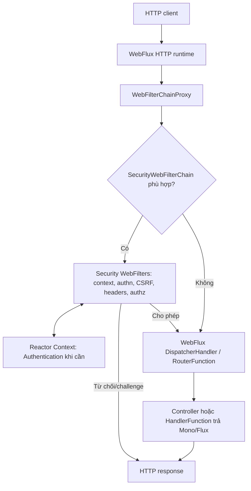

# ServerHttpSecurity và SecurityWebFilterChain trong ứng dụng WebFlux

## Mục tiêu học tập

Khi dùng Spring MVC trên Servlet, bạn thường khai báo `SecurityFilterChain` bằng `HttpSecurity`. Khi chuyển sang **Spring WebFlux**, bộ API tương ứng là **`ServerHttpSecurity` và `SecurityWebFilterChain`**. Tên trông giống nhau, nhưng điểm nối vào HTTP request, loại filter, cách mang security context và phong cách lập trình không giống hệt.

Sau bài này bạn có thể:

1. Phân biệt **Servlet/MVC security** và **WebFlux/reactive security**, tránh nhầm `HttpSecurity` với `ServerHttpSecurity`.
2. Giải thích quan hệ giữa `ServerHttpSecurity`, `SecurityWebFilterChain`, `WebFilterChainProxy`, `SecurityWebFiltersOrder` và `ServerWebExchange`.
3. Tạo bean `SecurityWebFilterChain` để định nghĩa `permitAll`, `authenticated`, `hasRole` và `denyAll` theo URL/method bằng **`authorizeExchange`**.
4. Đọc danh tính từ `ReactiveSecurityContextHolder` và hiểu lý do **Reactor Context** quan trọng hơn giả định một request luôn chạy trên một thread.
5. Tạo hai tài khoản học tập bằng `MapReactiveUserDetailsService` và `PasswordEncoder`, sử dụng HTTP Basic để quan sát 200/401/403.
6. Kiểm thử cấu hình WebFlux bằng **`WebTestClient`**, có cả trường hợp ẩn danh, sai mật khẩu và thiếu quyền.
7. Biết khi nào cần nhiều security chains, `securityMatcher`, reactive method security, CSRF, CORS, OAuth2 resource server và cách xử lý các thành phần blocking.

Ví dụ chạy được trong bài sử dụng **Java 17, Spring Boot 3.5.0, Spring Security 6.5.x, Spring WebFlux và Maven**. Chọn bản vá Boot/Security còn được hỗ trợ khi tạo dự án thực tế; đây là bộ phiên bản minh họa có chủ đích, không phải yêu cầu khóa phiên bản lâu dài. Lab dùng HTTP Basic và password giả trên **localhost** để dễ quan sát; không dùng credentials này trên hệ thống thật.

## 1. Đúng stack trước khi cấu hình bảo mật

**Spring WebFlux** là web stack reactive của Spring Framework, dùng `Publisher` từ Reactive Streams, phổ biến dưới dạng `Mono<T>` và `Flux<T>` của Project Reactor. WebFlux có thể xử lý HTTP request theo mô hình non-blocking, hỗ trợ controller dạng annotation và functional routes.

**Spring MVC** là web stack dựa trên Servlet API. Cả hai có `@RestController`, `@GetMapping` và nhiều khái niệm web chung, nhưng hạ tầng request và security filters khác nhau.

| Câu hỏi | Spring MVC / Servlet | Spring WebFlux / Reactive |
| --- | --- | --- |
| Starter web chính | `spring-boot-starter-web` | `spring-boot-starter-webflux` |
| HTTP processing | Servlet container, `DispatcherServlet` | Reactive web runtime, `DispatcherHandler` |
| Filter | `jakarta.servlet.Filter` | `org.springframework.web.server.WebFilter` |
| Security chain bean | `SecurityFilterChain` | `SecurityWebFilterChain` |
| Bộ dựng cấu hình | `HttpSecurity` | `ServerHttpSecurity` |
| Nơi gom/chọn chain | Servlet `FilterChainProxy` | Reactive `WebFilterChainProxy` |
| URL authorization DSL | `authorizeHttpRequests` + `requestMatchers` | `authorizeExchange` + `pathMatchers` |
| Security context thường dùng | `SecurityContextHolder`, mặc định theo thread trong Servlet | `ReactiveSecurityContextHolder`, Reactor Context |
| Manager xác thực phổ biến | `AuthenticationManager` / `AuthenticationProvider` | `ReactiveAuthenticationManager` và reactive components |
| Service tải người dùng | `UserDetailsService` | `ReactiveUserDetailsService` |
| Kiểm thử web | `MockMvc` | `WebTestClient` |
| Bật method security | `@EnableMethodSecurity` | `@EnableReactiveMethodSecurity` |

Không thay tên `HttpSecurity` thành `ServerHttpSecurity` rồi giữ mọi import, filter và lệnh cấu hình cũ. Khi code trả `Mono`/`Flux`, còn phải hiểu ngữ cảnh bảo mật và nguồn dữ liệu hoạt động trong reactive chain.

### 1.1. Chú ý khi thêm đồng thời hai web starters

Spring Boot mặc định **chọn Spring MVC** nếu cả `spring-boot-starter-web` và `spring-boot-starter-webflux` cùng nằm trên classpath. Một dự án Servlet có thể thêm WebFlux để dùng `WebClient` nhưng vẫn là **ứng dụng MVC**.

Nếu bạn muốn học chính xác `SecurityWebFilterChain`, dự án lab dưới đây chỉ khai báo `spring-boot-starter-webflux` cùng `spring-boot-starter-security`. Không cần thêm `spring-boot-starter-web`.

Kiểm tra dự án đang chạy stack nào qua dependency tree, loại `ApplicationContext`, log startup, các bean web và cấu hình mà Boot đã chọn. Không suy loại ứng dụng chỉ từ việc thấy dependency `reactor-core` hoặc một service method trả `Mono`.

### 1.2. Reactive không đồng nghĩa luôn có Netty

Boot với WebFlux starter thường chạy trên Reactor Netty mặc định. WebFlux có thể vận hành trên một số HTTP runtime khác tương thích. Điều cần phân biệt là **mô hình web reactive và chuỗi `WebFilter`**, không phải tên web server.

Tương tự, việc một controller trả `Mono` không tự bảo đảm toàn bộ đường xử lý non-blocking. Nếu bên trong `map(...)` bạn gọi JDBC đồng bộ, HTTP client đồng bộ hoặc `Thread.sleep(...)`, vẫn có nguy cơ chặn event-loop.

## 2. ServerHttpSecurity và SecurityWebFilterChain làm gì?

### 2.1. `ServerHttpSecurity` là bộ dựng cấu hình

`org.springframework.security.config.web.server.ServerHttpSecurity` là API DSL cho WebFlux. Nó cho phép chọn quy tắc request, cơ chế authentication, headers, CSRF, CORS, login, logout, exception handling và một số cơ chế khác theo phiên bản.

Bạn thường tiêm `ServerHttpSecurity` vào bean factory method:

```java
@Bean
SecurityWebFilterChain securityWebFilterChain(ServerHttpSecurity http) {
    return http
        .authorizeExchange(exchanges -> exchanges
            .pathMatchers("/public/**").permitAll()
            .anyExchange().authenticated()
        )
        .httpBasic(Customizer.withDefaults())
        .build();
}
```

Đây là **một fragment**: nó cần đặt trong lớp `@Configuration` và import các type liên quan. Nó cho thấy API cốt lõi, không phải project đầy đủ. `Customizer` thuộc `org.springframework.security.config.Customizer`.

- `http` là cấu hình/build DSL, không phải một HTTP request.
- `authorizeExchange(...)` khai báo **quy tắc phân quyền các `ServerWebExchange`**.
- `pathMatchers(...)` chọn những path cần áp rule.
- `httpBasic(...)` bật xác thực HTTP Basic khi phù hợp.
- `build()` tạo `SecurityWebFilterChain`, một **bean cấu hình filter chain**, để hạ tầng reactive security dùng lúc có request.

### 2.2. `SecurityWebFilterChain` là gì?

`SecurityWebFilterChain` mô tả:

- Chain này áp dụng với **những exchange nào**, thường qua `ServerWebExchangeMatcher`.
- Những **`WebFilter` bảo mật** nào phải chạy khi exchange phù hợp.

Trong chương trình web, Spring Security cung cấp một `WebFilterChainProxy` chọn chain phù hợp rồi chạy các security filters. Các filter có thể làm những việc như thiết lập/ngăn chặn request theo HTTPS policy, đọc security context, xác thực credentials, xử lý CSRF, ghi security headers, xử lý ngoại lệ, kiểm tra quyền URL.

**Tên gần giống nhưng type khác:**

- Servlet: `SecurityFilterChain` gồm `jakarta.servlet.Filter`.
- WebFlux: `SecurityWebFilterChain` gồm `org.springframework.web.server.WebFilter`.

Bạn không cần tự khai báo `WebFilterChainProxy` trong lab chỉ để bật Security; Boot và `@EnableWebFluxSecurity` cung cấp phần tích hợp tương ứng. Nhu cầu chính là đưa ra policy đúng cho ứng dụng.

### 2.3. `ServerWebExchange` mang gì?

`ServerWebExchange` đại diện bối cảnh một HTTP exchange trong Spring WebFlux: request, response, attributes, principal/session khi thích hợp và các thành phần liên quan.

Mô hình tổng quát:



Sơ đồ rút gọn đường đi, **không phải danh sách thứ tự từng WebFilter**. Thứ tự và điều kiện filter phụ thuộc cấu hình. Một request không khớp bất kỳ security chain nào có thể không được bảo vệ bởi các security filters dự kiến, vì vậy thiết kế nhiều chain cần có chain bắt phần còn lại khi cần.

### 2.4. `WebFilterChainProxy` và `SecurityWebFiltersOrder`

`SecurityWebFiltersOrder` là enum đại diện những vị trí có ý nghĩa trong reactive security filter chain. Nếu có nhu cầu thêm security WebFilter chuyên dụng, bạn có thể thấy các phương thức `addFilterBefore(...)`, `addFilterAt(...)` hoặc `addFilterAfter(...)` trên `ServerHttpSecurity`.

Không tùy tiện đặt một filter đọc hoặc sửa `Authentication` phía sau bước authorization rồi kỳ vọng chính sách phía trước tự cập nhật. Với người mới học, nên sử dụng cấu hình authentication/authorization có sẵn, chỉ viết filter custom khi thật sự cần một cơ chế mà framework chưa cung cấp.

## 3. Chính sách URL: authorizeExchange và pathMatchers

Cấu hình rõ ràng thường có các lớp sau:

```java
http.authorizeExchange(exchanges -> exchanges
    .pathMatchers("/public/**").permitAll()
    .pathMatchers("/admin/**").hasRole("ADMIN")
    .pathMatchers("/api/**").authenticated()
    .anyExchange().denyAll()
);
```

Đây là **fragment của DSL `ServerHttpSecurity`**, không phải code chạy độc lập.

| Quy tắc | Kết quả mong muốn |
| --- | --- |
| `permitAll()` | Exchange phù hợp được phép đi tiếp mà không cần user đăng nhập. |
| `authenticated()` | Cần danh tính đã xác thực hợp lệ. |
| `hasRole("ADMIN")` | Cần authority `ROLE_ADMIN` với default prefix thông thường. |
| `hasAuthority("REPORT_READ")` | Cần đúng authority `REPORT_READ`. |
| `denyAll()` | Từ chối, kể cả nếu người gọi đã đăng nhập. |
| `anyExchange()` | Fallback cho exchange chưa khớp rule phía trên. |

### 3.1. Thứ tự match có ý nghĩa

Nếu `/api/**` với `authenticated()` đứng trước `/api/admin/**` với `hasRole("ADMIN")`, rule rộng có thể khớp trước và ngăn rule admin được xét. Hãy đặt rule cụ thể trước rồi tới rule tổng quát.

Tương tự, đừng đặt `pathMatchers("/**").permitAll()` trước các rule bảo vệ rồi mong các rule sau vẫn áp dụng.

Mức “cho phép request đi qua” **không tự trao quyền đọc mọi dòng dữ liệu**. Với `GET /api/orders/123`, service/DB vẫn phải kiểm tra order thuộc người gọi hay tenant hợp lệ, kể cả request đã qua `authenticated()`.

### 3.2. HTTP method cũng là một phần của policy

`pathMatchers` có overload nhận `HttpMethod`. Ví dụ:

```java
import org.springframework.http.HttpMethod;

// Fragment trong authorizeExchange(...)
.pathMatchers(HttpMethod.GET, "/public/catalog").permitAll()
.pathMatchers(HttpMethod.GET, "/api/me").authenticated()
.anyExchange().denyAll()
```

Các request `POST /public/catalog` không được phép chỉ vì `GET` của cùng path đã public. Khi có endpoint ghi dữ liệu, phải xem xét cả CSRF, validation và quyền với object.

### 3.3. `pathMatchers` khác `securityMatcher`

Hai cấp chọn rất dễ nhầm:

1. **`ServerHttpSecurity.securityMatcher(...)`** giới hạn **SecurityWebFilterChain nào áp dụng cho một exchange**.
2. **`authorizeExchange(...).pathMatchers(...)`** chọn **quy tắc authorization bên trong chain đã được chọn**.

Một chain có `securityMatcher` không khớp sẽ không chạy cho request đó, nên rule `anyExchange()` trong chain ấy cũng không giúp bảo vệ request ngoài phạm vi của chain.

Hãy hình dung:

```text
GET /api/me
   |
   v
WebFilterChainProxy
   |
   +--> SecurityWebFilterChain #1 có securityMatcher("/admin/**")?
   |       Không
   |
   +--> SecurityWebFilterChain #2 bắt các đường còn lại?
           Có
           |
           v
        authorizeExchange:
          /public/** -> permitAll
          /api/**    -> authenticated
          any        -> denyAll
```

Với một ứng dụng mới, **một chain bao phủ tất cả** thường đơn giản và giảm rủi ro hơn. Nếu có nhiều chain cho API, UI, actuator hoặc tài nguyên bên ngoài, dùng `@Order` có chủ đích, các matcher ít chồng lấp và test cả những URL không khớp chain nào.

### 3.4. Phân biệt Authentication với Authorization

- **Authentication:** request đại diện cho ai? Basic credentials, form login/session, bearer token...
- **Authorization:** người đó có đủ quyền với exchange và thao tác không?

HTTP status thường gặp khi cấu hình Basic:

- **200 OK:** request được phép và handler chạy thành công.
- **401 Unauthorized:** chưa xác thực hoặc credentials sai; có thể kèm `WWW-Authenticate`.
- **403 Forbidden:** đã xác thực nhưng thiếu quyền; cũng có thể do CSRF hoặc một kiểm tra bảo mật khác.

Trong web app dùng form login, người chưa đăng nhập có thể nhận **302** tới trang đăng nhập. Không cố suy 401/403/302 chỉ từ tên `pathMatchers`; còn phụ thuộc authentication entry point, trạng thái principal và exception handling.

## 4. Reactive SecurityContext: khác biệt quan trọng nhất khi chuyển từ Servlet

### 4.1. Vì sao `SecurityContextHolder` theo thread không đủ?

Servlet thường xử lý một đoạn request trong một luồng có security context gắn với thread. Reactive execution có thể chuyển qua nhiều thread trong cùng pipeline, sử dụng event-loop, scheduler hoặc asynchronous operations. Việc tùy tiện lấy `SecurityContextHolder.getContext()` bên trong một callback không bảo đảm nhận đúng user trong mọi trường hợp WebFlux.

Spring Security reactive sử dụng **Reactor Context** để truyền dữ liệu bảo mật theo **subscription**, không cần giả định một request cố định trên một thread.

API thường dùng:

```java
import org.springframework.security.core.context.ReactiveSecurityContextHolder;
import org.springframework.security.core.context.SecurityContext;
import reactor.core.publisher.Mono;

Mono<String> currentUsername =
    ReactiveSecurityContextHolder.getContext()
        .map(SecurityContext::getAuthentication)
        .map(authentication -> authentication.getName());
```

Đây là fragment; trong lab hoàn chỉnh ở mục 6, controller gọi biểu thức này như một phần của một reactive pipeline do WebFlux subscribe.

### 4.2. Subscription và context propagation

Một `Mono<String>` mô tả công việc sẽ xảy ra khi có subscription. Tạo `Mono` chưa đồng nghĩa request đã xử lý xong; Spring WebFlux thực hiện subscribe đúng vào response pipeline.

**Không tự gọi `.block()` bên trong controller hoặc security callback trên event-loop.** Việc block có thể ảnh hưởng latency, throughput và đôi khi sinh lỗi trên non-blocking thread.

**Không tự gọi `.subscribe()` để kích hoạt thao tác nghiệp vụ** rồi trả response trước. Cách này tách vòng đời công việc khỏi request, có thể làm mất liên kết với cancellation, error handling, security context và transaction context. Hãy **trả `Mono`/`Flux`** và nối các bước bằng `map`, `flatMap`, `then`, `onErrorResume` phù hợp.

### 4.3. Điều gì xảy ra nếu service dùng blocking repository?

Giả sử controller:

```java
@GetMapping("/orders/{id}")
Mono<Order> getOrder(@PathVariable long id) {
    return Mono.just(repository.findById(id).orElseThrow());
}
```

Đây là **fragment minh họa sai chỗ blocking**; `repository` và `Order` chưa được định nghĩa. `repository.findById(...)` được gọi ngay khi tạo `Mono.just(...)`, có thể chặn event-loop. Khi dùng JDBC/JPA đồng bộ trong một ứng dụng WebFlux, cần thiết kế ranh giới scheduler/worker phù hợp và hiểu giới hạn; với workload thật sự reactive có thể chọn driver/client reactive như R2DBC theo yêu cầu.

Việc dùng `Mono.fromCallable(...).subscribeOn(Schedulers.boundedElastic())` có thể cách ly một thao tác blocking legacy trong một số trường hợp, nhưng không biến JDBC thành non-blocking, không loại bỏ vấn đề tải lớn và không miễn kiểm soát transaction/security context. Không thêm scheduler tùy tiện chỉ để làm hết cảnh báo.

## 5. Sự khác nhau giữa thành phần authentication reactive và servlet

Khi dùng username/password trong WebFlux, thường có những thành phần:

| Thành phần reactive | Vai trò | Gần tương ứng ở Servlet |
| --- | --- | --- |
| `ReactiveUserDetailsService` | Tải user bằng `Mono<UserDetails>` | `UserDetailsService` |
| `MapReactiveUserDetailsService` | Giữ user mẫu trong bộ nhớ để học | `InMemoryUserDetailsManager` |
| `ReactiveAuthenticationManager` | Xác minh một `Authentication` theo reactive contract | `AuthenticationManager` |
| `UserDetailsRepositoryReactiveAuthenticationManager` | Dùng user details và password encoder trong một kiểu xác thực username/password | `DaoAuthenticationProvider` trong nhiều thiết kế |
| `PasswordEncoder` | Hash/đối chiếu password; interface này dùng chung | `PasswordEncoder` |
| `ReactiveSecurityContextHolder` | Đọc authentication từ Reactor Context | `SecurityContextHolder` |
| `AuthenticationWebFilter` và filter tương ứng | Tích hợp đăng nhập vào reactive WebFilter chain | Servlet authentication filters |

**MapReactiveUserDetailsService không phải database.** Mỗi instance giữ dữ liệu riêng trong bộ nhớ; không tự đồng bộ giữa nhiều node và không cung cấp đầy đủ lifecycle user/secret trong sản phẩm thật.

Đối với form login, Basic auth, OAuth2/JWT và token, Spring Security sử dụng cách cấu hình và các bộ lọc tương ứng. Dù cùng là reactive, cách xác minh bearer JWT **không** phải gọi `PasswordEncoder.matches(...)` trên token; password encoder được dùng cho mật khẩu gốc theo cơ chế tương ứng.

## 6. Lab chạy được: Spring WebFlux với SecurityWebFilterChain

Bài lab có bốn endpoint:

| Endpoint | URL rule | Phần kiểm tra bổ sung |
| --- | --- | --- |
| `GET /public/ping` | `permitAll` | Không cần đăng nhập; body `pong`. |
| `GET /api/me` | `authenticated` | Trả username từ Reactive SecurityContext. |
| `GET /admin/ping` | `hasRole("ADMIN")` | Chỉ tài khoản admin nhận `admin-only`. |
| `GET /api/reports` | `authenticated` | Service có `@PreAuthorize("hasRole('ADMIN')")` nên user thường vẫn bị 403. |
| Các request còn lại | `denyAll` | Không tự mở endpoint mới. |

Hai tài khoản demo:

- `learner` / `learner-pass`: có `ROLE_USER`.
- `admin` / `admin-pass`: có `ROLE_USER` và `ROLE_ADMIN`.

Tất cả credentials trong bài chỉ phục vụ máy local. Không lưu plaintext password hoặc credentials cố định trong source của hệ thống thật.

### 6.1. Cấu trúc thư mục

```text
webflux-security-lab/
├── pom.xml
└── src/
    ├── main/java/com/example/reactivesecurity/
    │   ├── ReactiveSecurityApplication.java
    │   ├── ReactiveSecurityConfig.java
    │   ├── ReportService.java
    │   └── ApiController.java
    └── test/java/com/example/reactivesecurity/
        └── WebFluxSecurityIntegrationTest.java
```

### 6.2. Maven `pom.xml`

```xml
<project xmlns="http://maven.apache.org/POM/4.0.0"
         xmlns:xsi="http://www.w3.org/2001/XMLSchema-instance"
         xsi:schemaLocation="http://maven.apache.org/POM/4.0.0 https://maven.apache.org/xsd/maven-4.0.0.xsd">
    <modelVersion>4.0.0</modelVersion>

    <parent>
        <groupId>org.springframework.boot</groupId>
        <artifactId>spring-boot-starter-parent</artifactId>
        <version>3.5.0</version>
        <relativePath/>
    </parent>

    <groupId>com.example</groupId>
    <artifactId>webflux-security-lab</artifactId>
    <version>1.0.0</version>

    <properties>
        <java.version>17</java.version>
    </properties>

    <dependencies>
        <dependency>
            <groupId>org.springframework.boot</groupId>
            <artifactId>spring-boot-starter-webflux</artifactId>
        </dependency>
        <dependency>
            <groupId>org.springframework.boot</groupId>
            <artifactId>spring-boot-starter-security</artifactId>
        </dependency>
        <dependency>
            <groupId>org.springframework.boot</groupId>
            <artifactId>spring-boot-starter-test</artifactId>
            <scope>test</scope>
        </dependency>
        <dependency>
            <groupId>org.springframework.security</groupId>
            <artifactId>spring-security-test</artifactId>
            <scope>test</scope>
        </dependency>
    </dependencies>

    <build>
        <plugins>
            <plugin>
                <groupId>org.springframework.boot</groupId>
                <artifactId>spring-boot-maven-plugin</artifactId>
            </plugin>
        </plugins>
    </build>
</project>
```

`spring-boot-starter-webflux` cung cấp nền tảng WebFlux/reactor cho server, còn `spring-boot-starter-security` cung cấp Spring Security và khả năng tích hợp. `spring-security-test` hỗ trợ các test/mutator bảo mật cho WebTestClient. Parent/BOM của Boot quản lý các phiên bản phụ thuộc tương thích.

**Không thêm `spring-boot-starter-web` vào file này**, vì Boot có thể chọn MVC như đã giải thích. Kiểm tra cây dependency bằng `mvn dependency:tree` nếu ứng dụng không vận hành theo stack bạn dự kiến.

### 6.3. `ReactiveSecurityApplication.java`

```java
package com.example.reactivesecurity;

import org.springframework.boot.SpringApplication;
import org.springframework.boot.autoconfigure.SpringBootApplication;

@SpringBootApplication
public class ReactiveSecurityApplication {
    public static void main(String[] args) {
        SpringApplication.run(ReactiveSecurityApplication.class, args);
    }
}
```

`@SpringBootApplication` kích hoạt thành phần của Boot và quét các bean trong package `com.example.reactivesecurity`. Đây là lớp khởi động chung, không tự viết policy URL. Các bean Security phía dưới làm việc đó.

### 6.4. `ReactiveSecurityConfig.java`

```java
package com.example.reactivesecurity;

import org.springframework.context.annotation.Bean;
import org.springframework.context.annotation.Configuration;
import org.springframework.http.HttpMethod;
import org.springframework.security.config.Customizer;
import org.springframework.security.config.annotation.method.configuration.EnableReactiveMethodSecurity;
import org.springframework.security.config.annotation.web.reactive.EnableWebFluxSecurity;
import org.springframework.security.config.web.server.ServerHttpSecurity;
import org.springframework.security.core.userdetails.MapReactiveUserDetailsService;
import org.springframework.security.core.userdetails.User;
import org.springframework.security.core.userdetails.UserDetails;
import org.springframework.security.crypto.factory.PasswordEncoderFactories;
import org.springframework.security.crypto.password.PasswordEncoder;
import org.springframework.security.web.server.SecurityWebFilterChain;

@Configuration(proxyBeanMethods = false)
@EnableWebFluxSecurity
@EnableReactiveMethodSecurity
public class ReactiveSecurityConfig {

    @Bean
    PasswordEncoder passwordEncoder() {
        return PasswordEncoderFactories.createDelegatingPasswordEncoder();
    }

    @Bean
    MapReactiveUserDetailsService reactiveUsers(PasswordEncoder encoder) {
        UserDetails learner = User.withUsername("learner")
            .password(encoder.encode("learner-pass"))
            .roles("USER")
            .build();

        UserDetails admin = User.withUsername("admin")
            .password(encoder.encode("admin-pass"))
            .roles("USER", "ADMIN")
            .build();

        return new MapReactiveUserDetailsService(learner, admin);
    }

    @Bean
    SecurityWebFilterChain securityWebFilterChain(ServerHttpSecurity http) {
        return http
            .authorizeExchange(exchanges -> exchanges
                .pathMatchers(HttpMethod.GET, "/public/ping").permitAll()
                .pathMatchers(HttpMethod.GET, "/admin/ping").hasRole("ADMIN")
                .pathMatchers(HttpMethod.GET, "/api/me").authenticated()
                .pathMatchers(HttpMethod.GET, "/api/reports").authenticated()
                .anyExchange().denyAll()
            )
            .httpBasic(Customizer.withDefaults())
            .formLogin(ServerHttpSecurity.FormLoginSpec::disable)
            .build();
    }
}
```

Phân tích:

1. `@EnableWebFluxSecurity` bật cấu hình web security reactive theo Spring Security. Spring Boot cũng có auto-configuration WebFlux security theo điều kiện; ta khai báo tường minh để người học thấy rõ loại stack.
2. `@EnableReactiveMethodSecurity` bật method security cho các bean trả Publisher. Nếu bỏ annotation này, chỉ dựa vào URL rule thì `@PreAuthorize` trong service có thể không bảo vệ như mong đợi.
3. `PasswordEncoderFactories.createDelegatingPasswordEncoder()` tạo một delegating encoder; cấu hình mặc định cho hash mới trong dòng Security này dùng bcrypt. Mật khẩu demo được encode khi tạo user.
4. `MapReactiveUserDetailsService` là nguồn danh tính reactive dùng trong lab. Nó nhận `UserDetails` đã chứa hash; không lưu vào DB.
5. `ServerHttpSecurity.authorizeExchange` chọn rule theo HTTP method và path. Rule cụ thể đứng trước `anyExchange().denyAll()`.
6. `httpBasic(Customizer.withDefaults())` bật Basic auth. `formLogin(...disable)` tắt form login trong lab để request không đăng nhập nhận Basic challenge dễ kiểm thử. **Không tắt CSRF** hoặc headers mặc định.
7. `SecurityWebFilterChain` là bean đã build, dùng cho HTTP exchange của WebFlux. Việc khai báo bean này khiến chain web mặc định tương ứng của Boot nhường chỗ; các phần tích hợp bảo mật vẫn hoạt động.

**Cảnh báo:** HTTP Basic tạo header chứa credentials Base64, không phải mã hóa bí mật. Chỉ dùng qua HTTPS bên ngoài localhost. Tên và password cố định trong Java source là dữ liệu test, không phải hệ thống quản lý danh tính production.

### 6.5. `ReportService.java`: minh họa reactive method security

```java
package com.example.reactivesecurity;

import org.springframework.security.access.prepost.PreAuthorize;
import org.springframework.stereotype.Service;

import reactor.core.publisher.Mono;

@Service
public class ReportService {

    @PreAuthorize("hasRole('ADMIN')")
    public Mono<String> getRestrictedReport() {
        return Mono.just("restricted-report");
    }
}
```

Điểm có giá trị học tập:

- `@PreAuthorize` của **reactive method security** được xử lý khi lời gọi đi qua Spring-managed bean/proxy.
- Spring Security dùng authentication trong reactive context để đánh giá quyền.
- `Mono<String>` cho phép kết quả tích hợp vào pipeline, thay vì gọi `block()`.
- User `learner` có `ROLE_USER` nên HTTP rule `authenticated()` cho qua `/api/reports`, nhưng **method security từ chối** vì thiếu `ROLE_ADMIN`.
- User `admin` có `ROLE_ADMIN` nên được phép.

Đây là service trả dữ liệu tĩnh để minh họa, không có DB. Trong hệ thống thật, kiểm tra quyền còn cần owner/tenant của tài nguyên ở service/repository và chính sách trước các thao tác có tác dụng phụ. Method security qua proxy có hạn chế về self-invocation; việc một method trong cùng bean gọi `this.securedMethod()` có thể không qua interceptor.

### 6.6. `ApiController.java`: ReactiveSecurityContextHolder và route

```java
package com.example.reactivesecurity;

import java.util.Map;

import org.springframework.security.core.context.ReactiveSecurityContextHolder;
import org.springframework.security.core.context.SecurityContext;
import org.springframework.web.bind.annotation.GetMapping;
import org.springframework.web.bind.annotation.RestController;

import reactor.core.publisher.Mono;

@RestController
public class ApiController {

    private final ReportService reports;

    public ApiController(ReportService reports) {
        this.reports = reports;
    }

    @GetMapping("/public/ping")
    public Mono<String> ping() {
        return Mono.just("pong");
    }

    @GetMapping("/api/me")
    public Mono<Map<String, String>> me() {
        return ReactiveSecurityContextHolder.getContext()
            .map(SecurityContext::getAuthentication)
            .map(authentication -> Map.of(
                "username", authentication.getName()
            ));
    }

    @GetMapping("/admin/ping")
    public Mono<String> adminPing() {
        return Mono.just("admin-only");
    }

    @GetMapping("/api/reports")
    public Mono<String> report() {
        return reports.getRestrictedReport();
    }
}
```

**Vì sao `/api/me` quan trọng?** Nó lấy `Authentication` thông qua `ReactiveSecurityContextHolder.getContext()` bên trong chính reactive pipeline của request. Cơ chế này tương thích với security context được truyền bằng Reactor Context; không giả định callback luôn chạy trên một thread cụ thể.

Nếu bạn có một method trong service cần username, có thể truyền principal từ controller theo chính sách rõ ràng hoặc dùng reactive context với đúng ngữ cảnh subscription. Đừng lấy username từ `?user=...` hoặc header `X-User` do client tùy ý gửi để thay thế authentication đã kiểm chứng.

### 6.7. Chạy ứng dụng và quan sát bằng curl

Yêu cầu JDK 17+ và Maven:

```bash
java -version
mvn -version
mvn spring-boot:run
```

Mở terminal khác để gọi:

```bash
curl -i http://localhost:8080/public/ping
curl -i http://localhost:8080/api/me
curl -i -u learner:learner-pass http://localhost:8080/api/me
curl -i -u learner:wrong-pass http://localhost:8080/api/me
curl -i -u learner:learner-pass http://localhost:8080/admin/ping
curl -i -u admin:admin-pass http://localhost:8080/admin/ping
curl -i -u learner:learner-pass http://localhost:8080/api/reports
curl -i -u admin:admin-pass http://localhost:8080/api/reports
```

Trên PowerShell, dùng `curl.exe` nếu `curl` đang là alias của `Invoke-WebRequest`. HTTP status và body mong đợi với chính cấu hình trên:

| Request | Status | Body / ý nghĩa |
| --- | --- | --- |
| Anonymous `GET /public/ping` | **200** | `pong`; public. |
| Anonymous `GET /api/me` | **401** | Cần HTTP Basic authentication. |
| Learner đúng password, `GET /api/me` | **200** | JSON `{"username":"learner"}`. |
| Learner sai password, `GET /api/me` | **401** | Xác thực thất bại trước controller. |
| Learner `GET /admin/ping` | **403** | Đã xác thực nhưng không có `ROLE_ADMIN`. |
| Admin `GET /admin/ping` | **200** | `admin-only`. |
| Learner `GET /api/reports` | **403** | HTTP rule cho qua, nhưng `@PreAuthorize` ở service từ chối. |
| Admin `GET /api/reports` | **200** | `restricted-report`. |

Header như `WWW-Authenticate`, cache-control và security headers phụ thuộc cấu hình/security runtime. Basic có thể gửi `WWW-Authenticate` khi 401. Không dùng response được liệt kê làm ảnh chụp nguyên văn của một server đã chạy; đây là **kết quả dự kiến** để bạn tự kiểm chứng.

## 7. Kiểm thử tự động bằng WebTestClient

`WebTestClient` được thiết kế cho HTTP/reactive web testing. Với `@SpringBootTest(webEnvironment = RANDOM_PORT)`, Boot chạy một HTTP server test trên port ngẫu nhiên và cung cấp `WebTestClient` để gửi request thực qua mạng local. Điều này giúp xác nhận Security WebFilter chain hoạt động cùng controller và service.

`@WebFluxTest` hữu ích khi chỉ muốn thử một controller slice, nhưng nếu bạn muốn chứng minh **toàn bộ SecurityWebFilterChain + reactive method security + user service**, test full application context như dưới đây sẽ trực tiếp hơn.

### 7.1. `WebFluxSecurityIntegrationTest.java`

```java
package com.example.reactivesecurity;

import org.junit.jupiter.api.Test;
import org.springframework.beans.factory.annotation.Autowired;
import org.springframework.boot.test.context.SpringBootTest;
import org.springframework.test.web.reactive.server.WebTestClient;

@SpringBootTest(
    webEnvironment = SpringBootTest.WebEnvironment.RANDOM_PORT
)
class WebFluxSecurityIntegrationTest {

    @Autowired
    WebTestClient client;

    @Test
    void publicEndpointAllowsAnonymous() {
        client.get().uri("/public/ping")
            .exchange()
            .expectStatus().isOk()
            .expectBody(String.class).isEqualTo("pong");
    }

    @Test
    void meRequiresAuthentication() {
        client.get().uri("/api/me")
            .exchange()
            .expectStatus().isUnauthorized();
    }

    @Test
    void learnerCanReadOwnPrincipal() {
        client.get().uri("/api/me")
            .headers(headers ->
                headers.setBasicAuth("learner", "learner-pass")
            )
            .exchange()
            .expectStatus().isOk()
            .expectBody()
            .jsonPath("$.username").isEqualTo("learner");
    }

    @Test
    void wrongPasswordIsRejected() {
        client.get().uri("/api/me")
            .headers(headers ->
                headers.setBasicAuth("learner", "wrong-pass")
            )
            .exchange()
            .expectStatus().isUnauthorized();
    }

    @Test
    void userCannotAccessAdminRoute() {
        client.get().uri("/admin/ping")
            .headers(headers ->
                headers.setBasicAuth("learner", "learner-pass")
            )
            .exchange()
            .expectStatus().isForbidden();
    }

    @Test
    void adminCanAccessAdminRoute() {
        client.get().uri("/admin/ping")
            .headers(headers ->
                headers.setBasicAuth("admin", "admin-pass")
            )
            .exchange()
            .expectStatus().isOk()
            .expectBody(String.class).isEqualTo("admin-only");
    }

    @Test
    void methodSecurityRejectsOrdinaryUser() {
        client.get().uri("/api/reports")
            .headers(headers ->
                headers.setBasicAuth("learner", "learner-pass")
            )
            .exchange()
            .expectStatus().isForbidden();
    }

    @Test
    void adminPassesMethodSecurity() {
        client.get().uri("/api/reports")
            .headers(headers ->
                headers.setBasicAuth("admin", "admin-pass")
            )
            .exchange()
            .expectStatus().isOk()
            .expectBody(String.class).isEqualTo("restricted-report");
    }

    @Test
    void unlistedRouteDoesNotBecomePublic() {
        client.get().uri("/unlisted")
            .exchange()
            .expectStatus().isUnauthorized();
    }
}
```

**Điểm cần hiểu ở test cuối:** `anyExchange().denyAll()` từ chối exchange trước khi MVC/WebFlux handler xác định 404. Với anonymous, exception handling có thể dùng authentication entry point để trả 401 (do HTTP Basic); với principal đã xác thực, policy `denyAll` thường trả 403. Không bắt buộc mọi URL chưa tồn tại phải là 404 nếu policy cố tình chặn từ sớm.

Chạy:

```bash
mvn test
```

Trong ví dụ này có **9 test cases**. Kỳ vọng tất cả pass nếu code, dependencies và môi trường đúng. Đây là **kỳ vọng thiết kế**, không phải khẳng định đã chạy Maven trên máy của bạn. Nếu một test fail, xem actual status và logs của WebFilter chain trước khi thay đổi policy.

### 7.2. Dùng `spring-security-test` với WebTestClient

Ngoài Basic credentials thực, thư viện `spring-security-test` hỗ trợ mô phỏng authentication bằng các mutator reactive:

```java
import static org.springframework.security.test.web.reactive.server
    .SecurityMockServerConfigurers.mockUser;

// Fragment khi WebTestClient đã có Spring Security test support:
webTestClient.mutateWith(mockUser().roles("ADMIN"))
    .get().uri("/admin/ping")
    .exchange()
    .expectStatus().isOk();
```

Đây là fragment; khi bind thủ công `WebTestClient` với `ApplicationContext`, cần áp dụng `springSecurity()` test configurer phù hợp. `mockUser()` kiểm thử authorization bằng principal giả lập và **không chứng minh password encoder đã kiểm tra mật khẩu đúng/sai**. Vì vậy các test chính phía trên sử dụng Basic credentials thật qua full running server.

## 8. Nhiều SecurityWebFilterChain và securityMatcher

Ứng dụng có thể tách chính sách API, web UI, actuator hoặc kênh đặc biệt thành nhiều chains. Nguyên tắc:

- Dùng `@Order` để quyết định chain ưu tiên.
- Mỗi chain có `securityMatcher` giới hạn phạm vi khi cần.
- Chain được chọn phải có các rule `authorizeExchange` phù hợp.
- Có policy bao phủ request không thuộc chain chuyên biệt nếu bạn muốn mọi request đều được Spring Security bảo vệ.
- Test các path giao nhau, các method HTTP khác nhau, redirect và ERROR handling.

Ví dụ **fragment kiến trúc**, không thay trực tiếp bean `securityWebFilterChain` của lab nếu chưa thiết kế toàn bộ chains:

```java
@Bean
@Order(1)
SecurityWebFilterChain adminChain(ServerHttpSecurity http) {
    return http
        .securityMatcher(
            new PathPatternParserServerWebExchangeMatcher("/admin/**")
        )
        .authorizeExchange(exchanges -> exchanges
            .anyExchange().hasRole("ADMIN")
        )
        .httpBasic(Customizer.withDefaults())
        .build();
}

@Bean
@Order(2)
SecurityWebFilterChain otherChain(ServerHttpSecurity http) {
    return http
        .authorizeExchange(exchanges -> exchanges
            .pathMatchers("/public/**").permitAll()
            .anyExchange().authenticated()
        )
        .httpBasic(Customizer.withDefaults())
        .build();
}
```

Đoạn trên cần thêm imports `org.springframework.core.annotation.Order` và `org.springframework.security.web.server.util.matcher.PathPatternParserServerWebExchangeMatcher` cùng những thành phần từ phần code đầy đủ. **Nó là ví dụ riêng về chain selection**, không kết hợp nguyên trạng cùng chain của lab và không xác định toàn bộ phương án login/session cho production.

Điểm cần phân biệt: `.securityMatcher(...)` chọn **chain**; `.pathMatchers(...)` chọn **quy tắc** trong chain. Một chain mặc định có `anyExchange().authenticated()` không bảo vệ được URL mà nó không khớp nếu không có chain khác xử lý.

## 9. CSRF trong WebFlux: mặc định bật, không liên quan riêng Servlet

Spring Security reactive hỗ trợ `CsrfWebFilter` và các cơ chế token. **CSRF protection mặc định được bật** trong cấu hình WebFlux Security thông thường. Với ứng dụng sử dụng browser session/cookie hoặc credentials được trình duyệt tự gửi, CSRF có ý nghĩa quan trọng đối với request làm thay đổi trạng thái.

Bài lab chỉ có **GET** để quan sát authorization; vì vậy chúng ta **giữ nguyên CSRF mặc định**, không cần tự gửi token cho các request GET chỉ đọc.

Nếu mở rộng thêm POST/PUT/PATCH/DELETE:

1. Xác định cơ chế credential: browser session cookie, Basic tự động đính kèm, bearer token gửi tường minh hay client server-to-server.
2. Xem request có nguy cơ bị trang ngoài kích hoạt với credentials người dùng không.
3. Định nghĩa nơi lưu/token flow; trong WebFlux, token mặc định có thể nằm trong `WebSession` qua `WebSessionServerCsrfTokenRepository`.
4. Dùng `CsrfWebFilter` và `ServerCsrfTokenRepository` đúng ngữ cảnh nếu cần cấu hình.
5. Kiểm thử request ghi **không có token** và **có token hợp lệ**.
6. Chỉ quyết định tắt CSRF cho một kiến trúc cụ thể sau khi đánh giá thực tế. Một API có JSON body **không tự động miễn CSRF**.

Một ví dụ fragment để custom cookie token trong WebFlux, **không đưa vào lab vì lab không có frontend cần đọc token**:

```java
http.csrf(csrf -> csrf.csrfTokenRepository(
    CookieServerCsrfTokenRepository.withHttpOnlyFalse()
));
```

Fragment này cần import `CookieServerCsrfTokenRepository` từ package reactive của Spring Security. `withHttpOnlyFalse()` cho JavaScript đọc cookie token; chỉ chọn khi thực sự cần JS lấy token theo pattern đã thiết kế. **Không dùng nó cho session cookie chứa credentials**; HttpOnly của session cookie vẫn nên bật khi phù hợp.

Lưu ý CORS không thay thế CSRF: việc browser không cho script đọc response cross-origin không có nghĩa request cross-origin chắc chắn không được gửi hoặc không gây hiệu ứng.

## 10. CORS, cookies, headers và HTTPS trong ServerHttpSecurity

### 10.1. CORS: chính sách origin khác quyền API

Một frontend ở `http://localhost:5173` gọi WebFlux API ở `http://localhost:8080` là **cross-origin** vì port khác. Nếu browser cần đọc response từ API, server phải có CORS policy cho origin/method/header tương ứng, nhưng vẫn phải xác thực và phân quyền request.

WebFlux có cơ chế CORS trong Spring Framework; Spring Security có `ServerHttpSecurity.cors(...)` để tích hợp khi được cấu hình đúng. Có thể đặt CORS ở `CorsWebFilter` hoặc cấu hình framework phù hợp với ứng dụng; cần xác nhận xử lý preflight sớm và tránh cấu hình chồng nhau khó hiểu.

**Đừng dùng `permitAll()` trên mọi route như cách sửa lỗi CORS.** Preflight và policy authentication là những lớp kiểm tra khác nhau. Không phản chiếu tùy ý mọi `Origin` có credentials vào `Access-Control-Allow-Origin`.

### 10.2. Headers bảo mật

Spring Security có các response security headers mặc định cho WebFlux như chống MIME sniffing và cache headers hạn chế lưu response nhạy cảm. `Content-Security-Policy` là chính sách cần được thiết kế theo frontend của ứng dụng; không mặc định nghĩ rằng đã có một CSP phù hợp chỉ vì đã thêm Security starter.

Đối với API chứa dữ liệu user, xem xét `Cache-Control: no-store` và các rule CDN/proxy. Đối với static assets công khai có tên chứa content hash, có thể dùng caching hữu hạn/dài theo tính chất tài nguyên. Không dùng default headers như sự thay thế cho phân quyền dữ liệu.

### 10.3. HTTPS và proxy

Trong production, credentials, session cookie và bearer token cần được truyền qua **HTTPS/TLS**. Khi ứng dụng nằm sau load balancer/reverse proxy, chỉ tin `Forwarded`/`X-Forwarded-*` từ proxy được cấu hình kiểm soát; header do client tùy ý gửi không phải bằng chứng rằng request gốc an toàn.

ServerHttpSecurity hỗ trợ các tùy chỉnh liên quan HTTPS redirect theo phiên bản. Cấu hình TLS còn phụ thuộc reverse proxy, web server, cookie Secure, HSTS và địa chỉ bên ngoài mà browser nhìn thấy. Không copy một cấu hình redirect local vào production mà chưa hiểu kiến trúc proxy.

## 11. OAuth2 resource server / JWT trong WebFlux

WebFlux thường đóng vai API xác minh bearer access token thay vì nhận username/password trực tiếp. Khi đó vẫn dùng `ServerHttpSecurity` và `SecurityWebFilterChain`, nhưng bổ sung tích hợp resource server.

Ví dụ **fragment định hướng, không thuộc project runnable ở mục 6**:

```java
http
    .authorizeExchange(exchanges -> exchanges
        .pathMatchers("/public/**").permitAll()
        .pathMatchers("/api/**").authenticated()
        .anyExchange().denyAll()
    )
    .oauth2ResourceServer(oauth2 ->
        oauth2.jwt(Customizer.withDefaults())
    );
```

Để dùng fragment, cần dependency resource server của Boot phù hợp (ví dụ `spring-boot-starter-oauth2-resource-server` trong thế hệ tương thích) và cấu hình validation cho issuer/JWK theo identity provider tin cậy. Spring Security sẽ xác thực JWT qua các reactive components thích hợp; bạn còn phải kiểm tra **issuer, audience, expiry, scope/authority mapping và yêu cầu nghiệp vụ** theo hệ thống.

**Đừng xem “JWT parse được” là “user được phép đọc mọi dữ liệu”.** Policy HTTP và owner/tenant của object vẫn quan trọng.

Với resource server dùng bearer token do JavaScript chủ động gửi, threat model CSRF có thể khác browser session cookie. Quyết định CSRF vẫn dựa trên cách credentials được lưu và gửi trong thực tế, đặc biệt nếu ứng dụng hỗ trợ đồng thời cookie và token.

## 12. Functional WebFlux routes vẫn chịu SecurityWebFilterChain

WebFlux hỗ trợ cả `@RestController` lẫn functional routes `RouterFunction<ServerResponse>`. SecurityWebFilterChain áp vào HTTP WebFlux exchange **trước handler**, nên policy WebFilter không phụ thuộc việc request được xử lý bởi controller annotation hay handler function.

Ví dụ route functional là fragment độc lập:

```java
@Bean
RouterFunction<ServerResponse> routes() {
    return RouterFunctions.route(
        RequestPredicates.GET("/public/functional"),
        request -> ServerResponse.ok().bodyValue("functional-pong")
    );
}
```

Cần import `RouterFunction`, `ServerResponse`, `RouterFunctions` và `RequestPredicates` từ WebFlux functional API. Nếu dùng thêm fragment trong project lab, **route này sẽ bị `anyExchange().denyAll()` từ chối** cho đến khi bạn khai báo `pathMatchers("/public/functional").permitAll()` ở đúng vị trí.

Điều này thể hiện rõ sự khác biệt giữa **route tồn tại** và **policy cho phép gọi route**; không tự phát sinh rule public chỉ vì tên handler bắt đầu bằng `public`.

## 13. Các lỗi thường gặp và cách nhận diện

### Lỗi 1: Dùng `HttpSecurity` thay vì `ServerHttpSecurity`

Khi dự án là WebFlux, bean `SecurityFilterChain` của Servlet không đại diện WebFlux `SecurityWebFilterChain`. Chọn đúng API, imports và web starter. Đừng copy nguyên cấu hình MVC từ một bài khác.

### Lỗi 2: Thêm cả WebFlux và MVC starter mà không biết Boot chọn gì

Boot thường auto-configure MVC khi có cả hai starter. Kết quả là bạn viết bean reactive nhưng request lại đi qua servlet stack, hoặc không có bean `ServerHttpSecurity` theo dự tính. Kiểm tra dependency tree/web application type.

### Lỗi 3: Copy `authorizeHttpRequests` sang WebFlux

WebFlux DSL là `authorizeExchange` với `pathMatchers`/`anyExchange`. Nó không đổi tên dựa trên cảm tính; phải dùng đúng loại matcher và type để code compile/được thực thi.

### Lỗi 4: Nghĩ `Mono` luôn non-blocking

Một lời gọi JDBC, JPA, file IO hoặc HTTP sync ngay trong reactive lambda vẫn có thể chặn thread. Xem call stack và lựa chọn client/driver reactive hoặc cách ly blocking hợp lý; tránh `block()` trong request handler.

### Lỗi 5: Lấy `SecurityContextHolder.getContext()` trong callback reactive

WebFlux có thể đổi thread, nên ThreadLocal không bảo đảm context người dùng đúng. Đọc từ `ReactiveSecurityContextHolder` và giữ công việc trong cùng reactive pipeline.

### Lỗi 6: Tự gọi `subscribe()` rồi trả HTTP 200

Công việc chạy tách khỏi response, có thể thất bại muộn hoặc mất context/cancellation. Trả `Mono`/`Flux` cho WebFlux subscribe và truyền errors đúng đường.

### Lỗi 7: Tưởng `securityMatcher` và `pathMatchers` giống nhau

Một cái chọn chain, một cái chọn policy bên trong chain. Sai chain matcher có thể khiến route không đi qua chốt bảo mật. Test cả URL không khớp chain chuyên biệt.

### Lỗi 8: Rule `/api/**` đứng trước `/api/admin/**`

Rule rộng có thể bắt trước và làm rule admin không được xét. Đặt rule cụ thể trước, dùng `anyExchange().denyAll()` khi muốn default deny.

### Lỗi 9: Không bật reactive method security nhưng nghĩ `@PreAuthorize` đang chạy

Cần `@EnableReactiveMethodSecurity` và lời gọi qua bean proxy trong thiết kế thông thường. Test 403 tại method khi request HTTP đã qua `authenticated()`.

### Lỗi 10: Dùng `@EnableMethodSecurity` của Servlet thay vì reactive annotation

Khi WebFlux application dùng các reactive Publisher và Reactor Context, bật `@EnableReactiveMethodSecurity` theo API tương ứng. Kiểm tra các giới hạn type/annotation ở phiên bản đang dùng.

### Lỗi 11: Tắt CSRF toàn cục chỉ để POST hết bị 403

Có thể chính CSRF đang bảo vệ browser session. Nếu cần điều chỉnh, xác định cookie/token, các route ghi, loại client và thử nghiệm âm. Không xem JSON hoặc WebFlux là bằng chứng tự miễn CSRF.

### Lỗi 12: Đồng nhất CORS với authentication

CORS quyết định script browser từ origin khác có được đọc response; authentication/authorization quyết định quyền gọi API. Một origin được allow vẫn phải cung cấp credentials và quyền hợp lệ.

### Lỗi 13: Tin rằng `MapReactiveUserDetailsService` đã là user database production

Nó chỉ giữ user trong RAM. Dữ liệu không tự đồng bộ nhiều instance, không tự có reset password, audit, MFA hoặc secret management. Chỉ dùng cho lab và test.

### Lỗi 14: Mở `anyExchange().permitAll()` để sửa 401/403

Đây là thay đổi policy rộng. Hãy định nghĩa endpoint public cụ thể, giữ vùng private và role phù hợp. Đối với user data cần kiểm tra owner/tenant ở tầng service/DB.

### Lỗi 15: Dựa vào việc đã login để cho phép mọi ID tài nguyên

`authenticated()` chỉ cho biết request có danh tính đã xác thực. IDOR/BOLA vẫn xảy ra nếu service lấy ID do client truyền rồi truy vấn record của người khác mà không kiểm tra ownership hoặc tenant.

### Lỗi 16: Đoán HTTP status mà không nhìn entry point/exception handling

Một 401 có thể do Basic challenge, 403 do thiếu role/CSRF, 302 do form login. 404 có thể bị che bởi default-deny policy. Quan sát actual exchange và test đúng security flow thay vì mở quyền để buộc status theo ý.

## 14. Quy trình debug WebFlux Security

Khi gặp request 401/403 hoặc thấy policy không chạy, kiểm tra theo thứ tự:

1. **Web application type:** thật sự là WebFlux hay MVC? Có đồng thời hai starters không?
2. **Bean chain:** có bean `SecurityWebFilterChain` được tạo? Có nhiều chain và thứ tự `@Order` không?
3. **Matcher:** exchange đã khớp `securityMatcher` nào? `pathMatchers` nào chạy đầu tiên?
4. **Credentials:** Basic, form login hay bearer token? Credentials có hợp lệ không? Nguồn user/reactive authentication manager có tạo được authentication không?
5. **Reactive context:** authentication có sẵn trong Reactor Context khi controller/service subscribe không? Có bước `subscribe()`/thread-local/blocking làm giả định sai không?
6. **Method authorization:** có `@EnableReactiveMethodSecurity`, bean proxy và authority phù hợp không?
7. **CSRF/CORS:** request có dùng unsafe method hoặc browser preflight không? Chính sách hai cơ chế này hoạt động trước/sau authorization thế nào?
8. **HTTP response:** actual 200/401/403/302 và headers trong WebTestClient/DevTools/curl là gì?
9. **Negative tests:** anonymous, password sai, thiếu role, route chưa khai báo, object của người khác và method HTTP khác.
10. **Quan sát an toàn:** dùng logging chọn lọc trong dev, không log raw password, token, session cookie hoặc nội dung riêng tư.

Có thể bật logging Spring Security ở mức phù hợp trên môi trường phát triển, nhưng không nên dựa vào log thay cho test. Không đưa credentials thật vào test output hoặc issue tracker.

## 15. Câu hỏi tự kiểm tra

**1. Vì sao WebFlux dùng `SecurityWebFilterChain` thay `SecurityFilterChain`?**  
Vì WebFlux vận hành bằng `WebFilter` và `ServerWebExchange`, còn Servlet dùng `Filter`/request-response Servlet. Hai stack có cơ chế tích hợp HTTP khác nhau.

**2. `ServerHttpSecurity` và `SecurityWebFilterChain` khác nhau thế nào?**  
`ServerHttpSecurity` là DSL/builder; `build()` tạo `SecurityWebFilterChain` để reactive security áp dụng cho exchange phù hợp.

**3. `authorizeExchange` dùng để làm gì?**  
Định nghĩa authorization policies cho HTTP exchanges bằng các matcher và điều kiện như `permitAll`, `authenticated`, `hasRole`, `denyAll`.

**4. Vì sao `pathMatchers("/admin/**").hasRole("ADMIN")` cần được đặt trước `pathMatchers("/**").authenticated()`?**  
Vì rule rộng có thể khớp trước và khiến kiểm tra role admin bị bỏ qua. Rule cụ thể phải được chọn trước.

**5. `securityMatcher` có bảo vệ mọi URL trong ứng dụng không?**  
Không. Nó giới hạn phạm vi áp dụng của một chain. Cần có chain/policy bao phủ phần còn lại nếu muốn mọi exchange được bảo vệ.

**6. Vì sao không dùng ThreadLocal `SecurityContextHolder` làm nguồn chính trong callback reactive?**  
Vì công việc reactive có thể chạy qua nhiều thread; security context được truyền theo Reactor Context của subscriber.

**7. `MapReactiveUserDetailsService` có khác `InMemoryUserDetailsManager` không?**  
Có về hợp đồng: service reactive trả `Mono<UserDetails>`, phù hợp với WebFlux; implementation in-memory Servlet dùng interface blocking tương ứng.

**8. HTTP rule `authenticated()` trên `/api/reports` đã đủ để learner đọc báo cáo có `@PreAuthorize("hasRole('ADMIN')")` chưa?**  
Chưa. Nếu reactive method security được bật, service vẫn từ chối learner vì thiếu ROLE_ADMIN.

**9. WebFlux có tự tắt CSRF vì nó reactive không?**  
Không. CSRF support có mặc định riêng và cần xem xét theo browser/credentials; bài lab giữ nguyên cơ chế mặc định.

**10. CORS có cho phép user ẩn danh xem private data không?**  
Không. CORS không thay authentication/authorization của server.

**11. Tại sao `Mono.just(repository.findById(id))` chưa chắc non-blocking?**  
Vì argument `repository.findById(id)` được tính ngay khi dựng Mono; nếu nó blocking, event-loop có thể bị chặn.

**12. Khi có cả `spring-boot-starter-web` và `spring-boot-starter-webflux`, Boot chọn stack nào theo mặc định?**  
Thông thường chọn Spring MVC. Muốn lab WebFlux rõ ràng, chỉ dùng WebFlux starter hoặc cấu hình application type có chủ đích.

## Kết luận

**`ServerHttpSecurity` là API cấu hình bảo mật HTTP cho Spring WebFlux; `SecurityWebFilterChain` là chuỗi `WebFilter` bảo mật được dựng từ cấu hình đó.** Cơ chế vận hành trên `ServerWebExchange` và Reactor Context, trong khi cấu hình Servlet dùng `HttpSecurity` và `SecurityFilterChain`. Với WebFlux, hãy dùng `authorizeExchange`, đặt matcher theo thứ tự đúng, phân biệt `securityMatcher` và `pathMatchers`, giữ policy mặc định hạn chế, và dùng `ReactiveSecurityContextHolder` trong reactive pipeline.

Lab chứng minh một endpoint public, một endpoint cần login, một endpoint cần role ADMIN và một method được bảo vệ thêm bởi reactive method security. Từ nền tảng này, bạn có thể mở rộng sang OAuth2/JWT resource server, kiểm soát object/tenant, CSRF/CORS cho frontend và dữ liệu reactive thực sự. **Một pipeline có `Mono` chưa chắc đã non-blocking hoặc an toàn; policy, ngữ cảnh và nguồn dữ liệu vẫn phải được kiểm chứng.**

## Tài liệu tham khảo chính thức

- [Spring Security 6.5 — WebFlux Security](https://docs.spring.io/spring-security/reference/6.5/reactive/configuration/webflux.html)
- [Spring Security 6.5 — ServerHttpSecurity JavaDoc](https://docs.spring.io/spring-security/reference/6.5/api/java/org/springframework/security/config/web/server/ServerHttpSecurity.html)
- [Spring Security 6.5 — Reactive Method Security](https://docs.spring.io/spring-security/reference/6.5/reactive/authorization/method.html)
- [Spring Security 6.5 — WebFlux CSRF](https://docs.spring.io/spring-security/reference/6.5/reactive/exploits/csrf.html)
- [Spring Security 6.5 — Testing Authentication with WebTestClient](https://docs.spring.io/spring-security/reference/6.5/reactive/test/web/authentication.html)
- [Spring Boot 3.5 — Testing Spring Boot Applications](https://docs.spring.io/spring-boot/3.5/reference/testing/spring-boot-applications.html)
- [Spring Boot — Reactive Web Applications](https://docs.spring.io/spring-boot/reference/web/reactive.html)
