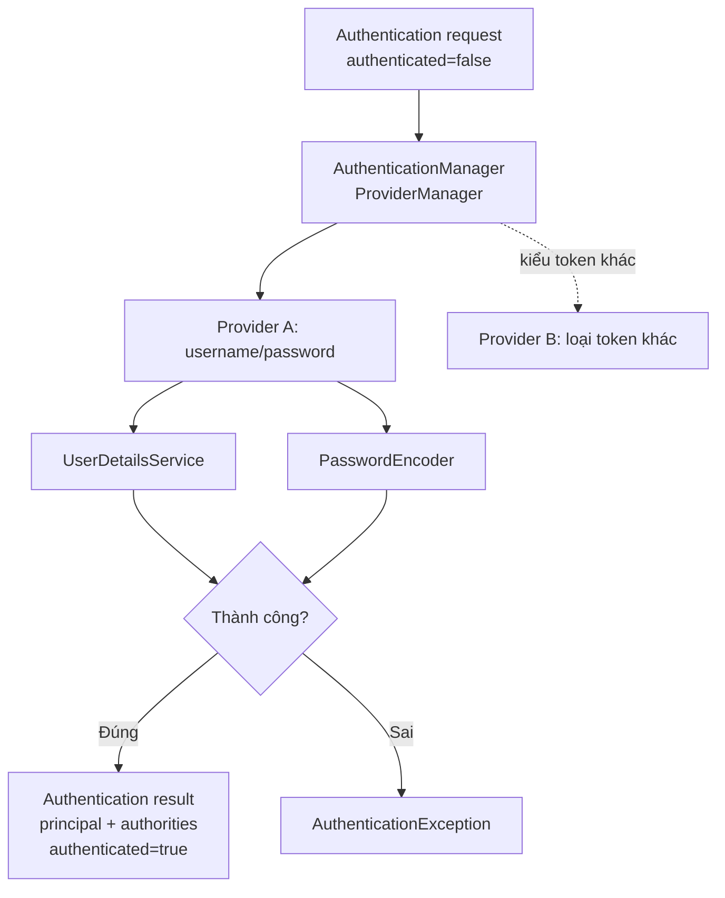

# Authentication biểu diễn yêu cầu xác thực và kết quả đã xác thực

## Mục tiêu bài học

Trong Spring Security, từ **Authentication** có hai vai trò dễ bị hiểu nhầm. Trước khi người dùng được kiểm tra, một đối tượng `Authentication` có thể chứa **yêu cầu xác thực**: tên đăng nhập và chứng cứ người dùng vừa cung cấp. Sau khi `AuthenticationManager` xác minh thành công, một `Authentication` khác thường biểu diễn **danh tính đã xác thực**: principal đã được xác nhận, những authority được cấp và trạng thái xác thực. Cùng một interface, nhưng ý nghĩa và mức độ tin cậy của dữ liệu thay đổi hoàn toàn sau bước kiểm chứng.

Bài học tập trung vào **Spring Security 6.x, Java 17, Spring MVC/Servlet** và ví dụ chạy được với **Spring Boot 3.5.0 / Spring Security 6.5.x**. Các khái niệm áp dụng rộng hơn, nhưng API và cách tích hợp khác ở WebFlux, Spring Security 7.x hoặc các cơ chế token cụ thể.

Sau khi học, bạn có thể:

1. Giải thích vì sao `Authentication` vừa là **đầu vào** của `AuthenticationManager.authenticate(...)` vừa là **kết quả** của thao tác đó.
2. Đọc đúng các thành phần `principal`, `credentials`, `authorities`, `details`, `getName()` và `isAuthenticated()`.
3. Phân biệt `UsernamePasswordAuthenticationToken.unauthenticated(...)` với token đã được provider cấp quyền, tránh tự giả mạo trạng thái authenticated.
4. Lần theo luồng HTTP Basic → authentication filter → `AuthenticationManager` → `AuthenticationProvider` → `SecurityContext` → authorization.
5. Hiểu việc xóa credentials khỏi kết quả xác thực, giới hạn của `isAuthenticated()` khi có anonymous/remember-me và cách lưu ngữ cảnh giữa các request.
6. Tự chạy một dự án Spring Boot có tài khoản mẫu, đọc principal tại controller và dùng JUnit/MockMvc để kiểm chứng yêu cầu, kết quả, 200/401/403.

**Mục tiêu chính là hiểu hợp đồng và vòng đời của Authentication.** `Authentication` không phải username đơn thuần, không phải mật khẩu, không phải HTTP session, và cũng không phải toàn bộ cơ chế phân quyền.

## 1. Một interface, hai vai trò

Spring Security mô tả `Authentication` theo hai mục đích:

- **Authentication request — đề nghị xác thực:** một filter hoặc thành phần login tạo đối tượng đại diện cho điều người gọi *khẳng định* (“tôi là learner”) và bằng chứng đi kèm (“đây là password của tôi”). Chưa có cơ sở để tin khẳng định này. Đối tượng được đưa vào `AuthenticationManager.authenticate(...)`.
- **Authenticated result — danh tính đã xác thực:** sau khi một cơ chế tin cậy xác minh chứng cứ, manager/provider trả về `Authentication` biểu diễn kết quả, thường chứa principal đã được kiểm chứng, authorities do hệ thống cấp và `isAuthenticated() == true`. Thành phần web security dùng kết quả để cập nhật `SecurityContext`.

```text
                  [Trước khi kiểm chứng]                [Sau khi kiểm chứng]
HTTP request
(username/password)
      |
      v
Authentication request
 principal   = "learner"      \
 credentials = "learner-pass"   >-- AuthenticationManager
 authorities = []             /       |
 authenticated = false                v
                                AuthenticationProvider
                                  + UserDetailsService
                                  + PasswordEncoder
                                        |
                                  Đúng? / Sai?
                                   /       \
                                 Đúng       Sai
                                  |          |
                                  v          v
                        Authentication    AuthenticationException
                        result            -> 401/flow lỗi phù hợp
                         principal = UserDetails learner
                         credentials = thường được xóa
                         authorities = [ROLE_USER]
                         authenticated = true
                                  |
                                  v
                         SecurityContext / authorization
```

Sơ đồ mô tả **một luồng username/password thông thường**. Token được dùng và nguồn principal khác nhau tùy cơ chế: form login, HTTP Basic, OAuth2 login, JWT bearer token, X.509, pre-authentication hay remember-me. Không mặc định mọi token đều có password.

### 1.1. Authentication không thực hiện phép kiểm tra

Gọi:

```java
Authentication request =
    UsernamePasswordAuthenticationToken.unauthenticated(
        "learner", "learner-pass"
    );
```

**Chưa xác thực gì cả.** Bạn chỉ vừa tạo một đối tượng chứa dữ liệu do phía gửi khai. `request.isAuthenticated()` là `false`. Việc đặt tên lớp là `Authentication` hay `UsernamePasswordAuthenticationToken` không biến một request thành kết quả đáng tin cậy.

Phép kiểm tra xảy ra khi một `AuthenticationManager` dùng provider phù hợp để xác minh chứng cứ:

```java
Authentication result = authenticationManager.authenticate(request);
```

Nếu đúng, manager trả về một `Authentication` đã xác thực theo hợp đồng; nếu không thể xác thực, một `AuthenticationException` thích hợp được ném ra. **Không coi biến `request` sau lời gọi là bằng chứng quyền truy cập**; hãy dùng kết quả thực sự được manager trả về.

### 1.2. Authentication khác Authorization

| Câu hỏi | Thành phần trọng tâm | Ví dụ |
| --- | --- | --- |
| “Ai là người gọi, có bằng chứng hợp lệ không?” | Authentication filter, `AuthenticationManager`, `AuthenticationProvider` | Kiểm tra mật khẩu của learner. |
| “Người được xác thực được cấp những quyền tổng quát nào?” | `Authentication.getAuthorities()` và nguồn danh tính đáng tin cậy | Learner có `ROLE_USER`; admin có `ROLE_ADMIN`. |
| “Người đó có được gọi endpoint này không?” | `AuthorizationManager`, `AuthorizationFilter`, `SecurityFilterChain` | `GET /admin` cần ADMIN. |
| “Người đó có được xem đơn hàng ID 42 không?” | Policy nghiệp vụ, method security và quyền sở hữu/tenant trong service/DB | Alice không xem đơn của Bob chỉ vì đã login. |

**Xác thực thành công là điều kiện cần cho nhiều hành động, chưa phải giấy phép làm mọi việc.** `Authentication` mang identity/authorities; chính sách authorization quyết định thao tác được phép trong ngữ cảnh cụ thể.

## 2. Cấu trúc của interface Authentication

`org.springframework.security.core.Authentication` mở rộng `java.security.Principal`. Những phương thức thường gặp:

```java
// Các chữ ký khái quát để học, không phải định nghĩa interface đầy đủ.
Object getPrincipal();
Object getCredentials();
Collection<? extends GrantedAuthority> getAuthorities();
Object getDetails();
String getName();
boolean isAuthenticated();
void setAuthenticated(boolean authenticated)
        throws IllegalArgumentException;
```

Tùy implementation, bạn có thể truy cập các thuộc tính khác. **Đây là hình dạng hợp đồng rút gọn**, không phải gợi ý tự implement hay tự gọi setter để cấp quyền. Các class token có thể hạn chế chuyển `false -> true` để tránh tạo token đã xác thực bằng dữ liệu chưa kiểm chứng.

| Thành phần | Ý nghĩa thường gặp | Điều không nên suy |
| --- | --- | --- |
| `getPrincipal()` | Người/đối tượng được biểu diễn. Trước auth có thể là username `String`; sau auth thường là `UserDetails` hoặc principal chuyên biệt. | Không mặc định luôn là `String` hay luôn là entity JPA. |
| `getCredentials()` | Chứng cứ dùng khi login: password, token hoặc giá trị tương ứng. | Không mặc định còn nguyên sau login; không ghi vào log/response. |
| `getAuthorities()` | Các `GrantedAuthority` được gán cho danh tính; dùng cho policy role/scope/permission. | Không tự có quyền sở hữu mọi object theo ID. |
| `getDetails()` | Metadata phụ trợ tùy filter/provider, ví dụ thông tin request. | Không nhầm với `principal`, không coi IP/header metadata là chứng cứ quyền. |
| `getName()` | Tên của principal theo implementation; thường là username trong ví dụ password login. | Không hứa đây luôn là email hoặc khóa chính người dùng. |
| `isAuthenticated()` | Cờ trạng thái của token theo cơ chế xác thực đó. | Không phải bằng chứng duy nhất để xác định “người dùng thật đã login”. |

### 2.1. Principal trước và sau khi xác thực

Đối với `UsernamePasswordAuthenticationToken` chưa xác thực:

```java
Authentication request =
    UsernamePasswordAuthenticationToken.unauthenticated(
        "learner", "learner-pass"
    );

Object principalBefore = request.getPrincipal(); // "learner"
```

Sau khi provider xác minh thành công, `getPrincipal()` **có thể** là `UserDetails` do `UserDetailsService` trả về. Trong lab ở mục 8, đó là implementation `User` của Spring Security. Nhưng trong JWT resource server, principal có thể là `Jwt`; trong OAuth2 login có thể là một `OAuth2User`; trong các mô hình khác còn những loại khác.

Do đó không cast mù quáng:

```java
// Giòn: chỉ chạy đúng khi principal thực sự là UserDetails.
UserDetails user = (UserDetails) authentication.getPrincipal();
```

Dùng `authentication.getName()` khi chỉ cần tên hiển thị/định danh mà implementation đã cung cấp. Nếu cần đối tượng principal cụ thể, kiểm tra kiểu và chỉ áp dụng trong cơ chế bạn đã cấu hình, hoặc dùng `@AuthenticationPrincipal` với handler phù hợp.

### 2.2. Credentials không phải thứ nên giữ trong SecurityContext

Với password login, trước xác thực `credentials` thường là raw password. Sau xác thực, `ProviderManager` mặc định cố **xóa thông tin credentials nhạy cảm** từ kết quả khi có thể, dựa trên hợp đồng `CredentialsContainer`. Vì thế `getCredentials()` của kết quả thường là `null` trong luồng username/password tiêu biểu.

Không nên viết:

```java
// Sai thiết kế: dựa vào raw password còn nằm trong context.
String password = (String) authentication.getCredentials();
```

Ứng dụng không cần biết mật khẩu đã xác thực để xử lý request nghiệp vụ. Nếu phải gọi dịch vụ bên ngoài, hãy thiết kế credential/delegation riêng; không chuyển tiếp password đăng nhập của người dùng.

**Một lưu ý cho cache user:** nếu một `UserDetails` được tái sử dụng từ shared cache mà provider xóa credentials trên chính instance đó, lần đăng nhập sau có thể gặp dữ liệu hash đã bị xóa. Khi tự thiết kế cache UserDetails, phải kiểm soát việc copy đối tượng và credential erasure theo kiến trúc, không vô hiệu hóa xóa credential một cách tùy tiện.

### 2.3. Authorities không do client tự cấp

`GrantedAuthority` đại diện quyền đã được cấp, ví dụ:

```text
ROLE_USER
ROLE_ADMIN
REPORT_READ
SCOPE_orders.read
```

`hasRole("ADMIN")` mặc định tương ứng việc kiểm tra authority `ROLE_ADMIN`; `hasAuthority("REPORT_READ")` kiểm tra chuỗi `REPORT_READ`. Quy tắc prefix có thể được tùy biến theo config; đọc policy của dự án thay vì chỉ so tên.

**Nguy hiểm:** client gửi `X-Role: ADMIN` rồi backend tự tạo `Authentication` đã authenticated với `ROLE_ADMIN`, không kiểm chứng nguồn role. Khi đó ứng dụng trao quyền dựa trên điều client tự nhận.

Các authorities của kết quả phải đến từ nguồn đáng tin: record user đã được kiểm tra, claims JWT đã xác minh và ánh xạ có chủ đích, hoặc hệ thống cấp quyền phù hợp. Ngay cả khi authority hợp lệ, authorization theo ownership/tenant vẫn cần được giải quyết ở nơi có dữ liệu tài nguyên.

### 2.4. Details và getName không đồng nghĩa nhau

`getDetails()` trong web flow có thể chứa `WebAuthenticationDetails` với địa chỉ từ xa/session ID; filter có thể tùy biến metadata. Trường này chủ yếu phục vụ ngữ cảnh/kiểm tra bổ sung. Với hệ thống sau reverse proxy, địa chỉ IP và forwarded headers cần chính sách trust proxy riêng; không biến metadata của client thành role.

`Authentication.getName()` thường trả tên của `Principal`/`UserDetails` hoặc một giá trị suy từ principal theo implementation. Trong bài lab, kết quả là username. Nhưng API không yêu cầu mọi hệ thống dùng email làm tên, cũng không đảm bảo nó luôn là khóa ngoại để truy vấn dữ liệu nghiệp vụ.

## 3. UsernamePasswordAuthenticationToken minh họa hai trạng thái

`UsernamePasswordAuthenticationToken` là một implementation thông dụng của `Authentication` trong username/password authentication.

### 3.1. Factory để tạo authentication request

Spring Security 6.x hỗ trợ:

```java
UsernamePasswordAuthenticationToken token =
    UsernamePasswordAuthenticationToken.unauthenticated(
        "learner", "learner-pass"
    );
```

Ý nghĩa:

- `principal` = chuỗi `"learner"` do client khai.
- `credentials` = chuỗi `"learner-pass"` do client cung cấp.
- `authorities` = danh sách trống trong token này.
- `isAuthenticated()` = `false`.

Bạn cũng có thể thấy constructor hai tham số trong code cũ; factory `unauthenticated(...)` giúp ý định rõ hơn.

### 3.2. Factory tạo token đã authenticated dành cho thành phần tin cậy

Spring Security có factory:

```java
UsernamePasswordAuthenticationToken authenticated =
    UsernamePasswordAuthenticationToken.authenticated(
        verifiedPrincipal,
        null,
        verifiedAuthorities
    );
```

Đây **chỉ là fragment khái niệm**: `verifiedPrincipal` và `verifiedAuthorities` phải do cơ chế đã xác minh hợp lệ cung cấp. Factory không tự tra database hay tự kiểm tra password. Tuyệt đối không lấy principal/authorities do browser gửi rồi gọi factory này để bypass authentication manager.

Trong hệ thống thực, **authentication provider** là nơi tạo kết quả đã xác thực sau khi kiểm chứng. Ứng dụng gọi `AuthenticationManager.authenticate(request)` thay vì tự đặt true cho request.

### 3.3. Cùng class nhưng không có nghĩa cùng instance

Một luồng điển hình:

```java
Authentication request =
    UsernamePasswordAuthenticationToken.unauthenticated(
        username, rawPassword
    );

Authentication result =
    authenticationManager.authenticate(request);

// Chỉ dùng result từ đây.
```

Đầu vào và đầu ra có thể là **hai object khác nhau**, hoặc implementation khác tùy cơ chế. Không xây logic phụ thuộc vào việc object bị thay đổi tại chỗ. `AuthenticationManager` có nhiệm vụ trả về một kết quả xác thực hợp lệ hoặc báo lỗi; **không nhất thiết trả đúng kiểu token ban đầu cho mọi provider**.

### 3.4. Vì sao không gọi setAuthenticated(true)?

Đoạn sau là một **anti-pattern**:

```java
// KHÔNG DÙNG để "đăng nhập" một người dùng.
request.setAuthenticated(true);
```

Trong `UsernamePasswordAuthenticationToken`, việc chuyển một request chưa xác thực sang trạng thái authenticated theo cách setter bị hạn chế để tránh tin vào dữ liệu chưa kiểm chứng. Với class custom, bạn cũng phải giữ quy tắc chỉ thành phần tin cậy mới được tạo kết quả được công nhận.

**Quy tắc học thuộc:** *Đối tượng request chứa lời khai; manager/provider kiểm chứng; kết quả mới được dùng làm danh tính.*

## 4. AuthenticationManager và AuthenticationProvider phối hợp ra sao?

### 4.1. Hợp đồng AuthenticationManager

`AuthenticationManager` định nghĩa thao tác:

```java
Authentication authenticate(Authentication authentication)
        throws AuthenticationException;
```

Đây là **chữ ký rút gọn**. `AuthenticationManager` không nhất thiết biết cách đọc mật khẩu từ database; nó có thể chuyển việc cho một hoặc nhiều `AuthenticationProvider`. Implementation rất thường gặp là `ProviderManager`.

Mô hình:



Sơ đồ mang tính khái niệm; `ProviderManager` có quy tắc thực tế về thứ tự provider, exception và parent manager. Một provider có thể tuyên bố không hỗ trợ loại `Authentication` đang được yêu cầu; nếu không provider nào xử lý được, xác thực thất bại. Không dùng việc “không provider xử lý” làm điều kiện mặc định cho phép.

### 4.2. DaoAuthenticationProvider làm gì?

Trong luồng username/password thường gặp, `DaoAuthenticationProvider` phối hợp:

1. Nhận `UsernamePasswordAuthenticationToken` có username/password do người gọi cung cấp.
2. Gọi `UserDetailsService.loadUserByUsername(username)` để lấy `UserDetails`.
3. Gọi `PasswordEncoder.matches(rawPassword, storedEncodedPassword)`.
4. Kiểm tra các trạng thái tài khoản thích hợp (enabled, locked, expired ...).
5. Nếu hợp lệ, trả `Authentication` đã authenticated, principal và authorities từ kết quả tin cậy.
6. Nếu không hợp lệ, ném `AuthenticationException` (thường thấy `BadCredentialsException` cho password sai hoặc user không tồn tại theo chính sách ẩn thông tin).

`UserDetailsService` **chỉ tải dữ liệu user**, không phải API trực tiếp để tự đăng nhập. `PasswordEncoder` chỉ kiểm tra hash, không quyết định quyền được xem tài nguyên.

### 4.3. ProviderManager xóa credential sau khi xác thực

Một `Authentication` thành công có thể mang theo dữ liệu nhạy cảm. Trong cấu hình thông thường, `ProviderManager` thực hiện `eraseCredentials()` trên kết quả nếu đối tượng hỗ trợ để giảm nguy cơ giữ password trong session hoặc log.

Do đó **đừng dùng `result.getCredentials()` làm cách chứng minh login thành công**. Hãy dùng trạng thái đã xác thực cùng principal/authorities từ kết quả và để các security components quản lý nó.

Việc xóa credential không tương đương vô hiệu hóa tài khoản, hủy phiên, xóa cookie hoặc xóa mọi bản sao password khỏi bộ nhớ/heap; nó là một lớp vệ sinh dữ liệu trong luồng xử lý.

## 5. Một HTTP request đi đến SecurityContext như thế nào?

Với **Spring MVC/Servlet** và HTTP Basic, luồng tiêu biểu là:

```text
Client
  |
  | Authorization: Basic <base64(username:password)>
  v
Servlet container
  |
  v
Spring Security FilterChainProxy / SecurityFilterChain
  |
  v
BasicAuthenticationFilter
  |
  | Tạo Authentication request chưa được xác thực
  v
AuthenticationManager -> AuthenticationProvider
  |
  | verify password + load authorities
  v
Authentication result (được xác thực)
  |
  v
SecurityContext chứa Authentication
  |
  v
AuthorizationFilter -> policy cho HTTP request
  |
  +--> Không đủ điều kiện -> 401/403/entry point phù hợp
  |
  v
DispatcherServlet -> Controller -> Service
```

Với form login, filter xử lý sẽ khác (`UsernamePasswordAuthenticationFilter`); với bearer JWT, authentication token/provider và nguồn authorities khác. **Cấu trúc tổng quát vẫn là “thu chứng cứ → kiểm chứng → tạo danh tính → áp policy”.**

### 5.1. SecurityContext và SecurityContextHolder

`SecurityContext` chứa `Authentication` hiện tại. `SecurityContextHolder` cho code thuộc Servlet stack truy cập ngữ cảnh đó bằng một strategy (mặc định thường dựa trên `ThreadLocal`).

Code đọc trong một lời gọi đã được Security quản lý:

```java
Authentication current =
    SecurityContextHolder.getContext().getAuthentication();
```

**Đây là fragment**, không nên chạy ngoài request rồi kỳ vọng luôn có user. Với request public, context có thể không có Authentication hoặc có anonymous token tùy filter chain. Với thread khác/`@Async`, context không tự lan truyền đúng trong mọi tình huống. Với **WebFlux**, dùng `ReactiveSecurityContextHolder` và Reactor Context thay vì suy luận theo Servlet ThreadLocal.

Tốt hơn, trong Spring MVC controller đã được bảo vệ, bạn có thể nhận `Authentication` bằng method argument, như code ở mục 8. Điều này làm dependency danh tính của endpoint rõ ràng và tránh tự truy vấn holder nhiều nơi.

### 5.2. Authentication đã được xác thực không tự lưu qua mọi request

Cần tách:

- **Đưa Authentication vào SecurityContext của request hiện tại:** giúp các bước sau biết người gọi trong request này.
- **Lưu SecurityContext để khôi phục ở request sau:** cần `SecurityContextRepository`/session hoặc cơ chế xác thực lặp lại, tùy kiến trúc.

Trong Spring Security 6, nếu tự viết một custom login controller hoặc authentication filter rồi đặt context bằng tay, bạn không nên mặc định context sẽ tự được lưu vào session. Với `SecurityContextHolderFilter`, muốn duy trì context giữa các request cần gọi `SecurityContextRepository.saveContext(...)` đúng cách hoặc dùng flow được Spring Security hỗ trợ. Với HTTP Basic stateless theo request, client có thể gửi credentials trên mỗi request và filter xác thực lại; không cần tự viết controller phát session để học khái niệm Authentication.

**Không tự set SecurityContext dựa trên input client chưa được xác thực.** Đây là đường bypass lớp bảo mật rất nghiêm trọng, dù sau đó controller vẫn thấy `Authentication` trong holder.

### 5.3. 401, 403, 302 và thất bại xác thực

| Tình huống | Ý nghĩa | Response thường gặp |
| --- | --- | --- |
| Không có credentials, endpoint yêu cầu login, dùng Basic | Chưa có danh tính hợp lệ | `401` và có thể có `WWW-Authenticate`. |
| Có username/password sai | Xác thực thất bại, không có result tin cậy | `401` với Basic; không đưa thông tin về password. |
| Đã xác thực nhưng thiếu role cho URL | Authorization từ chối | `403 Forbidden`. |
| Dùng form login với request điều hướng chưa đăng nhập | Entry point chuyển đến form | `302` tới login page trong cấu hình phù hợp. |
| Đã xác thực và có đủ quyền | Request được phép đi tiếp | Handler có thể trả `200` hoặc mã khác theo nghiệp vụ. |

**Không quy tất cả 403 cho mật khẩu sai:** CSRF và các cơ chế bảo vệ khác cũng có thể trả 403. **Không quy tất cả 401 cho username không tồn tại:** có thể do thiếu token, token không hợp lệ hoặc authentication entry point.

## 6. isAuthenticated(): cờ quan trọng nhưng chưa đủ để phân biệt anonymous

Dễ mắc lỗi:

```java
if (authentication != null && authentication.isAuthenticated()) {
    // Tự coi đây là user thật đã login.
}
```

Đây là **fragment có nguy cơ sai chính sách** trong hệ thống bật anonymous authentication: `AnonymousAuthenticationToken` có thể có `isAuthenticated() == true` về mặt trạng thái nội bộ của token, nhưng Spring Security coi đó là **anonymous**, không phải người dùng đã đăng nhập bằng credentials.

Vì vậy:

- Để bảo vệ URL, dùng `authorizeHttpRequests(...).authenticated()`, `fullyAuthenticated()`, `hasRole(...)` hoặc policy phù hợp. Những manager này sử dụng logic phân biệt các loại authentication.
- Nếu tự kiểm tra trong nghiệp vụ, dùng API/helper thích hợp với `AuthenticationTrustResolver` hoặc chú thích security hỗ trợ thay vì chỉ nhìn cờ.
- Không tự thực hiện phân quyền đơn giản bằng `authentication.getName() != null`. `anonymousUser` có thể là tên principal của request anonymous.
- `RememberMeAuthenticationToken` có thể đại diện người dùng đã nhận diện qua remember-me nhưng không phải **fully authenticated** theo cùng mức độ tin cậy với một lần đăng nhập đầy đủ.
- Nếu policy yêu cầu bước xác minh mạnh hơn (ví dụ MFA, reauthentication), cờ `isAuthenticated()` cũng chưa thể hiện mọi yêu cầu đó. Cần chính sách cụ thể về authentication factors.

### 6.1. AnonymousAuthenticationToken khác một request token đang chờ kiểm tra

Có hai thứ dễ bị gọi chung là “chưa login”:

| Loại | Ý nghĩa | `isAuthenticated()` có thể là |
| --- | --- | --- |
| `UsernamePasswordAuthenticationToken.unauthenticated(...)` | Có lời khai username/password chưa được xác minh | **false** |
| `AnonymousAuthenticationToken` do framework thiết lập | Đại diện anonymous caller trong filter chain để xử lý policy nhất quán | **true** theo implementation |
| `UsernamePasswordAuthenticationToken` do provider xác thực thành công | Danh tính đã kiểm chứng trong luồng username/password | **true** |
| `RememberMeAuthenticationToken` | Danh tính được khôi phục bằng remember-me theo cơ chế riêng | **true**, nhưng khác fully authenticated |

Chính vì vậy chỉ xem một boolean **không phân biệt được mọi mức tin cậy**. Dùng `authenticated()` và `fullyAuthenticated()` theo yêu cầu, hoặc một cơ chế trust resolver khi bắt buộc tự viết policy.

## 7. Authenticated result được dùng thế nào ở controller/service?

Sau khi Security filter chain xác thực thành công và URL rule cho phép tiếp tục, controller có thể nhận:

```java
@GetMapping("/api/me")
Map<String, String> me(Authentication authentication) {
    return Map.of("username", authentication.getName());
}
```

Đây là **fragment** cần nằm trong `@RestController`. Lợi ích:

- Username đến từ `Authentication` đã được web security xác lập.
- Controller không phải đọc Base64 Basic, không phải tự tìm user theo password.
- Trách nhiệm phân quyền URL vẫn nằm ở `SecurityFilterChain`.
- Không cần gửi `principal` hoặc `credentials` thô trong response.

Nếu cần user đầy đủ, trong hệ thống dựa trên `UserDetails` có thể dùng:

```java
@GetMapping("/api/me/details")
Map<String, String> details(
        @AuthenticationPrincipal UserDetails user) {
    return Map.of("username", user.getUsername());
}
```

Fragment này cần import `@AuthenticationPrincipal` và `UserDetails` và chỉ đúng khi principal thực tế là UserDetails. Với resource server JWT, principal là type khác; cần thiết kế handler tương ứng.

### 7.1. Không trả trực tiếp Authentication qua JSON

`Authentication` có thể chứa details request, authorities, loại principal, credentials hoặc metadata mà ứng dụng không muốn công khai. Trả nguyên:

```java
// Không nên trả thẳng object bảo mật ra client.
return authentication;
```

có thể tiết lộ cấu trúc nội bộ và khiến API bị phụ thuộc implementation. Hãy dùng DTO tường minh chỉ gồm các trường client cần biết. Không log raw token/password/hash, cũng không gửi chúng vào response debug.

### 7.2. Quyền với object vẫn cần kiểm tra

Một endpoint như `GET /api/orders/42` yêu cầu `authenticated()` mới chỉ bảo đảm có user. Nếu ID 42 thuộc Bob, Alice không được xem chỉ vì `Authentication#getAuthorities()` chứa `ROLE_USER`.

Trong service hoặc query, dùng identity/tenant từ nguồn đáng tin và kiểm tra ownership:

```sql
SELECT id, label
FROM purchase_orders
WHERE id = :requestedId
  AND owner_username = :authenticatedUsername;
```

Đây là **SQL định hướng**, dùng named parameters của cơ chế truy vấn phù hợp; không phải lệnh có thể chạy nguyên dạng trên mọi DB. Ý chính: identity sau authentication là **đầu vào cho authorization theo tài nguyên**, không phải kết quả phân quyền của mọi dòng dữ liệu.

## 8. Bài thực hành có thể chạy: từ Authentication request đến Authentication result

Ta tạo ứng dụng Boot với hai tài khoản `learner` và `admin`, HTTP Basic, một endpoint public, một endpoint trả thông tin được chọn lọc từ Authentication và một endpoint cần quyền ADMIN.

Bên cạnh HTTP tests, một test trực tiếp gọi `AuthenticationManager.authenticate(...)` để thấy **trước** và **sau** khác nhau như thế nào.

### 8.1. Cấu trúc thư mục

```text
authentication-lifecycle-demo/
├── pom.xml
└── src/
    ├── main/java/com/example/authlifecycle/
    │   ├── AuthLifecycleApplication.java
    │   ├── SecurityConfig.java
    │   └── IdentityController.java
    └── test/java/com/example/authlifecycle/
        ├── AuthenticationLifecycleTest.java
        └── IdentityHttpTest.java
```

### 8.2. Maven `pom.xml`

```xml
<project xmlns="http://maven.apache.org/POM/4.0.0"
         xmlns:xsi="http://www.w3.org/2001/XMLSchema-instance"
         xsi:schemaLocation="http://maven.apache.org/POM/4.0.0 https://maven.apache.org/xsd/maven-4.0.0.xsd">
    <modelVersion>4.0.0</modelVersion>

    <parent>
        <groupId>org.springframework.boot</groupId>
        <artifactId>spring-boot-starter-parent</artifactId>
        <version>3.5.0</version>
        <relativePath/>
    </parent>

    <groupId>com.example</groupId>
    <artifactId>authentication-lifecycle-demo</artifactId>
    <version>1.0.0</version>

    <properties>
        <java.version>17</java.version>
    </properties>

    <dependencies>
        <dependency>
            <groupId>org.springframework.boot</groupId>
            <artifactId>spring-boot-starter-web</artifactId>
        </dependency>
        <dependency>
            <groupId>org.springframework.boot</groupId>
            <artifactId>spring-boot-starter-security</artifactId>
        </dependency>
        <dependency>
            <groupId>org.springframework.boot</groupId>
            <artifactId>spring-boot-starter-test</artifactId>
            <scope>test</scope>
        </dependency>
        <dependency>
            <groupId>org.springframework.security</groupId>
            <artifactId>spring-security-test</artifactId>
            <scope>test</scope>
        </dependency>
    </dependencies>

    <build>
        <plugins>
            <plugin>
                <groupId>org.springframework.boot</groupId>
                <artifactId>spring-boot-maven-plugin</artifactId>
            </plugin>
        </plugins>
    </build>
</project>
```

`spring-boot-starter-security` đưa Spring Security lên classpath và tích hợp với Boot. `spring-security-test` cung cấp hỗ trợ thử HTTP authentication. Parent/BOM của Boot quản lý phiên bản các module tương thích.

Version `3.5.0` chỉ dùng để ví dụ nhất quán API 6.5; khi làm dự án thật hãy sử dụng bản vá còn được hỗ trợ. Bài này là **Servlet/MVC**, không dùng các WebFlux types như `ServerHttpSecurity` hoặc `SecurityWebFilterChain`.

### 8.3. `AuthLifecycleApplication.java`

```java
package com.example.authlifecycle;

import org.springframework.boot.SpringApplication;
import org.springframework.boot.autoconfigure.SpringBootApplication;

@SpringBootApplication
public class AuthLifecycleApplication {
    public static void main(String[] args) {
        SpringApplication.run(AuthLifecycleApplication.class, args);
    }
}
```

Lớp khởi động nằm trong package gốc `com.example.authlifecycle`, để Spring có thể scan các configuration/controller cùng package. Không có logic xác thực trực tiếp tại đây.

### 8.4. `SecurityConfig.java`

```java
package com.example.authlifecycle;

import org.springframework.context.annotation.Bean;
import org.springframework.context.annotation.Configuration;
import org.springframework.security.authentication.AuthenticationManager;
import org.springframework.security.authentication.ProviderManager;
import org.springframework.security.authentication.dao.DaoAuthenticationProvider;
import org.springframework.security.config.Customizer;
import org.springframework.security.config.annotation.web.builders.HttpSecurity;
import org.springframework.security.config.annotation.web.configurers.AbstractHttpConfigurer;
import org.springframework.security.core.userdetails.User;
import org.springframework.security.core.userdetails.UserDetails;
import org.springframework.security.core.userdetails.UserDetailsService;
import org.springframework.security.crypto.factory.PasswordEncoderFactories;
import org.springframework.security.crypto.password.PasswordEncoder;
import org.springframework.security.provisioning.InMemoryUserDetailsManager;
import org.springframework.security.web.SecurityFilterChain;

@Configuration(proxyBeanMethods = false)
public class SecurityConfig {

    @Bean
    PasswordEncoder passwordEncoder() {
        return PasswordEncoderFactories.createDelegatingPasswordEncoder();
    }

    @Bean
    UserDetailsService users(PasswordEncoder encoder) {
        UserDetails learner = User.withUsername("learner")
            .password(encoder.encode("learner-pass"))
            .roles("USER")
            .build();

        UserDetails admin = User.withUsername("admin")
            .password(encoder.encode("admin-pass"))
            .roles("USER", "ADMIN")
            .build();

        return new InMemoryUserDetailsManager(learner, admin);
    }

    @Bean
    AuthenticationManager authenticationManager(
            UserDetailsService users,
            PasswordEncoder encoder) {

        DaoAuthenticationProvider provider =
            new DaoAuthenticationProvider(users);
        provider.setPasswordEncoder(encoder);
        return new ProviderManager(provider);
    }

    @Bean
    SecurityFilterChain securityFilterChain(HttpSecurity http)
            throws Exception {

        return http
            .authorizeHttpRequests(auth -> auth
                .requestMatchers("/public/ping").permitAll()
                .requestMatchers("/api/me").authenticated()
                .requestMatchers("/admin/ping").hasRole("ADMIN")
                .anyRequest().denyAll()
            )
            .httpBasic(Customizer.withDefaults())
            .formLogin(AbstractHttpConfigurer::disable)
            .build();
    }
}
```

**Giải thích cấu hình:**

1. `PasswordEncoderFactories.createDelegatingPasswordEncoder()` tạo encoder; cấu hình mặc định trong dòng này dùng bcrypt khi encode mới, lưu chuỗi dạng `{bcrypt}...`.
2. `InMemoryUserDetailsManager` chỉ giữ user học tập trong bộ nhớ; hash được tạo từ raw password demo ở startup. Code vẫn chứa raw password nên **không phù hợp production**.
3. Bean `AuthenticationManager` ở đây được khai báo **tường minh** để test trực tiếp và để bạn thấy `ProviderManager → DaoAuthenticationProvider`. Với ứng dụng Boot bình thường, không cần tự đăng ký manager nếu cấu hình mặc định đã đủ.
4. `DaoAuthenticationProvider` nhận `UserDetailsService` và `PasswordEncoder` để kiểm tra username/password.
5. `SecurityFilterChain` xác định `/public/ping` public, `/api/me` cần xác thực và `/admin/ping` cần `ROLE_ADMIN`.
6. `.httpBasic(...)` bật Basic; `.formLogin(...disable)` tắt form login **chỉ để demo phản hồi HTTP rõ ràng**. Không tắt CSRF hay toàn bộ Spring Security.
7. `.anyRequest().denyAll()` là fallback cho đường dẫn chưa được khai báo, không dựa vào việc endpoint có tồn tại trong MVC hay không.

Mặc dù là ứng dụng đầu tiên, việc tự khai báo `AuthenticationManager` trong bài này **có mục đích sư phạm**: một test có thể gửi Authentication request trực tiếp vào manager rồi xem Authentication result. Khi chỉ muốn login cơ bản, bạn thường để Spring Security/Boot cấu hình manager phù hợp.

### 8.5. `IdentityController.java`

```java
package com.example.authlifecycle;

import java.util.List;
import java.util.Map;

import org.springframework.security.core.Authentication;
import org.springframework.security.core.GrantedAuthority;
import org.springframework.web.bind.annotation.GetMapping;
import org.springframework.web.bind.annotation.RestController;

@RestController
public class IdentityController {

    @GetMapping("/public/ping")
    public String ping() {
        return "pong";
    }

    @GetMapping("/api/me")
    public Map<String, Object> me(Authentication authentication) {
        List<String> authorities = authentication.getAuthorities().stream()
            .map(GrantedAuthority::getAuthority)
            .sorted()
            .toList();

        return Map.of(
            "username", authentication.getName(),
            "authenticated", authentication.isAuthenticated(),
            "authorities", authorities
        );
    }

    @GetMapping("/admin/ping")
    public String adminPing() {
        return "admin-only";
    }
}
```

Controller chỉ trả **username, trạng thái và authorities** đã được chọn lọc. Không trả `Authentication` thô, `UserDetails` thô, `credentials` hoặc hash mật khẩu. Việc URL `/api/me` đòi `authenticated()` giúp kết quả hiển thị trong lab là người dùng đăng nhập thật qua Basic, không phải anonymous.

### 8.6. `AuthenticationLifecycleTest.java`

```java
package com.example.authlifecycle;

import org.junit.jupiter.api.Test;
import org.springframework.beans.factory.annotation.Autowired;
import org.springframework.boot.test.context.SpringBootTest;
import org.springframework.security.authentication.AuthenticationManager;
import org.springframework.security.authentication.BadCredentialsException;
import org.springframework.security.authentication.UsernamePasswordAuthenticationToken;
import org.springframework.security.core.Authentication;
import org.springframework.security.core.GrantedAuthority;
import org.springframework.security.core.userdetails.UserDetails;

import static org.assertj.core.api.Assertions.assertThat;
import static org.assertj.core.api.Assertions.assertThatThrownBy;

@SpringBootTest
class AuthenticationLifecycleTest {

    @Autowired
    AuthenticationManager authenticationManager;

    @Test
    void requestIsNotYetAnAuthenticatedIdentity() {
        Authentication request =
            UsernamePasswordAuthenticationToken.unauthenticated(
                "learner", "learner-pass"
            );

        assertThat(request.isAuthenticated()).isFalse();
        assertThat(request.getPrincipal()).isEqualTo("learner");
        assertThat(request.getCredentials()).isEqualTo("learner-pass");
        assertThat(request.getAuthorities()).isEmpty();
    }

    @Test
    void managerReturnsVerifiedIdentityWithGrantedAuthorities() {
        Authentication request =
            UsernamePasswordAuthenticationToken.unauthenticated(
                "learner", "learner-pass"
            );

        Authentication result =
            authenticationManager.authenticate(request);

        assertThat(result.isAuthenticated()).isTrue();
        assertThat(result.getName()).isEqualTo("learner");
        assertThat(result.getPrincipal()).isInstanceOf(UserDetails.class);
        assertThat(result.getAuthorities())
            .extracting(GrantedAuthority::getAuthority)
            .contains("ROLE_USER");

        // ProviderManager mặc định xóa credentials trên kết quả.
        assertThat(result.getCredentials()).isNull();
    }

    @Test
    void wrongPasswordCannotCreateTrustedResult() {
        Authentication request =
            UsernamePasswordAuthenticationToken.unauthenticated(
                "learner", "wrong-pass"
            );

        assertThatThrownBy(
            () -> authenticationManager.authenticate(request)
        ).isInstanceOf(BadCredentialsException.class);
    }
}
```

**Ba phép thử kiểm tra đúng trọng tâm đề bài:**

- Test 1 chứng minh **request object** mang lời khai, chưa phải identity tin cậy.
- Test 2 chứng minh **result object** có `UserDetails`, authorities của learner và trạng thái authenticated. `ProviderManager` mặc định xóa credentials từ result trong luồng này.
- Test 3 chứng minh password sai tạo exception, **không** trả một Authentication thành công.

Các assertions không phụ thuộc vào chuỗi hash bcrypt ngẫu nhiên hay địa chỉ memory của object. Không in password/hash trong stdout. `AuthenticationManager` test trực tiếp không tự gắn kết quả vào `SecurityContextHolder`; đó là việc authentication filter/controller tích hợp đúng cách phải làm.

### 8.7. `IdentityHttpTest.java`

```java
package com.example.authlifecycle;

import org.junit.jupiter.api.Test;
import org.springframework.beans.factory.annotation.Autowired;
import org.springframework.boot.test.autoconfigure.web.servlet.AutoConfigureMockMvc;
import org.springframework.boot.test.context.SpringBootTest;
import org.springframework.test.web.servlet.MockMvc;

import static org.springframework.security.test.web.servlet.request.SecurityMockMvcRequestPostProcessors.httpBasic;
import static org.springframework.test.web.servlet.request.MockMvcRequestBuilders.get;
import static org.springframework.test.web.servlet.result.MockMvcResultMatchers.content;
import static org.springframework.test.web.servlet.result.MockMvcResultMatchers.jsonPath;
import static org.springframework.test.web.servlet.result.MockMvcResultMatchers.status;

@SpringBootTest
@AutoConfigureMockMvc
class IdentityHttpTest {

    @Autowired
    MockMvc mvc;

    @Test
    void pingIsPublic() throws Exception {
        mvc.perform(get("/public/ping"))
            .andExpect(status().isOk())
            .andExpect(content().string("pong"));
    }

    @Test
    void meRejectsAnonymous() throws Exception {
        mvc.perform(get("/api/me"))
            .andExpect(status().isUnauthorized());
    }

    @Test
    void meShowsAuthenticatedPrincipal() throws Exception {
        mvc.perform(get("/api/me")
                .with(httpBasic("learner", "learner-pass")))
            .andExpect(status().isOk())
            .andExpect(jsonPath("$.username").value("learner"))
            .andExpect(jsonPath("$.authenticated").value(true))
            .andExpect(jsonPath("$.authorities[0]").value("ROLE_USER"));
    }

    @Test
    void meRejectsBadPassword() throws Exception {
        mvc.perform(get("/api/me")
                .with(httpBasic("learner", "bad-pass")))
            .andExpect(status().isUnauthorized());
    }

    @Test
    void learnerIsNotAdmin() throws Exception {
        mvc.perform(get("/admin/ping")
                .with(httpBasic("learner", "learner-pass")))
            .andExpect(status().isForbidden());
    }

    @Test
    void adminMayVisitAdminRoute() throws Exception {
        mvc.perform(get("/admin/ping")
                .with(httpBasic("admin", "admin-pass")))
            .andExpect(status().isOk())
            .andExpect(content().string("admin-only"));
    }
}
```

Hai lớp cung cấp **9 tests**: ba test vòng đời Authentication và sáu test HTTP. MockMvc thử filter chain thật trong Spring MVC test context, khác với chỉ tạo fake principal bằng `@WithMockUser`. Khi mục tiêu là chứng minh password authentication, dùng Basic credentials thực trong test sẽ trực tiếp hơn việc chỉ mock user.

### 8.8. Chạy và tự quan sát qua terminal

Cần JDK 17+, Maven, cổng 8080 rảnh:

```bash
java -version
mvn -version
mvn test
mvn spring-boot:run
```

Sau khi app chạy, mở terminal khác:

```bash
curl -i http://localhost:8080/public/ping
curl -i http://localhost:8080/api/me
curl -i -u learner:learner-pass http://localhost:8080/api/me
curl -i -u learner:wrong-pass http://localhost:8080/api/me
curl -i -u learner:learner-pass http://localhost:8080/admin/ping
curl -i -u admin:admin-pass http://localhost:8080/admin/ping
```

Trên Windows PowerShell, dùng `curl.exe` nếu `curl` trỏ đến alias của `Invoke-WebRequest`.

| Request | Status dự kiến | Body chính khi thành công |
| --- | --- | --- |
| `GET /public/ping` anonymous | **200** | `pong` |
| `GET /api/me` anonymous | **401** | Không có thông tin identity |
| `GET /api/me` learner đúng password | **200** | JSON có `username=learner`, `authenticated=true`, `authorities=["ROLE_USER"]` |
| `GET /api/me` learner sai password | **401** | Không có verified identity |
| `GET /admin/ping` learner đúng password | **403** | Không trả nội dung admin |
| `GET /admin/ping` admin đúng password | **200** | `admin-only` |

Đây là **kết quả dự kiến** với code minh họa, không phải output thực đã chạy tại máy người học. Các header như `WWW-Authenticate`, `Cache-Control` hoặc response metadata có thể thay đổi theo runtime và security config. Dữ liệu JSON là cấu trúc logic; thứ tự field không phải contract.

**Chú ý:** HTTP Basic gửi username/password dưới dạng Base64 trong header, không tự bảo vệ bí mật khi truyền. Lab `localhost` có credentials giả; ứng dụng thật cần HTTPS, identity store/secret management và chính sách bảo vệ đăng nhập phù hợp.

## 9. Đọc một trường hợp thực tế theo từng bước

Giả sử client gửi:

```http
GET /api/me HTTP/1.1
Host: localhost:8080
Authorization: Basic <gia-tri-base64>
```

Đây là request minh họa, không chứa credentials thật. Diễn tiến:

1. `BasicAuthenticationFilter` đọc HTTP Basic và tạo một `Authentication` chưa được xác thực, với principal dạng username.
2. Filter đưa Authentication request vào `AuthenticationManager`.
3. `ProviderManager` tìm provider hỗ trợ `UsernamePasswordAuthenticationToken`.
4. `DaoAuthenticationProvider` tải `UserDetails` cho learner, dùng `PasswordEncoder.matches(...)` đối chiếu mật khẩu.
5. Nếu thành công, provider trả một `Authentication` có principal đáng tin và authorities. `ProviderManager` thường xóa dữ liệu credentials nhạy cảm trên result.
6. Filter thiết lập `SecurityContext` cho request hiện tại.
7. Authorization rule `/api/me` cần `authenticated()`, nên request được phép đi tiếp.
8. Spring MVC gọi `IdentityController.me(...)` với `Authentication` đang có hiệu lực.
9. Controller chỉ lấy `getName()`, `isAuthenticated()` và authority names để trả JSON.

Nếu password sai, bước 4 thất bại và không có verified Authentication result được đưa đến controller. Nếu learner gọi `/admin/ping`, bước xác thực vẫn thành công, nhưng `hasRole("ADMIN")` từ chối vì thiếu `ROLE_ADMIN`. Chính điểm này tách bạch **authentication success** và **authorization denied**.

## 10. Khi nào principal không phải UserDetails?

Không nên biến bài học thành suy luận “mọi Authentication đều là username/password”. Một vài cơ chế quan trọng:

| Cơ chế | Authentication/token thường gặp | Principal có thể là | Credentials / authorities |
| --- | --- | --- | --- |
| HTTP Basic / form login với DaoAuthenticationProvider | `UsernamePasswordAuthenticationToken` | `UserDetails` sau xác thực | Raw password chỉ trước auth; authorities lấy từ user store. |
| JWT resource server | `JwtAuthenticationToken` | `Jwt` hoặc principal theo adapter | JWT đã xác minh, scopes được ánh xạ thành authorities theo cấu hình. |
| OAuth2/OIDC login | `OAuth2AuthenticationToken` hoặc token liên quan | `OAuth2User`/`OidcUser` | Dữ liệu người dùng/claims do provider cung cấp và đã được xác minh theo luồng. |
| Anonymous trong servlet security | `AnonymousAuthenticationToken` | Thường là `anonymousUser` | Dùng trong security flow, không phải một người login thật. |
| Remember-me | `RememberMeAuthenticationToken` hoặc cơ chế tương ứng | User identity được khôi phục | Mức tin cậy khác full login. |
| Pre-auth / X.509 | Token/implementation riêng | Định danh đến từ tầng chứng thực tương ứng | Phải có policy tin cậy đối với upstream identity. |

Những tên token ở đây là ví dụ theo các cấu hình thường gặp; phiên bản, adapter và loại principal có thể khác. Khi một API chuyển sang OAuth2 resource server, code chỉ cast `UserDetails` có thể lỗi dù mọi request đã được xác thực hợp lệ.

## 11. Những lỗi hiểu sai thường gặp

### Lỗi 1 — “Có Authentication object tức là login thành công”

Không đúng: `Authentication` cũng dùng để **đại diện request chưa xác thực**. Kiểm tra kết quả trả về từ manager/provider và áp policy qua security framework.

### Lỗi 2 — “Client có thể tự đặt isAuthenticated=true”

Không nên: tạo token đã xác thực từ dữ liệu tự khai là bypass cơ chế authentication. Dùng manager/provider hoặc một hạ tầng chứng thực tin cậy, không tự tăng cờ để làm request qua filter.

### Lỗi 3 — “AuthenticationManager tự cấp quyền truy cập endpoint”

Manager xác minh danh tính và xây kết quả. `AuthorizationManager`/filter/method security mới quyết định endpoint hay hành động nghiệp vụ nào được phép.

### Lỗi 4 — “Authentication.getPrincipal() luôn trả String username”

Trước auth thường có thể là String, nhưng sau auth có thể là `UserDetails`, `Jwt`, `OAuth2User` hoặc đối tượng tùy hệ thống. Khi chỉ cần tên, dùng `getName()` với contract của cơ chế đang dùng.

### Lỗi 5 — “Authentication.getCredentials() phải còn mật khẩu sau login”

Sai: provider/manager thường xóa thông tin credential nhạy cảm. Không thiết kế service lệ thuộc mật khẩu còn trong security context.

### Lỗi 6 — “isAuthenticated() == true nghĩa là user thật đã đăng nhập”

Không chắc, vì anonymous token có thể true theo implementation. Dùng built-in `authenticated()`/`fullyAuthenticated()` hoặc trust resolver khi phải tự kiểm tra.

### Lỗi 7 — “Authorites do browser gửi đã là quyền”

Không. Authorities của verified result phải được cấp từ nguồn đáng tin. Header/JSON do client tự nhận role không phải chứng cứ.

### Lỗi 8 — “ROLE_USER nghĩa là sở hữu mọi record user”

Role thường là quyền cấp toàn ứng dụng; tài nguyên cụ thể cần ownership/tenant policy. Phân quyền theo object không tự phát sinh từ login.

### Lỗi 9 — “Đặt SecurityContextHolder là session được lưu”

Không tự động. Trong Spring Security 6, custom authentication flow cần xem `SecurityContextRepository` và explicit save nếu muốn lưu identity qua request; dùng tích hợp có sẵn nếu không cần tự phát triển login.

### Lỗi 10 — “Mật khẩu đã hash thì có thể gửi raw password qua HTTP thường”

Không. Bcrypt bảo vệ mật khẩu **khi lưu**; HTTP Basic Base64 không mã hóa đường truyền. Dùng TLS/HTTPS và không hard-code credentials thật.

### Lỗi 11 — “@WithMockUser test đã chứng minh PasswordEncoder đúng”

Mock principal bỏ qua nhiều bước xác thực. Muốn chứng minh luồng username/password, test manager và gửi Basic credentials thực qua MockMvc hoặc integration test.

### Lỗi 12 — “Lấy Authentication ở bất kỳ thread nào cũng thấy cùng user”

Với Servlet ThreadLocal strategy, context có phạm vi thực thi cụ thể; async thread cần cơ chế propagation thích hợp. WebFlux dùng Reactor Context, không dựa vào ThreadLocal mặc định theo cách Servlet.

### Lỗi 13 — “Khi login sai, có thể trả chi tiết ‘username không tồn tại’ cho client”

Nên dùng thông điệp xác thực thất bại thích hợp, tránh vô tình tiết lộ kho user. Test phần lỗi nhưng không xuất password/hash hoặc thông tin phân biệt user không tồn tại theo cách giúp liệt kê tài khoản.

### Lỗi 14 — “Authentication result luôn là chính object request ban đầu được sửa trạng thái”

Không có bảo đảm đó. Provider có thể tạo instance mới. Hãy dùng đối tượng manager trả về và không viết logic dựa vào identity của instance.

### Lỗi 15 — “Trả toàn bộ Authentication qua REST là cách debug vô hại”

Không nên. Object có thể chứa fields nội bộ, principal/authorities, details và thông tin không cần công khai. Trả DTO an toàn, log có chọn lọc và loại bỏ secret.

## 12. Quy trình kiểm tra khi thấy 401 hoặc 403

Khi một endpoint không hoạt động như kỳ vọng, đừng vội thay `authenticated()` bằng `permitAll()`. Kiểm tra theo luồng:

1. **HTTP request:** path, method, header Authorization hoặc cookie có thực sự được gửi? Basic, Bearer, form hay session?
2. **Filter chain:** đúng `SecurityFilterChain` được áp vào request chưa? Có nhiều chain/`securityMatcher` hoặc rule matcher chồng lấp?
3. **Authentication request:** filter tạo loại token gì? Principal và credentials có đúng format không? Đừng log raw credentials.
4. **AuthenticationManager:** có provider hỗ trợ token không? UserDetailsService/PasswordEncoder có tương thích format hash không?
5. **Failure:** exception là bad credentials, account disabled/locked, provider không hỗ trợ hay token hết hạn?
6. **Success result:** principal type, `getName()`, authorities và trạng thái authenticated có đúng nguồn tin cậy không?
7. **SecurityContext:** kết quả đã được gắn vào request context chưa, có cần lưu qua session hoặc xác thực lại mỗi request?
8. **Authorization:** rule nào khớp đầu tiên? `hasRole` so với `hasAuthority` có sai prefix? Method security có thêm policy không?
9. **CSRF/CORS:** nếu là POST hoặc browser cross-origin, có lớp bảo vệ khác trả 403 không?
10. **Test âm:** anonymous, sai password, thiếu role, user khác owner và request không có chain phù hợp.

Không ghi log password, bearer token, session ID hoặc toàn bộ Authentication result vào issue/tài liệu công khai. Các tín hiệu debug nên đủ để phân biệt **đã xác thực nhưng thiếu quyền** với **chưa được xác thực**.

## 13. Câu hỏi ôn tập có giải thích

**Câu 1.** Vì sao một `UsernamePasswordAuthenticationToken` có thể tồn tại trước khi biết mật khẩu đúng?

**Trả lời:** Nó biểu diễn **request xác thực**, chỉ chứa lời khai và chứng cứ cần được kiểm tra. Tạo object không phải thực hiện `authenticate(...)`.

**Câu 2.** Với `UsernamePasswordAuthenticationToken.unauthenticated("learner", "pw")`, `isAuthenticated()` trả gì?

**Trả lời:** `false`. Token này chưa được provider xác minh, chưa mang authorities được cấp.

**Câu 3.** Sau khi manager xác thực password đúng, ứng dụng nên dùng `request` hay `result`?

**Trả lời:** `result`. Manager trả authenticated result chứa principal/authorities đáng tin; không dựa vào request object ban đầu.

**Câu 4.** Vì sao result có thể trả `null` ở `getCredentials()`?

**Trả lời:** `ProviderManager` thường cố xóa sensitive credentials sau login thành công để giảm nguy cơ giữ password trong bộ nhớ/context.

**Câu 5.** `getPrincipal()` và `getName()` có khác nhau không?

**Trả lời:** Có. Principal là đối tượng đại diện danh tính, có thể là `UserDetails`/`Jwt`/custom object; `getName()` là tên được implementation suy ra/định nghĩa.

**Câu 6.** `getAuthorities()` đã trả `ROLE_USER` thì có quyền truy cập bất kỳ `/orders/{id}` nào không?

**Trả lời:** Không. Cần authorization policy theo endpoint và ownership/tenant thực tế của đơn hàng.

**Câu 7.** Có nên dùng `auth != null && auth.isAuthenticated()` làm chứng cứ user thật đã login không?

**Trả lời:** Không nên mặc định, vì anonymous token có thể true theo implementation. Ưu tiên policy manager `authenticated()` hoặc trust resolver phù hợp.

**Câu 8.** Password sai dẫn đến điều gì khi gọi `AuthenticationManager.authenticate(...)`?

**Trả lời:** Một `AuthenticationException` thích hợp, trong ví dụ là `BadCredentialsException`; không có verified Authentication result.

**Câu 9.** Đã gọi `SecurityContextHolder.setContext(...)` trong custom login thì browser chắc chắn duy trì đăng nhập ở request sau chưa?

**Trả lời:** Chưa. Cần cơ chế persistence phù hợp qua `SecurityContextRepository`/session hoặc một cơ chế xác thực lại; mặc định Spring Security 6 với `SecurityContextHolderFilter` thường yêu cầu explicit save trong custom flow.

**Câu 10.** Nếu controller trả trực tiếp `Authentication`, điều gì có thể sai?

**Trả lời:** Client có thể thấy principal/details/fields nội bộ không cần công khai. Trả DTO với những thông tin tối thiểu, không xuất credentials.

**Câu 11.** Vì sao `@WithMockUser` không thay thế test mật khẩu sai?

**Trả lời:** Mock user cung cấp authentication giả lập cho test authorization; nó không đi qua toàn bộ bước password matching từ raw credentials.

**Câu 12.** Một request được authentication thành công nhưng nhận 403 có mâu thuẫn không?

**Trả lời:** Không. Xác thực thành công chứng minh danh tính; authorization vẫn có quyền từ chối thao tác vì thiếu role/permission/ownership hoặc do biện pháp bảo vệ khác.

## 14. Ghi nhớ khi chuyển sang dự án thật

- Chỉ thành phần **đã xác minh credentials/token** mới được tạo hoặc chấp nhận authenticated result đáng tin.
- Không tin role, user ID hay tenant do client tự tuyên bố; principal/authorities phải có nguồn xác thực và ánh xạ đúng.
- Bảo vệ credentials cả **khi truyền** (TLS) lẫn **khi lưu** (password hashing phù hợp). Không trả/log chúng sau login.
- Dùng `Authentication` để biểu diễn danh tính và quyền mức khái quát; kiểm soát tài nguyên riêng theo service/query.
- Phân biệt trạng thái anonymous, remember-me, fully authenticated và các yêu cầu MFA theo chính sách thực tế.
- Để Spring Security filters và `SecurityContextRepository` quản lý lifecycle khi có thể; nếu tự làm login, phải có test về lưu/khôi phục/xóa context.
- Dùng Spring Security Test để kiểm tra **cả** request không có credentials, sai credentials, đủ quyền, thiếu quyền và trường hợp user khác owner.
- Với WebFlux, chuyển sang reactive authentication/context API tương ứng; đừng sao chép logic ThreadLocal của Servlet.
- Cập nhật Boot/Security theo bộ version tương thích, tránh dùng API cũ chỉ vì một tutorial cũ vẫn compile.

## Kết luận

**`Authentication` là một hợp đồng biểu diễn danh tính ở hai thời điểm khác nhau.** Trước khi kiểm chứng, nó chứa **yêu cầu xác thực** với lời khai và chứng cứ không được mặc nhiên tin. Sau khi `AuthenticationManager` và provider xác minh thành công, `Authentication` trả về là **kết quả xác thực**, mang principal, authorities và trạng thái phù hợp để Spring Security lưu trong `SecurityContext` và áp policy. Thất bại trả về exception, không phải một “người dùng đăng nhập nhưng sai mật khẩu”.

Trong code ứng dụng, hãy phân biệt rõ **request token** với **result token**, không tự đánh dấu authenticated từ dữ liệu client, không phụ thuộc việc raw credentials còn tồn tại, không đánh đồng `isAuthenticated()` với fully authenticated, và không quên rằng **authentication không thay authorization theo tài nguyên**. Đây là nền tảng để hiểu HTTP Basic, form login, JWT/OAuth2, method security và mọi luồng bảo mật tiếp theo.

## Tài liệu tham khảo

- [Spring Security 6.5 — Servlet Authentication Architecture](https://docs.spring.io/spring-security/reference/6.5/servlet/authentication/architecture.html)
- [Spring Security 6.5 — HTTP Basic Authentication](https://docs.spring.io/spring-security/reference/6.5/servlet/authentication/passwords/basic.html)
- [Spring Security 6.5 — DaoAuthenticationProvider](https://docs.spring.io/spring-security/reference/6.5/servlet/authentication/passwords/dao-authentication-provider.html)
- [Spring Security — Username/Password Authentication](https://docs.spring.io/spring-security/reference/6.5/servlet/authentication/passwords/)
- [Spring Security 6.5 — Authentication Persistence and Session Management](https://docs.spring.io/spring-security/reference/6.5/servlet/authentication/session-management.html)
- [Spring Security — Authorization Architecture](https://docs.spring.io/spring-security/reference/6.5/servlet/authorization/architecture.html)
