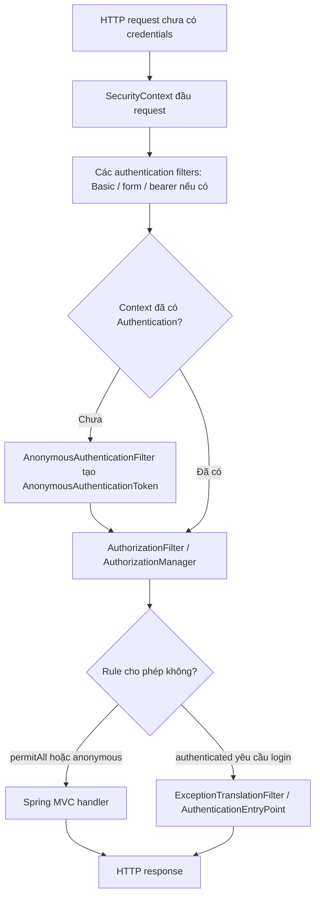

# AnonymousAuthenticationToken và trạng thái người dùng chưa đăng nhập

## Mục tiêu học tập

Một request chưa đăng nhập không nhất thiết có `Authentication == null` khi đi qua Spring Security. Trong ứng dụng Spring MVC/Servlet có anonymous support mặc định, Spring Security có thể đặt một **`AnonymousAuthenticationToken`** vào `SecurityContext` để biểu diễn người gọi ẩn danh. Token ấy thường có principal `anonymousUser`, authority `ROLE_ANONYMOUS` và đặc biệt **`isAuthenticated() == true`**. Điều này nghe mâu thuẫn cho đến khi ta tách hai câu hỏi: “có một đối tượng Authentication để framework xử lý đồng nhất không?” và “người gọi đã chứng minh danh tính chưa?”.

Bài này giải thích chính xác vai trò của anonymous authentication, cách nhận biết nó, sự khác nhau giữa `permitAll()` và `anonymous()`, lý do người chưa đăng nhập thường nhận **401** khi yêu cầu endpoint riêng tư, và một ví dụ chạy được với **Java 17, Spring Boot 3.5.0, Spring Security 6.5.x và Spring MVC**.

Sau khi học, bạn có thể:

1. Giải thích **`AnonymousAuthenticationFilter`**, **`AnonymousAuthenticationToken`** và **`AnonymousAuthenticationProvider`** phối hợp như thế nào.
2. Phân biệt `null Authentication`, `UsernamePasswordAuthenticationToken` chưa xác thực, anonymous token và token người dùng đã đăng nhập.
3. Không nhầm `Authentication#isAuthenticated()` với một chứng cứ rằng “người dùng thật đã login”.
4. Dùng `AuthenticationTrustResolver`/`AuthenticationTrustResolverImpl` để kiểm tra anonymous và hiểu sự khác nhau giữa anonymous, remember-me, authenticated và fully authenticated.
5. Hiểu vì sao Spring MVC `Authentication` method argument có thể là `null` đối với anonymous, trong khi `@CurrentSecurityContext` vẫn đọc được anonymous token.
6. Áp `permitAll()`, `anonymous()`, `authenticated()`, `fullyAuthenticated()`, `hasRole(...)`, `denyAll()` cho đúng đối tượng.
7. Tự chạy và kiểm thử 200/401/403, cùng các đặc điểm của token qua MockMvc và JUnit.

**Phạm vi:** Servlet stack, `HttpSecurity` và `SecurityFilterChain` trên Spring Security 6.5.x. WebFlux dùng `ServerHttpSecurity`, `SecurityWebFilterChain` và `ReactiveSecurityContextHolder`; không sao chép nguyên code Servlet vào WebFlux. Tài khoản và mật khẩu trong ví dụ chỉ dùng cho môi trường học tập local.

## 1. “Anonymous authentication” có nghĩa là gì?

Trong ngôn ngữ thông thường, *anonymous* là người chưa cung cấp danh tính được xác minh. Spring Security cũng hiểu anonymous là người **chưa đăng nhập thật**, nhưng bổ sung một đối tượng vào security context để các tầng authorization, logging và auditing dễ xử lý nhất quán.

Giả sử trình duyệt gửi:

```http
GET /public/ping HTTP/1.1
Host: localhost:8080
```

Request không có credentials, không có session đăng nhập hợp lệ, cũng không có token bearer. Sau khi các authentication filters khác không thiết lập một `Authentication`, `AnonymousAuthenticationFilter` có thể tạo:

```text
AnonymousAuthenticationToken
  principal       = anonymousUser
  authorities     = [ROLE_ANONYMOUS]
  authenticated   = true   (cờ của token)
  credentials     = ""     (chuỗi trống theo implementation)
```

**Đừng hiểu chữ `authenticated=true` ở đây là login thành công.** Đây là một representation nội bộ đặc biệt cho người chưa đăng nhập, được nhận biết bằng loại token và `AuthenticationTrustResolver`. Spring Security sẽ không cho anonymous đi qua rule `authenticated()` chỉ vì cờ đó đang là true.

### 1.1. Tại sao framework muốn có một anonymous object?

Có ít nhất bốn lợi ích:

- **Policy nhất quán:** có thể mô tả public/guest/private endpoints trong cùng hệ thống authorization.
- **Audit/logging:** code đọc `SecurityContext` có một principal mặc định cho những request ẩn danh thay vì phải xử lý `null` ở nhiều nơi.
- **Phân biệt mức tin cậy:** framework phân biệt anonymous, remember-me và người đã đăng nhập đầy đủ.
- **Entry point chính xác:** khi anonymous bị từ chối truy cập endpoint riêng tư, Spring Security có thể yêu cầu người gọi đăng nhập (thường 401 Basic hoặc 302 form login) thay vì chỉ báo 403.

Anonymous authentication **không biến người lạ thành tài khoản trong database**; nó không tạo password, không cấp session đã login, không thêm quyền xem dữ liệu người khác, không mặc định gán `ROLE_USER`.

### 1.2. Đường đi khái quát của một request ẩn danh



Sơ đồ minh họa đường đi tiêu biểu, không phải trình tự tuyệt đối của mọi filter trong mọi `SecurityFilterChain`. Những quyết định chính là: filter khác đã xác thực người gọi chưa, anonymous filter có được bật không, rule authorization nào khớp request, và exception handling chọn cách phản hồi ra sao.

## 2. Ba thành phần Anonymous Authentication

### 2.1. AnonymousAuthenticationFilter: chỉ thêm token nếu còn thiếu

Trong Servlet security chain, `AnonymousAuthenticationFilter` đảm nhiệm công việc điền một anonymous token vào `SecurityContextHolder` khi **chưa có Authentication**. Khi người dùng đã đăng nhập hợp lệ, filter không nên thay thế danh tính đó bằng anonymous.

Có thể hình dung pseudo-code:

```java
// PSEUDOCODE: không phải mã nguồn nguyên văn của framework.
Authentication current = securityContext.getAuthentication();
if (current == null) {
    securityContext.setAuthentication(createAnonymousToken());
}
```

Quan trọng: token anonymous được tạo **sau những cơ chế xác thực liên quan** trong chain; nó không tự đọc header Basic hoặc kiểm tra password. Nếu request có Basic hợp lệ, kết quả từ `BasicAuthenticationFilter`/provider được sử dụng. Nếu không có login hợp lệ, anonymous có thể được đặt vào context.

Với request chứa credentials sai, authentication filter có thể xử lý lỗi và kết thúc bằng challenge mà không đi tiếp theo đường anonymous thường gặp. Do đó **không kết luận mọi request thất bại đăng nhập đều chắc chắn đến controller với anonymous token**.

### 2.2. AnonymousAuthenticationToken: một Authentication đặc biệt

`org.springframework.security.authentication.AnonymousAuthenticationToken` triển khai `Authentication` thông qua `AbstractAuthenticationToken`. Nó chứa principal và tập `GrantedAuthority` tương ứng cho anonymous caller. Default thường gặp:

| Thuộc tính | Giá trị mặc định tiêu biểu | Ý nghĩa |
| --- | --- | --- |
| Loại token | `AnonymousAuthenticationToken` | Một marker nội bộ cho anonymous identity. |
| Principal | `anonymousUser` | Tên hiển thị mặc định; không phải một người dùng đã được tìm thấy trong database. |
| Authorities | `ROLE_ANONYMOUS` | Authority mặc định dành cho anonymous token, không phải `ROLE_USER`. |
| `isAuthenticated()` | `true` | Trạng thái nội bộ của token; **không đồng nghĩa đã login thật**. |
| `getCredentials()` | `""` | Chuỗi rỗng, không chứa password của một user. |
| `getName()` | Thường `anonymousUser` | Dùng được cho mô tả/audit, không phải identity xác thực. |

Token này không chứa mật khẩu đăng nhập, không có quyền tự xem API bảo vệ bằng `authenticated()` và không có bằng chứng về chủ sở hữu tài nguyên. Authority `ROLE_ANONYMOUS` là **quyền mang tính phân loại trong framework**, không nên gán cho nó ý nghĩa người dùng có vai trò kinh doanh.

### 2.3. AnonymousAuthenticationProvider: hỗ trợ loại token anonymous

`AnonymousAuthenticationProvider` có thể được gắn vào `ProviderManager` để nhận diện/kiểm tra anonymous token mà nó hỗ trợ. Cấu hình cổ điển của filter/provider cùng dùng một **key**; Spring Security dùng nó cho sự nhất quán nội bộ giữa các thành phần.

**Không coi key là secret xác thực đáng tin.** Tài liệu Spring Security nhấn mạnh key này không phải một ranh giới bảo mật thực sự. Nếu một client từ xa không đáng tin có thể tự tạo `Authentication` object rồi gửi vào một `AuthenticationManager` dùng chung anonymous provider, đó là kiến trúc cần được thiết kế lại; đừng sử dụng key của anonymous token để xác nhận danh tính.

Trong các ứng dụng Spring Boot Servlet thông thường, bạn **không cần tự new** `AnonymousAuthenticationFilter` hoặc `AnonymousAuthenticationProvider` chỉ để có anonymous support. `HttpSecurity` thường đã cấu hình chức năng này theo mặc định.

### 2.4. Không nhầm AnonymousAuthenticationToken với “login request chưa xác thực”

`UsernamePasswordAuthenticationToken.unauthenticated("alice", "raw-password")` có principal/credentials do người gửi khai, chờ `AuthenticationManager` kiểm tra.

`AnonymousAuthenticationToken` lại là một token **đã được framework tạo để đại diện người không có danh tính login**, không phải nỗ lực xác thực đang chờ provider. Cả hai không đại diện cho “user đã login”, nhưng **khác nhau về mục đích và trạng thái nội bộ**.

## 3. Bốn trạng thái dễ bị trộn lẫn

| Trạng thái | Ví dụ `Authentication` | `isAuthenticated()` | Có thể coi là người dùng login thật? |
| --- | --- | :---: | --- |
| **Chưa có Authentication** | `null` trong context trước khi anonymous filter chạy hoặc ngoài security chain | Không có đối tượng để gọi | Không. |
| **Yêu cầu login chưa kiểm tra** | `UsernamePasswordAuthenticationToken.unauthenticated(...)` | `false` | Không. |
| **Anonymous** | `AnonymousAuthenticationToken` | Thường **true** | **Không**; trust resolver nhận diện anonymous. |
| **Login đã xác minh** | `UsernamePasswordAuthenticationToken` do provider trả về sau password verification | Thường **true** | Có, trong phạm vi cơ chế và mức độ tin cậy tương ứng. |
| **Remember-me** | `RememberMeAuthenticationToken` | Thường **true** | Được nhận diện qua remember-me, nhưng không phải `fullyAuthenticated()`. |

Bảng này chỉ mô tả các trường hợp điển hình. Với pre-authentication, JWT, OAuth2/OIDC hoặc custom tokens, type/principal/authorities khác nhau; mức tin cậy phải được xác định theo security mechanism và policy.

### 3.1. Vì sao if-check thuần boolean có thể sai?

Đoạn sau là lỗi kinh điển:

```java
Authentication authentication =
    SecurityContextHolder.getContext().getAuthentication();

if (authentication != null && authentication.isAuthenticated()) {
    // Sai nếu hiểu rằng "đây chắc chắn là user đã login thật".
    showPrivateData();
}
```

Với anonymous token mặc định, cả hai điều kiện có thể đúng, nhưng người gọi **chưa đăng nhập**. Nếu dùng đoạn logic đó để kiểm soát quyền đọc dữ liệu nhạy cảm, bạn có thể mở sai ranh giới quyền.

**Giải pháp được ưu tiên:** để `authorizeHttpRequests(...).authenticated()` hoặc method authorization của Spring Security áp policy khi phù hợp. Những rule này có ngữ nghĩa phân biệt anonymous qua cơ chế trust resolver. Nếu bắt buộc kiểm tra trong business code, dùng `AuthenticationTrustResolver` và test các trường hợp thiếu context, anonymous và remember-me.

### 3.2. Không kiểm tra bằng tên principal

Đoạn này cũng thiếu tin cậy:

```java
boolean guest = "anonymousUser".equals(authentication.getName());
```

Vì `principal` có thể được tùy chỉnh qua `HttpSecurity.anonymous(...)`, và một ứng dụng không nên suy mức tin cậy từ tên hiển thị. Trong thực tế, một username do user đã đăng ký cũng có thể trông giống tên anonymous nếu cho phép đặt tên như vậy.

Tương tự, `authentication.getAuthorities().contains("ROLE_ANONYMOUS")` không phải cách tổng quát để nhận dạng loại authentication, nhất là khi custom authorities hoặc sai kiểu so sánh `GrantedAuthority` với `String`.

## 4. AuthenticationTrustResolver nhận diện anonymous thế nào?

Spring Security cung cấp interface `AuthenticationTrustResolver` và implementation `AuthenticationTrustResolverImpl` để phân biệt các trạng thái login. Đây là cơ chế đúng hơn so với chỉ so boolean hoặc so chuỗi principal.

Ví dụ fragment:

```java
Authentication auth =
    SecurityContextHolder.getContext().getAuthentication();

AuthenticationTrustResolver trustResolver =
    new AuthenticationTrustResolverImpl();

boolean isGuest = trustResolver.isAnonymous(auth);
```

Import:

```java
import org.springframework.security.authentication.AuthenticationTrustResolver;
import org.springframework.security.authentication.AuthenticationTrustResolverImpl;
import org.springframework.security.core.Authentication;
import org.springframework.security.core.context.SecurityContextHolder;
```

Đây là **fragment độc lập về ý tưởng**, không cần đưa vào mọi controller vì phần lớn policy đã có Spring Security xử lý. Trong lab đầy đủ phần sau, ta dùng trust resolver để làm endpoint quan sát đặc biệt.

### 4.1. Các mức độ tin cậy

Ngữ nghĩa thường gặp:

- **Anonymous:** chưa có danh tính login được xác minh; `trustResolver.isAnonymous(authentication)` trả true với anonymous token mặc định.
- **Remember-me:** một người dùng có identity từ cơ chế ghi nhớ phiên nhưng không nhất thiết trải qua login tương tác gần đây; trust resolver có `isRememberMe(...)`.
- **Authenticated:** chính sách `authenticated()` không coi anonymous token là user đăng nhập, nhưng có thể chấp nhận remember-me trong ngữ cảnh phù hợp.
- **Fully authenticated:** chính sách `fullyAuthenticated()` yêu cầu trạng thái xác thực đầy đủ, loại trừ anonymous và remember-me.

Đừng xem “fully authenticated” là bảo đảm người dùng vừa qua MFA hoặc reauthentication trong một khoảng thời gian cụ thể. Nếu nghiệp vụ cần step-up authentication cho giao dịch nhạy cảm, phải mô hình hóa yêu cầu riêng.

### 4.2. Vì sao framework không dùng mỗi isAuthenticated()?

Với anonymous token, `isAuthenticated()` có thể là true. Nhưng framework **biết đây là anonymous** qua loại authentication/trust resolver và vẫn thực thi `authenticated()` đúng ngữ nghĩa. Điều này cũng giúp `ExceptionTranslationFilter` lựa chọn **start authentication** khi người chưa đăng nhập bị từ chối, thay vì coi họ là user đã login và luôn trả 403.

### 4.3. Unit test ngắn minh họa

```java
AuthenticationTrustResolver resolver =
    new AuthenticationTrustResolverImpl();

AnonymousAuthenticationToken guest =
    new AnonymousAuthenticationToken(
        "local-key",
        "anonymousUser",
        List.of(new SimpleGrantedAuthority("ROLE_ANONYMOUS"))
    );

System.out.println(guest.isAuthenticated());       // true
System.out.println(resolver.isAnonymous(guest));    // true

Authentication loginRequest =
    UsernamePasswordAuthenticationToken.unauthenticated(
        "learner", "demo-secret"
    );

System.out.println(loginRequest.isAuthenticated()); // false
System.out.println(resolver.isAnonymous(loginRequest)); // false
```

Đây là **fragment phụ thuộc Spring Security classes** và các import thích hợp, không phải file Java độc lập dùng `javac` trần. Output logic dự kiến là:

```text
true
true
false
false
```

Điểm cần rút ra: **`!isAnonymous(...)` không đồng nghĩa `authenticated()`**. Login request chưa được xác minh cũng không phải `AnonymousAuthenticationToken`, nhưng vẫn không thể được coi là danh tính hợp lệ. Khi cần chính sách của framework, dùng các authorization rules có sẵn.

## 5. Anonymous token nằm ở đâu trong Spring MVC?

Một chi tiết rất dễ làm bạn debug sai: Spring MVC có nhiều cách đưa danh tính vào controller method, và chúng **không đồng nhất** đối với anonymous.

### 5.1. HttpServletRequest#getPrincipal() có thể là null

Tài liệu Spring Security chỉ rõ: các API servlet như `HttpServletRequest#getUserPrincipal()` hoặc `getCallerPrincipal()` vẫn có thể cho kết quả `null` với anonymous caller, dù `SecurityContextHolder` chứa `AnonymousAuthenticationToken`.

Trong Spring MVC, tham số:

```java
@GetMapping("/public/whoami")
String whoami(Authentication authentication) {
    return authentication == null ? "none" : authentication.getName();
}
```

thường được Spring MVC giải quyết qua `HttpServletRequest#getPrincipal`. Khi request anonymous, tham số `authentication` có thể là **null**. Vì thế đoạn:

```java
if (authentication instanceof AnonymousAuthenticationToken) {
    return "anonymous";
}
```

có thể **không chạy vào nhánh anonymous**, dù anonymous filter đã đặt token vào Spring Security context. Đây là lỗi giải thích thường gặp khi người học “không thấy anonymous token” trong controller.

### 5.2. Dùng @CurrentSecurityContext để thấy đúng anonymous token

Để quan sát cả anonymous, hãy lấy trực tiếp security context:

```java
@GetMapping("/public/security-context")
String contextInfo(@CurrentSecurityContext SecurityContext context) {
    Authentication auth = context.getAuthentication();
    return auth instanceof AnonymousAuthenticationToken
        ? "anonymous"
        : "other";
}
```

Import:

```java
import org.springframework.security.authentication.AnonymousAuthenticationToken;
import org.springframework.security.core.Authentication;
import org.springframework.security.core.context.SecurityContext;
import org.springframework.security.core.annotation.CurrentSecurityContext;
```

Đây là fragment của controller, cần bổ sung Spring MVC annotation import. Phần lab dưới sẽ dùng `@CurrentSecurityContext` cùng `HttpServletRequest` để hiển thị **cả hai góc nhìn trong một response**.

### 5.3. Không thiết kế business service dựa vào anonymousUser

Với một trang danh mục công khai, response có thể giống nhau cho mọi anonymous user. Với nghiệp vụ giỏ hàng chưa đăng nhập, bạn có thể dùng một guest session/id riêng do ứng dụng quản lý. Nhưng `anonymousUser` **không phải một user ID duy nhất cho từng khách truy cập**. Nhiều người anonymous sẽ có cùng tên principal hiển thị `anonymousUser`.

**Sai:** lưu đơn hàng, bình luận hoặc phân quyền tài nguyên theo `ownerUsername = "anonymousUser"` rồi kỳ vọng các khách không nhìn thấy dữ liệu nhau.

**Đúng:** nếu cần nhận diện guest tạm thời, thiết kế guest identity/session ngẫu nhiên, ownership và lifetime cụ thể, kiểm soát cookie/CSRF, rồi khi đăng nhập quyết định cách chuyển ownership. Anonymous token chỉ là một marker tiện cho security framework.

## 6. authorizeHttpRequests: permitAll, anonymous và authenticated khác nhau

Spring Security hỗ trợ nhiều kiểu policy thông qua `HttpSecurity.authorizeHttpRequests(...)`:

| Rule | Người chưa đăng nhập | Người đã đăng nhập hợp lệ | Ý nghĩa |
| --- | :---: | :---: | --- |
| `permitAll()` | Cho phép | Cho phép | Endpoint công khai cho mọi người. |
| `anonymous()` | Cho phép | Từ chối | Chỉ người đang ở trạng thái anonymous. |
| `authenticated()` | Từ chối/challenge | Cho phép | Phải có danh tính authenticated, không tính anonymous token. |
| `fullyAuthenticated()` | Từ chối/challenge | Cho phép nếu đủ mức tin cậy | Loại trừ anonymous và remember-me. |
| `hasRole("ADMIN")` | Không đạt | Chỉ cho người có `ROLE_ADMIN` | Kiểm tra role được cấp. |
| `hasAuthority("ROLE_ANONYMOUS")` | Thường đạt với anonymous mặc định | Thường không đạt | Kiểm tra chuỗi authority; không phải cách tổng quát để kiểm tra trạng thái. |
| `denyAll()` | Từ chối | Từ chối | Không cho ai đi qua. |

**Điểm phân biệt quan trọng:** `permitAll()` không đồng nghĩa “chỉ cho guest vào”. Nếu trang đăng ký hoặc giới thiệu sản phẩm cần cả khách và người đã đăng nhập, dùng `permitAll()`. Nếu trang dành riêng cho người chưa login, chẳng hạn `/guest-only` trong lab, dùng `anonymous()` theo yêu cầu.

### 6.1. Ví dụ rule rõ ràng

```java
http.authorizeHttpRequests(auth -> auth
    .requestMatchers("/public/**").permitAll()
    .requestMatchers("/guest-only").anonymous()
    .requestMatchers("/api/**").authenticated()
    .requestMatchers("/admin/**").hasRole("ADMIN")
    .anyRequest().denyAll()
);
```

Đây là **fragment HttpSecurity**. Cần đặt rule **cụ thể trước rule rộng**: ví dụ nếu có `/api/admin/**` cần ADMIN thì nó phải đứng trước `/api/**` chỉ cần authenticated. Trong ví dụ trên, `/admin/**` không giao nhau với `/api/**`.

`.anyRequest().denyAll()` giúp endpoint mới không vô tình public. Nó có thể khiến route chưa tồn tại bị trả lỗi authorization trước khi Spring MVC trả 404; phải thiết kế error/dispatch policy theo nhu cầu ứng dụng.

### 6.2. permitAll vẫn chạy Security filters

`permitAll()` nghĩa là rule authorization **cho phép request đi tiếp**, không phải tắt Spring Security. Các filter khác, trong đó có anonymous support và security headers, vẫn có thể hoạt động. Spring Security khuyến nghị thường dùng `permitAll` cho tài nguyên public thay vì đưa chúng khỏi filter chain bằng `web.ignoring()`.

Ngược lại, khi bỏ hẳn một URL khỏi Security filter chain, bạn có thể **không còn anonymous token**, các security headers hoặc một số cơ chế khác. Không nhìn thấy Authentication trong code bên ngoài filter chain không chứng minh browser đã đăng nhập hay policy đúng.

### 6.3. anonymous() không phải đăng nhập không mật khẩu

`anonymous()` chỉ mô tả quy tắc cho người chưa xác thực. Không phải OAuth anonymous login, không tạo tài khoản khách có quyền riêng, không dùng làm bí quyết “cho API ghi dữ liệu không cần token”.

Nếu endpoint có hành động ghi, cần xác định **quyền tạm thời, chống spam/lạm dụng, CSRF, xác thực email/OTP khi cần, ownership và lifecycle**; anonymous policy chỉ là một điều kiện trong thiết kế.

## 7. Vì sao người chưa đăng nhập nhận 401 thay vì 403?

Phân biệt hai lớp:

1. `AuthorizationFilter` và authorization manager đánh giá policy đối với request. Nếu request anonymous gọi endpoint yêu cầu `authenticated()`, quyết định là **deny**.
2. `ExceptionTranslationFilter` nhận ngoại lệ từ chối và có thể dùng `AuthenticationTrustResolver` để biết authentication là anonymous. Với anonymous, nó gọi **`AuthenticationEntryPoint`** để bắt đầu quá trình đăng nhập.
3. Với **HTTP Basic**, entry point thường trả **401 Unauthorized** cùng `WWW-Authenticate`. Với **form login**, nó có thể chuyển hướng **302** đến trang login.
4. Nếu người gọi đã xác thực thật nhưng thiếu quyền, `AccessDeniedHandler` thường đưa ra **403 Forbidden**.

```text
GET /api/me (chưa đăng nhập)
      |
      v
AnonymousAuthenticationToken trong context
      |
      v
Authorization: .authenticated() -> denied
      |
      v
ExceptionTranslationFilter + AuthenticationTrustResolver
      |
      v
Anonymous -> AuthenticationEntryPoint -> 401 Basic / 302 form

GET /admin/ping (learner đã đăng nhập)
      |
      v
Verified Authentication, chỉ có ROLE_USER
      |
      v
Authorization: .hasRole("ADMIN") -> denied
      |
      v
AccessDeniedHandler -> thường 403
```

**Không suy status chỉ từ token:** còn tùy form/basic/bearer, custom exception handling, request type và các filter khác. 403 cũng có thể đến từ **CSRF**, và 401 có thể xảy ra khi credentials sai dù URL public theo policy. Đọc logs/response thực trước khi kết luận.

### 7.1. Credentials sai không giống request không gửi credentials

Với request **không gửi** header Basic, anonymous filter có thể tạo token để hỗ trợ authorization. Với request **gửi sai** Basic credentials, `BasicAuthenticationFilter` có thể bắt lỗi xác thực, xóa security context hiện tại và gọi entry point cho lỗi login. Hai request có thể cùng trả 401 ở endpoint riêng tư, nhưng **đường xử lý không hoàn toàn giống nhau**.

Một nguyên tắc debug hữu ích: ghi nhận 401/403, authentication type và rule bị từ chối; không ghi raw password, Basic header, bearer token hay session cookie vào log.

## 8. Ví dụ chạy được: Boot 3.5, Java 17, Spring Security 6.5

### 8.1. Mục đích của project

Tạo năm endpoint:

| HTTP endpoint | Policy | Kết quả cần quan sát |
| --- | --- | --- |
| `GET /public/ping` | `permitAll` | Anonymous và user đã login đều được truy cập. |
| `GET /public/context` | `permitAll` | So sánh security context với Servlet principal, phân biệt anonymous vs verified user. |
| `GET /guest-only` | `anonymous` | Anonymous được 200, user đã login bị 403. |
| `GET /api/me` | `authenticated` | Anonymous bị 401; người login hợp lệ được 200. |
| `GET /admin/ping` | `hasRole("ADMIN")` | Learner bị 403, admin được 200. |

Hai tài khoản demo:

- `learner` / `learner-pass`: authority `ROLE_USER`.
- `admin` / `admin-pass`: authorities `ROLE_USER` và `ROLE_ADMIN`.

**Mật khẩu và tài khoản ở đây chỉ dùng trên localhost để học.** Không hard-code credentials production, không dùng HTTP Basic qua HTTP không mã hóa ngoài môi trường local.

### 8.2. Cấu trúc thư mục

```text
anonymous-security-lab/
├── pom.xml
└── src/
    ├── main/java/com/example/anonymous/
    │   ├── AnonymousLabApplication.java
    │   ├── SecurityConfig.java
    │   └── IdentityController.java
    └── test/java/com/example/anonymous/
        ├── AnonymousTokenTest.java
        └── AnonymousHttpTest.java
```

### 8.3. pom.xml

```xml
<project xmlns="http://maven.apache.org/POM/4.0.0"
         xmlns:xsi="http://www.w3.org/2001/XMLSchema-instance"
         xsi:schemaLocation="http://maven.apache.org/POM/4.0.0 https://maven.apache.org/xsd/maven-4.0.0.xsd">
    <modelVersion>4.0.0</modelVersion>

    <parent>
        <groupId>org.springframework.boot</groupId>
        <artifactId>spring-boot-starter-parent</artifactId>
        <version>3.5.0</version>
        <relativePath/>
    </parent>

    <groupId>com.example</groupId>
    <artifactId>anonymous-security-lab</artifactId>
    <version>1.0.0</version>

    <properties>
        <java.version>17</java.version>
    </properties>

    <dependencies>
        <dependency>
            <groupId>org.springframework.boot</groupId>
            <artifactId>spring-boot-starter-web</artifactId>
        </dependency>
        <dependency>
            <groupId>org.springframework.boot</groupId>
            <artifactId>spring-boot-starter-security</artifactId>
        </dependency>
        <dependency>
            <groupId>org.springframework.boot</groupId>
            <artifactId>spring-boot-starter-test</artifactId>
            <scope>test</scope>
        </dependency>
        <dependency>
            <groupId>org.springframework.security</groupId>
            <artifactId>spring-security-test</artifactId>
            <scope>test</scope>
        </dependency>
    </dependencies>

    <build>
        <plugins>
            <plugin>
                <groupId>org.springframework.boot</groupId>
                <artifactId>spring-boot-maven-plugin</artifactId>
            </plugin>
        </plugins>
    </build>
</project>
```

Đây là Maven project **Servlet MVC**, chỉ dùng `spring-boot-starter-web`, không thêm `spring-boot-starter-webflux`. Spring Boot parent/BOM chọn phiên bản tương thích cho Spring Security và các module. 3.5.0 là mốc ví dụ; khi làm dự án thật cần áp dụng bản vá còn được hỗ trợ.

### 8.4. AnonymousLabApplication.java

```java
package com.example.anonymous;

import org.springframework.boot.SpringApplication;
import org.springframework.boot.autoconfigure.SpringBootApplication;

@SpringBootApplication
public class AnonymousLabApplication {
    public static void main(String[] args) {
        SpringApplication.run(AnonymousLabApplication.class, args);
    }
}
```

Lớp `@SpringBootApplication` nằm ở package gốc, nên Spring component scanning phát hiện `SecurityConfig` và `IdentityController` trong cùng package. Startup không tự tạo identity production; nguồn user ở bean bên dưới.

### 8.5. SecurityConfig.java

```java
package com.example.anonymous;

import org.springframework.context.annotation.Bean;
import org.springframework.context.annotation.Configuration;
import org.springframework.http.HttpMethod;
import org.springframework.security.config.Customizer;
import org.springframework.security.config.annotation.web.builders.HttpSecurity;
import org.springframework.security.config.annotation.web.configurers.AbstractHttpConfigurer;
import org.springframework.security.core.userdetails.User;
import org.springframework.security.core.userdetails.UserDetails;
import org.springframework.security.core.userdetails.UserDetailsService;
import org.springframework.security.crypto.bcrypt.BCryptPasswordEncoder;
import org.springframework.security.crypto.password.PasswordEncoder;
import org.springframework.security.provisioning.InMemoryUserDetailsManager;
import org.springframework.security.web.SecurityFilterChain;

@Configuration(proxyBeanMethods = false)
public class SecurityConfig {

    @Bean
    PasswordEncoder passwordEncoder() {
        return new BCryptPasswordEncoder();
    }

    @Bean
    UserDetailsService users(PasswordEncoder encoder) {
        UserDetails learner = User.withUsername("learner")
            .password(encoder.encode("learner-pass"))
            .roles("USER")
            .build();

        UserDetails admin = User.withUsername("admin")
            .password(encoder.encode("admin-pass"))
            .roles("USER", "ADMIN")
            .build();

        return new InMemoryUserDetailsManager(learner, admin);
    }

    @Bean
    SecurityFilterChain securityFilterChain(HttpSecurity http)
            throws Exception {

        return http
            .authorizeHttpRequests(auth -> auth
                .requestMatchers(
                    HttpMethod.GET,
                    "/public/ping",
                    "/public/context"
                ).permitAll()
                .requestMatchers(HttpMethod.GET, "/guest-only").anonymous()
                .requestMatchers(HttpMethod.GET, "/api/me").authenticated()
                .requestMatchers(HttpMethod.GET, "/admin/ping").hasRole("ADMIN")
                .anyRequest().denyAll()
            )
            .httpBasic(Customizer.withDefaults())
            .formLogin(AbstractHttpConfigurer::disable)
            .build();
    }
}
```

Các điểm cần giải thích:

1. `InMemoryUserDetailsManager` giữ hai user học tập với password được hash bằng BCrypt. Đây không phải database hoặc hệ thống quản lý secret; source vẫn có password demo.
2. `SecurityFilterChain` định nghĩa quyền theo HTTP method/path. `requestMatchers` là authorization rules, không phải khai báo controller route.
3. `/public/**` theo các URL được liệt kê có `permitAll`, nên cả anonymous và authenticated user đều vào được.
4. `/guest-only` có **`anonymous()`**, nên ngược với login-only endpoint: user đã login hợp lệ sẽ không được phép vào.
5. `/api/me` có **`authenticated()`**; anonymous token dù có cờ `isAuthenticated()=true` vẫn bị framework từ chối.
6. `/admin/ping` cần `ROLE_ADMIN` theo quy ước `hasRole("ADMIN")`.
7. `.anyRequest().denyAll()` không mở các route mới chỉ vì có `@GetMapping` khác trong source.
8. `httpBasic(...)` được bật để curl và MockMvc dễ kiểm thử; form login bị tắt **chỉ trong bài lab** để tránh redirect HTML, không tắt anonymous support hay CSRF mặc định.
9. Chúng ta **không gọi `http.anonymous(...)`**: đó là chủ ý để quan sát default anonymous principal `anonymousUser` và authority `ROLE_ANONYMOUS`. Nếu sau này tùy chỉnh, test cần được cập nhật theo policy mới.

### 8.6. IdentityController.java: cùng lúc xem SecurityContext và Servlet principal

```java
package com.example.anonymous;

import jakarta.servlet.http.HttpServletRequest;

import java.util.List;
import java.util.Map;

import org.springframework.security.authentication.AuthenticationTrustResolver;
import org.springframework.security.authentication.AuthenticationTrustResolverImpl;
import org.springframework.security.core.Authentication;
import org.springframework.security.core.GrantedAuthority;
import org.springframework.security.core.annotation.CurrentSecurityContext;
import org.springframework.security.core.context.SecurityContext;
import org.springframework.web.bind.annotation.GetMapping;
import org.springframework.web.bind.annotation.RestController;

@RestController
public class IdentityController {

    private final AuthenticationTrustResolver trustResolver =
        new AuthenticationTrustResolverImpl();

    @GetMapping("/public/ping")
    public String ping() {
        return "pong";
    }

    @GetMapping("/public/context")
    public Map<String, Object> context(
            @CurrentSecurityContext SecurityContext context,
            HttpServletRequest request) {

        Authentication auth = context.getAuthentication();

        List<String> authorities = (auth == null)
            ? List.of()
            : auth.getAuthorities().stream()
                .map(GrantedAuthority::getAuthority)
                .sorted()
                .toList();

        return Map.of(
            "name", auth == null ? "(none)" : auth.getName(),
            "tokenAuthenticated", auth != null && auth.isAuthenticated(),
            "anonymous", trustResolver.isAnonymous(auth),
            "servletPrincipalPresent", request.getUserPrincipal() != null,
            "authorities", authorities
        );
    }

    @GetMapping("/guest-only")
    public String guestOnly() {
        return "guest-only";
    }

    @GetMapping("/api/me")
    public Map<String, String> me(Authentication authentication) {
        return Map.of("username", authentication.getName());
    }

    @GetMapping("/admin/ping")
    public String adminPing() {
        return "admin-only";
    }
}
```

**Phân tích endpoint `/public/context`:**

- `@CurrentSecurityContext SecurityContext context` lấy trực tiếp Spring Security context, kể cả khi có anonymous authentication.
- `context.getAuthentication()` có thể trả `AnonymousAuthenticationToken` trên request anonymous đi qua Security filter chain.
- `trustResolver.isAnonymous(auth)` phân loại token chính xác hơn việc kiểm tra tên `anonymousUser`.
- `tokenAuthenticated` cố ý cho thấy anonymous token có cờ `true` nhưng `anonymous=true`.
- `request.getUserPrincipal()` theo Servlet API thường là null với anonymous, dù SecurityContext chứa token. Với Basic login thành công, Servlet principal được thấy ở request wrapper theo cấu hình thường gặp.
- `authorities` là danh sách chuỗi được chọn lọc; không xuất credentials, session ID hay đối tượng Authentication đầy đủ.

**Không đưa một endpoint chẩn đoán như `/public/context` vào sản phẩm thật một cách vô tình.** Trong lab, nó chỉ cho thấy metadata an toàn của tài khoản giả. Trong production, phản hồi public không nên tiết lộ danh sách quyền nội bộ hoặc cấu trúc security runtime nếu không cần thiết.

`GET /api/me` dùng method argument `Authentication` vì URL đã yêu cầu `authenticated()`; ở đó danh tính đăng nhập hợp lệ được đưa vào handler. Đối với anonymous trên endpoint public, **đừng dùng riêng method argument này để kiểm tra anonymous** vì Spring MVC có thể resolve bằng Servlet principal và trả null.

### 8.7. Chạy bằng Maven, thử với curl

Từ thư mục có `pom.xml`:

```bash
java -version
mvn -version
mvn spring-boot:run
```

Trong terminal khác:

```bash
curl -i http://localhost:8080/public/ping
curl -i http://localhost:8080/public/context
curl -i -u learner:learner-pass http://localhost:8080/public/context
curl -i http://localhost:8080/guest-only
curl -i -u learner:learner-pass http://localhost:8080/guest-only
curl -i http://localhost:8080/api/me
curl -i -u learner:learner-pass http://localhost:8080/api/me
curl -i -u learner:wrong-pass http://localhost:8080/api/me
curl -i -u learner:learner-pass http://localhost:8080/admin/ping
curl -i -u admin:admin-pass http://localhost:8080/admin/ping
```

Trên Windows PowerShell, dùng `curl.exe` nếu `curl` là alias của `Invoke-WebRequest`.

Kết quả dự kiến:

| Request | HTTP status | Nội dung quan trọng |
| --- | --- | --- |
| Anonymous `GET /public/ping` | 200 | `pong` |
| Anonymous `GET /public/context` | 200 | `name=anonymousUser`, `tokenAuthenticated=true`, `anonymous=true`, `servletPrincipalPresent=false`, `authorities=["ROLE_ANONYMOUS"]` |
| Learner hợp lệ `GET /public/context` | 200 | `name=learner`, `tokenAuthenticated=true`, `anonymous=false`, `servletPrincipalPresent=true`, `authorities=["ROLE_USER"]` |
| Anonymous `GET /guest-only` | 200 | `guest-only` |
| Learner hợp lệ `GET /guest-only` | 403 | Đã login nên không thỏa `anonymous()` |
| Anonymous `GET /api/me` | 401 | Basic challenge; không trả username |
| Learner hợp lệ `GET /api/me` | 200 | JSON `{"username":"learner"}` |
| Sai password `GET /api/me` | 401 | Không có verified Authentication |
| Learner hợp lệ `GET /admin/ping` | 403 | Thiếu `ROLE_ADMIN` |
| Admin hợp lệ `GET /admin/ping` | 200 | `admin-only` |

**Không hiểu bảng như output HTTP nguyên văn.** Header, thứ tự field JSON và các thông tin transport có thể khác theo runtime. Quan sát status và các thuộc tính được liệt kê là đủ. `curl` không tự làm trình duyệt hoặc không có cơ chế cookie/session giống browser; trong ví dụ này mỗi request truyền Basic credentials theo lệnh.

## 9. Unit test: token anonymous và trust resolver

Để kiểm tra riêng ngữ nghĩa token, không cần chạy HTTP server. Tạo file `src/test/java/com/example/anonymous/AnonymousTokenTest.java`:

```java
package com.example.anonymous;

import java.util.List;

import org.junit.jupiter.api.Test;
import org.springframework.security.authentication.AnonymousAuthenticationToken;
import org.springframework.security.authentication.AuthenticationTrustResolver;
import org.springframework.security.authentication.AuthenticationTrustResolverImpl;
import org.springframework.security.authentication.UsernamePasswordAuthenticationToken;
import org.springframework.security.core.Authentication;
import org.springframework.security.core.authority.SimpleGrantedAuthority;

import static org.assertj.core.api.Assertions.assertThat;

class AnonymousTokenTest {

    private final AuthenticationTrustResolver trust =
        new AuthenticationTrustResolverImpl();

    @Test
    void anonymousTokenHasTrueFlagButIsAnonymous() {
        AnonymousAuthenticationToken guest =
            new AnonymousAuthenticationToken(
                "local-demo-key",
                "anonymousUser",
                List.of(new SimpleGrantedAuthority("ROLE_ANONYMOUS"))
            );

        assertThat(guest.isAuthenticated()).isTrue();
        assertThat(guest.getName()).isEqualTo("anonymousUser");
        assertThat(guest.getCredentials()).isEqualTo("");
        assertThat(trust.isAnonymous(guest)).isTrue();
    }

    @Test
    void unverifiedLoginRequestIsNotAnonymousToken() {
        Authentication loginRequest =
            UsernamePasswordAuthenticationToken.unauthenticated(
                "learner", "learner-pass"
            );

        assertThat(loginRequest.isAuthenticated()).isFalse();
        assertThat(trust.isAnonymous(loginRequest)).isFalse();
        assertThat(loginRequest.getAuthorities()).isEmpty();
    }

    @Test
    void VerifiedUsernameTokenIsDifferentFromAnonymous() {
        Authentication verified =
            UsernamePasswordAuthenticationToken.authenticated(
                "learner",
                null,
                List.of(new SimpleGrantedAuthority("ROLE_USER"))
            );

        assertThat(verified.isAuthenticated()).isTrue();
        assertThat(trust.isAnonymous(verified)).isFalse();
        assertThat(verified.getAuthorities())
            .extracting(authority -> authority.getAuthority())
            .containsExactly("ROLE_USER");
    }
}
```

Đây là **3 unit tests** đối với token/trust resolver. Test thứ ba dùng factory tạo token authenticated chỉ để mô phỏng type; **không phải cách triển khai đăng nhập trong server thật**. Trong ứng dụng production, chỉ authentication provider hoặc cơ chế đã kiểm chứng mới được tạo một kết quả authenticated đáng tin.

**Điểm đáng học:** unit test 2 cho thấy `isAnonymous == false` cũng chưa đủ để suy ra “đã login”. Phải kiểm soát trạng thái xác thực trong framework, không dùng những kiểm tra đơn lẻ sai ngữ cảnh.

## 10. Integration test: cùng HTTP endpoint, người dùng khác nhau

Tạo `src/test/java/com/example/anonymous/AnonymousHttpTest.java`:

```java
package com.example.anonymous;

import org.junit.jupiter.api.Test;
import org.springframework.beans.factory.annotation.Autowired;
import org.springframework.boot.test.autoconfigure.web.servlet.AutoConfigureMockMvc;
import org.springframework.boot.test.context.SpringBootTest;
import org.springframework.test.web.servlet.MockMvc;

import static org.springframework.security.test.web.servlet.request
    .SecurityMockMvcRequestPostProcessors.httpBasic;
import static org.springframework.test.web.servlet.request.MockMvcRequestBuilders.get;
import static org.springframework.test.web.servlet.result.MockMvcResultMatchers.content;
import static org.springframework.test.web.servlet.result.MockMvcResultMatchers.jsonPath;
import static org.springframework.test.web.servlet.result.MockMvcResultMatchers.status;

@SpringBootTest
@AutoConfigureMockMvc
class AnonymousHttpTest {

    @Autowired
    MockMvc mvc;

    @Test
    void publicPingAllowsAnonymous() throws Exception {
        mvc.perform(get("/public/ping"))
            .andExpect(status().isOk())
            .andExpect(content().string("pong"));
    }

    @Test
    void anonymousContextHasTokenButNoServletPrincipal()
            throws Exception {
        mvc.perform(get("/public/context"))
            .andExpect(status().isOk())
            .andExpect(jsonPath("$.name").value("anonymousUser"))
            .andExpect(jsonPath("$.tokenAuthenticated").value(true))
            .andExpect(jsonPath("$.anonymous").value(true))
            .andExpect(jsonPath("$.servletPrincipalPresent").value(false))
            .andExpect(jsonPath("$.authorities[0]")
                .value("ROLE_ANONYMOUS"));
    }

    @Test
    void loggedInContextIsNotAnonymous() throws Exception {
        mvc.perform(get("/public/context")
                .with(httpBasic("learner", "learner-pass")))
            .andExpect(status().isOk())
            .andExpect(jsonPath("$.name").value("learner"))
            .andExpect(jsonPath("$.tokenAuthenticated").value(true))
            .andExpect(jsonPath("$.anonymous").value(false))
            .andExpect(jsonPath("$.servletPrincipalPresent").value(true))
            .andExpect(jsonPath("$.authorities[0]")
                .value("ROLE_USER"));
    }

    @Test
    void anonymousRuleAllowsGuest() throws Exception {
        mvc.perform(get("/guest-only"))
            .andExpect(status().isOk())
            .andExpect(content().string("guest-only"));
    }

    @Test
    void anonymousRuleRejectsLoggedInUser() throws Exception {
        mvc.perform(get("/guest-only")
                .with(httpBasic("learner", "learner-pass")))
            .andExpect(status().isForbidden());
    }

    @Test
    void authenticatedRuleChallengesGuest() throws Exception {
        mvc.perform(get("/api/me"))
            .andExpect(status().isUnauthorized());
    }

    @Test
    void authenticatedRuleAcceptsLearner() throws Exception {
        mvc.perform(get("/api/me")
                .with(httpBasic("learner", "learner-pass")))
            .andExpect(status().isOk())
            .andExpect(jsonPath("$.username").value("learner"));
    }

    @Test
    void incorrectPasswordIsRejected() throws Exception {
        mvc.perform(get("/api/me")
                .with(httpBasic("learner", "wrong-pass")))
            .andExpect(status().isUnauthorized());
    }

    @Test
    void adminRouteRejectsOrdinaryUser() throws Exception {
        mvc.perform(get("/admin/ping")
                .with(httpBasic("learner", "learner-pass")))
            .andExpect(status().isForbidden());
    }

    @Test
    void adminRouteAcceptsAdmin() throws Exception {
        mvc.perform(get("/admin/ping")
                .with(httpBasic("admin", "admin-pass")))
            .andExpect(status().isOk())
            .andExpect(content().string("admin-only"));
    }

    @Test
    void unlistedRouteIsDeniedForAuthenticatedUser() throws Exception {
        mvc.perform(get("/unlisted")
                .with(httpBasic("learner", "learner-pass")))
            .andExpect(status().isForbidden());
    }
}
```

**Có 11 integration tests** bao phủ:

- `permitAll()` trên endpoint public.
- Anonymous token xuất hiện đúng trong `SecurityContext`.
- Servlet principal vắng mặt khi anonymous.
- Người dùng Basic login không còn bị xem là anonymous.
- `anonymous()` chấp nhận guest nhưng từ chối user đã login.
- `authenticated()` không chấp nhận anonymous.
- Sai password không có quyền dù header Basic được gửi.
- `hasRole("ADMIN")` phân biệt USER/ADMIN.
- `denyAll()` không vô tình cho endpoint mới trở thành public.

MockMvc chạy Spring MVC request cùng security filters trong test application context. Nó kiểm tra các lớp code trong bài, nhưng không thay thế kiểm thử browser session, load balancer hay identity provider nếu production dùng các cơ chế đó.

### 10.1. Chạy test

```bash
mvn test
```

Với cấu hình/filename như trên, có **14 tests** tổng cộng: 3 unit tests + 11 integration tests. Kỳ vọng tất cả pass khi dependency và môi trường đúng. Nếu test thất bại, xem assertion và HTTP status thực; bảng trong tài liệu chỉ nêu kết quả dự kiến, **không phải log từ một lần chạy sẵn**.

`JUnit` và `spring-security-test` giúp kiểm chứng behavior, nhưng không có test nào ở đây dùng password thật. Các account demo chỉ sống trong bộ nhớ của tiến trình test.

## 11. Tùy chỉnh anonymous principal và authorities khi thật sự cần

Theo mặc định, phần lớn ứng dụng **không cần** tự cấu hình anonymous support. Nếu bạn muốn thay tên guest hiển thị hoặc authority vì một chính sách đặc biệt, `HttpSecurity` hỗ trợ:

```java
http.anonymous(anonymous -> anonymous
    .principal("guestVisitor")
    .authorities("ROLE_GUEST")
);
```

Đây là **fragment HttpSecurity** cần đặt trong cấu hình thích hợp, không phải một class Java độc lập. Khi dùng trên Spring Security 6.5, API lambda `anonymous(Customizer)` phù hợp hơn cách gọi no-arg `anonymous()` cũ đã bị deprecated.

Sau khi tùy chỉnh, kết quả của `getName()`/`getAuthorities()` ở anonymous token có thể đổi. Nhưng **`AuthenticationTrustResolver.isAnonymous(...)` vẫn có thể nhận diện loại `AnonymousAuthenticationToken`**, và rule `authenticated()` vẫn không coi guest là người đã login.

**Không biến ROLE_GUEST thành quyền xem dữ liệu cá nhân** chỉ vì người dùng chưa có tài khoản. Nếu một endpoint cần identity guest tạm thời, phải thiết kế session/token ngẫu nhiên cho từng client và ownership riêng, không dựa vào principal cố định dùng chung.

### 11.1. Tắt anonymous support có làm ứng dụng an toàn hơn?

Có thể cấu hình:

```java
http.anonymous(AbstractHttpConfigurer::disable);
```

Đây là **fragment chỉ để nhận biết API**. Việc tắt anonymous không thay thế authorization. Nó có thể làm `SecurityContext#getAuthentication()` bằng null ở request không login và ảnh hưởng những code/policy dựa trên anonymous marker. Nếu một hệ thống cần tắt vì mô hình đặc biệt, phải test lại entry points, exception handling, authorization và các use case auditing.

Đừng tắt anonymous chỉ để sửa lỗi “`isAuthenticated()` trả true”. Hãy sửa **cách kiểm tra quyền** bằng trust resolver/built-in authorization. Việc loại bỏ anonymous filter có thể làm bộc lộ thêm lỗi `NullPointerException` trong code thiếu guard, nhưng không tự nâng chất lượng security policy.

### 11.2. Bảo vệ registration/login page

Đăng ký và đăng nhập thường là trang **cho phép người chưa đăng nhập**. Chúng có thể dùng `permitAll()` nếu một người đã đăng nhập vẫn cần xem hoặc redirect theo logic riêng. `anonymous()` có thể phù hợp nếu chính sách xác định login page chỉ dành cho guest, nhưng điều này cần test cả trường hợp người dùng đã có session và các redirect/entry point để tránh vòng lặp.

Không bắt buộc mọi login form phải dùng `anonymous()`. Nếu yêu cầu chỉ là trang có thể truy cập khi chưa login, `permitAll()` thường rõ ràng và dễ vận hành hơn.

## 12. Anonymous, CSRF, CORS và session là các khái niệm khác nhau

### 12.1. Anonymous token không chống CSRF

Một endpoint `POST /guest/feedback` có thể cho người chưa login gửi phản hồi, nhưng nếu request liên quan browser/session/cookie, vẫn cần xét rủi ro CSRF. Spring Security Servlet thường bật CSRF protection mặc định cho các HTTP method thay đổi trạng thái.

**Sai:** “Request anonymous thì không có nguy cơ CSRF, cứ tắt CSRF”.

**Đúng:** đánh giá liệu trình duyệt có tự đính kèm credentials/cookie hoặc trạng thái nào có thể bị lạm dụng, endpoint có side effects không, cách CSRF token được thiết kế, và có các lớp chống spam/rate-limit phù hợp hay không.

### 12.2. Anonymous và CORS là hai việc khác nhau

Ví dụ frontend `http://localhost:5173` gọi API `http://localhost:8080/public/context`: dù endpoint `permitAll` và request là guest, JavaScript vẫn cần chính sách **CORS** hợp lệ để browser được đọc response cross-origin. CORS không cung cấp danh tính login và không thay Spring Security authorization.

### 12.3. Anonymous token không đồng nghĩa server tạo HTTP session

Một request chưa đăng nhập có thể dùng anonymous token trong ngữ cảnh của **request hiện tại**. Chỉ riêng việc tạo anonymous token không có nghĩa mọi request sẽ tự tạo session bền vững để ghi nhớ user. Session có thể phát sinh bởi những cơ chế khác của ứng dụng/security (ví dụ lưu request, CSRF token hoặc logic session), nên phải kiểm tra request/response thực tế.

Dữ liệu guest cần tồn tại qua nhiều request — ví dụ giỏ hàng trước login — đòi hỏi **một cơ chế nhận diện guest/session** riêng với cookie/ID phù hợp. Không dùng chuỗi `anonymousUser` như khóa chung cho mọi người.

### 12.4. Anonymous và logout

Sau logout hợp lệ, principal đã đăng nhập không còn là identity được phép dùng cho những request sau. Một request tiếp theo không gửi credentials có thể lại được anonymous filter gắn `AnonymousAuthenticationToken`. Điều này **không có nghĩa logout thất bại**; điều cần kiểm tra là protected endpoint từ chối quyền và session/token cũ không còn được sử dụng theo thiết kế.

Với HTTP Basic, client có thể tiếp tục gửi username/password ở request sau nên lại được xác thực; không thể coi thao tác logout phía server như việc buộc client quên Basic credentials mà nó vẫn chủ động gửi.

## 13. SecurityContext, async và background job

`SecurityContextHolder` dùng strategy để giữ context; trong Servlet stack, mặc định thường gắn với thread hiện tại. Anonymous token được thiết lập trong đường xử lý request khi filter phù hợp chạy. Nhưng:

- Trong một scheduled job không đi qua HTTP security chain, `SecurityContextHolder.getContext().getAuthentication()` có thể là **null**.
- Trong `@Async`, thread khác hoặc executor tự quản lý, security context không tự lan truyền đúng trong mọi trường hợp.
- Nếu một request bị bypass hoàn toàn khỏi Spring Security filter chain, anonymous support của chain đó cũng không tạo token.
- Trong WebFlux, security context nằm trong **Reactor Context** theo pipeline/subscription, cần API reactive tương ứng.

Do đó viết service với giả định “SecurityContextHolder luôn có anonymous token khi chưa login” là sai phạm vi. **Anonymous token chỉ là một tính năng của security processing trong bối cảnh được cấu hình**, không phải mặc định toàn cục cho mọi thread trong JVM.

### 13.1. Khi nào log anonymous?

Audit có thể ghi actor type `ANONYMOUS`, route, action, request ID và kết quả policy mà không có username thật. Nếu có thông tin IP/UA để chống lạm dụng, chúng có giới hạn độ tin cậy và vấn đề quyền riêng tư, nên cần cách xử lý riêng. Đừng coi `anonymousUser` là id duy nhất hoặc ghi toàn bộ `Authentication` object vào log.

### 13.2. Khi nào dùng guest role?

Role `ROLE_ANONYMOUS` mặc định phục vụ authorization trong framework. Một hệ thống thương mại điện tử có thể có “guest checkout” như một trạng thái nghiệp vụ riêng; trạng thái ấy có thể gắn cart ID, email verification hoặc session-scoped identity. Không nên đồng nhất “guest business flow” với việc chỉ có `AnonymousAuthenticationToken`.

## 14. Những lỗi thường gặp khi làm việc với anonymous

### Lỗi 1 — Dùng isAuthenticated() để quyết định user đã login

Anonymous token có thể `true`. **Sửa:** dùng `authenticated()`/`fullyAuthenticated()` trong security policy hoặc trust resolver phù hợp.

### Lỗi 2 — So getName() với "anonymousUser"

Principal mặc định có thể được tùy chỉnh hoặc xung đột tên đăng nhập. **Sửa:** kiểm tra token bằng cơ chế trust resolver, không suy loại từ chuỗi.

### Lỗi 3 — Dùng Authentication method argument trên public endpoint để tìm anonymous token

Spring MVC có thể resolve từ Servlet principal, trả `null`. **Sửa:** dùng `@CurrentSecurityContext` khi cần quan sát trực tiếp Spring Security authentication.

### Lỗi 4 — Nghĩ permitAll là không đi qua filter chain

`permitAll` cho qua URL authorization, nhiều security filters vẫn có thể hoạt động. **Sửa:** phân biệt `permitAll` với `web.ignoring` và test headers/context.

### Lỗi 5 — Nghĩ anonymous() giống permitAll()

`anonymous()` dành cho guest, từ chối user đã login; `permitAll()` dành cho cả hai. **Sửa:** chọn theo mục tiêu của endpoint.

### Lỗi 6 — Cấp quyền dựa vào ROLE_ANONYMOUS mà quên loại token

Authority có thể bị tùy chỉnh hoặc được cấp do sai cấu hình. **Sửa:** dùng policy theo trạng thái authentication và kiểm soát nguồn cấp authorities.

### Lỗi 7 — Tạo AnonymousAuthenticationToken từ dữ liệu client để làm login

Token anonymous **không phải** kết quả xác minh password hoặc JWT; key của token không phải secret đáng tin. **Sửa:** đi qua provider/manager phù hợp với loại credentials và xác minh danh tính thật.

### Lỗi 8 — Dùng "anonymousUser" làm khóa owner dữ liệu của mọi guest

Mọi guest có thể có cùng tên principal. **Sửa:** dùng guest/session ID ngẫu nhiên được bảo vệ, ràng buộc owner với tài nguyên phù hợp và giới hạn vòng đời.

### Lỗi 9 — Kết luận 401 là do thiếu role

401 thường là challenge xác thực, còn người đã login thiếu role thường 403. **Sửa:** xem filter, entry point, trust resolver, exception handling và credentials.

### Lỗi 10 — Tắt anonymous filter để chữa bug kiểm tra boolean

Tắt filter có thể làm Authentication null và phá code khác; bug gốc là logic kiểm tra sai. **Sửa:** dùng built-in authorization hoặc trust resolver.

### Lỗi 11 — Nghĩ guest request luôn không có session/cookie

Các cơ chế khác vẫn có thể dùng session hoặc cookie, dù anonymous token không đại diện user đã login. **Sửa:** quan sát Set-Cookie và security/session config thực.

### Lỗi 12 — Mặc định có anonymous token ở job/thread ngoài HTTP

Anonymous filter chỉ chạy trong chain phù hợp. **Sửa:** phân biệt HTTP request context, async propagation và scheduled tasks.

### Lỗi 13 — Cho public endpoint trả thẳng Authentication object

Có thể tiết lộ details, authorities, metadata không cần thiết. **Sửa:** chỉ trả DTO tối thiểu, dùng diagnostic endpoint có chủ đích ở local.

### Lỗi 14 — Dùng authenticated() để bảo vệ quyền sở hữu từng record

Rule này chỉ chứng minh request có login hợp lệ, không đảm bảo owner/tenant. **Sửa:** kiểm tra authorization theo tài nguyên ở service/repository.

### Lỗi 15 — Đặt matcher quá rộng ở đầu

`requestMatchers("/**").permitAll()` đặt trước rule khác có thể làm chúng vô hiệu. **Sửa:** đặt cụ thể trước và có default deny phù hợp.

### Lỗi 16 — Không test cả người đã login trên guest-only route

Test anonymous 200 chưa chứng minh `anonymous()` hoạt động; endpoint có thể vô tình `permitAll()`. **Sửa:** test user đã xác thực bị 403 để xác minh chính xác policy.

## 15. Bài tập tự kiểm tra

**Câu 1.** AnonymousAuthenticationToken có phải là bằng chứng rằng người dùng đã nhập đúng mật khẩu không?  
**Đáp án:** Không. Nó là token nội bộ biểu diễn người chưa đăng nhập khi thiếu Authentication trong security context.

**Câu 2.** Vì sao `AnonymousAuthenticationToken.isAuthenticated()` có thể là true?  
**Đáp án:** Đây là trạng thái nội bộ của token được framework tạo, không phải bằng chứng login thật. Authorization sử dụng trust resolver để phân biệt anonymous.

**Câu 3.** Nếu `auth.isAuthenticated() == true`, có nên tự mở API dữ liệu cá nhân không?  
**Đáp án:** Không. Trước hết cần xét loại authentication/mức tin cậy, và sau đó còn phải áp quyền owner/tenant/role cho tài nguyên.

**Câu 4.** Mặc định principal và authority của anonymous token thường là gì?  
**Đáp án:** `anonymousUser` và `ROLE_ANONYMOUS`, với khả năng tùy chỉnh bằng `HttpSecurity.anonymous(...)`.

**Câu 5.** Khi nào AnonymousAuthenticationFilter tạo token?  
**Đáp án:** Trong chain của nó, nếu security context chưa có Authentication ở thời điểm filter xử lý.

**Câu 6.** Vì sao controller nhận `Authentication` parameter có thể là null trên request anonymous dù SecurityContext có token?  
**Đáp án:** Spring MVC có thể resolve từ Servlet principal; API Servlet trả null với anonymous. Dùng `@CurrentSecurityContext` để đọc security context trực tiếp.

**Câu 7.** `permitAll()` có cho user đã login vào endpoint không?  
**Đáp án:** Có. `permitAll` dành cho mọi caller.

**Câu 8.** `anonymous()` có cho user đã login vào endpoint không?  
**Đáp án:** Không theo policy của nó. Nó dành cho anonymous caller, không phải synonym của permitAll.

**Câu 9.** Vì sao một guest gọi `/api/me` thường nhận 401 khi dùng HTTP Basic?  
**Đáp án:** Rule `authenticated()` từ chối anonymous; `ExceptionTranslationFilter` nhận diện trạng thái chưa login và gọi `AuthenticationEntryPoint` để challenge.

**Câu 10.** User đã login thiếu `ROLE_ADMIN` thường nhận gì khi gọi `/admin/ping`?  
**Đáp án:** 403 Forbidden từ authorization/exception handling trong cấu hình Basic thông thường.

**Câu 11.** `!trustResolver.isAnonymous(auth)` có đủ chứng minh login không?  
**Đáp án:** Không. Auth có thể null hoặc là token login request chưa được kiểm tra. Nên sử dụng policy framework theo trạng thái/mức tin cậy.

**Câu 12.** Anonymous token có thể dùng làm user ID bền vững cho mỗi giỏ hàng chưa đăng nhập không?  
**Đáp án:** Không. Nhiều guest cùng có principal `anonymousUser`; cần guest identity/session phù hợp nếu phải liên kết dữ liệu giữa request.

**Câu 13.** Tắt anonymous support có khiến mọi endpoint an toàn hơn không?  
**Đáp án:** Không tự động. Phải đánh giá rule authorization, entry points, null context và test lại các đường xử lý.

**Câu 14.** Anonymous có phải trường hợp giống remember-me không?  
**Đáp án:** Không. Remember-me nhận diện một người dùng từ cơ chế nhớ phiên, còn anonymous không chứng minh danh tính login; `fullyAuthenticated()` loại trừ cả hai theo ngữ nghĩa phù hợp.

## 16. Checklist vận dụng vào ứng dụng thật

Khi thêm public/guest/private endpoint, hãy rà soát:

1. **Mục tiêu URL:** public cho mọi người (`permitAll`) hay chỉ guest (`anonymous`) hay phải đăng nhập (`authenticated`)?
2. **Danh tính đáng tin:** không suy quyền từ tên `anonymousUser`, header tự nhận, hoặc `isAuthenticated()` đơn lẻ.
3. **Vùng dữ liệu:** API nào chứa dữ liệu user/tenant phải có authorization theo tài nguyên.
4. **Spring MVC arguments:** nếu cần thấy anonymous context, dùng `@CurrentSecurityContext`; đừng nhầm với Servlet principal.
5. **Error handling:** test 401/403/302 theo Basic, form login hoặc bearer thực tế.
6. **Lifecycle:** anonymous token không tự tạo tài khoản, session bền vững hay guest ID.
7. **CSRF/CORS:** phân tích độc lập theo browser credentials và origin; không dùng anonymous để bỏ qua các lớp này.
8. **Filter chain:** chắc chắn request đi qua đúng `SecurityFilterChain`; nếu có nhiều chain, test cả các URL không khớp.
9. **Negative cases:** anonymous, user có credentials sai, user hợp lệ thiếu role, user khác owner, route lạ và HTTP method khác.
10. **Quan sát an toàn:** không trả/log credentials, token thực, session cookie hoặc toàn bộ security context trong sản phẩm.
11. **Version:** đối chiếu API với phiên bản Boot/Security đang dùng; cấu hình Servlet không copy nguyên cho WebFlux.
12. **Thay đổi policy:** nếu tùy chỉnh anonymous principal/authorities, phải cập nhật tests và rule có liên quan, tránh phụ thuộc chuỗi tên.

## Kết luận

`AnonymousAuthenticationToken` giúp Spring Security **biểu diễn người chưa đăng nhập bằng một Authentication đặc biệt** để các thành phần authorization, auditing và exception handling có một ngữ cảnh thống nhất. `AnonymousAuthenticationFilter` tạo token khi context chưa có identity, `AnonymousAuthenticationProvider` hỗ trợ nhận diện loại token theo cơ chế nội bộ, còn `AuthenticationTrustResolver` giúp framework biết nó vẫn là **anonymous**.

Điểm quan trọng nhất: **`AnonymousAuthenticationToken.isAuthenticated() == true` không có nghĩa user đã login thật**. Hãy dùng `permitAll()` cho endpoint công khai, `anonymous()` cho endpoint chỉ dành cho guest, `authenticated()` hoặc `fullyAuthenticated()` cho những mức login tương ứng, và tiếp tục bảo vệ dữ liệu theo role/owner/tenant. Trong Spring MVC, nếu muốn quan sát anonymous token hãy dùng `@CurrentSecurityContext`; Servlet principal có thể vẫn là null.

Bài lab với Java 17 và Spring Boot 3.5.0 cho thấy trực tiếp sự khác nhau: người chưa login có anonymous token nhưng không vượt qua `authenticated()`, user đã đăng nhập không vượt qua `anonymous()`, và chỉ admin được xem endpoint yêu cầu `ROLE_ADMIN`. Đây là nền tảng để hiểu cách Spring Security đối xử với danh tính chưa đăng nhập mà không suy sai từ trạng thái boolean.

## Tài liệu tham khảo chính thức

- [Spring Security 6.5 — Anonymous Authentication](https://docs.spring.io/spring-security/reference/6.5/servlet/authentication/anonymous.html)
- [Spring Security 6.5 — Servlet Authentication Architecture](https://docs.spring.io/spring-security/reference/6.5/servlet/authentication/architecture.html)
- [Spring Security 6.5 — Authorize HttpServletRequests](https://docs.spring.io/spring-security/reference/6.5/servlet/authorization/authorize-http-requests.html)
- [Spring Security 6.5 — HttpSecurity JavaDoc](https://docs.spring.io/spring-security/reference/6.5/api/java/org/springframework/security/config/annotation/web/builders/HttpSecurity.html)
- [Spring Security 6.5 — AnonymousConfigurer JavaDoc](https://docs.spring.io/spring-security/reference/6.5/api/java/org/springframework/security/config/annotation/web/configurers/AnonymousConfigurer.html)
- [Spring Security 6.5 — AnonymousAuthenticationToken JavaDoc](https://docs.spring.io/spring-security/reference/6.5/api/java/org/springframework/security/authentication/AnonymousAuthenticationToken.html)
- [Spring Security 6.5 — HTTP Basic Authentication](https://docs.spring.io/spring-security/reference/6.5/servlet/authentication/passwords/basic.html)
