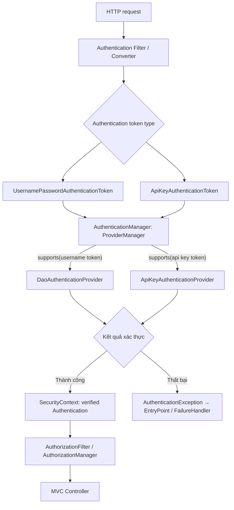
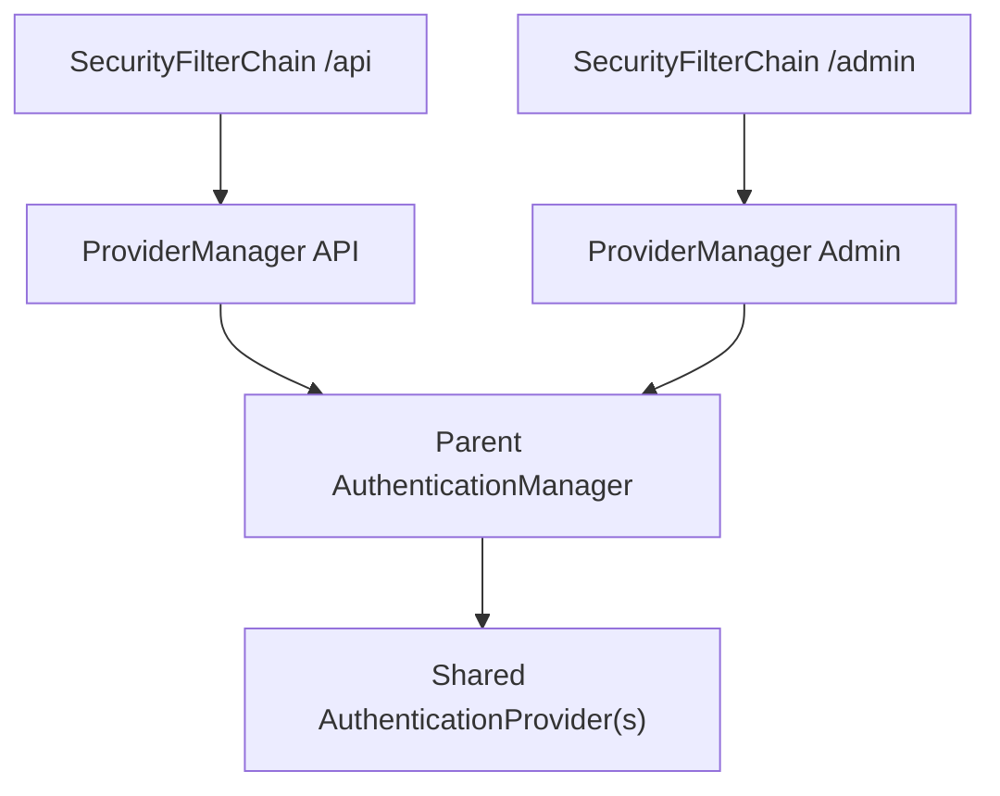

# AuthenticationProvider.supports và khả năng có nhiều cách xác thực

## Mục tiêu của bài

Một ứng dụng có thể chấp nhận nhiều hình thức đăng nhập: username/password, API key dành cho service, bearer JWT, mTLS, LDAP hay một identity provider. Trong Spring Security, `AuthenticationManager` là cửa vào để xác minh một yêu cầu xác thực; implementation phổ biến `ProviderManager` điều phối một danh sách `AuthenticationProvider`. Mỗi provider khai báo **`supports(Class<?>)`** để cho biết nó có thể xử lý **kiểu Authentication request nào**.

**Ý quan trọng nhất:** `supports(...) == true` chỉ báo khả năng xử lý **loại token**. Nó **không** chứng minh password, API key hoặc JWT hợp lệ. Việc kiểm tra bằng chứng xảy ra trong `authenticate(Authentication)`. Một provider có thể trả một Authentication đã xác thực, trả `null` vì chưa thể quyết định, hoặc ném `AuthenticationException` vì xác thực thất bại.

Nội dung dành cho **Java 17, Spring Boot 3.5.0, Spring Security 6.5.x, Servlet/Spring MVC**. Ví dụ cuối bài cố ý dùng hai cơ chế: **HTTP Basic username/password** và **API key qua custom header**. API key/password hard-code chỉ là dữ liệu giả trong localhost; ứng dụng thật nên dùng OAuth2, mTLS, secret manager hoặc key service với quản trị vòng đời phù hợp.

Sau khi học, bạn có thể:

1. Giải thích vai trò khác nhau của filter, `Authentication`, `AuthenticationManager`, `AuthenticationProvider` và authorization.
2. Đọc đúng chữ ký `supports(Class<?>)` và `authenticate(Authentication)`, biết tại sao chúng nhận hai loại tham số khác nhau.
3. Lần theo cách `ProviderManager` thử nhiều providers theo thứ tự; phân biệt skipped, `null`, success, exception và parent manager.
4. Hiểu ý nghĩa `ProviderNotFoundException`, `BadCredentialsException` và xử lý đặc biệt của account-status exceptions.
5. Thiết kế token type rõ ràng cho những cơ chế khác nhau; tránh để token class hoặc dữ liệu do client gửi tự quyết định quyền.
6. Xây custom `ApiKeyAuthenticationToken` và `ApiKeyAuthenticationProvider`, cấu hình cạnh `DaoAuthenticationProvider`.
7. Kiểm thử lựa chọn provider bằng JUnit và HTTP 200/401/403 bằng MockMvc.
8. Biết khi nào dùng một manager chung và khi nào chia nhỏ managers/chains theo trust boundary.

## 1. Bản đồ các thành phần

Spring Security không bắt đầu bằng việc “thử tất cả password trong database”. HTTP request được một authentication filter hoặc converter diễn giải thành **một Authentication request object**; sau đó manager mới quyết định provider nào có thể kiểm tra object ấy.



| Thành phần | Chịu trách nhiệm gì? | Không làm gì? |
| --- | --- | --- |
| Authentication filter | Đọc Basic/form/bearer/header và tạo Authentication request; chuyển cho manager. | Không tự coi header có mặt là credentials hợp lệ. |
| `Authentication` | Chứa lời khai và credentials trước xác thực; chứa principal/authorities tin cậy khi kết quả thành công. | Không tự kiểm tra key/password. |
| `AuthenticationManager` | Định nghĩa `authenticate(Authentication)`, trả result hoặc ném exception. | Không tự phân quyền mọi endpoint/tài nguyên. |
| `ProviderManager` | Chọn/thử nhiều provider và có thể dùng parent manager. | Không đoán kiểu login chỉ từ username. |
| `AuthenticationProvider` | Xác minh một loại Authentication request có thể hỗ trợ. | Không tự gửi HTTP 401/403. |
| `SecurityContext` | Giữ kết quả xác thực trong bối cảnh phù hợp. | Không bảo đảm session lưu qua mọi request nếu không cấu hình. |
| `AuthorizationManager` | Kiểm tra quyền trên request/method/resource. | Không thay cơ chế kiểm chứng credentials. |

Ví dụ Spring Security thường có `BasicAuthenticationFilter` tạo `UsernamePasswordAuthenticationToken`; `DaoAuthenticationProvider` dùng `UserDetailsService` và `PasswordEncoder` kiểm tra username/password. Một resource server JWT có thể tạo bearer token request rồi dùng provider xác minh chữ ký/issuer/claims. API key riêng cần cách nhận header và provider tương ứng.

**Hai cách nhận credentials không nhất thiết là hai provider.** HTTP Basic và form login có thể cùng tạo `UsernamePasswordAuthenticationToken` và cùng sử dụng một DaoAuthenticationProvider. Ngược lại, hai providers có thể cùng supports một token class khi tồn tại hai identity stores, nhưng điều đó làm fallback/phân vùng phức tạp hơn.

## 2. Hợp đồng AuthenticationProvider

Spring Security 6.5 định nghĩa interface ở `org.springframework.security.authentication.AuthenticationProvider`:

```java
public interface AuthenticationProvider {
    Authentication authenticate(Authentication authentication)
            throws AuthenticationException;

    boolean supports(Class<?> authentication);
}
```

Đoạn trên là hình thức rút gọn để học. Method `supports` nhận **`Class<?>`**, ví dụ `UsernamePasswordAuthenticationToken.class`, **không** nhận một object có username/key. Method `authenticate` mới nhận **instance** có credentials thực.

### 2.1. `supports(Class<?>)` là khả năng xử lý theo kiểu token

```java
@Override
public boolean supports(Class<?> authenticationType) {
    return ApiKeyAuthenticationToken.class
        .isAssignableFrom(authenticationType);
}
```

Nó trả true khi class được hỏi là `ApiKeyAuthenticationToken` hoặc subtype tương thích. Vì API key token trong lab là `final`, trên thực tế chỉ class đó được support.

**Thứ tự của `isAssignableFrom` rất quan trọng:** vế trái là class mà provider hiểu; vế phải là class được đưa vào. Đảo hướng kiểm tra có thể làm provider bỏ sót loại token phù hợp hoặc nhận các class ngoài scope.

### 2.2. Tại sao supports=true chưa nói lên kết quả đăng nhập?

Giả sử filter tạo:

```java
Authentication request =
    UsernamePasswordAuthenticationToken.unauthenticated(
        "learner", "wrong-password"
    );
```

DaoAuthenticationProvider **vẫn supports** `UsernamePasswordAuthenticationToken.class`. Tuy nhiên, `PasswordEncoder.matches(...)` sẽ phát hiện password sai và xác thực thất bại. Tương tự, header `X-API-Key` có mặt không có nghĩa giá trị API key đúng.

Câu nói chính xác là: **provider nhận biết cấu trúc của lời khai; provider còn phải kiểm chứng nội dung của lời khai**.

### 2.3. Ba kết quả có thể có từ authenticate

| Trả về/ném ra | Diễn giải | Cách manager xử lý |
| --- | --- | --- |
| `Authentication` đã xác thực hợp lệ | Đã kiểm chứng và có principal/authorities tin cậy. | Thường dừng và trả kết quả. |
| `null` | Provider không thể quyết định với request cụ thể. | Có thể thử provider sau/parent; không tự cho phép login. |
| `AuthenticationException` | Chứng cứ bị từ chối hoặc có lỗi xác thực. | Manager áp exception/fallback semantics; có thể báo thất bại cuối cùng. |

Chú ý: `supports == false` khiến provider được **bỏ qua ngay từ đầu**, khác với `authenticate(...) == null` khi provider **đã được gọi nhưng nhường quyết định**.

### 2.4. Đừng trả null khi đã biết credentials sai

Một custom provider thực sự chịu trách nhiệm về token API key, đã đọc key và thấy sai, nên ném `BadCredentialsException`. Nếu tùy tiện trả `null`, manager có thể chuyển sang provider khác cũng hỗ trợ loại token này. Điều đó có thể làm ý định khóa/từ chối bị bỏ qua khi có nguồn xác thực thay thế.

Ngược lại, trong kiến trúc có nhiều providers được phân vùng rõ ràng, provider có thể trả `null` nếu request không thuộc phạm vi nó được phép đánh giá. Sự phân vùng phải dựa trên thiết kế đáng tin, không nên đoán theo username do người dùng tự khai.

### 2.5. Không đưa authorization vào supports

`supports(Class<?>)` không phải nơi thực hiện `hasRole("ADMIN")`, kiểm tra tenant hoặc owner của đơn hàng. Những điều đó thuộc authorization sau khi principal/authorities đã được xác thực. Tại pha supports, class token còn có thể chứa dữ liệu từ client chưa kiểm chứng.

## 3. ProviderManager dùng nhiều provider thế nào?

`ProviderManager` là một `AuthenticationManager` nhận một danh sách providers. Khi có request, nó xét provider theo thứ tự đã cấu hình và dùng `supports(request.getClass())` để biết provider nào có thể được hỏi.

```text
ProviderManager.authenticate(authentication)
  |
  +--> Provider A supports(tokenClass)?
  |        false → skip
  |        true  → A.authenticate(request)
  |                    success → trả verified Authentication
  |                    null    → thử provider phù hợp tiếp
  |                    exception → áp quy tắc xử lý/fallback
  |
  +--> Provider B ...
  |
  +--> Parent AuthenticationManager (nếu có, theo quy tắc)
  |
  +--> Không ai xác thực được → AuthenticationException
```

Mô tả trên là pseudocode; implementation thật có thêm quy tắc đặc biệt cho parent, account-status exceptions, sự kiện và credential erasure.

### 3.1. Hai token types riêng rẽ

Giả sử manager chứa `List.of(apiKeyProvider, daoProvider)`:

| Request token | ApiKey provider | DAO provider | Kết quả nếu credentials đúng |
| --- | --- | --- | --- |
| `ApiKeyAuthenticationToken` | `supports=true`, xác minh key | `supports=false` | `service-client`, `ROLE_SERVICE` |
| `UsernamePasswordAuthenticationToken` | `supports=false` | `supports=true`, xác minh password | `learner`, `ROLE_USER` |
| `TestingAuthenticationToken` | `supports=false` | `supports=false` | Không provider phù hợp, thất bại. |

Khi hai provider hỗ trợ **khác token type**, cấu hình dễ đọc và ít gây nhầm. Thêm provider sau không tự làm API key/password trở nên hợp lệ nếu có dữ liệu sai.

### 3.2. ProviderNotFoundException

Nếu manager không có provider nào hỗ trợ một token class và parent cũng không thể xử lý, `ProviderManager` thường ném `ProviderNotFoundException`. Đây là một `AuthenticationException` chỉ ra vấn đề về **khả năng xử lý loại token** hoặc cấu hình manager.

Ví dụ kiểm thử:

```java
Authentication unknown =
    new TestingAuthenticationToken("name", "value");

authenticationManager.authenticate(unknown);
// ProviderNotFoundException với đúng manager của lab.
```

Đây là fragment kiểm thử; `TestingAuthenticationToken` không phải cơ chế đăng nhập production. Nếu bạn tạo filter cho `ApiKeyAuthenticationToken` nhưng quên wire API key provider vào manager mà filter thật sự dùng, bạn có thể gặp lỗi tương tự.

### 3.3. Exception không phải lúc nào cũng dừng ngay

Không được viết tài liệu rằng “hễ provider ném BadCredentialsException thì ProviderManager luôn dừng và bỏ qua provider còn lại”. Với một số `AuthenticationException` thông thường, manager **có thể thử provider tiếp theo** và một kết quả thành công sau đó có thể được dùng.

Ngược lại, exception nhóm `AccountStatusException` (ví dụ account disabled/locked) và `InternalAuthenticationServiceException` thường làm ProviderManager dừng theo quy tắc đặc biệt. Không chủ động chuyển exception locked/disabled thành `null` chỉ để thử thêm cơ chế khác.

**Hệ quả an ninh:** nếu hai providers cùng supports `UsernamePasswordAuthenticationToken`, một tài khoản bị khóa ở nguồn A không được âm thầm “thử lại ở nguồn B” để đăng nhập. Thiết kế identity realm và thứ tự fallback cần được test rõ, đặc biệt khi username trùng giữa các stores.

### 3.4. Parent AuthenticationManager

Một `ProviderManager` có thể cấu hình **parent manager**. Khi local providers không đưa ra kết quả hợp lệ theo quy tắc của manager, parent có thể được hỏi. Nhiều security chains có thể có managers riêng nhưng dùng chung parent cho những cơ chế nhất định.



**Không phải lúc nào parent rộng hơn cũng an toàn.** Nếu chain admin dự kiến chỉ nhận hardware-backed/mTLS authentication nhưng parent chấp nhận loại password credential khác, fallback có thể nới trust boundary. Quy tắc quyết định quyền phải dựa trên kiểu authentication và yêu cầu xác thực thực tế, không chỉ trên việc có principal.

### 3.5. Credential erasure

`ProviderManager` mặc định cố xóa thông tin credentials nhạy cảm của Authentication result khi token hỗ trợ `CredentialsContainer`. Điều này giảm nguy cơ giữ password/key lâu trong session/context. Một custom token nên hỗ trợ `eraseCredentials()` và thường **không đưa raw key vào verified result** ngay từ đầu.

Nếu principal/UserDetails được tái sử dụng chung từ cache, xóa credentials trên chính instance trong cache có thể ảnh hưởng lần xác thực sau. Khi dùng cache, cần clone dữ liệu hoặc quản lý vòng đời xóa credentials rõ ràng; không vội tắt cơ chế xóa dữ liệu nhạy cảm.

## 4. Một manager chung hay nhiều manager riêng?

### 4.1. Một manager chứa nhiều provider

Phù hợp khi các entry points có một trust boundary được thiết kế chung và muốn dùng một danh sách providers dễ kiểm thử. Lab dùng hai authentication filters: filter Basic tạo username/password token, filter API key tạo custom token, cả hai gọi **một** ProviderManager.

```text
HTTP Basic credentials ─> BasicAuthenticationFilter ─> UsernamePasswordAuthenticationToken
                                                        |
X-API-Key header ──────> ApiKeyHeaderFilter ────────> ApiKeyAuthenticationToken
                                                        |
                                                        v
                                                  ProviderManager
                                                   |         |
                                                   v         v
                                                 Dao     ApiKeyProvider
```

### 4.2. Nhiều SecurityFilterChain với managers riêng

Có thể tách `/staff/**` dùng form login khỏi `/api/service/**` dùng bearer JWT hoặc mTLS. `FilterChainProxy` chọn **SecurityFilterChain** phù hợp theo `securityMatcher(...)` và thứ tự; sau đó filter trong chain tạo token và gửi tới manager được chain cấu hình.

Cần phân biệt:

1. **Chọn chain:** HTTP request matcher, được cấu hình với `securityMatcher`.
2. **Chọn provider:** `supports(Class<?>)` trên **token class** do authentication filter đã tạo.
3. **Quyền truy cập:** `authorizeHttpRequests(...).requestMatchers(...)` và authorization managers.

Dùng `securityMatcher` và `supports` như từ đồng nghĩa là lỗi kiến trúc. Một filter chain không khớp request thì manager bên trong chain ấy có thể không được gọi.

### 4.3. Một token class, nhiều providers cùng hỗ trợ

Hai `DaoAuthenticationProvider` dùng hai stores khác nhau có thể cùng hỗ trợ `UsernamePasswordAuthenticationToken`. `supports` không phân biệt realm theo username. Nếu cần xác thực nhiều stores, bạn phải định nghĩa ranh giới source, precedence, cách ứng xử khi không tìm thấy tài khoản, account disabled/locked và cách tránh trùng username làm rò/bypass quyền.

Không xem `null` là một tiện ích “cứ thử cho đến khi đâu đó đăng nhập được” mà không phân tích trust boundary. Những hệ thống có LDAP + local accounts, external identity provider + backup accounts, hoặc nhiều tenant phải kiểm thử chính sách này đặc biệt kỹ.

### 4.4. Các cơ chế framework có sẵn

- `DaoAuthenticationProvider`: username/password với `UserDetailsService` và `PasswordEncoder`.
- `JwtAuthenticationProvider`: JWT bearer token sau khi áp bộ xác minh tương ứng.
- Provider cho opaque token: introspection tại server tin cậy.
- LDAP, pre-authentication, SAML và những giao thức khác: provider/filters theo module và phiên bản.
- API key custom: cần token/converter/filter/provider và quy tắc secret riêng nếu framework/app chưa có integration phù hợp.

**JWT không được xác thực chỉ bằng cách decode Base64 payload.** Provider/decoder phải kiểm tra chữ ký/issuer/audience/expiry và claims theo policy; `supports` chỉ nói nó hiểu token type.

## 5. Bài lab: HTTP Basic + API key trong cùng ứng dụng

Ta tạo một ứng dụng Spring Boot MVC dùng hai kiểu credentials với policy:

| Endpoint | Quy tắc | Basic user `learner` | API key `service-client` |
| --- | --- | :---: | :---: |
| `GET /public/ping` | `permitAll` | Được | Được |
| `GET /api/whoami` | `authenticated` | Được | Được |
| `GET /api/basic` | `hasRole("USER")` | Được | 403 |
| `GET /api/service` | `hasRole("SERVICE")` | 403 | Được |
| URL khác | `denyAll` | 403 khi đã đăng nhập | 403 khi đã xác thực |

Lab credentials:

- Basic: `learner` / `learner-pass` → `ROLE_USER`.
- Key: `lab-key-123` → `service-client` / `ROLE_SERVICE`.
- Không credentials vào private endpoint → **401** trong HTTP Basic flow.
- Password/key sai → **401**.
- Cùng request có cả `Authorization` và `X-API-Key` → **400** do policy ứng dụng cố ý từ chối tình huống nhập nhằng.

### 5.1. Cấu trúc

```text
multi-provider-lab/
├── pom.xml
└── src/
    ├── main/java/com/example/multiprovider/
    │   ├── MultiProviderApplication.java
    │   ├── ApiKeyAuthenticationToken.java
    │   ├── ApiKeyAuthenticationProvider.java
    │   ├── ApiKeyHeaderFilter.java
    │   ├── SecurityConfig.java
    │   └── DemoController.java
    └── test/java/com/example/multiprovider/
        ├── ProviderSelectionTest.java
        └── MultiProviderHttpTest.java
```

### 5.2. Maven pom.xml

```xml
<project xmlns="http://maven.apache.org/POM/4.0.0"
         xmlns:xsi="http://www.w3.org/2001/XMLSchema-instance"
         xsi:schemaLocation="http://maven.apache.org/POM/4.0.0 https://maven.apache.org/xsd/maven-4.0.0.xsd">
    <modelVersion>4.0.0</modelVersion>
    <parent>
        <groupId>org.springframework.boot</groupId>
        <artifactId>spring-boot-starter-parent</artifactId>
        <version>3.5.0</version>
        <relativePath/>
    </parent>
    <groupId>com.example</groupId>
    <artifactId>multi-provider-lab</artifactId>
    <version>1.0.0</version>
    <properties>
        <java.version>17</java.version>
    </properties>
    <dependencies>
        <dependency>
            <groupId>org.springframework.boot</groupId>
            <artifactId>spring-boot-starter-web</artifactId>
        </dependency>
        <dependency>
            <groupId>org.springframework.boot</groupId>
            <artifactId>spring-boot-starter-security</artifactId>
        </dependency>
        <dependency>
            <groupId>org.springframework.boot</groupId>
            <artifactId>spring-boot-starter-test</artifactId>
            <scope>test</scope>
        </dependency>
        <dependency>
            <groupId>org.springframework.security</groupId>
            <artifactId>spring-security-test</artifactId>
            <scope>test</scope>
        </dependency>
    </dependencies>
    <build>
        <plugins>
            <plugin>
                <groupId>org.springframework.boot</groupId>
                <artifactId>spring-boot-maven-plugin</artifactId>
            </plugin>
        </plugins>
    </build>
</project>
```

Boot parent quản lý các phiên bản tương thích. `3.5.0` là mốc học tập theo Spring Security 6.5; dự án thực tế cần nâng lên bản vá còn được hỗ trợ. Bài dùng **Servlet MVC**, không thêm starter WebFlux.

### 5.3. MultiProviderApplication.java

```java
package com.example.multiprovider;

import org.springframework.boot.SpringApplication;
import org.springframework.boot.autoconfigure.SpringBootApplication;

@SpringBootApplication
public class MultiProviderApplication {
    public static void main(String[] args) {
        SpringApplication.run(MultiProviderApplication.class, args);
    }
}
```

Đặt tất cả class trong cùng package `com.example.multiprovider` để Spring Boot phát hiện controller/config khi component scan.

## 6. Custom Authentication token cho API key

### 6.1. ApiKeyAuthenticationToken.java

```java
package com.example.multiprovider;

import java.util.Collection;
import java.util.Collections;

import org.springframework.security.authentication.AbstractAuthenticationToken;
import org.springframework.security.core.GrantedAuthority;

public final class ApiKeyAuthenticationToken
        extends AbstractAuthenticationToken {

    private final Object principal;
    private Object credentials;

    private ApiKeyAuthenticationToken(
            Object principal,
            Object credentials,
            Collection<? extends GrantedAuthority> authorities,
            boolean verified) {

        super(authorities);
        this.principal = principal;
        this.credentials = credentials;
        if (verified) {
            super.setAuthenticated(true);
        }
    }

    public static ApiKeyAuthenticationToken unauthenticated(
            String submittedKey) {

        return new ApiKeyAuthenticationToken(
            null,
            submittedKey,
            Collections.emptyList(),
            false
        );
    }

    static ApiKeyAuthenticationToken verified(
            String principal,
            Collection<? extends GrantedAuthority> authorities) {

        return new ApiKeyAuthenticationToken(
            principal,
            null,
            authorities,
            true
        );
    }

    @Override
    public Object getPrincipal() {
        return principal;
    }

    @Override
    public Object getCredentials() {
        return credentials;
    }

    @Override
    public void setAuthenticated(boolean authenticated) {
        if (authenticated) {
            throw new IllegalArgumentException(
                "Verified token must come from a trusted provider"
            );
        }
        super.setAuthenticated(false);
    }

    @Override
    public void eraseCredentials() {
        super.eraseCredentials();
        credentials = null;
    }
}
```

**Giải thích:**

- `unauthenticated(submittedKey)` tạo **request token**: chưa có principal đáng tin, credentials chứa key do client đưa, authorities trống.
- `verified(...)` là factory **package-private**, chỉ provider sau khi xác minh key mới được gọi trong lab; tạo token với principal và authorities đã được gán.
- Method `setAuthenticated(true)` công khai bị chặn. `super.setAuthenticated(true)` trong private constructor chỉ dùng cho đường verified nội bộ.
- `eraseCredentials()` xóa bản sao key trong object khi được gọi.
- Một token type không tự tạo ranh giới bảo mật: các thành phần trong JVM vẫn phải đáng tin. Không đưa khả năng tạo verified token cho bất kỳ input nào từ client.

Luồng trước/sau:

```text
Trước provider:
  ApiKeyAuthenticationToken
  principal=null; credentials="lab-key-123"
  authorities=[]; isAuthenticated=false

Sau provider xác minh:
  ApiKeyAuthenticationToken
  principal="service-client"; credentials=null
  authorities=[ROLE_SERVICE]; isAuthenticated=true
```

## 7. Custom provider với supports(Class<?>)

### 7.1. ApiKeyAuthenticationProvider.java

```java
package com.example.multiprovider;

import java.nio.charset.StandardCharsets;
import java.security.MessageDigest;
import java.util.List;

import org.springframework.security.authentication.AuthenticationProvider;
import org.springframework.security.authentication.BadCredentialsException;
import org.springframework.security.core.Authentication;
import org.springframework.security.core.authority.SimpleGrantedAuthority;

public final class ApiKeyAuthenticationProvider
        implements AuthenticationProvider {

    private final byte[] expectedKey;

    public ApiKeyAuthenticationProvider(String expectedKey) {
        this.expectedKey =
            expectedKey.getBytes(StandardCharsets.UTF_8);
    }

    @Override
    public Authentication authenticate(Authentication authentication) {
        if (!(authentication instanceof ApiKeyAuthenticationToken)) {
            // Guard nếu bị gọi trực tiếp ngoài ProviderManager.
            return null;
        }

        Object credentials = authentication.getCredentials();
        if (!(credentials instanceof String submitted)
                || submitted.isBlank()) {
            throw new BadCredentialsException("Invalid API key");
        }

        byte[] submittedBytes =
            submitted.getBytes(StandardCharsets.UTF_8);

        if (!MessageDigest.isEqual(expectedKey, submittedBytes)) {
            throw new BadCredentialsException("Invalid API key");
        }

        return ApiKeyAuthenticationToken.verified(
            "service-client",
            List.of(new SimpleGrantedAuthority("ROLE_SERVICE"))
        );
    }

    @Override
    public boolean supports(Class<?> authenticationType) {
        return ApiKeyAuthenticationToken.class
            .isAssignableFrom(authenticationType);
    }
}
```

**Tách đúng trách nhiệm:**

1. `supports(Class<?>)` nhận **kiểu token**, trả true chỉ với custom API key token.
2. `authenticate(Authentication)` nhận object cụ thể, phòng thủ với type guard khi bị gọi ngoài manager.
3. `getCredentials()` là key chưa được chứng minh. Key trống/sai → `BadCredentialsException`.
4. Key hợp lệ → trả verified result với principal `service-client` và authority `ROLE_SERVICE`.
5. Không có bước nào tin vào `X-Role`/`X-User` do client gửi; quyền được gán **bên trong provider sau khi xác minh key**.

`MessageDigest.isEqual(...)` giúp đối chiếu byte array tránh kiểu string equality thông thường, nhưng **bài này không có API key storage production**: key được hard-code, không có ID/rotation/expiry/tenant/revoke. Sản phẩm thật cần nguồn secret an toàn, key hash/lookup và quyền tối thiểu.

## 8. HTTP filter chuyển header thành request token

Provider không tự đọc HTTP header. Muốn nhận `X-API-Key` trong Servlet stack, cần một filter/converter. Lab dùng `OncePerRequestFilter` để cho thấy rõ bước tạo token và gọi manager.

### 8.1. ApiKeyHeaderFilter.java

```java
package com.example.multiprovider;

import java.io.IOException;

import jakarta.servlet.FilterChain;
import jakarta.servlet.ServletException;
import jakarta.servlet.http.HttpServletRequest;
import jakarta.servlet.http.HttpServletResponse;

import org.springframework.security.authentication.AuthenticationManager;
import org.springframework.security.core.Authentication;
import org.springframework.security.core.AuthenticationException;
import org.springframework.security.core.context.SecurityContext;
import org.springframework.security.core.context.SecurityContextHolder;
import org.springframework.web.filter.OncePerRequestFilter;

public final class ApiKeyHeaderFilter extends OncePerRequestFilter {

    private final AuthenticationManager manager;

    public ApiKeyHeaderFilter(AuthenticationManager manager) {
        this.manager = manager;
    }

    @Override
    protected void doFilterInternal(
            HttpServletRequest request,
            HttpServletResponse response,
            FilterChain chain) throws ServletException, IOException {

        String key = request.getHeader("X-API-Key");

        if (key == null) {
            chain.doFilter(request, response);
            return;
        }

        if (request.getHeader("Authorization") != null) {
            // Policy của lab: không nhận hai kiểu credentials cùng lúc.
            response.setStatus(HttpServletResponse.SC_BAD_REQUEST);
            return;
        }

        Authentication result;
        try {
            result = manager.authenticate(
                ApiKeyAuthenticationToken.unauthenticated(key)
            );
        } catch (AuthenticationException ex) {
            SecurityContextHolder.clearContext();
            response.setStatus(HttpServletResponse.SC_UNAUTHORIZED);
            return;
        }

        SecurityContext context =
            SecurityContextHolder.createEmptyContext();
        context.setAuthentication(result);
        SecurityContextHolder.setContext(context);

        try {
            chain.doFilter(request, response);
        } finally {
            SecurityContextHolder.clearContext();
        }
    }
}
```

Hành vi từng nhánh:

- Không có API key: cho request đi tiếp. Nếu có Basic credentials, `BasicAuthenticationFilter` đảm nhiệm.
- Có API key và Basic cùng lúc: trả `400` để tránh authentication precedence không rõ, không tạo identity.
- Có key đơn lẻ: tạo **unauthenticated token**, gọi manager. Nếu manager từ chối, trả `401` không lộ key.
- Thành công: tạo `SecurityContext` mới cho **request hiện tại**, đặt verified Authentication và cho filter chain tiếp tục.
- `finally` xóa context sau khi request hoàn tất. Lab dùng credentials theo từng request, không ghi kết quả vào session.

**Đây là filter học tập**, không thay thế tất cả khả năng của `AuthenticationFilter`/framework: async dispatch, custom failure/success handler, thống nhất entry points, request caching, session persistence và lifecycle phải được thiết kế lại nếu dùng thực tế. Một custom filter đặt sai vị trí có thể chạy ngoài security chain hoặc đọc context không đúng.

Chú ý block `try/catch` chỉ bắt exception từ `manager.authenticate`. Exception phát sinh khi controller/authorization xử lý tiếp không bị diễn giải nhầm thành “API key sai”.

## 9. Lắp ProviderManager có hai providers

### 9.1. SecurityConfig.java

```java
package com.example.multiprovider;

import java.util.List;

import org.springframework.context.annotation.Bean;
import org.springframework.context.annotation.Configuration;
import org.springframework.http.HttpMethod;
import org.springframework.security.authentication.AuthenticationManager;
import org.springframework.security.authentication.ProviderManager;
import org.springframework.security.authentication.dao.DaoAuthenticationProvider;
import org.springframework.security.config.Customizer;
import org.springframework.security.config.annotation.web.builders.HttpSecurity;
import org.springframework.security.config.annotation.web.configurers.AbstractHttpConfigurer;
import org.springframework.security.config.http.SessionCreationPolicy;
import org.springframework.security.core.userdetails.User;
import org.springframework.security.core.userdetails.UserDetailsService;
import org.springframework.security.crypto.bcrypt.BCryptPasswordEncoder;
import org.springframework.security.crypto.password.PasswordEncoder;
import org.springframework.security.provisioning.InMemoryUserDetailsManager;
import org.springframework.security.web.SecurityFilterChain;
import org.springframework.security.web.authentication.www.BasicAuthenticationFilter;

@Configuration(proxyBeanMethods = false)
public class SecurityConfig {

    @Bean
    PasswordEncoder passwordEncoder() {
        return new BCryptPasswordEncoder();
    }

    @Bean
    UserDetailsService users(PasswordEncoder encoder) {
        return new InMemoryUserDetailsManager(
            User.withUsername("learner")
                .password(encoder.encode("learner-pass"))
                .roles("USER")
                .build()
        );
    }

    @Bean
    ApiKeyAuthenticationProvider apiKeyProvider() {
        return new ApiKeyAuthenticationProvider("lab-key-123");
    }

    @Bean
    AuthenticationManager authenticationManager(
            UserDetailsService users,
            PasswordEncoder encoder,
            ApiKeyAuthenticationProvider apiKeyProvider) {

        DaoAuthenticationProvider dao =
            new DaoAuthenticationProvider(users);
        dao.setPasswordEncoder(encoder);

        return new ProviderManager(List.of(apiKeyProvider, dao));
    }

    @Bean
    SecurityFilterChain securityFilterChain(
            HttpSecurity http,
            AuthenticationManager manager) throws Exception {

        return http
            .authenticationManager(manager)
            .sessionManagement(session -> session
                .sessionCreationPolicy(SessionCreationPolicy.STATELESS)
            )
            .authorizeHttpRequests(auth -> auth
                .requestMatchers(
                    HttpMethod.GET, "/public/ping"
                ).permitAll()
                .requestMatchers(
                    HttpMethod.GET, "/api/whoami"
                ).authenticated()
                .requestMatchers(
                    HttpMethod.GET, "/api/basic"
                ).hasRole("USER")
                .requestMatchers(
                    HttpMethod.GET, "/api/service"
                ).hasRole("SERVICE")
                .anyRequest().denyAll()
            )
            .addFilterBefore(
                new ApiKeyHeaderFilter(manager),
                BasicAuthenticationFilter.class
            )
            .httpBasic(Customizer.withDefaults())
            .formLogin(AbstractHttpConfigurer::disable)
            .build();
    }
}
```

Tại đây:

- Provider thứ nhất chuyên API key, provider thứ hai là DAO chuyên username/password.
- `DaoAuthenticationProvider(UserDetailsService)` và `setPasswordEncoder(...)` thuộc API hợp lệ trên Spring Security 6.5.x.
- `ProviderManager(List.of(...))` tạo danh sách cụ thể và thứ tự rõ ràng.
- `http.authenticationManager(manager)` bảo đảm HTTP Basic filter của chain dùng manager vừa cấu hình.
- `new ApiKeyHeaderFilter(manager)` cũng nhận đúng instance ấy; hai cơ chế đến cùng manager.
- `addFilterBefore(..., BasicAuthenticationFilter.class)` đặt custom filter trước Basic, nhưng sau các cơ chế chuẩn bị context phù hợp trong chain.
- `SessionCreationPolicy.STATELESS` không lưu SecurityContext vào HTTP session. Client phải gửi credentials thích hợp ở mỗi request.
- `.anyRequest().denyAll()` bảo vệ route chưa khai báo.
- HTTP Basic được bật, form login tắt để demo 401 rõ ràng. **CSRF vẫn được bật theo mặc định**, vì lab chỉ dùng GET; nếu bổ sung POST/PUT/PATCH/DELETE, cần đánh giá rủi ro CSRF dựa trên cách client tự gửi cookie/Basic credentials và cung cấp token đúng kiến trúc. Không tắt toàn bộ CSRF chỉ để request ghi hết bị 403.

Tài khoản/password trong source chỉ là demo. `InMemoryUserDetailsManager` không phải user store production, `ROLE_SERVICE` chung chưa đủ xác định quyền tenant hoặc owner của đối tượng nghiệp vụ.

**Vì sao wire tường minh?** Chỉ thấy một `AuthenticationProvider` bean trong application context không chứng minh rằng mọi SecurityFilterChain hay mọi authentication filter sẽ tự sử dụng bean đó. Với nhiều managers, cấu hình sai khiến filter tạo token mà manager không biết provider xử lý, dẫn đến `ProviderNotFoundException`.

## 10. Controller có endpoint dùng role khác nhau

### 10.1. DemoController.java

```java
package com.example.multiprovider;

import java.util.Map;

import org.springframework.security.core.Authentication;
import org.springframework.web.bind.annotation.GetMapping;
import org.springframework.web.bind.annotation.RestController;

@RestController
public class DemoController {

    @GetMapping("/public/ping")
    public String ping() {
        return "pong";
    }

    @GetMapping("/api/whoami")
    public Map<String, String> whoami(Authentication authentication) {
        return Map.of(
            "principal", authentication.getName(),
            "tokenType",
            authentication.getClass().getSimpleName()
        );
    }

    @GetMapping("/api/basic")
    public String basicRoute() {
        return "user-access";
    }

    @GetMapping("/api/service")
    public String serviceRoute() {
        return "service-access";
    }
}
```

`/api/whoami` chỉ trả username và token class cho mục đích học tập. Trong sản phẩm, đừng trả nguyên `Authentication` hoặc raw credentials, cũng đừng public internal token type nếu client không cần. Đối với endpoint trả order/invoice theo ID, còn phải kiểm tra ownership/tenant ở service hoặc query dù đã đi qua `authenticated()`.

### 10.2. HTTP Basic đi qua provider nào?

Client gửi:

```http
GET /api/whoami HTTP/1.1
Authorization: Basic <base64(learner:learner-pass)>
```

Trình tự:

1. Custom API key filter không thấy `X-API-Key` → cho request đi tiếp.
2. `BasicAuthenticationFilter` tạo `UsernamePasswordAuthenticationToken` chưa xác thực.
3. `ProviderManager` hỏi API key provider; `supports(UsernamePasswordAuthenticationToken.class)==false` → bỏ qua.
4. DAO provider supports token này, tải `learner` và dùng `PasswordEncoder.matches(...)` kiểm tra.
5. Trả verified Authentication có `ROLE_USER`, request vượt `authenticated()` và controller nhận `learner`.

### 10.3. API key đi qua provider nào?

Client gửi:

```http
GET /api/whoami HTTP/1.1
X-API-Key: lab-key-123
```

Trình tự:

1. Custom filter thấy key, tạo `ApiKeyAuthenticationToken.unauthenticated(...)`.
2. `ProviderManager` hỏi API key provider; `supports(ApiKeyAuthenticationToken.class)==true`.
3. Provider so key, trả verified token có principal `service-client`, authority `ROLE_SERVICE`.
4. Filter đặt result vào SecurityContext, Basic filter không có header Basic nên không thay thế danh tính.
5. Controller nhận `service-client`, token type `ApiKeyAuthenticationToken`.

Hai cách login dẫn đến **cùng một loại HTTP status thành công nhưng hai principal/role khác nhau**, nên khi gọi các endpoint chỉ dành cho USER/SERVICE sẽ nhận kết quả khác.

## 11. Unit/integration test cho supports và ProviderManager

### 11.1. ProviderSelectionTest.java

```java
package com.example.multiprovider;

import java.util.List;

import org.junit.jupiter.api.Test;
import org.springframework.beans.factory.annotation.Autowired;
import org.springframework.boot.test.context.SpringBootTest;
import org.springframework.security.authentication.AuthenticationManager;
import org.springframework.security.authentication.AuthenticationProvider;
import org.springframework.security.authentication.BadCredentialsException;
import org.springframework.security.authentication.ProviderManager;
import org.springframework.security.authentication.ProviderNotFoundException;
import org.springframework.security.authentication.TestingAuthenticationToken;
import org.springframework.security.authentication.UsernamePasswordAuthenticationToken;
import org.springframework.security.core.Authentication;

import static org.assertj.core.api.Assertions.assertThat;
import static org.assertj.core.api.Assertions.assertThatThrownBy;

@SpringBootTest
class ProviderSelectionTest {

    @Autowired
    AuthenticationManager manager;

    @Autowired
    ApiKeyAuthenticationProvider keyProvider;

    @Test
    void apiKeyProviderSupportsOnlyItsTokenType() {
        assertThat(keyProvider.supports(
            ApiKeyAuthenticationToken.class
        )).isTrue();

        assertThat(keyProvider.supports(
            UsernamePasswordAuthenticationToken.class
        )).isFalse();
    }

    @Test
    void apiKeyRequestStartsUnauthenticated() {
        ApiKeyAuthenticationToken request =
            ApiKeyAuthenticationToken.unauthenticated("lab-key-123");

        assertThat(request.isAuthenticated()).isFalse();
        assertThat(request.getAuthorities()).isEmpty();
        assertThat(request.getCredentials()).isEqualTo("lab-key-123");
    }

    @Test
    void correctApiKeyProducesVerifiedResult() {
        Authentication result = manager.authenticate(
            ApiKeyAuthenticationToken.unauthenticated("lab-key-123")
        );

        assertThat(result.isAuthenticated()).isTrue();
        assertThat(result.getName()).isEqualTo("service-client");
        assertThat(result.getCredentials()).isNull();
        assertThat(result.getAuthorities())
            .extracting(granted -> granted.getAuthority())
            .containsExactly("ROLE_SERVICE");
    }

    @Test
    void correctBasicPasswordUsesDaoProvider() {
        Authentication result = manager.authenticate(
            UsernamePasswordAuthenticationToken.unauthenticated(
                "learner", "learner-pass"
            )
        );

        assertThat(result.isAuthenticated()).isTrue();
        assertThat(result.getName()).isEqualTo("learner");
        assertThat(result.getAuthorities())
            .extracting(granted -> granted.getAuthority())
            .contains("ROLE_USER");
    }

    @Test
    void invalidApiKeyFails() {
        assertThatThrownBy(() -> manager.authenticate(
            ApiKeyAuthenticationToken.unauthenticated("wrong-key")
        )).isInstanceOf(BadCredentialsException.class);
    }

    @Test
    void invalidPasswordFails() {
        assertThatThrownBy(() -> manager.authenticate(
            UsernamePasswordAuthenticationToken.unauthenticated(
                "learner", "wrong-pass"
            )
        )).isInstanceOf(BadCredentialsException.class);
    }

    @Test
    void unrecognizedTokenFailsWithoutProvider() {
        assertThatThrownBy(() -> manager.authenticate(
            new TestingAuthenticationToken("any", "not-used")
        )).isInstanceOf(ProviderNotFoundException.class);
    }

    @Test
    void providerReturningNullAllowsNextProvider() {
        AuthenticationProvider undecided = new AuthenticationProvider() {
            @Override
            public boolean supports(Class<?> type) {
                return ApiKeyAuthenticationToken.class
                    .isAssignableFrom(type);
            }

            @Override
            public Authentication authenticate(
                    Authentication request) {
                return null;
            }
        };

        ProviderManager sequential = new ProviderManager(
            List.of(undecided, keyProvider)
        );

        Authentication result = sequential.authenticate(
            ApiKeyAuthenticationToken.unauthenticated("lab-key-123")
        );

        assertThat(result.isAuthenticated()).isTrue();
        assertThat(result.getName()).isEqualTo("service-client");
    }
}
```

Tổng **8 test** minh họa: provider supports theo class, input chưa xác thực, hai provider tạo kết quả riêng, key/password sai ném exception, loại token không support dẫn đến `ProviderNotFoundException`, và provider trả `null` cho phép provider thứ hai thử tiếp.

Test cuối chỉ minh họa hợp đồng fallback; nó không phải khuyến nghị thêm một provider “luôn trả null” vào hệ thống thật. Khi có hai sources cùng support token type, cần điều kiện phân vùng/ưu tiên rõ ràng.

## 12. MockMvc kiểm chứng HTTP authentication và quyền

### 12.1. MultiProviderHttpTest.java

```java
package com.example.multiprovider;

import org.junit.jupiter.api.Test;
import org.springframework.beans.factory.annotation.Autowired;
import org.springframework.boot.test.autoconfigure.web.servlet.AutoConfigureMockMvc;
import org.springframework.boot.test.context.SpringBootTest;
import org.springframework.test.web.servlet.MockMvc;

import static org.springframework.security.test.web.servlet.request
    .SecurityMockMvcRequestPostProcessors.httpBasic;
import static org.springframework.test.web.servlet.request.MockMvcRequestBuilders.get;
import static org.springframework.test.web.servlet.result.MockMvcResultMatchers.content;
import static org.springframework.test.web.servlet.result.MockMvcResultMatchers.jsonPath;
import static org.springframework.test.web.servlet.result.MockMvcResultMatchers.status;

@SpringBootTest
@AutoConfigureMockMvc
class MultiProviderHttpTest {

    @Autowired
    MockMvc mvc;

    @Test
    void publicEndpointAllowsAnonymous() throws Exception {
        mvc.perform(get("/public/ping"))
            .andExpect(status().isOk())
            .andExpect(content().string("pong"));
    }

    @Test
    void privateEndpointChallengesAnonymous() throws Exception {
        mvc.perform(get("/api/whoami"))
            .andExpect(status().isUnauthorized());
    }

    @Test
    void basicAuthUsesUsernamePasswordToken() throws Exception {
        mvc.perform(get("/api/whoami")
                .with(httpBasic("learner", "learner-pass")))
            .andExpect(status().isOk())
            .andExpect(jsonPath("$.principal").value("learner"))
            .andExpect(jsonPath("$.tokenType")
                .value("UsernamePasswordAuthenticationToken"));
    }

    @Test
    void apiKeyUsesCustomToken() throws Exception {
        mvc.perform(get("/api/whoami")
                .header("X-API-Key", "lab-key-123"))
            .andExpect(status().isOk())
            .andExpect(jsonPath("$.principal")
                .value("service-client"))
            .andExpect(jsonPath("$.tokenType")
                .value("ApiKeyAuthenticationToken"));
    }

    @Test
    void basicUserAccessesUserRoute() throws Exception {
        mvc.perform(get("/api/basic")
                .with(httpBasic("learner", "learner-pass")))
            .andExpect(status().isOk())
            .andExpect(content().string("user-access"));
    }

    @Test
    void keyClientAccessesServiceRoute() throws Exception {
        mvc.perform(get("/api/service")
                .header("X-API-Key", "lab-key-123"))
            .andExpect(status().isOk())
            .andExpect(content().string("service-access"));
    }

    @Test
    void basicUserCannotAccessServiceRoute() throws Exception {
        mvc.perform(get("/api/service")
                .with(httpBasic("learner", "learner-pass")))
            .andExpect(status().isForbidden());
    }

    @Test
    void keyClientCannotAccessUserRoute() throws Exception {
        mvc.perform(get("/api/basic")
                .header("X-API-Key", "lab-key-123"))
            .andExpect(status().isForbidden());
    }

    @Test
    void wrongKeyIsRejected() throws Exception {
        mvc.perform(get("/api/service")
                .header("X-API-Key", "wrong-key"))
            .andExpect(status().isUnauthorized());
    }

    @Test
    void wrongBasicPasswordIsRejected() throws Exception {
        mvc.perform(get("/api/basic")
                .with(httpBasic("learner", "wrong-pass")))
            .andExpect(status().isUnauthorized());
    }

    @Test
    void conflictingCredentialHeadersAreRejected() throws Exception {
        mvc.perform(get("/api/whoami")
                .header("X-API-Key", "lab-key-123")
                .with(httpBasic("learner", "learner-pass")))
            .andExpect(status().isBadRequest());
    }

    @Test
    void unlistedRouteIsDeniedToLoggedInUser() throws Exception {
        mvc.perform(get("/unlisted")
                .with(httpBasic("learner", "learner-pass")))
            .andExpect(status().isForbidden());
    }
}
```

Đây là **12 test HTTP**. Tổng số test trong dự án = **20** (8 provider tests + 12 MockMvc tests). Chúng được thiết kế để phân biệt authentication failure (401), authorization denial (403), policy từ chối hai kiểu credential (400) và các request thành công (200).

**MockMvc** chạy Spring MVC test context cùng Security filter chain, không cần mở cổng network. Những test này không thay thế kiểm thử TLS, reverse proxy, session thật, key rotation hoặc deployment multi-node. `@WithMockUser` hữu ích khi test role, nhưng không chứng minh password/key matching; ở đây dùng request có credentials thực cho đúng mục tiêu.

## 13. Chạy Maven và gửi HTTP request

Yêu cầu Java 17+ và Maven. Tại thư mục `multi-provider-lab`:

```bash
java -version
mvn -version
mvn test
mvn spring-boot:run
```

Trong terminal khác:

```bash
curl -i http://localhost:8080/public/ping
curl -i http://localhost:8080/api/whoami
curl -i -u learner:learner-pass http://localhost:8080/api/whoami
curl -i -H "X-API-Key: lab-key-123" http://localhost:8080/api/whoami
curl -i -u learner:learner-pass http://localhost:8080/api/basic
curl -i -H "X-API-Key: lab-key-123" http://localhost:8080/api/service
curl -i -u learner:learner-pass http://localhost:8080/api/service
curl -i -H "X-API-Key: wrong-key" http://localhost:8080/api/service
curl -i -u learner:learner-pass -H "X-API-Key: lab-key-123" http://localhost:8080/api/whoami
```

Trên Windows PowerShell, dùng `curl.exe` nếu `curl` là alias của `Invoke-WebRequest`. Kết quả dự kiến với code lab:

| Request | HTTP status | Giá trị quan sát |
| --- | --- | --- |
| Public, anonymous | 200 | `pong` |
| Private, anonymous | 401 | Basic authentication challenge |
| Basic hợp lệ, `/api/whoami` | 200 | `principal=learner`, username/password token |
| API key hợp lệ, `/api/whoami` | 200 | `principal=service-client`, API key token |
| Basic hợp lệ, `/api/basic` | 200 | `user-access` |
| API key hợp lệ, `/api/service` | 200 | `service-access` |
| Basic gọi `/api/service` | 403 | Không có ROLE_SERVICE |
| API key gọi `/api/basic` | 403 | Không có ROLE_USER |
| Key sai | 401 | Không tạo verified Authentication |
| Key + Basic cùng request | 400 | Bị từ chối theo policy của filter custom |

Mã trạng thái và body trên là **kỳ vọng thiết kế**, không phải log lấy từ một lần Maven đã chạy. Header `WWW-Authenticate` thường có ở challenge HTTP Basic; phản hồi 401 từ custom key filter ở đây chỉ đặt status, không phát challenge riêng.

HTTP Basic dùng Base64, không mã hóa credentials ở tầng truyền tải; API key là secret trực tiếp. Trong production cần **HTTPS/TLS** và tránh lưu raw secret trong source, shell history, logs, URL hoặc report.

## 14. Khi mở rộng thêm loại xác thực

### 14.1. Thêm JWT bearer token

Để hỗ trợ JWT resource server, thường có ba phần:

1. Filter nhận `Authorization: Bearer ...` và tạo bearer authentication request.
2. Manager/provider hoặc các thành phần tương ứng phải **xác minh JWT thực sự**: chữ ký, issuer, audience, expiry và claims theo chính sách.
3. Sau đó ánh xạ principal/authorities đã xác minh và áp authorization cho request/resource.

**Không có bước nào chỉ cần `supports(...) == true` là được cấp quyền.** Cũng không tự decode Base64 token rồi tin ngay trường role/tenant. Với OAuth2 resource server, ưu tiên module tích hợp Spring Security thay vì tự viết JWT parser/provider.

### 14.2. Form login và HTTP Basic có thể chung provider

Form login lấy username/password từ form; Basic lấy chúng từ header. Cả hai có thể tạo cùng `UsernamePasswordAuthenticationToken` và dùng một `DaoAuthenticationProvider`. Vì vậy số lượng filter nhận credentials và số lượng provider không có quan hệ một-một.

### 14.3. Nhiều username/password stores

Hai user stores (nhân viên và khách hàng) có thể cùng dùng password token class. Cả hai provider có thể `supports=true`, nhưng phải có thiết kế realm và fallback rõ. Một username trùng tại cả hai stores, tài khoản bị disable ở nguồn A, hoặc hai mật khẩu khác nhau là tình huống bắt buộc test. Không dùng rule “provider sau thắng nếu provider trước báo sai” một cách vô thức.

### 14.4. Đọc context đúng stack

Lab dùng Servlet `SecurityContextHolder`, tức context theo strategy phù hợp trong thread/request. WebFlux dùng `ServerHttpSecurity`, `SecurityWebFilterChain` và `ReactiveSecurityContextHolder` trong Reactor Context. Không sao chép một custom Servlet `OncePerRequestFilter` nguyên trạng vào WebFlux.

## 15. Các lỗi thường gặp

**1. Supports=true được hiểu là credentials đúng.**  
Nó chỉ khẳng định token class phù hợp; phải gọi `authenticate` và xác minh chứng cứ.

**2. Supports trả true với mọi Class.**  
Provider có thể nhận sai token và cast lỗi hoặc xác thực không đáng tin. Dùng kiểm tra type đúng hướng.

**3. Provider đọc username trong supports.**  
Method nhận Class object; username/key nằm trong Authentication instance.

**4. Trả null khi chứng cứ sai nhưng vẫn thuộc phạm vi provider.**  
Có thể khiến manager thử provider khác và thay đổi ranh giới xác thực. Dùng exception đúng semantics.

**5. Tin rằng BadCredentialsException luôn chặn ngay toàn bộ chain.**  
ProviderManager có thể tiếp tục thử provider khác trong một số điều kiện. Thiết kế fallback và test thật.

**6. Chuyển LockedException/DisabledException thành null.**  
Có thể gây bypass policy khóa tài khoản nếu provider sau cho phép. Tôn trọng account-status failure.

**7. Quên đăng ký provider vào manager được filter sử dụng.**  
Provider class có trong dự án chưa chắc filter đang gọi đúng manager. Wire tường minh và test với request thực.

**8. Tạo token type nhưng không có filter/converter.**  
Provider không tự đọc HTTP request. Có cơ chế nhận credentials và tạo token phù hợp.

**9. Filter tạo authenticated result dựa trên header X-Role.**  
Header do client tự nhận không phải nguồn quyền. Filter chỉ tạo request token; provider kiểm chứng.

**10. Cho phép nhiều loại credentials mà không có precedence.**  
Cần quyết định rõ cách xử lý request gửi Basic và API key cùng lúc, tránh nhầm actor/role. Lab trả 400.

**11. Dùng parent manager để mở fallback ngoài policy chain.**  
Có thể chấp nhận cơ chế authentication không đủ mức tin cậy. Tách manager/chain và test ranh giới.

**12. Tưởng authenticated() đủ cho mọi bản ghi.**  
User đã login vẫn cần kiểm tra role/scope/owner/tenant của dữ liệu được truy cập.

**13. Log raw key hoặc toàn bộ Authentication.**  
Dễ rò secret, session metadata và principal details. Log actor ID, loại cơ chế và kết quả ở mức phù hợp.

**14. Dùng API key demo cố định trong hệ thống thật.**  
Thiếu key ID, revoke, rotation, expiry, scope và rate limiting. Dùng secret infrastructure phù hợp.

**15. Tắt CSRF để một request POST hết 403.**  
CSRF và authentication/authorization là các bảo vệ khác nhau. Đánh giá cookie/Basic/browser tự gửi credentials, token và HTTP methods trước khi thay đổi.

**16. Đặt rule URL rộng trước rule cụ thể.**  
`requestMatchers("/**").permitAll()` đứng đầu có thể mở cả endpoint cần bảo vệ. Dùng first-match đúng thứ tự và fallback `denyAll` khi phù hợp.

**17. Chỉ test 200 của cơ chế hợp lệ.**  
Không chứng minh sai password/key, unsupported token, thiếu role hoặc request có cả hai credentials bị từ chối. Viết negative tests tương xứng.

## 16. Checklist review multi-authentication

Trước khi triển khai thật, trả lời:

1. HTTP entry point nào tạo Authentication request, theo filter/chain nào?
2. Token class và nguồn credentials có rõ ràng không?
3. Provider nào supports từng token class? Có providers trùng support không?
4. Credentials được xác minh bằng gì: password hash, key store, JWT validator, mTLS trust store?
5. Khi chứng cứ sai, provider trả exception nào? Khi không thuộc phạm vi, null có hợp lý không?
6. Có parent manager/fallback vượt trust boundary không?
7. Authority/principal đến từ dữ liệu tin cậy hay header do client tự khai?
8. Credential sau xác thực có được xóa khỏi result và logs không?
9. Nếu gửi cùng lúc nhiều cơ chế, ứng dụng từ chối hay chọn có chủ đích?
10. SecurityContext được đặt đúng request và lưu/khôi phục theo policy stateless/session chưa?
11. Endpoint còn áp rule authorization và ownership/tenant không?
12. Đã test 401, 403, provider unsupported, wrong key, wrong password, account locked và cross-mechanism không?
13. Có quản lý key/password qua TLS, secret storage, rotation, revoke, audit và rate limiting không?
14. Khi thêm SecurityFilterChain mới, đã kiểm tra `securityMatcher`/`@Order` và fallback chưa?
15. Khi chuyển sang WebFlux, đã thay đúng reactive API và context propagation chưa?

## 17. Câu hỏi ôn tập

**Câu 1.** `supports(Class<?>)` nhận username/password không?  
**Trả lời:** Không, nó nhận `Class<?>`. Dữ liệu cụ thể nằm trong Authentication instance truyền cho `authenticate(Authentication)`.

**Câu 2.** Provider trả `null` thì request được login chưa?  
**Trả lời:** Chưa. Nó nhường quyền quyết định; manager có thể hỏi provider sau hoặc parent, nếu không có kết quả thì thất bại.

**Câu 3.** Sai password có làm `supports` của DaoAuthenticationProvider trả false không?  
**Trả lời:** Không. Token type vẫn là username/password; sai password được phát hiện khi authenticate.

**Câu 4.** Vì sao HTTP Basic và form login có thể dùng cùng provider?  
**Trả lời:** Chúng là hai đường thu credentials nhưng có thể cùng tạo `UsernamePasswordAuthenticationToken`.

**Câu 5.** Nếu không provider nào nhận `ApiKeyAuthenticationToken`, exception thường gặp là gì?  
**Trả lời:** `ProviderNotFoundException`, nếu không có parent nào xác thực được.

**Câu 6.** Tại sao ném BadCredentialsException không bảo đảm mọi provider sau đều bị bỏ qua?  
**Trả lời:** ProviderManager có thuật toán tiếp tục/fallback cho một số exception thông thường. Không dựa vào giả định sai này để bảo vệ ranh giới danh tính.

**Câu 7.** Vì sao key hợp lệ có thể vẫn nhận 403 ở `/api/basic`?  
**Trả lời:** Đã authenticated là service-client nhưng chỉ có ROLE_SERVICE, không có ROLE_USER cần cho endpoint.

**Câu 8.** Thêm AuthenticationProvider bean có tự làm mọi HTTP request dùng nó không?  
**Trả lời:** Chưa chắc. Filter phải tạo token đúng type và manager của filter phải được cấu hình với provider đó.

**Câu 9.** Có nên dùng API key làm JWT bằng cách tự decode Base64 không?  
**Trả lời:** Không. JWT cần xác minh chữ ký, issuer, audience, expiry và chính sách claims. Dùng resource-server support chuẩn.

**Câu 10.** Nếu hai sources cùng hỗ trợ password token và user bị khóa ở source A, có nên tự thử source B không?  
**Trả lời:** Không mặc định. Đây là ranh giới trust và account-status policy; phải xác định realm và không bypass trạng thái bị khóa.

**Câu 11.** Vì sao lab từ chối request vừa Basic vừa API key?  
**Trả lời:** Để không có precedence mơ hồ khiến actor/authorities bị hiểu sai; đây là policy minh họa có chủ đích của ứng dụng.

**Câu 12.** `supports` quyết định quyền xem đơn hàng người khác được không?  
**Trả lời:** Không. Đó là authorization theo object/tenant/owner, diễn ra sau khi danh tính đã xác thực.

## Kết luận

**`AuthenticationProvider.supports(Class<?>)` chỉ trả lời provider có thể đánh giá loại Authentication token được giao hay không.** `authenticate(Authentication)` mới kiểm chứng credentials và trả về kết quả đã xác thực, trả `null` khi chưa thể quyết định, hoặc ném exception khi xác thực thất bại. `ProviderManager` phối hợp nhiều providers, có thể dùng parent manager, xử lý exception theo quy tắc riêng và xóa credentials nhạy cảm từ successful result khi hỗ trợ.

Ứng dụng có thể dùng một AuthenticationManager cho nhiều cơ chế: mỗi filter/converter cần tạo đúng token type, manager phải chứa provider tương ứng, và mỗi provider chỉ tạo identity tin cậy sau khi chứng cứ được kiểm chứng. Với các nguồn danh tính chồng lấp, cần thiết kế realm, thứ tự và fallback rõ ràng. Sau khi xác thực thành công, **authorization** vẫn tiếp tục quyết định quyền theo role, scope, owner và tenant. Bài lab Basic + API key và 20 test cung cấp điểm xuất phát để bạn tự kiểm chứng các ranh giới này.

## Tài liệu chính thức

- [Spring Security 6.5 — Servlet Authentication Architecture](https://docs.spring.io/spring-security/reference/6.5/servlet/authentication/architecture.html)
- [Spring Security 6.5 — AuthenticationProvider JavaDoc](https://docs.spring.io/spring-security/reference/6.5/api/java/org/springframework/security/authentication/AuthenticationProvider.html)
- [Spring Security 6.5 — ProviderManager JavaDoc](https://docs.spring.io/spring-security/reference/6.5/api/java/org/springframework/security/authentication/ProviderManager.html)
- [Spring Security 6.5 — AuthenticationManager JavaDoc](https://docs.spring.io/spring-security/reference/6.5/api/java/org/springframework/security/authentication/AuthenticationManager.html)
- [Spring Security 6.5 — DaoAuthenticationProvider](https://docs.spring.io/spring-security/reference/6.5/servlet/authentication/passwords/dao-authentication-provider.html)
- [Spring Security 6.5 — HttpSecurity JavaDoc](https://docs.spring.io/spring-security/reference/6.5/api/java/org/springframework/security/config/annotation/web/builders/HttpSecurity.html)
- [Spring Security 6.5 — Authorize HttpServletRequests](https://docs.spring.io/spring-security/reference/6.5/servlet/authorization/authorize-http-requests.html)
- [Spring Security 6.5 — Spring Security Test](https://docs.spring.io/spring-security/reference/6.5/servlet/test/index.html)
