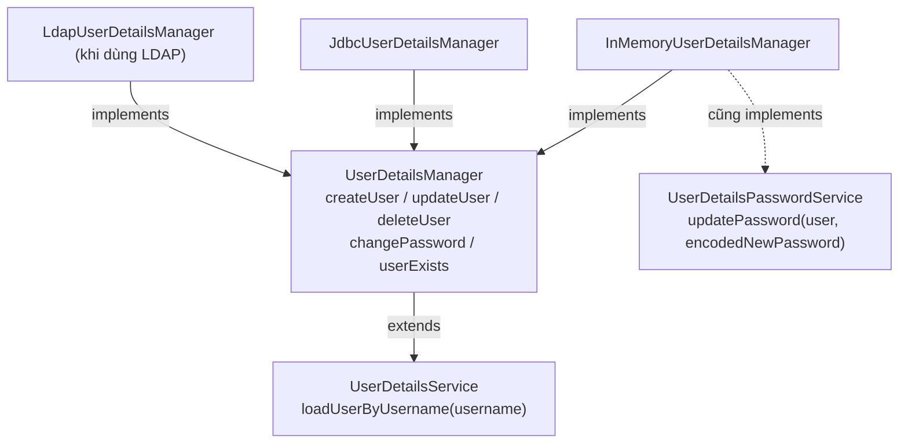
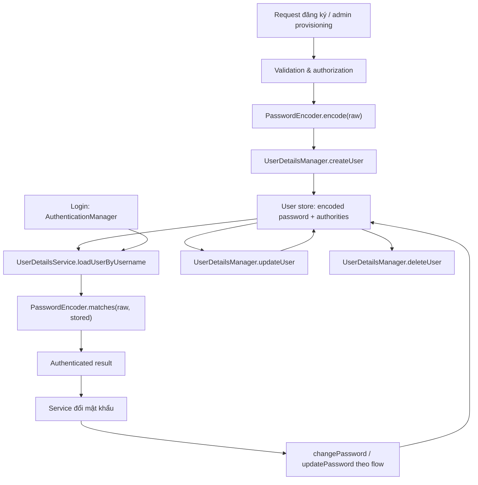

# UserDetailsManager bổ sung các thao tác quản lý tài khoản

## Mục tiêu bài học

Trong Spring Security, `UserDetailsService` cho hệ thống **đọc thông tin tài khoản phục vụ xác thực** qua `loadUserByUsername(String username)`. Khi ứng dụng cần **tạo, cập nhật, xóa, kiểm tra tồn tại hoặc thay mật khẩu** của tài khoản, giao diện mở rộng `UserDetailsManager` cung cấp các thao tác quản lý tương ứng. Hiểu đúng sự khác nhau này giúp bạn chọn lớp phù hợp với bài toán, không vô tình đặt toàn bộ vòng đời tài khoản vào mã kiểm tra đăng nhập.

Bài này tập trung vào **Spring Security 6.5.x, Java 17, Spring Boot 3.5.0, Spring MVC/Servlet**. Ta xây một ứng dụng nhỏ dùng `InMemoryUserDetailsManager` làm nguồn người dùng, cấu hình HTTP Basic, rồi viết kiểm thử độc lập cho các thao tác `createUser`, `updateUser`, `deleteUser`, `userExists`, `changePassword` và cách chúng ảnh hưởng lần xác thực tiếp theo. Phần JDBC minh họa hướng chuyển sang dữ liệu lưu bền vững.

Sau bài, bạn có thể:

1. Phân biệt `UserDetails`, `UserDetailsService`, `UserDetailsManager`, `UserDetailsPasswordService`, `PasswordEncoder` và `AuthenticationManager`.
2. Gọi đúng năm thao tác quản lý tài khoản của `UserDetailsManager` cùng method `loadUserByUsername` được kế thừa.
3. Hiểu vì sao mật khẩu truyền vào `createUser/updateUser` phải được encode trước và vì sao `changePassword` có những điều kiện đặc biệt.
4. Dùng `InMemoryUserDetailsManager`, quan sát việc tạo, sửa authority, khóa/mở trạng thái, xóa user mà không có database.
5. Kiểm tra thay đổi thực sự ảnh hưởng authentication/authorization ở request tiếp theo.
6. Hiểu `JdbcUserDetailsManager`, schema users/authorities và những điểm cần thêm khi triển khai với database.
7. Viết JUnit 5 và MockMvc tests, phân biệt test lifecycle của manager với test HTTP 200/401/403.
8. Xác định những giới hạn production: quyền quản trị, đổi/reset mật khẩu, race conditions, transaction, revoke sessions/tokens, audit, MFA và secret management.

**Phạm vi của UserDetailsManager là quản lý dữ liệu danh tính cho username/password**, không phải một API REST được bảo vệ sẵn, không phải giải pháp cấp MFA/session/token và không tự thực hiện mọi chính sách kinh doanh quanh tài khoản.

## 1. UserDetailsService và UserDetailsManager có quan hệ gì?

Hãy xem đúng cây interface:



Về Java:

```java
// Hình dạng hợp đồng rút gọn để học.
public interface UserDetailsService {
    UserDetails loadUserByUsername(String username)
        throws UsernameNotFoundException;
}

public interface UserDetailsManager extends UserDetailsService {
    void createUser(UserDetails user);
    void updateUser(UserDetails user);
    void deleteUser(String username);
    void changePassword(String oldPassword, String newPassword);
    boolean userExists(String username);
}
```

Đây là **sơ đồ API**, không phải hai interface bạn phải tự tạo lại trong ứng dụng. Spring Security đã cung cấp chúng tại:

- `org.springframework.security.core.userdetails.UserDetailsService`
- `org.springframework.security.provisioning.UserDetailsManager`

**Điểm cốt lõi:** vì `UserDetailsManager extends UserDetailsService`, mọi implementation của UserDetailsManager có thể được dùng như **nguồn người dùng cho `DaoAuthenticationProvider`** khi đăng nhập username/password. Bạn không cần viết một UserDetailsService thứ hai chỉ để đọc các user vừa được manager tạo.

### 1.1. UserDetails có phải entity database không?

Không. `UserDetails` là hợp đồng dữ liệu mà Spring Security cần để kiểm tra tài khoản. Nó thường có username, **encoded password**, authorities và các trạng thái như enabled/non-expired/non-locked.

```java
UserDetails learner = User.withUsername("learner")
    .password(encoder.encode("learner-pass"))
    .roles("USER")
    .build();
```

Đây là fragment sử dụng `PasswordEncoder encoder` đã có. `User` là implementation của `UserDetails` do Spring Security cung cấp.

**Không đồng nhất UserDetails với JPA entity `Account`**. Trong production, một entity có thể chứa email, phone, createdAt, tenant, MFA, trạng thái xác minh và dữ liệu nghiệp vụ; service/map lớp identity sẽ chuyển thông tin cần thiết sang `UserDetails`. Trả nguyên UserDetails cho frontend cũng không phải DTO API an toàn vì nó có thể chứa password hash và thông tin nội bộ.

### 1.2. UserDetailsManager khác AuthenticationManager

| API | Câu hỏi mà API trả lời | Ví dụ |
| --- | --- | --- |
| `UserDetailsService.loadUserByUsername` | “Tài khoản này có thông tin xác thực nào?” | Load username/hash/authorities từ user store. |
| `UserDetailsManager.createUser/updateUser/deleteUser` | “Kho người dùng cần thay đổi thế nào?” | Tạo user, sửa vai trò, xóa account record. |
| `UserDetailsManager.userExists` | “Username này đã có trong kho chưa?” | Kiểm tra tồn tại. |
| `UserDetailsManager.changePassword` | “Đổi mật khẩu của current user theo implementation này.” | Thường cần context và có thể cần xác minh mật khẩu cũ. |
| `AuthenticationManager.authenticate` | “Credentials vừa cung cấp có hợp lệ không?” | Trả verified Authentication hoặc ném exception. |
| `PasswordEncoder.encode/matches` | “Hash mật khẩu thế nào; raw có khớp hash lưu không?” | Dùng bcrypt/DelegatingPasswordEncoder. |
| `AuthorizationManager` | “Người đã xác thực được phép thực hiện thao tác không?” | Check role, permission, owner, tenant. |

**Tạo user không phải đăng nhập.** `manager.createUser(...)` chỉ ghi UserDetails vào store. Nó không tự tạo HTTP session hay đưa một Authentication đã xác thực vào `SecurityContextHolder`. Muốn login, HTTP Basic/form/filter vẫn phải gửi credentials tới AuthenticationManager.

**Xóa user không tự revoke mọi session/JWT.** Một session có thể giữ Authentication cũ; một JWT tự chứa có thể còn hiệu lực đến lúc hết hạn nếu không có token revocation/session invalidation. Các chính sách này phải thiết kế bên ngoài interface.

## 2. Năm phương thức quản lý tài khoản

### 2.1. createUser(UserDetails user)

Tạo một record mới theo dữ liệu UserDetails được truyền. Ví dụ:

```java
UserDetails account = User.withUsername("analyst")
    .password(encoder.encode("analyst-pass"))
    .roles("USER")
    .build();

users.createUser(account);
```

Ở đây `users` là một `UserDetailsManager` và `encoder` là bean `PasswordEncoder`. Manager nhận **một UserDetails đã có password ở format lưu trữ**; nó không thể tự suy rằng chuỗi đưa vào là plaintext hay bcrypt.

Với `InMemoryUserDetailsManager`, nếu username đã tồn tại, `createUser` từ chối thay vì âm thầm ghi đè. Với JDBC/LDAP, cách phát sinh lỗi có thể là exception khác, chịu ràng buộc database/schema; không phụ thuộc vào một exception class chung cho mọi implementation.

**Không dùng `createUser` như API đăng ký tự do nếu user có thể gửi trường roles/authorities tùy ý.** Server phải gán role tối thiểu sau khi xác minh và áp policy.

### 2.2. updateUser(UserDetails user)

Cập nhật thông tin account hiện có. Ví dụ sửa authorities trong lab:

```java
UserDetails current = users.loadUserByUsername("analyst");
UserDetails updated = User.withUserDetails(current)
    .authorities("ROLE_USER", "REPORT_READ")
    .build();

users.updateUser(updated);
```

`User.withUserDetails(current)` giúp giữ các thuộc tính UserDetails đang có, sau đó thay authorities theo yêu cầu có chủ đích. Nếu bạn tạo User mới mà quên copy `password`/enabled/locked flags, có thể vô tình reset các trạng thái bảo mật hoặc làm user không login được.

**`updateUser` không phải HTTP PATCH tự động.** Không có version checking, validation, audit, role-grant policy hay transaction ở interface. Với database và nhiều admins, cần đảm bảo người cập nhật được quyền cấp roles và tránh mất cập nhật đồng thời (optimistic locking/transactions phù hợp).

### 2.3. deleteUser(String username)

Xóa record user trong user store:

```java
users.deleteUser("analyst");
boolean stillExists = users.userExists("analyst");
```

Với `InMemoryUserDetailsManager`, record không còn được tìm thấy sau khi xóa; ở production còn phải quyết định: delete cứng hay deactivate/soft-delete, giữ audit/truy vết, phân rã dữ liệu liên quan, revoke refresh tokens/sessions/API keys và tránh xóa account đang có nghĩa vụ pháp lý.

**Không kết luận user đã bị đá khỏi mọi session chỉ vì deleteUser đã chạy.** Kết quả phiên đã tạo từ trước và các token tự chứa cần cơ chế thu hồi hoặc chính sách kiểm tra trạng thái riêng.

### 2.4. userExists(String username)

Kiểm tra username có trong store:

```java
if (!users.userExists("analyst")) {
    users.createUser(account);
}
```

Đây là fragment minh họa, **không đảm bảo thao tác tạo tài khoản an toàn khi có race condition**. Hai request đồng thời có thể cùng thấy false rồi cùng cố create. Khi dùng database, unique constraint trên username/tenant là nguồn chân lý; service phải xử lý duplicate conflict theo quy ước đã thiết kế.

**Không công khai endpoint `/users/exists?username=...` cho mọi caller mà không xét nguy cơ liệt kê tài khoản.** Thông điệp đăng ký/khôi phục mật khẩu nên hạn chế tiết lộ account existence theo threat model thực tế.

### 2.5. changePassword(String oldPassword, String newPassword)

Method này **đổi mật khẩu của người dùng hiện tại** theo implementation, khác hoàn toàn với `updateUser(UserDetails)` có username cụ thể.

```java
users.changePassword(oldRawPassword, newEncodedPassword);
```

Đây là fragment quan trọng nhưng **chưa phải endpoint đổi mật khẩu hoàn chỉnh**. Hai tham số của interface không hứa tự encode password, tự xác minh oldPassword trong mọi implementation hoặc tự xác định username từ một tham số. Mức kiểm tra và cách lưu phụ thuộc manager đã cấu hình.

Trong `InMemoryUserDetailsManager` thuộc dòng Spring Security 6.5:

1. Method tìm **Authentication của current user** trong `SecurityContextHolder`.
2. Nếu không có Authentication, nó không biết người dùng nào đang đổi mật khẩu và ném `AccessDeniedException`.
3. **Nếu `setAuthenticationManager(...)` đã được cấu hình**, manager sẽ xác thực lại username đang có với `oldPassword` trước khi ghi mới.
4. **Nếu chưa cấu hình AuthenticationManager cho InMemoryUserDetailsManager**, việc xác minh mật khẩu cũ **không được chính manager in-memory thực hiện**. Vì vậy đừng mặc định truyền một oldPassword sai luôn bị chặn.
5. Implementation lưu chuỗi `newPassword` được truyền; trong lab dùng `encoder.encode(newRawPassword)` trước để không lưu plaintext.
6. Nó không tự hủy những session hoặc access token trước đó, cũng không thay thế quy trình reset password.

**Đây là điểm dễ sai nhất của bài:** một UI đổi mật khẩu phải xác minh identity, old password nếu yêu cầu, policy mật khẩu mới, chống brute force, rate limit, audit, hash, transaction, token revocation và chống CSRF tùy kiểu client. Chỉ gọi `changePassword` không cung cấp toàn bộ các lớp đó.

## 3. Vòng đời tài khoản trong một ứng dụng



Đây là một luồng khái quát, không phải “createUser tự gọi AuthenticationManager”. Các bước admin provisioning, registration và password reset có policy khác nhau. Khi sử dụng JDBC/JPA hoặc external identity provider, còn có transaction, unique constraints, events và đồng bộ session/cache.

### 3.1. Tạo và cập nhật UserDetails không phải kiểm tra login

Một UserDetails có thể được lưu hợp lệ về mặt cấu trúc nhưng vẫn không xác thực được nếu:

- Password lưu chưa encode đúng format mà `PasswordEncoder` lúc login trông đợi.
- `isEnabled() == false`.
- Account bị locked/expired hoặc credentials expired.
- Không có authorities đúng schema hoặc nguồn user load bị cấu hình sai.
- AuthenticationManager đang dùng một UserDetailsService khác với manager bạn vừa cập nhật.

Vì vậy test phải bao phủ cả **thao tác CRUD thành công** và **đăng nhập thực sự trước/sau thay đổi**.

### 3.2. Điều chỉnh role sau khi user đã đăng nhập

`users.updateUser(...)` có thể đổi authorities trong user store nhưng một Authentication đã đặt trong HTTP session có thể vẫn giữ authorities cũ. Với HTTP Basic stateless và user được tải lại khi xác thực từng request, request mới thường thấy trạng thái mới. Với session-based login, bạn cần chính sách refresh SecurityContext, invalidation hoặc đánh giá permission theo dữ liệu nguồn để bảo đảm cập nhật quyền có hiệu lực kịp thời.

**Đổi role trong database không tự kéo role cũ khỏi mọi JWT.** Nếu token chứa claims role tự mang, phải xét thời hạn token, revocation, introspection hoặc cách đối chiếu quyền server-side.

## 4. Các implementation phổ biến

| Implementation | Nguồn lưu | Hỗ trợ CRUD | Phù hợp |
| --- | --- | --- | --- |
| `InMemoryUserDetailsManager` | Map trong RAM của một JVM/process | Có | Demo, test, ví dụ học tập, một số case nhỏ và kiểm soát chặt |
| `JdbcUserDetailsManager` | JDBC/DataSource, bảng users/authorities theo schema hỗ trợ | Có | Hệ thống username/password sử dụng JDBC schema tương thích |
| `LdapUserDetailsManager` | LDAP directory theo môi trường/cấu hình | Có theo khả năng directory | Hệ thống dùng LDAP làm kho tài khoản |
| Custom `UserDetailsService` | Repository/identity provider do ứng dụng tự định nghĩa | Chỉ đọc theo interface | Khi cần tích hợp identity với domain phức tạp |
| Custom `UserDetailsManager` | Repository do ứng dụng xây dựng | Có nếu tự triển khai và kiểm thử | Khi muốn API quản lý riêng mà vẫn dùng hợp đồng Spring Security |

**Chọn interface theo nhu cầu:** nếu ứng dụng chỉ đăng nhập từ OAuth2/OIDC bên ngoài, không mặc định phải tạo UserDetailsManager. Nếu ứng dụng có tài khoản nội bộ và cần CRUD, interface có thể giúp thống nhất code nhưng không thay domain-level account service.

### 4.1. InMemoryUserDetailsManager

`InMemoryUserDetailsManager` có constructor không tham số, constructor từ `UserDetails...`, `Collection<UserDetails>` hoặc `Properties`. Nó có `loadUserByUsername` và cả năm method quản lý.

Đặc điểm:

- Dữ liệu giữ trong RAM tiến trình; restart sẽ mất các thay đổi chạy lúc runtime nếu không có nguồn khởi tạo khác.
- Những instance khác nhau không tự đồng bộ user.
- Không có migration, transaction hoặc bảng user.
- Phù hợp để bạn xác nhận code quản lý tài khoản hoạt động mà không cần DB.
- Có một số hành vi implementation-specific như chuẩn hóa key username khi lookup; **không dựa vào hành vi đó để giả định mọi DB/LDAP đều case-insensitive**.

### 4.2. JdbcUserDetailsManager

`JdbcUserDetailsManager` kế thừa `JdbcDaoImpl` và triển khai `UserDetailsManager`. Nó dùng `DataSource`, queries để đọc/ghi dữ liệu và schema users/authorities mặc định theo tài liệu Spring Security.

Một cấu hình fragment:

```java
@Bean
UserDetailsManager jdbcUsers(DataSource dataSource) {
    return new JdbcUserDetailsManager(dataSource);
}
```

Phải có các import `org.springframework.context.annotation.Bean`, `javax.sql.DataSource` và `org.springframework.security.provisioning.JdbcUserDetailsManager` / `UserDetailsManager`. **Chỉ thêm fragment này sau khi đã cấu hình DataSource, schema và bỏ bean in-memory cùng vai trò**, nếu không bạn có thể có nhiều nguồn UserDetailsService và khó dự đoán authentication dùng nguồn nào.

Sơ đồ bảng mẫu dạng rút gọn cho database hỗ trợ syntax này:

```sql
CREATE TABLE users (
    username VARCHAR(50) NOT NULL PRIMARY KEY,
    password VARCHAR(500) NOT NULL,
    enabled BOOLEAN NOT NULL
);

CREATE TABLE authorities (
    username VARCHAR(50) NOT NULL,
    authority VARCHAR(50) NOT NULL,
    CONSTRAINT fk_auth_user
        FOREIGN KEY (username) REFERENCES users(username)
);

CREATE UNIQUE INDEX ix_auth_username
    ON authorities(username, authority);
```

**Đây là ví dụ SQL phác thảo, không phải migration chung cho mọi database.** Spring Security cung cấp schema resource và queries mặc định; với H2/Oracle/PostgreSQL/MySQL có khác biệt về kiểu dữ liệu/collation/constraints. Nếu dùng schema tùy biến (ví dụ account có UUID, email, tenantId, status riêng), phải cấu hình queries hoặc triển khai manager phù hợp; không giả định `JdbcUserDetailsManager` tự hiểu entity JPA của bạn.

#### Vì sao authority được tách khỏi bảng users?

Một user có thể có nhiều roles/permissions nên mỗi dòng trong `authorities` lưu một authority gắn username. `.roles("ADMIN")` thường tạo `ROLE_ADMIN` theo prefix mặc định. `JdbcUserDetailsManager.updateUser(...)` cần cập nhật dữ liệu quyền theo các query/schema mà manager biết; nếu database dùng mô hình role-permission nhiều bảng riêng, hãy ánh xạ hoặc thiết kế manager khác.

#### Lưu dữ liệu bền vững không tự đảm bảo đồng bộ quyền

Với JDBC, DB lưu qua restart và có thể chia sẻ giữa nhiều ứng dụng, nhưng cache của UserDetails, HTTP session, JWT, replication lag và concurrent writes vẫn ảnh hưởng thời điểm quyền mới có hiệu lực. Cần chiến lược invalidation/event và kiểm thử concurrency theo yêu cầu.

## 5. PasswordEncoder nằm ở đâu trong quản lý tài khoản?

### 5.1. Mật khẩu gốc và mật khẩu lưu

`UserDetailsManager` **không phải PasswordEncoder**. Trong bài lab:

```java
PasswordEncoder encoder =
    PasswordEncoderFactories.createDelegatingPasswordEncoder();

String raw = "learner-pass";
String stored = encoder.encode(raw);

UserDetails user = User.withUsername("learner")
    .password(stored)
    .roles("USER")
    .build();
```

`PasswordEncoderFactories.createDelegatingPasswordEncoder()` của Spring Security 6.5 mặc định dùng bcrypt cho password mới, gắn prefix `{bcrypt}` vào hash lưu. Khi login, `DaoAuthenticationProvider` dùng encoder tương ứng gọi `matches(raw, encoded)`. Bcrypt có salt ngẫu nhiên nên hai lần encode cùng raw string thường khác nhau: **không so hai lần encode bằng equals**.

```java
// Sai với bcrypt vì mỗi lần encode có thể sinh salt khác.
boolean wrongCheck =
    encoder.encode(submitted).equals(storedHash);

// Đúng:
boolean matches = encoder.matches(submitted, storedHash);
```

Hai dòng là fragment; `submitted` và `storedHash` là dữ liệu cần được khởi tạo bởi code thật.

### 5.2. Không dùng {noop} cho tài khoản thật

Bạn có thể gặp `.password("{noop}pass")` trong tutorial rất cũ. Marker `{noop}` có nghĩa không hash password. Nó chỉ phù hợp để hiểu cơ chế format/demo tối giản; **không dùng để lưu password production**.

Ngay cả khi bạn gọi `encoder.encode("demo-pass")` trong app, raw string vẫn nằm trong source/build artifact. Vì vậy các tài khoản hard-code ở lab chỉ dùng với credentials giả trên máy cục bộ.

### 5.3. updateUser thay mật khẩu có cần encode lại không?

Có, **nếu đang thay một raw password bằng password mới**. Ví dụ:

```java
UserDetails current = users.loadUserByUsername("learner");

UserDetails updated = User.withUserDetails(current)
    .password(encoder.encode("new-lab-pass"))
    .build();

users.updateUser(updated);
```

Tuy nhiên, đây là thao tác **quản trị trực tiếp kho user**, không phải self-service password-change flow: không có bước kiểm tra mật khẩu cũ, không tự lấy current user, không tự chống lạm dụng hay revoke session. Trong sản phẩm, backend chỉ được gọi flow này sau khi authorization/verification của người quản trị hoặc reset token hợp lệ đã hoàn tất.

### 5.4. changePassword phải được thiết kế kỹ

`UserDetailsManager.changePassword(oldPassword, newPassword)` là thay mật khẩu của **current principal**; nó không nhận username. Đối với `InMemoryUserDetailsManager` trong 6.5, nếu muốn reauthenticate mật khẩu cũ, phải cấu hình `setAuthenticationManager(...)`; nếu không, implementation có thể không xác minh old password.

Đối với bài lab dùng `DelegatingPasswordEncoder`, ta gọi:

```java
UserDetailsManager users = configuredManager;

// Chỉ thực hiện trong bối cảnh current user được xác thực.
users.changePassword(
    "learner-pass",
    encoder.encode("next-lab-pass")
);
```

Đây là **fragment**, không phải một public REST endpoint được phép gọi tùy ý. Người dùng hiện tại phải có authentication trong SecurityContext; `configuredManager` cần có phương án xác minh old password được thiết kế và test, không được dựa vào một giả định ngầm.

**Không lưu `newPassword` raw** vào manager in-memory chỉ vì chữ ký có tên password; implementation có thể lưu nguyên chuỗi bạn cung cấp, và login sau đó sẽ không đối chiếu được hash tương ứng.

## 6. Phân biệt changePassword và UserDetailsPasswordService.updatePassword

Đây là phần ít được giải thích nhưng quan trọng:

| API | Thuộc interface | User nào bị thay mật khẩu? | Ai cần xác minh? |
| --- | --- | --- | --- |
| `changePassword(oldPassword, newPassword)` | `UserDetailsManager` | **Current user** trong SecurityContext (tùy implementation) | Old password có được kiểm tra hay không phụ thuộc manager/cấu hình; dịch vụ tự phục vụ phải thiết kế kiểm tra đầy đủ |
| `updateUser(UserDetails)` | `UserDetailsManager` | User mang username trong object truyền vào | Caller/service phải có quyền chỉnh user; interface không xác minh old password |
| `updatePassword(UserDetails, encodedNewPassword)` | `UserDetailsPasswordService` | UserDetails được chỉ định | Chủ yếu phục vụ cập nhật hash/rehashing theo cơ chế thích hợp; không phải self-service password-change endpoint |

`InMemoryUserDetailsManager` triển khai **cả** `UserDetailsManager` và `UserDetailsPasswordService`. `JdbcUserDetailsManager` cũng có tích hợp cập nhật password theo API và phiên bản. Nhưng **`updatePassword` không phải method của UserDetailsManager**; đừng gọi nó qua biến `UserDetailsManager` và nghĩ interface có sẵn method đó.

Ví dụ minh họa phương thức thứ hai:

```java
// Chỉ khi bạn có UserDetailsPasswordService thích hợp
// và đã xác lập policy/authority tương ứng.
UserDetails user = users.loadUserByUsername("learner");
UserDetails updated = passwordService.updatePassword(
    user,
    encoder.encode("rotated-lab-pass")
);
```

Đây là fragment, `passwordService` thuộc `UserDetailsPasswordService` và phải được khởi tạo/tiêm từ implementation phù hợp. Phương thức này không yêu cầu oldPassword nên không thay thế flow đổi mật khẩu xác minh người dùng. `DaoAuthenticationProvider` có thể tích hợp `UserDetailsPasswordService` để nâng cấp hash theo cơ chế hỗ trợ; version/algorithm/cost phải được kiểm chứng.

## 7. Dự án Spring Boot hoàn chỉnh: nguồn người dùng có thể quản lý

### 7.1. Kịch bản HTTP

Ta dùng account mẫu:

- `learner` / `learner-pass`: `ROLE_USER`.
- `admin` / `admin-pass`: `ROLE_USER` và `ROLE_ADMIN`.

Ứng dụng có ba GET endpoints:

| HTTP request | Policy | Kết quả dự kiến |
| --- | --- | --- |
| `GET /public/ping` | `permitAll()` | Anonymous 200, body `pong` |
| `GET /api/me` | `authenticated()` | Learner/admin 200; anonymous 401 với Basic |
| `GET /admin/ping` | `hasRole("ADMIN")` | Admin 200; learner 403 |
| Các request khác | `denyAll()` | Không tự public endpoint mới |

**Bài lab không mở REST endpoint cho create/update/delete user**. Việc quản lý tài khoản sẽ được kiểm thử trực tiếp trên một manager riêng của từng unit test, vì raw CRUD không tự có admin authorization, validation, audit hay CSRF protection. Khi triển khai nghiệp vụ thật, phải có service và chính sách bảo vệ riêng trước khi đưa thao tác quản trị ra HTTP.

### 7.2. Cấu trúc thư mục

```text
user-manager-lab/
├── pom.xml
└── src/
    ├── main/java/com/example/usermanager/
    │   ├── UserManagerApplication.java
    │   ├── SecurityConfig.java
    │   └── IdentityController.java
    └── test/java/com/example/usermanager/
        ├── UserDetailsManagerLifecycleTest.java
        └── AccountAuthenticationHttpTest.java
```

### 7.3. Maven pom.xml

```xml
<project xmlns="http://maven.apache.org/POM/4.0.0"
         xmlns:xsi="http://www.w3.org/2001/XMLSchema-instance"
         xsi:schemaLocation="http://maven.apache.org/POM/4.0.0 https://maven.apache.org/xsd/maven-4.0.0.xsd">
    <modelVersion>4.0.0</modelVersion>

    <parent>
        <groupId>org.springframework.boot</groupId>
        <artifactId>spring-boot-starter-parent</artifactId>
        <version>3.5.0</version>
        <relativePath/>
    </parent>

    <groupId>com.example</groupId>
    <artifactId>user-manager-lab</artifactId>
    <version>1.0.0</version>

    <properties>
        <java.version>17</java.version>
    </properties>

    <dependencies>
        <dependency>
            <groupId>org.springframework.boot</groupId>
            <artifactId>spring-boot-starter-web</artifactId>
        </dependency>
        <dependency>
            <groupId>org.springframework.boot</groupId>
            <artifactId>spring-boot-starter-security</artifactId>
        </dependency>
        <dependency>
            <groupId>org.springframework.boot</groupId>
            <artifactId>spring-boot-starter-test</artifactId>
            <scope>test</scope>
        </dependency>
        <dependency>
            <groupId>org.springframework.security</groupId>
            <artifactId>spring-security-test</artifactId>
            <scope>test</scope>
        </dependency>
    </dependencies>

    <build>
        <plugins>
            <plugin>
                <groupId>org.springframework.boot</groupId>
                <artifactId>spring-boot-maven-plugin</artifactId>
            </plugin>
        </plugins>
    </build>
</project>
```

`spring-boot-starter-web` mang Spring MVC/Servlet stack; `spring-boot-starter-security` tích hợp Spring Security; `spring-security-test` phục vụ MockMvc test. Parent Boot chọn dependency versions tương thích. Version `3.5.0` là mốc học tập, không phải khuyến nghị giữ nguyên phiên bản không có bản vá trong sản phẩm.

### 7.4. UserManagerApplication.java

```java
package com.example.usermanager;

import org.springframework.boot.SpringApplication;
import org.springframework.boot.autoconfigure.SpringBootApplication;

@SpringBootApplication
public class UserManagerApplication {
    public static void main(String[] args) {
        SpringApplication.run(UserManagerApplication.class, args);
    }
}
```

Đây là entry point. Class đặt tại package gốc `com.example.usermanager` để Boot scan SecurityConfig và IdentityController.

### 7.5. SecurityConfig.java

```java
package com.example.usermanager;

import org.springframework.context.annotation.Bean;
import org.springframework.context.annotation.Configuration;
import org.springframework.security.config.Customizer;
import org.springframework.security.config.annotation.web.builders.HttpSecurity;
import org.springframework.security.config.annotation.web.configurers.AbstractHttpConfigurer;
import org.springframework.security.config.http.SessionCreationPolicy;
import org.springframework.security.core.userdetails.User;
import org.springframework.security.crypto.factory.PasswordEncoderFactories;
import org.springframework.security.crypto.password.PasswordEncoder;
import org.springframework.security.provisioning.InMemoryUserDetailsManager;
import org.springframework.security.provisioning.UserDetailsManager;
import org.springframework.security.web.SecurityFilterChain;

@Configuration(proxyBeanMethods = false)
public class SecurityConfig {

    @Bean
    PasswordEncoder passwordEncoder() {
        return PasswordEncoderFactories.createDelegatingPasswordEncoder();
    }

    @Bean
    UserDetailsManager users(PasswordEncoder encoder) {
        return new InMemoryUserDetailsManager(
            User.withUsername("learner")
                .password(encoder.encode("learner-pass"))
                .roles("USER")
                .build(),
            User.withUsername("admin")
                .password(encoder.encode("admin-pass"))
                .roles("USER", "ADMIN")
                .build()
        );
    }

    @Bean
    SecurityFilterChain securityFilterChain(HttpSecurity http)
            throws Exception {

        return http
            .sessionManagement(session -> session
                .sessionCreationPolicy(SessionCreationPolicy.STATELESS)
            )
            .authorizeHttpRequests(auth -> auth
                .requestMatchers("/public/ping").permitAll()
                .requestMatchers("/api/me").authenticated()
                .requestMatchers("/admin/ping").hasRole("ADMIN")
                .anyRequest().denyAll()
            )
            .httpBasic(Customizer.withDefaults())
            .formLogin(AbstractHttpConfigurer::disable)
            .build();
    }
}
```

**Giải thích những dòng quan trọng:**

- `users(...)` trả về **`UserDetailsManager`**, nên bean cũng thỏa mãn `UserDetailsService` vì interface kế thừa. Cơ chế username/password của Spring Security có thể lấy user từ chính bean này.
- `PasswordEncoderFactories.createDelegatingPasswordEncoder()` tạo encoder mặc định bcrypt có format `{bcrypt}...` cho hash mới.
- Mật khẩu demo được encode ngay khi tạo UserDetails; không dùng `{noop}`.
- `SessionCreationPolicy.STATELESS` giúp các GET request Basic học tập không dựa vào session đã login trước đó. Mỗi request có credentials phù hợp sẽ trải qua authentication tương ứng.
- `httpBasic(...)` nhận HTTP Basic; form login được tắt để người học thấy 401 thay vì redirect đến trang HTML.
- `anyRequest().denyAll()` bảo vệ route chưa cấu hình, kể cả khi controller sau này được thêm.
- **CSRF mặc định vẫn được giữ**. Vì lab chỉ dùng GET không thay đổi trạng thái, không cần token ở các test GET. Khi xây endpoint POST/PUT/DELETE đổi user, phải xử lý CSRF và quyền quản trị đúng threat model.

**Default user của Spring Boot:** khi không có nguồn người dùng tùy chỉnh, Boot có thể tạo user `user` với password ngẫu nhiên log ra startup. Ở đây có bean `UserDetailsManager` cũng là `UserDetailsService` nên auto-config user mặc định tương ứng nhường chỗ. Dùng `learner`/`admin` ở ví dụ.

### 7.6. IdentityController.java

```java
package com.example.usermanager;

import java.util.List;
import java.util.Map;

import org.springframework.security.core.Authentication;
import org.springframework.security.core.GrantedAuthority;
import org.springframework.web.bind.annotation.GetMapping;
import org.springframework.web.bind.annotation.RestController;

@RestController
public class IdentityController {

    @GetMapping("/public/ping")
    public String ping() {
        return "pong";
    }

    @GetMapping("/api/me")
    public Map<String, Object> me(Authentication authentication) {
        List<String> authorities = authentication.getAuthorities()
            .stream()
            .map(GrantedAuthority::getAuthority)
            .sorted()
            .toList();

        return Map.of(
            "username", authentication.getName(),
            "authorities", authorities
        );
    }

    @GetMapping("/admin/ping")
    public String adminPing() {
        return "admin-only";
    }
}
```

Ở `/api/me`, Spring Security đã xác thực request, nên controller nhận `Authentication` phù hợp. API chỉ trả username và danh sách authority strings, **không** trả `UserDetails` đầy đủ hoặc password hash.

### 7.7. Chạy và thử HTTP

Tại thư mục `user-manager-lab`:

```bash
java -version
mvn -version
mvn spring-boot:run
```

Mở terminal khác:

```bash
curl -i http://localhost:8080/public/ping
curl -i http://localhost:8080/api/me
curl -i -u learner:learner-pass http://localhost:8080/api/me
curl -i -u learner:wrong-pass http://localhost:8080/api/me
curl -i -u learner:learner-pass http://localhost:8080/admin/ping
curl -i -u admin:admin-pass http://localhost:8080/admin/ping
```

Trên PowerShell, dùng `curl.exe` nếu `curl` đang là alias của `Invoke-WebRequest`.

Kết quả **dự kiến**:

| Request | HTTP status | Body khi thành công |
| --- | --- | --- |
| Anonymous `GET /public/ping` | 200 | `pong` |
| Anonymous `GET /api/me` | 401 | Không trả identity |
| Learner đúng password `GET /api/me` | 200 | JSON có `username=learner`, `authorities=["ROLE_USER"]` |
| Learner sai password `GET /api/me` | 401 | Không có verified Authentication |
| Learner `GET /admin/ping` | 403 | Thiếu ROLE_ADMIN |
| Admin `GET /admin/ping` | 200 | `admin-only` |

Bảng chỉ mô tả behavior bạn phải tự kiểm chứng, không phải stdout lấy từ một lần chạy đã thực hiện. Thứ tự field JSON và một số security headers không phải phần contract của bài.

HTTP Basic mang password trong header Base64. Base64 **không mã hóa bí mật**; chỉ dùng credentials demo trên localhost. Ứng dụng thật phải sử dụng HTTPS/TLS, secret management và kiểm soát lộ qua command history/logs.

## 8. Kiểm thử UserDetailsManager trực tiếp

Ta tạo **manager mới trong mỗi test** để tránh test này thay đổi user store của test khác. Không dùng chung bean singleton của ứng dụng khi kiểm tra create/update/delete trong unit test; điều đó có thể làm các test HTTP gặp user bị xóa hoặc role thay đổi và dẫn đến failure phụ thuộc thứ tự chạy.

### 8.1. UserDetailsManagerLifecycleTest.java

```java
package com.example.usermanager;

import java.util.List;

import org.junit.jupiter.api.AfterEach;
import org.junit.jupiter.api.BeforeEach;
import org.junit.jupiter.api.Test;

import org.springframework.security.access.AccessDeniedException;
import org.springframework.security.authentication.AuthenticationManager;
import org.springframework.security.authentication.BadCredentialsException;
import org.springframework.security.authentication.DisabledException;
import org.springframework.security.authentication.ProviderManager;
import org.springframework.security.authentication.UsernamePasswordAuthenticationToken;
import org.springframework.security.authentication.dao.DaoAuthenticationProvider;
import org.springframework.security.core.Authentication;
import org.springframework.security.core.context.SecurityContext;
import org.springframework.security.core.context.SecurityContextHolder;
import org.springframework.security.core.userdetails.User;
import org.springframework.security.core.userdetails.UserDetails;
import org.springframework.security.core.userdetails.UsernameNotFoundException;
import org.springframework.security.crypto.factory.PasswordEncoderFactories;
import org.springframework.security.crypto.password.PasswordEncoder;
import org.springframework.security.provisioning.InMemoryUserDetailsManager;

import static org.assertj.core.api.Assertions.assertThat;
import static org.assertj.core.api.Assertions.assertThatThrownBy;

class UserDetailsManagerLifecycleTest {

    private PasswordEncoder encoder;
    private InMemoryUserDetailsManager users;
    private AuthenticationManager authenticationManager;

    @BeforeEach
    void setUp() {
        encoder = PasswordEncoderFactories.createDelegatingPasswordEncoder();

        users = new InMemoryUserDetailsManager(
            User.withUsername("learner")
                .password(encoder.encode("start-pass"))
                .roles("USER")
                .build()
        );

        DaoAuthenticationProvider provider =
            new DaoAuthenticationProvider(users);
        provider.setPasswordEncoder(encoder);

        authenticationManager = new ProviderManager(provider);

        // Quan trọng: changePassword có thể reauthenticate oldPassword.
        users.setAuthenticationManager(authenticationManager);
    }

    @AfterEach
    void clearSecurityContext() {
        SecurityContextHolder.clearContext();
    }

    @Test
    void createUserAddsEncodedAccount() {
        UserDetails analyst = User.withUsername("analyst")
            .password(encoder.encode("analyst-pass"))
            .roles("USER")
            .build();

        users.createUser(analyst);

        assertThat(users.userExists("analyst")).isTrue();
        UserDetails stored = users.loadUserByUsername("analyst");

        assertThat(stored.getUsername()).isEqualTo("analyst");
        assertThat(stored.getPassword()).startsWith("{bcrypt}");
        assertThat(encoder.matches(
            "analyst-pass", stored.getPassword()
        )).isTrue();
    }

    @Test
    void duplicateAccountCannotBeCreatedAgain() {
        UserDetails duplicate = User.withUsername("learner")
            .password(encoder.encode("another-pass"))
            .roles("USER")
            .build();

        assertThatThrownBy(() -> users.createUser(duplicate))
            .isInstanceOf(IllegalArgumentException.class);

        assertThat(encoder.matches(
            "start-pass",
            users.loadUserByUsername("learner").getPassword()
        )).isTrue();
    }

    @Test
    void updateUserReplacesAuthoritiesAndKeepsPassword() {
        UserDetails before = users.loadUserByUsername("learner");

        UserDetails edited = User.withUserDetails(before)
            .authorities("ROLE_USER", "REPORT_READ")
            .build();

        users.updateUser(edited);
        UserDetails after = users.loadUserByUsername("learner");

        assertThat(after.getAuthorities())
            .extracting(a -> a.getAuthority())
            .containsExactlyInAnyOrder("ROLE_USER", "REPORT_READ");

        assertThat(encoder.matches(
            "start-pass", after.getPassword()
        )).isTrue();
    }

    @Test
    void disableUserMakesFollowingAuthenticationFail() {
        UserDetails current = users.loadUserByUsername("learner");

        users.updateUser(
            User.withUserDetails(current).disabled(true).build()
        );

        assertThat(users.loadUserByUsername("learner")
            .isEnabled()).isFalse();

        assertThatThrownBy(() -> authenticationManager.authenticate(
            UsernamePasswordAuthenticationToken.unauthenticated(
                "learner", "start-pass"
            )
        )).isInstanceOf(DisabledException.class);
    }

    @Test
    void deleteUserRemovesAccount() {
        users.deleteUser("learner");

        assertThat(users.userExists("learner")).isFalse();
        assertThatThrownBy(
            () -> users.loadUserByUsername("learner")
        ).isInstanceOf(UsernameNotFoundException.class);
    }

    @Test
    void userExistsIsFalseForAnUnknownAccount() {
        assertThat(users.userExists("not-created")).isFalse();
    }

    @Test
    void updateMissingUserIsRejected() {
        UserDetails missing = User.withUsername("missing")
            .password(encoder.encode("missing-pass"))
            .roles("USER")
            .build();

        assertThatThrownBy(() -> users.updateUser(missing))
            .isInstanceOf(IllegalArgumentException.class);
    }

    @Test
    void changePasswordChecksOldPasswordAndStoresEncodedNewOne() {
        Authentication verified = authenticationManager.authenticate(
            UsernamePasswordAuthenticationToken.unauthenticated(
                "learner", "start-pass"
            )
        );

        SecurityContext context =
            SecurityContextHolder.createEmptyContext();
        context.setAuthentication(verified);
        SecurityContextHolder.setContext(context);

        users.changePassword(
            "start-pass",
            encoder.encode("next-pass")
        );

        String encodedAfter =
            users.loadUserByUsername("learner").getPassword();

        assertThat(encoder.matches(
            "next-pass", encodedAfter
        )).isTrue();
        assertThat(encoder.matches(
            "start-pass", encodedAfter
        )).isFalse();

        assertThatThrownBy(() -> authenticationManager.authenticate(
            UsernamePasswordAuthenticationToken.unauthenticated(
                "learner", "start-pass"
            )
        )).isInstanceOf(BadCredentialsException.class);
    }

    @Test
    void wrongOldPasswordDoesNotChangePassword() {
        Authentication verified = authenticationManager.authenticate(
            UsernamePasswordAuthenticationToken.unauthenticated(
                "learner", "start-pass"
            )
        );

        SecurityContext context =
            SecurityContextHolder.createEmptyContext();
        context.setAuthentication(verified);
        SecurityContextHolder.setContext(context);

        assertThatThrownBy(() -> users.changePassword(
            "wrong-old",
            encoder.encode("unexpected-pass")
        )).isInstanceOf(BadCredentialsException.class);

        assertThat(encoder.matches(
            "start-pass",
            users.loadUserByUsername("learner").getPassword()
        )).isTrue();
    }

    @Test
    void changePasswordNeedsCurrentAuthenticatedIdentity() {
        assertThatThrownBy(() -> users.changePassword(
            "start-pass",
            encoder.encode("new-pass")
        )).isInstanceOf(AccessDeniedException.class);
    }

    @Test
    void updatePasswordChangesStoredHashWithoutOldPasswordCheck() {
        UserDetails old = users.loadUserByUsername("learner");

        UserDetails updated = users.updatePassword(
            old, encoder.encode("rotated-pass")
        );

        assertThat(encoder.matches(
            "rotated-pass", updated.getPassword()
        )).isTrue();
        assertThat(encoder.matches(
            "rotated-pass",
            users.loadUserByUsername("learner").getPassword()
        )).isTrue();
    }
}
```

**Có 11 test cases độc lập** trong file trên. Mỗi test tạo `InMemoryUserDetailsManager` mới, dùng `PasswordEncoder` giống Spring Boot app và wiring `DaoAuthenticationProvider → ProviderManager` để xác minh password thật.

**Cách đọc test changePassword:**

1. `authenticate(...)` kiểm tra username và mật khẩu ban đầu, trả verified Authentication.
2. Test đặt verified Authentication vào `SecurityContextHolder` **giả lập current user**. Đây là môi trường test tin cậy; production không được tự đặt Authentication từ username do client gửi.
3. `users.setAuthenticationManager(authenticationManager)` được cấu hình trước, nên `changePassword("start-pass", ...)` kiểm tra mật khẩu cũ qua manager.
4. Test đưa **hash của new password**, không đưa raw string trực tiếp.
5. Sau đó dùng `matches(...)` chứng minh mật khẩu mới đúng, mật khẩu cũ sai, và quá trình login bằng mật khẩu cũ thất bại.
6. `@AfterEach` dọn SecurityContext để tránh identity của test này lan sang test khác.

**Điểm phân biệt:** `updatePassword(UserDetails, encodedPassword)` thuộc `UserDetailsPasswordService` do implementation này còn hỗ trợ. Nó không đòi old password như một self-service change flow; chỉ dùng khi tầng gọi đã có bằng chứng và policy thích hợp.

Test `disableUserMakesFollowingAuthenticationFail` cho thấy một thay đổi ở user store có thể khiến login mới nhận `DisabledException`, khác với chỉ thay HTTP authorization rule. Nó **không tự logout mọi session đã tồn tại**.

### 8.2. Tại sao không test bằng cách gọi hai lần encode?

Với bcrypt, salt ngẫu nhiên làm các hash khác nhau; assertions đúng là:

```java
assertThat(encoder.matches(raw, encoded)).isTrue();
```

Đây là fragment đơn lẻ, `raw` và `encoded` phải có giá trị phù hợp. **Không viết `encoder.encode(raw).equals(encoded)`** để xác minh password. Hash không phải token đăng nhập, và không cần in hash vào logs để chứng minh test.

## 9. Kiểm thử HTTP: manager cũng là nguồn xác thực

`@SpringBootTest`/MockMvc chạy application context với bean `UserDetailsManager users(...)` thực tế. Các HTTP test dưới đây **chỉ đọc** và không làm thay đổi users singleton, nên không phụ thuộc vào thứ tự unit test ở mục 8.

### 9.1. AccountAuthenticationHttpTest.java

```java
package com.example.usermanager;

import org.junit.jupiter.api.Test;
import org.springframework.beans.factory.annotation.Autowired;
import org.springframework.boot.test.autoconfigure.web.servlet.AutoConfigureMockMvc;
import org.springframework.boot.test.context.SpringBootTest;
import org.springframework.security.provisioning.UserDetailsManager;
import org.springframework.test.web.servlet.MockMvc;

import static org.assertj.core.api.Assertions.assertThat;
import static org.springframework.security.test.web.servlet.request
    .SecurityMockMvcRequestPostProcessors.httpBasic;
import static org.springframework.test.web.servlet.request.MockMvcRequestBuilders.get;
import static org.springframework.test.web.servlet.result.MockMvcResultMatchers.content;
import static org.springframework.test.web.servlet.result.MockMvcResultMatchers.jsonPath;
import static org.springframework.test.web.servlet.result.MockMvcResultMatchers.status;

@SpringBootTest
@AutoConfigureMockMvc
class AccountAuthenticationHttpTest {

    @Autowired
    MockMvc mvc;

    @Autowired
    UserDetailsManager users;

    @Test
    void bootProvidesSameManagerForUserLookup() {
        assertThat(users.userExists("learner")).isTrue();
        assertThat(users.loadUserByUsername("learner")
            .getUsername()).isEqualTo("learner");
    }

    @Test
    void publicEndpointIsAccessibleToAnonymous() throws Exception {
        mvc.perform(get("/public/ping"))
            .andExpect(status().isOk())
            .andExpect(content().string("pong"));
    }

    @Test
    void anonymousCannotReadMe() throws Exception {
        mvc.perform(get("/api/me"))
            .andExpect(status().isUnauthorized());
    }

    @Test
    void learnerWithCorrectPasswordIsAuthenticated() throws Exception {
        mvc.perform(get("/api/me")
                .with(httpBasic("learner", "learner-pass")))
            .andExpect(status().isOk())
            .andExpect(jsonPath("$.username").value("learner"))
            .andExpect(jsonPath("$.authorities[0]")
                .value("ROLE_USER"));
    }

    @Test
    void wrongPasswordFailsAuthentication() throws Exception {
        mvc.perform(get("/api/me")
                .with(httpBasic("learner", "wrong-pass")))
            .andExpect(status().isUnauthorized());
    }

    @Test
    void learnerLacksAdminRole() throws Exception {
        mvc.perform(get("/admin/ping")
                .with(httpBasic("learner", "learner-pass")))
            .andExpect(status().isForbidden());
    }

    @Test
    void adminPassesAdminRule() throws Exception {
        mvc.perform(get("/admin/ping")
                .with(httpBasic("admin", "admin-pass")))
            .andExpect(status().isOk())
            .andExpect(content().string("admin-only"));
    }

    @Test
    void unknownRouteIsNotPublicForAuthenticatedUser()
            throws Exception {
        mvc.perform(get("/unknown")
                .with(httpBasic("learner", "learner-pass")))
            .andExpect(status().isForbidden());
    }
}
```

Đây là **8 test cases HTTP/context**, gồm một test xác nhận bean và bảy test HTTP. Tổng với 11 lifecycle tests là **19 test cases**.

Điều quan trọng là `UserDetailsManager` được đăng ký như Spring bean mà `DaoAuthenticationProvider` dùng dưới hợp đồng `UserDetailsService`, nên login đúng đọc user từ kho này. Test phân biệt:

- **200:** credentials hợp lệ và URL rule cho phép.
- **401:** thiếu hoặc sai credentials trong HTTP Basic flow.
- **403:** đã đăng nhập nhưng thiếu ROLE_ADMIN hoặc route bị default-deny.
- Một username xuất hiện trong manager nhưng chưa chắc sẽ được vào mọi endpoint.

Đây là các test đã **được viết để bạn chạy**, không phải kết quả thật đã chạy Maven. Nếu kết quả khác kỳ vọng, hãy kiểm tra dependency, package, bean nguồn user, filter chain, encoder, HTTP matcher và trạng thái thực của user trước khi nới rule.

### 9.2. Chạy toàn bộ tests

```bash
mvn test
```

Kỳ vọng có **19 test** và không có failures/errors khi chạy đúng mã trong cấu trúc đã nêu. Maven/Surefire có thể hiển thị output khác nhau giữa các máy; bài không giả mạo một log cố định. Với unit test thay password, thời gian chạy có thể lâu hơn test thường vì bcrypt có work factor và thực hiện nhiều lần hash/verify.

## 10. Nếu muốn thử một ví dụ quản lý trực tiếp ngoài HTTP

Trong một test nhỏ, bạn có thể thử tuần tự:

```java
PasswordEncoder encoder =
    PasswordEncoderFactories.createDelegatingPasswordEncoder();

InMemoryUserDetailsManager users =
    new InMemoryUserDetailsManager();

users.createUser(
    User.withUsername("demo")
        .password(encoder.encode("demo-pass"))
        .roles("USER")
        .build()
);

System.out.println(users.userExists("demo"));    // true

UserDetails current = users.loadUserByUsername("demo");
UserDetails updated = User.withUserDetails(current)
    .authorities("ROLE_USER", "REPORT_READ")
    .build();

users.updateUser(updated);

System.out.println(
    users.loadUserByUsername("demo").getAuthorities().stream()
        .map(a -> a.getAuthority())
        .sorted()
        .toList()
); // [REPORT_READ, ROLE_USER]

users.deleteUser("demo");

System.out.println(users.userExists("demo"));    // false
```

Đây là **fragment cần imports và class/test wrapper**, không phải một file `javac` trần; project ở mục 7 cung cấp dependencies. Ba dòng stdout chú thích có nội dung dự kiến **chính xác** khi chạy theo thứ tự với manager riêng:

```text
true
[REPORT_READ, ROLE_USER]
false
```

Không có hash bcrypt cố định được in ra vì salt thay đổi giữa các lần encode. Đoạn này minh họa việc UserDetailsManager hỗ trợ CRUD; **không minh họa HTTP authorization** vì toàn bộ thao tác nằm trong mã test/học tập.

## 11. Vì sao không nên tạo REST CRUD trực tiếp bằng manager?

Ví dụ sau là **anti-pattern**, đừng copy vào project:

```java
// NGUY HIỂM: client có thể tự cấp ROLE_ADMIN hoặc xóa user khác.
@PostMapping("/users")
void create(@RequestBody UserDetails user) {
    users.createUser(user);
}
```

Nguy cơ:

1. Client tự truyền authorities và có thể tự xin `ROLE_ADMIN`.
2. Client tự truyền encoded password hoặc raw password sai format.
3. Không có validation username, mật khẩu, uniqueness, email verification.
4. Không xác định người gọi được quyền tạo/xóa/sửa tài khoản nào.
5. Không có CSRF, audit, rate limit hoặc policy thao tác nguy hiểm.
6. Không kiểm soát mass assignment từ JSON vào object `UserDetails`.
7. Response/errors có thể tiết lộ tồn tại tài khoản hoặc hash.
8. Không có transaction, ownership/tenant checking, idempotency và xử lý cạnh tranh.

### 11.1. Hình dạng một service đúng trách nhiệm

Một service production thường có luồng:

```text
HTTP / registration / admin operation
    |
    v
Authentication + authorization (actor, tenant, action)
    |
    v
Validate input / business policy
    |
    v
Password policy + PasswordEncoder / identity provider
    |
    v
UserDetailsManager hoặc repository service
    |
    v
Transaction + audit + event/session/token invalidation
    |
    v
DTO response không có password/hash
```

Từ manager không thể tự suy các kiểm tra này. Nếu user đang tự đổi password, actor/subject thường phải là cùng user hoặc theo một quy trình reset được xác minh. Nếu admin cập nhật role, service cần biết admin có được cấp role đó và có được thao tác trên tenant mục tiêu không.

### 11.2. Ví dụ service fragment cho tạo tài khoản

```java
public void registerLearner(String username, String rawPassword) {
    // Giả định tầng ngoài đã có registration policy,
    // rate limiting và email/identity verification phù hợp.
    if (username == null || username.isBlank()) {
        throw new IllegalArgumentException("Username is required");
    }
    if (rawPassword == null || rawPassword.length() < 12) {
        throw new IllegalArgumentException("Password policy not met");
    }
    if (users.userExists(username)) {
        throw new IllegalArgumentException("Username unavailable");
    }

    UserDetails learner = User.withUsername(username)
        .password(encoder.encode(rawPassword))
        .roles("USER") // Role do server gán, không lấy từ request.
        .build();

    users.createUser(learner);
}
```

Đây là **fragment thiết kế**, không phải service hoàn chỉnh có thể public mà không cần sửa. `users` là UserDetailsManager, `encoder` là PasswordEncoder do service inject. Validation còn sơ giản và `userExists + createUser` có race condition; DB phải có unique constraint, error mapping, transaction và cơ chế chống username enumeration theo ngữ cảnh.

### 11.3. Khi user có quyền quản trị?

Endpoint admin có thể được bảo vệ bằng `hasRole("ADMIN")` hoặc `@PreAuthorize` nhưng role chung chưa chắc cho phép sửa mọi tenant. Với RBAC + tenant, còn cần kiểm tra admin thuộc phạm vi nào, vai trò nào được cấp, có rule separation-of-duties hay không, và audit trước/sau thay đổi.

**Không để admin API chấp nhận nguyên `UserDetails` từ client rồi lưu nguyên trạng**. Nên dùng request DTO với whitelist fields, validate từng transition và đặt role assignment trong code đáng tin.

## 12. Từ InMemory sang JDBC: cần làm gì thêm?

### 12.1. Chuẩn bị schema

Theo tài liệu Spring Security JDBC, schema mặc định có ít nhất:

- `users(username, password, enabled)`;
- `authorities(username, authority)`;
- unique constraint/index trên cặp username-authority;
- foreign key trỏ từ authorities sang users.

Một dự án H2 local có thể dùng resource `org/springframework/security/core/userdetails/jdbc/users.ddl`, nhưng cú pháp schema ấy có thể khác database thực. Không dùng trực tiếp cho PostgreSQL/Oracle/MySQL mà chưa đối chiếu dialect và chiến lược migration.

### 12.2. Chuẩn bị DataSource

Tại Maven, thêm driver JDBC phù hợp và `spring-boot-starter-jdbc`. Với H2 để học, ví dụ dependency:

```xml
<dependency>
    <groupId>org.springframework.boot</groupId>
    <artifactId>spring-boot-starter-jdbc</artifactId>
</dependency>
<dependency>
    <groupId>com.h2database</groupId>
    <artifactId>h2</artifactId>
    <scope>runtime</scope>
</dependency>
```

Đây là fragment bổ sung **cho biến thể JDBC**, không được chèn nguyên vào lab in-memory nếu bạn chưa định chuyển sang JDBC. Dùng H2 embedded để học SQL/user persistence trong tiến trình nhưng không giả định H2 in-memory vẫn giữ dữ liệu sau restart.

Trong cấu hình tương ứng, `@Bean UserDetailsManager jdbcUsers(DataSource dataSource)` có thể trả `new JdbcUserDetailsManager(dataSource)`. Phải bảo đảm chỉ có nguồn user mà authentication manager thực sự cần, và dữ liệu được seed/migrate đúng cách.

### 12.3. Không chỉ thay class là có production-ready account management

Chuyển sang JDBC giải quyết **lưu trữ bền vững** nếu DB được vận hành đúng, nhưng chưa giải quyết:

- Password reset/verification, MFA, username recovery.
- Account lock/unlock sau tấn công brute force.
- Soft delete và yêu cầu lưu hồ sơ.
- Quản lý session/token sau khi đổi role/password.
- Rate limits, auditing, notifications và sự kiện.
- Tenant isolation, quyền admin và unique username theo tenant.
- Schema migration, transaction, optimistic locking.
- Caching UserDetails và thời gian hiệu lực của quyền.
- Secret/key rotation, backup, encryption-at-rest khi cần.

Nếu domain user phức tạp, custom UserDetailsService + domain account service thường cho phép mô hình business phù hợp hơn là cố ép mọi thuộc tính vào schema users/authorities mặc định.

## 13. Bài tập mở rộng có hướng giải

### Bài tập 1 — Thêm user tạm thời

Tạo manager riêng trong JUnit, gọi `createUser` cho username `temp` với password đã encode, sau đó `loadUserByUsername` và `PasswordEncoder.matches`. Test trùng username bị từ chối. Đừng ghi raw pass vào log.

### Bài tập 2 — Thêm quyền xem báo cáo

Với `learner`, tạo `User.withUserDetails(old).authorities("ROLE_USER", "REPORT_READ").build()` rồi `updateUser`. Dùng `hasAuthority("REPORT_READ")` ở một endpoint test riêng nếu cần. Kiểm tra role/authority prefix không bị hiểu nhầm.

### Bài tập 3 — Khóa tài khoản

Dùng `User.withUserDetails(old).disabled(true).build()` và `updateUser`. Dùng DaoAuthenticationProvider kiểm tra login lại bị từ chối, không chỉ kiểm tra flag trong store. Đặt giải pháp mở khóa qua admin policy rõ ràng.

### Bài tập 4 — Đổi mật khẩu qua manager

Tạo AuthenticationManager phù hợp, cấu hình `InMemoryUserDetailsManager.setAuthenticationManager(...)`, đặt verified Authentication trong test context, gọi `changePassword(oldRaw, encoder.encode(newRaw))`, kiểm tra old password sai và new password đúng. Sau test luôn clear SecurityContext.

### Bài tập 5 — So sánh updatePassword với changePassword

Gọi `updatePassword(UserDetails, encodedNewPassword)` từ `UserDetailsPasswordService` implementation, rồi chứng minh nó không tự nhận oldPassword. Giải thích vì sao method dùng cho cập nhật hash nội bộ không phải public self-service password-change endpoint.

### Bài tập 6 — Chuyển sang JDBC

Tạo H2 DataSource và schema theo docs, thay nguồn user in-memory bằng JdbcUserDetailsManager, seed user test có password encoded, rồi test CRUD và login. Thử restart với H2 memory và file-based để quan sát khác biệt về persistence.

### Bài tập 7 — Tác động đến session cũ

Tạo một app test có form login/session, đăng nhập, đổi role trong store và kiểm tra request tiếp theo với cùng session. Kết quả có thể giữ authorities cũ tùy cấu hình. Đề xuất invalidation hoặc kiểm tra quyền server-side cho thao tác nhạy cảm.

### Bài tập 8 — Kiểm tra concurrency khi createUser

Tạo hai lời gọi tạo cùng username. Với DB, dùng unique index và transaction; với in-memory, không lấy tình huống demo làm bảo đảm cho hệ thống nhiều node. Định nghĩa response conflict phù hợp và không lộ thông tin account enumeration quá mức.

## 14. Những lỗi thường gặp và cách sửa

### Lỗi 1 — Nghĩ UserDetailsManager chỉ là cách khác để loadUserByUsername

Nó **kế thừa** UserDetailsService và còn có create/update/delete/changePassword/userExists. Dùng đúng interface khi thực sự cần quản lý account.

### Lỗi 2 — Nghĩ createUser đã đăng nhập user

createUser chỉ ghi user store. Người dùng phải qua AuthenticationManager hoặc login flow; SecurityContext/session không tự xuất hiện.

### Lỗi 3 — Lưu password plaintext bằng createUser/updateUser

Manager không tự bảo đảm encode. Hãy encode bằng PasswordEncoder phù hợp trước khi lưu và test `matches(raw, storedHash)`.

### Lỗi 4 — Dùng {noop} hoặc so sánh hai lần bcrypt encode

`{noop}` không hash password, hai lần bcrypt encode có salt nên có thể khác. Dùng encoder và `matches` đúng format.

### Lỗi 5 — Dùng changePassword mà không có current Authentication

InMemoryUserDetailsManager cần current user để biết đổi password cho ai. Không có Authentication có thể ném AccessDeniedException.

### Lỗi 6 — Tin InMemoryUserDetailsManager luôn check oldPassword

Nó chỉ reauthenticate nếu có AuthenticationManager được cấu hình. Phải kiểm tra implementation và test, không dựa vào tên tham số.

### Lỗi 7 — Truyền raw newPassword trực tiếp vào changePassword

Một số implementation như in-memory lưu chuỗi truyền vào; cần encoded value đúng format. Không chờ manager tự đoán.

### Lỗi 8 — Nhầm updatePassword với changePassword

`UserDetailsPasswordService.updatePassword` dùng UserDetails và new encoded password; không phải method của UserDetailsManager, cũng không chứng minh current user nhập old password đúng.

### Lỗi 9 — updateUser làm mất password/flags/authorities

Đổi role nhưng tạo UserDetails mới thiếu trạng thái cũ có thể phá account. Dùng builder copy có chủ đích và test tất cả flags liên quan.

### Lỗi 10 — Cấp role do client gửi vào createUser

Client có thể tự chọn ADMIN. Server phải gán roles dựa trên policy và kiểm tra actor/tenant.

### Lỗi 11 — Tưởng userExists rồi createUser an toàn trước concurrency

Hai request có thể thấy false cùng lúc. Dùng DB unique constraint, transaction và xử lý conflict; không dựa vào precheck duy nhất.

### Lỗi 12 — Nghĩ deleteUser tự kết thúc mọi session/JWT

Một session/token đã phát hành có thể tiếp tục được chấp nhận tùy kiến trúc. Cần revoke/invalidate và policy kiểm tra trạng thái account.

### Lỗi 13 — Tưởng updateUser role mới có hiệu lực ngay với mọi token

Authorities có thể được cache trong Authentication/JWT. Cần xem phiên đang tồn tại, refresh context và token revocation/introspection.

### Lỗi 14 — Gắn JDBC manager nhưng thiếu schema/queries

JdbcUserDetailsManager cần DataSource và schema phù hợp. Không mặc định nó đọc được bảng JPA tùy ý.

### Lỗi 15 — Dùng cả hai nguồn user mà không biết authentication chọn nguồn nào

Nhiều UserDetailsService/manager beans có thể gây lỗi auto-config hoặc ambiguity. Wire đúng nguồn vào AuthenticationProvider và viết test login thực.

### Lỗi 16 — Mở public CRUD REST vì UserDetailsManager đã có API

Interface không tự authorize. Bọc bằng service, request DTO, validation, role/tenant policy, CSRF nếu thích hợp, audit và rate limits.

### Lỗi 17 — Tắt CSRF để POST đổi tài khoản hết bị 403

CSRF có thể là lớp bảo vệ quan trọng với browser cookies/auto-attached credentials. Đánh giá threat model và token flow; không tắt toàn cục vì một test thiếu token.

### Lỗi 18 — Dùng InMemoryUserDetailsManager như distributed user database

Dữ liệu là map trong process, restart mất thay đổi và các replicas không đồng bộ. Dùng store bền vững cho hệ thống nhiều node.

### Lỗi 19 — Test toàn bộ lifecycle trên singleton dùng chung giữa tests

Xóa/đổi user khiến HTTP tests khác fail ngẫu nhiên. Tạo manager riêng trong unit tests hoặc cô lập transaction/context cho integration tests.

### Lỗi 20 — Trả UserDetails hoặc password hash qua API

UserDetails là mô hình security nội bộ, không phải response DTO. Chỉ gửi thông tin cần thiết, không log raw/hashed credentials.

## 15. Câu hỏi tự kiểm tra kèm đáp án

**Câu 1.** UserDetailsManager có thay UserDetailsService khi xác thực không?  
**Đáp án:** Có thể, vì nó extends UserDetailsService và có loadUserByUsername. Nó còn cung cấp các thao tác quản lý user.

**Câu 2.** Nêu năm method do UserDetailsManager bổ sung.  
**Đáp án:** `createUser`, `updateUser`, `deleteUser`, `changePassword`, `userExists`.

**Câu 3.** Tại sao createUser không tự đăng nhập user?  
**Đáp án:** Nó chỉ thay đổi kho user, không kiểm tra credentials hoặc đặt verified Authentication vào SecurityContext.

**Câu 4.** Tại sao phải encode password trước createUser?  
**Đáp án:** Manager có thể lưu đúng chuỗi bạn truyền; PasswordEncoder khi xác thực cần encoded format khớp policy. Không lưu plaintext.

**Câu 5.** updateUser có tự hiểu “chỉ thêm một authority” không?  
**Đáp án:** Không. Interface nhận UserDetails hoàn chỉnh; implementation cập nhật theo dữ liệu object. Copy các fields cần giữ và thay authorities có chủ đích.

**Câu 6.** userExists có bảo đảm createUser ngay sau đó sẽ thành công khi nhiều request đồng thời không?  
**Đáp án:** Không. Cần unique constraint/transaction/conflict handling ở persistent store.

**Câu 7.** changePassword thay user nào?  
**Đáp án:** Theo contract, thay mật khẩu của current user; với InMemoryUserDetailsManager, nó lấy username từ Authentication hiện tại trong SecurityContext.

**Câu 8.** InMemoryUserDetailsManager luôn xác minh oldPassword được đưa vào changePassword chứ?  
**Đáp án:** Không. Trong 6.5, bước reauthentication có nếu bạn đã set AuthenticationManager tương ứng.

**Câu 9.** Tham số newPassword của changePassword có thể luôn là plaintext không?  
**Đáp án:** Không được giả định. Với implementation in-memory, cần đưa chuỗi đã encode theo policy lưu vì nó lưu newPassword được truyền vào.

**Câu 10.** updatePassword thuộc UserDetailsManager không?  
**Đáp án:** Không. Nó thuộc UserDetailsPasswordService; InMemoryUserDetailsManager còn implement interface ấy.

**Câu 11.** JdbcUserDetailsManager có tự dùng bảng Account JPA chứa tenantId và email không?  
**Đáp án:** Không tự động. Nó dựa trên schema/queries JDBC tương thích; cần custom queries hoặc implementation khác cho domain riêng.

**Câu 12.** Vì sao xóa user chưa đủ revoke JWT?  
**Đáp án:** JWT tự chứa có thể còn hạn và được validate không cần đọc user store ở mỗi request. Cần chính sách revoke/introspection/expiry phù hợp.

**Câu 13.** Với Spring Security default role prefix, `roles("ADMIN")` tạo authority nào?  
**Đáp án:** `ROLE_ADMIN`. `hasRole("ADMIN")` thường so authority này.

**Câu 14.** Tại sao Unit test phải tạo manager mới từng test?  
**Đáp án:** CRUD làm thay đổi state; nếu dùng singleton chung, test khác có thể phụ thuộc thứ tự và thất bại ngẫu nhiên.

**Câu 15.** Có thể mở API admin createUser bằng cách nhận raw UserDetails từ client không?  
**Đáp án:** Không nên. Client không được tự cấp roles, đưa password/hash và account flags tùy ý. Dùng DTO, policy, validation và service trung gian.

**Câu 16.** Khi muốn đổi password sau login, kiểm tra nào còn cần bên ngoài UserDetailsManager?  
**Đáp án:** Identity/old password hoặc reset proof, password policy, password hashing, CSRF theo client, rate limiting, audit và xử lý session/token sau thay đổi.

## 16. Checklist trước khi áp dụng vào production

1. **Nguồn danh tính:** dùng local database, LDAP hay external IdP? Có cần manager ghi được hay chỉ read-only UserDetailsService?
2. **Schema và transaction:** users/authorities, uniqueness, migration, optimistic locking, transaction boundaries và tenant isolation.
3. **Password policy:** encoder, cost, salt, format/migration, MFA, reset/change flow, chống brute force và TLS.
4. **Authorization CRUD:** ai được tạo tài khoản, khóa, cấp role, xóa, reset mật khẩu cho ai và trong tenant nào?
5. **Input mapping:** request DTO và whitelist fields; không nhận thẳng UserDetails có authorities/password hash từ browser.
6. **Context:** current user trong changePassword được xác thực thế nào, oldPassword có được kiểm tra theo implementation không?
7. **Credential erasure/cache:** không log secret, tránh giữ password trong cache hoặc lộ qua API/exception.
8. **Sessions/tokens:** invalidate sessions, revoke refresh tokens/keys và xử lý quyền đã cache sau đổi role/password.
9. **Concurrency:** duplicate creates, conflicting updates, idempotency, transactions và unique constraints.
10. **Audit:** actor, subject, before/after roles, reason, timestamp; không ghi raw password/token.
11. **Testing:** success/failure CRUD, invalid input, unauthorized admin, CSRF, wrong old password, disabled account, stale session/JWT và multi-node.
12. **Operations:** backups, recovery, rate limits, data-retention/deletion policies, dependency upgrades và kiểm thử khôi phục.

## Kết luận

**`UserDetailsManager` là phần mở rộng của `UserDetailsService`, bổ sung khả năng quản lý vòng đời account** qua `createUser`, `updateUser`, `deleteUser`, `changePassword` và `userExists`. Nó giúp bạn vừa đọc thông tin user để xác thực vừa có API cập nhật kho user theo một hợp đồng chung, nhưng **không tự cung cấp authorization, validation, audit, transactions, password policy hoặc session/token revocation**.

`InMemoryUserDetailsManager` rất phù hợp cho bài học vì có thể kiểm tra đầy đủ API mà không cần database. `JdbcUserDetailsManager` mở rộng hướng thực hành sang JDBC và schema users/authorities, nhưng yêu cầu thiết kế persistence thực tế. Đặc biệt, **không mặc định `changePassword` tự xác minh mật khẩu cũ hoặc tự hash mật khẩu mới**: phải đọc contract của implementation, cấu hình AuthenticationManager/PasswordEncoder và viết negative tests. Các bước management thay đổi dữ liệu tài khoản; các bước authentication/authorization tiếp tục quyết định ai đã chứng minh danh tính và được quyền làm gì.

## Tài liệu tham khảo chính thức

- [Spring Security 6.5 — UserDetailsManager JavaDoc](https://docs.spring.io/spring-security/reference/6.5/api/java/org/springframework/security/provisioning/UserDetailsManager.html): interface, năm method và method kế thừa.
- [Spring Security 6.5 — InMemoryUserDetailsManager JavaDoc](https://docs.spring.io/spring-security/reference/6.5/api/java/org/springframework/security/provisioning/InMemoryUserDetailsManager.html): non-persistent user store, setAuthenticationManager, changePassword, updatePassword.
- [Spring Security 6.5 — JdbcUserDetailsManager JavaDoc](https://docs.spring.io/spring-security/reference/6.5/api/java/org/springframework/security/provisioning/JdbcUserDetailsManager.html): JDBC CRUD, schema/queries.
- [Spring Security 6.5 — In-Memory Authentication](https://docs.spring.io/spring-security/reference/6.5/servlet/authentication/passwords/in-memory.html): dùng manager trong authentication.
- [Spring Security 6.5 — JDBC Authentication](https://docs.spring.io/spring-security/reference/6.5/servlet/authentication/passwords/jdbc.html): DataSource, users/authorities schema.
- [Spring Security 6.5 — UserDetailsService](https://docs.spring.io/spring-security/reference/6.5/servlet/authentication/passwords/user-details-service.html): loadUserByUsername.
- [Spring Security 6.5 — UserDetailsPasswordService JavaDoc](https://docs.spring.io/spring-security/reference/6.5/api/java/org/springframework/security/core/userdetails/UserDetailsPasswordService.html): cập nhật password theo UserDetails.
- [Spring Security 6.5 — Password Storage](https://docs.spring.io/spring-security/reference/6.5/features/authentication/password-storage.html): format hash và DelegatingPasswordEncoder.
- [Spring Security 6.5 — MockMvc Security Testing](https://docs.spring.io/spring-security/reference/6.5/servlet/test/mockmvc/index.html): HTTP authentication/authorization tests.
