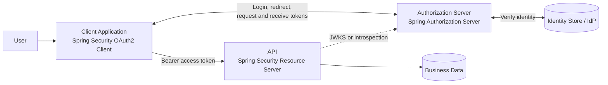
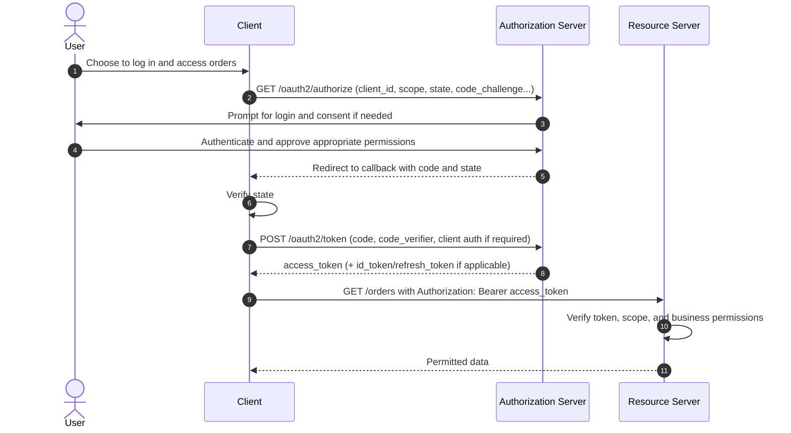

# Role of the Authorization Server in the Spring Security Ecosystem

## 1. Why Do We Need an Authorization Server?

Suppose a system has an order management web application, a mobile application for staff, and an order management API. Both applications need to call the API on behalf of the user, but the API should not require each application to forward the user's username and password on every request. The system also needs to know **which application is allowed to access, what it can do, for how long, and on whose behalf**.

The **Authorization Server** is the central component that handles this problem according to OAuth 2.0. It authenticates and evaluates authorization requests, then issues appropriate tokens so that a client application can access protected resources. With OpenID Connect (OIDC), the Authorization Server also acts as an **OpenID Provider**, providing user identity authentication information to the application.

In the Spring ecosystem:

- **Spring Security** provides the foundation for authentication, authorization, security filters, and OAuth 2.0/OIDC support.
- **Spring Authorization Server** provides the capabilities needed to **build an Authorization Server** based on Spring Security.
- **Spring Security OAuth2 Client** helps applications log in via OIDC/OAuth 2.0, execute authorization flows, and use tokens.
- **Spring Security OAuth2 Resource Server** protects APIs by verifying tokens and enforcing access rules.

Key point: The Authorization Server **decides on token issuance**; the Resource Server **decides whether to allow a specific request to a resource**. The two decisions are related, but they do not replace each other.

### Learning Outcomes

1. Distinguish between the Authorization Server, OAuth2 Client, Resource Server, and the user authentication service.
2. Explain the Authorization Code flow with PKCE, and the roles of the access token, refresh token, and ID token.
3. Identify the components to configure in a Spring Boot application and the trust boundaries between them.
4. Recognize security risks, operational requirements, and minimum tests required before production deployment.

## 2. Roles in OAuth 2.0/OIDC

| Role | Responsibility | Example in the Order System |
| --- | --- | --- |
| **Resource Owner** | The entity capable of granting or denying access to a resource; in user-facing flows, typically the user | A staff member who owns permission to view assigned orders |
| **Client** | Requests authorization, receives tokens, and calls APIs; can be a web app, mobile app, or backend service | Order management web app or mobile app |
| **Authorization Server** | Authenticates authorization requests and clients according to the applicable flow, checks policies, and issues tokens | `https://auth.example.com` |
| **Resource Server** | Receives requests with an access token, verifies the token, and enforces access control | `https://api.example.com` |
| **Identity System** | Stores or verifies identities, passwords, MFA, accounts, and groups; may be co-located with or federated to the Authorization Server | User database, LDAP, or an external identity provider |

Not every flow involves a direct user. For example, `client_credentials` is used for service-to-service communication: the Authorization Server authenticates the **client** and issues a token representing the client's permissions, without necessarily having a user login session.

Authorization Server, Client, and Resource Server are **protocol roles**, not necessarily three separate physical servers. In small applications, these roles may be deployed together; when scaling, the Authorization Server is often separated so multiple applications and APIs can trust a single token issuer.

## 3. Where Does the Authorization Server Fit in the Spring Architecture?



The diagram illustrates two distinct planes of the system:

**Authorization plane.** The client communicates with the Authorization Server to request access. The Authorization Server processes the request, checks policies for the client and the user, and then issues tokens.

**Resource plane.** The client uses the access token to call the API. The Resource Server verifies the token and checks permissions for the specific endpoint, operation, and data record. For JWTs, the Resource Server typically fetches and caches public keys via JWKS and verifies the signature locally; for opaque tokens, it typically calls the introspection endpoint to check token status.

For example, a token with the `orders.read` scope does not mean the user is allowed to view **every** order. The Resource Server must still enforce business rules, such as allowing access only to orders belonging to the user's branch or organization.

### The Authorization Server Does Not Automatically Provide All IAM Features

Spring Authorization Server supports the authorization protocol; when self-hosting, the development team still needs to design or integrate login, user management, multi-factor authentication, account recovery, client administration, security policies, storage, and monitoring. Do not confuse enabling OAuth 2.0 endpoints with having a complete identity management product.

## 4. How Does an Authorization Flow Happen?

For applications where users log in, **Authorization Code combined with PKCE** is the foundational flow. PKCE helps mitigate the risk of an attacker intercepting an authorization code and exchanging it for a token. The client generates a secret `code_verifier` for each request and sends a `code_challenge` derived from that value in the initial redirect step.



Clarifying common points of confusion:

1. **`/oauth2/authorize`** is the entry point for browser-based authorization requests. The Authorization Server may direct the user to a login screen and a consent screen depending on policy.
2. The **authorization code** is a short-lived, single-use code that the client exchanges for tokens at `/oauth2/token`. It is not an access token for calling APIs.
3. **`state`** is generated and verified by the client to bind the initial request to the redirect response, protecting against request mix-ups and CSRF attacks. **`code_verifier`** is verified at the token endpoint to enforce PKCE.
4. With **OIDC**, the client requests the `openid` scope; it may use `nonce` and must validate the ID token's validity conditions. `nonce` helps bind the identity response to the initial request.
5. A **confidential client** (e.g., a backend/BFF that can keep a secret) must authenticate at the token endpoint using its registered authentication method. A **public client** (e.g., an SPA or mobile app) cannot keep a client secret safe, so a client secret embedded in the application must not be treated as a trustworthy credential.
6. A **refresh token** is only issued when permitted by the client type, grant type, and server policy. Do not assume every code exchange will return a refresh token.

An example token response might look like:

```json
{
  "access_token": "<access-token>",
  "token_type": "Bearer",
  "expires_in": 900,
  "scope": "orders.read",
  "id_token": "<id-token-if-oidc>",
  "refresh_token": "<refresh-token-if-issued>"
}
```

The `id_token` and `refresh_token` fields in the example **do not always appear**. `expires_in` is an illustrative lifetime, not a default applicable to every system.

### Service-to-Service Flow

When an automated reporting service needs to read an API without a logged-in user, the client typically uses **Client Credentials**:

```text
Reporting Service -- client authentication + grant_type=client_credentials -->
Authorization Server -- access token with scope reports.read -->
Reporting Service -- Bearer access token --> Reporting API
```

There is no browser redirect, authorization code, or user consent in this flow. Client permissions must be granted according to the principle of least privilege, separate from the permissions of any user account.

The **Implicit** and **Resource Owner Password Credentials** flows are legacy options with security risks and should not be used when designing new systems. Choose a flow based on the client type and business context rather than choosing whichever implementation is shortest.

## 5. Three Common Token Types and Their Responsibilities

| Type | Purpose | Primary Consumer | Notes |
| --- | --- | --- | --- |
| **Access token** | Authorizes API calls within the granted lifetime and scope | Client sends to Resource Server | The API must verify the token and access permissions; the token can be JWT or opaque |
| **Refresh token** | Requests a new access token without repeating the full login flow | Client sends to Authorization Server | Sensitive value; requires secure storage and appropriate expiration/revocation/rotation policies |
| **ID token** (OIDC) | Carries user identity authentication claims for the OIDC Client | OIDC Client | Do not use the ID token in place of an access token to call APIs |

**JWT** is a token format consisting of claims and a signature. The signature enables tamper detection and issuer verification; the payload of a standard JWT is **not encrypted**. Therefore, do not put passwords, secrets, or unnecessary personal data in claims.

A Resource Server receiving a JWT access token typically checks the signature, accepted algorithm, expiration (`exp`, and `nbf` when present), issuer (`iss`), audience (`aud`) per policy, and scope/authorities. In Spring Security, JWT scopes are commonly converted into authorities with the `SCOPE_` prefix (e.g., `SCOPE_orders.read`), though this mapping can be customized. **Successful signature verification alone is not enough to conclude that a token is authorized to call an arbitrary API.**

JWTs allow an API to verify tokens locally, reducing network dependencies on each request; in return, revoking an issued JWT may not take immediate effect on Resource Servers that only verify signatures locally. Opaque tokens combined with introspection are more convenient when centralized token status checking is needed, but they increase dependency on the Authorization Server and network call overhead. Base your token format decision on revocation requirements, performance, and the trust level between services.

## 6. What Endpoints Does the Authorization Server Provide?

Actual endpoints depend on the configured features and version. In the Spring Authorization Server ecosystem, common paths include:

| Common Endpoint | Function |
| --- | --- |
| `/oauth2/authorize` | Accepts authorization requests, used in Authorization Code |
| `/oauth2/token` | Issues or refreshes tokens according to supported grant types |
| `/oauth2/jwks` | Provides **public keys** for recipients to verify JWTs |
| `/oauth2/introspect` | Returns token status/attributes to clients authorized for introspection |
| `/oauth2/revoke` | Accepts token revocation requests according to policy |
| `/.well-known/oauth-authorization-server` | OAuth 2.0 Authorization Server discovery metadata when supported |
| `/.well-known/openid-configuration` | OpenID Provider discovery metadata when OIDC is enabled |
| `/userinfo` | Provides OIDC user claims when enabled and authorized |
| `/connect/logout` | Supports the OIDC logout flow when enabled |

Some OIDC features are **optional**; do not write tests assuming every endpoint in the table appears simply by adding a dependency. The server must explicitly configure the enabled features, registered clients, signing keys, issuer, and authentication components.

**Issuer** is the stable identifier of the Authorization Server, such as `https://auth.example.com`. This value must match the published metadata and the `iss` claim in tokens. If the system runs behind a reverse proxy or API gateway, the public issuer, HTTPS, and forwarded headers configuration must be consistent to prevent clients or Resource Servers from rejecting tokens due to an issuer mismatch.

## 7. Spring Components That Must Work Together

Spring Authorization Server provides extension points to integrate with Spring Security. Common conceptual components and APIs include:

| Component | Role in Design |
| --- | --- |
| `SecurityFilterChain` and Authorization Server configuration | Applies filters, endpoints, and security policies for OAuth 2.0/OIDC requests |
| `RegisteredClientRepository` | Stores client configuration: client ID, authentication methods, grant types, redirect URIs, scopes, PKCE and consent settings |
| `OAuth2AuthorizationService` | Stores and retrieves authorizations, tokens, and state associated with the authorization process |
| `OAuth2AuthorizationConsentService` | Manages information about client scopes approved by users when consent is required |
| `OAuth2TokenGenerator` and token customizer | Issues tokens and customizes claims within security policy boundaries |
| `JWKSource` / signing keys | Supplies key material for signing tokens and publishing public key parts |
| `AuthorizationServerSettings` | Configures the issuer and server endpoint parameters |
| Spring Security login mechanism | Authenticates users via form login, internal provider, or another identity federation mechanism |

An Authorization Server application typically has at least **two groups of security rules**: rules for OAuth 2.0/OIDC protocol endpoints and rules for the login page/application UI. They must coordinate so unauthenticated users are directed to the login flow, while token requests or client authentication are handled according to the protocol.

A small example of **issuer** in Java configuration (for illustration; must be wired with the remaining beans and adapted to your Spring version):

```java
@Bean
AuthorizationServerSettings authorizationServerSettings() {
    return AuthorizationServerSettings.builder()
            .issuer("https://auth.example.com")
            .build();
}
```

In a **separate API application** acting as a Resource Server, Spring Boot configuration can typically start with:

```yaml
spring:
  security:
    oauth2:
      resourceserver:
        jwt:
          issuer-uri: https://auth.example.com
```

Configuring `issuer-uri` allows the Resource Server to use metadata from the issuer to discover JWT verification details when the Authorization Server provides the corresponding discovery endpoint. The API must still configure appropriate access control, validate the audience per system requirements, and map scopes/claims to business permissions. This YAML snippet **does not configure an Authorization Server** and is not sufficient to protect the entire API.

For a Spring Boot application acting as an OAuth2 Client, the client registration configuration on the consuming application side and the `RegisteredClientRepository` configuration on the Authorization Server side must match in client ID, redirect URI, authentication method, grant types, and scopes.

### What Data Needs to Be Persisted?

In-memory examples help you learn the flow quickly, but they are not suitable for long-term production state. For a real system, consider persisting client configurations, authorizations, consents, revocation history, and signing keys; design backups, recovery, migrations, and data access controls. **Private keys used to sign tokens must never be published via JWKS**; JWKS only publishes key components permitted for public sharing.

## 8. Security Rules That Determine System Trustworthiness

The Authorization Server has the authority to issue tokens for many services, so misconfiguration can have a wide blast radius. Key principles:

1. **Enforce HTTPS** for real connections; protect session cookies, authorization codes, client credentials, and tokens in transit.
2. **Register exact redirect URIs**, avoiding wildcards or open redirects; validate `state` and use PKCE with `S256` for Authorization Code.
3. **Distinguish between public and confidential clients**. Do not put a client secret in browser-side JavaScript or a mobile app package and assume it can stay secret; for backends, protect client credentials and rotate them periodically.
4. **Apply least privilege**: restrict grant types, scopes, token lifetimes, and audiences; do not grant `admin` or overly broad scopes when only `orders.read` is needed.
5. **Separate access tokens and ID tokens**; the Resource Server must only accept the configured token type, issuer, and audience.
6. **Protect and rotate signing keys**. Manage keys using an appropriate secret store/KMS/HSM, supporting an overlap period so existing valid tokens can still be verified during rotation.
7. **Protect user authentication** with strong password policies, MFA when needed, login attempt throttling, `Secure` and `HttpOnly` cookies, and `SameSite` settings compatible with redirect flows. Do not disable CSRF for the entire application just to handle a single OAuth 2.0 endpoint.
8. **Protect tokens in storage and logs**. Avoid logging raw tokens, authorization codes, secrets, or sensitive information in logs, analytics URLs, or error messages. Evaluate browser-side token storage versus using a BFF with secure session cookies.
9. **Do not trust every token just because it is a JWT**. The Resource Server must restrict trusted issuers, audiences, algorithms, lifetimes, and scopes; per-resource permission rules still belong to the API.
10. **Set up load limits and monitoring** for login, token, introspection, and JWKS endpoints; implement rate limiting, auditing, and alerts for signs of abuse.

An example of permission boundaries: a client receives an access token with `scope=orders.read` and `aud=orders-api`. The Resource Server may allow `GET /orders`, but must deny `DELETE /orders/123` if the appropriate scope is missing, and must deny reading orders from another department if data policies forbid it. The Authorization Server cannot handle all of those business conditions on behalf of the API.

## 9. What to Test Before Going Live

In addition to happy-path testing, create deliberate failure scenarios:

| Scenario | Expected Result |
| --- | --- |
| Client uses valid redirect URI, scope, and Authorization Code + PKCE | Receives code, exchanges token successfully; Resource Server accepts token with sufficient permissions |
| Client sends an unregistered redirect URI or requests a disallowed scope | Authorization Server rejects per policy |
| `state` mismatch after callback | Client rejects the response |
| Missing or wrong `code_verifier`, or reuse of an authorization code | Fails to exchange for an access token |
| Confidential client uses invalid credentials | Token endpoint rejects the request |
| Expired JWT, invalid signature, or mismatched issuer/audience | Resource Server rejects the token |
| Valid token but missing scope or unauthorized for the record | Resource Server returns an appropriate access error without leaking data |
| Token revocation or signing key rotation | Verification/revocation behaves according to token format, lifetime, and designed policy |
| Authorization Server temporarily unreachable | Clear error behavior; assess impact on new token issuance, login, introspection, and JWT-verifying APIs |

In operations, monitor error rates at `/oauth2/authorize` and `/oauth2/token`, failed login counts, introspection latency, discovery/JWKS availability, TLS certificate expiration, signing key lifecycle, and storage health. Set alerts for sudden spikes while ensuring logs include correlation IDs for investigation without exposing credentials.

## 10. When Should You Build Your Own Authorization Server?

**Self-hosting with Spring Authorization Server** is suitable when an organization needs deep control over client registration, claims, authorization flows, and Spring ecosystem integration, and has the capability to continuously maintain security, signing keys, data, upgrades, and operations.

**Using an existing identity provider / Authorization Server** is suitable if you quickly need account management, SSO, MFA, federation, user administration, and compliance workflows that the team does not want to build and operate from scratch. Spring Security applications can still act as Clients and Resource Servers trusting that provider.

Both choices share the same architectural principles: the application must validate tokens in the proper context, the API must enforce business permissions, and operators must manage keys, client configurations, redirect flow security, and token lifecycles.

## 11. Summary Through a Scenario

A staff member opens the order management application:

1. The application redirects to the Authorization Server to log in and request the `orders.read` scope using Authorization Code + PKCE.
2. The Authorization Server authenticates the user, applies authorization policies, and issues an access token; if using OIDC, the client may also receive an ID token to verify the login session.
3. The application sends the **access token** to the Order API.
4. The Order API (Spring Security Resource Server) verifies the issuer, signature or token status, expiration, audience, and scope, then checks access permissions for each order.
5. When the token expires, the application executes the appropriate flow to obtain a new token. The Authorization Server remains responsible for issuance policies, while the API remains responsible for protecting data.

**Remember:** The Authorization Server is the **trusted authority for issuing tokens**, the OAuth2 Client is the **party requesting and using tokens**, and the Resource Server is the **party verifying tokens and protecting resources**. OIDC adds a user identity authentication layer; it does not replace authorization at the API.

### Standards and Reference Documentation

- [Spring Authorization Server Reference](https://docs.spring.io/spring-authorization-server/reference/)
- [Spring Security OAuth 2.0 Reference](https://docs.spring.io/spring-security/reference/servlet/oauth2/index.html)
- [RFC 6749 – The OAuth 2.0 Authorization Framework](https://datatracker.ietf.org/doc/html/rfc6749)
- [RFC 7636 – Proof Key for Code Exchange (PKCE)](https://datatracker.ietf.org/doc/html/rfc7636)
- [OpenID Connect Core 1.0](https://openid.net/specs/openid-connect-core-1_0.html)
