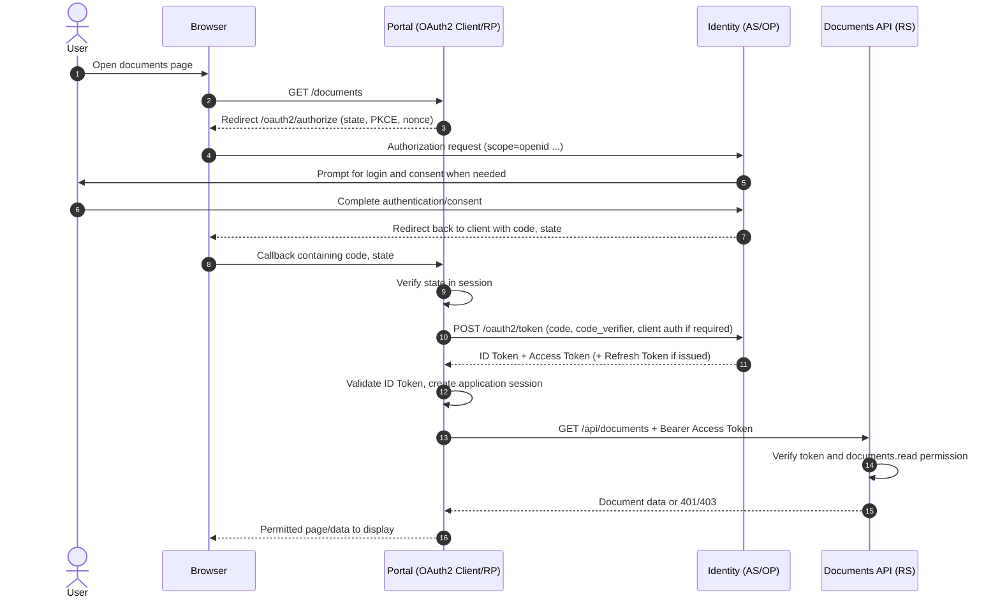

# Distinguishing Authorization Server, Resource Server, OAuth2 Client, and OpenID Provider

In systems using OAuth 2.0 and OpenID Connect (OIDC), the four terms **Authorization Server**, **Resource Server**, **OAuth2 Client**, and **OpenID Provider** represent **roles in a protocol**, not necessarily four separately deployed applications. A single Spring Boot application can take on one or more roles; what matters is understanding which party issues tokens, which party consumes tokens, and which party authenticates user identity.

Within the scope of building a **Spring Security OAuth2/OIDC Authorization Server** with Spring Boot, accurately distinguishing these roles helps you design trust boundaries, choose appropriate Spring Security configurations, implement login/authorization flows properly, and test APIs safely.

## 1. Context: Participating Components

Suppose a system has a web portal `portal.example.com`, a document management API `api.example.com`, and an identity service `identity.example.com`. A user logs into the web portal to read documents they are permitted to access.

- **Resource Owner** (in typical scenarios, the user): the entity with authority to permit an application to access a resource. Some flows such as `client_credentials` have no direct user involvement.
- **User Agent**: the browser or user-side software that handles redirects between the application and the identity service. The browser is not synonymous with the OAuth2 Client in every architecture.
- **OAuth2 Client**: the application requesting access and receiving tokens via a supported grant; in this example, the web portal.
- **Authorization Server (AS)**: the service that processes authorization requests and issues tokens; in this example, the identity service.
- **Resource Server (RS)**: the API that stores/serves protected resources; in this example, the documents API.
- **OpenID Provider (OP)**: the service that provides identity authentication functionality according to OIDC; in this example, the identity service also acts as the OP.

The addresses and domain names above are illustrative; in real-world deployments, multiple roles may share the same hostname or the same process.

## 2. Quick Comparison Table of the Four Roles

| Criterion | Authorization Server | Resource Server | OAuth2 Client | OpenID Provider |
|---|---|---|---|---|
| Core question | **Who grants permissions/tokens?** | **Who protects the resources?** | **Who requests and uses permissions?** | **Who authenticates identity via OIDC?** |
| Responsibilities | Processes authorization grants, manages client registrations/policies, issues and manages tokens | Receives access tokens, verifies validity and permissions, enforces API access control | Initiates the authorization flow, receives authorization codes/tokens, and calls APIs or logs in users | Performs authentication, issues ID Tokens, and provides enabled OIDC capabilities |
| Typical input | Authorization requests, token requests, client and user info depending on the grant | HTTP requests carrying a Bearer access token | User interaction, authorization codes, or client credentials | OIDC authentication requests with the `openid` scope |
| Typical output | Access tokens, refresh tokens when issued, protocol responses | Resources or `401`/`403` errors | HTTP requests to APIs, application login sessions | ID Tokens, user info via UserInfo when supported |
| Trust relies on | Authenticating clients, users, and issuance policies | Verifying issuer, signature or introspection, expiration, audience, and scopes/permissions | Verifying `state`, PKCE, token responses; validating the ID Token when using OIDC | Guaranteeing identity claims and binding tokens to the exact client |
| Can stand alone | Yes: OAuth 2.0 only, OIDC not required | Yes: API accepts access tokens from an AS | Yes: can use OAuth 2.0 only | **Not protocol-independent:** an OP is an OAuth 2.0 Authorization Server that additionally implements OIDC |
| Spring support | **Spring Authorization Server** | **Spring Security OAuth2 Resource Server** | **Spring Security OAuth2 Client** | **Spring Authorization Server** with OIDC enabled |

**Common misconception:** An OpenID Provider is neither the party calling APIs nor a Resource Server by default. An AS becomes an OP when it actually implements OIDC requirements; merely issuing JWTs or having a login page is not enough to call it an OP.

## 3. OAuth 2.0 Handles Authorization; OpenID Connect Adds an Authentication Layer

### 3.1. OAuth 2.0 answers: What is the application allowed to do?

OAuth 2.0 is an **authorization** framework. After a client completes a valid grant, the Authorization Server issues an access token so the client can request access to resources. The access token represents the granted access rights and may be associated with a user or the client itself depending on the grant.

For example, `portal.example.com` receives a token with the `documents.read` scope and then calls `GET /api/documents`. The API determines whether the token is valid and has read permission. **Having an access token does not automatically prove the identity of the person currently using the web portal**; a client should not treat an arbitrary access token as proof of an OIDC login.

### 3.2. OIDC answers: Who was just authenticated?

OIDC adds an **identity authentication layer** on top of OAuth 2.0. When a client makes a valid OIDC request, typically including the `openid` scope, the OpenID Provider can return an **ID Token** containing information about the authentication event and the subject identifier (`sub`). The application receives the ID Token and validates the required claims/signature before establishing a login session.

In the OIDC context, an OAuth2 Client receiving authentication is commonly called a **Relying Party (RP)**. Therefore, the same Spring Boot application can be both an OAuth2 Client and an OIDC Relying Party. These are two ways of describing two functions of the application, not two necessarily separate servers.

| Token Type | Who typically receives it? | Who is the intended consumer? | Primary purpose |
|---|---|---|---|
| **Access Token** | OAuth2 Client | Designated Resource Server/API | Permits accessing resources according to the token's permissions and context |
| **ID Token** | OIDC Relying Party/Client | The specific client whose `client_id` is in `aud` | Attests to the login result, subject identifier, and authentication context |
| **Refresh Token** | Eligible Client | Authorization Server at the token endpoint | Requests a new access token according to issuance, revocation, and expiration policies |

Do not pass an ID Token in the `Authorization: Bearer ...` header to call an API. A Resource Server needs an **access token** intended for that API. An access token can be a JWT or an opaque string; token format does **not** determine whether a service is an OpenID Provider.

### 3.3. Claims Have Different Meanings

An ID Token might have illustrative content like:

```json
{
  "iss": "https://identity.example.com",
  "sub": "user-42",
  "aud": "portal-web",
  "exp": 1794852000,
  "iat": 1794848400,
  "nonce": "nonce-stored-in-session"
}
```

A JWT access token intended for an API might have an illustrative payload like:

```json
{
  "iss": "https://identity.example.com",
  "sub": "user-42",
  "aud": "documents-api",
  "scope": "documents.read",
  "exp": 1794852000,
  "iat": 1794848400
}
```

These are only **illustrative payloads, not signed JWTs**. Scope naming, audience, and access token claims depend on the Authorization Server and the contract with the API. `sub` in an access token can also represent a client when using the `client_credentials` grant. Do not take plausible-looking claims as proof of validity without verifying the corresponding token.

## 4. End-to-End Flow: OIDC Login Followed by Calling an API with OAuth 2.0

Consider a server-side web client using **Authorization Code + PKCE**. The Authorization Server also has OIDC enabled and is therefore referred to as an OpenID Provider.



Key points to read accurately from the flow:

1. **The Client** initiates the authorization request and stores `state`, the PKCE `code_verifier`, and `nonce` (when nonce is required) bound to the transaction session. In the Authorization Code flow, `code_challenge` is sent through the browser, while `code_verifier` is used when exchanging the code for tokens.
2. **The AS/OP** authenticates the user according to policy, and validates the client, redirect URI, grant, scopes, and consent if required. The AS issues an **authorization code** first; tokens are issued at the token endpoint when a valid code is exchanged.
3. **The Client/RP** compares `state` to prevent callback swapping; uses PKCE to bind the code exchange process; and validates the ID Token (e.g., issuer, audience, signature, expiration, and nonce when applicable) before trusting the identity.
4. **The RS** receives the **access token** via API requests and enforces its own access policies. The RS does not accept an ID Token as a substitute for API authorization checks.
5. **The User** may have logged in at the OP without necessarily having the `documents.read` permission. Identity authentication and granting permission to read documents are two separate decisions.

Example of an authorization request wrapped for readability:

```http
GET /oauth2/authorize?response_type=code&client_id=portal-web&redirect_uri=https%3A%2F%2Fportal.example.com%2Flogin%2Foauth2%2Fcode%2Fcompany&scope=openid%20profile%20documents.read&state=RANDOM_STATE&code_challenge=BASE64URL_SHA256_VERIFIER&code_challenge_method=S256&nonce=RANDOM_NONCE HTTP/1.1
Host: identity.example.com
```

`RANDOM_STATE`, `RANDOM_NONCE`, and `BASE64URL_SHA256_VERIFIER` are placeholders; a real system must generate cryptographically secure random values and bind them properly to the session. `redirect_uri` must match the registration rules at the AS, using HTTPS in production environments (with exceptions for certain local development scenarios).

## 5. Detailed Roles and Security Boundaries

### 5.1. Authorization Server: Where Permissions Are Decided and Issued

The Authorization Server is typically responsible for:

- Managing **registered clients**, including `client_id`, authentication methods, redirect URIs, grant types, allowed scopes, and PKCE and token policies.
- Providing the **authorization endpoint** and **token endpoint** corresponding to supported grants.
- Authenticating users when required by the grant; authenticating clients when required by the client type and authentication method.
- Making authorization/consent decisions per policy, and issuing and managing authorization codes, access tokens, and refresh tokens.
- Providing a means to verify access tokens, such as public signing keys/JWKS for JWTs or an introspection endpoint if supported and configured.

The AS **is not by default a business resource store**. The token-issuing service may store accounts, sessions, consents, and security metadata, but it does not necessarily serve `/api/documents`.

Common OAuth 2.0 endpoints in Spring Authorization Server:

| Endpoint | Function |
|---|---|
| `/oauth2/authorize` | Starts processing an authorization request with user interaction when required by the grant |
| `/oauth2/token` | Exchanges an authorization code or executes a supported token grant |
| `/oauth2/jwks` | Publishes public keys so recipients can verify JWT signatures, when appropriate keys are configured |
| `/oauth2/introspect` | Provides token status information to clients authorized to introspect |
| `/oauth2/revoke` | Requests token revocation subject to protocol and implementation conditions |

The paths above are common defaults in Spring Authorization Server; **not every external AS is required to use these exact paths**. Actual functionality depends on the version, endpoint configuration, and required beans.

### 5.2. Resource Server: The Gatekeeper of Resources

The Resource Server is responsible for validating **access tokens intended for it** and enforcing authorization before returning data:

- For a **JWT access token**: verify the signature with trusted keys, check `iss`, expiration (`exp`, and `nbf` if present), audience (`aud`), and required constraints.
- For an **opaque access token**: use introspection (or an appropriately designed mechanism) to retrieve validity status and required attributes from the AS.
- Enforce scopes and business permissions; for example, `documents.read` only allows a category of operation, while permission to view a *specific document* may still require checking the owner, organization, or record-level access policies.
- Return **401 Unauthorized** when credentials are missing or unacceptable, and **403 Forbidden** when credentials are accepted but insufficient under policy.

**Never merely decode a JWT** and trust its payload. Anyone can construct a JWT payload as plain text; the RS must verify the signature and critical claims. Spring Security's `issuer-uri` configuration helps verify the issuer, signature, and timestamps according to the JWT Resource Server mechanism; **audience validation per the API contract must be configured/verified separately** and cannot be assumed from `issuer-uri` alone.

### 5.3. OAuth2 Client: Application Requesting Permissions on Behalf of Itself or a User

The OAuth2 Client is the component that **requests tokens**, not the component that issues tokens. There are two common types:

| Client Type | Examples | Notes |
|---|---|---|
| **Confidential client** | Backend application managing a client secret securely | Can authenticate with the AS using a client secret or a stronger mechanism; commonly uses Authorization Code for server-side web apps |
| **Public client** | Mobile apps, SPAs running in the browser | Cannot keep a client secret secure; uses PKCE with Authorization Code and avoids embedding secrets into code distributed to users |

A client can request permissions **on behalf of a user** using Authorization Code, or obtain a token **for the application itself** using `client_credentials` when permitted by the AS. With `client_credentials`, there is no end-user login event, so an OIDC ID Token representing a user login should not be expected.

An OAuth2 Client can use Spring Security libraries for login (`oauth2Login`) or for managing authorized clients and calling APIs (`oauth2Client`); both needs can coexist in the same application.

### 5.4. OpenID Provider: An AS Providing OIDC Authentication

An OpenID Provider is an **Authorization Server that supports OIDC**. Beyond the OAuth 2.0 authorization process, the OP is responsible for:

- Authenticating users and issuing an **ID Token** to the Relying Party when executing an appropriate OIDC flow.
- Publishing OIDC metadata via discovery, typically at `/.well-known/openid-configuration` depending on the issuer and implementation.
- Providing keys for ID Token signature verification (typically via `jwks_uri`) and supporting additional OIDC features such as UserInfo when configured.
- Ensuring the ID Token is bound to the **exact client** (`aud`) and authentication context so the RP can verify them.

**OIDC does not require a Resource Server to implement OIDC.** The documents API only needs to verify access tokens and its own API permissions. If an API also issues ID Tokens or serves UserInfo, that is a separately designed additional responsibility—it does not arise merely because the API uses JWTs.

## 6. Mapping to Spring Security and Spring Authorization Server

The Spring ecosystem separates responsibilities across different configurations and features. The examples below illustrate **the role separation**, not a complete runnable project; a real application needs appropriate dependencies, login configuration, client registration, signing keys, and persistence as required.

### 6.1. Building an Authorization Server and Enabling the OpenID Provider Role

In an application acting as the AS, Spring Authorization Server provides endpoint configuration and token issuance mechanics. To support OIDC, enable the OIDC extension on `OAuth2AuthorizationServerConfigurer`:

```java
@Bean
@Order(1)
SecurityFilterChain authorizationServerFilterChain(HttpSecurity http) throws Exception {
    OAuth2AuthorizationServerConfigurer authorizationServer =
            OAuth2AuthorizationServerConfigurer.authorizationServer();

    http.securityMatcher(authorizationServer.getEndpointsMatcher())
        .with(authorizationServer, server ->
                server.oidc(Customizer.withDefaults()))
        .authorizeHttpRequests(auth -> auth.anyRequest().authenticated())
        .exceptionHandling(ex -> ex.defaultAuthenticationEntryPointFor(
                new LoginUrlAuthenticationEntryPoint("/login"),
                new MediaTypeRequestMatcher(MediaType.TEXT_HTML)));

    return http.build();
}
```

This configuration snippet illustrates the DSL API of Spring Authorization Server versions supporting `OAuth2AuthorizationServerConfigurer.authorizationServer()` and `HttpSecurity.with(...)`; the API may vary by version. To complete the application, you also need a `RegisteredClientRepository`, a `JWKSource` for signing tokens, appropriate `AuthorizationServerSettings`/issuer, a `SecurityFilterChain` for user login, and components for persisting tokens/consents as dictated by your architecture. Enabling `.oidc(...)` configures the OIDC protocol portion; **it does not automatically create users, consent data, or valid clients**.

Example client configuration (illustrating creating a `RegisteredClient`):

```java
RegisteredClient portal = RegisteredClient.withId(UUID.randomUUID().toString())
        .clientId("portal-web")
        .clientSecret(passwordEncoder.encode(secretFromSecureConfiguration))
        .clientAuthenticationMethod(ClientAuthenticationMethod.CLIENT_SECRET_BASIC)
        .authorizationGrantType(AuthorizationGrantType.AUTHORIZATION_CODE)
        .authorizationGrantType(AuthorizationGrantType.REFRESH_TOKEN)
        .redirectUri("https://portal.example.com/login/oauth2/code/company")
        .scope(OidcScopes.OPENID)
        .scope(OidcScopes.PROFILE)
        .scope("documents.read")
        .clientSettings(ClientSettings.builder().requireProofKey(true).build())
        .build();
```

`secretFromSecureConfiguration` is a variable representing a secret loaded from a secure configuration system, not a hardcoded value. The client registration must be stored by `RegisteredClientRepository`. A public client uses the `none` authentication method rather than pretending it can keep a `client_secret`.

### 6.2. Configuring an API as a Resource Server

A Spring Boot application that only serves protected APIs does not need to enable OIDC login or token endpoints:

```yaml
spring:
  security:
    oauth2:
      resourceserver:
        jwt:
          issuer-uri: https://identity.example.com
```

```java
@Bean
SecurityFilterChain apiSecurityFilterChain(HttpSecurity http) throws Exception {
    http.securityMatcher("/api/**")
        .authorizeHttpRequests(auth -> auth
            .requestMatchers(HttpMethod.GET, "/api/documents/**")
                .hasAuthority("SCOPE_documents.read")
            .anyRequest().authenticated())
        .oauth2ResourceServer(oauth2 -> oauth2.jwt(Customizer.withDefaults()));

    return http.build();
}
```

This example uses JWT access tokens, where scopes are mapped by Spring to authorities with the `SCOPE_` prefix under common configuration. You must add policies for other endpoints and an **audience validator** tailored to the API. If the AS issues **opaque tokens**, replace the `jwt` configuration with the `opaqueToken` mechanism and configure the appropriate introspection endpoint/credentials. `oauth2ResourceServer()` does not generate tokens for callers.

### 6.3. Configuring the Portal as an OAuth2 Client and OIDC Relying Party

A web application logging in through an OP can configure a registration with an issuer:

```yaml
spring:
  security:
    oauth2:
      client:
        registration:
          company:
            provider: company-identity
            client-id: portal-web
            client-secret: ${PORTAL_OAUTH2_CLIENT_SECRET}
            authorization-grant-type: authorization_code
            redirect-uri: "{baseUrl}/login/oauth2/code/{registrationId}"
            scope: openid, profile, documents.read
        provider:
          company-identity:
            issuer-uri: https://identity.example.com
```

```java
@Bean
SecurityFilterChain portalSecurityFilterChain(HttpSecurity http) throws Exception {
    http.authorizeHttpRequests(auth -> auth
            .requestMatchers("/", "/public/**").permitAll()
            .anyRequest().authenticated())
        .oauth2Login(Customizer.withDefaults())
        .oauth2Client(Customizer.withDefaults());
    return http.build();
}
```

When the registration includes the `openid` scope, Spring Security handles login via OIDC if the provider supports the protocol properly. `oauth2Login()` sets up browser-based login; `oauth2Client()` supports OAuth2 Client capabilities inside the application. How access tokens are sent to the API, how authorized clients are stored/refreshed, and how user sessions are linked still need to be designed to fit the architecture. The client secret must be kept on the server or in a secure secret store, never placed in browser-side JavaScript.

### 6.4. One Application Can Assume Multiple Roles

Configuration sets do not map one-to-one with the number of applications:

| Architecture | Roles That Can Be Combined | What Must Stay Clear |
|---|---|---|
| Three-service system | `identity`: AS/OP; `portal`: Client/RP; `api`: RS | Signing keys, audience, redirect URIs, token flows, and access conditions |
| Backend-for-Frontend (BFF) | BFF is Client/RP, calling RSs from the backend | Session/cookie protection, backend token management, CSRF, and per-user permissions |
| Monolith application | Same process can be Client and RS; AS/OP can also be co-located if design allows | Avoiding conflicts between `SecurityFilterChain`s, endpoints, and trust boundaries |
| Multiple APIs sharing one OP | One AS/OP, multiple RSs with distinct audiences/permissions | Never letting a token intended for API A automatically access API B |

When using multiple `SecurityFilterChain`s, check `securityMatcher`, `@Order` precedence, and the fallback chain so that AS endpoints, login, and APIs receive the right policies. Combining roles does not allow skipping token verification just because components run in the same process.

## 7. Common Cases of Confusion

| Misconception | Correct Understanding |
|---|---|
| "Using JWT means you already have OIDC" | JWT is a token format; OIDC requires the authentication protocol, ID Token, and corresponding bindings. |
| "Resource Server issues access tokens" | Under the standard OAuth 2.0 model, the **Authorization Server** issues tokens; the RS validates tokens to protect resources. |
| "Receiving an ID Token at the API is enough for authentication and authorization" | The ID Token is meant for the RP, not a substitute for an access token with the audience/permissions intended for the API. |
| "Logged-in users are allowed to call every API" | Login authenticates the subject; APIs still check tokens, scopes, audiences, and resource-level permissions. |
| "Client secrets are safe when placed in an SPA" | SPAs/public clients cannot keep secrets; use a public client design with Authorization Code + PKCE. |
| "An OAuth2 Client must have a login screen" | A client can run without user interaction using `client_credentials` when appropriate. |
| "AS and OP are always two separate servers" | In OIDC, an OP is an AS that supports OIDC; one service can provide both roles. |
| "A JWT with a valid signature works for any API" | Each RS must verify issuer, expiration, audience, scopes, and business policies. |
| "Discovery and JWKS are the token endpoint" | Discovery publishes metadata; JWKS publishes verification keys; the token endpoint handles token issuance. |

A serious design flaw is **token substitution**: API B accepts a valid access token signed by the same AS that was actually intended only for API A. The prevention is defining a distinct audience for each API and requiring every RS to validate `aud` alongside other checks. Another flaw is **confusing an ID Token with an access token**, causing a client or API to trust data that was not issued for its intended purpose.

## 8. How to Determine Roles When Designing a System

When facing a new component, ask these questions in order:

1. **Does the component issue authorization codes/access tokens and manage clients/grants?** If yes, it is acting as an **Authorization Server**.
2. **Does it perform OIDC authentication, issue ID Tokens for RPs, and publish OIDC metadata?** If yes, it is also an **OpenID Provider**.
3. **Does it receive access tokens to return data or execute protected APIs?** If yes, it is acting as a **Resource Server**.
4. **Does it register with an AS, request authorization codes/access tokens, and then use those tokens?** If yes, it is acting as an **OAuth2 Client**; if it uses OIDC to log in users, it is simultaneously a **Relying Party**.

A single component may get multiple "yes" answers. When that happens, draw up a table of endpoints, tokens received/issued, token consumers, data to protect, and corresponding `SecurityFilterChain`s before writing configuration.

### Thought-Check Examples

**Scenario A:** A scheduled background service uses `client_credentials` to obtain a token from `identity.example.com` and then updates data through an API. The background service is an **OAuth2 Client**, `identity.example.com` is the **AS**, and the API is the **RS**. There is no need for OIDC/ID Tokens for an end user in this flow.

**Scenario B:** A user selects "Sign in with identity provider" on the web portal. The provider supports OIDC and issues an ID Token; the web portal validates the ID Token and creates a session. The provider is the **OP/AS**; the web portal is the **OIDC RP/OAuth2 Client**. If the web portal subsequently calls an API with an access token, the API is the **RS**.

**Scenario C:** A microservice accepts Bearer JWTs and checks `SCOPE_orders.read`, but has no login UI or token-issuing endpoints. This microservice is an **RS**, not an Authorization Server or OpenID Provider.

## 9. Testing Suggestions by Responsibility

| Component Under Test | Positive Cases | Cases That Must Be Rejected/Controlled |
|---|---|---|
| **AS** | Valid client, grant, redirect URI, and scope receive protocol-compliant responses | Unregistered redirect URI, invalid client, disallowed grant/scope, reused authorization code, or wrong PKCE |
| **OP** | RP successfully validates an ID Token with the right issuer, audience, and expiration | ID Token with wrong `aud`/`iss`, invalid signature, expired, or mismatched nonce when required |
| **Client/RP** | Authorization Code + PKCE flow, `state` matching, session created for the right user | Callback with wrong `state`, missing/wrong `code_verifier`, failed code exchange, or token failing validation |
| **RS** | Active token, matching audience and scope, permitted resource | Missing token, invalid signature/issuer/audience, expired token, missing scope, or unauthorized object access |

You should test the scenario where **a user authenticates successfully but is not permitted to view a specific resource**: this verifies the system does not equate OIDC login with business authorization. When integrating Spring Security, check HTTP status codes, `WWW-Authenticate` when appropriate, audit logs without leaking tokens, and the effectiveness of revocation/refresh policies for the chosen token type.

## 10. Learning Takeaways

In an OAuth 2.0/OIDC architecture:

- **Authorization Server** issues access permissions as tokens after processing valid grants.
- **Resource Server** protects APIs by validating access tokens and corresponding permissions.
- **OAuth2 Client** requests and uses tokens; when logging in via OIDC, it is also a **Relying Party**.
- **OpenID Provider** is an Authorization Server with the added responsibility of identity authentication and issuing ID Tokens under OIDC.

When building an Authorization Server with Spring Authorization Server, test the **protocol/token endpoints**, **OIDC features**, **client configurations**, and **token contracts with Resource Servers** separately. Mastering these four roles is the foundation for diving deeper into signing key design, grants, consent, PKCE, token validation, endpoint security, integration testing, and operating real-world identity systems.
