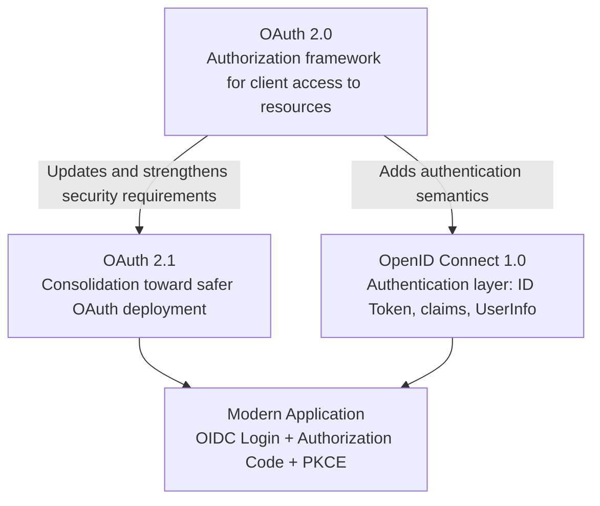
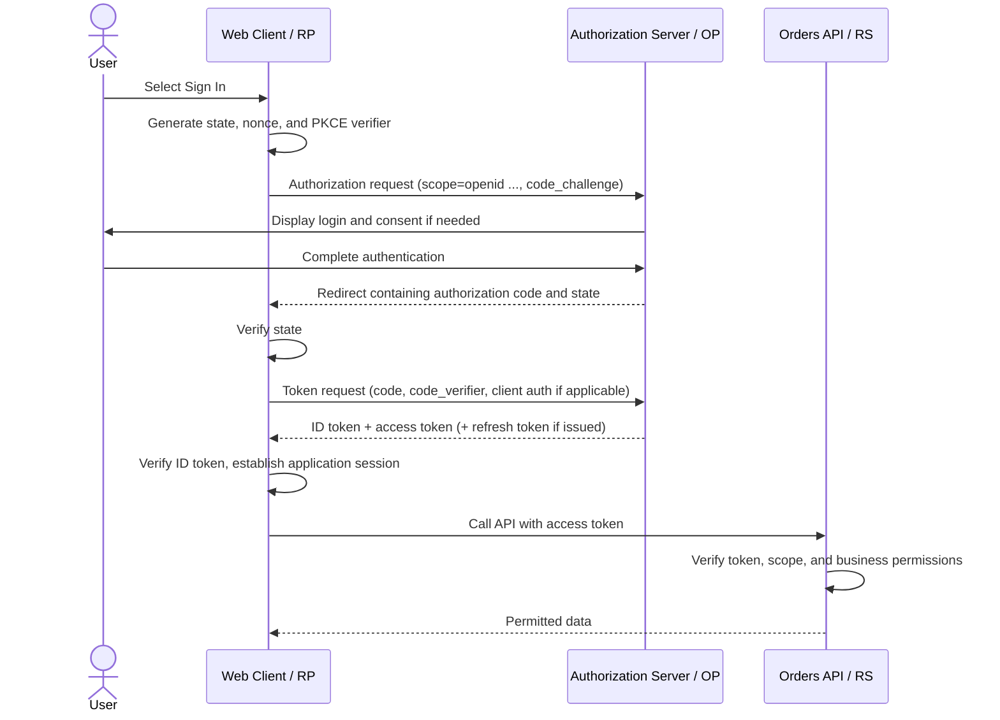

# Relationship Between OAuth 2.0, OAuth 2.1, and OpenID Connect 1.0

## 1. Context and Learning Objectives

When building an **Authorization Server with Spring Security and Spring Authorization Server** in a Spring Boot application, the three terms **OAuth 2.0**, **OAuth 2.1**, and **OpenID Connect (OIDC) 1.0** often appear together. They are closely related, yet they answer different questions:

- **OAuth 2.0:** How can an application (client) be granted permission to access protected resources?
- **OAuth 2.1:** What modern security practices should form the baseline when implementing OAuth, replacing legacy mechanisms with known risks?
- **OpenID Connect 1.0:** How does a client authenticate who the logged-in user is using a standardized protocol built on top of OAuth?

For example, a booking system has a web UI, a mobile app, and an orders API. A user logs in once to use the applications; the client needs to know the identity of the logged-in user, while the API should only allow operations matching the granted permissions. **OIDC helps the client verify the login session**, while **OAuth helps the client obtain an access token to call APIs**. Security practices associated with OAuth 2.1, such as Authorization Code combined with PKCE, reduce risks throughout the journey.

After this lesson, you will be able to:

1. Distinguish **resource access authorization** from **identity authentication**.
2. Explain the relationship between OAuth 2.0, the OAuth 2.1 consolidation direction, and the OIDC 1.0 identity layer.
3. Trace the combined login and authorization flow using Authorization Code + PKCE.
4. Distinguish the purpose, intended recipient, and validation of an **access token** versus an **ID token**.
5. Select the right configuration components in Spring Authorization Server, Spring Security OAuth2 Client, and Resource Server.

## 2. Overall Model: One Foundation, Two Extension Directions

OAuth 2.0 is the authorization protocol framework. OAuth 2.1 builds on that foundation, removing or tightening options that are no longer considered suitable under modern security practices. OIDC 1.0 uses OAuth 2.0's authorization mechanisms and **adds a user authentication protocol layer**.



The diagram shows that **OAuth 2.1 and OIDC are not competing products**. OAuth 2.1 refines how permissions are granted safely; OIDC adds identity information and rules for clients to verify the authentication process. A modern OIDC login solution can adopt the security practices promoted by OAuth 2.1 and the OAuth Security Best Current Practice.

**Note on specifications:** OAuth 2.0 is standardized by RFC 6749; OIDC Core 1.0 is an OpenID Foundation specification. OAuth 2.1 is an effort to consolidate and update OAuth 2.0. When applying normative requirements from "OAuth 2.1", check the **IETF document version in effect at the time of implementation**, as draft/RFC status and wording may evolve. The security principles explained below are also grounded in RFC 7636 (PKCE) and RFC 9700 (OAuth 2.0 Security Best Current Practice).

## 3. OAuth 2.0: The Foundation of Authorization

OAuth 2.0 solves the problem of **granting a client permission to access protected resources**. Instead of asking the user to hand over their password to a third-party application, the Authorization Server issues an access token so the application can call an API within granted limits.

Four foundational roles:

| Role | Responsibility | Example |
|---|---|---|
| **Resource Owner** | Entity capable of granting access to resources | User who owns the booking data |
| **Client** | Application requesting access permissions | Web app, mobile app, background service |
| **Authorization Server (AS)** | Authenticates or identifies the subject when needed, handles authorization, and issues tokens | Spring Authorization Server |
| **Resource Server (RS)** | Protects APIs, validates access tokens, and enforces access policies | Orders API running Spring Security Resource Server |

A client may request the `orders.read` permission, yet the Resource Server still needs to check the specific target object, action, and business rules. **Scopes do not automatically replace authorization checks in the API.**

### 3.1. Grant Types in OAuth 2.0

OAuth 2.0 originally described Authorization Code, Implicit, Resource Owner Password Credentials, and Client Credentials, while also allowing extension grants. Not all grants share the same security level or purpose:

| Grant | Scenario | Evaluation in Modern Design |
|---|---|---|
| **Authorization Code** | Client interacts with a user through a browser | Primary choice, combined with **PKCE** |
| **Client Credentials** | Service calling a service on its own behalf | Still appropriate when there is no end user |
| **Implicit** | Issuing an access token directly via browser response | Should not be used in new designs; omitted in the OAuth 2.1 direction |
| **Resource Owner Password Credentials** | Client directly collects username and password | Should not be used; omitted in the OAuth 2.1 direction |

OAuth 2.0 **does not require an access token to be a JWT**. An Authorization Server can issue opaque strings or JWTs. The Resource Server must validate tokens using the mechanism chosen by the system, such as verifying a JWT signature or calling introspection.

### 3.2. OAuth 2.0 Does Not Define a Standard "Login" Flow for Clients

The Authorization Server often authenticates a user while processing an authorization request, but **OAuth 2.0 does not fully define proof of user authentication for the client**. Seeing an access token does not by itself prove to the client that the token was issued to that client to confirm the identity of the logged-in user. An access token is issued for accessing resources and is processed by the Resource Server.

Therefore, "obtaining an access token and decoding it to treat it as login" is an error-prone design. For login needs, use OIDC and validate the **ID token** according to OIDC rules.

## 4. OAuth 2.1: Updating Security Thinking for OAuth

OAuth 2.1 gathers security improvements established across multiple RFCs and practical guidelines while narrowing down error-prone options. It **does not turn OAuth into an identity protocol** and does not produce ID tokens by default.

| Aspect | Original OAuth 2.0 | OAuth 2.1 Direction and Modern Security Practices |
|---|---|---|
| Browser-based authorization flow | Authorization Code or Implicit | Prefer **Authorization Code + PKCE**; do not use Implicit |
| Authorization code theft protection | PKCE added via RFC 7636 | Use PKCE for Authorization Code flows; typically select `S256` |
| Collecting user passwords at client | Password grant existed | Remove / do not use the Password grant |
| Redirect URI | Had registration and matching rules | Strictly validate redirect URIs; avoid wildcards and open redirects |
| Token leakage | Separate guidance | Enforce TLS, protect refresh tokens, control where tokens are transmitted and their lifetimes |
| Adoption approach | Allowed many legacy configurations | Secure-by-default design referencing Security BCP |

**PKCE** (*Proof Key for Code Exchange*) binds the exchange of an authorization code for tokens to the client that initiated the request. How it works:

1. The client randomly generates a `code_verifier` with sufficient entropy and stores it only on the client side.
2. The client computes `code_challenge = BASE64URL(SHA256(ASCII(code_verifier)))` when selecting the `S256` method.
3. The client sends `code_challenge` in the authorization request.
4. When exchanging the code for tokens, the client sends `code_verifier`.
5. The Authorization Server recomputes and compares them. A party that intercepted only the code without the verifier cannot exchange the code for a token.

PKCE addresses a specific threat: **authorization code interception or injection**. PKCE does not replace TLS, redirect URI validation, `state`, confidential client authentication, or token validation.

> **Key takeaway:** An Authorization Server that "supports OAuth 2.0" can still operate with modern security configurations. There is no universal switch to "flip to OAuth 2.1" that guarantees every security policy. You must examine how grants, clients, PKCE, redirect URIs, and tokens are configured and tested.

## 5. OpenID Connect 1.0: The Authentication Layer Built on OAuth

OIDC 1.0 adds standardized rules so a **Relying Party (RP)**—a client using OIDC—can authenticate the identity of an **End-User** with the help of an **OpenID Provider (OP)**. In typical deployments, the OP also serves as the OAuth Authorization Server.

OIDC introduces key concepts:

- **The `openid` scope:** Signals that the request is an OIDC request. Without `openid`, an ordinary OAuth request is not implicitly OIDC.
- **ID Token:** A JWT containing standardized claims about the authentication event and identity, issued by the OP for the RP.
- **Claims:** For example, `sub` (subject identifier), `iss` (issuer), `aud` (audience), `auth_time`, and authorized profile information.
- **UserInfo Endpoint:** An endpoint that can provide user information based on the access token and granted scopes.
- **Discovery and JWKS:** Allows clients to discover OP metadata and retrieve public keys to verify ID token signatures.
- **Other extensions:** May support logout mechanisms, session management, and dynamic client registration; actual support must be confirmed per product and configuration.

### 5.1. How Is an ID Token Different from an Access Token?

| Criterion | Access Token | ID Token |
|---|---|---|
| Primary purpose | Authorizes access to protected resources | Provides proof of user authentication to the client |
| Primary consumer | Designated Resource Server/API | OIDC Relying Party/client |
| Format | Not required by OAuth 2.0 to be a JWT | **JWT** per OIDC |
| Audience | Typically targets API/Resource Server, per token issuance model | Contains the RP's client ID in `aud` per OIDC |
| Key contents | Scopes/permissions and token metadata per issuance policy | `iss`, `sub`, `aud`, `exp`, `iat`; optionally `nonce`, `auth_time`, etc. |
| How it is used | Sent as a Bearer token to the appropriate API | Validated per OIDC, then used to establish the client's login context |
| What NOT to do | Treat it as standard login proof for an RP | Send it instead of an access token to call an API |

The **decoded ID token** payload example below is for illustration only; timestamps and identifiers are synthetic:

```json
{
  "iss": "https://auth.example.com",
  "sub": "user-42",
  "aud": "web-client",
  "iat": 1900000000,
  "exp": 1900000300,
  "nonce": "random-nonce-value",
  "auth_time": 1900000000
}
```

- `iss` must exactly match the issuer trusted by the RP.
- `aud` must contain the RP's client ID; rules related to `azp` must be applied when appropriate.
- `exp`, `iat`, and time constraints must be validated per the specification.
- The signature and algorithm must be verified using trusted keys from the OP; **being able to read the payload does not mean the token is verified**.
- If `nonce` was sent in the request, the RP must verify the matching value in the ID token; `auth_time` must be checked when re-authentication parameters like `max_age` are present.
- `sub` is the user identifier within the scope of the issuer. Do not use `email` as an immutable identifier key because emails can change or be unverified.

`profile` and `email` are OIDC scopes used to **request** standard claim sets; they do not guarantee every claim will be present in the ID token or UserInfo. Issuance also depends on consent, available data, and OP policy.

### 5.2. When Is an ID Token Issued?

In an OIDC Authorization Code Flow request, the client sends `scope` containing `openid`. After authentication and access approval, the client exchanges the code at the Token Endpoint; a successful response includes an **ID token** and usually an **access token**. A refresh token is included only if the grant, policy, and configuration support it.

Conversely, with the **Client Credentials Grant**, there is no End-User authentication session. The client typically receives an access token for itself and **no user ID token**. Do not add `openid` to Client Credentials expecting to receive a user identity.

## 6. Combined OIDC + Authorization Code + PKCE Flow

Suppose the web application `web-client` needs to log in a user and call `orders-api`. Recommended flow:



Parameters in the Authorization Request (wrapped across lines for readability):

```http
GET /oauth2/authorize?response_type=code&client_id=web-client
    &redirect_uri=https%3A%2F%2Fapp.example.com%2Fcallback
    &scope=openid%20profile%20orders.read
    &state=RANDOM_STATE&nonce=RANDOM_NONCE
    &code_challenge=BASE64URL_SHA256_VERIFIER
    &code_challenge_method=S256
```

Here:

- `response_type=code` requests the **Authorization Code Flow**.
- `scope=openid profile orders.read` combines the OIDC login request, profile claims, and API permissions in a single journey; each scope must be permitted by the server.
- `state` binds the response to the initial request, preventing flow mix-ups and CSRF attacks at the client. The client must verify the returned value.
- `nonce` binds the ID token to the authentication request and helps reduce replay risks. In the pure Authorization Code Flow, `nonce` is not always mandatory in OIDC Core, but if the client sends it, it must validate it.
- `code_challenge` is the value derived from `code_verifier` via PKCE; do not send the verifier in this step.
- `redirect_uri` must be a valid registered URI for the client.

After receiving the code, the client sends a Token Request over a secure channel:

```http
POST /oauth2/token
Content-Type: application/x-www-form-urlencoded

grant_type=authorization_code&code=AUTHORIZATION_CODE&redirect_uri=https%3A%2F%2Fapp.example.com%2Fcallback&code_verifier=ORIGINAL_RANDOM_VERIFIER
```

The example above shows only the core parameters; a confidential client must also authenticate using its registered method (such as `client_secret_basic`), while a public client typically sends `client_id` according to Token Endpoint rules. The code is single-use and must have a short lifetime.

Illustrative response:

```json
{
  "access_token": "ACCESS_TOKEN_VALUE",
  "token_type": "Bearer",
  "expires_in": 300,
  "id_token": "SIGNED_ID_TOKEN_JWT"
}
```

The client **validates the ID token to handle login**. The API **validates the access token to decide whether to permit reading data**. Both decisions may share the same Authorization Server, but they must not be equated. Completing OAuth/OIDC also does not automatically grant access to all orders: the API must check whether the user owns the order or has an appropriate role.

## 7. Mapping into the Spring Security Ecosystem

In Spring Boot, the three functions are typically cleanly separated:

| Spring Component | Protocol Role | Core Responsibilities |
|---|---|---|
| **Spring Authorization Server** | OAuth Authorization Server; can enable OIDC Provider | Client registration, authorization/consent processing, token issuance, publishing metadata and keys |
| **Spring Security OAuth2 Client / `oauth2Login`** | OAuth Client / OIDC Relying Party | Login redirects, callback handling, code exchange, ID token validation, login session creation |
| **Spring Security Resource Server** | OAuth Resource Server | Access token validation (JWT or opaque) and protecting API endpoints |

A single Authorization Server can serve **both OAuth API authorization and OIDC login**. Enabling OIDC does not mean the Resource Server automatically grants access using an ID token, or that every client receives an ID token.

### 7.1. Enabling the OIDC Provider

With Spring Authorization Server using the corresponding configurer API, the configuration concept looks like this (abbreviated snippet; must be placed in a `SecurityFilterChain` matching your library version):

```java
OAuth2AuthorizationServerConfigurer authorizationServerConfigurer =
    OAuth2AuthorizationServerConfigurer.authorizationServer();

http
    .securityMatcher(authorizationServerConfigurer.getEndpointsMatcher())
    .with(authorizationServerConfigurer,
        authorizationServer -> authorizationServer.oidc(Customizer.withDefaults()));
```

To function completely, the application also needs a **user authentication mechanism**, `RegisteredClientRepository`, signing keys/JWK, and `AuthorizationServerSettings` or equivalent configuration. Filter chains for authentication endpoints, login redirection, and sessions must also be properly designed. The snippet above illustrates **enabling OIDC**, not a complete production-ready configuration.

Common endpoints encountered when using these respective features:

| Endpoint | Purpose |
|---|---|
| `/oauth2/authorize` | Accepts Authorization Requests |
| `/oauth2/token` | Exchanges codes, refreshes tokens, or executes supported grants |
| `/oauth2/jwks` | Publishes public JWKs for JWT verification according to configuration |
| `/.well-known/openid-configuration` | OIDC Provider discovery metadata when OIDC is enabled |
| `/userinfo` | Provides user info per UserInfo rules when OIDC is enabled |

Actual paths and availability depend on the Spring Authorization Server version, issuer, endpoint settings, and enabled features. Endpoints such as revocation, introspection, and logout have their own security requirements; do not assume they work just because OIDC is enabled.

### 7.2. Registering a Client with PKCE and OIDC Scopes

Example of a public client using Authorization Code + PKCE that needs login and API access:

```java
RegisteredClient publicClient = RegisteredClient.withId(UUID.randomUUID().toString())
    .clientId("web-client")
    .clientAuthenticationMethod(ClientAuthenticationMethod.NONE)
    .authorizationGrantType(AuthorizationGrantType.AUTHORIZATION_CODE)
    .redirectUri("https://app.example.com/callback")
    .scope(OidcScopes.OPENID)
    .scope(OidcScopes.PROFILE)
    .scope("orders.read")
    .clientSettings(ClientSettings.builder()
        .requireProofKey(true)
        .build())
    .build();
```

The choices above have specific meanings:

- `ClientAuthenticationMethod.NONE` indicates a client that cannot keep a secret safely; must be distinguished from a confidential backend client with a client authentication mechanism.
- `AuthorizationGrantType.AUTHORIZATION_CODE` selects the redirect-based authorization flow.
- `requireProofKey(true)` enforces PKCE during code exchange.
- `OidcScopes.OPENID` indicates this client can perform OIDC login once the provider and flow are fully configured.
- `orders.read` is an application-specific scope requesting permission to read orders; its name and enforcement are defined by the system.

This snippet illustrates the client registration API and does not include the persistence repository or other mandatory security configurations. For SPAs, consider the risks of tokens in the browser; a backend-for-frontend (BFF) pattern can reduce token exposure to JavaScript. **Never put a client secret in JavaScript code or an application incapable of keeping secrets.**

### 7.3. Concerns to Keep Separate When Configuring

**For the Authorization Server:** Configure a consistent issuer; register exact redirect URIs; restrict grant types and scopes; require PKCE; provide signing keys and a key rotation plan; choose token lifetimes; protect tokens, client secrets, consents, audit logs, and administrative endpoints.

**For the OIDC Client:** Use trusted Discovery/issuer metadata; validate `state` before processing callbacks; verify the ID token signature, `iss`, `aud`, expiration, and `nonce` if sent; establish the application's own session; do not treat the access token as login identity.

**For the Resource Server:** Verify the signature/issuer/audience of JWT access tokens when the format and issuance policy include those fields, or use token introspection for opaque tokens; validate expiration, scopes, roles, and resource ownership rules. Never accept an ID token as an API bearer token.

## 8. Choosing the Protocol for Each Problem

| Problem | Appropriate Approach | Expected Token / Outcome |
|---|---|---|
| User logs into web or mobile app, then calls API | **OIDC Authorization Code + PKCE**, combined with API scopes if needed | ID token for RP; access token for API |
| Application requests permission to user's API without needing OIDC login | **OAuth Authorization Code + PKCE** | Access token; ID token not required |
| Internal job calls API on behalf of a service | **OAuth Client Credentials** with appropriate client authentication | Access token; no End-User ID token |
| Need to know who a logged-in user at the OP is | **OIDC**; validate ID token per standard | Verified identity from the ID token |
| Need to authorize reading/updating orders | **OAuth access token + Resource Server policy** | API permits or denies based on token and business permissions |
| Legacy project using Implicit/Password Grant | Evaluate and migrate to grants aligned with modern security practices | Reduce token exposure and avoid clients handling user passwords |

### Misconceptions to Avoid

1. **"OAuth 2.0 is login."** OAuth 2.0 is an authorization framework; OIDC adds authentication rules and the ID token.
2. **"OAuth 2.1 replaces OIDC."** One updates OAuth practices while the other defines the identity layer; they work together.
3. **"Having an access token means the client knows for sure who the user is."** An access token is meant for the API recipient. The client needs authentication proof addressed to itself, such as an OIDC ID token.
4. **"An ID token is a JWT so it can be sent to an API."** The JWT format does not determine intended use; APIs must reject tokens of the wrong type or wrong audience.
5. **"PKCE is only for mobile."** PKCE is also beneficial for web apps and many other clients; new designs should support Authorization Code + PKCE.
6. **"Scopes are enough for data authorization."** Scopes are only one part of the model; APIs must still check permissions based on business context.
7. **"Enabling OIDC in Spring completes the security system."** You still need to configure login, key management, clients, redirect URIs, tokens, sessions, Resource Servers, and test failure cases.

## 9. Integration Test Scenarios to Implement

Even though this lesson is an overview, a real-world Authorization Server project should include test cases proving the exact boundaries of OAuth and OIDC:

| Scenario | Expected Result |
|---|---|
| OIDC Authorization Code + PKCE with `openid`, valid client | Code exchange succeeds; RP receives a valid ID token and an access token per policy |
| Authorization Code without `openid` | Does not implicitly generate an OIDC ID token |
| Wrong `code_verifier` or missing PKCE when client requires it | Token Request is rejected |
| Authorization Response with wrong `state` | Client rejects callback |
| ID token with invalid `iss`, `aud`, signature, or `nonce` | RP rejects login |
| Sending ID token to API instead of access token | Resource Server rejects it |
| Access token with valid signature but missing scope or wrong ownership | API returns appropriate access error |
| Unregistered Redirect URI | Authorization Request is rejected |
| Client Credentials Grant without user | Issues appropriate access token; does not generate a user ID token |
| Signing key rotation | Client/Resource Server validates active tokens according to JWKS policy and overlap period |

## 10. Core Knowledge to Remember

**OAuth 2.0** provides the authorization framework for clients to obtain access tokens and call protected resources. **OAuth 2.1** promotes safer OAuth usage, notably Authorization Code + PKCE and eliminating legacy risky grants. **OIDC 1.0** builds on OAuth to provide standardized authentication proof via the ID token, alongside UserInfo, Discovery, and claims mechanisms.

In a Spring Boot architecture, Spring Authorization Server can be both the **OAuth Authorization Server** and the **OpenID Provider**; Spring Security OAuth2 Client acts as the **RP/client**; and Spring Security Resource Server protects **APIs** using access tokens. A secure login flow typically uses **OIDC Authorization Code + PKCE**, yet **identity authentication**, **API access authorization**, and **business permission checks** remain three distinct decisions.

## Normative References

- [RFC 6749 — The OAuth 2.0 Authorization Framework](https://www.rfc-editor.org/rfc/rfc6749)
- [RFC 6750 — OAuth 2.0 Bearer Token Usage](https://www.rfc-editor.org/rfc/rfc6750)
- [RFC 7636 — Proof Key for Code Exchange (PKCE)](https://www.rfc-editor.org/rfc/rfc7636)
- [RFC 9700 — Best Current Practice for OAuth 2.0 Security](https://www.rfc-editor.org/rfc/rfc9700)
- [OAuth 2.1 — IETF Specification Status and Version](https://datatracker.ietf.org/doc/draft-ietf-oauth-v2-1/)
- [OpenID Connect Core 1.0](https://openid.net/specs/openid-connect-core-1_0.html)
- [OpenID Connect Discovery 1.0](https://openid.net/specs/openid-connect-discovery-1_0.html)
- [Spring Authorization Server — Reference](https://docs.spring.io/spring-authorization-server/reference/)
