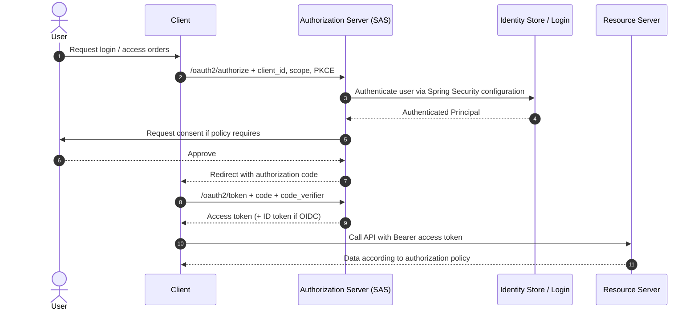

# Feature Scope of Spring Authorization Server vs. What the Application Must Build

## 1. Problem Statement and Responsibility Boundaries

When a system has multiple web applications, mobile apps, and APIs, each application should not issue access tokens under its own ad-hoc convention. A central **Authorization Server (AS)** consolidates processing authorization requests, issuing tokens under OAuth 2.0, and providing OpenID Connect (OIDC) protocols when applications require federated login. In the Spring Boot ecosystem, **Spring Security** provides the security foundation, while **Spring Authorization Server (SAS)** provides the components to implement the Authorization Server role.

It is critical to distinguish **the protocol infrastructure provided by the framework** from **the product functionality the development team must still design, implement, and operate**. SAS handles a large share of the OAuth 2.0/OIDC protocol correctly; it does not by itself turn a Spring Boot application into a complete identity management system.

| Component | Primary Role | Example |
| --- | --- | --- |
| **Authorization Server** | Receives authorization requests, authenticates clients, issues and manages tokens per protocol | Spring Boot service integrating SAS at `auth.example.com` |
| **Resource Owner / End User** | User who owns the data or has authority to permit applications to access it | Customer logging in and consenting to share information |
| **Client** | Application requesting tokens to perform operations | Web portal, mobile app, backend service |
| **Resource Server** | API validating access tokens and enforcing resource access permissions | Orders API at `api.example.com` |
| **Identity / User Store** | Stores and manages users, passwords/keys, account status, MFA, and organizational policies | User database, LDAP, or external identity service |

For example, a user wants an order management app to view their list of orders. The client redirects the browser to the Authorization Server, the user logs in (if no session exists), the system runs a consent step if required, and then the client exchanges the **authorization code** for tokens. The client uses the **access token** to call the Resource Server; the orders API itself decides whether the user is permitted to view that specific order.



The diagram illustrates the **Authorization Code + PKCE** flow. The exact path may vary depending on client type and grant type. In OAuth 2.0, **access authorization** is the core objective; in OIDC, **user identity authentication** is added via mechanisms such as the ID token and UserInfo.

## 2. What Does SAS Already Provide?

SAS organizes `SecurityFilterChain`s, endpoints, protocol handlers, data models, configuration, and extension points for an application to implement an Authorization Server. The capabilities below must be **appropriately enabled/configured** and may depend on the SAS/Spring Security version in use.

### 2.1. Endpoints and Protocol Flows

| Feature Group | What the Framework Handles | What the Development Team Must Still Decide |
| --- | --- | --- |
| **Authorization Code** | Accepts `/oauth2/authorize` requests, validates parameters, generates and controls authorization codes, processes code exchange at `/oauth2/token` | Which users can log in, which clients can be used, which redirect URIs are registered |
| **PKCE** | Verifies `code_verifier` against `code_challenge` per client configuration | Requiring PKCE for appropriate clients; choosing secure integration on web/mobile |
| **Client Credentials** | Authenticates clients and issues tokens for service-to-service communication | Managing service identities, credentials, scopes, and least privilege |
| **Refresh Token** | Handles token refresh grants and supporting policies such as lifetime and token reuse | Whether to issue refresh tokens, lifetimes, revocation mechanisms, and lost-token handling |
| **Device Authorization** | Supports device flows with code entry UI on another device, along with related endpoints | Code display UX, user authentication, and anti-abuse policies |
| **Token Revocation / Introspection** | Provides revocation and token status inspection endpoints per OAuth 2.0 | Which clients may call them, which token types use introspection, cache impact |
| **JWK Set and Metadata** | Publishes verification keys and metadata for clients/Resource Servers to discover configuration | Signing key source, key rotation, issuer, DNS, TLS, and reverse proxy configuration |
| **OIDC** | Can enable OIDC Provider Configuration, ID tokens, UserInfo, and logout depending on version capabilities | Profile data, exposed claims, login sessions, logout policies |
| **Protocol Extensions** | Some versions add support for features like Pushed Authorization Requests, Dynamic Client Registration, or Token Exchange | Check version and support level, enable intentionally, establish additional policies |

The paths mentioned above are **commonly used defaults** and can be adjusted via `AuthorizationServerSettings`. Do not rely on a generic endpoint table to assume every feature is automatically active in every version.

### 2.2. Built-In Building Blocks

- **`RegisteredClient` / `RegisteredClientRepository`**: model and lookup store for clients allowed to use the system, including `client_id`, client authentication methods, grant types, redirect URIs, and scopes.
- **`OAuth2Authorization` / `OAuth2AuthorizationService`**: stores the state of authorizations, codes, and tokens for token issuance, lookup, and revocation.
- **`OAuth2AuthorizationConsent` / `OAuth2AuthorizationConsentService`**: records permissions a user has approved for a client (when the flow and policy use consent).
- **`AuthorizationServerSettings`**: configures the issuer and endpoints of the Authorization Server.
- **`TokenSettings`, `ClientSettings`**: configures token lifetimes, refresh token policies, PKCE requirements, and per-client consent requirements.
- **`OAuth2TokenCustomizer` and extension points**: injects claims or adjusts parts of token issuance processing to meet business requirements.
- **`JWKSource<SecurityContext>` and token signing processors**: integrates signing keys and publishes public keys; the application must supply and manage keys.
- **Sample and JDBC storage implementations**: provides a quick path for development and a JDBC option to store clients, authorizations, and consents; production systems still need schema planning, migrations, backups, and operations.

SAS also integrates with Spring Security's authentication, session, filter, and access control mechanisms. However, **SAS does not by itself supply user data or enterprise account policies**. Supporting a protocol does not mean the entire corresponding product workflow already exists.

## 3. What the Application Must Build Itself

### 3.1. Identity, Login, and User Lifecycle

The application needs to choose how to authenticate users: `UserDetailsService`, a custom database, LDAP, federation with an external Identity Provider, or a valid custom mechanism. Beyond checking credentials, the product may require account registration, email activation, password reset, MFA, account lock/unlock, anomalous login detection, and session management. SAS does not create these business workflows automatically.

Spring Security can generate a basic login page with `formLogin()` for testing. **A branded login page, account recovery, MFA UX, error messaging, and user support** remain the responsibility of the application or an external identity product.

### 3.2. Client Registration and Administration

The framework knows how to look up a `RegisteredClient`; it does not decide **who is allowed to create clients**, who approves redirect URIs, how client secrets are issued/rotated, how compromised client credentials are disabled, or how public clients and confidential clients are classified. The development team must establish governance, access control, and auditing for these operations.

A client administration portal may need: owner, environment, active status, accepted grant types, fixed list of redirect URIs, allowed scopes, credential expiration, change history, and revocation workflows.

### 3.3. Persistence Store and Key Management

`InMemory` stores are useful for demos, but restarting the application loses state. Multi-instance environments typically require persisting clients, authorizations, and consents in a durable store such as a database, while handling migrations, transactions, backups, and consistency. Choosing JDBC or implementing a custom repository depends on the system.

For asymmetrically signed JWTs, **the private key is a security asset of the service**. The application is responsible for securely generating/storing keys, restricting access, publishing public key components via JWKS, setting `kid`, rotating keys with an overlap period, and recovering from incidents. Randomly generating a new RSA key pair on every startup is only suitable for technical examples, not production operations.

### 3.4. Business Permissions, Scopes, and Claims Data

A scope such as `orders.read` describes the breadth a client requests and the AS can issue; it **does not replace** the Resource Server checking whether the user is allowed to view **order #123**. Authorization by role, resource owner, department, tenant, or ABAC policies must be enforced where resources are processed.

If an access token or ID token carries custom claims (e.g., tenant, internal identifier), you must define the source of truth, semantics, intended readers, and limits on sensitive data. The ID token serves the client in verifying the OIDC login session; the access token serves API call permissions. Do not use an ID token as a bearer token to call APIs.

### 3.5. Consent, Logout, and Product Workflows

SAS manages consent data and part of the interaction flow; the product must decide when to re-prompt, in what language scopes are displayed, what is recorded, and where users revoke permissions. An OIDC logout endpoint (if enabled and supported) does not automatically resolve every login session at clients, user sessions across multiple devices, and sessions across all related applications.

Multi-tenant requirements, identity linking, social login, federation, device management, or specialized approval workflows all require custom integration design.

### 3.6. System Security and Operations

The deployment team still owns HTTPS, reverse proxy configuration, consistent DNS/issuer, secret management, monitoring, logs with sensitive data masked, rate limiting, credential-stuffing protection, CSRF for cookie-based UIs, CORS control, testing, version upgrades, and incident response. The framework provides mechanisms; choosing the right configuration for the environment is the operations team's responsibility.

## 4. Implementation Boundary Example in Spring Boot

Suppose there is a **public web client** logging in via Authorization Code + PKCE and accessing `orders-api`. The example below illustrates wiring the basic building blocks using the API style of **Spring Boot 3.x / Spring Authorization Server 1.x**. You must verify dependencies, APIs, and integration details against your actual version before using them. Imports are omitted to focus on each part's responsibility.

**Framework part: enable Authorization Server endpoints and OIDC.**

```java
@Configuration
@EnableWebSecurity
class AuthorizationServerSecurityConfig {

    @Bean
    @Order(1)
    SecurityFilterChain authorizationServerChain(HttpSecurity http) throws Exception {
        OAuth2AuthorizationServerConfigurer as =
                OAuth2AuthorizationServerConfigurer.authorizationServer();

        http.securityMatcher(as.getEndpointsMatcher())
                .with(as, configurer -> configurer.oidc(Customizer.withDefaults()))
                .authorizeHttpRequests(auth -> auth.anyRequest().authenticated())
                .exceptionHandling(exceptions -> exceptions.defaultAuthenticationEntryPointFor(
                        new LoginUrlAuthenticationEntryPoint("/login"),
                        new MediaTypeRequestMatcher(MediaType.TEXT_HTML)));

        return http.build();
    }

    @Bean
    @Order(2)
    SecurityFilterChain applicationChain(HttpSecurity http) throws Exception {
        http.authorizeHttpRequests(auth -> auth.anyRequest().authenticated())
                .formLogin(Customizer.withDefaults());
        return http.build();
    }

    @Bean
    AuthorizationServerSettings authorizationServerSettings() {
        return AuthorizationServerSettings.builder()
                .issuer("https://auth.example.com")
                .build();
    }
}
```

The first chain handles Authorization Server endpoints; the second chain handles user login and other application URLs. `formLogin()` is only one option for the user authentication step. **This configuration is not yet a complete Authorization Server for production:** you still need client repository beans, authorization/consent repositories, a user source, a signing key source, deployment configuration, and appropriate policies.

**Application part: decide what a client is allowed to do.**

```java
@Bean
RegisteredClientRepository registeredClientRepository() {
    RegisteredClient client = RegisteredClient.withId(UUID.randomUUID().toString())
            .clientId("public-web")
            .clientAuthenticationMethod(ClientAuthenticationMethod.NONE)
            .authorizationGrantType(AuthorizationGrantType.AUTHORIZATION_CODE)
            .redirectUri("http://127.0.0.1:8081/callback")
            .scope(OidcScopes.OPENID)
            .scope(OidcScopes.PROFILE)
            .scope("orders.read")
            .clientSettings(ClientSettings.builder()
                    .requireProofKey(true)
                    .requireAuthorizationConsent(true)
                    .build())
            .tokenSettings(TokenSettings.builder()
                    .accessTokenTimeToLive(Duration.ofMinutes(10))
                    .build())
            .build();

    return new InMemoryRegisteredClientRepository(client);
}
```

The code shows that SAS provides the `RegisteredClient` **model**, while the development team chooses `client_id`, grant types, redirect URIs, scopes, PKCE, and consent. This is a **public client** using no client secret, so PKCE is especially important. The HTTP loopback redirect URI is only for illustrating a local environment; publicly deployed web applications require exact registered URIs over HTTPS. `InMemoryRegisteredClientRepository` is likewise only suitable for examples and does not preserve clients across restarts.

For backend applications that can protect a client secret, you can choose a **confidential client**, an appropriate authentication method, and a secret management workflow. Never place fixed secrets in source code or frontend code.

**Resource Server part: enforce permissions at the API.** The orders API typically validates access tokens using Spring Security's OAuth 2.0 Resource Server support, such as JWT configuration with `issuer-uri` or `jwk-set-uri`. After verifying the signature, issuer, expiration, and required conditions, the API must verify **appropriate audience/scopes and permissions on specific data**. The rule "customers can only view their own orders" must still be implemented in API business logic; it cannot rely solely on SAS having successfully issued a token.

## 5. Which Layers Does a Real Request Pass Through?

Using the example of logging into a web portal to read the orders list:

1. **The development team** creates `RegisteredClient` `public-web` with a registered redirect URI, the `authorization_code` grant, scopes `openid`, `profile`, `orders.read`, and PKCE required.
2. **The client** generates `code_verifier`, `code_challenge`, `state` (and `nonce` if required by the OIDC flow), then opens the authorization request.
3. **SAS** validates the client, redirect URI, scopes, and protocol parameters. **The application authenticates the user** via the integrated Spring Security mechanism; when needed, the consent flow prompts the user before granting permissions.
4. **SAS** issues a short-lived authorization code bound to the corresponding request. The client exchanges the code together with `code_verifier` at the token endpoint.
5. **SAS** creates the access token and, when OIDC conditions are met, the ID token. Signing, claims, lifetimes, and state storage rely on the configured beans/policies.
6. **The client** sends the access token to `orders-api`. **The Resource Server** validates the token and then checks scopes and permissions on each order before returning data.

If the client alters `redirect_uri`, sends a wrong `code_verifier`, or requests a scope outside the allowed list, the Authorization Server must reject it at the protocol layer. If the token is valid but the user tries to view someone else's order, the Resource Server must still reject it at the business layer. Both checks address **two different risks**.

## 6. Design Checklist by Ownership Scope

| Pre-Deployment Question | Primary Responsible Party |
| --- | --- |
| Which grant types, client authentication mechanisms, and PKCE rules apply? | Application team configuring SAS per protocol |
| Who registers, approves, and revokes clients/redirect URIs? | Identity product and governance team |
| How do users log in, reset passwords, and use MFA? | Identity service and integrated Spring Security mechanism |
| Where are clients, authorizations, and consents stored across multiple instances? | Application and data platform team |
| Who holds signing keys, rotates keys, publishes JWKS, and recovers from incidents? | Security and operations team |
| What are the access/refresh token lifetimes and revocation policies? | Security team defines policy; application configures it |
| Which claims are exposed? Which claims are sensitive data? | Identity, business, and security teams |
| How does the API enforce scopes, audience, tenant, and ownership? | Each Resource Server and business owner |
| Who detects token abuse, login abuse, and authentication incidents? | Operations, security, and observability team |

Items to verify before going to production:

- **Protocol and URLs:** consistent issuer across tokens, discovery, and Resource Servers; HTTPS in production environments; exact redirect URI matching; minimal grant types and scopes; PKCE according to client type.
- **Keys and credentials:** durable, protected signing keys supporting rotation; secrets via a secret store rather than source code; sensitive data absent from URL logs or application logs.
- **Data and sessions:** persistence suitable for multi-instance setups, backup/restore, refresh token, session, and logout strategies; consider the delay between token revocation and the validity of already-issued JWTs.
- **Attack surface protection:** CSRF for cookie-based login/consent pages, intentional CORS, rate limiting and monitoring on sensitive endpoints, brute-force and replay controls.
- **API permissions:** validate issuer, signature, expiration, audience, and scopes per the API contract; enforce per-resource-object permissions; never treat client-supplied claims as trusted data.
- **Operability:** health checks, metrics on token issuance errors, logs with correlation IDs, alerts on sudden spikes in login/authorization failures, dependency upgrades, and recovery testing.

**Note on JWTs and revocation:** An already-issued JWT can be verified independently by a Resource Server until it expires. Calling the revoke endpoint does not automatically ensure every API immediately rejects that JWT if the API only verifies signatures and timestamps. If immediate revocation is required, you must design an additional state-checking mechanism, short access token lifetimes, or a solution matching the risk level.

## 7. Required Test Cases

| Case | Expected Result | Layer to Verify |
| --- | --- | --- |
| Valid Authorization Code + PKCE | Receives code and exchanges it for an access token | SAS + client configuration |
| Missing/wrong `code_verifier` when client requires PKCE | Code exchange request is rejected | SAS + `ClientSettings` |
| Unregistered Redirect URI | Authorization request is safely rejected | SAS + URI list |
| Client requests unpermitted scope | No permissions issued beyond the allowed list | SAS + scope policy |
| Reused or expired code | Cannot exchange for tokens again | SAS + authorization store |
| Unauthenticated or ineligible user | Redirects to authentication or denies per policy | Application login mechanism |
| Consent required but not approved | Permissions are not granted before user agrees | SAS + consent UI/policy |
| Expired token, wrong issuer/audience, or invalid signature | API rejects the token | Resource Server |
| Valid token but accessing another user's data | API returns 403 or policy-appropriate response | API business permissions |
| Restart or instance failover | Clients and required state remain intact | Persistence/deployment |
| Signing key rotation | Old tokens remain verifiable during the designed transition window | JWK/Resource Server |
| Protocol logging | Sufficient error observability without leaking codes, tokens, or secrets | Operations/security |

For enabled flows such as Client Credentials, Device Authorization, Refresh Token, OIDC UserInfo, or Logout, add corresponding test cases; do not conclude the system "supports OIDC" merely because browser login works.

## 8. Common Misconceptions

**"Adding the SAS dependency gives you a complete Identity Provider."** The dependency provides endpoint and protocol foundations, while the user store, MFA, account lifecycle, UI, and operations must be provided separately.

**"The `orders.read` scope allows reading every order."** A scope only represents an authorized capability at the client/request level; checking order ownership still belongs to the API.

**"Access tokens and ID tokens are interchangeable."** The ID token proves authentication results to the OIDC client; the access token is proof of authorization to call the Resource Server. Each token has a different purpose and intended recipient.

**"Revoking a token immediately stops a JWT from working on every API."** That depends on how the Resource Server validates tokens and the revocation mechanism designed.

**"Having a logout endpoint means every session on every application ends."** Cross-application session state and logout require explicit contracts with each involved client, browser, and service.

**"An `InMemory` example configuration and startup key generation are enough for production."** Ephemeral data and keys break login experiences, token verification, and incident recovery during restarts or multi-instance scaling.

## 9. Learning Outcomes to Achieve

After this lesson, learners should be able to distinguish three responsibilities: **SAS executes the authorization/token issuance protocol**, **the identity application provides login and user/client administration**, and **the Resource Server enforces API and data access permissions**. When designing an Authorization Server with Spring Boot, draw these boundaries before choosing endpoints, grant types, or data stores; that is how you avoid overlooking capabilities the framework cannot decide on behalf of the product.
