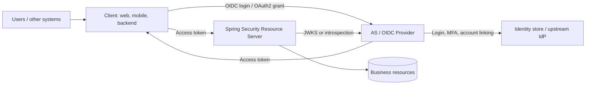

# Evaluating Self-Building an Authorization Server vs. Using an Existing Identity Provider

## Lesson Objectives

When a Spring Boot application needs centralized login (SSO), API access authorization, or integration with an enterprise identity system, the development team must choose between **building a custom OAuth 2.0/OpenID Connect Authorization Server on Spring Security and Spring Authorization Server**, **operating a packaged Identity Provider (IdP)**, or **using a managed IdP**. This decision has long-term impacts on security architecture, user experience, cost, scalability, and vendor portability.

After this lesson, learners will be able to:

- Distinguish the scopes of an Authorization Server, OpenID Connect Provider, Identity Provider, client application, and Resource Server.
- Identify what Spring Authorization Server provides versus what a complete identity product must still build itself.
- Compare the three options using mandatory requirements, operational capability, total cost of ownership, and risk.
- Build a set of validation criteria for security, availability, integrability, and migration path before making a decision.

> **Guiding principle:** Self-hosting an Authorization Server can make sense when deep control or customization is required and the organization has the capacity to maintain security over many years. If the primary needs are login, MFA, SSO, user administration, and identity federation, evaluate existing IdP products first. The final conclusion must rest on real requirements and PoC results, not solely on lines of code or license fees.

## 1. Understanding the Problem to Solve

### 1.1. Roles in OAuth 2.0 and OpenID Connect

| Concept | Core Responsibility | Question to Ask |
|---|---|---|
| **Authorization Server (AS)** | Authenticates authorization requests, manages clients, issues tokens, publishes metadata and verification keys; handles supported OAuth 2.0 flows. | Who is allowed to obtain tokens, with what permissions, for which resources? |
| **OpenID Provider (OP)** | An AS supporting OpenID Connect (OIDC), issuing ID Tokens and providing identity info per the protocol. | Through which issuer does the application authenticate users? |
| **Identity Provider (IdP)** | A system providing or federating identities; typically includes login, MFA, account management, SSO, and enterprise features. | How are identities created, protected, recovered, and linked? |
| **OAuth 2.0 Client / OIDC Relying Party** | Web, mobile, or backend application requesting authorization/login via an AS/OP. | How does the application redirect users to log in and receive tokens? |
| **Resource Server** | API validating access tokens and enforcing access permissions on resources. | Does this token have the right issuer, audience, and required permissions? |

**OAuth 2.0 is an authorization mechanism**, while **OIDC adds a user authentication layer**. An access token is not automatically proof of login for a client; an OIDC client uses an ID Token along with its corresponding validation process. Furthermore, issuing JWTs is only one part of operating an AS: there are also user identities, session management, access policies, signing key lifecycles, permission revocation, and incident response.

For example, a system has a Spring Boot sales app, a mobile app, and three internal APIs that simultaneously need: users to log in with SSO; the mobile app to use Authorization Code + PKCE; APIs to accept tokens by `issuer` and `audience`; employees to log in through corporate accounts; and operations teams to have audit logs and session invalidation capabilities. Simply adding JWT generation to an existing application will not fully satisfy these requirements.

### 1.2. Three Distinct Approaches

1. **Build in-house with Spring Authorization Server:** develop and operate a token-issuing service customized to business logic. The framework provides the protocol foundation; the team owns identity integration, storage, administration, operations, and additional security layers.
2. **Use a self-hosted packaged IdP:** deploy a product such as Keycloak on the organization's infrastructure. The team writes less custom code for common identity features, but still handles patching, operations, backups, monitoring, and secure configuration.
3. **Use a managed IdP:** integrate a service such as Auth0, Okta, Amazon Cognito, or Microsoft Entra under the appropriate product/tier. The vendor handles much of the platform operations, while the application remains responsible for client configuration, access permissions, user data, token validation, and service contracts.

Whichever approach you choose, **Spring Security can still act as the OAuth2 Client and Resource Server**. You do not need to build your own AS just because your backend is written in Spring Boot.



The diagram shows the logical roles. The Resource Server uses JWKS to verify JWT signatures offline or calls introspection if using opaque tokens / a centralized checking strategy; it does not necessarily call the AS on every request. An upstream IdP may not exist when the AS manages internal accounts itself.

## 2. What Does Spring Authorization Server Actually Provide?

**Spring Authorization Server** is a foundation for building an AS/OIDC Provider on Spring Security. Official documentation lists capability groups such as Authorization Code, Client Credentials, Refresh Token, Device Authorization, Token Exchange, authorize/token/revocation/introspection endpoints, metadata, JWKS, and configurable OIDC endpoints. Having an endpoint or feature present in the framework **does not mean the finished system comes with admin screens, user registration, approval workflows, MFA, account lifecycle management, or production operations**. Exact availability and defaults depend on version and configuration.

If building in-house, clearly define each component's responsibilities:

| Component / Mechanism | Required Functionality | Implementation Decision |
|---|---|---|
| `RegisteredClientRepository` | Stores clients, redirect URIs, grants, scopes, and client authentication policies. | Use durable storage and a controlled client issuance/revocation workflow. |
| `OAuth2AuthorizationService` | Stores authorization state, authorization codes, tokens, and related data. | Design transactions, durable storage, cleanup policies, and expired-token handling. |
| `OAuth2AuthorizationConsentService` | Stores permission consent decisions per client/user. | Define scopes requiring consent, display UI, and revocation controls. |
| `JWKSource`, token generator / encoder | Signs tokens, publishes public keys, and customizes claims. | Protect private keys, isolate environments, rotate keys periodically, and prepare for key compromise incidents. |
| `SecurityFilterChain`s for AS and login | Protects protocol endpoints and authentication UI. | Design session policies, CSRF, brute-force protection, MFA, cookies, and admin access. |
| Identity management and authorization service | Accounts, groups, roles, user lifecycle, upstream IdP integration. | Usually must be built or connected separately; avoid equating `scope` with fine-grained business permissions. |
| Operational infrastructure | Databases, load balancing, observability, backups, incident response. | Own real-world SLAs, reliability, and recoverability. |

The framework includes in-memory implementations for development/testing and JDBC implementations for certain repositories/services. Do not treat in-memory state as durable production storage; JDBC configuration alone also does not solve query optimization, schema migrations, data governance, or high availability.

### 2.1. A Key Architectural Decision: Who Owns Identity?

- **AS manages users itself:** must provide account creation, authentication, MFA, password changes, account recovery, account locking, auditing, and credential leak response workflows.
- **AS acts as an identity broker (broker/federation):** users log in at an upstream IdP; you must still solve user mapping, secure account linking, claims, tenants, sessions, and logout.
- **Applications use the IdP directly:** eliminates an operational layer; suitable when there is no need for token policy or protocol transformations beyond the product's capabilities.

Do not build an intermediate AS just to "rename claims" if the requirement can be handled through IdP configuration, mappers, a gateway, or safe authority mapping at the Resource Server.

## 3. Mandatory Criteria to Confirm Before Scoring

Before comparing cost or flexibility, establish **hard gates**. An option that fails a mandatory requirement must be eliminated or retained only if there is an approved and verified compensating control.

| Condition Group | Verification Question | Acceptance Evidence |
|---|---|---|
| Protocol standards | Do clients need OIDC, OAuth 2.0, SAML 2.0, Device Authorization, Token Exchange, SCIM, or specialized features? | Version/feature matrix and interoperability tests with each real client. |
| Security | Are phishing-resistant MFA, risk-based access policies, session management, token revocation, or KMS/HSM key management required? | Configurations, penetration/attack testing, operational process evidence. |
| Identity & SSO | Are AD/LDAP, partner federation, multi-tenancy, self-service, or account recovery needed? | PoC against real identity sources and user flows. |
| Legal & data | Which data must reside in specific regions; are there audit/contract/retention/deletion requirements? | DPA, data processing locations, retention policies, and deletion workflows. |
| Availability | Must login keep running if one region/cloud fails? What are the RTO/RPO and SLOs? | HA/DR architecture and failover/recovery drill results. |
| Cost | Does pricing scale with MAUs, number of organizations, MFA, enterprise connections, APIs, environments, or support? | Quotes modeled on 12–36 months of load, staffing, and infrastructure costs. |
| Exit capability | Can accounts, tenant configs, logs, user IDs, and identity links be exported when migrating systems? | Migration plan and permitted data import/export test. |

**Ask "which system is responsible?" rather than just "does the feature exist?"** A vendor MFA feature might only exist on a specific plan; a Keycloak deployment may support a desired mechanism, yet the ops team remains responsible for patching and service continuity. Every claim about features, certifications, data residency, or SLAs must be verified against the exact version, service tier, and contract terms.

## 4. Overall Comparison of the Three Approaches

| Criterion | Self-Build with Spring Authorization Server | Self-Hosted Packaged IdP | Managed IdP |
|---|---|---|---|
| Custom protocol/business logic | Very high, at the cost of verifying everything yourself. | Via extensions/SPIs within product boundaries. | Via config, hooks/actions/APIs within plan limits. |
| Login, MFA, self-service, admin UI | Build yourself or integrate external systems. | Typically many built-in features; must configure and test. | Typically many built-in features; plan-dependent. |
| SSO, AD/LDAP, SAML, OIDC federation | Must integrate yourself or add extra components. | Depends on product and connector suite. | Depends on vendor, connection type, and plan. |
| Data / signing key control | Highest autonomy, with full self-responsibility. | High if deployed on controlled infrastructure. | Depends on data residency, key management model, and contract. |
| Patching and platform security | Team manages framework, custom code, and OS/infra. | Ops team manages product patches and infrastructure. | Vendor manages service layer; customer still configures securely. |
| Scalability / HA / DR | Design and prove it yourself. | Design yourself per product guidance. | Relies on service architecture, quotas, and vendor commitments. |
| Initial implementation | Can be fast for minimal flows, slower when turning into a full identity product. | Usually faster than building common features from scratch. | Usually fast for standard use cases. |
| Direct costs | Build effort, long-term staffing, infra, and testing. | Infrastructure, operations, support/licensing if applicable. | Subscription/usage/MAU/connections/support per pricing tier. |
| Solution dependency | Depends on internal code and framework. | Depends on product, version, and extensions. | Depends on vendor APIs, policies, pricing, and lifecycle. |

No column is "safe by default" for every situation. For example, self-building offers exact control over claims but may lack dedicated security staff; a SaaS IdP removes operational burden but may fail data residency rules; a self-hosted IdP provides out-of-the-box SSO but still requires a team to handle failovers and upgrades.

### 4.1. When to Lean Toward Self-Building

Self-building an AS deserves to make the shortlist only when **all** of the following hold simultaneously:

1. There are mandatory requirements for grant processing, claims, tokens, or specialized integrations that existing solutions fail to meet after a PoC.
2. The organization controls the user lifecycle and has engineering, security, SRE, and on-call incident response teams.
3. There is budget for long-term maintenance, protocol testing, signing key management, and 24/7 operations meeting SLOs.
4. The benefits of deep control or unique constraints outweigh the added cost and risk.

For example: an internal platform has a token issuance workflow tied to unique business approvals and requires multiple token formats for a proprietary ecosystem. Before building, verify whether an existing IdP's extensions/token exchange/policies can solve it.

### 4.2. When to Prioritize an Existing IdP

Prioritize evaluating existing IdPs when the scope is primarily **OIDC login, SSO, MFA, account administration, enterprise identity connections, and standard operational practices**. Choose between self-hosted and managed IdP based on data control, operational appetite, flexibility, support commitments, and TCO. A small team needing SSO/MFA often gains substantial value from a managed solution; a team with existing infrastructure and internal operational mandates may fit a packaged IdP.

### 4.3. Hybrid Approaches

A hybrid architecture remains a practical option: Spring Security applications authenticate via an existing IdP; APIs use standard JWT/opaque tokens; an application-side business authorization service enforces domain-specific checks; or an internal AS federates identity with an upstream IdP when a dedicated token-issuing layer is truly required.

Only introduce an additional token issuer layer when there is a clear reason involving trust boundaries, audience control, token exchange, policies, or integration requirements. Each extra layer increases complexity across `issuer`, sessions, logout, keys, and troubleshooting paths.

## 5. Security Responsibilities You Cannot Skip

Even when using an off-the-shelf product, the client systems must still be configured accurately. When self-building, the team must **design, implement, test, and operate** all of the following controls:

### 5.1. Protocol and Clients

- Prefer **Authorization Code + PKCE (`S256`)** for interactive login flows; public clients cannot store secrets securely the way backends can. Per RFC 9700, an AS must support PKCE; public clients must use PKCE, and confidential clients are also recommended to use it.
- Register and strictly match `redirect_uri`; never allow arbitrary wildcards, open redirects, or accepting `client_id` from an unauthenticated context.
- Prevent CSRF and session mix-ups: use per-transaction `state`; with OIDC, validate `nonce` when applicable, binding responses to the initiating transaction. Protect `code_verifier` and client-side sessions.
- Do not design new systems with the Implicit grant or Resource Owner Password Credentials grant; these flows conflict with modern security practices under RFC 9700. For M2M, use `client_credentials` with an appropriate client authentication mechanism.
- Apply least privilege for scopes, audiences, and consent; never stuff passwords, secrets, or unnecessary personal data into JWTs.

### 5.2. Tokens, Signing Keys, and Resource Servers

- Verify **signature, accepted algorithms, `iss`, `aud`, `exp`, `nbf`** (when present), token type, and appropriate permissions. In many Resource Server configurations, setting `issuer-uri` only handles discovery, JWKS, and issuer; you must add a validator for `aud` per API. Never use an ID Token as an access token.
- Protect private signing keys, support `kid`/JWKS, rotate keys with an overlap window, and have a revocation plan if a key is compromised. Restrict key access via KMS/HSM when required, separate dev/staging/prod, and audit all administrative actions.
- Consider short-lived access tokens. **Revoking an issued JWT does not automatically take immediate effect** at Resource Servers verifying offline; combine short TTLs, blocklists, introspection, or session/event mechanisms depending on sensitivity.
- When issuing refresh tokens to public clients, RFC 9700 requires **sender-constrained refresh tokens or refresh token rotation** to detect replay; clearly define behavior to revoke the entire token family when reuse is detected. For confidential clients, still bind tokens to the client and protect transport channels.
- For sensitive APIs, evaluate mTLS/DPoP (sender-constrained tokens), certificates, per-endpoint authorization policies, and clock skew tolerance.

### 5.3. User Authentication and Operations

- MFA/passkeys when needed, login protection against brute force/credential stuffing, email verification, account recovery, preventing improper account linking, and step-up authentication checks.
- TLS, appropriate `Secure`/`HttpOnly`/`SameSite` cookies, CSRF protection on cookie-based flows, clickjacking defenses, CORS control, and trusted reverse proxy configuration.
- Audit administrative access, client registrations, policy edits, key changes, and anomalous login events; ensure logs never contain tokens, passwords, or private keys.
- Back up configuration data, consent grants, and sessions/authorizations as required; run periodic restore drills and measure RTO/RPO instead of merely checking that a backup file exists.
- Patch libraries and operating systems, scan dependencies, test failover, enforce rate limiting, protect sensitive endpoints from DDoS; maintain on-call runbooks and drill credential/key compromise incidents.

**Minimum PoC security test suite:** tamper with `redirect_uri`; swap `state`/`nonce`; send wrong/missing `code_verifier`; reuse an authorization code; replay a refresh token; send a token with wrong `iss` or `aud`; expired token/invalid signature; cross-tenant access attempt; execute logout and attempt to reuse the session/token. Results must show which requests were rejected and why.

## 6. Comparing Costs via TCO and Risk

Cost is not just subscription fees or a few sprints of coding. Define the exact same functional scope and evaluation horizon, such as 36 months:

```text
TCO = Initial implementation cost
    + Infrastructure / licensing / usage costs
    + Operations, support, and upgrade staffing costs
    + Security testing, compliance, and DR costs
    + Integration, change, and exit/migration costs
    + Internal risk reserve for incidents
```

Sample checklist questions:

- With a managed IdP, do fees rise with monthly active users, SAML connections, tenant count, MFA, SMS, API calls, non-production environments, or support tier?
- With a self-hosted IdP, have you accounted for database HA, standby regions, monitoring, version upgrades, on-call rotation, and commercial support if needed?
- With a self-built AS, have you accounted for protocol testing, threat modeling, signing keys, identity lifecycle, admin UI, client onboarding, abuse prevention, and lost focus on the core product?
- What is the switching cost after two years if pricing or requirements change?

A weighted scoring matrix can support cross-team discussions. The table below is a **hypothetical illustrative example**, not an inherent ranking of technologies or vendors:

| Criterion | Weight | Self-Built AS | Packaged IdP | Managed IdP |
|---|---:|---:|---:|---:|
| Readiness for security/compliance requirements | 30% | 3 | 4 | 5 |
| Standard integration / existing identity systems | 20% | 3 | 4 | 5 |
| Fit for specialized customization | 20% | 5 | 3 | 3 |
| Operational capability in current team | 20% | 2 | 3 | 5 |
| Estimated TCO for the scenario | 10% | 3 | 4 | 3 |
| **Weighted Score (out of 5)** | **100%** | **3.2** | **3.6** | **4.4** |

Formula: `Score = Σ(decimal weight × score from 1 to 5)`. For example, the Packaged IdP score equals `0.30×4 + 0.20×4 + 0.20×3 + 0.20×3 + 0.10×4 = 3.6`. Each organization must substitute its own weights, data, PoC results, and real estimates; **hard gates always take priority over the total score**.

## 7. Four Decision-Making Scenarios

### Scenario A — B2C Startup Needing Fast and Secure Login

Needs: web/mobile apps, email and social login, forgot password, MFA, scaling by MAU. Small engineering team with no dedicated identity-infrastructure specialists.

**Preferred direction:** trial a managed IdP; check feature tiers, MAU costs, data residency, and data exportability. Spring Boot acts as OAuth2 Client/Resource Server. Only switch to self-building if a core requirement is proven impossible to meet.

### Scenario B — B2B SaaS Where Each Enterprise Logs In via Its Own IdP

Needs: per-tenant OIDC/SAML SSO, domain and role mapping, user invitation workflows, connection administration, auditing, and account disabling when employees leave a customer company.

**Preferred direction:** evaluate an IdP that properly supports enterprise federation and multi-tenancy. Verify JIT provisioning, SCIM (if needed), email collision handling, `tenant_id` mapping, and logout. Avoid binding tenant permissions solely based on unverified email/domain values.

### Scenario C — Internal System with Specialized Authorization Mechanics

Needs: tokens only issued after a unique business approval chain, unusual resource object bindings, controlled internal protocols, with existing security and SRE teams.

**Consideration direction:** PoC Spring Authorization Server to evaluate feasibility of extensions/token customization/token exchange and operational requirements. If an upstream IdP still provides user authentication, you can federate identity instead of maintaining passwords yourself. Self-building is reasonable when off-the-shelf products fail a hard gate and the organization accepts long-term ownership.

### Scenario D — Only Need Tokens for Service-to-Service Communication

Needs: a few trusted backends using `client_credentials`, no login UI, no user accounts.

**Evaluation direction:** leverage an existing AS/IdP first to avoid creating another issuer and key lifecycle. A small self-deployed AS can fit inside isolated infrastructure when the team has sufficient capability. Pay attention to `aud`, scopes, client authentication, credential rotation, mTLS/`private_key_jwt` according to risk, and the ability to disable clients.

## 8. Spring Boot Integration Example When Choosing an Existing IdP

A single Spring Boot application can simultaneously act as an **OIDC client** (for web login) and a **Resource Server** (protecting APIs); if acting in only one role, keep the corresponding configuration section. Illustrative example—URLs and client IDs must be replaced with your actual IdP values:

```yaml
spring:
  security:
    oauth2:
      client:
        registration:
          company-login:
            provider: company-idp
            client-id: ${OIDC_CLIENT_ID}
            client-secret: ${OIDC_CLIENT_SECRET}
            authorization-grant-type: authorization_code
            scope: openid,profile,email
        provider:
          company-idp:
            issuer-uri: https://id.example.org/realms/company
      resourceserver:
        jwt:
          issuer-uri: https://id.example.org/realms/company
```

This is an integration configuration example, **not a complete production configuration**. You must add appropriate Spring Security dependencies, `oauth2Login`/endpoint protection as needed, secret management via a secret store, per-API `aud` validation, claims/roles mapping, and authorization policy checks at the business layer. Never accept a client-supplied token and trust `email` or `roles` without verifying the signature, issuer, and audience.

If you choose to self-build, the minimal architecture must add `RegisteredClientRepository` and services storing authorizations/consents in durable persistence, a stable public issuer configuration, signing key lifecycle, user authentication policies, standard endpoints, client administration, auditing, and runbooks. Check the documentation corresponding to the Spring Boot/Spring Security/Spring Authorization Server versions you deploy; API names and default activation behaviors can change across versions.

## 9. Verifiable Decision Process

Proceed sequentially through the decision gates:

**Step 1 — Specify use cases.** List clients (web, SPA, native, backend), user personas (customers, employees, partners), login methods, scopes/audiences, tenants, upstream IdPs, token types, and logout flows. Set concrete numbers for login load, token issuance, RTO/RPO, and SLOs.

**Step 2 — Establish hard gates.** Separate mandatory legal/security requirements from technical preferences. Record the required evidence for each gate; do not accept "supports OIDC" if you actually need enterprise SAML, MFA, or multi-tenant federation.

**Step 3 — Shortlist 2–3 candidates.** Compare at least one existing IdP against self-building whenever customization is the primary driver. Document versions, deployment regions, service tiers, limits, workload assumptions, and accountable owners.

**Step 4 — Run PoCs against the same scenarios.** Require candidates to pass the same tests: OIDC login with PKCE, client credentials if applicable, user and permission mapping, key rotation/JWKS, token expiration/revocation, upstream IdP failures, multi-tenant handling, logging, and backup/restore or failover. Capture actual results and configuration effort—avoid demoing only the happy path.

**Step 5 — Quantify 36 months.** TCO covers staffing, infrastructure, licensing, operations, incidents, and migration. Score based on PoC evidence; document unknowns and convert them into tests or contract terms.

**Step 6 — Finalize with an ADR.** Record the decision, rejected alternatives, rationale, owners, remaining risks, and review triggers (e.g., changing data requirements, MAU growth, loss of feature support, missed SLOs).

Abbreviated Architecture Decision Record example:

```text
ADR: Choose identity platform for system X
Context: 3 web clients, 2 mobile clients, 20 enterprise SSO tenants
Hard gates: OIDC, enterprise SAML, MFA, audit, 1-hour RTO
Candidates: Spring Authorization Server / Self-hosted IdP / Managed IdP
Evidence: PoC for PKCE, tenant SSO, signing keys, failover; 36-month TCO
Decision: [selected option]
Rationale: [gates met, measured benefits, operational capacity]
Remaining risks: [limits, dependencies, mitigations]
Owners: [platform + security + product teams]
Re-evaluate when: [objective conditions and review milestones]
```

## 10. Plan for Solution Migration from the Start

Identities and tokens are far harder to migrate than endpoint configurations. Whichever provider you pick, prepare for:

1. **Identifier stability:** use `issuer + subject` as the identifier key from the OP, or map to an immutable internal user ID; never use email as an immutable identifier because emails can change, be recycled, or collide across tenants.
2. **Business data independence:** business roles, object-level permissions, and tenant policies should belong to your domain when needed. Claims from the IdP are inputs to checks, not the sole source of all permissions.
3. **Token strategy when changing issuers:** `iss`, discovery URL, JWKS, `aud`, claim mappings, and client registrations may change. The Resource Server must only accept trusted configured issuers, and during migration can temporarily support multiple issuers with separate validators; never disable issuer validation "just to make it work."
4. **Session and refresh token management:** legacy system tokens/sessions usually cannot be migrated directly; plan for forced re-authentication, gradual expiration, or bounded transitions with clear user communication.
5. **Account migration:** check permission to export password hashes, password policies, and legal constraints; re-authentication or password resets are often needed when credentials cannot be transferred. Test handling of linked accounts, duplicate usernames, and consent history.
6. **Prove recovery:** drill backup restoration, vendor exit, restarting token issuance, and revoking permissions under failure conditions.

When changing `issuer` or providers, merely updating `issuer-uri` on one service is **not enough**: you must synchronize client registrations, redirect URIs, audiences, trust configuration, user mappings, sessions, and revocation policies.

## 11. Misconceptions to Avoid

| Misconception | Correct Understanding |
|---|---|
| "Since we use Spring Boot, we must use Spring Authorization Server." | Spring Security integrates OIDC/OAuth 2.0 cleanly with external IdPs; an AS is only needed when the organization actively issues tokens itself. |
| "Self-building just needs a login endpoint and JWT generation." | You need complete protocol compliance, session safety, persistence, signing keys, identity administration, auditing, upgrades, and incident handling. |
| "No license fee means it is cheaper." | TCO includes dedicated staffing, operations, incidents, security, and opportunity cost. |
| "Using SaaS means the vendor handles all security." | The application remains responsible for client secrets, redirect URIs, token validation, permission mapping, and tenant configuration. |
| "With JWTs, logout or revoke takes effect immediately." | Resource Servers verifying JWTs offline can keep accepting tokens until expiration unless additional invalidation mechanisms exist. |
| "Any IdP with OIDC supports every enterprise requirement." | You must explicitly verify SAML, SCIM, MFA, multi-tenancy, data residency, auditing, service tiers, and limits. |

## 12. Pre-Approval Architecture Checklist

- [ ] Clearly separated requirements for OAuth 2.0 (authorization), OIDC (authentication), and identity management.
- [ ] Confirmed every hard gate covering security, protocols, legal, data, and SLAs.
- [ ] Tested login, token issuance, refresh/revoke, client credentials (if applicable), and JWT verification with `iss`, `aud`, and `exp`.
- [ ] Tested failure cases: spoofed redirects, code/token reuse, wrong tenant, key compromise/rotation, IdP disconnection, and recovery.
- [ ] Assigned clear owners for MFA, user lifecycle, client management, auditing, backup/restore, and incident on-call.
- [ ] Compared TCO across identical functional scope, traffic assumptions, and evaluation timeframes.
- [ ] Established a plan for issuer migration, user mapping, and handling active sessions/tokens.
- [ ] Documented an ADR with rationale, PoC evidence, remaining risks, and review triggers.

## References

1. [Spring Authorization Server — Overview](https://docs.spring.io/spring-authorization-server/reference/overview.html): framework scope, use cases, and features.
2. [Spring Authorization Server — Core Model / Components](https://docs.spring.io/spring-authorization-server/reference/core-model-components.html): `RegisteredClientRepository`, `OAuth2AuthorizationService`, consent, token generators, and stores.
3. [Spring Authorization Server — Configuration Model](https://docs.spring.io/spring-authorization-server/reference/configuration-model.html): extension points and endpoints.
4. [RFC 9700 — Best Current Practice for OAuth 2.0 Security](https://www.rfc-editor.org/rfc/rfc9700.html): PKCE, token protection, redirects, refresh tokens, and key attack vectors.
5. [OpenID Connect Core 1.0](https://openid.net/specs/openid-connect-core-1_0.html): ID Token, user-authenticating clients, scopes, and claims.
6. [Spring Security — OAuth 2.0 Resource Server JWT](https://docs.spring.io/spring-security/reference/servlet/oauth2/resource-server/jwt.html): JWT validation and custom validators.
