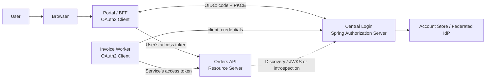
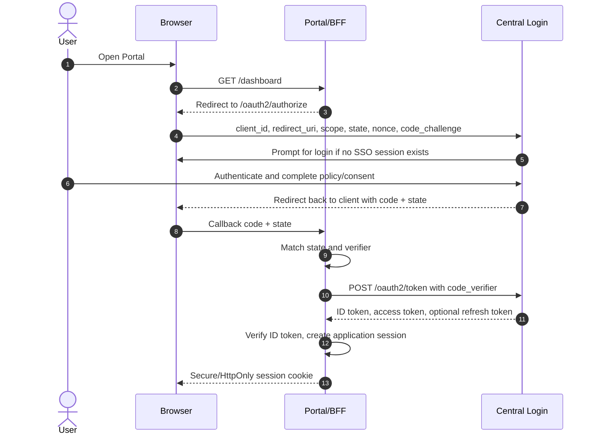
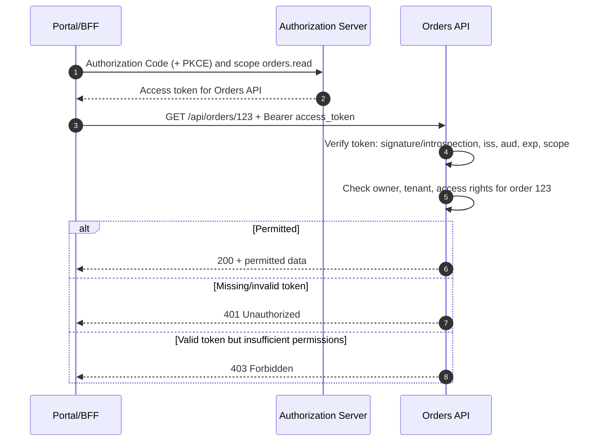
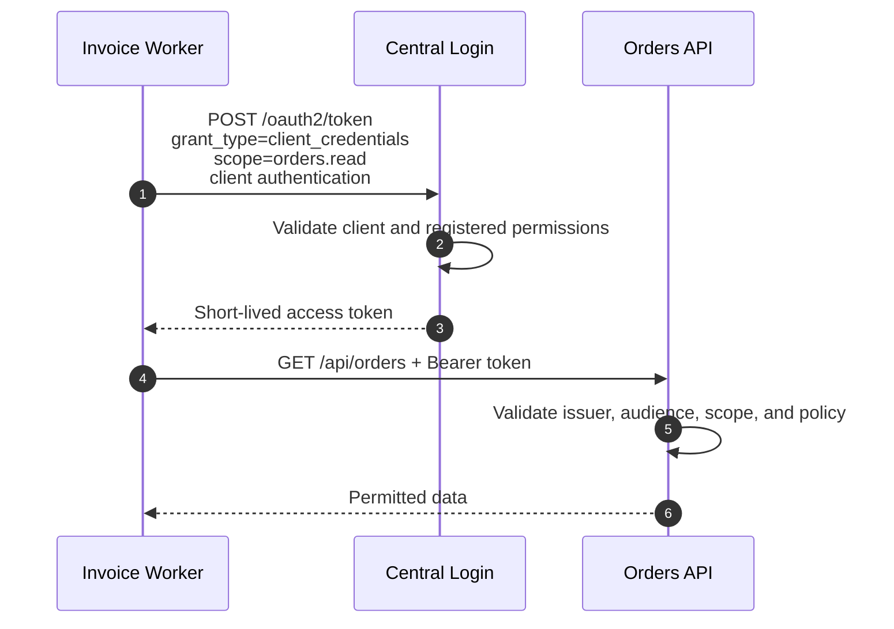
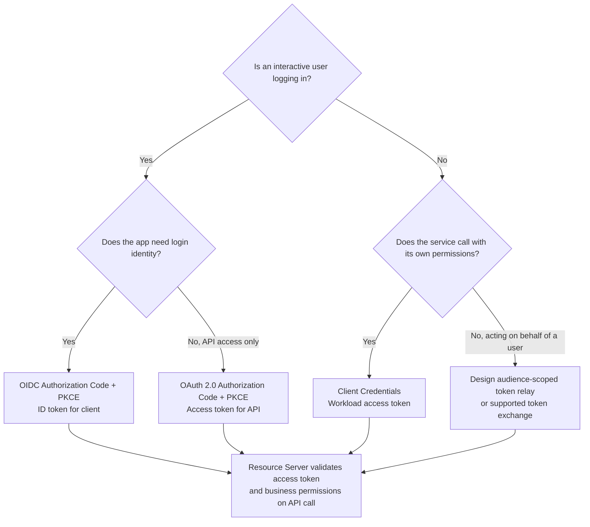

# Centralized Login, API Authorization, and Service-to-Service Communication Scenarios

In a system consisting of multiple Web applications, APIs, and background services, requirements like "single sign-on", "allowing an app to call an API", and "allowing two services to communicate" may look similar because they all use tokens. However, these are **three different problems regarding the subject, permission scope, and session lifecycle**. Designing an **OAuth 2.0/OpenID Connect Authorization Server** with **Spring Security** and **Spring Authorization Server** must start by choosing the right flow for each problem.

This lesson belongs to the **Overview** chapter of the **SPRING_SECURITY_OAUTH2_OIDC_AUTHORIZATION_SERVER** module. Its goal is to understand how to position the Authorization Server inside a Spring Boot application architecture, model the use cases, and identify the configuration, security, testing, and operational requirements before diving into detailed source code.

## 1. The Three Problems and the Role of the Authorization Server

Suppose an enterprise has:

- **Portal**: an internal user interface accessed in a browser.
- **Orders API**: manages orders and enforces business permissions.
- **Invoice Worker**: a background service that periodically queries orders to issue invoices.
- **Central Login**: a centralized authentication point that issues tokens and publishes metadata/verification keys.

In OAuth 2.0, the foundational roles are:

| Role | Responsibility | Example |
|---|---|---|
| Resource Owner | Entity with rights over a resource, usually a user | Staff member using the Portal |
| Client | Application requesting permissions or tokens | Portal, Invoice Worker |
| Authorization Server (AS) | Authenticates/authorizes per policy and issues tokens | Central Login using Spring Authorization Server |
| Resource Server (RS) | Protects resources and validates access tokens | Orders API |
| User Agent | Browser participating in login redirects | Staff member's browser |

**Authentication** answers "who is logging in?" **Authorization** answers "which actions on which resources is the subject allowed to perform?" **Delegation** allows a client to receive bounded permissions to call an API; it does not mean the client possesses all of the user's permissions.

| Scenario | Actual Subject | Appropriate Mechanism | Primary Outcome |
|---|---|---|---|
| Centralized login / SSO | Interactive user | OpenID Connect + Authorization Code + PKCE | Client identifies the user and creates an application session |
| Calling an API on behalf of a user | User who authorized the client | OAuth 2.0 Authorization Code + PKCE | Access token with scopes and audience appropriate for the API |
| Service-to-service calls | Application/service, no interactive user | OAuth 2.0 Client Credentials | Access token representing the client with granted machine permissions |

> **Distinguishing OIDC and OAuth 2.0:** OAuth 2.0 is an authorization framework for clients to access protected resources. OpenID Connect (OIDC) builds on OAuth 2.0 to standardize login and identity information via **ID tokens**, **UserInfo**, and related endpoints. Having an access token does **not automatically** mean the application has authenticated the user under OIDC.

### 1.1. Reference Architecture



In practice, the Authorization Server and Resource Server should have separated responsibilities. The Authorization Server **issues** tokens; the Orders API **verifies** tokens and enforces authorization policies at the resource. Both can use Spring Security, yet belong to different applications or configuration roles.

### 1.2. Artifacts That Cannot Be Used Interchangeably

| Artifact | Who Uses It? | Purpose | Should Not Be Used To… |
|---|---|---|---|
| **Authorization code** | Client exchanges it at the token endpoint | Proves the authorization step just completed; short-lived, single-use | Call APIs |
| **ID token** (OIDC) | Client / Relying Party | Verifies the login event and basic user identity info | Act as a Bearer token for Orders API |
| **Access token** | Resource Server | Decides API access based on signature/status, claims, and policies | Replace a browser login session or imply OIDC login identity by default |
| **Refresh token** | Client permitted to hold tokens | Requests a new access token without repeating user interaction | Be sent to a Resource Server |
| **Session cookie** | Browser and application/AS | Maintains a login session on a specific domain | Replace tokens across every API and every domain |

An access token can be a **self-contained JWT** (the API verifies the signature, `iss`, `aud`, expiration, and permissions) or an **opaque token** (the API uses the introspection endpoint and validates per policy). Do not assume all access tokens are JWTs. An OIDC ID token is typically a JWT; the audience of an ID token targets the **client**, unlike the audience of an access token meant for an API.

## 2. Scenario A: Centralized Login and Single Sign-On (SSO)

### 2.1. Real-World Problem

A user opens `portal.example.com` and then navigates to `reports.example.com`. Both applications trust `login.example.com` as their OIDC Provider. If the user already has a valid session at Central Login, opening Reports can complete the OIDC process without re-entering a password.

Key point: **SSO comes from the login session at the identity provider**, not from copying Portal's cookie to Reports. Each application still needs to create and protect its own session; Central Login can share authentication state via OIDC redirect flows.

### 2.2. Authorization Code + PKCE Flow



Notable steps:

1. **Pre-register the client:** `client_id`, client authentication policy, grant types, scopes, and `redirect_uri` are already permitted. The callback must match the exact registered value.
2. **Generate `state` and PKCE:** the client generates a random `code_verifier` and sends `code_challenge` using `S256`. `state` binds the callback response to the initial request to prevent flow spoofing.
3. **If using OIDC, include `scope=openid` and an appropriate `nonce`:** `nonce` binds the ID token to the login request and helps prevent replay. The client must thoroughly validate the ID token, including signature, issuer, audience, expiry, and `nonce` when applicable.
4. **User authenticates at the AS:** passwords/MFA, login policies, and consent if required are the responsibility of the identity solution. Spring Authorization Server issues tokens, but does not replace the full suite of user management workflows.
5. **Exchange code at the token endpoint:** a backend confidential client such as a BFF authenticates using its registered method and sends `code_verifier`. The browser never receives `client_secret`.
6. **Client creates an application session:** the BFF can keep tokens on the server side and return an appropriate `Secure; HttpOnly; SameSite` cookie. CSRF checks remain necessary for cookie-authenticated endpoints.

*Illustrative* example of authorization request parameters:

```text
GET https://login.example.com/oauth2/authorize
  ?response_type=code
  &client_id=portal-bff
  &redirect_uri=https%3A%2F%2Fportal.example.com%2Flogin%2Foauth2%2Fcode%2Fcentral
  &scope=openid%20profile%20orders.read
  &state=<random-state>
  &nonce=<random-nonce>
  &code_challenge=<base64url-sha256-verifier>
  &code_challenge_method=S256
```

Values inside `<...>` are placeholders only; they must be cryptographically random per the protocol and URL-encoded when sending a real request.

### 2.3. Linking Multiple Applications and Login Sessions

When Reports initiates a new OIDC authorization request, Central Login checks the SSO session on its own domain. If the session is still valid and policy does not require re-authentication, the AS can issue a new authorization code for Reports. Reports exchanges the code and creates its own session.

Three distinct actions must be differentiated:

- **Logging out of one application:** clears Portal's session; the Central Login session and Reports session may still remain active.
- **Logging out of the identity provider:** terminates the SSO session at Central Login according to protocol/policy; this does not mean every cookie or already-issued access token automatically disappears.
- **Token revocation and cross-application logout:** may require token revocation, appropriate OIDC logout mechanisms, short token lifetimes, and coordination across multiple clients. Support for logout styles depends on the Spring Authorization Server version and integration; verify exact capabilities before promising "instant system-wide logout."

If Central Login authenticates users via Google, Microsoft Entra ID, or another enterprise IdP, that is **federation/upstream login**. Central Login must still manage identity mapping, subject, tenant, sessions, and token issuance contracts for internal clients. Never blindly forward raw external IdP tokens to every internal API.

## 3. Scenario B: API Access Authorization in a User Context

### 3.1. Business Story

A staff member logs into Portal and clicks "View orders". Portal sends an access token to the Orders API. The API must know:

1. Was the token issued by a **trusted Authorization Server**?
2. Is the token still active, within time constraints, and carrying the right **audience** for Orders API?
3. Does the token have the **scope** for reading orders?
4. Is the user actually allowed to view that **specific order** based on tenant, department, owner, and business policy?

The fourth question usually requires checking data inside the API itself. The `orders.read` scope does not mean the user can read every order across every organization.



**Authentication at Portal and authorization at the API must be checked independently.** The API should never trust a self-asserted header like `X-User-Id` from the Internet, nor assume that passing through an API Gateway is reason enough to skip token validation and authorization.

### 3.2. Designing Scopes, Audiences, and Business Permissions

An illustrative breakdown:

| Action | OAuth Scope | Audience | Business Check at the API |
|---|---|---|---|
| Read list of permitted orders | `orders.read` | `orders-api` | Filter by tenant and user scope |
| Create or update orders | `orders.write` | `orders-api` | Role, order status, limits |
| View internal invoice data | `invoice.read` | `invoice-api` | Organization permissions and billing data |

**Scope** generally describes the type of permission granted to a client; **audience** identifies the target API allowed to accept the token; **internal roles/permissions** describe business authority. These three layers complement one another. Mapping roles from claims into `GrantedAuthority` requires clear conventions, control over claim sources, and never treating a scope as an administrative role by default.

With Spring Security Resource Server, the default JWT mechanism can map scopes into authorities formatted as `SCOPE_orders.read`. Issuer/audience attributes, expiration, and signatures must be verified. **Audience often needs to be configured or enforced via an explicit validator** depending on your Spring Security setup; do not rely solely on signature verification.

### 3.3. When to Use JWT vs. Opaque Access Tokens?

- **JWT:** the API can verify locally with public keys fetched from JWKS; fits low-latency needs, though issued tokens generally remain valid until expiration unless an extra control layer exists.
- **Opaque:** the API calls the introspection endpoint to retrieve token status and permissions; makes it easier to put revocation decisions into the validation path, but depends on AS availability/latency and caching policy.
- **Whichever you choose:** transmit only over HTTPS, limit lifetimes, never log raw Bearer token values, avoid placing tokens in URLs, and restrict permissions under least privilege.

If an API Gateway is present, preliminary token validation at the Gateway can reduce load and reject requests early. Resource Servers must still maintain clear trust boundaries; a Gateway cannot replace each API's business authorization checks.

## 4. Scenario C: Service-to-Service Communication via Client Credentials

### 4.1. When There Is No Interactive User

The Invoice Worker runs nightly with no user opening a browser to grant permissions. The worker is registered as a **confidential client** and uses the `client_credentials` grant:

1. The Worker authenticates its client identity at `/oauth2/token` using `client_secret_basic` or a stronger method when appropriate, such as `private_key_jwt` or mutual TLS if supported by the system.
2. The Authorization Server validates the client, allowed grant types, registered scopes, and issuance policy.
3. The AS returns a short-lived access token representing **the service** and targeted at the destination API.
4. The Worker calls Orders API with `Authorization: Bearer ...`. The API verifies the token, audience, scope, and machine access policies.
5. When the token expires, the Worker obtains a new token using the appropriate grant. Typically `client_credentials` **does not need a refresh token**.



Example request using curl (environment variable values are illustrative):

```bash
curl --request POST "https://login.example.com/oauth2/token" \
  --user "$CLIENT_ID:$CLIENT_SECRET" \
  --data-urlencode "grant_type=client_credentials" \
  --data-urlencode "scope=orders.read"
```

In real applications, secrets must be retrieved from an appropriate secret store and never appear in repositories, logs, or public configurations. The curl command above helps understand the protocol; when running in shared environments, watch for the risk of exposing command-line arguments through process-monitoring tools.

### 4.2. A Service Token Does Not Represent an Employee

There is no user in `client_credentials`, so the API should not record that a specific employee approved an operation based solely on that access token. The identity to audit is the client/workload. If an action requires a user identity, the system must use a user-involving authorization flow or a clearly defined delegated authorization model.

When **Service A calls Service B on behalf of a user**, there are two common patterns:

- **Forwarding the user's access token:** appropriate only if the token was issued for the exact audience, scopes, and trust model of Service B. Never forward a token carrying Service A's audience to Service B and ask B to "accept it anyway."
- **Token exchange / on-behalf-of:** Service A exchanges a valid token for a constrained token intended for Service B, if the Authorization Server and ecosystem support that policy. This **is not a default feature you can assume** in every Spring Authorization Server version; verify exact support and configuration.

The *service with its own permissions* model and the *service acting on behalf of a user* model produce different audit trails. Avoid using broad machine permissions to substitute for user context simply because it is easier to implement.

## 5. Applying This in Spring Boot Applications

The three components have distinct configurations:

| Component | Spring Security | Responsibilities |
|---|---|---|
| Central Login | Spring Authorization Server + user authentication config | Client registration; OAuth/OIDC endpoints; signing keys; tokens, consent, sessions |
| Portal/BFF | OAuth2 Client + OIDC Login | Login redirects; callbacks; storing authorized clients; creating sessions |
| Orders API | OAuth2 Resource Server | Token verification; authority mapping; blocking requests; business permission checks |
| Invoice Worker | OAuth2 Client | Obtaining, caching, and renewing access tokens for the client credentials grant |

### 5.1. Configuring the Authorization Server: Multiple Clients, Multiple Grant Types

The following example illustrates **registering two clients with different purposes** in Spring Authorization Server. Imports are omitted to keep the focus on configuration; domains and secrets must be replaced with real configuration.

```java
@Bean
RegisteredClientRepository registeredClientRepository(
        PasswordEncoder passwordEncoder,
        @Value("#{environment['PORTAL_BFF_SECRET']}") String portalSecret,
        @Value("#{environment['INVOICE_WORKER_SECRET']}") String workerSecret) {

    RegisteredClient portal = RegisteredClient.withId(UUID.randomUUID().toString())
            .clientId("portal-bff")
            .clientSecret(passwordEncoder.encode(portalSecret))
            .clientAuthenticationMethod(ClientAuthenticationMethod.CLIENT_SECRET_BASIC)
            .authorizationGrantType(AuthorizationGrantType.AUTHORIZATION_CODE)
            .authorizationGrantType(AuthorizationGrantType.REFRESH_TOKEN)
            .redirectUri("https://portal.example.com/login/oauth2/code/central")
            .scope(OidcScopes.OPENID)
            .scope(OidcScopes.PROFILE)
            .scope("orders.read")
            .clientSettings(ClientSettings.builder()
                    .requireProofKey(true)
                    .requireAuthorizationConsent(true)
                    .build())
            .tokenSettings(TokenSettings.builder()
                    .accessTokenTimeToLive(Duration.ofMinutes(10))
                    .reuseRefreshTokens(false)
                    .build())
            .build();

    RegisteredClient worker = RegisteredClient.withId(UUID.randomUUID().toString())
            .clientId("invoice-worker")
            .clientSecret(passwordEncoder.encode(workerSecret))
            .clientAuthenticationMethod(ClientAuthenticationMethod.CLIENT_SECRET_BASIC)
            .authorizationGrantType(AuthorizationGrantType.CLIENT_CREDENTIALS)
            .scope("orders.read")
            .tokenSettings(TokenSettings.builder()
                    .accessTokenTimeToLive(Duration.ofMinutes(5))
                    .build())
            .build();

    return new InMemoryRegisteredClientRepository(portal, worker);
}
```

**Details to read carefully in the configuration:**

- Portal uses `authorization_code`, requires PKCE, and has a specific redirect URI. `openid` turns the request into an OIDC login; if Portal only needs API access without OIDC identification, do not automatically include `openid` in every request.
- Invoice Worker is only allowed `client_credentials`, has no redirect URI, and does not need the `openid` scope.
- `reuseRefreshTokens(false)` applies to clients using refresh tokens; the application must store and update refresh tokens along a secure lifecycle.
- `InMemoryRegisteredClientRepository` and random IDs are only for testing. Production environments require a durable client store (such as JDBC), secret management, and rotation policies.
- This code **is not a complete Authorization Server configuration**: you still need security filter chains, user identity management, `AuthorizationServerSettings`, a `JWKSource` signing key source, authorization/consent stores, and public endpoint setup.

In endpoint configuration, enable OIDC if you want to issue ID tokens and expose OIDC endpoints, for example using `OAuth2AuthorizationServerConfigurer` with `oidc(Customizer.withDefaults())` in the Authorization Server's security filter chain. The security chain for the user login page is usually separate and must include an appropriate authentication mechanism. Specific configuration package/API names may vary across Spring Security and Spring Authorization Server branches; pin consistent dependency versions before applying code samples.

### 5.2. Configuring the BFF to Log In via OIDC

A Spring Boot client can use `spring-boot-starter-oauth2-client` and configure by issuer:

```yaml
spring:
  security:
    oauth2:
      client:
        registration:
          central:
            provider: central
            client-id: portal-bff
            authorization-grant-type: authorization_code
            redirect-uri: "{baseUrl}/login/oauth2/code/{registrationId}"
            scope: openid, profile, orders.read
        provider:
          central:
            issuer-uri: https://login.example.com
```

This snippet **does not yet include the client secret**. For a confidential BFF client, supply the secret via secure configuration or a secret manager and declare an authentication method matching the client on the Authorization Server. Spring Security can use discovery metadata from `issuer-uri` to locate endpoints and JWKS. When configuring the application, enable `oauth2Login` and the appropriate OAuth2 Client pieces.

For pure browser-based SPAs, the client is a **public client**: never embed a client secret. Use Authorization Code + PKCE and consider a BFF when the problem demands reducing token exposure to JavaScript. CORS, CSRF, cookie policies, and XSS protections must still be designed for the application type.

### 5.3. Orders API Verifying Issuer, Audience, and Scope

A Resource Server using JWTs can apply a configuration like this (example for Spring Security 6.x):

```java
@Configuration
@EnableWebSecurity
class OrdersApiSecurity {

    @Bean
    SecurityFilterChain apiSecurity(HttpSecurity http) throws Exception {
        http.authorizeHttpRequests(authorize -> authorize
                .requestMatchers(HttpMethod.GET, "/api/orders/**")
                    .hasAuthority("SCOPE_orders.read")
                .requestMatchers(HttpMethod.POST, "/api/orders/**")
                    .hasAuthority("SCOPE_orders.write")
                .anyRequest().authenticated())
            .oauth2ResourceServer(oauth2 -> oauth2.jwt(Customizer.withDefaults()));
        return http.build();
    }

    @Bean
    JwtDecoder jwtDecoder(@Value("#{environment['OIDC_ISSUER']}") String issuer) {
        NimbusJwtDecoder decoder =
                NimbusJwtDecoder.withIssuerLocation(issuer).build();

        OAuth2TokenValidator<Jwt> audienceValidator = token ->
                token.getAudience().contains("orders-api")
                    ? OAuth2TokenValidatorResult.success()
                    : OAuth2TokenValidatorResult.failure(
                        new OAuth2Error("invalid_token",
                                "Token is not intended for Orders API", null));

        decoder.setJwtValidator(new DelegatingOAuth2TokenValidator<>(
                JwtValidators.createDefaultWithIssuer(issuer),
                audienceValidator));
        return decoder;
    }
}
```

- `issuer` must match the exact `iss` value issued by the AS and published in metadata; do not arbitrarily substitute an internal hostname if the AS advertises a different public issuer.
- The validator requires `aud=orders-api`. The Authorization Server **must actually issue access tokens containing that audience**, typically via resource/client mapping policies and `OAuth2TokenCustomizer<JwtEncodingContext>`. Do not remove the audience validator simply because default tokens do not yet include the claim.
- For opaque tokens, replace the JWT mechanism with appropriate introspection; the API must then authenticate to the AS and handle timeouts, availability, and caching.
- The `hasAuthority` rules only check scopes at the path/method layer; per-order permission checks remain in business logic (such as service-level authorization).

**CSRF warning:** the example configuration focuses solely on Bearer access tokens. If the Resource Server also serves cookie/session-based endpoints, the CSRF policy must be evaluated separately; never disable CSRF globally just to fix an API call error.

### 5.4. Invoice Worker Obtaining Tokens via OAuth2 Client

Example client credentials configuration in Spring Boot:

```yaml
spring:
  security:
    oauth2:
      client:
        registration:
          invoice-worker:
            provider: central
            client-id: invoice-worker
            authorization-grant-type: client_credentials
            scope: orders.read
        provider:
          central:
            issuer-uri: https://login.example.com
```

In production, the client secret must be supplied from a secure secret source for the `invoice-worker` registration (or use a stronger client authentication mechanism if supported). On the Java application side, `OAuth2AuthorizedClientManager` with a `clientCredentials()` provider can request/renew access tokens and pair with `RestClient` or `WebClient`. Never hardcode a Bearer token or implement an expiration cache with an unsynchronized global variable.

## 6. Security Boundaries and Common Design Pitfalls

| Pitfall | Consequence | Prevention |
|---|---|---|
| Using an ID token to call an API | Confuses client authentication token with API permissions | APIs must only accept access tokens with the right audience |
| Checking only the JWT signature | Tokens from another client/API can be misused | Verify `iss`, `aud`, expiration, token type, scopes, and business rules |
| Sharing one client across all services | Cannot distinguish identities; hard to revoke and audit | Give each workload its own registration, secret/key, and least privilege |
| Storing a client secret in an SPA/mobile app | Secret exposed to application users | Public client + PKCE, or a BFF design |
| Treating `orders.read` as permission to read all orders | Cross-tenant/customer data access | Enforce row-level/object-level authorization |
| Copying access tokens across services | Wrong audience or excessive privilege propagation | Resource-specific tokens, supported token exchange, separated permissions |
| Using password grant/implicit in new apps | Higher risk of exposing passwords/tokens | Authorization Code + PKCE for users |
| Assuming logout invalidates every token | Active access tokens can still be used | Short lifetimes, revocation/introspection when needed, coordinated logout |
| Logging tokens, authorization codes, or secrets | Credential leakage | Redact logs, monitor anomalies, rotate keys/secrets |

Beyond the pitfalls above, ensure TLS connections from clients to sensitive endpoints, exact callback matching, CSRF protection for cookie-based sessions, `state`/PKCE/`nonce` verification, restricted access to admin endpoints, signing key protection, and brute-force/MFA protections during user authentication.

## 7. Scenario-Based Testing

A useful test suite must cover **valid flows and failure paths** across the client, Authorization Server, and Resource Server.

| Group | Required Tests | Expected Outcome |
|---|---|---|
| SSO | Log into Portal then open Reports with the same AS session | Reports completes OIDC; prompts for re-login only when policy/session requires |
| Callback | Mismatched `state`, wrong `code_verifier`, reused code | Request rejected, no application session created |
| OIDC | ID token with wrong issuer/audience/nonce or expired | Client rejects login |
| API Token | Missing token, expired, invalid signature, wrong issuer/audience | API rejects (`401` for missing/invalid token) |
| API Permissions | Valid token but missing `orders.write` | API denies write operation (`403`) |
| Tenant | Token has `orders.read` but requests an order in another tenant | API denies per business rules |
| Machine-to-Machine | Invoice Worker with valid scope calls Orders API | Succeeds; audit records the right client/workload |
| Machine-to-Machine | Worker requests unregistered scope/grant | Authorization Server refuses token issuance |
| Token Lifecycle | Access token expires; rotated refresh token is reused | Client obtains new token properly; old token reuse is rejected per policy |
| Key Rotation | JWKS rotates to a new key with an overlap period | Resource Server continues validating legitimate tokens without accepting unknown keys |
| Logout | Clear local session, log out of AS, revoke token | Behavior matches published policy; do not assume every token dies immediately |

For integration testing in Spring Boot, you can use `spring-security-test`, `MockMvc`, and simulated JWTs with specific claims to test policies at the Resource Server. However, tests with mocked tokens **do not replace** real protocol tests across client, AS, and API; include at least one end-to-end flow verifying discovery, redirects, PKCE, JWKS, and validation.

## 8. Operating an Authorization Server Safely

The Authorization Server is a shared trust point, so an incident there impacts every application. Essential operational requirements include:

1. **Fixed and consistent issuer:** configure a consistent public issuer URL, HTTPS, reverse proxy/forwarded headers, and discovery metadata across environments.
2. **Managed signing keys:** use a proper secret store/KMS/HSM, protect private keys, publish JWKS properly; during rotation, retain old keys while old tokens may still be valid.
3. **Durable state storage:** client registrations, authorizations, and consents must stay consistent across instances; pick JDBC/clustering/caching aligned with session and revocation policies.
4. **Per-client permissions and secrets:** periodically review scopes, redirect URIs, authentication methods, token lifetimes, and secret/certificate lifecycles.
5. **Controlled observability:** track request counts to authorize/token/introspection, `invalid_client` and `invalid_grant` errors, latency, 401/403 rates, and anomalous refreshes; audit by client/correlation ID without logging raw tokens.
6. **Availability and recovery:** back up configuration/authorization stores, rehearse key and data recovery, rate-limit sensitive endpoints, and maintain response procedures for leaked secrets or signing keys.

### 8.1. Choosing a Flow by Business Question



A sound design can clearly state **who the subject is**, **which client requests the token**, **which audience is accepted**, **which scopes are granted**, **where business permission checks live**, and **how tokens/sessions are invalidated**. Answering these questions clearly before writing Spring Security configuration avoids mixing up centralized login, API authorization, and service-to-service communication.

## 9. Self-Check Knowledge Questions

1. If Portal and Reports both trust Central Login, what mechanism allows the user to avoid entering their password twice? Why must both applications still keep separate sessions?
2. Why might an access token with a valid signature still be rejected by Orders API?
3. Why should Invoice Worker not use `authorization_code` or hold onto a long-lived refresh token for scheduled runs?
4. When Service A needs to call Service B on behalf of a user, why can you not arbitrarily forward an access token issued for Service A?
5. What verification model ensures an employee with `orders.read` still cannot read orders belonging to another tenant?
6. When near-instant permission revocation is needed, what are the trade-offs between self-contained JWTs and opaque tokens?

**Conclusion:** Spring Authorization Server is the hub for issuing tokens and enforcing OAuth2/OIDC policies; each client chooses grants based on subject and context; each Resource Server protects APIs through token verification and business authorization. SSO login, user-scoped API access, and client credentials share the same trust infrastructure, yet must be designed, tested, and operated along distinct boundaries.
