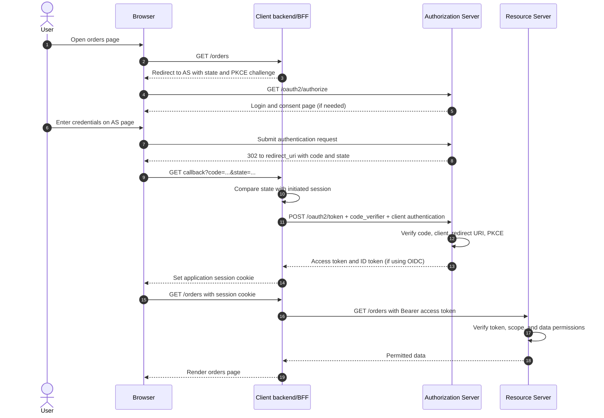

# Trust Boundaries Between User, Client, Browser, and Server

In OAuth 2.0/OpenID Connect (OIDC), a login or authorization request traverses multiple components: the user, browser, **client** application, **Authorization Server**, and often the **Resource Server**. These components see different data, control different parts of the flow, and do not share the same level of trust. Designing an Authorization Server with Spring Security and Spring Authorization Server is only secure when we clearly define **who is allowed to prove what, where, and with what evidence**.

After this lesson, you will be able to:

- Distinguish the user, user-agent, OAuth client, Authorization Server, and Resource Server; recognize when they reside in the same physical application yet retain separate security responsibilities.
- Point out the trust boundary at each step in Authorization Code + PKCE and explain why `redirect_uri`, `state`, `nonce`, client authentication, and token validation are needed.
- Compare server-side clients (confidential client/BFF) with SPAs or mobile applications (public clients).
- Connect these boundaries to configuring, testing, and operating Spring Authorization Server.

## 1. Identifying the Actors Properly

| Actor | Role and Control Zone | What Must Never Be Trusted by Default |
| --- | --- | --- |
| **User (resource owner/end-user)** | Interacts with the login screen, confirms authorization; may be the data owner. | A click or user-sent parameter does not automatically grant permission past system policies. A self-asserted username is not proof of authentication. |
| **Browser (user-agent)** | Navigates between client and Authorization Server; carries URLs, cookies, forms, and runs JavaScript. | The browser is user-controlled; URLs, query parameters, scripts, stolen cookies, or data sent by JavaScript can all be tampered with. |
| **OAuth client** | Application requesting access on behalf of a user: website with backend/BFF, SPA, or native app. Has a `client_id` and registered policies with the Authorization Server. | `client_id` is a public identifier, **not** client authentication proof; nor does the client have authority to issue tokens or decide permission scope itself. |
| **Authorization Server (AS)** | Authenticates users (directly or via an IdP), controls authorization, manages clients, authorization codes, and tokens; in OIDC, also issues ID tokens. | Do not trust `client_id`, `redirect_uri`, `scope`, `code_challenge`, or user identity merely because they appear in a request. |
| **Resource Server (RS)** | API owning the data/resources; decides whether to accept an access token and specific operation. | Do not trust an `Authorization` header, `client_id`, ID token, or a browser claim that "the user is logged in" without verification. |

**A single system may perform multiple roles simultaneously.** For instance, one Spring Boot application might both run an Authorization Server and serve an API. Both functions still retain distinct verification rules: the AS is responsible for issuing tokens; the API is responsible for validating tokens and deciding resource access. Never deduce that "same server" means "no permission check needed."

In OAuth, **authorization** is granting bounded access permissions to a client. In OIDC, the **authentication** layer adds the ID token and rules for the client to verify that a user has logged in with an issuer. Pure OAuth does not turn an access token into login proof for the client.

## 2. Three Trust Zones to Visualize

Consider an ordering system example:

- `https://id.example.com`: Spring Authorization Server; owns the login page, AS login session, client registry, authorization codes, and signing keys.
- `https://portal.example.com`: client application with a backend (BFF); maintains its own application session and keeps client credentials and tokens on the server.
- `https://api.example.com`: Resource Server; serves the orders API after verifying access tokens and permissions on orders.

The browser accesses both of the first two domains, yet **never becomes a trusted server component**. Someone can edit URLs, send manual HTTP requests, use malicious browser extensions, or execute scripts injected via XSS. HTTPS protects data in transit and authenticates the server via certificates, but does not make browser-originated content trustworthy.

Two kinds of trust must be distinguished:

1. **Identity and protocol trust:** the AS authenticates the user; the AS identifies a valid client; the client verifies the AS's response and ID token; the RS verifies access tokens from an accepted issuer.
2. **Business trust:** even when a token is valid and contains `orders.read`, the API must still check which **specific orders** the user/subject is allowed to read. A valid token does not mean access to every record.

A useful rule of thumb: **whenever data crosses from a less-trusted zone into a decision-making zone, the recipient must verify the evidence and bindings of that data right at that boundary.**

## 3. Authorization Code + PKCE Flow and Its Boundaries

The diagram below uses a **confidential web client/BFF**. Exchanging the authorization code for tokens happens between the client backend and the AS; the browser only handles redirects with the code and uses the portal's session cookie.



The critical boundaries lie at the following points:

### 3.1. Browser → Authorization Server: The Authorization Request Is Untrusted Input

An authorization request might contain:

```http
GET /oauth2/authorize?response_type=code
    &client_id=portal-bff
    &redirect_uri=https%3A%2F%2Fportal.example.com%2Flogin%2Foauth2%2Fcode%2Fsas
    &scope=openid%20orders.read
    &state=RANDOM_STATE
    &code_challenge=BASE64URL_CHALLENGE
    &code_challenge_method=S256
    &nonce=RANDOM_NONCE
```

This is wrapped across lines for readability; on the actual wire, parameters are URL-encoded. **The AS must verify**, at a minimum:

- `client_id` exists in `RegisteredClientRepository`, the client is permitted to use Authorization Code, and has compatible settings.
- `redirect_uri` matches a registered URI for the client. Never permit arbitrary wildcards, prefix matching, or hosts "similar to" trusted domains. Compatibility exceptions for native app loopback redirects must follow the relevant standards.
- `scope` only requests registered permissions, is permitted by policy, and, when required, is approved by the user. Consent does not replace policy checks.
- `code_challenge` is valid and `S256` is used in configurations requiring PKCE; the issued code must be bound to the challenge, client, redirect URI, and authorization session.
- The authentication session at the AS genuinely belongs to the just-authenticated user; login actions, consent confirmations, and state-changing endpoints are properly protected against CSRF.

**Never hand the user's password to the client so the client can "log in on their behalf" in this flow.** The user logs in at the AS or an identity provider delegated by the AS. The client receives the protocol outcome and never needs to know the password.

### 3.2. Authorization Server → Browser → Client: The Front-Channel Must Not Be Treated as Final Proof

The AS redirects to `redirect_uri` with `code` and `state`. All data returning to the client via URLs passes through the browser, so the client must:

- Verify that the returned `state` **matches exactly** the random value bound to the original session/transaction. This detects unexpected responses and helps prevent login CSRF/code injection. Merely checking "is the `state` parameter present" is insufficient.
- Never use `code` to grant access immediately; always exchange the code at the token endpoint, where the AS checks the code's bindings and validity.
- Limit leakage of `code` and `state` via logs, browser history, Referer headers, or third-party scripts on the callback page; use HTTPS exclusively, process callbacks promptly, and configure an appropriate `Referrer-Policy`.

An authorization code must be **short-lived and single-use**. Anyone intercepting the code should also be unable to exchange it for a token without the matching `code_verifier`; that is the purpose of PKCE. However, PKCE does not make `state` redundant for binding the response to the client's login session.

### 3.3. Client → Token Endpoint: Distinguishing Client Identification from Client Authentication

When sending `code` and `code_verifier` to `/oauth2/token`:

- For a **confidential client**, the AS authenticates the client using its registered mechanism, such as `client_secret_basic`, `private_key_jwt`, or mTLS. Secrets/private keys must stay solely on the backend and secret infrastructure—never sent in URLs or embedded in JavaScript.
- For a **public client** (SPA/native), a `client_secret` cannot be kept secret. The AS must not treat an app-embedded secret as strong proof. PKCE binds the code request to the party exchanging the code, yet **PKCE does not turn a public client into a confidential client**.
- For both, the AS verifies that the code is unexpired, unused, belongs to the right client, matches the bound redirect URI, and that `code_verifier` produces the matching challenge.

`client_id` is visible in browsers and logs; its presence does **not** prove the sender is the legitimate application. For OAuth client authentication, proof lies in a verified secret/signature/certificate; for public clients, rely on PKCE bindings and other appropriate protocol controls.

### 3.4. Client → Resource Server: Access Tokens Are Inputs That Must Be Verified

The RS never accepts a request merely because a header states `Authorization: Bearer ...` or because the caller sends `user_id`. For a JWT access token, the RS must verify the signature against a trusted issuer, allowed algorithms/keys, `iss`, `exp`/`nbf` lifetimes, `aud` matching the API, and required scopes/authorities. Then the RS checks ownership and access policies on the specific resource.

If using **opaque tokens**, the RS can use token introspection under a trusted configuration, verifying `active` status and related constraints. You cannot simply Base64-decode or inspect claims while skipping verification.

**An ID token does not replace an access token.** The ID token serves the client authenticating a user in OIDC; an ID token's `aud` is usually `client_id`, not an API identifier. APIs must require access tokens with the right audience and permissions.

### 3.5. Browser → Client Application: Two Separate Login Sessions

The AS may maintain a login cookie at `id.example.com`; the portal may maintain its own session cookie at `portal.example.com`. Both cookies have different purposes, domain scopes, and lifecycles. Logging in at the AS does not automatically create a valid portal session for every browser; the portal must still complete the callback and verify the OIDC transaction.

In a backend/BFF client, keep tokens on the server side and issue the browser only a session cookie configured with appropriate `Secure`, `HttpOnly`, and `SameSite` flags. Cookies do not eliminate CSRF risk; state-changing endpoints require appropriate CSRF defenses. `SameSite=Lax` can fit many top-level redirect flows, but cookie behavior must be tested against actual flows and domain structures.

## 4. How Confidential Clients and Public Clients Differ

| Question | Backend Web Client / BFF (confidential) | Browser-Based SPA (public) | Native App (public) |
| --- | --- | --- | --- |
| Can it keep a client secret? | Yes, if kept strictly server-side and managed properly. | No; JavaScript bundles are public. | No; binaries and devices are controlled by the user. |
| Who makes the token request? | Backend calls the AS directly. | JavaScript calls the token endpoint from the browser; needs properly scoped CORS if cross-origin. | Application calls the token endpoint from the device. |
| PKCE? | Recommended and should be required. | Mandatory under modern security practices for Authorization Code. | Mandatory under modern security practices for Authorization Code. |
| Where do tokens live? | Stored on the server; browser holds an app session cookie. | May reside in JS memory/storage, making them more exposed to XSS. | Reside on the device; should be stored in OS secure key storage when available. |
| Redirect considerations? | Strictly registered HTTPS callback. | Strictly registered HTTPS callback; protect origin data and scripts. | Use native-appropriate redirects (claimed HTTPS/loopback or supported mechanism) to avoid URI hijacking. |
| Notable risks | Secret leaks in logs/config, app session hijacking, CSRF, backend token leakage. | XSS, malicious dependencies, insecure token storage, client impersonation. | On-device token theft, redirect interception, app impersonation. |

Core takeaway: the term **"client"** in OAuth describes a protocol role, **not inherently a server**. In an SPA, the JavaScript program itself is the OAuth client; the browser is the client's execution environment. In a BFF model, the backend is the OAuth client performing token exchanges, while the browser interacts primarily via an application session.

For public clients with refresh tokens, add measures such as **refresh token rotation** or sender-constrained tokens per AS policy and current security standards. Storing tokens in `localStorage` makes them directly readable if XSS occurs; even keeping tokens solely in memory does not stop malicious JavaScript from using a token while it remains valid.

## 5. Distinguishing Security Artifacts

| Value | Issuer / Creator | Purpose and Verifier | Must Never Be Mistaken For |
| --- | --- | --- | --- |
| `client_id` | Issued by AS on client registration | Looks up client configuration. | A secret or client authentication proof. |
| `state` | Randomly generated by client per transaction | Client matches against stored state upon receiving callback. | An authorization mechanism or a replacement for PKCE. |
| `code_verifier` & `code_challenge` | Generated by client; AS stores challenge | AS verifies verifier when exchanging the code. | A client secret or proof of user identity. |
| Authorization `code` | Issued by AS | Token endpoint verifies and consumes once. | An access token or permission to call APIs. |
| `nonce` (OIDC) | Generated by client if used | Client compares `nonce` in ID token with the original request to bind the token to the transaction. | A replacement for `state` or PKCE. |
| ID token | Signed by OIDC Provider/AS | Client verifies signature, issuer, audience, expiration, and nonce when requested. | A token used instead of an access token to call APIs. |
| Access token | Issued by AS | RS verifies token and decides access permissions. | A user password or unlimited access rights. |
| Refresh token | Optionally issued by AS | Client uses to request new access tokens per policy; AS validates and prevents replay appropriately. | Safe data to put freely in URLs/logs/browsers. |
| Session cookie | Issued per domain by AS or web client | The server owning the session verifies the cookie when handling requests. | Proof usable directly across other domains/APIs. |

OIDC may not mandate `nonce` in every Authorization Code Flow case, but when a client sends `nonce`, it must validate it in the returned ID token. `state` and `nonce` protect **different bindings**: request–callback and request–ID token.

## 6. Mapping Trust Boundaries to Spring Authorization Server

Spring Authorization Server provides models and extension points to enforce checks on the party owning the responsibility:

| Spring Component | Boundary-Related Responsibility |
| --- | --- |
| `RegisteredClientRepository` / `RegisteredClient` | Looks up registered clients: `client_id`, authentication methods, grant types, redirect URIs, scopes, PKCE/consent policies. |
| `OAuth2AuthorizationService` | Stores and retrieves authorization state, authorization codes, and tokens to verify validity/bindings. |
| `OAuth2AuthorizationConsentService` | Stores user-approved consents when required by the application. |
| AS `SecurityFilterChain` | Protects OAuth/OIDC endpoints and configures appropriate authentication mechanisms and entry points. |
| `AuthorizationServerSettings` | Defines the issuer and endpoint paths; the issuer must remain stable and match the public URL accurately. |
| `JWKSource<SecurityContext>` and signing config | Manages token signing keys; publishes only public keys/JWKS while keeping private keys secure. |
| Spring Security OAuth2 Client | Client-side handling of redirects/callbacks, state, token requests, and response validation per configuration. |
| Spring Security Resource Server | API-side JWT verification or opaque token introspection; requires additional audience and business permission checks. |

Example of **registering a confidential client** for the portal (illustrative Java snippet assuming `passwordEncoder` and client storage configuration exist):

```java
String clientSecret = System.getenv("PORTAL_BFF_CLIENT_SECRET");
if (clientSecret == null || clientSecret.isBlank()) {
    throw new IllegalStateException("Missing client secret");
}

RegisteredClient portal = RegisteredClient.withId(UUID.randomUUID().toString())
    .clientId("portal-bff")
    .clientSecret(passwordEncoder.encode(clientSecret))
    .clientAuthenticationMethod(ClientAuthenticationMethod.CLIENT_SECRET_BASIC)
    .authorizationGrantType(AuthorizationGrantType.AUTHORIZATION_CODE)
    .authorizationGrantType(AuthorizationGrantType.REFRESH_TOKEN)
    .redirectUri("https://portal.example.com/login/oauth2/code/sas")
    .scope(OidcScopes.OPENID)
    .scope("orders.read")
    .clientSettings(ClientSettings.builder()
        .requireProofKey(true)
        .requireAuthorizationConsent(true)
        .build())
    .build();
```

Notable constraints:

- `requireProofKey(true)` requires PKCE for this client; the backend must generate and store the verifier bound to the OAuth transaction.
- `redirectUri(...)` declares the permitted callback; never inject arbitrary URIs from browser parameters into this list.
- `clientSecret(...)` applies only to confidential clients; in practice, load it from a secret management system and never write raw values to logs or source control.
- `requireAuthorizationConsent(true)` requires passing through the consent step per configuration; user approval must still stay within server scope and policy limits.
- `InMemoryRegisteredClientRepository` suits examples or tests; production deployments generally need durable storage with governance and client-data protection.

In a Resource Server, configuring `issuer-uri` can automate metadata/key retrieval and issuer validation. However, **you must explicitly define the allowed API audience** and add audience validation when default configuration does not cover it. Record-level, ownership, or tenant authorization rules continue to live in API business logic.

When the AS runs behind a reverse proxy/load balancer, the public issuer URL and HTTPS must align with metadata and tokens. Only accept forwarded headers from **trusted** proxies; never let an arbitrary client-supplied `X-Forwarded-Host` from the Internet alter the issuer or redirect URLs.

## 7. Common Design Mistakes and Counterexamples

### Scenario A: Redirecting to an Attacker's Domain

A legitimate client registered the callback `https://portal.example.com/login/oauth2/code/sas`. An attacker alters the request to:

```text
client_id=portal-bff
redirect_uri=https://attacker.example/callback
```

The AS **must reject** because the callback is not in the registered list, even if `client_id` is valid or the user is logged in at the AS. If the AS accepts arbitrary redirects, the authorization code can be sent to an unintended destination. When a redirect URI is invalid, the AS must not redirect error messages to that untrusted URI itself.

### Scenario B: Attacker Injects a Login Response into Another User's Session

An attacker obtains a code generated from their own session and tricks a victim into visiting the callback containing that code. If the client does not match `state` against the transaction initiated in the victim's session, the client may bind the wrong identity or session. The client must generate unpredictable `state` per request and reject mismatched callbacks. PKCE further protects code exchange at the AS.

### Scenario C: API Accepts an ID Token

A client sends an ID token to `/orders` instead of an access token. The ID token may have a valid signature, yet its audience is the client, not the API. The RS must reject tokens that do not match the API's intended token type, audience, or policy.

### Scenario D: SPA "Hides" a Secret in the Build Bundle

A client secret appears in a JavaScript file, a build-time environment variable, or a native app binary. Users and attackers can extract it. You must register the app as a **public client**, use Authorization Code + PKCE with appropriate token protections, and never treat that secret as a security authentication factor.

### Scenario E: Valid Token, but Data Belongs to Another User

An access token carries `orders.read` and the right API `aud`. A user changes the URL from `/orders/123` to someone else's `/orders/999`. If the API checks only the token and scope without checking permission on order `999`, the system still suffers from an object-level authorization flaw (IDOR/BOLA). The final security boundary sits inside the Resource Server's business decisions.

## 8. Testing at Boundaries Instead of Only Testing the Happy Path

| Test | Expected Secure Result |
| --- | --- |
| Register a fixed callback; send a different `redirect_uri` or look-alike host URI | AS rejects the request; does not send a code to the unknown URI. |
| Exchange code with wrong `code_verifier` | Token endpoint rejects. |
| Reuse an authorization code already exchanged successfully | Token endpoint rejects the subsequent attempt. |
| Callback returns a `state` not matching the initial request session | Client rejects login/callback. |
| Confidential client sends wrong credentials | AS refuses to issue tokens. |
| Resource Server receives expired, wrong-issuer, or wrong-audience access token | API rejects. |
| API receives an ID token where an access token is required | API rejects. |
| Token has valid scope but requests another user's resource | API denies per resource ownership policy. |
| OIDC ID token returns a `nonce` different from the requested nonce | Client rejects the ID token. |
| Portal logout while AS session still exists | Verify behavior matches SSO/logout design; never assume both sessions end simultaneously by default. |

When writing integration tests, verify **the decision-maker at each boundary**: the AS checks client registrations and codes; the OAuth client checks `state`/ID tokens; the RS checks access tokens and object permissions. A single "user logs in successfully" test does not prove that rejection paths actually work.

## 9. Checklist for Design and Operations

1. **Map actors accurately:** browser, client backend/SPA/native, AS, and RS; explicitly note where secrets, tokens, cookies, and signing keys reside.
2. **Tighten registration config:** appropriate client authentication method, exact callback declarations, restricted scopes/grants, PKCE and consent per policy.
3. **Lock down the front-channel:** HTTPS, transaction-bound `state`, `nonce` when using OIDC, and prevent code leakage on callbacks.
4. **Protect the token endpoint and storage:** short-lived/single-use codes, valid verifier checks, client authentication for confidential clients, and protection for refresh tokens and secrets.
5. **Verify tokens on the receiving side:** issuer, signature/introspection, expiration, audience, scopes; ID tokens go only to the right client; APIs still check data permissions.
6. **Protect sessions and runtime:** secure cookies, CSRF, XSS, dependencies, secret manager, logging policies, HTTPS, and trusted reverse proxies.
7. **Test failure paths:** bad redirects, bad `state`/`nonce`, code replay, wrong-audience tokens, and accessing another user's data.

**Closing principle:** The Authorization Server should only issue credentials after verifying issuance prerequisites itself; the client should only create a user session after validating the OIDC/OAuth response properly; the Resource Server should only return data after verifying both the token **and** actual access permissions. No component may outsource a security decision to a parameter self-asserted by a browser or caller.

**Standards for further reading:** RFC 6749 (OAuth 2.0), RFC 7636 (PKCE), RFC 9700 (OAuth 2.0 Security Best Current Practice), OpenID Connect Core 1.0, and Spring Authorization Server/Spring Security documentation on Registered Client, OAuth2 Client, and Resource Server.
