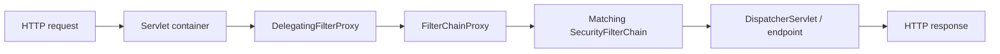
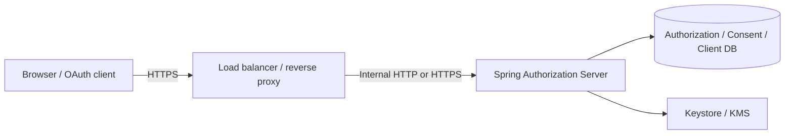
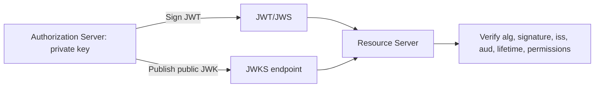

# Prerequisite Knowledge of Servlet Security, HTTP, TLS, and Cryptography

## 1. Why Is This Foundational Knowledge Needed?

In the **SPRING_SECURITY_OAUTH2_OIDC_AUTHORIZATION_SERVER** module, the goal is to learn how to design, configure, secure, test, and operate an **OAuth 2.0/OpenID Connect Authorization Server** using Spring Security and Spring Authorization Server in a Spring Boot application. Before configuring token issuance endpoints, login, or ID Token issuance, learners need to understand four foundational layers:

1. **Servlet Security** explains how requests are processed through security filter chains, how users are authenticated, and how login state is maintained.
2. **HTTP** explains how browsers, OAuth clients, Authorization Servers, and Resource Servers exchange requests, responses, redirects, headers, cookies, and error codes.
3. **TLS** protects the transport channel, authenticates server hostnames, and secures data such as authorization codes, client credentials, and tokens in transit over the network.
4. **Applied cryptography** protects passwords, proves token integrity, generates unpredictable values, and prevents authorization code theft with PKCE.

This is **prerequisite knowledge**, not a requirement for learners to implement OAuth 2.0 protocols or cryptographic algorithms from scratch. Spring Security and Spring Authorization Server already provide most mechanisms; the developer's job is to understand trust boundaries accurately and configure them securely.

### Expected Learning Outcomes

After this lesson, learners will be able to:

- Trace a request through `SecurityFilterChain`, distinguish **authentication** from **authorization**, and explain when sessions and cookies are used.
- Read and explain HTTP redirects, `GET`, `POST`, status codes, headers, and data formats in the Authorization Code Flow.
- Describe the path of HTTPS through a reverse proxy; identify misconfigurations of `issuer`, certificates, cookies, and forwarded headers.
- Distinguish hashing, HMAC, digital signatures, encryption, and secure random data; read JWT/JWK/JWKS structures and understand PKCE's purpose.
- Connect these foundations to designing, testing, and operating an Authorization Server on Spring Boot.

## 2. The Big Picture: A Single Login and Token Issuance

A typical system has four roles: **Resource Owner** (user), **Client** (application wanting access), **Authorization Server** (authenticates and issues tokens), and **Resource Server** (API protecting resources). With OpenID Connect (OIDC), the Authorization Server also acts as an **OpenID Provider**, issuing an **ID Token** for the client to verify user identity.

```mermaid
sequenceDiagram
    autonumber
    actor U as User
    participant B as Browser / Client
    participant AS as Authorization Server
    participant RS as Resource Server
    B->>AS: GET /oauth2/authorize + state + code_challenge
    AS-->>B: 302 /login (if no session exists)
    U->>B: Enter login credentials
    B->>AS: POST /login over HTTPS
    AS-->>B: Session Set-Cookie; resume authorization flow
    AS-->>B: 302 redirect_uri?code=...&state=...
    B->>AS: POST /oauth2/token + code + code_verifier
    AS-->>B: Access Token (+ ID Token if using OIDC)
    B->>RS: GET /api/... with Authorization: Bearer ...
    RS-->>B: Permitted data
```

The diagram simplifies several steps, such as the *consent* screen and how backend clients exchange tokens. Two points must be distinguished:

- **User login at the Authorization Server** typically involves sessions, cookies, and Servlet Security Filters. Tokens issued to the client afterward have their own lifecycle.
- **Access Token verification at the Resource Server** is a separate task. If the token is a JWT, the Resource Server typically verifies the signature and claims; if it is an opaque token, it may use introspection. Using JWTs does not mean the entire Authorization Server becomes a stateless application.

## 3. Servlet Security Knowledge to Master

### 3.1. Where Does a Servlet Request Go?

In Spring Boot using the servlet stack, the web container (e.g., Tomcat) receives an HTTP request and passes it through the **Servlet Filter Chain** before the request reaches `DispatcherServlet`, a controller, or the matching endpoint. Spring Security plugs into this chain via `DelegatingFilterProxy`, typically pointing to a `FilterChainProxy` named `springSecurityFilterChain`.



`FilterChainProxy` selects a matching `SecurityFilterChain` based on `RequestMatcher` and priority order. **Not every request passes sequentially through every chain**: the first matching chain is applied. Inside a chain, security filters handle responsibilities such as extracting credentials, restoring security context, authentication, exception handling, and access control checks. Filter order has security implications; therefore, use Spring Security configuration rather than registering filters arbitrarily.

Key components and responsibilities:

| Component | Role to Understand |
| --- | --- |
| `HttpSecurity` | DSL for configuring security rules for a `SecurityFilterChain`. |
| `SecurityFilterChain` | Set of security filters applied to a group of requests. |
| `RequestMatcher` | Determines which chain or rule applies to a request. |
| `Authentication` | Represents the principal, credentials, and authorities; authenticated state must be established through a trusted mechanism. |
| `AuthenticationManager` / `AuthenticationProvider` | Coordinates and validates credentials or specific authentication methods. |
| `SecurityContext` / `SecurityContextHolder` | Where authentication info for the currently processed request is accessed. |
| `SecurityContextRepository` | Mechanism to load/save security context across requests when needed, e.g., using an HTTP session. |
| `AuthorizationManager` | Evaluates whether a request or operation is permitted. |

**Authentication** asks: *Who is making the request?* For example, verifying a username and password to establish a login session. **Authorization** asks: *Is the authenticated subject allowed to perform this action?* For example, whether the user consented to the client requesting the `profile` scope, and whether the client is registered to use that grant type. User permissions, client permissions, and OAuth scopes must not be conflated.

### 3.2. Why Does an Authorization Server Usually Need Two Security Chains?

In an application serving both protocol endpoints (`/oauth2/authorize`, `/oauth2/token`, `/oauth2/jwks`, OIDC endpoints, etc.) and a login page (`/login`), the request groups have different requirements. Spring Authorization Server configurations typically place a **high-priority chain** for protocol endpoints, and a **default chain** for the login UI and remaining application requests.

The example below illustrates separating chains in Spring Authorization Server versions featuring the `OAuth2AuthorizationServerConfigurer.authorizationServer()` API:

```java
@Configuration
@EnableWebSecurity
public class SecurityConfig {

    @Bean
    @Order(1)
    SecurityFilterChain authorizationServerChain(HttpSecurity http) throws Exception {
        OAuth2AuthorizationServerConfigurer configurer =
                OAuth2AuthorizationServerConfigurer.authorizationServer();

        http.securityMatcher(configurer.getEndpointsMatcher())
                .with(configurer, server -> server.oidc(Customizer.withDefaults()))
                .authorizeHttpRequests(auth -> auth.anyRequest().authenticated())
                .exceptionHandling(ex -> ex.defaultAuthenticationEntryPointFor(
                        new LoginUrlAuthenticationEntryPoint("/login"),
                        new MediaTypeRequestMatcher(MediaType.TEXT_HTML)));

        return http.build();
    }

    @Bean
    @Order(2)
    SecurityFilterChain applicationChain(HttpSecurity http) throws Exception {
        http.authorizeHttpRequests(auth -> auth.anyRequest().authenticated())
                .formLogin(Customizer.withDefaults());
        return http.build();
    }
}
```

This code focuses on **security routing** and is not yet a complete Authorization Server configuration. A real system also needs `RegisteredClientRepository`, `OAuth2AuthorizationService`, signing keys/JWK, and `AuthorizationServerSettings`, along with mechanisms for user management, passwords, and consent. Configuration APIs may vary across Spring Security/Spring Authorization Server versions; consult the official documentation for your exact version.

When reading the configuration, ask yourself: which chain matches `GET /oauth2/authorize`? Where is an unauthenticated request redirected? Why must `/login` be handled by the application chain? If `@Order` were swapped, could requests be intercepted prematurely by the catch-all chain?

### 3.3. Sessions, Cookies, CSRF, and CORS

**HTTP does not store state between requests by default**, yet browser-based login flows usually require sessions. After successful authentication, the browser may receive a session identifier cookie (commonly `JSESSIONID`); on subsequent requests, `SecurityContextRepository` can restore the `Authentication` from the corresponding session. `SecurityContextHolder` typically binds context to the current processing thread; do not assume it propagates automatically to every asynchronous thread.

Commonly confused mechanisms:

- **Session cookie** is proof that the browser is attached to a session; it is not an Access Token or ID Token. Enable `Secure`, `HttpOnly`, and choose a `SameSite` policy compatible with actual login flows.
- **CSRF** exploits the browser's automatic cookie transmission to execute unwanted requests. Especially critical for state-changing operations like `POST /login`, logout, consent, or session-based forms. Never disable CSRF across the entire application just because the Authorization Server has a token endpoint; Spring Authorization Server has specific configurations for protocol endpoints.
- **CORS** is a browser mechanism controlling whether JavaScript from another origin can read responses. CORS does not replace authentication, authorization, PKCE, or CSRF. Redirecting the browser to an authorization page is not equivalent to a cross-origin `fetch()`, and `Access-Control-Allow-Origin: *` should never be opened indiscriminately on sensitive endpoints.
- **SameSite** controls when cookies are sent in cross-site contexts. `Lax` usually fits standard login redirects; special flows such as OIDC `form_post` responses may require carefully evaluating `SameSite=None; Secure` alongside CSRF protections.

### 3.4. Servlet Security Questions to Answer Before Deploying

Which filter or controller sends an unauthenticated request to login? After login, where is `Authentication` stored and restored? Do the login form and consent form include CSRF tokens? Can protocol endpoints be accidentally matched by a catch-all `SecurityFilterChain`? When deploying multiple instances, how are session state, authorization codes, and consents shared or durably persisted?

## 4. HTTP Knowledge to Master

### 4.1. Methods, Endpoints, and Status Codes

OAuth 2.0 and OIDC operate over HTTP, so you must read **methods**, **URLs**, **headers**, **bodies**, and **response statuses** accurately. Common requests include:

| Request or Response | Meaning |
| --- | --- |
| `GET /oauth2/authorize?...` | Browser starts an authorization request via query parameters. May require login and consent. |
| `302 Location: /login` | Redirects the browser to log in. |
| `POST /login` | Sends authentication credentials in the body over HTTPS, per form login configuration. |
| `302 Location: https://client.example/callback?code=...&state=...` | Returns the authorization code to the registered redirect URI. |
| `POST /oauth2/token` | Client exchanges the code for tokens; typically sends an `application/x-www-form-urlencoded` body. |
| `GET /.well-known/openid-configuration` | Fetches discovery metadata when OIDC is enabled. |
| `GET /oauth2/jwks` | Fetches the public JWK set so recipients can verify tokens with matching signatures. |
| `401 Unauthorized` | Usually signals unauthenticated or invalid credentials; may include `WWW-Authenticate`. |
| `403 Forbidden` | Subject is identified but lacks sufficient permissions, or a security policy denies the operation. |

Do not apply `401`/`403` mechanically to every OAuth case: the token endpoint also returns JSON protocol errors such as `invalid_client`, `invalid_grant`, and `invalid_request` per the specifications. When testing, inspect **both the HTTP status and the error body**.

**Redirects are part of the security protocol**:

- `Location` sends the browser to a new URL. In the Authorization Code Flow, `redirect_uri` must be strictly validated against registered URIs; never accept arbitrary URLs leading to open redirects or code leakage.
- `302` and `303` are commonly used for redirects after form submissions. `307`/`308` preserve the HTTP method and body, so exercise extreme caution to avoid forwarding a `POST` request containing credentials to another address.
- `code`, `state`, `client_id`, `scope`, `redirect_uri`, and `code_challenge` play different roles; do not treat all of them as secret credentials. However, authorization codes must still be protected and never logged publicly.

### 4.2. Headers, Content Types, URL Encoding, and Cookies

Example request exchanging an authorization code for tokens by a confidential client:

```http
POST /oauth2/token HTTP/1.1
Host: auth.example.com
Content-Type: application/x-www-form-urlencoded
Authorization: Basic <base64-client-credentials>

grant_type=authorization_code&code=<one-time-code>&redirect_uri=https%3A%2F%2Fclient.example%2Fcallback&code_verifier=<pkce-verifier>
```

In this example:

- `Content-Type` describes the body format, **not** an authentication mechanism. Form parameters must be properly URL-encoded.
- `Authorization: Basic ...` carries Base64-encoded client credentials for transport under HTTP syntax; **Base64 is not security encryption**. Use only over HTTPS and protect the secret. Public clients have no secret to prove identity this way; configure an appropriate client authentication method.
- `Authorization: Bearer <access-token>` is used by the Resource Server when a client calls an API; anyone holding a valid bearer token can use it within its granted scope.
- `Cookie` sends session identifiers back to the server, while `Set-Cookie` returns cookies to the browser. Distinguish session cookies from bearer token headers.
- `Cache-Control: no-store` and appropriate non-caching policies should apply to responses containing tokens or sensitive data. Avoid recording secrets, tokens, and authorization codes in access logs, traces, analytics, or public URLs.

### 4.3. Stateless HTTP Does Not Mean Stateless Business Logic

An Authorization Server typically manages **single-use authorization codes**, consents, refresh tokens, client details, and login sessions. Even if Access Tokens are issued as self-verifiable JWTs, token issuance and revocation still require state management. Conversely, a Resource Server can verify JWTs locally using JWKS without calling the Authorization Server on every request.

Keep the differences clear between:

- **Session-based user authentication** in browser interactions.
- **OAuth client authentication** at the token endpoint or other endpoints requiring client authentication.
- **Resource access authorization** via an Access Token at the Resource Server.

These three mechanisms serve different actors and trust boundaries.

## 5. TLS and HTTPS Infrastructure Knowledge

### 5.1. What Does TLS Protect?

TLS creates an authenticated and encrypted communication channel between the client and the TLS termination endpoint. When accessing `https://auth.example.com`, the client verifies the certificate and domain name (via SAN entries), trust chain to an appropriate CA, certificate validity period, and TLS session parameters. During the TLS handshake, both sides establish session keys to protect the confidentiality and integrity of exchanged data.

For an Authorization Server, TLS protects user authentication credentials, authorization codes, client secrets, access/refresh tokens, and session cookies in transit. **TLS does not replace application authorization, CSRF protection, PKCE, or token signatures**; each mechanism protects against a different class of risk.

Minimum deployment essentials:

- Serve public endpoints over **HTTPS** using modern TLS configurations (prefer TLS 1.3, support secure TLS 1.2 where compatibility requires). Disable weak protocol versions and cipher suites.
- Maintain valid certificates, matching domain names, complete certificate chains, and renewal procedures before expiration.
- Never disable certificate or hostname verification in OAuth clients, Resource Servers, or production-facing test clients.
- Consider HTTP Strict Transport Security (HSTS) once the entire domain and relevant subdomains meet HTTPS requirements; set `Secure` on cookies carrying sessions or sensitive data.
- Keep server clocks reasonably synchronized to prevent failures checking certificates, `exp`, `nbf`, and token timestamps.

### 5.2. Terminating TLS at a Reverse Proxy and the Issuer URL

A production deployment often places a load balancer or reverse proxy in front of Spring Boot:



When the proxy terminates TLS, the application may **see the internal connection as HTTP** even though users connect via HTTPS. If the public origin or forwarded headers are misconfigured, the Authorization Server may emit discovery metadata, redirect URIs, or `iss` claims using `http://` or an internal hostname. That causes issuer verification errors, redirect failures, and potential exposure over unintended transport paths.

Example of explicitly declaring the issuer:

```java
@Bean
AuthorizationServerSettings authorizationServerSettings() {
    return AuthorizationServerSettings.builder()
            .issuer("https://auth.example.com")
            .build();
}
```

The issuer is the **public identifier** of the Authorization Server; tokens, discovery metadata, and client/Resource Server configurations must all align with that value. When using a reverse proxy, trust `Forwarded` or `X-Forwarded-*` headers only from **trusted** proxies and strip spoofed client headers before forwarding to the application. If the proxy-to-application hop uses HTTP, ensure corresponding network-level controls; use internal HTTPS/mTLS when the threat model requires it.

**mTLS** (mutual TLS) adds client-side certificate authentication and can serve as an OAuth client authentication mechanism in suitable deployments. It is not mandatory for every OAuth 2.0/OIDC client, and differs from standard HTTPS which authenticates only the server.

### 5.3. Checking TLS in Development vs. Production

In local environments, `localhost` and custom setups may be used for learning and experimentation. In production deployments, do not rely on `localhost` exceptions to allow HTTP callbacks; use a stable public issuer, registered redirect URIs, and HTTPS with certificates trusted by clients. Inspect the entire path including browser → proxy, proxy → backend, Authorization Server → database/keystore, and calls to external systems against the threat model.

## 6. Cryptography Knowledge to Master

### 6.1. Distinguishing Common Techniques

| Technique | What Is It Used For? | Example in Authorization Server | Confusion to Avoid |
| --- | --- | --- | --- |
| Cryptographic hash (`SHA-256`) | Produces a fixed-length digest to verify binding/integrity in protocols. | Computing `code_challenge` for PKCE `S256`. | Fast hashing is not a safe way to store passwords. |
| Password hashing (`bcrypt`, `Argon2id`, proper PBKDF2) | Turns a password/secret into a one-way verifiable value with salt and work factor. | Storing user passwords or applicable client secrets. | Never store raw passwords or use plain SHA-256 for passwords. |
| HMAC | Authenticates message integrity and origin using a **shared symmetric key**. | Symmetric token/signature designs like `HS256`, when two trusted parties share a secret. | Any party verifying an HMAC also knows the key and can forge signatures. |
| Asymmetric digital signature | Holder of the **private key** signs; holder of the **public key** verifies. | Signing JWTs with appropriate algorithms like `RS256` or `ES256`. | No need to distribute private keys to Resource Servers. |
| Encryption | Conceals content from parties lacking the decryption key. | TLS protects transport; JWE can protect token payloads if truly needed. | JWTs signed with JWS have **readable** payloads—not encrypted confidentiality. |
| Cryptographically secure RNG (CSPRNG) | Generates practically unpredictable values. | Authorization codes, `state`, `nonce`, `code_verifier`, secret tokens, session identifiers. | Never use ordinary random number generators for security tokens. |

A Spring Security application typically uses an appropriate `PasswordEncoder` (such as `DelegatingPasswordEncoder`) to verify passwords. When handling token signing keys, manage key lifecycles and access controls; **never embed real private keys or client secrets in source code or study materials**.

### 6.2. How Are JWT, JWS, JWK, and JWKS Related?

JWT (*JSON Web Token*) is a format carrying claims. The common form is a **signed JWT** using JWS, consisting of three Base64URL-encoded parts separated by dots:

```text
BASE64URL(header).BASE64URL(payload).BASE64URL(signature)
```

The header can carry `alg` (signing algorithm) and `kid` (key identifier); the payload can carry `iss` (issuer), `sub` (subject), `aud` (audience), `exp` (expiration), `iat` (issued-at timestamp), and claims specific to Access Tokens or ID Tokens. Base64URL-decoding **does not** prove a token is valid. The verifier must verify the signature using an allowed key and algorithm, then validate required claims according to intended use.

Example flow using asymmetric signatures:



- **JWK** (*JSON Web Key*) is a JSON representation of a key. For asymmetric keys, a public JWK contains the shareable public key material.
- **JWKS** (*JSON Web Key Set*) is a collection of JWKs; the JWKS endpoint lets verifiers fetch public keys and use `kid` to select the right key.
- **JWS** confirms integrity and origin within trusted keys; it does not hide claims. **JWE** is the structure for encrypting content when separate payload confidentiality is required.
- **Access Token** proves authority to call an API per scope/audience; **ID Token** is for the client to verify user authentication results in OIDC. A Resource Server must never accept an ID Token in place of an Access Token.
- During **key rotation**, publish and retain the old public key long enough to verify still-valid tokens while retiring the old private key per policy. Never return private keys from the JWKS endpoint.

Asymmetric signatures are usually preferred when multiple Resource Servers must verify tokens, because those systems only hold public keys. The verifier must maintain an allowlist of permitted algorithms; **never** blindly trust whatever `alg` value appears in the token header. A token is valid only when `iss`, `aud`, lifetime, and business conditions match the called endpoint.

### 6.3. PKCE `S256`, `state`, and `nonce`

In the Authorization Code Flow, `code` passes through the browser and redirects. If intercepted, an attacker might attempt to exchange it for tokens. **Proof Key for Code Exchange (PKCE)** binds the code exchange to a secret value generated by the client at the beginning of the flow.

1. The client generates a random `code_verifier` via a CSPRNG, **43 to 128 characters** long per RFC 7636 syntax.
2. The client computes `code_challenge = BASE64URL(SHA256(ASCII(code_verifier)))` using the `S256` method; Base64URL here has **no `=` padding**.
3. The `/oauth2/authorize` request carries `code_challenge` and `code_challenge_method=S256`, while the client keeps `code_verifier` secret.
4. When exchanging the code at `/oauth2/token`, the client sends `code_verifier`. The Authorization Server verifies it matches the challenge bound to the authorization code.

Illustrative example:

```text
GET /oauth2/authorize?
  response_type=code&client_id=sample-client&scope=openid&
  redirect_uri=https%3A%2F%2Fclient.example%2Fcallback&
  state=<random-state>&
  code_challenge=<base64url-sha256-verifier>&
  code_challenge_method=S256

POST /oauth2/token
  grant_type=authorization_code&code=<returned-code>&
  redirect_uri=https%3A%2F%2Fclient.example%2Fcallback&
  code_verifier=<original-verifier>
```

`state`, `nonce`, and PKCE do not replace one another:

| Value | Who Creates and Uses It? | Primary Purpose |
| --- | --- | --- |
| `state` | Client creates before redirecting and verifies upon receiving response. | Binds the response to the initial authorization request, helping prevent CSRF/session mix-ups in redirect flows. |
| `code_verifier` / `code_challenge` | Client creates; Authorization Server verifies during code exchange. | Prevents use of an intercepted authorization code by a party lacking the verifier. |
| `nonce` | OIDC client creates; included in requests when applicable and verified in the ID Token. | Binds the ID Token to the authentication request, reducing replay/token substitution risks. |

Use the Authorization Code Flow with PKCE `S256`, especially treating PKCE as essential for public clients; modern security recommendations also apply PKCE broadly to other clients. A public client running in a browser or on a device cannot keep a client secret reliably confidential, even if a secret appears in a frontend config file.

### 6.4. Passwords, Client Secrets, and Tokens in Storage

- **User passwords:** use salted password hashing with an appropriate cost factor; Spring Security `PasswordEncoder` supports verifying and upgrading hash formats. Never log passwords or store plaintext.
- **Client secrets:** issue only to confidential clients capable of keeping secrets, store protected, and verify with an appropriate encoder. Establish workflows for issuing, revoking, and rotating secrets.
- **Signing keys:** private keys must be tightly controlled, managed via a keystore, KMS, or HSM according to required security levels; only public keys are published to signature verifiers.
- **Authorization codes/refresh tokens:** must be unpredictable, time-limited, with clear usage/revocation policies. Authorization codes must be short-lived and **single-use**; refresh tokens must be protected on the client side with risk-appropriate rotation/revocation strategies.
- **Tokens and identity data:** minimize sensitive data in claims; avoid writing tokens, secrets, verifiers, or session IDs to logs. Signed JWT payloads are readable by anyone holding the token string.

## 7. Putting Knowledge Together into a Threat Model

| Real-World Risk | Symptom or Cause | Knowledge / Control to Apply |
| --- | --- | --- |
| Attacker reads tokens in transit | Plain HTTP or TLS verification disabled | HTTPS/TLS and hostname/certificate verification. |
| Authorization code theft | Redirect leaked or code intercepted | PKCE `S256`, short-lived single-use codes, strict redirect URI checks. |
| Login response swapping | Client fails to bind request to callback | `state`, OIDC `nonce` when needed, strict `redirect_uri` and app session validation. |
| Unintended requests via session cookie | State-changing form lacks protection | CSRF protection, proper `SameSite` cookies, origin checks as needed. |
| API accepts wrong-audience token | Only decodes JWT or only verifies signature | Verify `iss`, `aud`, `exp`, `nbf`, algorithm, permissions, and scopes. |
| Public key cannot verify after rotation | Old key removed from JWKS too early | Rotation procedure retaining old public keys for the token validity window. |
| Discovery publishes internal or HTTP URLs | Wrong issuer or trusting spoofed forwarded headers | Explicit public issuer, trusted reverse proxy, end-to-end HTTPS checks. |
| Leaked client secret/private key | Hardcoded, logged, committed to repo, or overly broad config access | Secret manager/KMS, access control, rotation, never place secrets in public clients. |

A common mistake is seeing `200 OK` at the token endpoint and concluding the system is secure. A compliant Authorization Server must also reject **wrong clients, wrong `redirect_uri`, wrong verifiers, reused codes, wrong-issuer/audience tokens, unprotected cookies**, and invalid requests.

## 8. Practice Scenarios to Check Foundational Knowledge

Suppose a Spring Boot application has a `/login` UI, an Authorization Server at `https://auth.example.com`, an OAuth client at `https://client.example`, and a Resource Server at `https://api.example.com`.

**Scenario A — Choosing the filter chain.** When a browser calls `/oauth2/authorize` without being logged in, the protocol chain receives the request, redirects to `/login`, and then the application chain handles form login. Explain why which chain gets selected depends on `securityMatcher` and `@Order`, and through what mechanism the user is recognized again after the redirect.

**Scenario B — Spotting a reverse proxy misconfiguration.** The discovery endpoint is reachable over HTTPS, yet returns issuer `http://internal-service:9000`. Inspect `AuthorizationServerSettings`, the public hostname, forwarded headers emitted by the proxy, and the token's `iss` value. Clients must observe a consistent HTTPS issuer; never manually patch tokens to hide the error.

**Scenario C — Rejecting invalid code exchanges.** Repeat a `POST /oauth2/token` request with the same authorization code or with a mismatched `code_verifier`. The Authorization Server must reject under its single-use policy and PKCE enforcement; read the protocol error body to identify the cause.

**Scenario D — Distinguishing tokens.** An API receives an ID Token with a valid signature whose `aud` is the client ID rather than the API. The API must not treat an ID Token as an Access Token: token purpose and audience must match alongside a valid signature.

### Checklist Before Studying Detailed Authorization Server Configuration

- [ ] Can explain the Servlet Filter Chain, `SecurityFilterChain`, `SecurityContext`, and the role of login sessions.
- [ ] Can distinguish user authentication, client authentication, and authorization at the Resource Server.
- [ ] Can read authorization endpoint and token endpoint requests/responses, redirects, and cookies; understand form encoding, HTTP statuses, and OAuth errors.
- [ ] Know why TLS is needed at every appropriate boundary, along with a stable HTTPS issuer and securely configured reverse proxy.
- [ ] Can distinguish hashes, password hashes, HMAC, digital signatures, and encryption; understand that signed JWTs do not keep payloads secret by default.
- [ ] Know the roles of JWK/JWKS, `kid`, private/public keys, and JWT claim validation steps.
- [ ] Can describe PKCE `S256`, `state`, and `nonce`, and how each blocks a distinct attack class.

## 9. Standards and Further Reading

- [Spring Security Reference](https://docs.spring.io/spring-security/reference/) — Servlet Architecture, authentication, authorization, session management, CSRF, and HTTP headers.
- [Spring Authorization Server Reference](https://docs.spring.io/spring-authorization-server/reference/) — Authorization Server configuration, endpoints, registered clients, tokens, JWK, and OIDC.
- [RFC 6749 — The OAuth 2.0 Authorization Framework](https://www.rfc-editor.org/rfc/rfc6749) — fundamental roles, grants, endpoints, and error responses.
- [RFC 7636 — Proof Key for Code Exchange](https://www.rfc-editor.org/rfc/rfc7636) — how PKCE is computed, sent, and verified.
- [RFC 9700 — Best Current Practice for OAuth 2.0 Security](https://www.rfc-editor.org/rfc/rfc9700) — modern security recommendations for OAuth 2.0.
- [OpenID Connect Core 1.0](https://openid.net/specs/openid-connect-core-1_0.html) — ID Tokens, nonce, and OIDC validation rules.
- [RFC 7517 — JSON Web Key](https://www.rfc-editor.org/rfc/rfc7517), [RFC 7519 — JSON Web Token](https://www.rfc-editor.org/rfc/rfc7519), and [RFC 8446 — TLS 1.3](https://www.rfc-editor.org/rfc/rfc8446) — key, token, and transport security foundations.

**Readiness criterion for moving to configuration:** learners can trace a request end-to-end from the browser, through security filters and HTTPS, to authorization code issuance, token exchange, and Access Token verification at the API, while explaining at least one corresponding security control at each stage.
