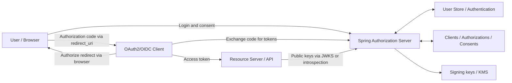
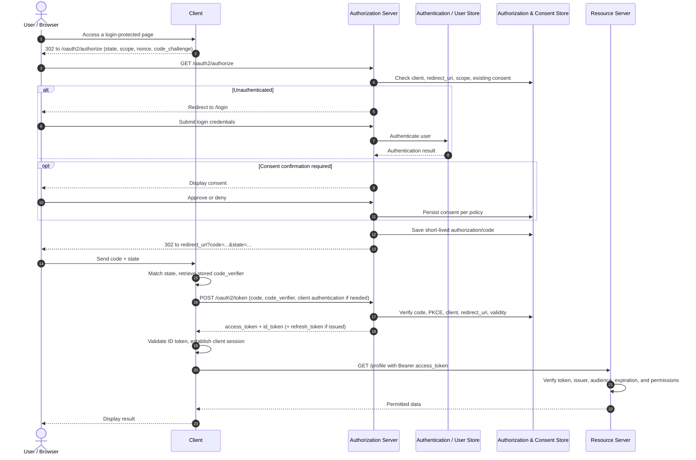
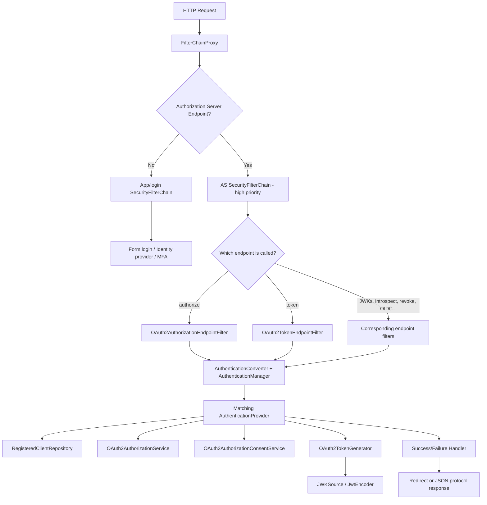
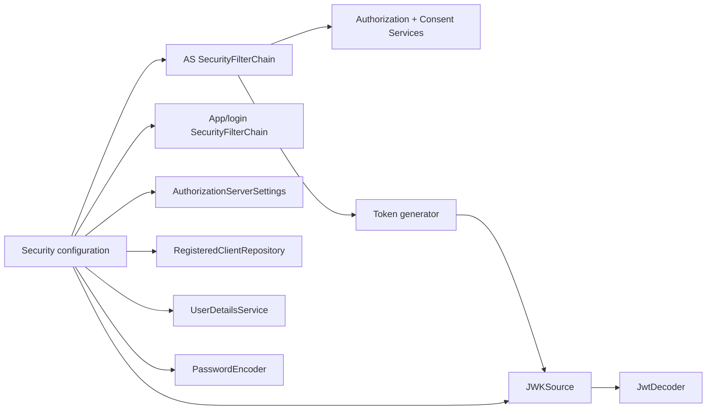
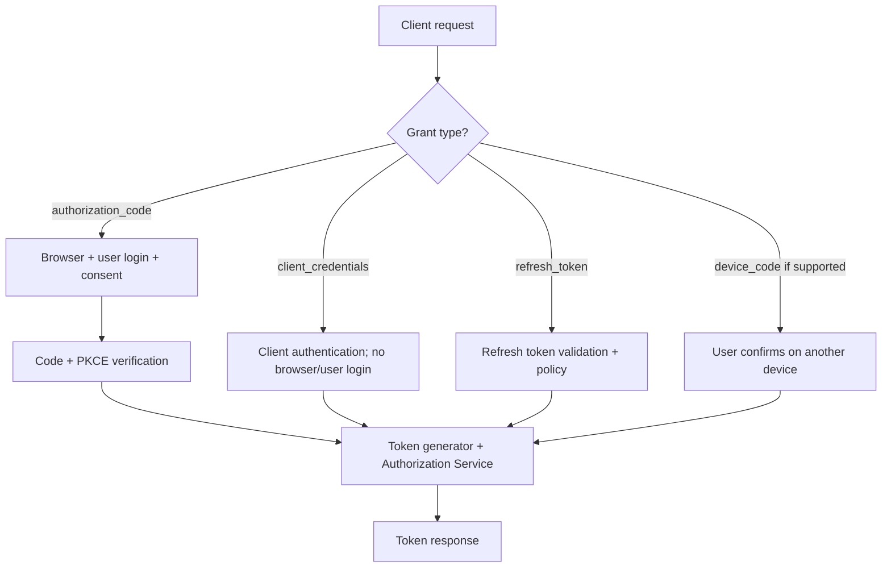
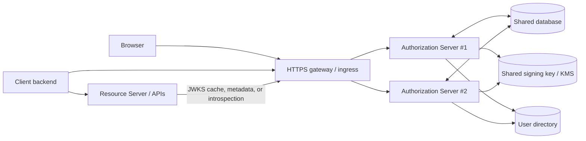

# Processing Flow Map and Components to Implement

## 1. Objectives and Scope

In the **Spring Security OAuth2 OIDC Authorization Server** ecosystem, an Authorization Server (AS) is the component that authenticates users, identifies client applications (clients), processes authorization, and issues tokens according to OAuth 2.0/OpenID Connect (OIDC). To design, configure, secure, test, and operate a system with **Spring Boot** and **Spring Authorization Server (SAS)**, you need visibility into both **the path of a request** and **the internal components responsible for each step**.

After this lesson, you will be able to:

- Draw the boundaries between the Authorization Server, Client, Resource Server, browser, and data stores.
- Trace the **Authorization Code + PKCE** flow when a client additionally requests `openid` for OIDC login.
- Map each protocol step to `SecurityFilterChain`s, `AuthenticationProvider`s, services, and endpoints in SAS.
- Identify which beans need configuration, which data must be persisted durably, which signing keys must be managed, and what needs testing before production deployment.
- Distinguish the paths of access tokens, ID tokens, and refresh tokens to avoid misassigning responsibilities across services.

**Scope:** The primary map uses Authorization Code + PKCE and OIDC; other flows such as Client Credentials, Refresh Token, and Device Authorization are placed in relation to the overall architecture. This is an overview of the implementation map and does not replace dedicated documentation for each grant type.

## 2. Big Picture: Who Talks to Whom?

| Component | Role | Key Responsibility |
| --- | --- | --- |
| **User / Resource Owner** | System user | Logs in and decides whether to approve requested permissions. |
| **Browser / User Agent** | Interactive navigation channel | Redirects to the login page, handles permission consent, and returns to the client via `redirect_uri`. |
| **OAuth2/OIDC Client** | Web, mobile, or backend application requesting tokens | Registers `client_id`, `redirect_uri`s, and grant types; generates `state`, `code_verifier`, `nonce` when appropriate; stores tokens securely. |
| **Authorization Server** | Issues tokens and authenticates per protocol | Handles `/oauth2/authorize`, `/oauth2/token`, metadata, JWKs, and enabled endpoints. |
| **Identity / User Store** | Stores identities and credentials | Provides users and verifies login credentials; may be a database, LDAP, or another authentication mechanism. |
| **Resource Server (API)** | Service hosting protected resources | Validates access tokens and token authority before returning data; is not inherently a token issuer. |
| **Configuration & Authorization State Store** | AS data store | Stores registered clients, authorizations, consents, keys, and operational config depending on architecture. |



**Distinguishing the three token types:**

- **Access token** serves API access; the Resource Server must verify the token and corresponding permissions (`scope`/`authority`). The token may be a JWT or an opaque token, depending on design.
- **ID token** is an OIDC identity assertion intended for the **client (Relying Party)**, typically containing claims such as `iss`, `sub`, `aud`, `exp`, `iat`, and optionally `nonce`. Never use an ID token in place of an access token when calling an API.
- **Refresh token** lets the client request a new access token per AS policy; never send a refresh token to a Resource Server.

## 3. Standard Authorization Code + PKCE Flow with OIDC

Suppose a web client named `web-client` is registered, and a user wants to log in and call a profile API. Both the client and the AS must know the exact registered `redirect_uri`; the AS has a fixed issuer `https://auth.example.com`.



Read the flow by these milestones:

1. **Client prepares before redirecting.** Generates random `state` to bind the request session, generates a sufficiently random `code_verifier`, and computes `code_challenge = BASE64URL(SHA256(ASCII(code_verifier)))` with `code_challenge_method=S256`. When logging in with OIDC, also generates `nonce` to validate the ID token as needed by the client.
2. **Browser hits the authorization endpoint.** The AS checks `client_id`, `redirect_uri`, `response_type=code`, `scope`, PKCE, and whether the client is allowed to use the grant. If the user is not logged in, the AS delegates to the application's authentication mechanism.
3. **User authenticates and approves permissions.** Authentication yields an authenticated principal. Consent is the decision to grant scopes to a client, not synonymous with the login step. If the user denies, the AS returns a protocol error via a valid redirect.
4. **AS issues an authorization code.** The code is short-lived and bound to the client, principal, redirect URI, and PKCE challenge. The browser carries only the code back to the client, never receiving an access token in a URL fragment like the Implicit Flow.
5. **Client exchanges the code over a back-channel.** The client submits `code_verifier`; the AS checks it against `code_challenge`, verifies the code is unused and unexpired, verifies client authentication if required, and checks that `redirect_uri` matches the initial request.
6. **AS issues tokens.** When scopes include `openid` and OIDC is enabled, the success response includes an ID token in addition to the access token. A refresh token appears only if permitted by the client and issuance policy.
7. **Client calls the API using the access token.** The Resource Server verifies the JWT signature via JWK Set or uses introspection per configuration, then enforces endpoint and business authorization.

Example of a properly constructed authorization request from a client (uppercase values are placeholders):

```http
GET /oauth2/authorize?response_type=code
    &client_id=web-client
    &redirect_uri=https%3A%2F%2Fapp.example.com%2Flogin%2Foauth2%2Fcode%2Fweb-client
    &scope=openid%20profile
    &state=RANDOM_STATE
    &nonce=RANDOM_NONCE
    &code_challenge=BASE64URL_SHA256_OF_VERIFIER
    &code_challenge_method=S256 HTTP/1.1
Host: auth.example.com
```

**Note:** Line breaks above are for readability only; real HTTP requests send the query string on one line. For an unregistered or invalid `redirect_uri`, the AS must never redirect the browser to an arbitrary address supplied by the request.

## 4. Processing Map Inside Spring Security and SAS

At the HTTP level, SAS uses the **Spring Security filter chain**. When a request enters the application, `FilterChainProxy` selects the first `SecurityFilterChain` whose matcher matches. Therefore, have one high-priority chain for **AS protocol endpoints** and a separate chain to handle normal login/application requests.



The diagram is a **responsibility map**, not a rigid call sequence for every endpoint. For example, the JWK Set endpoint publishes public keys; not every request passes through an `AuthenticationProvider` or generates tokens. Similarly, password verification at `/login` belongs to the application chain, whereas verifying an authorization code belongs to the AS chain.

### 4.1. Which Components Are Required?

| Component / API | Position in Architecture | Decisions to Make on Implementation |
| --- | --- | --- |
| `SecurityFilterChain` | HTTP protection and security routing | `@Order` precedence, endpoint matchers, form login, CSRF, authentication entry point. |
| `OAuth2AuthorizationServerConfigurer` | Wires AS OAuth2 endpoints | Enable OIDC and extension endpoints as needed. |
| `AuthorizationServerSettings` | Defines server metadata | **Exact issuer**, endpoint paths, consistency with public URLs behind a reverse proxy. |
| `RegisteredClientRepository` | Client registration store | `client_id`, client secret if any, redirect URIs, authentication methods, grant types, scopes, PKCE, consent. |
| `OAuth2AuthorizationService` | Persists authorization state | Authorization codes, access/refresh tokens, token status, and metadata for verification/revocation. |
| `OAuth2AuthorizationConsentService` | Persists approved permissions | Binds approved scopes to the user and client. |
| `AuthenticationManager` / `AuthenticationProvider` | Validates protocol requests | Client/grant/authorization code/PKCE verification depending on endpoint. |
| `UserDetailsService` or other identity mechanism | Authenticates interactive users | Passwords, SSO federation, MFA, account locking, session management. |
| `OAuth2TokenGenerator<?>` | Generates tokens | JWT/opaque tokens, claim customization, lifetimes, token policies. |
| `JWKSource<SecurityContext>` | Supplies keys for JWTs | Protected private signing keys, public keys via JWKS, `kid`, key rotation. |
| `JwtDecoder` | Verifies JWTs in features needing a decoder | Required for certain OIDC features; do not confuse with a Resource Server's token validator. |
| `OAuth2TokenCustomizer<JwtEncodingContext>` | Extends permitted claims | Minimal claims, accurate identifiers, avoid putting sensitive data in tokens. |
| Resource Server security config | API side, a **different role** from the AS | Configure `issuer-uri`/`jwk-set-uri`, validate `aud`, and map scopes/roles. |

For an AS application with **interactive user logins**, you also need to design `/login`, sessions, cookies, and an identity source. SAS provides protocol infrastructure; it does not automatically solve the entire login UX, MFA, user administration, or business policies.

### 4.2. Paths of Important Requests

| Request | Primary Handler | Data Read/Written | Output |
| --- | --- | --- | --- |
| `GET /oauth2/authorize` | Authorization endpoint + AS chain | Registered client, authentication session, authorization/consent | Redirect to login, consent, error, or code. |
| `POST /oauth2/token` | Token endpoint and grant provider | Client, authorization code or refresh token, token metadata | JSON token response or OAuth error. |
| `GET /oauth2/jwks` | JWK Set endpoint | **Public** portion of key set | JWK Set for verifiers to validate JWTs. |
| `POST /oauth2/introspect` | Introspection endpoint | Token metadata and active status | Token info per RFC 7662 for authorized clients. |
| `POST /oauth2/revoke` | Revocation endpoint | Token and related authorization | Revocation response per RFC 7009. |
| `GET /.well-known/openid-configuration` | OIDC discovery (when OIDC enabled) | Published issuer and endpoints/config | JSON metadata for OIDC clients. |
| `GET /userinfo` | OIDC UserInfo (when enabled & properly configured) | Valid access token, principal, and claims | Permitted identity claims. |
| `GET/POST /connect/logout` | OIDC logout (when enabled & supported) | ID token hint, client/redirect policy, browser session | Terminates session and valid redirect. |

Certain endpoints such as device authorization, pushed authorization requests (PAR), or dynamic client registration depend on SAS version, configuration, and use case. Never assume all optional endpoints are enabled or ready to expose to the Internet by default.

## 5. Minimal Spring Boot Configuration Example

The following example describes a build **for local learning**. Spring Boot manages compatible dependency versions; pick Boot/SAS versions according to project documentation rather than mixing Spring Security versions from different generations.

```xml
<!-- pom.xml: alongside Spring Boot configuration and other required dependencies -->
<dependency>
    <groupId>org.springframework.boot</groupId>
    <artifactId>spring-boot-starter-oauth2-authorization-server</artifactId>
</dependency>
<dependency>
    <groupId>org.springframework.boot</groupId>
    <artifactId>spring-boot-starter-web</artifactId>
</dependency>
```

Minimal bean diagram:



Focus on the main wiring (`import`s omitted for clarity):

```java
@Configuration(proxyBeanMethods = false)
@EnableWebSecurity
public class AuthorizationServerConfig {

    @Bean
    @Order(1)
    SecurityFilterChain authorizationServerChain(HttpSecurity http)
            throws Exception {
        OAuth2AuthorizationServerConfigurer as =
                OAuth2AuthorizationServerConfigurer.authorizationServer();

        http
            .securityMatcher(as.getEndpointsMatcher())
            .with(as, server -> server.oidc(Customizer.withDefaults()))
            .authorizeHttpRequests(auth -> auth.anyRequest().authenticated())
            .exceptionHandling(ex -> ex.defaultAuthenticationEntryPointFor(
                new LoginUrlAuthenticationEntryPoint("/login"),
                new MediaTypeRequestMatcher(MediaType.TEXT_HTML)));

        return http.build();
    }

    @Bean
    @Order(2)
    SecurityFilterChain applicationChain(HttpSecurity http)
            throws Exception {
        http
            .authorizeHttpRequests(auth -> auth.anyRequest().authenticated())
            .formLogin(Customizer.withDefaults());
        return http.build();
    }

    @Bean
    AuthorizationServerSettings authorizationServerSettings() {
        return AuthorizationServerSettings.builder()
                .issuer("http://localhost:9000")
                .build();
    }

    @Bean
    PasswordEncoder passwordEncoder() {
        return new BCryptPasswordEncoder();
    }

    @Bean
    UserDetailsService userDetailsService(PasswordEncoder encoder) {
        UserDetails user = User.withUsername("alice")
                .password(encoder.encode("local-password"))
                .roles("USER")
                .build();
        return new InMemoryUserDetailsManager(user);
    }

    @Bean
    RegisteredClientRepository registeredClientRepository(
            PasswordEncoder encoder) {
        RegisteredClient client = RegisteredClient
                .withId(UUID.randomUUID().toString())
                .clientId("web-client")
                .clientSecret(encoder.encode("local-client-secret"))
                .clientAuthenticationMethod(
                        ClientAuthenticationMethod.CLIENT_SECRET_BASIC)
                .authorizationGrantType(
                        AuthorizationGrantType.AUTHORIZATION_CODE)
                .authorizationGrantType(
                        AuthorizationGrantType.REFRESH_TOKEN)
                .redirectUri(
                        "http://127.0.0.1:8080/login/oauth2/code/web-client")
                .scope(OidcScopes.OPENID)
                .scope(OidcScopes.PROFILE)
                .clientSettings(ClientSettings.builder()
                        .requireProofKey(true)
                        .requireAuthorizationConsent(true)
                        .build())
                .tokenSettings(TokenSettings.builder()
                        .reuseRefreshTokens(false)
                        .build())
                .build();

        return new InMemoryRegisteredClientRepository(client);
    }

    @Bean
    JWKSource<SecurityContext> jwkSource()
            throws NoSuchAlgorithmException {
        KeyPairGenerator generator = KeyPairGenerator.getInstance("RSA");
        generator.initialize(2048);
        KeyPair pair = generator.generateKeyPair();

        RSAKey rsaKey = new RSAKey.Builder(
                (RSAPublicKey) pair.getPublic())
                .privateKey((RSAPrivateKey) pair.getPrivate())
                .keyID(UUID.randomUUID().toString())
                .build();

        JWKSet keys = new JWKSet(rsaKey);
        return (selector, context) -> selector.select(keys);
    }

    @Bean
    JwtDecoder jwtDecoder(JWKSource<SecurityContext> jwkSource) {
        return OAuth2AuthorizationServerConfiguration.jwtDecoder(jwkSource);
    }
}
```

Set the local port to `server.port=9000` to match the example's issuer. This configuration shows **how the beans relate**, not a production blueprint: users and clients are in memory, credentials are test values, and the RSA private key is regenerated on every startup. Upon restart, tokens signed by the previous key can no longer be verified; production must store keys securely and have a rotation plan.

**Why must there be two filter chains?** `/oauth2/authorize` belongs to the AS chain, whereas `/login` typically belongs to the application chain. If matchers or chain ordering are wrong, requests can hit 404/403, enter redirect loops, or receive unintended CSRF/authentication policies.

**Why is `JwtDecoder` needed?** Certain SAS OIDC features require a dedicated decoder. That does not mean the AS is performing access token validation on behalf of every Resource Server.

### 5.1. From Demo Config to Durable Persistence

| Data | Demo / Testing | Production Direction |
| --- | --- | --- |
| Registered clients | `InMemoryRegisteredClientRepository` | `JdbcRegisteredClientRepository` or custom repository with controlled client changes. |
| Authorization codes, access/refresh tokens, and metadata | `InMemoryOAuth2AuthorizationService` | `JdbcOAuth2AuthorizationService` or equivalent durable persistence adapter. |
| Authorization consents | `InMemoryOAuth2AuthorizationConsentService` | `JdbcOAuth2AuthorizationConsentService` or durable store. |
| User accounts | `InMemoryUserDetailsManager` | Managed identity store with hashing, lockout/MFA as required. |
| Private signing keys | `KeyPairGenerator` on startup | Protected key store, KMS/HSM if appropriate, `kid` lifecycle and key rotation. |
| Issuer, endpoints, and client redirects | `localhost` | Stable public HTTPS domain with per-environment configuration management. |

SQL table structures must match the exact Spring Authorization Server version in use. When migrating to JDBC, declare the appropriate service/repository beans, apply the schema and migration strategy; never use memory as a shared data source across multiple AS instances if authorization/consent state must be shared.

## 6. Map of Grant Branches and Component Reuse



- **Authorization Code + PKCE:** Suitable for browser/app logins with users; `RegisteredClient` must allow `authorization_code`. OIDC adds `openid` and ID token handling.
- **Client Credentials:** Meant for machine-to-machine communication; the AS authenticates the client and issues an access token within the client's permitted scopes. **There is no user-representing ID token** in normal flows.
- **Refresh Token:** Client uses a previously issued refresh token per server policy. Verify client bindings and token lifecycle; design rotation and reuse detection if required by the system.
- **Device Authorization:** Useful for input-constrained devices; adds endpoints, user codes, and a polling confirmation flow. Deploy only when needed by the product and supported by your SAS version.

Do not favor Implicit Flow or Resource Owner Password Credentials in new designs. For public clients unable to hold a client secret, PKCE is essential; for confidential clients, PKCE still provides valuable defense-in-depth for Authorization Code.

## 7. Security Controls to Attach at the Right Processing Step

| Risk | Control Point | How to Implement |
| --- | --- | --- |
| Redirect target hijacking to steal codes | Authorization endpoint | Only accept registered `redirect_uri`s, matched strictly per applicable rules; avoid wildcard redirects. |
| Spoofing or swapping authorization responses | Client before code exchange | Generate strong `state`, store bound to session, and verify on callback. |
| Intercepted or swapped authorization code | Authorization + Token endpoints | Mandate PKCE S256, short-lived single-use codes, verify client/redirect URI. |
| ID token replay / wrong issuer or client | OIDC client | Verify signature, `iss`, `aud`, `exp`/`iat`, and `nonce` when used. |
| Client impersonation | Token endpoint | Use `client_secret_basic`, `private_key_jwt`, or method matching client type; protect and rotate credentials. |
| JWT accepted at the wrong API | Resource Server | Check signature, issuer, expiry, **audience**, and scopes/permissions; never check signature alone. |
| Signing key leak or wrong key published | AS + keys | Private keys must never be exposed via `/oauth2/jwks`; use secure key storage, monitoring, and overlap rotation. |
| Refresh token theft | Client, token store | Store securely, limit lifetime, rotate when appropriate, revoke on compromise. |
| CSRF on login/consent pages | Browser endpoints | Keep appropriate Spring Security CSRF protection; never disable CSRF globally just to make the token endpoint work. |
| Wrong issuer behind proxy | AS settings + gateway | Public URL uses HTTPS, forwarded headers configured in a controlled way; `iss` must match discovery, tokens, and verifier config. |

**JWT revocation has immediacy limits:** If a Resource Server validates JWTs offline, an issued token can remain valid until `exp` even if the AS records a revocation. When near-instant invalidation is required, consider opaque tokens + introspection, short-lived access tokens, or a suitable denylist mechanism; each carries operational trade-offs.

**Client credentials represent the application's identity, not the end user's.** Never place secrets in frontend JavaScript or mobile code; distinguish public clients and confidential clients right at client registration.

## 8. Layered Implementation Map in Practice

Break responsibilities into manageable layers:

1. **Protocol layer:** configure the AS filter chain, `AuthorizationServerSettings`, OIDC, and enabled grants/endpoints; publish metadata and JWKs with the accurate issuer.
2. **User authentication layer:** design form login or identity provider federation, MFA/sessions, and consent workflow; control cookies and CSRF.
3. **Client and authorization layer:** configure `RegisteredClientRepository`, redirect policies, grants, scopes, PKCE, and consent; persist authorizations/refresh tokens and related state.
4. **Token and key layer:** choose JWT/opaque, claims, lifetimes, refresh policies, private keys, `kid`, public JWKs, and rotation.
5. **Resource Server layer:** configure token validators on each API, enforce authorization at endpoints/services, and rely only on trusted claims.
6. **Operations layer:** TLS, reverse proxy, secrets, migrations, audit logs with redacted tokens, rate limiting, metrics, tracing, backups, and alerting.

A typical deployment places a gateway or reverse proxy in front of the AS:



In a multi-instance architecture, pay special attention to **consistency**: signing keys and `kid`, authorization/consent storage, login sessions (if needed by the app), issuer URL, and authorization code state. Avoid having one instance issue a code whose state another instance cannot read when the code exchange request arrives.

### 8.1. Observability Across Flow Cutpoints

- **Authorization:** redirect volume to `/login`, consent accepted/denied counts, `invalid_request`/`unauthorized_client` errors, processing latency.
- **Token:** successful/failed code exchanges, `invalid_grant`, client authentication errors, latency, refresh token usage volume.
- **Security:** anomalous redirects, code replay attempts, login brute force, signature verification failures, client/key registration changes.
- **Availability:** discovery/JWKS availability, database and KMS connection stability, endpoint latency, clock skew across components.

Never write raw access tokens, ID tokens, refresh tokens, client secrets, passwords, or authorization codes into logs or traces. Debug errors using correlation IDs and sanitized metadata.

## 9. Testing Strategy Based on the Flow Map

Instead of only checking that the server boots, test both **success paths and failure boundaries**.

| Test Group | Scenario | What to Confirm |
| --- | --- | --- |
| Configuration | Discovery and JWKS from public issuer | URLs, `issuer`, `jwks_uri` are valid; JWKs contain no private keys. |
| HTTP security | `/login`, `/oauth2/authorize`, `/oauth2/token` | Correct filter chains, login redirect when required, token endpoint not intercepted by inappropriate form login. |
| Authorization Code | Login + consent + callback + code exchange | Issues code then valid tokens; `state` verified by client. |
| PKCE | Wrong/missing `code_verifier` when required | Token request fails; matching verifier succeeds. |
| Client validation | Wrong `client_id`, secret, `redirect_uri`, grant, or scope | Request rejected per protocol, no token issued. |
| Code lifecycle | Exchange code twice, expired code | Rejected; code cannot be reused. |
| OIDC | `openid`, ID token, and UserInfo | `iss`/`sub`/`aud`/`nonce` match, claim policy accurate. |
| Token lifecycle | Refresh, rotation, revoke | Policies enforced properly and impact on API clearly verified. |
| Resource Server | JWT with wrong issuer/audience, expired, missing scope | Returns 401 for auth failure, 403 when lacking proper permissions. |
| Operations | Restart, multi-instance, key rotation | Authorization state remains usable as designed; tokens remain valid during key transition. |

You can combine **Spring Security Test / MockMvc** for protocol endpoints, **integration tests with a real database or Testcontainers** for persistence, and end-to-end tests with an actual OAuth2 client + Resource Server. Keep test data separate from production secrets. Verify behavior against your exact Spring Boot/SAS version because extension endpoints and configuration APIs can evolve.

### 9.1. Minimum Verification Sequence After Building a Demo

1. Start the AS on port 9000 and confirm `/.well-known/openid-configuration` returns the expected issuer.
2. Check `/oauth2/jwks` exposes only public keys; the `kid` of signed JWTs has a matching key.
3. Use a registered OIDC client to redirect the browser to the authorize endpoint with `openid` and PKCE S256.
4. Log in, complete consent, and verify the callback carries the code and exact `state`.
5. Exchange the code with the matching client/redirect/`code_verifier`; receive tokens and verify the ID token at the client.
6. Call the API using the access token, then retry with missing scope, wrong audience, and expired token.
7. Test wrong verifier, wrong redirect URI, reused code, and revoke/refresh per policy to confirm safe failures.

## 10. Common Misconceptions

**"Spring Authorization Server means you have a complete identity management system."** No. SAS provides OAuth2/OIDC infrastructure; user management, MFA, account recovery, auditing, and identity policies must be designed separately.

**"Successful login guarantees all scopes are granted."** No. The client must be registered for the appropriate scopes and grants; users/AS may still require consent or apply extra issuance policies.

**"A valid JWT must be accepted by the API."** No. A JWT with a valid signature can still have the wrong issuer, wrong audience, be expired, or lack required permissions.

**"The Authorization Server also has to check every request to every API."** No. Each Resource Server handles its own authentication and authorization; it may use cached JWKS or introspection depending on token type and revocation needs.

**"Putting the protocol endpoints in one chain is all you need."** No. Browser flows also rely on login, sessions, consent, CSRF policy, and error handling in the application chain.

## 11. Pre-Implementation Memory Map

When reading requirements for an OAuth2/OIDC system, be able to answer these design questions:

- **Who is the client?** Public or confidential, which redirect URIs, which grant types, and are PKCE and consent enabled?
- **Who is the user?** Where does authentication happen, and which component handles login/MFA/sessions?
- **Where do tokens go?** Which API does the access token serve, which client does the ID token serve, and where are refresh tokens stored?
- **Where does state live?** Do clients, authorization codes, token metadata, consents, and signing keys survive restarts and multi-instance scaling?
- **Who enforces security checks?** AS checks protocol and issues permissions; client checks `state`/ID tokens; Resource Server checks access tokens, audience, and permissions.
- **How is it operated?** Are issuer and TLS, rotation, revocation, auditing, monitoring, and failure-path testing all planned?

A properly implemented AS connects **protocol → filter chain → provider/service → data and keys → tokens → Resource Server**. Keeping this map in mind helps you locate the right configuration point, debug issues, and write tests without blurring responsibilities across Spring Security, Spring Authorization Server, and token-consuming applications.
