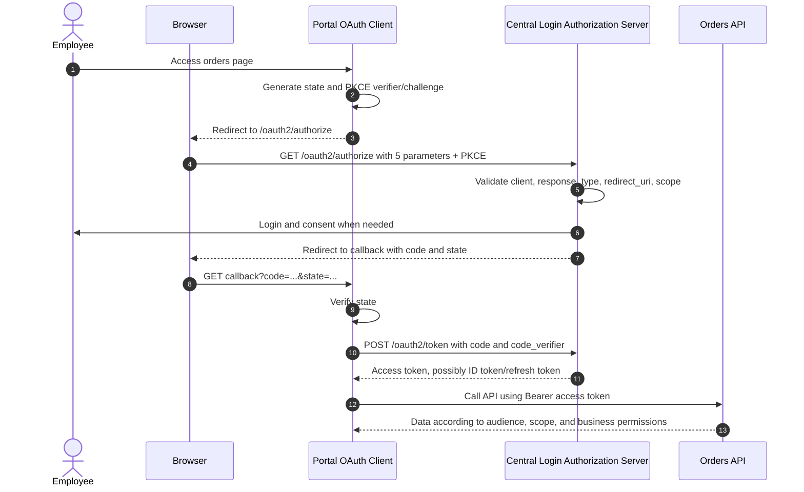
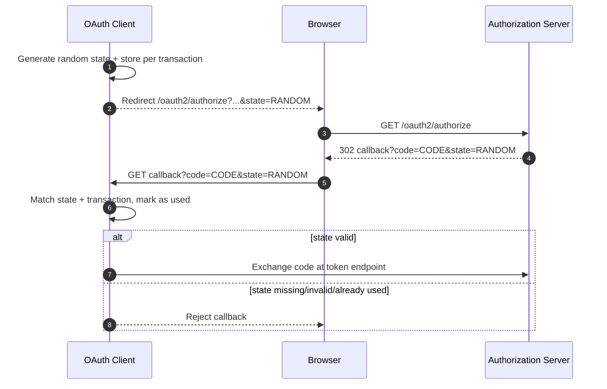
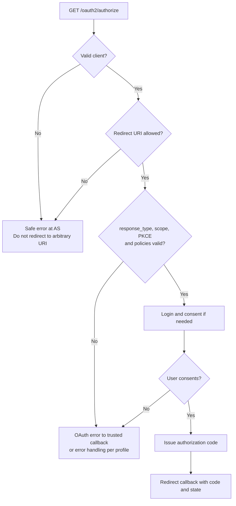

# response_type, client_id, redirect_uri, scope, and state Parameters

The **Authorization Endpoint** is where an OAuth 2.0/OpenID Connect (OIDC) Authorization Server receives requests to initiate the authorization flow from a user's browser. In a Spring Boot architecture using **Spring Security** and **Spring Authorization Server**, the endpoint typically resides at `/oauth2/authorize`. A common request contains five parameters: **`response_type`**, **`client_id`**, **`redirect_uri`**, **`scope`**, and **`state`**.

These five parameters are not decorative query options on the URL: they help the server understand **what type of response to issue**, **which application is requesting access**, **where the response is allowed to return**, **which permissions are being requested**, and **how the client correlates the callback with the original request**. A mistake in a single parameter can lead to login failures, over-privileged grants, or authorization code leakage.

This lesson belongs to the **Authorization Endpoint** chapter of the **SPRING_SECURITY_OAUTH2_OIDC_AUTHORIZATION_SERVER** module. The overarching goal is to design, configure, secure, test, and operate an OAuth 2.0/OIDC Authorization Server with Spring Security and Spring Authorization Server in a Spring Boot application.

> The URLs and illustrative code below use the hypothetical domains `login.example.com`, `portal.example.com`, and `api.example.com`. To run in a real project, you need to register clients, configure the issuer, authorization/consent stores, users, signing keys, and the corresponding security filter chains.

## 1. Where Does the Authorization Endpoint Fit in the OAuth2/OIDC Flow?

Suppose Portal is an OAuth client, an employee wants to access the orders screen, and Central Login is the Authorization Server. Portal redirects the browser to the authorization endpoint. Central Login authenticates the user if needed, validates the request, prompts for consent when required by policy, and then sends the response back to the registered callback.



The diagram illustrates the **Authorization Code Flow with PKCE**. This is the appropriate flow for most modern interactive applications. A request to `/oauth2/authorize` **does not issue an access token directly via the callback URL** in this flow; the Authorization Server issues an **authorization code** first, and then the client exchanges the code at the token endpoint.

### 1.1. Authorization Endpoint vs. Token Endpoint

| Component | Purpose | Who typically sends the request? |
|---|---|---|
| `/oauth2/authorize` | Initiates user authorization, validates client/redirect/scope, handles login/consent, and returns a code or error | Browser redirected by the client |
| `/oauth2/token` | Exchanges an authorization code for tokens, refreshes tokens, or performs other permitted grants | OAuth client via HTTP back-channel |
| `/login` | Enters user authentication credentials | Browser at the Authorization Server |
| `/userinfo` if OIDC is enabled | Returns user information based on a valid access token | OIDC client |
| `/oauth2/jwks` | Publishes public keys to verify signed JWTs | OIDC client or Resource Server |

An unauthenticated user may be redirected from `/oauth2/authorize` to `/login`. This is a **new HTTP request**, which may pass through the login application's `SecurityFilterChain`; after authenticating, the browser returns to the original authorization request. The client must never receive the user's password in this flow.

## 2. Structure of an Authorization Request

Example of full parameters in a **human-readable** format:

```text
GET https://login.example.com/oauth2/authorize
    ?response_type=code
    &client_id=portal-bff
    &redirect_uri=https%3A%2F%2Fportal.example.com%2Flogin%2Foauth2%2Fcode%2Fcentral
    &scope=openid%20profile%20orders.read
    &state=7oY9p...random...
    &code_challenge=xYz...base64url...
    &code_challenge_method=S256
    &nonce=4rK...random...
```

In a real request, the URL is **a single URL-encoded string**, without line breaks as shown in the illustration. Parameters follow `?` and are joined with `&`. Do not add tokens or secrets to the URL. Beyond the five main parameters of this lesson, the example also includes `code_challenge`/`code_challenge_method` to enforce PKCE and `nonce` for OIDC.

| Parameter | Sample value | Primary responsibility | Primary validating party |
|---|---|---|---|
| `response_type` | `code` | Selects the authorization response type | Authorization Server |
| `client_id` | `portal-bff` | Identifies the registered OAuth client | Authorization Server |
| `redirect_uri` | `https://portal.example.com/login/oauth2/code/central` | Specifies the allowed destination for the response | Authorization Server |
| `scope` | `openid profile orders.read` | Requests permissions/claims within permitted bounds | Authorization Server and consent policy |
| `state` | Random, unpredictable string | Binds the callback to a previously created client transaction | **OAuth client** |

**Distinguishing the responsible party:** The Authorization Server typically **returns `state` verbatim** if present in a protocol-processed request; the client must match that value itself against the initiated transaction. Merely seeing `state` appear in the callback does not mean the response is safe.

### 2.1. Which Parameters Are Required?

Under the OAuth 2.0 Authorization Code model, `response_type=code` and `client_id` are the basic required parameters. `redirect_uri` is conditional depending on protocol rules and registration; in practice, you should **explicitly send the registered URI** and enforce exact matching, especially when multiple callbacks exist. `scope` is optional at the base OAuth2 layer but carries specific meaning for the application and OIDC; when requesting OIDC, `openid` in the scope triggers OIDC semantics. `state` is **strongly recommended** to bind and validate the response, and may be required by the client's security profile.

**Do not equate "optional in part of the specification" with "should be omitted in production".** Check the actual policies of Spring Authorization Server, the `RegisteredClient` registration, and the security profile applied to the system.

## 3. response_type: What Kind of Response Is the Client Requesting?

`response_type` indicates which response type the client wants the Authorization Server to use when processing the authorization request.

### 3.1. `response_type=code`

For the Authorization Code Flow:

```text
response_type=code
```

When the request is valid and the user completes login/consent per policy, the Authorization Server returns **a short-lived, single-use authorization code**. The client uses that code at `/oauth2/token`. If the request includes PKCE, the token request must send the corresponding `code_verifier`.

Example of a successful response:

```http
HTTP/1.1 302 Found
Location: https://portal.example.com/login/oauth2/code/central?code=AUTH_CODE_EXAMPLE&state=STATE_EXAMPLE
```

An authorization code is not an access token. Do not put the code into logs, analytics, uncontrolled referers, or public documentation; the callback should process and strip the code from the URL safely after use.

### 3.2. What If a `response_type` Other Than `code` Is Passed?

Some OAuth2/OIDC profiles define additional response types such as `token` or combined values for implicit/hybrid flows. **Do not assume Spring Authorization Server automatically supports all of these response types.** In new applications, prioritize Authorization Code + PKCE and avoid flows that return tokens directly from the authorization endpoint in accordance with modern security guidance.

If a client is registered for `authorization_code` and requests an unsupported response type, the server must reject it per the protocol, such as `unsupported_response_type` or an error appropriate to the client/grant status. Do not silently rewrite an invalid `response_type` to `code` and continue granting access.

### 3.3. Relationship with `authorizationGrantType`

In Spring Authorization Server, registering:

```java
.authorizationGrantType(AuthorizationGrantType.AUTHORIZATION_CODE)
```

allows the client to use the Authorization Code Flow. This is a **registration policy**, not the same field as `response_type` on the request. The Authorization Server validates the request's response type against the grants allowed for the client; a client registered only for `client_credentials` cannot start an authorization code flow for a user.

**`grant_type=authorization_code`** appears at the **token endpoint**, whereas **`response_type=code`** appears at the **authorization endpoint**. Confusing these two parameters often causes `invalid_request` or `unsupported_response_type` errors depending on the stage.

## 4. client_id: Identifying Which Client Is Requesting Access

`client_id` is a public identifier issued by the Authorization Server for each registered client. For example:

```text
client_id=portal-bff
```

The Authorization Server uses this value to look up the `RegisteredClient`, then checks its properties:

- Does the client exist and is it still permitted to operate?
- Is it allowed to use the Authorization Code Flow?
- Does `redirect_uri` belong to the set of registered URIs?
- Are the requested `scope` values within the permissions the client is allowed to request?
- How does `ClientSettings` require PKCE/consent?
- Is the client public or confidential, and which client authentication method will the token endpoint require?

### 4.1. Client ID Is Not a Secret

Anyone who views the authorization URL can see `client_id`. This value **is not proof that the application is a trusted original**. For confidential clients, proof of client authentication typically occurs during the code exchange at the token endpoint, via `client_secret_basic`, `private_key_jwt`, or another supported mechanism. Public clients use `ClientAuthenticationMethod.NONE`, combined with Authorization Code + PKCE and protocol constraints.

Do not place `client_secret` in the query string at the authorization endpoint. Embedding secrets in URLs increases the risk of exposure through browser history, logs, analytics, and intermediaries; for SPAs/native apps, a secret embedded in the build artifact is not considered confidential.

### 4.2. Registering a Client on Spring Authorization Server

Example of a Portal client with a backend, enabling OIDC login and reading the Orders API:

```java
RegisteredClient portal = RegisteredClient
    .withId("portal-client-record")
    .clientId("portal-bff")
    .clientSecret(passwordEncoder.encode(portalSecret))
    .clientAuthenticationMethod(
        ClientAuthenticationMethod.CLIENT_SECRET_BASIC)
    .authorizationGrantType(AuthorizationGrantType.AUTHORIZATION_CODE)
    .authorizationGrantType(AuthorizationGrantType.REFRESH_TOKEN)
    .redirectUri(
        "https://portal.example.com/login/oauth2/code/central")
    .scope(OidcScopes.OPENID)
    .scope(OidcScopes.PROFILE)
    .scope("orders.read")
    .clientSettings(ClientSettings.builder()
        .requireProofKey(true)
        .requireAuthorizationConsent(true)
        .build())
    .build();
```

`portalSecret` and `passwordEncoder` in the example should be injected/configured from a secure source; never hard-code secrets in source code. The purpose of this snippet is to highlight the attributes the Authorization Server checks when `client_id=portal-bff` appears, not to provide a standalone runnable Spring Boot program.

### 4.3. Invalid or Non-existent Client ID

If a valid client cannot be found, the Authorization Server **must not arbitrarily redirect to the `redirect_uri` declared in the request**. This is a critical rule: redirecting is only safe once the client and an allowed callback have been verified. The server may display a safe error locally rather than sending a code or error to an unverified address.

## 5. redirect_uri: The Response Destination Must Be Trusted

`redirect_uri` specifies where the Authorization Server sends the browser after processing the authorization request. In the example:

```text
https://portal.example.com/login/oauth2/code/central
```

This path is typically the **callback route** of the OAuth2 Client, where the client reads the authorization code and `state` and proceeds with the token exchange. With Spring Security OAuth2 Client, the default callback generally takes the form `/login/oauth2/code/{registrationId}`, though applications can configure a different path as long as it is registered consistently with the Authorization Server.

### 5.1. Redirect URI Must Match Registration

One of the most critical checks is comparing the request's `redirect_uri` against the URIs registered for that `client_id`. For production web applications, use **exact matching**, HTTPS, and fixed callbacks. Never allow arbitrary wildcards or derive the callback host from user-controlled request parameters.

| Allowed registration | Requested URI | Expected handling |
|---|---|---|
| `https://portal.example.com/oauth/callback` | Exact same URI | May proceed if other conditions are valid |
| `https://portal.example.com/oauth/callback` | `https://evil.example.net/callback` | **Reject; do not redirect to the unknown URI** |
| `https://portal.example.com/oauth/callback` | `http://portal.example.com/oauth/callback` | Reject due to scheme mismatch |
| `https://portal.example.com/oauth/callback` | `https://portal.example.com/oauth/callback/` | Reject if it does not match registration |
| `https://portal.example.com/oauth/callback` | `https://portal.example.com.evil.net/oauth/callback` | Reject due to hostname mismatch |
| `https://portal.example.com/oauth/callback` | `https://portal.example.com/redirect?next=https://evil.example.net` | Reject unless explicitly registered; even if registered, avoid open redirects |

**Profile exception:** For native applications using loopback redirects, some standards allow special rules for dynamic ports. Do not assume all versions of Spring Authorization Server automatically support every case; verify the exact behavior/profile.

### 5.2. URIs with Query and Fragment Components

A callback URI may contain a valid query component if supported by the profile and registration mechanism, for example:

```text
https://portal.example.com/oauth/callback?tenant=acme
```

When appending `code` and `state`, the Authorization Server must attach parameters in a way that preserves the accepted query. However, **a redirect endpoint URI must not contain a fragment component** under OAuth 2.0. Avoid putting sensitive data or untrusted tenant parameters into the callback; validate any query values the application consumes.

In particular, URL encoding is very error-prone: a full `redirect_uri` value is percent-encoded **when placed inside the query string of `/oauth2/authorize`**; after decoding exactly once, it must match the registered URI according to policy. Do not double-encode or compare using `startsWith("https://portal.example.com")`.

### 5.3. Redirect URI Errors Must Be Handled Before Navigating

Suppose an attacker sends:

```http
GET /oauth2/authorize?response_type=code&client_id=portal-bff&redirect_uri=https%3A%2F%2Fattacker.example%2Fcollect&scope=openid&state=x HTTP/1.1
Host: login.example.com
```

If the callback is not allowed, the Authorization Server must reject the request **on the server side**, without sending the browser to `attacker.example` with either `code` or `error`. Conversely, once the callback has been verified and an error occurs at a later step, the protocol may allow sending `error` and `state` to the valid callback.

This is a crucial boundary between **"an invalid request"** and **"whether the destination for returning errors is trustworthy"**.

## 6. scope: What Permissions Is the Client Requesting?

`scope` is a list of permission strings, typically space-delimited:

```text
scope=openid profile orders.read
```

In a URL, spaces must be properly encoded:

```text
scope=openid%20profile%20orders.read
```

When using `application/x-www-form-urlencoded` encoding, spaces may also be represented as `+` depending on context. Use a URI builder library rather than manual string concatenation.

### 6.1. Registered, Requested, and Granted Scopes

There are three distinct sets of scopes:

- **Registered scopes:** the allowed set in `RegisteredClient`, e.g., `openid`, `profile`, and `orders.read`.
- **Requested scopes:** the set the client includes in the request, which can be a subset, e.g., `openid` and `orders.read`.
- **Granted scopes:** the set actually issued after policy and consent evaluation. It must never exceed the client's allowlist.

In the simple case:

```text
granted_scopes ⊆ requested_scopes ⊆ registered_scopes
```

For example, if a client is registered with `orders.read` but sends `scope=orders.admin`, the Authorization Server must reject it or enforce policy per the protocol without granting scopes beyond those registered. A client cannot escalate privileges by modifying query values.

### 6.2. `openid` Has Special Meaning in OIDC

| Scope | Attribute | Meaning |
|---|---|---|
| `openid` | OIDC | Signals an OIDC login request; tied to ID tokens and OIDC rules |
| `profile` | OIDC standard scope | Requests permitted profile claims per policy |
| `email` | OIDC standard scope | Requests email-related claims when granted |
| `orders.read` | OAuth2 business scope | Allows requesting read access to Orders API data per policy |
| `orders.write` | OAuth2 business scope | Allows requesting write access to Orders API data per policy |

**Without `openid`**, the Authorization Code flow can still serve as OAuth2 API authorization, but it does not automatically become an OIDC login and **does not automatically issue an ID token** merely because the server supports OIDC.

Conversely, `openid` **does not grant access** to every Resource Server API. An ID token is issued to the OIDC client to verify login; APIs receive an **access token** and validate audience, scope, and business permissions.

### 6.3. Consent and the Principle of Least Privilege

A client requesting `orders.read` does not mean the user agrees to grant that permission. If registration/policy requires consent, the Authorization Server may display the scopes for the user to approve or deny. The consent UI must explain permissions in clear language and avoid misleading users into thinking sensitive scopes are harmless.

Register scopes according to actual needs. For example, if Portal only displays orders, do not add `orders.write`, `orders.export`, or administrative scopes. Having `orders.read` still does not replace tenant- and object-level authorization checks at the Resource Server.

### 6.4. Audience Is Not Scope

An access token carrying `orders.read` may still be invalid for `Orders API` if `aud` targets a different API. The Authorization Server needs a policy to issue tokens with the appropriate audience; Orders API must verify `iss`, `aud`, signature/status, expiration, and scope. Defining scopes on `RegisteredClient` **does not automatically** configure the audience on a JWT.

## 7. state: Binding the Callback to the Client-Initiated Request

`state` is a value generated by the **OAuth client** before sending the browser to `/oauth2/authorize`. The client stores that value per **authorization transaction**, then checks the value returned at the callback.

Its purpose is to bind the response to the exact initiated flow, helping prevent certain forms of CSRF and response injection/mix-up attacks. The value should be sufficiently random, unpredictable, single-use, and time-limited.



### 7.1. state Is Not a Security Token Verified by the Authorization Server on the Client's Behalf

The Authorization Server does not know the client's internal state and typically echoes `state` as opaque data. The client must verify the callback:

1. Is there a pending authorization transaction for this application/client?
2. Is `state` present and does it match the stored value exactly?
3. Is the transaction still valid and unused?
4. When multiple tabs run concurrently, which `state`/`code_verifier`/`nonce` tuple does the callback belong to?
5. Did the response come from the right issuer and comply with the client's security profile?

Do not accept a callback merely because a `code` parameter is present. If `state` is invalid, **stop before exchanging the code**, and do not generate a new state to match the response.

### 7.2. Generating state with a Cryptographically Secure Random Source

JavaScript example in a trusted browser environment:

```javascript
function base64url(bytes) {
  let binary = "";
  for (const byte of bytes) binary += String.fromCharCode(byte);
  return btoa(binary).replace(/\+/g, "-").replace(/\//g, "_").replace(/=+$/g, "");
}

function newOAuthState() {
  const bytes = new Uint8Array(32);
  crypto.getRandomValues(bytes);
  return base64url(bytes);
}

const state = newOAuthState();
```

The example reads 32 random bytes (256 bits) and encodes them as unpadded Base64URL. `state` can be stored in a server-side session (BFF) or an appropriate client-side transaction state mechanism. If using `sessionStorage` in an SPA, store each transaction separately and keep in mind that malicious same-origin JavaScript can still access it.

Do not use timestamps, usernames, or `Math.random()` as state. Do not put secret tokens, personal identifiers, passwords, or sensitive session data into `state` and send them in the URL. If you need to preserve navigation context, keep it server-side and use state purely as a lookup key, or use an integrity-checked value with a clear security design.

### 7.3. How PKCE, state, and nonce Differ

| Value | Function | Who verifies it? |
|---|---|---|
| `state` | Binds the response to the authorization transaction | OAuth client |
| `code_challenge` / `code_verifier` | Binds the authorization code to the initiated request | Authorization Server during code exchange |
| `nonce` when OIDC applies | Binds the ID token to the authentication request, mitigating replay | OIDC client |
| `client_secret`/client assertion | Authenticates a confidential client at the token endpoint | Authorization Server |
| AS session cookie | Maintains the user's authenticated session | Authorization Server |

These mechanisms complement each other but do not fully replace one another. PKCE is especially critical for public clients; confidential clients should also use PKCE. Clients still need proper response/issuer binding, callback validation, and state management.

## 8. Configuring Spring Authorization Server for the Authorization Code Flow

Once you understand the five parameters, you can map them to `RegisteredClient` and `SecurityFilterChain` configuration.

### 8.1. Registering a Client with Specific Callback, Grant, and Scopes

Example of a configuration **focused on client registration**, with `PasswordEncoder` and `RegisteredClientRepository` beans. This is a standalone registration snippet; a complete server also requires user authentication, signing keys, authorization/consent services, issuer configuration, and endpoint chains.

```java
package example.authorizationserver.config;

import java.time.Duration;
import org.springframework.context.annotation.Bean;
import org.springframework.context.annotation.Configuration;
import org.springframework.core.env.Environment;
import org.springframework.security.crypto.factory.PasswordEncoderFactories;
import org.springframework.security.crypto.password.PasswordEncoder;
import org.springframework.security.oauth2.core.AuthorizationGrantType;
import org.springframework.security.oauth2.core.ClientAuthenticationMethod;
import org.springframework.security.oauth2.core.oidc.OidcScopes;
import org.springframework.security.oauth2.server.authorization.client.RegisteredClient;
import org.springframework.security.oauth2.server.authorization.client.RegisteredClientRepository;
import org.springframework.security.oauth2.server.authorization.client.InMemoryRegisteredClientRepository;
import org.springframework.security.oauth2.server.authorization.settings.ClientSettings;
import org.springframework.security.oauth2.server.authorization.settings.TokenSettings;

@Configuration(proxyBeanMethods = false)
public class PortalClientConfiguration {

    @Bean
    PasswordEncoder passwordEncoder() {
        return PasswordEncoderFactories.createDelegatingPasswordEncoder();
    }

    @Bean
    RegisteredClientRepository registeredClientRepository(
            PasswordEncoder encoder, Environment env) {

        String secret = env.getRequiredProperty("PORTAL_CLIENT_SECRET");

        RegisteredClient portal = RegisteredClient
            .withId("portal-client-record")
            .clientId("portal-bff")
            .clientSecret(encoder.encode(secret))
            .clientAuthenticationMethod(
                ClientAuthenticationMethod.CLIENT_SECRET_BASIC)
            .authorizationGrantType(AuthorizationGrantType.AUTHORIZATION_CODE)
            .authorizationGrantType(AuthorizationGrantType.REFRESH_TOKEN)
            .redirectUri(
                "https://portal.example.com/login/oauth2/code/central")
            .scope(OidcScopes.OPENID)
            .scope(OidcScopes.PROFILE)
            .scope("orders.read")
            .clientSettings(ClientSettings.builder()
                .requireProofKey(true)
                .requireAuthorizationConsent(true)
                .build())
            .tokenSettings(TokenSettings.builder()
                .accessTokenTimeToLive(Duration.ofMinutes(10))
                .build())
            .build();

        return new InMemoryRegisteredClientRepository(portal);
    }
}
```

Mapping against the request:

| Request value | Server property | Processing condition |
|---|---|---|
| `response_type=code` | `authorizationGrantType(AuthorizationGrantType.AUTHORIZATION_CODE)` | Grant is registered and supported by the endpoint |
| `client_id=portal-bff` | `clientId("portal-bff")` | Client exists |
| `redirect_uri=https://portal.example.com/...` | `redirectUri(...)` | Callback matches registration |
| `scope=openid profile orders.read` | `scope(...)` | Does not exceed allowlist and policy |
| `state=...` | Not a secret stored in `RegisteredClient` | Server echoes it when processed; client must verify |
| `code_challenge_method=S256` | `requireProofKey(true)` | PKCE required; check specific S256 policy |

**Example limitation:** `InMemoryRegisteredClientRepository` is intended for learning and testing. Production should use a persistent repository, keep `id` and `clientId` stable, manage secrets in a vault/secret manager, and implement rotation lifecycles. Do not copy secret values from env directly into logs.

### 8.2. Enabling Protocol Endpoints on the Right SecurityFilterChain

In Spring Security 6.x with Spring Authorization Server 1.x supporting the `with(...)` API, a baseline configuration pattern is:

```java
@Bean
@Order(1)
SecurityFilterChain authorizationServerSecurityFilterChain(
        HttpSecurity http) throws Exception {

    OAuth2AuthorizationServerConfigurer as =
        OAuth2AuthorizationServerConfigurer.authorizationServer();

    http
        .securityMatcher(as.getEndpointsMatcher())
        .with(as, configurer -> configurer.oidc(Customizer.withDefaults()))
        .authorizeHttpRequests(auth -> auth
            .anyRequest().authenticated())
        .exceptionHandling(exceptions -> exceptions
            .defaultAuthenticationEntryPointFor(
                new LoginUrlAuthenticationEntryPoint("/login"),
                new MediaTypeRequestMatcher(MediaType.TEXT_HTML)))
        .oauth2ResourceServer(oauth2 -> oauth2.jwt(Customizer.withDefaults()));

    return http.build();
}

@Bean
@Order(2)
SecurityFilterChain applicationSecurityFilterChain(
        HttpSecurity http) throws Exception {
    http
        .authorizeHttpRequests(auth -> auth.anyRequest().authenticated())
        .formLogin(Customizer.withDefaults());
    return http.build();
}
```

This is a **wiring illustration**; remaining imports and beans have been omitted. The protocol chain selects `/oauth2/authorize` and other OAuth2/OIDC endpoints via `getEndpointsMatcher()`. The application chain serves `/login`. If unauthenticated, the browser can be redirected to login and then returned to the original authorization request via the session and saved request.

Do not manually restrict the protocol chain to `/oauth2/**` because discovery/OIDC endpoints live outside that pattern. Do not use a login success handler that always redirects users to home if doing so discards the saved authorization request.

### 8.3. Issuer and Redirect URI Behind a Reverse Proxy

The Authorization Server may sit behind an ingress or load balancer. You should configure the public issuer, for example:

```java
@Bean
AuthorizationServerSettings authorizationServerSettings() {
    return AuthorizationServerSettings.builder()
        .issuer("https://login.example.com")
        .build();
}
```

With a reverse proxy, forwarded headers must be configured for trusted proxies so Spring builds redirects accurately, using public HTTPS even if internal traffic uses another scheme. A misconfigured proxy host/port can cause callback mismatches or incorrect issuer metadata.

**Do not fix errors by accepting every redirect URI**: fix the registration and the system's public URL instead.

## 9. Sending an Authorization Request from Spring Security OAuth2 Client

On the Portal/BFF side, Spring Boot uses `spring-boot-starter-oauth2-client` and configures a `ClientRegistration` that can automatically construct the authorization URL from provider metadata.

```yaml
spring:
  security:
    oauth2:
      client:
        registration:
          central:
            provider: central
            client-id: portal-bff
            client-secret: "REPLACE_FROM_SECRET_MANAGER"
            client-authentication-method: client_secret_basic
            authorization-grant-type: authorization_code
            redirect-uri: "{baseUrl}/login/oauth2/code/{registrationId}"
            scope: openid, profile, orders.read
        provider:
          central:
            issuer-uri: https://login.example.com
```

The `client-secret` value above is **a placeholder only**. In a real application, inject it from a secret manager or protected secret configuration. `ClientRegistration` lives on the **OAuth2 Client**; `RegisteredClient` lives on the **Authorization Server**. Both configurations must match in grant type, client authentication method, redirect URI, and scope.

### 9.1. Who Generates `state` and PKCE Parameters in Spring Client?

Spring Security OAuth2 Client provides mechanisms to manage authorization requests, store `state` per transaction, and process callbacks. When customizing `OAuth2AuthorizationRequestResolver` or the URI builder, preserve this contract. If you replace the entire authorization request with a manually assembled string, you are also responsible for:

- Generating a random `state` and storing it with the transaction;
- Creating the PKCE verifier/challenge per client policy;
- Keeping `redirect_uri` aligned with registration;
- Sending the proper `scope`, plus `nonce` for OIDC;
- Validating the callback, restoring the verifier/state, and exchanging the code;
- Cleaning up the authorization request after success or error.

**Do not assume PKCE is automatically added in every configuration and version.** Verify `ClientRegistration`, Spring OAuth2 Client policies, and the actual wire request; if the Authorization Server enables `requireProofKey(true)`, the client must send full PKCE parameters.

### 9.2. Building the URL in Code Instead of Manual Query Concatenation

Below is a Java example solely illustrating **percent-encoding** of parameters; in production, you should usually let Spring Security OAuth2 Client handle this alongside its state store and callback binding:

```java
String authorizationUrl = UriComponentsBuilder
    .fromUriString("https://login.example.com/oauth2/authorize")
    .queryParam("response_type", "code")
    .queryParam("client_id", "portal-bff")
    .queryParam("redirect_uri",
        "https://portal.example.com/login/oauth2/code/central")
    .queryParam("scope", "openid profile orders.read")
    .queryParam("state", state)
    .queryParam("code_challenge", challenge)
    .queryParam("code_challenge_method", "S256")
    .build()
    .encode()
    .toUriString();
```

`state` and `challenge` must be generated using secure algorithms and stored linked to the client transaction; the snippet above does not handle that part itself. If the client is OIDC and uses `nonce`, you must add and validate the nonce. Inspect the final URL on the wire to ensure different build/encode APIs do not introduce double-encoding.

## 10. Success Responses, Consent Denial, and Validation Errors

### 10.1. Success: Redirect with Code and State

Once the user is authenticated and registration, PKCE, scope, and consent (if required) are verified, the AS creates a code bound to the authorization context and valid callback:

```http
HTTP/1.1 302 Found
Location: https://portal.example.com/login/oauth2/code/central?code=CODE_EXAMPLE&state=STATE_EXAMPLE
Cache-Control: no-store
```

The client must validate `state` **before** sending the code to the token endpoint, then perform client authentication if confidential and send `code_verifier` when using PKCE. After the token response, an OIDC client validates the ID token separately (issuer, audience, expiry, and nonce when applicable).

**Do not use the callback URL as a transport for access tokens.** Access tokens are returned from the token endpoint; never log codes or tokens.

### 10.2. Errors After the Callback Is Verified

If an error occurs during an authorization request whose client and **valid callback** have already been identified, the Authorization Server may respond by redirecting to the callback with error parameters:

```http
HTTP/1.1 302 Found
Location: https://portal.example.com/login/oauth2/code/central?error=access_denied&state=STATE_EXAMPLE
```

Common error scenarios:

| Scenario | Possible error type | Notes |
|---|---|---|
| Unsupported `response_type` | `unsupported_response_type` | Only when the callback is safe to receive errors |
| Client not permitted to use the grant | `unauthorized_client` | Cross-check registration |
| Invalid or out-of-allowlist `scope` | `invalid_scope` | Never grant scopes outside registration |
| Missing parameter or malformed request | `invalid_request` | Depends on where validation detects the error |
| User denies consent | `access_denied` | Do not issue a code |
| Internal error returnable per protocol | `server_error` | Do not leak stack traces or secrets |

Specific error codes depend on the error category, the point of validation, and the OAuth2/OIDC profile. Do not write rigid tests asserting that every invalid request returns `302` or that every error uses `invalid_request`.

### 10.3. Invalid Client or Callback Errors: Never Redirect Arbitrarily

When `client_id` is unknown or `redirect_uri` is invalid, the server **cannot trust the callback URL** supplied by the request. The Authorization Server must display or return a safe error at the endpoint itself or via an appropriate local mechanism, **never sending the browser to an untrusted URI just to report an error**.



This diagram highlights the security boundary for returning responses; the exact order of individual providers/filters and specific error codes may vary depending on Spring Authorization Server configuration.

## 11. Interaction with PKCE, OIDC, and Extension Parameters

The five parameters in this lesson form the skeleton of an authorization request, but a secure application typically also needs:

| Parameter/concept | Role | When to use? |
|---|---|---|
| `code_challenge` | Hashed value of the verifier binding the code | Authorization Code + PKCE |
| `code_challenge_method=S256` | Secure challenge transformation method | Recommended with PKCE |
| `code_verifier` | Proof sent **at the token endpoint**, not in the authorization request | During code exchange |
| `nonce` | Binds the ID token to the authentication request | OIDC, depending on profile/flow |
| `prompt` | Hints desired user interaction behavior in OIDC | If supported by OIDC features/provider |
| `login_hint` | Hints account identity | If supported by provider; never treat as authenticated identity |
| `max_age` | Requires maximum age of authentication event | OIDC per policy |
| `response_mode` | Mechanism for transporting the authorization response | Only when supported by implementation/profile |
| PAR / Request Object | Protects/structures the authorization request per profile | When supported and required by the Authorization Server |

Do not assume every advanced OIDC parameter is supported by the running Spring Authorization Server version. The Authorization Server must publish accurate metadata/capabilities and behavior must be tested. Meanwhile, `response_type=code` + PKCE, `client_id`, `redirect_uri`, `scope`, and `state` form the verifiable foundation of the Authorization Code Flow.

### 11.1. PKCE Protects the Code, Not state or Redirect URI

The client generates a random `code_verifier`, sends `code_challenge` at authorize, and sends the original verifier when exchanging the code. For public clients, PKCE is essential; confidential clients should enable it too. However, PKCE cannot fix a callback pointing to an attacker, broken `state` validation, XSS in an SPA, or overly broad scopes. Each protection layer serves a distinct goal.

### 11.2. OIDC `openid` Does Not Turn Every Scope into Identity

When `scope` includes `openid`, the client requests OIDC identification; the ID token is intended for the client (its audience is usually `client_id`). Scopes like `orders.read` govern access to a Resource Server. A successful user login does not permit skipping audience/scope/tenant checks at the Orders API.

### 11.3. URL Length, Request Objects, and Sensitive Data

Authorization requests typically travel over the front-channel via the browser, meaning URLs may be recorded in browser history, reverse proxy logs, and observability tools. Do not put client secrets, passwords, access tokens, private data, or unnecessary sensitive details in the query string. If an application has many complex parameters or strict integrity/privacy requirements, consider profiles such as Pushed Authorization Requests (PAR) or signed request objects **if the system supports them**, rather than letting URLs grow unchecked.

## 12. Test Matrix for the Five Parameters

Tests should cover both happy paths and **rejection paths**. The goal is to verify that the Authorization Server and OAuth2 Client enforce the contract properly, not merely that a login screen renders.

| Test case | Request/action | Expected outcome |
|---|---|---|
| Happy path | `response_type=code`, valid client, valid callback, registered scopes, random state, valid PKCE | Code issued; callback includes matching state |
| Missing `response_type` | Parameter omitted | Request rejected per protocol |
| Unsupported `response_type=token` | Client registered only for Authorization Code | No access token returned in fragment |
| Missing `client_id` | Client unidentified | No authorization/code created; no arbitrary redirect |
| Non-existent client | `client_id=unknown-client` | Safe rejection |
| Client disallowed from auth code | Client registered only for `client_credentials` | Grant/response type rejected |
| Valid redirect | Exact match with registration | Can proceed |
| Redirect changes scheme/host/path | Alters part of registered callback | Rejected; **no redirect to unknown URI** |
| Redirect with lookalike host | `portal.example.com.evil.net` | Rejected; no prefix matching used |
| Undeclared redirect | Introduces a new callback in request | No code issued |
| Scope is a subset | Requests `openid orders.read` when registered | `orders.write` is not auto-granted |
| Scope outside allowlist | Requests `orders.admin` | No permissions granted beyond registration |
| Without `openid` | Requests only `orders.read` | Not treated as an OIDC login |
| Valid state | Callback echoes original state | Client proceeds to code exchange |
| Missing/invalid/reused state | Alters, removes, or replays state | Client aborts flow |
| Two concurrent tabs | Two requests with distinct state/verifier pairs | Each callback matches its exact transaction |
| Missing PKCE | Client requires `requireProofKey(true)` | Authorization request rejected |
| Wrong verifier | Token request uses mismatched `code_verifier` | No token issued, typically `invalid_grant` |
| Reused code | Exchanges the same code twice | Second attempt rejected |
| Consent denied | User rejects requested permissions | No code issued; error per profile |
| Wrong audience at API | Token issued for another API sent to Orders API | API rejects request |
| Proxy/issuer | Called via public HTTPS host behind reverse proxy | Accurate redirects and issuer |
| Callback with open redirect | Client has careless redirect endpoint | App does not forward code to external host |

### 12.1. Where to Test?

**Authorization Server:** Use `MockMvc`/`spring-security-test` and integration tests to verify client registration, redirect URI handling, authorization requests, login/consent, PKCE, code issuance, and protocol errors.

**OAuth2 Client:** Verify state and verifier generation/storage, transaction matching, callback/ID token validation, token exchange, and error handling when the user denies consent.

**Resource Server:** Verify JWT signature/introspection, issuer, audience, expiration, scope, and resource-level authorization. A working authorization endpoint does not prove APIs are properly protected.

For end-to-end tests, preserve browser session cookies and traverse all steps: authorize -> login/consent -> callback -> token. Mocking a principal or token directly does not prove that callback/state and redirect URI validation work properly.

### 12.2. curl Example and Understanding Its Limitations

To inspect the authorization endpoint, you can send a demo request (with parameters passed through URL-encoding):

```bash
curl --get --include "https://login.example.com/oauth2/authorize" \
  --data-urlencode "response_type=code" \
  --data-urlencode "client_id=portal-bff" \
  --data-urlencode "redirect_uri=https://portal.example.com/login/oauth2/code/central" \
  --data-urlencode "scope=openid profile orders.read" \
  --data-urlencode "state=$OAUTH_STATE" \
  --data-urlencode "code_challenge=$PKCE_CHALLENGE" \
  --data-urlencode "code_challenge_method=S256"
```

`$OAUTH_STATE` and `$PKCE_CHALLENGE` are environment variables holding values **securely generated for the test run**; the example command does not generate them itself. Without an active browser session, the response will likely be a redirect to login; a standalone `curl` command does not automatically complete login/consent. When inspecting a 302, avoid blindly passing `-L` across every redirect without understanding where cookies/tokens are sent and the environment's policy.

To test redirect errors, replace the callback with an unregistered URI in a **test environment** and verify that the response does **not** redirect to the fake URI. Never use an external callback for testing against production accounts.

## 13. Common Implementation Mistakes and Troubleshooting

| Symptom | Possible cause | How to verify/fix |
|---|---|---|
| Redirect loop from authorize to login | Misconfigured session/saved request or filter chain | Check `SecurityFilterChain` ordering, session cookies, and login success handler |
| OAuth client reports `invalid_state_parameter` or similar error | State lost, mismatched, or callback from another tab | Match per transaction; do not overwrite shared state |
| `invalid_redirect_uri` / `invalid_request` | Callback differs from registration or proxy builds wrong URL | Compare exact URIs, issuer/base URL, and forwarded headers |
| Redirect errors only in production | Public HTTPS URL differs from internal host/port | Configure public issuer and trusted proxy settings |
| `invalid_scope` | Requested scope exceeds registered scopes | Check `RegisteredClient.scopes` and policy |
| Authorization Code not issued | Grant not registered, missing PKCE, or login/consent failure | Inspect stage-specific errors, check grants and client settings |
| Token endpoint `invalid_grant` | Expired/reused code, wrong verifier, or mismatched redirect | Verify code/client/verifier/URI binding |
| Client has ID token but API returns `401` | Sent ID token by mistake or access token has wrong audience | Use access token; inspect API validator |
| Has `orders.read` scope but data is denied | Tenant/object-level policy at Resource Server | Check business permissions; do not broaden scopes arbitrarily |
| Long/malformed encoding in authorization request | Manual URL concatenation or double-encoded redirect URI | Use a URI builder and inspect actual wire request |
| State/code/token leaked in logs | Unredacted logging of request queries/callbacks | Redact sensitive fields and limit retention |
| Authorization endpoint receives unknown client | Missing registration or mixed environment configs | Separate client IDs, redirects, and issuers by environment |

## 14. Design and Operations Checklist

1. **`response_type`:** default to `code` for user-facing flows; allow only response types corresponding to grants supported by the server.
2. **`client_id`:** ensure valid registration, never treat the ID as a secret; separate clients by product, workload, environment, and trust boundary.
3. **`redirect_uri`:** register exact callbacks, require HTTPS for production web apps, disallow wildcards/open redirects; never redirect to unverified URIs.
4. **`scope`:** follow least privilege, enforce allowlists/consent; APIs must verify audience, scope, and business permissions.
5. **`state`:** generate randomly with a CSPRNG, store per authorization transaction, verify on callback, and invalidate upon use/timeout.
6. **PKCE:** generate a fresh verifier/challenge per flow; prefer `S256`, enforce via server client settings, and test failure cases.
7. **OIDC:** include `openid` only when login is actually needed, verify ID token/nonce per profile; never use an ID token as an access token.
8. **Spring wiring:** configure `RegisteredClientRepository`, `AuthorizationServerSettings`, protocol/login filter chains, authorization/consent storage, and signing keys.
9. **Operations:** maintain a stable public issuer, manage signing keys/secrets, verify reverse proxy handling, isolate environments, and restrict logging of sensitive queries.
10. **Testing:** test both happy paths and failures across response type, client, callback, scope, state, PKCE, consent, and token validation.

### 14.1. Application Scenarios

**Portal BFF:** The backend holds the client secret, stores state/verifier server-side, and sends `response_type=code` and `scope=openid profile orders.read`. The Authorization Server permits the exact callback and enforces PKCE and consent per policy. The BFF verifies state, exchanges the code with client authentication, and keeps tokens on the server side.

**Dashboard SPA:** A public client with `ClientAuthenticationMethod.NONE`, using Authorization Code + PKCE. The SPA generates and manages transaction state/verifier without embedding secrets. The Authorization Server must secure redirect URIs/CORS appropriately; the SPA must prioritize XSS defense and safe token storage.

**Invoice Worker:** No interactive user; uses `client_credentials` at the **token endpoint**, so it does not construct `response_type`, `redirect_uri`, or `state` like a browser authorization request. This is why a single authorize URL template cannot apply to every type of OAuth client.

## 15. Self-Assessment Questions

1. At which endpoints do `response_type=code` and `grant_type=authorization_code` differ?
2. Why must `client_id` not be used as secret proof of an application?
3. When `redirect_uri` does not match registration, why must the server not redirect to that URI even to return an error?
4. If `scope` contains `orders.read` without `openid`, is the application requesting an OIDC login?
5. Who generates `state` and who validates it? What must happen when `state` does not match?
6. What threat does PKCE mitigate, and why does it not replace `state` or redirect URI validation?
7. Why is URL encoding of `redirect_uri` and the `scope` list prone to errors when concatenated manually?
8. Why can an access token containing the `orders.read` scope still be rejected by the Orders API?
9. In which cases may the Authorization Server redirect an OAuth error back to the client, and in which cases must it render the error locally?
10. When Portal has multiple concurrent login tabs open, how should `state` and `code_verifier` be managed to prevent mixing transactions?
11. When enabling PKCE on a `RegisteredClient`, which steps must the client update in the authorization and token requests?
12. If an application is solely a background worker, why does it not need the five Authorization Endpoint parameters covered in this lesson?

## 16. Reference Documentation

- [RFC 6749 — OAuth 2.0, Authorization Request and Response sections](https://www.rfc-editor.org/rfc/rfc6749): defines `response_type`, `client_id`, `redirect_uri`, `scope`, `state`, and authorization errors.
- [RFC 7636 — Proof Key for Code Exchange](https://www.rfc-editor.org/rfc/rfc7636): protects the authorization code using `code_challenge` and `code_verifier`.
- [RFC 9700 — OAuth 2.0 Security Best Current Practice](https://www.rfc-editor.org/rfc/rfc9700): modern security guidance for Authorization Code, redirect URIs, and mitigating OAuth flow attacks.
- [OpenID Connect Core 1.0](https://openid.net/specs/openid-connect-core-1_0.html): `openid`, ID tokens, `nonce`, and related authentication requirements.
- [Spring Authorization Server — Core Model](https://docs.spring.io/spring-authorization-server/reference/core-model-components.html): `RegisteredClient`, grants, scopes, and related services.
- [Spring Security — OAuth2 Client](https://docs.spring.io/spring-security/reference/servlet/oauth2/client/index.html): constructing authorization requests, managing callbacks, and client-side token exchange.

**Key takeaway:** `response_type` selects the response type, `client_id` identifies the registered client, `redirect_uri` restricts where the code is delivered, `scope` limits the requested permissions, and `state` enables the client to verify that the callback belongs to the right transaction. Combined with Authorization Code + PKCE and OIDC, these five parameters form the contract between an OAuth client and Spring Authorization Server. Protecting callbacks, validating scopes, managing state, and rejecting untrusted redirects are essential prerequisites for operating a secure Authorization Endpoint.
