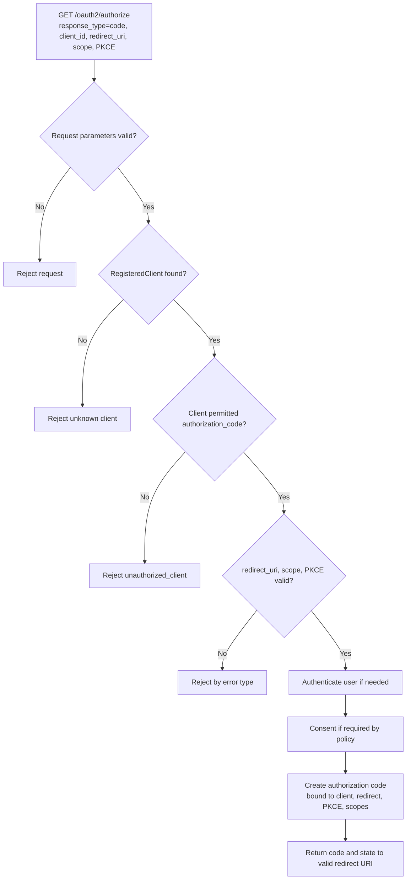

# Validating the Registered Client and Permitted Grant

## 1. Where Validation Sits in the Authorization Endpoint

In a **Spring Security OAuth 2.0 / OpenID Connect Authorization Server** built with **Spring Boot** and **Spring Authorization Server**, not every application that knows the `/oauth2/authorize` address is allowed to initiate any authorization flow. The Authorization Server must identify the **registered client**, verify **that the client is permitted to use the requested flow**, and then continue validating the redirect URI, scopes, and security parameters before issuing an authorization code.

This is the focus of the lesson **"Validating the Registered Client and Permitted Grant"**, belonging to the **Authorization Endpoint** chapter in the **SPRING_SECURITY_OAUTH2_OIDC_AUTHORIZATION_SERVER** module. This validation has direct implications for designing, configuring, securing, testing, and operating a real-world Authorization Server.

Consider two applications:

- **`orders-web`** is a web backend registered to use the **Authorization Code Flow** so users can log in and authorize `orders.read`.
- **`nightly-report-job`** is a background job registered only for the **Client Credentials Grant** to access reports on behalf of the application itself.

If `nightly-report-job` sends `GET /oauth2/authorize?response_type=code...`, the Authorization Server **must reject** that flow because the client is not permitted to use `authorization_code`. The mere fact that a client exists in the repository **is not sufficient** to issue an authorization code.

### After This Lesson, You Will Be Able To

1. Distinguish *client identification*, *client authentication*, *user authentication*, and *grant permission validation*.
2. Explain how `RegisteredClientRepository` and `RegisteredClient.authorizationGrantTypes` participate in handling an authorization request.
3. Map `response_type=code` at the authorization endpoint to `AuthorizationGrantType.AUTHORIZATION_CODE` in client registration.
4. Configure two clients with different grant policies and predict which requests are permitted.
5. Diagnose `unauthorized_client`, `invalid_request`, `invalid_scope`, and related errors without introducing redirect vulnerabilities.
6. Test behavior across the Authorization Endpoint and Token Endpoint, including when PKCE, consent, and OIDC are involved.

## 2. Four Distinct Questions Must Be Separated

| Question | Answering component | Example |
| --- | --- | --- |
| **Which client is making the request?** | `client_id` and `RegisteredClientRepository` | `client_id=orders-web` resolves the matching registration |
| **Is the client allowed to use this flow?** | `RegisteredClient.authorizationGrantTypes` | Having `authorization_code` permits starting the Authorization Code Flow |
| **Who is logging in and do they consent?** | User authentication and consent mechanisms at the AS | Alice logs in and approves `orders.read` if required |
| **Can the client prove its identity when exchanging the code?** | Client authentication at the **Token Endpoint** (if confidential), combined with PKCE | `client_secret_basic`, `private_key_jwt`, or public client + PKCE |

**Common point of confusion:** The Authorization Endpoint identifies the client using **`client_id`** and validates its registration/grants. It does **not** require the browser to send `client_secret` in the query string. A confidential client typically authenticates using a secret or stronger method when calling **`POST /oauth2/token`**. Conversely, the user enters a password on the Authorization Server's login page to authenticate the **resource owner**, not the OAuth client.

In OAuth 2.0, an **authorization grant** is the mechanism/credential the client uses to obtain an access token; a **grant type** is the kind of flow supported by the server and permitted for the client. In the Authorization Code Flow:

```text
Authorization Endpoint:
GET /oauth2/authorize?response_type=code&client_id=orders-web&...
                               |
                               v
RegisteredClient.authorizationGrantTypes
    contains AuthorizationGrantType.AUTHORIZATION_CODE ?
                               |
                       Yes --> proceed
                       No  --> reject

Token Endpoint, after the client receives the code:
POST /oauth2/token
grant_type=authorization_code&code=...&...
```

Do not put `grant_type=authorization_code` into an authorization request thinking that enables the grant. At the **authorization endpoint**, the client requests the authorization response type using `response_type=code`; at the **token endpoint**, the client selects the grant to exchange the code using `grant_type=authorization_code`.

## 3. `RegisteredClientRepository` Is the Source of Truth for Client Permissions

Spring Authorization Server represents a registered client with `RegisteredClient` and looks it up via `RegisteredClientRepository`. For a request containing `client_id=orders-web`, the conceptual handling flow is:

```java
RegisteredClient client = registeredClientRepository.findByClientId("orders-web");

if (client == null) {
    // Unregistered client: do not proceed to issue an authorization code.
}

boolean allowed = client != null && client.getAuthorizationGrantTypes()
        .contains(AuthorizationGrantType.AUTHORIZATION_CODE);
```

This is **code illustrating the business logic**, not a snippet to copy into an application filter yourself. Spring Authorization Server already provides authentication converters/providers and validators for authorization requests; when using the standard configuration, the framework performs client lookup and grant validation. The code snippet helps you recognize the API and understand the data path.

### 3.1. Properties Affecting Authorization Request Acceptance

| `RegisteredClient` property | Check / meaning |
| --- | --- |
| `clientId` | Public value in the request used to locate the client registration |
| `authorizationGrantTypes` | Indicates whether the client is permitted to use `authorization_code` |
| `redirectUris` | Set of valid redirect URIs for returning the code/result to the right client |
| `scopes` | Scopes the client is allowed to request, e.g., `orders.read`, `openid` |
| `clientSettings.requireProofKey` | Specifies whether PKCE is mandatory when sending an authorization code request |
| `clientSettings.requireAuthorizationConsent` | Specifies whether user consent is required for scopes when applicable |
| `clientAuthenticationMethods` | How the client authenticates when calling endpoints requiring client authentication, typically the token endpoint |
| `clientSecret` and `clientSecretExpiresAt` | Confidential client credentials; **never send the secret at the Authorization Endpoint** |

Distinguish two important identifiers:

- `RegisteredClient.clientId` is the value the client sends in HTTP requests; it is not a secret.
- `RegisteredClient.id` is the **internal** identifier used by the repository/Authorization Server to store associations with `OAuth2Authorization`.

If `client_id` is supplied but no `RegisteredClient` is found, the system must never "temporarily register" the client using the redirect URL sent by the request. Client registration and approval are separate processes, outside normal authorization requests.

### 3.2. Client Validity Is Not Merely "Present in the Database"

A client may be registered yet disallowed from using the Authorization Code Flow. It may also be permitted to use authorization codes yet send an unregistered `redirect_uri`, request unauthorized scopes, or omit required PKCE parameters. Therefore, a valid request must **satisfy all relevant conditions**, not merely `findByClientId(...) != null`.

Additional administrative attributes such as a "suspended" client status, registration expiration, owner, or deployment environment list can be built by the product itself. **`RegisteredClient` does not have a universal built-in "enabled" flag by default** to automatically enforce every client-locking workflow. If you need this capability, you must add policy checks in your system's management/authentication layer rather than assuming the framework provides it.

## 4. In What Order Does the Authorization Endpoint Process a Request?

Suppose a client opens the URL:

```http
GET /oauth2/authorize?response_type=code&client_id=orders-web&redirect_uri=https%3A%2F%2Fapp.example.com%2Foauth%2Fcallback&scope=orders.read&state=RANDOM_STATE&code_challenge=RANDOM_CHALLENGE&code_challenge_method=S256 HTTP/1.1
Host: auth.example.com
```

In a Spring Authorization Server implementation, the request reaches the **Authorization Endpoint**, `/oauth2/authorize` by default, where authentication/validation components process the parameters. For the Authorization Code Flow, the classes typically involved are `OAuth2AuthorizationEndpointFilter`, `OAuth2AuthorizationCodeRequestAuthenticationConverter`, and `OAuth2AuthorizationCodeRequestAuthenticationProvider`. Exact class names and customization hooks depend on the version in use; the description below represents the **logical sequence**, not a guarantee of line-by-line internal execution order.



Key steps:

1. **Parse the request:** inspect `response_type`, `client_id`, `redirect_uri`, `scope`, `state`, PKCE, and extension parameters per endpoint requirements.
2. **Look up RegisteredClient:** query the repository by the requested client ID; reject if not found.
3. **Check the grant:** for `response_type=code`, `AuthorizationGrantType.AUTHORIZATION_CODE` must be permitted on this registration. The fact that the server *supports* a grant does not mean *every client is allowed* to use it.
4. **Validate the redirect URI:** the callback must be valid and registered for the client; never send codes or error messages to arbitrary addresses from the request.
5. **Validate scope and PKCE:** requested scopes must be permitted by registration/policy; when PKCE is required, the challenge/method must be valid.
6. **Login and consent:** interactive user steps only make sense after the request is determined eligible to proceed.
7. **Persist state and issue the code:** the code is short-lived, bound to the client and request context, and returned to the validated redirect URI.

**Note on execution order:** a filter chain may redirect the user to login before certain validation branches complete, depending on authentication state, request type, and version. Therefore, **seeing HTTP 302 to `/login` does not prove the client/grant has been accepted**. When testing, complete the full login session and observe the final response (code or error) along with the corresponding authorization state.

## 5. Configuring Two Clients with Different Grants

The example below creates two registrations in Spring Authorization Server:

- `orders-web`: a confidential web client, permitted `authorization_code` and `refresh_token`; only allowed to redirect to `https://app.example.com/oauth/callback`; requires PKCE `S256` when requesting a code.
- `nightly-report-job`: a confidential service client, permitted only `client_credentials`; does not need a browser, redirect URI, or authorization code.

This is a self-contained **client registration** configuration snippet at the bean level; a complete running Authorization Server also needs a SecurityFilterChain, login mechanism, signing key/JWK source, AuthorizationServerSettings, and the corresponding services. Do not treat this bean as the entire project.

```java
package com.example.authserver;

import java.util.UUID;

import org.springframework.context.annotation.Bean;
import org.springframework.context.annotation.Configuration;
import org.springframework.security.crypto.factory.PasswordEncoderFactories;
import org.springframework.security.crypto.password.PasswordEncoder;
import org.springframework.security.oauth2.core.AuthorizationGrantType;
import org.springframework.security.oauth2.core.ClientAuthenticationMethod;
import org.springframework.security.oauth2.server.authorization.client.InMemoryRegisteredClientRepository;
import org.springframework.security.oauth2.server.authorization.client.RegisteredClient;
import org.springframework.security.oauth2.server.authorization.client.RegisteredClientRepository;
import org.springframework.security.oauth2.server.authorization.settings.ClientSettings;

@Configuration
public class DemoClientRegistration {

    @Bean
    PasswordEncoder passwordEncoder() {
        return PasswordEncoderFactories.createDelegatingPasswordEncoder();
    }

    @Bean
    RegisteredClientRepository registeredClients(PasswordEncoder encoder) {
        RegisteredClient ordersWeb = RegisteredClient
                .withId(UUID.randomUUID().toString())
                .clientId("orders-web")
                // Secret for test environment only.
                .clientSecret(encoder.encode("lab-only-orders-secret"))
                .clientAuthenticationMethod(
                        ClientAuthenticationMethod.CLIENT_SECRET_BASIC)
                .authorizationGrantType(
                        AuthorizationGrantType.AUTHORIZATION_CODE)
                .authorizationGrantType(
                        AuthorizationGrantType.REFRESH_TOKEN)
                .redirectUri("https://app.example.com/oauth/callback")
                .scope("orders.read")
                .scope("orders.write")
                .clientSettings(ClientSettings.builder()
                        .requireProofKey(true)
                        .requireAuthorizationConsent(true)
                        .build())
                .build();

        RegisteredClient nightlyReportJob = RegisteredClient
                .withId(UUID.randomUUID().toString())
                .clientId("nightly-report-job")
                .clientSecret(encoder.encode("lab-only-report-secret"))
                .clientAuthenticationMethod(
                        ClientAuthenticationMethod.CLIENT_SECRET_BASIC)
                .authorizationGrantType(
                        AuthorizationGrantType.CLIENT_CREDENTIALS)
                .scope("reports.read")
                .build();

        return new InMemoryRegisteredClientRepository(
                ordersWeb, nightlyReportJob);
    }
}
```

### Why Does This Configuration Produce Different Behavior?

| Request | Client | Grant in registration | Conclusion |
| --- | --- | --- | --- |
| `GET /oauth2/authorize?response_type=code...` | `orders-web` | Has `authorization_code` | Can proceed **if** redirect URI, scope, PKCE, and other conditions are valid |
| `GET /oauth2/authorize?response_type=code...` | `nightly-report-job` | Only `client_credentials` | **Not permitted** to use the Authorization Code Flow |
| `POST /oauth2/token` with `grant_type=client_credentials` | `nightly-report-job` | Has `client_credentials` | Can issue token after client authentication and scope check |
| `POST /oauth2/token` with `grant_type=client_credentials` | `orders-web` | Lacks `client_credentials` | Grant rejected, even though the client can use authorization code |
| `POST /oauth2/token` with `grant_type=refresh_token` | `orders-web` | Has `refresh_token` | Proceeds only with a valid refresh token bound to the client |
| `GET /oauth2/authorize?response_type=code...` | non-existent client ID | No registration | Request rejected; client is not auto-registered |

Registering `REFRESH_TOKEN` **does not** create an additional authorization response type at `/oauth2/authorize`. It allows the client to use the refresh grant at the **token endpoint** when eligible. Likewise, `CLIENT_CREDENTIALS` does not create an authorization request with user interaction.

**Note:** `InMemoryRegisteredClientRepository` is suitable for learning and testing. In production, client registrations must be managed persistently—for example, with `JdbcRegisteredClientRepository` or an appropriate repository—alongside approval/revocation workflows. Never hard-code client secrets in source code or generate new registration IDs on every production restart.

## 6. Parameters That Must Be Validated Beyond Client and Grant

Checking the client and grant are the first two gates. Passing them **is not enough to issue an authorization code**. An authorization request may contain:

```http
GET /oauth2/authorize?response_type=code&client_id=orders-web&redirect_uri=https%3A%2F%2Fapp.example.com%2Foauth%2Fcallback&scope=orders.read&state=STATE_SAMPLE&code_challenge=CHALLENGE_SAMPLE&code_challenge_method=S256 HTTP/1.1
Host: auth.example.com
```

`STATE_SAMPLE` and `CHALLENGE_SAMPLE` are placeholders only; in real execution, valid random/PKCE values must be used. You must verify:

| Parameter | Role | What to verify |
| --- | --- | --- |
| `response_type=code` | Requests an authorization code | Server supports this response type and client is permitted `AUTHORIZATION_CODE` |
| `client_id=orders-web` | Looks up the registered client | Must find a `RegisteredClient` with matching client ID |
| `redirect_uri` | Destination for the authorization response | Must match a registered URI; never send the code to an arbitrary URI |
| `scope=orders.read` | Requested scope | Must not exceed what the client is allowed and server policy |
| `state` | Binds the authorization response to the client-side request | Client generates, stores per session, and **re-verifies at the callback** |
| `code_challenge` | PKCE challenge | Required when `requireProofKey(true)`, must have valid syntax |
| `code_challenge_method=S256` | Challenge generation method | Prefer `S256`; client must retain the matching `code_verifier` |

### 6.1. Redirect URI Must Be Bound to the Registered Client

For client `orders-web` registered with `https://app.example.com/oauth/callback`, the following request is **invalid**:

```http
GET /oauth2/authorize?response_type=code&client_id=orders-web&redirect_uri=https%3A%2F%2Fattacker.example%2Fcollect&scope=orders.read HTTP/1.1
Host: auth.example.com
```

Even though the client ID exists and has the `authorization_code` grant, the authorization code **must not be sent** to `https://attacker.example/collect`. For an unvalidated redirect URI, the Authorization Server **should not—and by protocol rules must not—arbitrarily redirect to that URI to report an error**, because doing so turns the Authorization Server into an open redirect or leaks information.

In tests, use URIs that match registration exactly rather than assuming two "similar" addresses are equivalent. Differences in scheme, host, path, port, characters, or URI components can cause rejection. Exceptions and special requirements for native apps/loopback URIs must follow configuration and applicable standards; never enable wildcard redirects for convenience.

### 6.2. Registered Scopes Differ from Actually Granted Scopes

Suppose a client is allowed `orders.read` and `orders.write`:

```text
RegisteredClient.scopes = {orders.read, orders.write}
Authorization Request  = scope=orders.read
Authorized scopes       = {orders.read}   // if fully approved
```

A client being **allowed to request** `orders.write` does not mean every authorization is **granted** `orders.write`. The Authorization Server must evaluate requested scopes, grant policy, and consent; the Resource Server must verify the actual permissions in the access token.

If a request asks for `scope=admin.all` when the registration lacks that permission, the server must reject it under appropriate scope/policy rules, typically `invalid_scope`. If the client omits `scope`, default behavior/final scope depends on protocol and configured policy; **never assume** all registered scopes are automatically granted.

### 6.3. PKCE Binds the Authorization Request to the Token Request

With `ClientSettings.requireProofKey(true)`, an authorization code request must include valid PKCE. The client generates a random `code_verifier` and stores it locally; for `S256`:

```text
code_challenge = BASE64URL_NO_PADDING(
    SHA256(ASCII(code_verifier))
)
```

The authorization request sends `code_challenge`, and the subsequent token request sends `code_verifier`. If the challenge is missing when required or uses a disallowed format/method, the authorization request is rejected. If the challenge is valid but the verifier during code exchange is wrong, the error occurs at the **token endpoint** (typically `invalid_grant`), even though the client passed grant validation at the authorization endpoint.

PKCE protects the authorization code—especially critical for public clients—and should also be used for confidential clients. It **does not replace** client authentication when a client is registered as confidential.

### 6.4. OIDC Requires Both Client Conditions and Server Features

To request OpenID Connect, a client typically sends `scope=openid` along with `response_type=code`. In that case:

- The Authorization Server must have **OIDC support enabled** in its Spring Authorization Server configuration.
- The client must be registered with the `openid` scope and an appropriate grant.
- The authorization request must still satisfy redirect URI, PKCE, and related validations.
- When the OIDC flow succeeds, the token response may contain an **ID Token**; this token is used for identity verification on the OIDC client, **not as a substitute for an access token when calling APIs**.

Do not assume that merely adding `openid` to `RegisteredClient.scopes` activates full OIDC; OIDC support must also be configured on the Authorization Server.

## 7. Error Responses: Proper Classification and Redirect Protection

The Authorization Endpoint may return errors by redirecting to a **validated redirect URI**, or return errors directly when the callback cannot be trusted. The specific error code and delivery mechanism depend on the violated condition, how far the request was validated, and applicable OAuth/OIDC rules.

### Common Error Codes

| Error | Typical meaning | How to distinguish when debugging |
| --- | --- | --- |
| `unauthorized_client` | The client was identified but is not permitted to use the requested authorization method | Check grant types in `RegisteredClient.authorizationGrantTypes` |
| `invalid_request` | Request is missing, duplicated, conflicting, or has an invalid required parameter | Check `client_id`, `response_type`, redirect URI, PKCE, and syntax |
| `unsupported_response_type` | Authorization Server does not support the requested `response_type` value | Check server capabilities; do not confuse with an unregistered grant |
| `invalid_scope` | Requested scope is invalid, disallowed, or rejected by policy | Compare requested scope against registration and policy |
| `access_denied` | Resource Owner denied or Authorization Server refused permission per decision | Distinguish from client/grant validation errors |
| `server_error` | Internal error preventing request processing | Log internally while protecting sensitive data |

For example, for a **client with a valid redirect URI**, an error may be returned as:

```http
HTTP/1.1 302 Found
Location: https://app.example.com/oauth/callback?error=unauthorized_client&state=STATE_SAMPLE
```

This is only a **protocol-valid response pattern when safe redirection is possible**. Do not rely on this example to assert that Spring Authorization Server always returns HTTP 302 or always chooses `unauthorized_client` for every invalid request. The client must handle other error responses and appropriate HTTP statuses as well.

If a request sends an unregistered `redirect_uri=https://attacker.example/collect`, the Authorization Server **must not** send:

```http
HTTP/1.1 302 Found
Location: https://attacker.example/collect?error=invalid_request
```

This snippet illustrates **unsafe behavior to avoid**, not an expected response. Redirecting to an attacker-controlled URI creates an open redirect and risks leaking data. The Authorization Server must handle errors without trusting an unverified callback.

### Unknown Client Is Not Equivalent to a Wrong Secret

Three situations must be kept distinct:

1. **`client_id` not found at the Authorization Endpoint:** the client cannot receive an authorization code; no secret is validated in this front-channel request.
2. **Client exists but lacks `authorization_code`:** reject the Authorization Code Flow, even if the client is permitted `client_credentials` at the token endpoint.
3. **Client has the code grant but sends the wrong secret at the Token Endpoint:** client authentication failure, typically `invalid_client`; not a grant-permission error at the Authorization Endpoint.

Misdiagnosing these three error groups often leads to dangerous fixes, such as adding unnecessary grants or disabling redirect validation instead of fixing client configuration.

## 8. How Grant Validation Differs Between Authorization Endpoint and Token Endpoint

An OAuth client registered for multiple grants is permitted to use only **its authorized grants**, each with its own conditions. The two endpoints enforce different contracts:

| Aspect | Authorization Endpoint | Token Endpoint |
| --- | --- | --- |
| Default path | `GET /oauth2/authorize`; POST may be used in interactive steps like consent | `POST /oauth2/token` |
| Intent | Request authorization, typically to obtain an authorization code | Exchange a grant/credential for tokens |
| Flow-selection parameter | `response_type=code` | `grant_type=authorization_code`, `client_credentials`, `refresh_token`... |
| Client lookup | From `client_id` in the request | From client authentication/identification per registered method |
| Grant permission check | Does the client have `AUTHORIZATION_CODE` for the code flow? | Does the client have the grant type matching the token request? |
| User involvement | May require login and consent | Does not display a user login screen during token exchange |
| Specific protections | Redirect URI, state, scope, PKCE challenge | Client authentication, code/verifier/redirect binding, refresh token or grant-specific data |
| Outcome | Code/authorization response or error | Access token and related tokens or error |

### 8.1. Authorization Code: Two Validation Layers in One Flow

In the earlier step:

```http
GET /oauth2/authorize?response_type=code&client_id=orders-web&redirect_uri=https%3A%2F%2Fapp.example.com%2Foauth%2Fcallback&scope=orders.read&state=STATE_SAMPLE&code_challenge=CHALLENGE_SAMPLE&code_challenge_method=S256 HTTP/1.1
Host: auth.example.com
```

After the user authenticates/approves and the server issues the code, the client sends a **back-channel** request:

```http
POST /oauth2/token HTTP/1.1
Host: auth.example.com
Authorization: Basic <base64-of-client-credentials>
Content-Type: application/x-www-form-urlencoded

grant_type=authorization_code&code=CODE_SAMPLE&redirect_uri=https%3A%2F%2Fapp.example.com%2Foauth%2Fcallback&code_verifier=VERIFIER_SAMPLE
```

The token endpoint verifies:

- Whether the confidential client authenticates using its registered method and secret/key.
- Whether the `authorization_code` grant is permitted on the client's registration.
- Whether the code is unexpired, unused, belongs to the right client, and is bound to the original redirect URI.
- Whether `code_verifier` matches the `code_challenge` saved during the authorization request.

An authorization request may be valid and issue a code successfully, yet the token request **still fails** due to a wrong secret, reused code, expired code, or mismatched PKCE verifier. Therefore, tests that stop once the callback has a `code` do not prove the entire Authorization Code Flow works.

### 8.2. Client Credentials: Does Not Start at the Authorization Endpoint

Client `nightly-report-job` calls the token endpoint with:

```http
POST /oauth2/token HTTP/1.1
Host: auth.example.com
Authorization: Basic <base64-of-nightly-report-job-credentials>
Content-Type: application/x-www-form-urlencoded

grant_type=client_credentials&scope=reports.read
```

This flow has no `response_type=code`, redirect URI, end-user login, or consent at the authorization endpoint. The resulting token represents **the client**, not implicitly a logged-in user. Attempting to send this client to `/oauth2/authorize` for a code will be rejected.

### 8.3. Refresh Token: Not a Response Type

If `orders-web` was issued a refresh token and has the `refresh_token` grant registered, the client can request a new access token at `/oauth2/token`:

```http
POST /oauth2/token HTTP/1.1
Host: auth.example.com
Authorization: Basic <base64-of-client-credentials>
Content-Type: application/x-www-form-urlencoded

grant_type=refresh_token&refresh_token=REFRESH_TOKEN_SAMPLE
```

The client does not send `response_type=refresh_token` to the Authorization Endpoint. The Authorization Server still verifies client authentication, grant permission, and the refresh token according to its own lifecycle.

## 9. Configuring Spring Authorization Server: Responsible Classes and Customization Boundaries

Spring Authorization Server provides security configuration for OAuth 2.0/OIDC endpoints. At the layer receiving authorization requests, several components commonly appear:

| Component | Role |
| --- | --- |
| `OAuth2AuthorizationEndpointFilter` | Accepts authorization endpoint requests and delegates to the appropriate authentication/processing mechanism |
| `OAuth2AuthorizationCodeRequestAuthenticationConverter` | Parses authorization code request parameters into an authentication token |
| `OAuth2AuthorizationCodeRequestAuthenticationProvider` | Validates/completes the authorization code request, including registered client, grant, and related checks |
| `RegisteredClientRepository` | Looks up clients by ID; holds grant, redirect URI, scope, and authentication method policies |
| `OAuth2AuthorizationService` | Persists authorization state and associated codes/tokens |
| `OAuth2AuthorizationConsentService` | Persists consent per policy when a user approves scopes |

A typical Authorization Server configuration excerpt using the modern configuration API:

```java
import org.springframework.context.annotation.Bean;
import org.springframework.core.annotation.Order;
import org.springframework.http.MediaType;
import org.springframework.security.config.Customizer;
import org.springframework.security.config.annotation.web.builders.HttpSecurity;
import org.springframework.security.oauth2.server.authorization.config.annotation.web.configurers.OAuth2AuthorizationServerConfigurer;
import org.springframework.security.web.SecurityFilterChain;
import org.springframework.security.web.authentication.LoginUrlAuthenticationEntryPoint;
import org.springframework.security.web.util.matcher.MediaTypeRequestMatcher;

@Bean
@Order(1)
SecurityFilterChain authorizationServerSecurityFilterChain(HttpSecurity http)
        throws Exception {
    OAuth2AuthorizationServerConfigurer as =
            OAuth2AuthorizationServerConfigurer.authorizationServer();

    http.securityMatcher(as.getEndpointsMatcher())
        .with(as, configurer -> configurer
                .oidc(Customizer.withDefaults()))
        .authorizeHttpRequests(requests ->
                requests.anyRequest().authenticated())
        .exceptionHandling(ex -> ex.defaultAuthenticationEntryPointFor(
                new LoginUrlAuthenticationEntryPoint("/login"),
                new MediaTypeRequestMatcher(MediaType.TEXT_HTML)));

    return http.build();
}
```

**Snippet scope:** this is the endpoint security chain only; it omits registration beans, the user login chain, JWK source, issuer, token generator, CSRF/consent integration, and other configurations needed for a complete application. `oidc(Customizer.withDefaults())` is only needed when the application wants to support OIDC; it does not replace the grant permissions registered on each client.

Importantly: **you do not need to write a custom filter saying "if `client_id` exists, allow it"**. That approach easily misses grant/redirect/scope/PKCE checks. Let the framework handle default validation, govern client policy via `RegisteredClientRepository`, and if additional business rules are required, use the official extension points of your framework version while **preserving** mandatory validations.

### Difference Between Business Validation and Route Configuration

Allowing a request through `authorizeHttpRequests`, such as `anyRequest().authenticated()`, does **not** mean a client is automatically allowed to use every grant. Validation occurs in two layers:

1. **Spring Security filter chain** determines which requests enter the authorization endpoint and requires appropriate authentication.
2. **OAuth2 Authorization Code Request Authentication Provider** validates **protocol rules and registration** for the specific client.

Confusing these two layers can lead to editing `requestMatchers` or disabling authentication when you actually only need to update the grant on `RegisteredClient`, or conversely opening grants too broadly to mask a routing issue.

## 10. Testing Client and Grant Validation: Scenarios That Must Be Distinguished

A good test suite proves that clients/grants are restricted **per specific registration**, while not overlooking redirect URIs, scopes, and PKCE. Create dedicated registrations for test environments so production clients are unaffected.

### 10.1. Authorization Request Test Matrix

| ID | Input conditions | Expected outcome |
| --- | --- | --- |
| AE-01 | `orders-web`, `response_type=code`, valid redirect, valid scope, valid PKCE | Proceeds to login/consent and issues code |
| AE-02 | Non-existent `client_id` | Rejected; no code issued, no redirect to unverified URI |
| AE-03 | Client exists but does not register `authorization_code` | No code issued; reports unauthorized client or corresponding error |
| AE-04 | Client registered for `authorization_code` requests `response_type=token` | No implicit token issued; handled per supported response types |
| AE-05 | Client has code grant but unregistered `redirect_uri` | Rejected; **no redirect** to unknown URI |
| AE-06 | Client has code grant but requests scope outside registration | Rejected or restricted per scope-handling rules; no out-of-policy permissions granted |
| AE-07 | `requireProofKey(true)` but request omits `code_challenge` | Authorization request rejected |
| AE-08 | Invalid PKCE challenge or unsupported method | Authorization request rejected |
| AE-09 | User denies consent on a valid request | No code issued; error response such as `access_denied` to valid callback |
| AE-10 | Client has registered grant but secret is expired | **Do not** use authorize result to conclude client authentication succeeds; token request must re-authenticate |
| AE-11 | `openid` scope sent when OIDC is disabled or scope unregistered | Do not assume OIDC is valid; handle per actual features and scopes |
| AE-12 | Two clients share the same redirect URI but have different grants/scopes | Permissions are governed by **each client ID's RegisteredClient**, not by the URI |

In AE-06, an out-of-policy scope error is typically `invalid_scope`; avoid designing tests that depend solely on a single HTTP status when rules/extensions may differ. Scenarios AE-07 and AE-08 should use syntactically valid inputs elsewhere rather than mixing in redirect or client ID errors, avoiding false attribution.

### 10.2. Testing the "Disallowed Grant" Error Independently

If you want to prove that the provider actually rejects **because of the grant**, make the rest of the request valid. For instance, in a **dedicated test fixture**, you can register `client-credentials-only-test` with the `CLIENT_CREDENTIALS` grant and a test redirect URI to isolate the grant check:

```java
RegisteredClient jobOnly = RegisteredClient.withId("grant-restriction-test")
        .clientId("client-credentials-only-test")
        .clientSecret(encoder.encode("test-only-secret"))
        .clientAuthenticationMethod(ClientAuthenticationMethod.CLIENT_SECRET_BASIC)
        .authorizationGrantType(AuthorizationGrantType.CLIENT_CREDENTIALS)
        .redirectUri("https://test-client.example.com/callback")
        .scope("orders.read")
        .build();
```

**This is test fixture data**, not a recommendation to register redirect URIs for client-credentials clients in production. When sending an authorization request to `/oauth2/authorize` with `response_type=code`, `client_id=client-credentials-only-test`, and the fixture's valid redirect URI and scope, the request is still **not permitted** to use the Authorization Code Flow. Adding the test redirect prevents false conclusions caused by a missing redirect in registration.

### 10.3. Continuing Tests from Authorization Code to Token

Only after obtaining a valid code should you proceed to test the token endpoint:

| ID | Token request | Expected outcome |
| --- | --- | --- |
| TE-01 | `orders-web`, valid secret, `authorization_code`, unused code, valid verifier | Issues appropriate access token |
| TE-02 | Same code used a second time | Rejected, typically `invalid_grant` |
| TE-03 | Wrong PKCE verifier | Token request rejected |
| TE-04 | Different client uses `orders-web`'s code | Rejected because the code is bound to the original client |
| TE-05 | Wrong secret for confidential client | Client authentication rejected, typically `invalid_client` |
| TE-06 | `orders-web` requests `client_credentials` though unregistered | Grant rejected |
| TE-07 | `nightly-report-job` requests `client_credentials` and scope `reports.read` | Can issue a client-representing token if authentication and policy succeed |

**Seeing the login page, consent page, or callback with a `code`** is not enough to conclude the Token Endpoint will issue a token successfully. Each endpoint validates its own set of conditions.

### 10.4. A Controlled Manual Verification Approach

In a lab environment using HTTPS and properly mapped example hosts, construct a valid authorization URL:

```text
https://auth.example.com/oauth2/authorize
  ?response_type=code
  &client_id=orders-web
  &redirect_uri=https%3A%2F%2Fapp.example.com%2Foauth%2Fcallback
  &scope=orders.read
  &state=<state-random>
  &code_challenge=<S256-challenge>
  &code_challenge_method=S256
```

For each test run, generate **a fresh state, verifier, and challenge**. Do not copy the placeholder strings literally. Complete login/consent and observe the verified callback. Then alter one condition at a time:

1. Replace `client_id` with a non-existent client ID.
2. Switch to a client with only `client_credentials`, using a valid test redirect fixture as in section 10.2.
3. Keep `orders-web` but change `redirect_uri` to an unregistered URI.
4. Keep the valid client and redirect but request `scope=admin.all`.
5. Keep other conditions valid but omit `code_challenge` when registration requires PKCE.

Each test must use an isolated browser session and fresh parameters to isolate the root cause; reusing the same state/code/verifier from a completed run can skew results due to expired or already-used codes. When requesting an invalid redirect URI, verify that the browser **is not redirected to any unlisted URI**.

## 11. Operational Perspective: Client Registration, Grant Changes, and Monitoring

### 11.1. Grant Changes Must Follow an Approval Process

Grant types are part of a **client's security policy**. For example, changing `nightly-report-job` from `CLIENT_CREDENTIALS` to also support `AUTHORIZATION_CODE` opens up a new way to obtain tokens, tied to users and callbacks. This is not a minor technical tweak just to "make a request pass".

A governance process should document:

- Client ID, owner, application, and deployment environment.
- Permitted grant types and business justification; corresponding authentication methods.
- Redirect URIs, scopes, PKCE/consent policies, TTLs, and additional constraints.
- Approval sign-off, effective time, audit trail, and pre-/post-change testing.
- Synchronization strategy across multiple Authorization Server instances or client registration caches.

When modifying a persistent registration, preserve the **internal ID** and unrelated fields by updating the existing record. Changing the client ID or creating a new registration can break existing authorizations/tokens tied to the prior client. Never change grant types without assessing the impact on active authorizations.

### 11.2. Logs Must Be Sufficient for Diagnosis Without Exposing Data

Appropriately scoped security logs may include:

| Field | Purpose |
| --- | --- |
| Timestamp, request/correlation ID | Correlate events in a trace |
| Identified Client ID | Locate the relevant registration |
| `response_type`, endpoint type | Identify the requested flow |
| Outcome category and error code | Distinguish unknown client, disallowed grant, invalid redirect, invalid scope |
| Environment and configuration version | Detect nodes/caches holding stale registrations |

**Never log** client secrets, authorization codes, access/refresh tokens, PKCE verifiers, sensitive query string values, full callback URLs containing codes, or unnecessary user details. Be careful with reverse proxies and access logs: `/oauth2/authorize` URLs may contain scopes, state, and PKCE challenges; callbacks may contain authorization codes. Limit logged fields, encrypt data in transit, and restrict log access permissions.

### 11.3. Server Metadata Differs from Per-Client Permissions

An Authorization Server may publish metadata such as:

```json
{
  "authorization_endpoint": "https://auth.example.com/oauth2/authorize",
  "token_endpoint": "https://auth.example.com/oauth2/token",
  "response_types_supported": ["code"],
  "grant_types_supported": [
    "authorization_code",
    "client_credentials",
    "refresh_token"
  ]
}
```

This is an **illustrative metadata excerpt**, not a fixed response across every Spring Authorization Server version. Metadata advertises **general server capabilities**, not whether a specific client has been approved for every grant in `grant_types_supported`. Final permission resides in `RegisteredClient.authorizationGrantTypes` and server policies.

### 11.4. Three Common Misleading Configuration Issues

**Case A — "Client ID is valid, yet I still get `unauthorized_client`":** The client exists in the repository but only has `CLIENT_CREDENTIALS` registered. Do not fix this by disabling validators; check the business justification and only add `AUTHORIZATION_CODE` if the client is genuinely permitted to use the Authorization Code Flow.

**Case B — "Reaching the login screen means the grant is valid":** Routing through login depends on filter chains and the user session; it does not guarantee the request is eligible to receive a code. You must complete the test and confirm the authorization response is accepted.

**Case C — "The client registered AUTHORIZATION_CODE, so any callback can receive a code":** A valid grant **does not bypass** redirect URI, scope, and PKCE checks. Arbitrary callbacks risk code leakage and are unacceptable even to "unblock dev environments".

## 12. Practice Exercise and Self-Check Questions

### Exercise

Design an Authorization Server for three applications:

| Client | Business role | Required grant | Additional requirements |
| --- | --- | --- | --- |
| `shopping-web` | Users log in and view shopping carts | `authorization_code`, optionally `refresh_token` | Exact redirect URI, PKCE, `cart.read` scope |
| `inventory-worker` | Automated inventory sync service | `client_credentials` | Strong client authentication, `stock.sync` scope |
| `shopping-mobile` | User-facing mobile app | `authorization_code` | Public client, PKCE, redirect URI following native app recommendations |

Tasks to complete:

1. Describe an appropriate `RegisteredClient` for each application, including grant types, authentication methods, scopes, and redirect URIs where applicable.
2. Predict the outcome when `inventory-worker` sends `response_type=code` to `/oauth2/authorize`.
3. Explain why `shopping-mobile` cannot keep a client secret confidential and why PKCE is necessary.
4. Suppose `shopping-web` is granted `cart.read` but attempts to request `admin.all`. Identify the component responsible for rejecting the request.
5. Distinguish the error when `shopping-web` obtains a valid code but sends the wrong secret at the token endpoint.
6. Propose audit fields to record when modifying grant permissions for `inventory-worker`.

### Questions with Answers

**Q1.** Is `client_id` a secret, and is it sufficient to authenticate a confidential client?  
**Answer:** No. `client_id` is a public identifier; a confidential client must authenticate using its registered method at endpoints requiring client authentication, typically the token endpoint.

**Q2.** Can a client registered with `refresh_token` but not `authorization_code` use `response_type=code` at the Authorization Endpoint?  
**Answer:** No. Permission to use refresh tokens does not allow the client to request authorization codes.

**Q3.** If the Authorization Server advertises support for `authorization_code`, can every registered client use this flow?  
**Answer:** No. Each `RegisteredClient` must be granted `AuthorizationGrantType.AUTHORIZATION_CODE`.

**Q4.** What happens if a client has the code grant and a valid redirect URI, but omits PKCE when `requireProofKey(true)` is set?  
**Answer:** The authorization request is ineligible and rejected; a valid grant does not waive PKCE validation.

**Q5.** Can an OIDC-issued ID Token be used instead of an access token to call a Resource Server?  
**Answer:** No. An ID Token is intended for the OIDC client to verify login; a Resource Server must validate an **access token** with the appropriate audience and permissions.

**Q6.** If the redirect URI does not match registration, should the server redirect to the client-supplied URI to report the error?  
**Answer:** No. Redirecting to an unverified destination must be avoided to prevent open redirects and data leakage risks.

### Memory Map

```text
Authorization Request (GET /oauth2/authorize)
  response_type=code
  client_id=orders-web
  redirect_uri=...
  scope=orders.read
  state=...
  code_challenge=...
          |
          v
RegisteredClientRepository.findByClientId(client_id)
          |
          +--> Not found: reject
          |
          v
RegisteredClient.authorizationGrantTypes
  contains AUTHORIZATION_CODE?
          |
          +--> No: reject flow
          |
          v
Validate redirect URI + scope + PKCE + policies
          |
          +--> Invalid: reject safely
          |
          v
User login / consent (if needed)
          |
          v
Issue authorization code, return to valid redirect URI
          |
          v
POST /oauth2/token
  grant_type=authorization_code
  code + PKCE verifier + client authentication (if needed)
          |
          v
Issue tokens if all token request conditions are valid
```

**Core takeaway:** The Authorization Endpoint must verify **a registered client** that is **permitted to use the Authorization Code Grant**, while validating the redirect URI, scopes, PKCE, and protocol conditions. Grant permissions are configured on `RegisteredClient`, whereas client authentication via secret/key during code exchange is an independent step at the Token Endpoint. Understanding and testing this boundary helps prevent misconfiguring client permissions in Spring Authorization Server.

## Reference Standards

- [Spring Authorization Server Reference](https://docs.spring.io/spring-authorization-server/reference/) — `RegisteredClient`, `RegisteredClientRepository`, Authorization Endpoint, and configuration capabilities.
- [Spring Security Reference — OAuth 2.0](https://docs.spring.io/spring-security/reference/servlet/oauth2/index.html) — authentication, authorization, and OAuth 2.0 integration.
- [RFC 6749 — The OAuth 2.0 Authorization Framework](https://www.rfc-editor.org/rfc/rfc6749) — §3.1 Authorization Endpoint, §4.1 Authorization Code Grant, §4.1.2.1 Error Response.
- [RFC 7636 — Proof Key for Code Exchange](https://www.rfc-editor.org/rfc/rfc7636) — PKCE requirements and authorization code protection.
- [RFC 8414 — OAuth 2.0 Authorization Server Metadata](https://www.rfc-editor.org/rfc/rfc8414) — server capability metadata.
- [OpenID Connect Core 1.0](https://openid.net/specs/openid-connect-core-1_0.html) — authorization requests and the Authorization Code Flow in OIDC.
