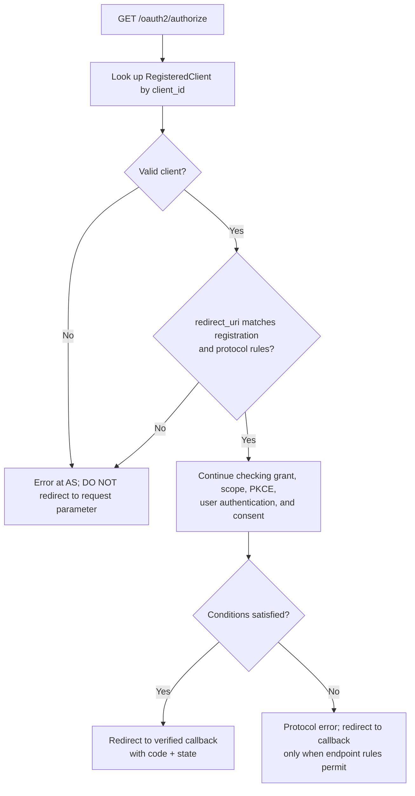
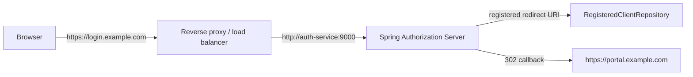

# Exact redirect_uri Matching and Preventing Open Redirects

In **OAuth 2.0/OpenID Connect (OIDC)**, the Authorization Endpoint typically returns authorization results by instructing the browser to redirect to an **OAuth client** address. The `redirect_uri` parameter is a security boundary determining **where authorization codes or error messages are sent**. If the Authorization Server lets a client pick an arbitrary destination, an attacker-crafted request can turn a trusted login server into an open redirector or leak authorization codes.

This lesson belongs to the **Authorization Endpoint** chapter of the **SPRING_SECURITY_OAUTH2_OIDC_AUTHORIZATION_SERVER** module, focusing on designing, configuring, securing, testing, and operating Spring Authorization Server in a Spring Boot application. The core focus is **matching the redirect URI against registered URIs**, preventing open redirects on both the Authorization Server and client application, and understanding the narrow exceptions for native apps.

**After this lesson, you will be able to:**

- Explain why `redirect_uri` is a sensitive parameter in the Authorization Code Flow and why `client_id` alone is not enough to trust a callback.
- Distinguish **exact matching** from hostname matching, path prefixes, wildcards, or arbitrary URI normalization.
- Determine when the Authorization Server must display an error **locally**, rather than redirecting to an invalid `redirect_uri`.
- Register fixed callbacks via `RegisteredClient`, verify Spring Authorization Server behavior, and avoid accidentally weakening the default validator.
- Protect callbacks on the OAuth client side using `state`, PKCE, and safe post-login redirects.
- Write a test suite against open redirects, covering lookalike hosts, `@` userinfo tricks, encoded URLs, query parameters, fragments, scheme mismatches, and routing behind a reverse proxy.

## 1. Where Does redirect_uri Sit in the Authorization Flow?

Consider a web portal using Spring Security OAuth2 Client, logging in through Spring Authorization Server:

| Role | Example URL | Responsibility |
| --- | --- | --- |
| Authorization Server | `https://login.example.com` | Authenticates users, validates authorization requests, and issues authorization codes. |
| Backend OAuth client | `https://portal.example.com` | Initiates requests, holds `state` and PKCE verifier, receives callbacks, and exchanges codes for tokens. |
| **Registered** callback | `https://portal.example.com/login/oauth2/code/sas` | The sole destination permitted to receive OAuth responses for client `portal-web`. |
| Resource Server | `https://api.example.com` | Validates access tokens and read permissions. |

Simplified flow:

```mermaid
sequenceDiagram
    autonumber
    actor U as User
    participant B as Browser
    participant C as OAuth Client portal-web
    participant AS as Authorization Server
    participant DB as RegisteredClientRepository

    U->>B: Choose Login
    B->>C: GET /orders
    C-->>B: Redirect to AS; generate state, PKCE
    B->>AS: GET /oauth2/authorize?client_id=portal-web&redirect_uri=...
    AS->>DB: Look up RegisteredClient portal-web
    DB-->>AS: List of registered redirectUris
    AS->>AS: Match redirect_uri and validate request
    AS-->>B: Login / consent if needed
    U->>B: Authenticate and consent
    B->>AS: Submit result
    AS-->>B: 302 to verified callback + code + state
    B->>C: GET /login/oauth2/code/sas?code=...&state=...
    C->>C: Match state
    C->>AS: POST /oauth2/token + code + verifier + client auth
    AS-->>C: Tokens when transaction is valid
```

The browser is an intermediary carrying responses from the AS to the client, not the authority deciding whether a callback is valid. An attacker can manually craft a `/oauth2/authorize` URL, modify query strings, embed links in emails, or send HTTP requests directly. Therefore, **every front-channel parameter must be verified by the Authorization Server against a trusted registration**.

### 1.1. Example of a Valid Authorization Request

For readability, the request below is split across lines. In actual transmission, query parameters must be URL-encoded on a single valid URL:

```http
GET /oauth2/authorize?response_type=code
    &client_id=portal-web
    &redirect_uri=https%3A%2F%2Fportal.example.com%2Flogin%2Foauth2%2Fcode%2Fsas
    &scope=openid%20orders.read
    &state=RANDOM_STATE_FROM_CLIENT
    &code_challenge=BASE64URL_SHA256_OF_VERIFIER
    &code_challenge_method=S256
    &nonce=RANDOM_NONCE
```

In this example:

- `client_id=portal-web` only helps the AS **locate the client registration**; it does not authenticate that the sender of the URL is the legitimate portal.
- `redirect_uri` instructs the AS to deliver the result to the exact callback registered by the portal.
- `state` is a random value generated by the **client** to bind the callback to the login transaction; the client must verify it upon receiving the response.
- `code_challenge` is used in PKCE; the token endpoint validates `code_verifier` to prove the party exchanging the code is the party that initiated the request.
- `nonce` can bind an OIDC ID token to the transaction when requested by the client; it does not replace `state` or PKCE.

## 2. How Dangerous Is an Open Redirect at the Authorization Endpoint?

An **open redirect** is a vulnerability allowing a user or attacker to control a redirect destination without proper application validation. For example, a flawed Authorization Server directly uses a request parameter to construct `Location`:

```java
// ANTI-PATTERN: do not implement.
String redirectUri = request.getParameter("redirect_uri");
response.sendRedirect(redirectUri + "?code=" + authorizationCode);
```

An attacker sends the victim this link:

```text
https://login.example.com/oauth2/authorize
  ?response_type=code
  &client_id=portal-web
  &redirect_uri=https%3A%2F%2Fattacker.example%2Fcallback
  &scope=openid
```

If the AS does not compare the callback against registration, after the user authenticates, the browser can carry the authorization code to `https://attacker.example/callback`.

Even when the code is protected by PKCE, **redirecting to an attacker-specified destination is still a security flaw**: it risks leaking URL data, enabling phishing, or serving as a stepping stone in another attack. PKCE reduces the chance of exchanging a stolen code; it **does not legitimize an arbitrary callback**.

Common consequences include:

1. **Authorization code leakage:** if the destination is attacker-controlled, the code appears in the attacker's URL/HTTP requests; whether it can be exchanged depends on remaining protections.
2. **Phishing via a trusted hostname:** the link starts with `login.example.com` yet ultimately sends the user to an external site.
3. **Chained redirect through a legitimate app:** an attacker may try to exploit a redirect endpoint inside a trusted client domain to forward the browser externally.
4. **Login CSRF/code injection:** if a client handles callback `state` improperly, an attacker-supplied code may be bound to the victim's session.
5. **Expanded attack surface in multi-tenant setups:** if every tenant can enter arbitrary callbacks, users can be sent to domains not belonging to the registered tenant/application.

**The post-authorization redirect destination must come from an approved list in registration, never from trusting the domain displayed in the link.**

## 3. What Is Exact redirect_uri Matching?

For a typical web client, the AS must match the received `redirect_uri` against **one of the complete URIs registered for that specific client**. Exact matching covers scheme, host, port when present, path, query, and significant characters. Do not substitute wildcards, prefix matching, or same-origin-only checks.

Suppose only the following is registered:

```text
https://portal.example.com/login/oauth2/code/sas
```

Matrix:

| `redirect_uri` in request | Accepted? | Reason |
| --- | --- | --- |
| `https://portal.example.com/login/oauth2/code/sas` | **Yes** | Matches the registered URI. |
| `https://portal.example.com/login/oauth2/code/sas/` | **No** | Extra trailing `/` on path. |
| `http://portal.example.com/login/oauth2/code/sas` | **No** | Different scheme from `https`. |
| `https://portal.example.com:444/login/oauth2/code/sas` | **No** | Different port from registration. |
| `https://portal.example.com.evil.example/login/oauth2/code/sas` | **No** | Host belongs to another domain. |
| `https://portal.example.com@evil.example/callback` | **No** | In URI syntax, `evil.example` is the host; the part before `@` is userinfo. |
| `https://portal.example.com/login/oauth2/code/sas?next=https://attacker.example` | **No** | Contains extra query not in registration. |
| `https://portal.example.com/login/oauth2/code/sas#fragment` | **Invalid** | An OAuth redirect endpoint URI must not contain a fragment. |
| `https://other.example.com/login/oauth2/code/sas` | **No** | Different host. |
| `https://portal.example.com/redirect?target=https://attacker.example` | **No** | Not in the registered callback list. |

A registration may hold **multiple exact URIs**, for example to support two fixed callbacks for two entry points of the same client; each URI must still be explicitly evaluated and approved. The more callbacks registered, the larger the attack surface and management overhead.

### 3.1. String Matching vs. Guessing Network Equivalence

URIs that look similar are not necessarily **the same protocol identifier**:

```text
https://portal.example.com/callback
https://portal.example.com/callback/
https://portal.example.com:443/callback
https://portal.example.com/callback?flow=login
https://PORTAL.example.com/callback
```

A browser, reverse proxy, or HTTP library may normalize certain details when sending requests. However, client registration policy should not rely on "these two URLs probably hit the same machine" to accept callbacks. For web OAuth clients, maintain **one canonical registered URI** and use it consistently in both the authorization request and token exchange.

Watch out for two layers of URL encoding:

- `redirect_uri` itself is a URI, e.g., `https://portal.example.com/callback?mode=login`.
- When placed inside a **query parameter** of `/oauth2/authorize`, characters like `:`, `/`, `?`, and `=` are encoded for HTTP parameter transport, e.g., `redirect_uri=https%3A%2F%2Fportal.example.com%2Fcallback%3Fmode%3Dlogin`.
- The HTTP framework decodes **the outer parameter encoding layer** to extract the URI string; the AS then checks that string against registration. Never intentionally decode multiple times, alter the path, or reconstruct callbacks from client-controlled fragments.

**Never "relax" checks** by stripping queries, trimming trailing `/`, upgrading `http` to `https`, dropping ports, or auto-accepting all subdomains. Changing a URI must go through the client registration/update process, never be decided by an attacker in a request.

### 3.2. Why Are Prefix or Wildcard Matches Dangerous?

All of the following hand-written checks **are insufficient**:

```java
// ANTI-PATTERN: prefix matching only.
boolean allow1 = requestedRedirect.startsWith("https://portal.example.com");

// ANTI-PATTERN: hostname suffix matching only.
boolean allow2 = requestedHost.endsWith("example.com");

// ANTI-PATTERN: wildcard across all paths and queries in origin.
boolean allow3 = requestedRedirect.matches(
    "https://portal[.]example[.]com/.*");
```

- `startsWith(...)` can accept `https://portal.example.com.evil.example/callback` or `@` forms that spoof the hostname.
- `endsWith("example.com")` matches `badexample.com`; even checking suffix with a leading dot allows **every subdomain**, including compromised subdomains or those belonging to other tenants.
- Path wildcards allow redirecting to `/redirect?target=...`, another open redirect endpoint on the same host.
- Checking the host accurately while **ignoring port/path/query** still permits sending codes to endpoints that are not the real callback.

The proper approach with the framework is to register exact URIs in `RegisteredClient` and let the **Authorization Server validator** check them. The matching snippet below only illustrates exact membership conceptually—it is **not** a full replacement for the protocol validator:

```java
// CONCEPTUAL MODEL for a web client, not the full OAuth validator.
boolean isRegistered =
    registeredClient.getRedirectUris().contains(requestedRedirectUri);
```

A real validator must also check mandatory protocol requirements, valid URI syntax, client/grant permissions, standard-permitted edge cases, and other constraints. When customization is needed, prefer **retaining the default validator** and adding narrow policy checks alongside it.

## 4. Error-Handling Rule: Never Redirect to an Untrusted URI

This is the single most critical boundary of the Authorization Endpoint: **never use an invalid `redirect_uri` to deliver an error response**.

Consider two scenarios:

| Scenario | Safe handling |
| --- | --- |
| `client_id` does not exist, `redirect_uri` is invalid, or not in registration | The AS **must not redirect** the browser to that URI. Typically displays an error on the AS or returns a direct error response. |
| `redirect_uri` is verified valid, but the request fails on scope/response type | Per endpoint rules, the AS **may redirect the protocol error** to the **verified** callback, including `error` and `state` if the request carried a valid state to echo. |

Decision flow:



For example, when the callback is valid but authorization is denied, the response may be:

```http
HTTP/1.1 302 Found
Location: https://portal.example.com/login/oauth2/code/sas?error=access_denied&state=RANDOM_STATE_FROM_CLIENT
```

Conversely, when a request asks for an unregistered callback `https://attacker.example/callback`, an **unsafe** response is:

```http
HTTP/1.1 302 Found
Location: https://attacker.example/callback?error=invalid_request
```

**Never return the second response.** Redirect URI errors must be caught before deciding to use that callback for error delivery. Specific HTTP statuses and error page formats can vary across versions/entry points, so tests should focus on the security invariant: **never emit a `Location` header pointing to an untrusted URI, and never leak codes/tokens**.

### 4.1. What If redirect_uri Is Omitted?

Depending on the grant, request type, and applicable specification, `redirect_uri` may be mandatory or governed by rules inferring a callback from registration. For an **OIDC Authentication Request**, `redirect_uri` is required; for plain OAuth 2.0, check the specification and implementation version rules when only a single redirect URI is registered.

**Do not assume** omitting `redirect_uri` is always acceptable, and do not implement custom logic picking the first callback in a list. For predictability, clients should send the **exact registered URI** and test the running Spring Authorization Server version's behavior.

### 4.2. What If the Callback Is Verified, Yet the Code Is Invalid?

A `code` and `state` may appear in the callback from attacker injection or an expired transaction. On the OAuth client side, seeing the right callback URI **does not mean** the request is valid. The client must verify `state`, then exchange the authorization code at the token endpoint, where the AS validates the code, client, redirect URI, PKCE, and other conditions.

**Blocking open redirects is a necessary condition, not the entirety of Authorization Code Flow security.**

## 5. Configuring Redirect URIs in Spring Authorization Server

Spring Authorization Server stores allowed callbacks in `RegisteredClient.redirectUris`. Callers may only use callbacks present in the registration according to the protocol validator's rules.

Example of a confidential web client compatible with Spring Boot 3.x + Spring Authorization Server 1.x. The snippet below covers **client registration** only, assuming the application already defines the security beans, signing keys, and form login needed to run an Authorization Server.

### 5.1. Java Configuration with a Fixed Callback

```java
package com.example.authserver.config;

import java.util.UUID;

import org.springframework.beans.factory.annotation.Value;
import org.springframework.context.annotation.Bean;
import org.springframework.context.annotation.Configuration;
import org.springframework.security.crypto.password.PasswordEncoder;
import org.springframework.security.oauth2.core.AuthorizationGrantType;
import org.springframework.security.oauth2.core.ClientAuthenticationMethod;
import org.springframework.security.oauth2.core.oidc.OidcScopes;
import org.springframework.security.oauth2.server.authorization.client.InMemoryRegisteredClientRepository;
import org.springframework.security.oauth2.server.authorization.client.RegisteredClient;
import org.springframework.security.oauth2.server.authorization.client.RegisteredClientRepository;
import org.springframework.security.oauth2.server.authorization.settings.ClientSettings;

@Configuration(proxyBeanMethods = false)
public class PortalClientRegistrationConfig {

    @Bean
    RegisteredClientRepository registeredClientRepository(
            PasswordEncoder passwordEncoder,
            @Value("${oauth.portal.client-secret}") String clientSecret) {

        RegisteredClient portal = RegisteredClient
            .withId(UUID.randomUUID().toString())
            .clientId("portal-web")
            .clientSecret(passwordEncoder.encode(clientSecret))
            .clientAuthenticationMethod(
                ClientAuthenticationMethod.CLIENT_SECRET_BASIC)
            .authorizationGrantType(
                AuthorizationGrantType.AUTHORIZATION_CODE)
            .redirectUri(
                "https://portal.example.com/login/oauth2/code/sas")
            .scope(OidcScopes.OPENID)
            .scope("orders.read")
            .clientSettings(ClientSettings.builder()
                .requireProofKey(true)
                .requireAuthorizationConsent(true)
                .build())
            .build();

        return new InMemoryRegisteredClientRepository(portal);
    }
}
```

`src/main/resources/application.yml`:

```yaml
oauth:
  portal:
    client-secret: ${PORTAL_OAUTH_CLIENT_SECRET}
```

Key takeaways:

1. `redirectUri(...)` is populated **during trusted client registration**, never read directly from the `/oauth2/authorize` query string. Exact callbacks must be approved during onboarding or configuration.
2. `clientAuthenticationMethod(CLIENT_SECRET_BASIC)` applies to backend clients holding a secret; it does not replace checking `redirect_uri` when receiving a browser authorization request.
3. `requireProofKey(true)` enforces PKCE for the client. Even with PKCE enabled, an unlisted redirect URI must still be rejected.
4. `requireAuthorizationConsent(true)` controls user consent prompting, **not** permission to pick callbacks.
5. `UUID.randomUUID()` and `InMemoryRegisteredClientRepository` are only suitable for demos. In production, use stable IDs, a persistent repository, and governance over callback changes.
6. The secret is injected from the environment and encoded before storing in the registration; never hard-code real secret literals in source code or logs.

**Do not modify the default validator just to allow "flexible" callbacks from query strings.** If multiple valid callbacks are needed, register each fixed URI explicitly; if independent tenants are needed, consider separate registrations with clear administrative and callback boundaries.

### 5.2. Where Does Spring Authorization Server Perform Validation?

In the Authorization Code Flow, Spring Authorization Server uses components such as:

| Component | Role |
| --- | --- |
| `OAuth2AuthorizationEndpointFilter` | Receives and handles requests to the Authorization Endpoint. |
| `OAuth2AuthorizationCodeRequestAuthenticationConverter` | Converts the HTTP request into an authorization request authentication token. |
| `OAuth2AuthorizationCodeRequestAuthenticationProvider` | Validates the authorization request and coordinates authorization issuance. |
| `OAuth2AuthorizationCodeRequestAuthenticationValidator` | Enforces standard request checks, including redirect URI and scope logic. |
| `RegisteredClientRepository` | Looks up trusted configuration for clients, redirect URIs, grant types, and scopes. |
| `OAuth2AuthorizationService` | Persists transaction/authorization code state for token exchange. |

Class names and extension hooks may vary by Spring Authorization Server version. When customizing `authorizationEndpoint(...)` or replacing `setAuthenticationValidator(...)`, remember that you may **override** the default validation logic. A custom validator that checks only tenant rules without continuing to validate the redirect URI introduces a vulnerability.

A safe approach when adding business rules is to **retain the default validator** and attach a narrow check before or after it using the extension API supported by your library version. When a genuine exception exists (such as a native loopback client's redirect URI), apply it solely to properly classified registrations and cover it with tests.

### 5.3. Distinguishing the Client's Redirect URI from the Server's Issuer URL

Suppose the Authorization Server is exposed publicly at `https://login.example.com`, while the backend runs at `http://auth-service:9000`. The issuer can be configured in `AuthorizationServerSettings`:

```java
@Bean
AuthorizationServerSettings authorizationServerSettings() {
    return AuthorizationServerSettings.builder()
        .issuer("https://login.example.com")
        .build();
}
```

The issuer identifies **who issues tokens**; the redirect URI belongs to the **OAuth client**. These two addresses do not need to share a domain and should never be inferred from `Host` headers or container hostnames.

On the Spring Security OAuth2 Client side, callbacks commonly follow `{baseUrl}/login/oauth2/code/{registrationId}`. The `baseUrl` value must be resolved accurately by proxy and origin configuration. **The client must build a URI matching what the AS registered**; never alter the URI based on untrusted forwarded headers.

## 6. Open Redirects Can Still Exist Inside the Client Application Itself

An Authorization Server that validates callbacks accurately can still be undermined if **the application owning the callback has an open redirect or unvalidated forwarding**.

Example fixed registered callback:

```text
https://portal.example.com/login/oauth2/code/sas
```

After handling login, the portal lets users pick a landing page via a `next` parameter:

```text
https://portal.example.com/after-login?next=https://attacker.example
```

If the controller is written as:

```java
// ANTI-PATTERN: next is controlled by the browser.
@GetMapping("/after-login")
void afterLogin(@RequestParam String next,
                HttpServletResponse response) throws IOException {
    response.sendRedirect(next);
}
```

the portal now has an open redirect right inside a legitimate domain. This can be abused for phishing and, depending on callback handling, leak codes or related data if the app forwards raw URLs, queries, or unsanitized fragments.

**Solution:** post-login navigation targets must come from an **allowlist of permitted internal routes** or server-managed route identifiers. For example:

```java
import java.io.IOException;
import java.util.Set;

import jakarta.servlet.http.HttpServletResponse;
import org.springframework.web.bind.annotation.GetMapping;
import org.springframework.web.bind.annotation.RequestParam;
import org.springframework.web.bind.annotation.RestController;

@RestController
class AfterLoginController {

    private static final Set<String> ALLOWED_PATHS =
        Set.of("/home", "/orders", "/profile");

    @GetMapping("/after-login")
    void afterLogin(@RequestParam(required = false) String next,
                    HttpServletResponse response) throws IOException {

        String destination = next != null && ALLOWED_PATHS.contains(next)
            ? next
            : "/home";

        response.sendRedirect(destination);
    }
}
```

This example allows **only three literal paths**, rejecting absolute destinations, `//`, backslashes, external hosts, and anything outside the allowlist. In real applications with context paths, locales, or dynamic routes, represent destinations with **server-controlled IDs** or route them through a thoroughly tested navigation helper instead of accepting free-form URLs.

### 6.1. Protecting the OAuth Client Callback

A secure callback should:

1. Verify `state` in the response matches the exact unpredictable value stored for the browser's transaction; reject callbacks not initiated by the client.
2. Submit the authorization code to the token endpoint with the matching `client_id`, `redirect_uri`, and `code_verifier`; confidential clients authenticate using their registered method.
3. If using OIDC, verify the ID token: signature, `iss`, `aud`, expiry, `nonce` if requested, and other protocol requirements.
4. Establish a secure application session; cookies must set `Secure`, `HttpOnly`, and `SameSite` appropriately for the flow, alongside CSRF protection.
5. Strip the code from visible URLs after callback completion, and restrict logging callback URLs or running third-party scripts on the callback page.
6. Redirect onward only to trusted routes after successful callback handling, never reflecting arbitrary query `next`/`returnUrl` parameters into `Location`.

In Authorization Code + PKCE flows, the callback should not forward the raw code to a third-party frontend/page to "handle itself" when the client backend initiated the transaction and holds the verifier.

### 6.2. What If redirect_uri Contains a Query Component?

OAuth 2.0 can permit a registered redirect URI to include a query component. For example, if registration genuinely holds `https://portal.example.com/callback?source=sso`, the AS must treat that URI **as the registered string**; when appending `code` and `state` to the redirect response, they must be added per protocol rules rather than blindly concatenating a second `?`.

However, callback queries should not contain arbitrary forwarding parameters like `next=https://attacker.example`. A literal registered query does not make the application safe if the destination server reads attacker-controlled data to decide where to redirect next.

## 7. Special Case: Native Applications and Loopback Redirects

The **exact match** rule for web clients is an essential default. However, there is a standardized exception for certain native applications: **loopback redirect URIs**.

Under RFC 8252, a native application may open a temporary HTTP listener on an ephemeral port on the loopback interface, such as:

```text
http://127.0.0.1:51001/callback
http://127.0.0.1:62037/callback
http://[::1]:60001/callback
```

For loopback IP literal callbacks, the Authorization Server **must allow the port to vary** when this mechanism is implemented per RFC 8252; the rest of the URI must still be validated against registration and policy. This is a **narrow exception** specific to application and redirect type, not an excuse to allow `https://portal.example.com:*`, arbitrary localhost hostnames, or arbitrary client paths.

Key points to remember:

- `localhost` is not fully equivalent to loopback IP literal addresses (`127.0.0.1` or `[::1]`) in native-app OAuth guidance.
- Native apps must still use **Authorization Code + PKCE** and cannot store client secrets like confidential backends.
- Some native apps also use **claimed HTTPS URIs** or supported custom URI schemes; each carries different redirect-hijacking risks and must be registered according to relevant standards.
- Dynamic port support and exact URI validation behavior **depend on Spring Authorization Server version and configuration**. Do not assume a plain `RegisteredClient.redirectUri(...)` configuration automatically handles every exception; write integration tests and extensions as needed.
- Never extend this exception to web clients or disable global `redirect_uri` validation just to "support mobile".

**Never apply native loopback policy to an SPA hosted at `https://spa.example.com` or a web backend on a public domain.**

## 8. Reverse Proxies, Hostnames, and Deployment Environments

A real-world Spring Boot deployment typically looks like:



When proxying HTTP traffic, keep these separate:

- **Public Authorization Server issuer:** `https://login.example.com`, configured explicitly in `AuthorizationServerSettings`.
- **Backend bind URL:** `http://auth-service:9000`, strictly for internal connectivity.
- **Client callback:** `https://portal.example.com/login/oauth2/code/sas`, stored in `RegisteredClient`.

Do not register `http://auth-service:9000` as a callback simply because the app runs in a container. Callbacks belong to the client application and must be reachable from the user's browser in the flow.

`Forwarded`/`X-Forwarded-Host`/`X-Forwarded-Proto` headers can affect how clients and the AS construct redirect URLs. Trust these headers only when they come from a **controlled reverse proxy** where client-spoofed headers from the Internet are stripped or overwritten. In Spring Boot, `server.forward-headers-strategy` must be chosen carefully for your topology and network policy; never configure it loosely to accept arbitrary hosts.

### 8.1. Which Callbacks Do Dev, Staging, and Production Need?

| Environment | Example callback | Management approach |
| --- | --- | --- |
| Local development | `http://127.0.0.1:8081/login/oauth2/code/sas` | Dedicated local registration, strictly for loopback and internal testing. |
| Staging | `https://staging-portal.example.com/login/oauth2/code/sas` | Separate client registration/secret and separate staging issuer. |
| Production | `https://portal.example.com/login/oauth2/code/sas` | Exact registration, strict change permissions, and auditing. |

Prefer **per-environment registrations** so a production client cannot accidentally redirect codes to localhost or staging. If an organization tries to reuse one client registration across all environments, every listed callback becomes a target to which the AS can send codes; risk rises even if each URI is matched exactly.

### 8.2. Dynamic Tenants or Domains

Avoid patterns such as:

```text
https://*.example.com/oauth/callback
https://{tenant}.example.com/oauth/callback
https://portal.example.com/oauth/callback?returnUrl=*
```

Multi-tenant architectures can instead use:

- A fixed callback with tenant mapping protected by **server-side state**. The client uses a single callback; after callback validation, the server resolves the permitted tenant and route.
- Separate `RegisteredClient` records per tenant/application, each with its own explicitly approved callback list.
- An exact list of callback URIs under strict onboarding/revocation governance, if the number of tenants is small and manageable.

Never accept an arbitrary callback domain directly from an authorization request, auto-append it to registration, or dynamically create clients without ownership verification.

## 9. Additional Safeguards Beyond Exact Redirect Matching

**Exact redirect matching protects the response destination**, but the Authorization Code Flow still needs complementary defenses:

| Risk | Additional safeguard | Why redirect matching alone is not enough |
| --- | --- | --- |
| Front-channel code theft | PKCE `S256`; short-lived, single-use codes bound to client/redirect. | Even a legitimate callback can leak codes via logs, browser extensions, or a compromised client. |
| Login CSRF/code injection | Random `state`, binding the transaction to the client session. | A valid URI does not prove the callback belongs to a request this client initiated. |
| ID token misuse or mix-up from another issuer | Client validates issuer, audience, signature, nonce; consider OAuth AS issuer identification when federating multiple ASes. | The callback belongs to the client, yet the response could originate from another flow/issuer. |
| Client compromised via XSS | CSP, dependency hygiene, safe token storage, and hardened callback page. | Code running in a valid origin can read or abuse frontend data. |
| Post-login open redirect | Route allowlist, server-side route IDs, never forward client-supplied URLs. | The AS only validates the first callback, not subsequent redirects inside the client app. |
| Browser tampering with authorization request | AS validators, PKCE/state, and PAR/JAR in high-security systems. | Requests traversing the browser remain untrusted input. |

**PAR (Pushed Authorization Requests, RFC 9126)** or **JAR (JWT-Secured Authorization Request)** can help protect authorization request parameters in high-assurance systems. However, they **do not allow skipping** registered callback validation.

In OIDC, `response_type` and `response_mode` govern how responses are delivered (query, fragment, or form post per supported flow). This lesson focuses on the **Authorization Code Flow**; do not assume every response carries `code` in the query string, and never use implicit flow merely to avoid the token endpoint.

## 10. Testing Against Open Redirects

Tests must cover at least two boundaries: the **Authorization Server** deciding which callbacks are accepted and the **OAuth client** ensuring post-login redirects are safe.

### 10.1. Authorization Endpoint Test Matrix

Assume `portal-web` has only one registered callback: `https://portal.example.com/login/oauth2/code/sas`.

| Input/condition | Expected outcome |
| --- | --- |
| Exact URI, valid client/grant/scope and PKCE | Proceeds to login/consent, then redirects to the exact callback with code and state. |
| `redirect_uri=https://attacker.example/callback` | No redirect to attacker, no code issued to that URI. |
| Host `portal.example.com.evil.example` | Rejected. |
| Userinfo trick: `https://portal.example.com@evil.example/callback` | Rejected. |
| Right host but wrong path or trailing `/` | Reject unregistered URI. |
| Callback changes HTTPS to HTTP | Rejected (except supported/registered native loopback exceptions). |
| Right path but appends query `next` | Reject URI differing from registration. |
| Redirect URI has a fragment | Reject invalid request. |
| `client_id` missing from repository | Do not redirect based on the URI supplied in the request. |
| `client_id` for client A with callback belonging to client B | Rejected; do not share callbacks by common host. |
| Verified URI, disallowed scope | Per OAuth rules, may return an error to the **verified callback**, issuing no code. |
| Missing or invalid PKCE on a PKCE-required client | Do not issue code/token for the invalid request. |
| Code exchanged at token endpoint with a different `redirect_uri` | Token endpoint rejects. |
| Authorization code reused | Token endpoint rejects subsequent attempt. |
| Forged `Host`/`X-Forwarded-Host` headers sent deliberately | No callback outside registration; proxy/issuer URLs are not controlled by untrusted clients. |

**Do not assert only HTTP status codes:** an unauthenticated request might redirect to a login form, or errors might return as HTML/JSON depending on the filter chain. In tests with an authenticated session, check both `Location` and response content; verify **codes or sensitive errors are never sent to an unregistered URI**.

### 10.2. Example Request Construction with curl

A request to the Authorization Endpoint **solely to test an unknown callback** can be built with:

```bash
curl --silent --show-error --include --get \
  'https://login.example.com/oauth2/authorize' \
  --data-urlencode 'response_type=code' \
  --data-urlencode 'client_id=portal-web' \
  --data-urlencode 'redirect_uri=https://attacker.example/callback' \
  --data-urlencode 'scope=openid orders.read' \
  --data-urlencode 'state=test-state' \
  --data-urlencode 'code_challenge=test-challenge' \
  --data-urlencode 'code_challenge_method=S256'
```

This is a **negative test request**; the placeholder `code_challenge` is not a valid PKCE challenge. To isolate the callback error from other errors, integration tests should construct requests with valid PKCE and a controlled user session.

The assertion to verify is **no `Location: https://attacker.example/...`** and **no code issued**. For an unauthenticated request, the AS may require login before surfacing certain errors; thorough tests must satisfy remaining conditions or use a test harness simulating user authentication.

A positive test must cover both the **authorization redirect** and the **token request**: receive the code at the exact callback, validate `state`, then exchange the code using the matching PKCE verifier and exact redirect URI. This ensures the valid path truly works rather than only testing rejection branches.

### 10.3. Testing Open Redirects in the Client Itself

Verify that:

- `/after-login?next=https://attacker.example` never returns a `Location` pointing to the attacker domain.
- `next=//attacker.example` is not treated as an internal route.
- `next=%2F%2Fattacker.example` cannot be exploited through multi-pass decoding.
- `next=\\attacker.example` or slash/backslash variants are rejected.
- `next=/orders` is permitted if the application defines that route.
- Callbacks with a missing or mismatched `state` are rejected without creating a user session.
- Valid callbacks do not expose `code` in logs, subsequent redirect query strings, or `Referer` headers to third-party resources.

Do not assume testing the AS suffices to prove the callback page is safe; open redirects on the client are a separate failure mode.

## 11. Troubleshooting: Common Issues

### `invalid_request` or AS Rejects Callback Even Though the URL Looks Right

Compare the **actual callback string in the request** against `RegisteredClient.redirectUris`: scheme, host, port, path, query, and trailing slashes. Check whether a proxy injects an internal port, downgrades `https` to `http`, or Spring OAuth2 Client constructs a callback using a different registration ID.

If they differ, fix client configuration or register the proper URI via governance. Never disable redirect URI validation.

### Using localhost Locally, Yet Production Also Accepts localhost

A single registration may be mixing dev and production callbacks. Separate registrations per environment and scope client secrets, grants, and scopes accordingly. A production client allowing local callbacks raises risk because a user's browser could send codes to a local listener.

### Host Checked, Yet Still Redirects to an Attacker

The code may be using prefix matching, wildcards, or an open redirect endpoint on a valid host. Inspect the **entire URI** and every hop in the `302 Location` chain; stop using dynamic callbacks and fix open redirects on the client.

### Adding a Query to redirect_uri Causes Token Exchange to Return `invalid_grant`

The authorization code is bound to the transaction and redirect URI at issuance. The token request must send a `redirect_uri` matching the authorization request when required by protocol. If the client adds/removes query parameters or alters the path between steps, the AS may reject the code even if unexpired.

### Callback Is Valid, Yet the User Logs Into the Wrong Account

Look beyond the redirect URI. Inspect client-side `state`, PKCE, authorization code binding, and ID token validation results. This may be login CSRF/code injection or a session-management bug rather than a simple exact-match failure.

### Behind a Reverse Proxy, Callback Gets Built with Wrong Scheme or Host

Check the public issuer/origin URL, client `{baseUrl}` configuration, TLS termination, and trusted forwarded headers. Never accept `X-Forwarded-Host` directly from the Internet. In multi-instance deployments, ensure registrations and issuers stay consistent.

## 12. Design Exercise

You are building a Spring Authorization Server for three clients:

| Client | Type | Callback to manage |
| --- | --- | --- |
| `staff-portal` | Confidential web BFF | `https://staff.example.com/login/oauth2/code/sas` |
| `customer-spa` | Public SPA | `https://app.example.com/auth/callback` |
| `mobile-app` | Native app with loopback redirect | `http://127.0.0.1:{dynamic-port}/callback` per RFC 8252 |

Design a `RegisteredClient` for each client and answer:

1. Why must `https://staff.example.com.evil.example/login/oauth2/code/sas` be rejected even though it contains `staff.example.com`?
2. Why should you not register `https://*.example.com/callback` broadly for both the web portal and SPA?
3. If `staff-portal` uses a registered callback but its `/after-login` controller redirects to arbitrary URLs, what risk remains?
4. For the native app, which part of the loopback URI is allowed to vary under RFC 8252? Does that legitimize wildcard ports/paths for web clients?
5. If a client wants to land on `/orders/123` after login, should it pass that URI directly in `redirect_uri` or store a controlled route identifier in transaction state?
6. If the AS emits an error due to an invalid scope when the callback is verified, where may the response go? What if the callback is **not** verified?
7. Why does the client still need `state` and PKCE after the AS performs exact callback validation?
8. When operating across multiple environments and a reverse proxy, what test verifies that the client-generated callback **matches** the AS registration **exactly**?

**Answer guidance:** callbacks are registered protocol destinations, not arbitrary business navigation paths. Web clients use specific URIs; native loopback has a narrow exception under RFC 8252. The AS only responds to verified callbacks; clients must also validate transactions and control post-login redirects.

## 13. Pre-Production Checklist

- [ ] Every `RegisteredClient` has an **exact, minimal, and approved** callback list.
- [ ] No wildcards, prefixes, domain suffixes, or untrusted `Host`/forwarded headers determine URIs.
- [ ] The Authorization Endpoint rejects unregistered callbacks **without redirecting errors to those URIs**.
- [ ] Custom methods/validators do not bypass Spring Authorization Server's default redirect URI checks.
- [ ] The OAuth client uses the exact same URI in both the authorization request and token exchange; validates `state`, PKCE, and OIDC ID tokens when applicable.
- [ ] Callback pages and post-login navigation do not introduce open redirects; only controlled internal routes are allowed.
- [ ] Registrations are separated across dev/staging/production, and per-tenant callbacks are governed.
- [ ] If native loopback is used, dynamic port exceptions apply solely to eligible clients/URIs and are covered by tests.
- [ ] Reverse proxies produce accurate public origins/issuers, and forwarded headers come strictly from trusted sources.
- [ ] Tests cover lookalike hosts, `@`, wrong schemes, ports, paths, queries, fragments, double encoding, and redirect chains.
- [ ] Logs/monitoring do not record authorization codes, tokens, client secrets, or sensitive callback query parameters.
- [ ] Both happy paths and rejection paths of the Authorization Code Flow are tested before upgrading Spring Authorization Server.

**Key takeaway:** `redirect_uri` is **a registered destination belonging to an OAuth client**, not a parameter for the browser to pick where authorization results go. In Spring Authorization Server, use `RegisteredClient.redirectUri(...)` to store exact callbacks and keep the standard validator intact. If a callback is unverified, the AS must never use it as a destination—**not even for error messages**. Complete protection also requires PKCE, `state`, client callback hardening, TLS, and registration governance.

**References:**

- [RFC 6749 — OAuth 2.0 Authorization Framework](https://www.rfc-editor.org/rfc/rfc6749.html): `3.1.2` (Redirection Endpoint), `4.1` (Authorization Code), `10.15` (Open Redirectors).
- [RFC 9700 — Best Current Practice for OAuth 2.0 Security](https://www.rfc-editor.org/rfc/rfc9700.html): redirect URI matching requirements, preventing code leakage and redirect attacks.
- [RFC 8252 — OAuth 2.0 for Native Apps](https://www.rfc-editor.org/rfc/rfc8252.html): loopback IP redirects and dynamic port exceptions.
- [RFC 7636 — Proof Key for Code Exchange (PKCE)](https://www.rfc-editor.org/rfc/rfc7636.html): code verifier/challenge and code binding.
- [OpenID Connect Core 1.0](https://openid.net/specs/openid-connect-core-1_0.html): Authentication Request, redirect URI, and ID token validation.
- [Spring Authorization Server Reference — Protocol Endpoints](https://docs.spring.io/spring-authorization-server/reference/protocol-endpoints.html): Authorization Endpoint and customization hooks.
- [Spring Authorization Server Reference — Core Model and Components](https://docs.spring.io/spring-authorization-server/reference/core-model-components.html): `RegisteredClient` and `RegisteredClientRepository`.
