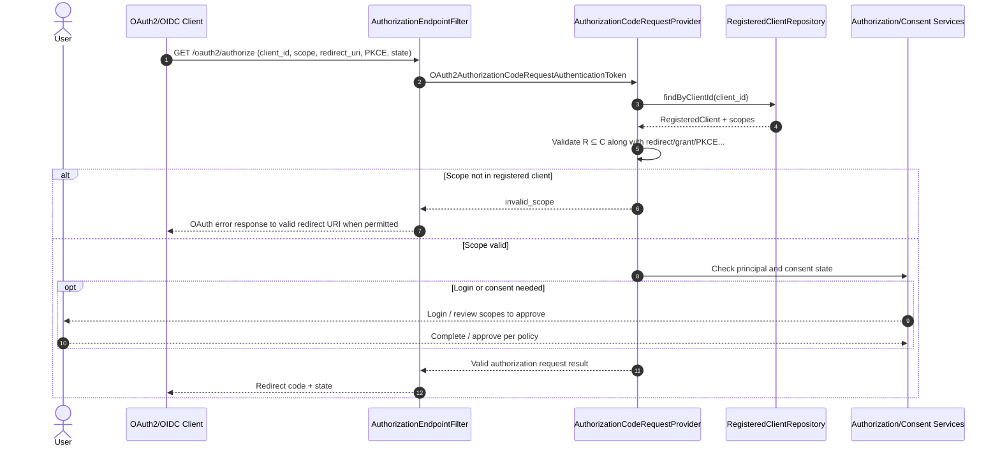
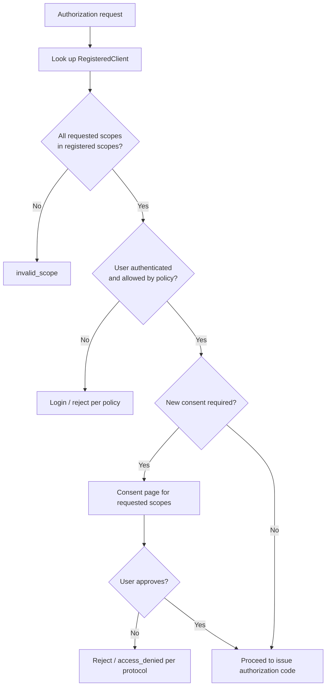
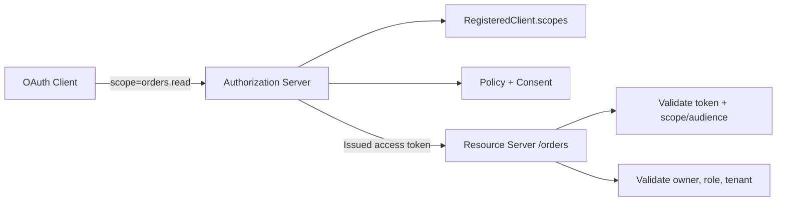

# Validating Requested Scopes Against Client Configuration

## 1. The Problem: A Client Registers a Set of Permissions but Requests Only a Subset

In a Spring Boot application using **Spring Security** and **Spring Authorization Server (SAS)** to build an OAuth 2.0/OpenID Connect (OIDC) Authorization Server, a client may be registered with multiple **scopes** while each authorization request only needs specific scopes.

For example, the web application `orders-portal` has these scopes in `RegisteredClient`:

```text
openid
profile
orders.read
orders.write
```

A user opens the view-orders feature; the client sends to the Authorization Endpoint:

```http
GET /oauth2/authorize?response_type=code
    &client_id=orders-portal
    &redirect_uri=https%3A%2F%2Fportal.example.com%2Flogin%2Foauth2%2Fcode%2Forders
    &scope=openid%20orders.read
    &state=STATE_RANDOM
    &code_challenge=CHALLENGE_S256
    &code_challenge_method=S256
```

Here, the **requested scopes** are `{openid, orders.read}`. This is a subset of the **registered scopes** `{openid, profile, orders.read, orders.write}`, so it passes the scope boundary check *if all other conditions are valid*. Conversely, if the client sends `orders.admin` even though it is not registered, the Authorization Server must reject the request in accordance with OAuth 2.0 rules, **never automatically granting** that scope.

This lesson in the **Authorization Endpoint** chapter focuses on this relationship: scopes in the request, scopes in `RegisteredClient`, validation logic at the authorization endpoint, user consent, effective permissions at the Resource Server, and how to test when customizing Spring Authorization Server.

After this lesson, the learner should be able to explain:

1. How `scope` in HTTP differs from `RegisteredClient.getScopes()` and from the `SCOPE_...` authority in Spring Security.
2. Which scope requests are accepted and which must be rejected.
3. How `OAuth2AuthorizationCodeRequestAuthenticationProvider` and validators participate in validation.
4. How to add a scope policy **without removing the default validator**.
5. Why scope validation at the Authorization Server does not replace consent, PKCE, client authentication, and per-resource authorization at the API.

> **Version scope:** Java examples follow the API style of **Spring Authorization Server 1.x / Spring Security 6.x**. In other Spring Security versions integrating Authorization Server or other SAS versions, configuration entry points and extension points may differ. Consult the official documentation/Javadoc for your target version before copying into a project.

## 2. What Scope Is and What It Is Not

OAuth 2.0 uses **scope** to represent the access boundary a client requests and the Authorization Server can grant. Specific scope values like `orders.read` or `billing.export` are defined by the system; OAuth itself does not know what "read an order" or "export data" means.

A `scope` parameter can contain multiple scope tokens separated by **spaces**. When placed in a URL, spaces are typically encoded as `%20`.

| Concept | Example | Meaning |
| --- | --- | --- |
| **Requested scopes** | `scope=openid%20orders.read` | Scopes the client requests for **this authorization attempt** |
| **Registered scopes** | `RegisteredClient.getScopes() = {openid, profile, orders.read}` | Upper bound from **client registration**; does not mean all scopes are granted by default |
| **Granted / authorized scopes** | `{openid, orders.read}` | Scopes the Authorization Server actually permits in the authorization result after appropriate checks |
| **Consent** | User approves `orders.read` | User decision per policy; cannot escalate privileges beyond client registration |
| **Token scope claim / response scope** | `scope: "orders.read"` | Information about the access token's scopes; must be checked per token format and protocol |
| **Spring Security authority** | `SCOPE_orders.read` | Permission representation that the Resource Server mechanism may map from a scope token to enforce rules |
| **Business authorization** | User is permitted to view order #123 | Permission on a specific object, which must be enforced in the Resource Server/application |

Scope tokens are typically **case-sensitive**: `orders.read` is not equivalent to `Orders.Read`. Separate tokens with spaces—do not use commas or a JSON list for the standard `scope` parameter. If a client sends duplicate `scope` parameters, the system must validate according to the endpoint's parsing/validation mechanism rather than arbitrarily picking the first or last value.

### 2.1. Do Not Equate Scope with Role

`orders.read` describes the permission the client is allowed to request to call an API; `ROLE_MANAGER` may be a user's role in the system; and `Order.ownerId == principal.id` is a data access condition. These three concepts can work together, but none replaces another.

For example, `orders-portal` is granted `orders.read` and Alice logs in successfully. That **does not prove** Alice is allowed to view Bob's orders. The Orders API still needs to evaluate owner/tenant/role rules before returning data.

### 2.2. OIDC `openid` Scope and Profile Scopes

In an OIDC request, `openid` is the special scope indicating the client wants to use OIDC to authenticate the user. Scopes such as `profile`, `email`, `address`, and `phone` have standard meanings in OIDC; however, actual claims depend on the data source, policy, and OP support/configuration.

- `openid` does **not** mean every API accepts the client's access token.
- `profile` does **not** automatically expose every personal field; disclosed data must follow claims policy.
- `email` does **not** guarantee `email_verified=true`; the two claims have distinct meanings.
- `orders.read` is a business scope, named and documented clearly by the application for clients/APIs.

If a client requests `openid` when `RegisteredClient` does not register this scope, the request does not pass validation merely because the OP has OIDC enabled. Similarly, an OAuth 2.0 client requesting only `orders.read` does not automatically receive an ID token.

## 3. The Core Validation Rule: requested ⊆ registered

Let:

- `R` be the **set of requested scopes** in the authorization request;
- `C` be the **set of registered scopes** on `RegisteredClient`;
- `G` be the **set of granted scopes** after valid checks and policy evaluation.

Baseline condition:

\[
R \subseteq C
\]

To grant permissions safely, scopes in the result must not automatically exceed what the client requested and is allowed:

\[
G \subseteq R \subseteq C
\]

When a requested scope is not permitted:

\[
R \setminus C \ne \varnothing \Rightarrow \texttt{invalid\_scope}
\]

This is a **boundary-validation model**, not a claim that SAS always silently computes the intersection `R ∩ C` and returns a partial grant when a request is invalid. In standard configuration, a request carrying scopes outside the allowlist must be rejected by validation, not "silently drop the dangerous scope and still issue a code" as a general rule.

### 3.1. Scenario Table

Suppose `RegisteredClient.scopes` is:

```text
{ "openid", "profile", "orders.read", "orders.write" }
```

| Requested scope (`R`) | Valid when compared against `C`? | Explanation |
| --- | --- | --- |
| `openid orders.read` | Yes | Both are registered |
| `orders.read` | Yes | Client asks for fewer than allowed; not an OIDC login without `openid` |
| `openid profile orders.read orders.write` | Yes | All scopes are within registration; still subject to consent/policy |
| `orders.admin` | No | Scope is not registered |
| `orders.read orders.admin` | No | Even **one** disallowed scope must cause rejection |
| `OpenId orders.read` | No | `OpenId` differs from `openid` |
| `openid,orders.read` | No per example list | Comma does not separate scope tokens; this is treated as a different single scope value |
| `scope` empty/omitted | Check policy/version | Spec allows using default scopes or rejecting; **never assume** full `C` is granted |

A scope that passes comparison against `RegisteredClient` can still be rejected at later steps—for example, if the client has an invalid `redirect_uri`, lacks the grant, omits PKCE, fails policy, has no authenticated user session, or consent is denied.

### 3.2. When Scope Is Omitted

RFC 6749 allows a client to omit `scope`; the Authorization Server must then handle it clearly, such as applying predefined **default scopes** or rejecting the request. Exact SAS behavior can depend on version, endpoint, client, and configuration; verify it with integration tests.

Never add logic like:

```java
// Anti-pattern example: never turn a missing scope into requesting all permissions.
if (requestedScopes.isEmpty()) {
    requestedScopes = registeredClient.getScopes();
}
```

This anti-pattern turns a request specifying no permissions into a request for maximum privileges. If the system needs default scopes, define a minimal policy, document it clearly, and test that path.

## 4. Where Are Scopes Validated in Spring Authorization Server?

In the Authorization Code Flow, `OAuth2AuthorizationEndpointFilter` receives `/oauth2/authorize`. A converter builds an `OAuth2AuthorizationCodeRequestAuthenticationToken`, which `AuthenticationManager` delegates to the appropriate provider—typically `OAuth2AuthorizationCodeRequestAuthenticationProvider`.

The provider uses `RegisteredClient`, the request, and validators to check conditions such as client/grant, redirect URI, and scopes. For unauthenticated requests, Spring Security requires the user to authenticate before completing authorization; for requests requiring consent, the user goes through the consent step.



The diagram illustrates the **logical processing path**. Intermediate redirects for login/consent, provider ordering, and actual request resumption may vary by version/configuration. If the **redirect URI is invalid**, the server must never send errors to the suspicious URI; that check is separate from handling `invalid_scope`.

### 4.1. Distinguishing Three Components

| Component | Role |
| --- | --- |
| `OAuth2AuthorizationCodeRequestAuthenticationConverter` | Reads authorization request parameters and creates an unauthenticated `Authentication` object |
| `OAuth2AuthorizationCodeRequestAuthenticationProvider` | Processes the request, combining client, redirect, scope, and state checks required to issue a code |
| `OAuth2AuthorizationCodeRequestAuthenticationValidator` | Default validator for authorization code requests; exposes redirect URI and scope validators for composition when extending |

Do not confuse `OAuth2AuthorizationCodeAuthenticationProvider` (the provider that **exchanges the code at the token endpoint**) when you only want to customize **scope validation at the authorization endpoint**. Those two providers handle different requests.

### 4.2. Checking via the RegisteredClient Model

In SAS 1.x, the scope list is configured when building a `RegisteredClient`:

```java
RegisteredClient ordersPortal = RegisteredClient.withId(stableId)
        .clientId("orders-portal")
        .clientName("Orders Portal")
        .clientAuthenticationMethod(ClientAuthenticationMethod.NONE)
        .authorizationGrantType(AuthorizationGrantType.AUTHORIZATION_CODE)
        .redirectUri(
            "https://portal.example.com/login/oauth2/code/orders")
        .scope(OidcScopes.OPENID)
        .scope(OidcScopes.PROFILE)
        .scope("orders.read")
        .scope("orders.write")
        .clientSettings(ClientSettings.builder()
            .requireProofKey(true)
            .requireAuthorizationConsent(true)
            .build())
        .build();
```

`stableId` is the client's durable internal key, distinct from `clientId`; the code above is only **an illustrative builder snippet**, omitting repositories, user authentication, token generators, persistence, JWKs, and full endpoint configuration.

Notable details:

- `scope(...)` is called multiple times to register permitted values. It does **not** grant all of those scopes to every request.
- `ClientAuthenticationMethod.NONE` suits a **public client**; authorization codes require PKCE via `requireProofKey(true)`.
- `requireAuthorizationConsent(true)` adds a user decision when required by the flow; an unregistered scope cannot become allowed simply because a user "clicks approve".
- Every callback must be in `redirectUris`; valid scopes cannot save a request with an unknown redirect URI.

## 5. Interpreting Validation Results and the invalid_scope Error

Under OAuth 2.0, `invalid_scope` indicates that a requested scope is invalid, unknown, malformed, or exceeds allowed bounds. At the Authorization Endpoint, when the request has a **verified valid redirect URI**, an error may be returned via redirect with `error` and matching `state` parameters.

Illustration when the client requests unregistered `orders.admin`:

```http
GET /oauth2/authorize?response_type=code
    &client_id=orders-portal
    &redirect_uri=https%3A%2F%2Fportal.example.com%2Flogin%2Foauth2%2Fcode%2Forders
    &scope=openid%20orders.admin
    &state=STATE_RANDOM
    &code_challenge=CHALLENGE_S256
    &code_challenge_method=S256
```

A redirect error response may look like:

```http
HTTP/1.1 302 Found
Location: https://portal.example.com/login/oauth2/code/orders?error=invalid_scope&state=STATE_RANDOM
```

This is an **example response shape** for learning the protocol contract, not a strict guarantee of HTTP status, optional parameters, or error handling across every SAS version. The Authorization Server may render an error page locally in situations where redirection is unsafe or invalid.

**Never do these three things:**

1. Return an authorization code successfully even though requested scopes exceed the client's allowlist.
2. Redirect an error to an unverified `redirect_uri`.
3. Log codes, tokens, credentials, or full URLs containing sensitive data just to diagnose `invalid_scope`.

For the token endpoint, scopes in the token response are interpreted per RFC and specific grant. The Authorization Code Grant does not allow using the code exchange step to request extra scopes that were never granted in the authorization request.

## 6. Consent: A Client-Valid Scope Is Not Automatically Approved by the User

Checking `R ⊆ C` is a mandatory prerequisite, but **it does not replace authorization consent**. For a client requiring consent, the user may be asked about the permissions the application is requesting.

Suppose `orders-portal` is registered with `orders.read` and `orders.write`:

1. On the first flow, the client requests `orders.read`, and Alice approves read access.
2. On a later flow, the client also requests `orders.write`; the client still passes `RegisteredClient` checks, yet an additional consent prompt may be needed.
3. If the client requests unregistered `orders.admin`, **it must not reach the consent screen for the user to approve**; the request must be rejected at the client/scope validation layer.



In SAS, `OAuth2AuthorizationConsent` and `OAuth2AuthorizationConsentService` persist approved permissions. Consented scopes may be represented as `GrantedAuthority` instances like `SCOPE_orders.read`; that is a **consent persistence representation**, not an implication that `ROLE_*` or every authority in `SecurityContext` is a client scope.

**Important:** consent screens and custom logic must never insert scopes outside `RegisteredClient.scopes` into the authorization state just because a user checked a box. Consent behavior can depend on version, client settings, and custom UI; always write integration tests.

## 7. Adding Scope Policies Beyond Default Registration

### 7.1. When Is a Custom Validator Actually Needed?

In most projects, **SAS's standard validator already checks whether requested scopes belong to registered scopes**. You do not need to reimplement `containsAll` merely to stop clients from requesting unregistered scopes.

Consider a custom policy only when there are **additional** business constraints, such as:

- `orders.export` may only be used by clients in an approved allowlist.
- A client may only request `finance.read` after an activation date and before a sunset timestamp.
- Tenant rules forbid a group of clients from requesting `customer.pii.read` even if that scope exists in their registration profile.
- Sensitive scopes must satisfy a specific profile or extra authentication/consent requirements.

Start by maintaining **`RegisteredClient.scopes`** and client governance workflows. Dynamic policies should rely on trusted data sources, auditing, and proper cache invalidation.

### 7.2. Rule of Thumb: Preserve Default Validation

A common pitfall when calling `setAuthenticationValidator(custom)` is **replacing the entire validator**. A custom validator that checks only `orders.export` can accidentally drop redirect URI validation, scope limits, or other default checks.

With the SAS 1.x API, you can compose the default redirect URI and scope validators with additional policy like this:

```java
Consumer<OAuth2AuthorizationCodeRequestAuthenticationContext> validator =
        OAuth2AuthorizationCodeRequestAuthenticationValidator
                .DEFAULT_REDIRECT_URI_VALIDATOR
        .andThen(OAuth2AuthorizationCodeRequestAuthenticationValidator
                .DEFAULT_SCOPE_VALIDATOR)
        .andThen(context -> {
            Set<String> requestedScopes = context.getAuthentication().getScopes();
            String clientId = context.getRegisteredClient().getClientId();

            // approvedExportClientIds is governed by the app and loaded from a trusted source.
            if (requestedScopes.contains("orders.export")
                    && !approvedExportClientIds.contains(clientId)) {
                throw new OAuth2AuthorizationCodeRequestAuthenticationException(
                        new OAuth2Error(OAuth2ErrorCodes.INVALID_SCOPE),
                        context.getAuthentication());
            }
        });
```

This is an **illustrative configuration snippet**, depending on imports and the `approvedExportClientIds` set provided by the application. Errors are signaled via the appropriate authorization request exception so the endpoint produces a safe OAuth error response. Do not expose internal policy details or sensitive data sources in error descriptions returned to clients.

### 7.3. Registering the Validator on the Right Provider

One extension pattern supported in SAS 1.x uses `authorizationEndpoint().authenticationProviders(...)` to locate `OAuth2AuthorizationCodeRequestAuthenticationProvider` and set the composed validator:

```java
OAuth2AuthorizationServerConfigurer authorizationServer =
        OAuth2AuthorizationServerConfigurer.authorizationServer();

http.securityMatcher(authorizationServer.getEndpointsMatcher())
    .with(authorizationServer, server -> server
        .authorizationEndpoint(authorizationEndpoint ->
            authorizationEndpoint.authenticationProviders(providers ->
                providers.forEach(provider -> {
                    if (provider instanceof
                            OAuth2AuthorizationCodeRequestAuthenticationProvider p) {
                        p.setAuthenticationValidator(validator);
                    }
                }))))
    .authorizeHttpRequests(auth -> auth.anyRequest().authenticated());
```

This code belongs inside a complete `SecurityFilterChain`/configuration; bean declarations, login chains, repositories, JWKs, and token generators are omitted. Verify the API for your version. In particular, if the system also accepts requests via **Pushed Authorization Requests (PAR)** or other extensions, ensure the scope policy applies on those paths too; never assume modifying one provider covers every request path.

If you only need to check whether scopes belong to client registration, **keep the standard validator**. Do not add duplicate policy code.

## 8. Separating Client Registration Limits from Business Authorization Policies

A production architecture typically has three layers:



1. **Client registration** sets the ceiling on what a client can request. For instance, `orders-portal` has `orders.read`.
2. **Authorization Server policy/consent** decides what is granted in a given interaction, based on user/client and product rules.
3. **Resource Server** validates the access token and permissions on the actual resource. For example, Alice can view only orders belonging to Alice's account even when the token carries `orders.read`.

Spring Security Resource Server example (assuming the application has already configured JWT validation/issuer/audience):

```java
@PreAuthorize("hasAuthority('SCOPE_orders.read')")
@GetMapping("/orders/{id}")
public OrderDto getOrder(@PathVariable UUID id, Authentication authentication) {
    // orderService must continue verifying the principal's permissions on id,
    // such as owner/tenant/role, before returning data.
    return orderService.getOrderVisibleTo(authentication, id);
}
```

`SCOPE_orders.read` is the common mapping when Spring Security translates a bearer token's scope into a `GrantedAuthority`. This mapping can be customized; the API still needs to verify `iss`, signature, expiration, `aud`, and business rules. If a client receives an ID token via OIDC, never use the ID token instead of an access token to call an API.

## 9. Designing Good Scopes to Prevent Over-Broad Requests

### 9.1. Scopes Should Be Fine-Grained, Meaningful, and Stable

| Design | Assessment | Recommendation |
| --- | --- | --- |
| `all` | Too broad; hard to audit and violates least privilege | Split into read, write, and export permissions |
| `orders.read` | Appropriate for an order-reading API | Pair with per-order authorization at the API |
| `orders.write` | Appropriate for order mutations | Split update, cancel, and approve if sensitivity differs |
| `orders.export` | Sensitive; can bulk-export data | Consider extra approval/policy gates |
| `openid` | Special OIDC scope | Register only when the client needs OIDC; separate from API scopes |
| `tenant-123-read` | Embedding tenant data in scope names causes scope explosion | Use a tenant claim + authorization checks at the Resource Server |

Changing scope names or semantics affects the contract between clients, the Authorization Server, and Resource Servers. Plan versioning, migration, and API documentation. Never use scopes as session tokens or pass sensitive data inside scope names.

### 9.2. Governance of Registered Scopes

Adding sensitive scopes should document: client owner, business justification, environment, target APIs, accessible data tier, approver, and change history. Adding a scope to `RegisteredClient` **expands what the client can request**, even if existing sessions have not yet been granted the new scope.

If multiple instances cache `RegisteredClient`, ensure scope updates propagate cleanly. If one instance retains stale scopes, validation results become inconsistent across requests.

### 9.3. Scope and Audience Are Not Interchangeable

A token with `orders.read` issued for API A should not automatically be accepted by API B. The Resource Server must check **audience** under its own contract, in addition to scope and issuer. Identical scope names across multiple APIs do not automatically grant an access token access to all of them.

## 10. Authorization Scope Test Matrix

For client `orders-portal` registered with `{openid, profile, orders.read, orders.write}`, cases to verify:

| Test | Request / condition | Expected outcome |
| --- | --- | --- |
| Valid subset | `scope=openid orders.read` | Proceeds if redirect, PKCE, user, and other conditions are valid |
| Single valid scope | `scope=orders.read` | Passes registered-scope check; not treated as OIDC automatically |
| All registered scopes | `scope=openid profile orders.read orders.write` | No `invalid_scope` merely for requesting the full set; subject to policy/consent |
| Unregistered scope | `scope=orders.admin` | `invalid_scope`, no code/token issued with that scope |
| Mixed valid and invalid | `scope=orders.read orders.admin` | Entire request rejected by validation |
| Case mismatch | `scope=Orders.Read` | Does not match `orders.read` |
| Comma separator | `scope=openid,orders.read` | Not treated as two standard scopes |
| Duplicate scope token | `scope=orders.read orders.read` | Clear parse/normalization behavior, no extra privilege; test for your version |
| Duplicate `scope` parameter | Two distinct `scope` query params | No ambiguous interpretation; verify rejection per actual parser |
| Omitted `scope` | No `scope` parameter | Default/reject per documented policy; never auto-grant all scopes |
| Invalid redirect URI, valid scope | Unregistered callback | Rejected; no redirect to unknown URI |
| Invalid scope, valid redirect URI | Valid callback, unregistered scope | Safe `invalid_scope` response |
| Wrong PKCE, valid scope | Mismatched `code_verifier` | Rejected during code exchange |
| User denies consent | Consent rejected | No unapproved permissions granted |
| User previously consented only to read | Client requests `orders.write` | Additional consent step triggered per policy |
| Custom policy blocks `orders.export` | Client registered the scope but lacks approval | Rejected per policy |
| Another client requests same scope | Client B lacks `orders.read` in registration | Enforces limits **per RegisteredClient** |
| Client A's code exchanged by Client B | Valid code format but wrong client | Rejected; no token issued |
| Resource Server gets token missing scope | Valid token lacking `orders.read` | API rejects request |
| Resource Server gets token with scope, wrong owner | Alice uses `orders.read` to view Bob's order | API rejects per business authorization |

### 10.1. Testing Real Behavior Over HTTP

Illustrative example calling the authorization endpoint with a test client:

```bash
curl -i -G "https://auth.example.com/oauth2/authorize" \
  --data-urlencode "response_type=code" \
  --data-urlencode "client_id=orders-portal" \
  --data-urlencode "redirect_uri=https://portal.example.com/login/oauth2/code/orders" \
  --data-urlencode "scope=openid orders.admin" \
  --data-urlencode "state=STATE_RANDOM" \
  --data-urlencode "code_challenge=CHALLENGE_S256" \
  --data-urlencode "code_challenge_method=S256"
```

This example uses placeholders and assumes an appropriate client/issuer; it is **not an immediately runnable end-to-end test command** because the authorization endpoint is a browser flow requiring user authentication/consent and a valid PKCE challenge. For integration tests, use `MockMvc` with an authenticated user to observe validation results under your real configuration.

Verify not only the HTTP status, but also `Location`, `error`, `state`, where the browser is redirected, the absence of an authorization code, and token/authorization store state when requests are rejected. Never emit tokens, codes, verifiers, or sensitive data in published test logs.

### 10.2. Testing Regressions Introduced by Custom Validators

If you override a validator to enforce custom policies, add regression tests ensuring:

- Unregistered scopes are still rejected by the standard validator.
- Unknown redirect URIs are still rejected; no open redirect exists.
- Clients with sensitive scopes outside the approved group are rejected.
- Approved clients with normal scopes and valid grants/consent still succeed.
- Other paths such as PAR, if enabled, do not bypass the policy.
- The token endpoint never accepts expanded scopes during authorization code exchange.

## 11. Common Operational Pitfalls

| Symptom | Common cause | How to investigate |
| --- | --- | --- |
| `invalid_scope` after a client release | New client requests a scope not yet registered | Compare `client_id`, `RegisteredClient.scopes`, and actual request |
| OAuth login succeeds without an ID token | Client lacks `openid`, or OIDC configuration is incomplete | Inspect requested scopes, OIDC endpoints, and token response |
| API returns 403 even though token endpoint succeeded | Access token lacks scope/authority or business permission | Check token `scope`/`scp`, authority mapping, and ownership |
| API returns 401 | Invalid token, wrong issuer/audience, or expired | Check Resource Server JWT/opaque token validation |
| Scope registered yet user must consent again | New scope not yet approved by user or required by policy | Check consent service, client settings, and requested scopes |
| One instance issues a code, another returns `invalid_scope` | Unsynchronized client cache/repository | Inspect database, caches, deployments, and issuer |
| Unknown callbacks accepted after adding a custom validator | Replacing the validator dropped default redirect checks | Restore default validators and add negative tests |
| Unclear how empty `scope` requests behave | Default policy undefined or untested | Define an explicit contract and test for your version |
| `orders.read` rejected even though another client can use it | Each client has its own `RegisteredClient.scopes` set | Look up the exact client by `client_id`; avoid arbitrary global scopes |

**Safe logging:** record correlation IDs, client IDs, endpoints, error codes, and **non-sensitive scope names** if allowed by policy. Avoid logging raw authorization URLs when they contain `code`, `state`, tokens, or session details. Never leak internal details about approved clients or confidential scope lists in error descriptions.

## 12. Design Exercise

An Authorization Server has three clients:

```text
orders-portal:
  scopes = {openid, profile, orders.read, orders.write}
  grant  = authorization_code

reports-console:
  scopes = {openid, reports.read, reports.export}
  grant  = authorization_code

inventory-worker:
  scopes = {inventory.read, inventory.write}
  grant  = client_credentials
```

The product team sets these requirements: `reports.export` may only be granted once a client is approved by InfoSec; `orders-portal` must never export reports; `inventory-worker` has no logged-in users.

Answer the following:

1. Should `orders-portal` requesting `openid orders.read reports.export` be issued a code? Why?
2. `reports-console` requests `openid reports.export` before InfoSec approval: which layer rejects it, even though the scope is registered?
3. Can Alice's consent allow `orders-portal` to gain `reports.export`?
4. When `inventory-worker` requests `inventory.write`, does scope validation happen at the authorization endpoint or the token endpoint? Why?
5. Does an `orders.read` token issued to Alice automatically allow viewing every order across the company?
6. If a custom validator returns success for all requests containing `reports.export`, which safeguards risk being bypassed?

**Answer hints:**

1. No; `reports.export` is not in `orders-portal`'s `RegisteredClient.scopes`, resulting in `invalid_scope`.
2. The additional policy in the authorization processing path must reject `reports.export` when the client is unapproved, alongside the default validator.
3. No; consent cannot expand client permissions beyond registration.
4. `client_credentials` is a **token endpoint** grant and does not pass through the browser authorization endpoint. Scope/grant validation and matching policy must run in the token endpoint provider.
5. No; the Resource Server still enforces owner, tenant, and data rules.
6. Default scope validation and redirect URI checks risk being lost if the entire validator is replaced instead of composed.

## 13. Pre-Production Checklist

1. **Model:** every client has an explicit registered scope set matching its grant types; no overly broad default scopes exist.
2. **Authorization request:** `scope` is parsed cleanly without ambiguity; every requested scope belongs to `RegisteredClient.scopes`.
3. **Flow security:** redirect URI checks, PKCE, client/grant checks, client-side `state`, and user authentication remain intact.
4. **Consent:** consent policies are explicit; unregistered scopes never appear on consent screens.
5. **Custom policies:** default validators are preserved when extending; no bypass exists via other endpoints/flows such as PAR.
6. **Tokens and APIs:** access tokens hold no permissions beyond what was granted; Resource Servers check issuer, audience, signature, scope, and resource permissions.
7. **Operations:** client registration changes require approval, auditing, cache invalidation, and multi-instance testing.
8. **Negative testing:** unknown scopes, wrong casing, unknown redirects, wrong PKCE, denied consent, cross-client misuse, and data-level permissions are all verified.

## 14. Reference Documentation

- [Spring Authorization Server — Protocol Endpoints](https://docs.spring.io/spring-authorization-server/reference/protocol-endpoints.html): Authorization Endpoint, `OAuth2AuthorizationCodeRequestAuthenticationProvider`, and customizing validation.
- [Spring Authorization Server — Core Model Components](https://docs.spring.io/spring-authorization-server/reference/core-model-components.html): `RegisteredClient`, `OAuth2Authorization`, `OAuth2AuthorizationConsent`, and services.
- [Spring Security — OAuth 2.0 Resource Server](https://docs.spring.io/spring-security/reference/servlet/oauth2/resource-server/index.html): access token validation, scope-to-authority mapping, and API authorization.
- [RFC 6749 — OAuth 2.0 Authorization Framework](https://www.rfc-editor.org/rfc/rfc6749): `scope` boundaries, `invalid_scope` errors, and authorization requests.
- [RFC 9700 — OAuth 2.0 Security BCP](https://www.rfc-editor.org/rfc/rfc9700): Authorization Code security principles, redirect URIs, and modern OAuth practices.
- [OpenID Connect Core 1.0](https://openid.net/specs/openid-connect-core-1_0.html): `openid` and OIDC scope semantics.

These examples illustrate the responsibilities of each layer in SAS; your exact framework version, product policies, and implementation determine final runtime behavior. Do not promote illustrative snippets directly to production without persistent repositories, signing keys, login/consent flows, and required integration tests.

**Key takeaway:** at the Authorization Endpoint, **requested scopes must belong to the scopes registered for that specific client**. This is an essential permission-limiting gate, though not the final word on user or API permissions. Preserving default validators when adding policies, handling `invalid_scope` safely, enforcing appropriate consent, and having Resource Servers validate resource-level permissions together form a secure OAuth 2.0/OIDC flow.
