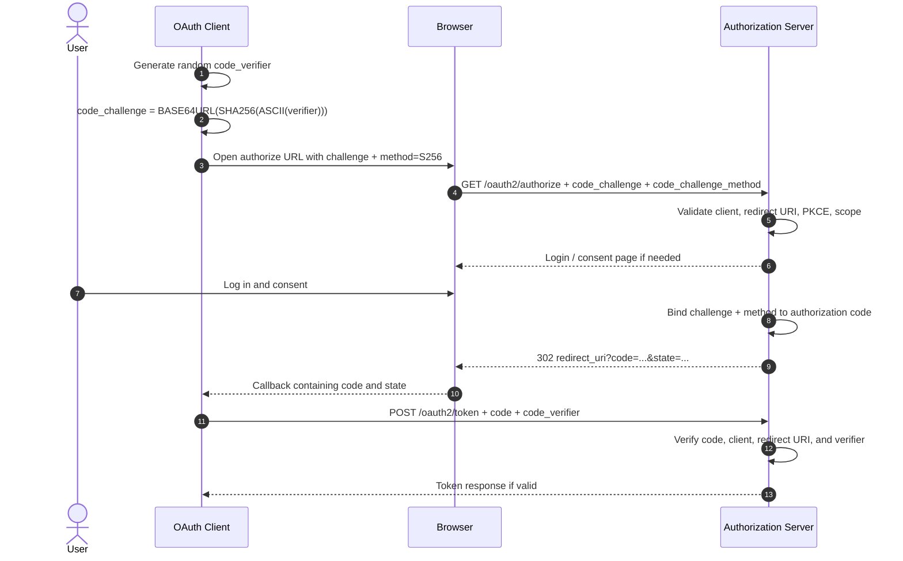
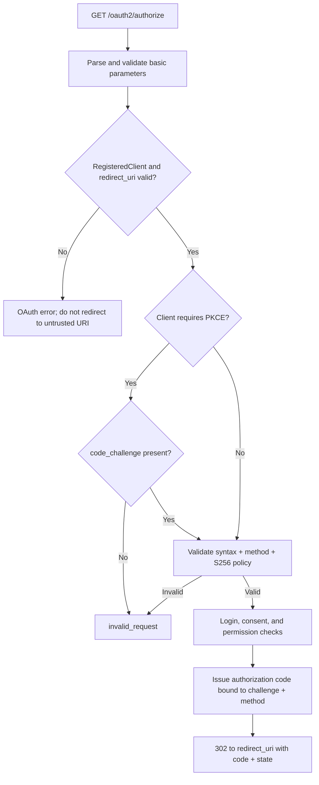
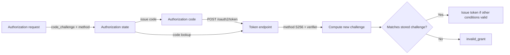

# Receiving code_challenge and code_challenge_method

## 1. The Problem at the Authorization Endpoint

In the **Authorization Endpoint** chapter of the **SPRING_SECURITY_OAUTH2_OIDC_AUTHORIZATION_SERVER** module, we learn how to design, configure, secure, test, and operate an OAuth 2.0/OpenID Connect Authorization Server with Spring Security and Spring Authorization Server in Spring Boot.

When a client opens `/oauth2/authorize` to initiate the **Authorization Code Flow**, the Authorization Server must accept and validate two parameters of **Proof Key for Code Exchange (PKCE)**:

- `code_challenge`: evidence derived from a random value held **solely by the client**.
- `code_challenge_method`: the transformation method used to derive `code_challenge` from `code_verifier`, typically `S256`.

At the Authorization Endpoint, the server **does not yet receive `code_verifier`** and **cannot yet prove the client knows the verifier**. This endpoint's job is to **validate PKCE syntax and policy, and then bind the challenge/method to the authorization code being issued**. Only at the Token Endpoint does the client send the verifier so the server can verify it and decide whether to issue tokens.

This is a critical safeguard if an authorization code leaks during redirection: anyone holding the code without a valid verifier cannot exchange it for an Access Token.

### Learning Objectives

After this lesson, you will be able to:

1. Explain the role, timing, and syntax of `code_challenge` and `code_challenge_method`.
2. Understand the difference between `S256` and `plain`, as well as the default rule when the method is omitted.
3. Describe how the Authorization Endpoint receives, validates, and stores the PKCE binding with the authorization code.
4. Register a `RegisteredClient` using the Authorization Code Flow with `requireProofKey(true)` enabled in Spring Authorization Server.
5. Generate valid `code_verifier` and `code_challenge` values, execute the browser flow, and exchange the code at the Token Endpoint.
6. Design rejection test cases: missing PKCE, unknown method, malformed challenge, mismatched verifier, expired code, or reused code.
7. Distinguish PKCE from `state`, `nonce`, client authentication, redirect URI validation, and TLS.

## 2. View the Entire Flow Before Analyzing the Two Parameters

### 2.1. Who Generates and Who Knows the Secret?

PKCE starts **on the client**, not on the Authorization Server. Each authorization transaction requires a fresh `code_verifier` generated using a cryptographically secure pseudorandom number generator (CSPRNG). The client computes `code_challenge` and sends the challenge to the Authorization Endpoint, while keeping the verifier secret until code exchange.



In practice, many backend clients handle the callback themselves after redirection, whereas SPA/browser clients call the token endpoint according to their implementation. The diagram focuses on the relationship between PKCE and the two endpoints.

### 2.2. Where Does Each Parameter Appear?

| Parameter | Where transmitted | Role | Kept secret? |
| --- | --- | --- | --- |
| `code_verifier` | **Token Endpoint**, in the code-exchange request | Single-use secret generated by the client to prove possession of the challenge. | **Yes**; never put in the authorize URL, logs, or analytics. |
| `code_challenge` | **Authorization Endpoint**, in the authorization request | Binding commitment stored by the server alongside the authorization transaction. | Not treated as a secret, yet still avoid unnecessary collection/logging. |
| `code_challenge_method` | **Authorization Endpoint** | Specifies how to transform the verifier into the challenge during code exchange. | Not secret. |
| `state` | Authorization request and authorization response | Links the callback to the prior request, helping prevent CSRF/mix-up depending on client implementation. | Unpredictable value that must be matched; does not replace the verifier. |
| `nonce` | OIDC request and ID Token when applicable | Binds the OIDC authentication result to the initial request. | Distinct from `state` and PKCE. |

The Authorization Endpoint **must never require the client to send `code_verifier`**. If the verifier is placed in the authorize URL, it may appear in browser history, `Referer` headers, or HTTP logs, defeating PKCE protection.

## 3. Syntax of code_verifier and code_challenge

### 3.1. Generating a Compliant code_verifier

RFC 7636 specifies `code_verifier` as a string of **43–128 characters** from the `unreserved` character set:

```text
ALPHA / DIGIT / "-" / "." / "_" / "~"
```

That is, only Latin letters, digits, and the four characters `- . _ ~`. Clients should use at least **256 bits of entropy**; the standard approach is drawing 32 cryptographically random bytes and encoding with unpadded Base64URL to produce a 43-character string.

Never use `Math.random()`, timestamps, sequential IDs, fixed passwords, or the same verifier across multiple authorization code requests.

### 3.2. S256 Is the Recommended Transformation

For `code_challenge_method=S256`, the standard formula is:

```text
code_challenge = BASE64URL-ENCODE(SHA256(ASCII(code_verifier)))
```

The SHA-256 digest is 32 bytes; when Base64URL-encoded **without padding**, the challenge is **43 characters** long. Here Base64URL uses `-` and `_` instead of `+` and `/`, omitting trailing `=` signs; this is **not cryptographic encryption**, but a URL-safe encoding of binary data.

A public test vector from RFC 7636:

```text
code_verifier  = dBjftJeZ4CVP-mB92K27uhbUJU1p1r_wW1gFWFOEjXk
code_challenge = E9Melhoa2OwvFrEMTJguCHaoeK1t8URWbuGJSstw-cM
method         = S256
```

These values are **test vectors only**—never use them as real verifiers in a deployed system. Clients must generate a fresh random value for **every** transaction.

### 3.3. The plain Method and Default Value When Method Is Omitted

RFC 7636 defines two initial methods:

| `code_challenge_method` | Formula | Assessment |
| --- | --- | --- |
| `S256` | `BASE64URL(SHA256(ASCII(code_verifier)))` | Preferred and should be enforced for modern clients. |
| `plain` | `code_challenge = code_verifier` | Exists solely for legacy compatibility; should not be used in new systems. |

**Easily overlooked specification detail:** if a request supplies `code_challenge` but **omits `code_challenge_method`**, RFC 7636 states the method **defaults to `plain`**. That does not mean a server must permit `plain` in every configuration. An Authorization Server enforcing an **S256-only** policy must reject requests that omit the method or specify `plain`, rather than silently treating them as `S256`.

Do not silently fall back from `S256` to `plain` when a client encounters errors; RFC 7636 warns against **PKCE downgrade attacks**. `S256` is mandatory to implement for servers supporting PKCE under RFC 7636, while accepting `plain` must follow an explicit compatibility policy. Reference: [RFC 7636, Sections 4.2–4.4](https://www.rfc-editor.org/rfc/rfc7636#section-4.2).

### 3.4. Challenge Syntax at the Authorization Endpoint

Under RFC 7636, `code_challenge` must also contain **43–128 characters** from the unreserved set; for standard SHA-256 `S256`, a valid challenge is **43 characters** of unpadded Base64URL. Examples:

```text
Valid S256:
E9Melhoa2OwvFrEMTJguCHaoeK1t8URWbuGJSstw-cM

Invalid:
abc                 # too short
abc+def/ghi=        # contains characters outside the PKCE challenge format
<excessively long>  # exceeds the 128-character limit
```

Validating length, character set, supported methods, and client policy must occur **before issuing an authorization code**. Never wait until the Token Endpoint to discover an unsupported method or malformed challenge.

## 4. What Must the Authorization Endpoint Process?

### 4.1. A Valid Authorization Request

Suppose public client `public-spa` is registered with callback `http://127.0.0.1:4200/callback`. The request typically navigates the browser to:

```http
GET /oauth2/authorize?response_type=code&client_id=public-spa&redirect_uri=http%3A%2F%2F127.0.0.1%3A4200%2Fcallback&scope=openid%20profile&state=<random-state>&code_challenge=E9Melhoa2OwvFrEMTJguCHaoeK1t8URWbuGJSstw-cM&code_challenge_method=S256 HTTP/1.1
Host: localhost:9000
```

In production, both the authorize URL and callback must satisfy HTTPS/redirect URI requirements for the client type and platform. `localhost`/loopback in this example is strictly for learning.

Core fields:

| Parameter | Example value | Validation |
| --- | --- | --- |
| `response_type` | `code` | Accept only response types allowed by both Authorization Server and client. |
| `client_id` | `public-spa` | Must match a valid `RegisteredClient`. |
| `redirect_uri` | `http://127.0.0.1:4200/callback` | Must satisfy matching rules against registered URIs; no arbitrary callbacks. |
| `scope` | `openid profile` | Only use scopes the client is allowed to request and the user approves when required. |
| `state` | Random string | Client generates, stores, and matches at callback; server echoes if valid. |
| **`code_challenge`** | `E9Mel...` | Verify presence when client requires PKCE, plus syntax and length. |
| **`code_challenge_method`** | `S256` | Verify method is supported and meets policy. |

The server must also handle user login state and consent as needed. **A request with a valid challenge is not enough to issue a code**, because the server must still authenticate the principal and validate client, redirect URI, scopes, and business conditions.

### 4.2. Verification Flow Upon Receipt

For a client configured to require PKCE, the Authorization Endpoint should proceed through these logical steps:

1. Parse the request and validate basic authorization parameters, including checking for duplicate sensitive parameters or decoding failures.
2. Look up `RegisteredClient` by `client_id`; verify the client is allowed `authorization_code` and `response_type=code`.
3. Validate `redirect_uri`. If the redirect URI is untrusted, **never redirect errors to that URI**.
4. Extract `code_challenge` and `code_challenge_method`.
5. If `RegisteredClient.getClientSettings().isRequireProofKey()` is `true`, reject if the challenge is missing.
6. Validate challenge and method per RFC 7636 and policy (prefer `S256`; reject `plain` if enforcing S256-only).
7. Validate scopes, login session, and consent; finally issue an authorization code **bound to the accepted challenge and method**.
8. Redirect to the exact registered callback, returning `code` and `state`, **never the verifier**.



The diagram focuses on the PKCE flow; when a client does not require PKCE per policy, a missing challenge may follow server compatibility rules. For modern public clients, **enforce PKCE** so there is no way to bypass this safeguard.

### 4.3. The Verifier Is Not Needed at This Step

The server cannot compare `code_verifier` at authorize time because the verifier **is not present** in that request. What the server does is store or bind **the approved challenge and method** to the authorization code. At the token endpoint, the client sends the verifier and the server recomputes the challenge using the stored method to compare.

Do not work around this by sending `code_verifier` in the authorize query string, storing it in a server-set browser cookie, or returning it in the redirect response. Doing so destroys PKCE's separation between the single-use secret and the public commitment.

## 5. Binding challenge/method to the Authorization Code

### 5.1. Why Store Both?

If you only store an authorization code and forget the challenge or method, the token endpoint lacks the evidence needed to verify which client initiated the transaction. If you store the challenge without the method, the token endpoint might apply the wrong transformation or let a client choose a different method during code exchange.

Logical data model for a newly approved authorization:

```text
authorization_code: <short-lived-one-time-code>
registered_client_id: <internal-registered-client-id>
principal_name: dev.user
redirect_uri: http://127.0.0.1:4200/callback
authorized_scopes: [openid, profile]
state: <original-state>
code_challenge: E9Melhoa2OwvFrEMTJguCHaoeK1t8URWbuGJSstw-cM
code_challenge_method: S256
code_expires_at: <short-expiry>
```

This is a **logical model**, not a mandatory database schema or the exact internal field layout of every Spring Authorization Server version. The framework typically holds authorization request/PKCE metadata inside `OAuth2Authorization` managed by `OAuth2AuthorizationService`, which the token endpoint later reads back.



**The binding must be immutable for a given code.** The token endpoint must never take a new `code_challenge_method` from the token request to override the original transformation, or borrow a challenge from a different authorization request.

### 5.2. Storage in Multi-Instance Environments

If node A issues an authorization code and node B receives the code-exchange request, both nodes must see the same authorization and PKCE state; an independent per-node `InMemoryOAuth2AuthorizationService` will not support this.

Production typically requires a persistent/shared repository, atomic updates, and mechanisms ensuring codes are **strictly single-use**. PKCE does not replace code TTLs, client checks, or redirect URI checks, nor does it solve race conditions when two requests exchange the same code concurrently.

Never write raw authorization codes, client secrets, or `code_verifier` values to audit logs. For persisted state holding challenges, store only what is necessary in an appropriately secured repository with restricted access and retention.

### 5.3. Relationship with TokenSettings

`TokenSettings.authorizationCodeTimeToLive(Duration)` bounds the code's lifetime; `ClientSettings.requireProofKey(true)` enforces PKCE for the client. These are **two distinct policies**:

```java
ClientSettings clientSettings = ClientSettings.builder()
        .requireProofKey(true)
        .requireAuthorizationConsent(true)
        .build();

TokenSettings tokenSettings = TokenSettings.builder()
        .authorizationCodeTimeToLive(Duration.ofMinutes(3))
        .build();
```

A short-lived code does not replace PKCE; likewise, PKCE does not allow a code to be valid indefinitely or reused.

## 6. Role of Spring Authorization Server

### 6.1. Components Handling the Authorization Endpoint

In a standard Spring Authorization Server configuration (Servlet stack), the components involved in an authorization code request include:

| Component | Role |
| --- | --- |
| `OAuth2AuthorizationEndpointFilter` | Receives requests to the Authorization Endpoint and coordinates converters, authentication manager, and success/error handlers. |
| `OAuth2AuthorizationCodeRequestAuthenticationConverter` | Converts the HTTP authorization request into an authentication request token carrying parameters. |
| `OAuth2AuthorizationCodeRequestAuthenticationToken` | Request model holding client ID, redirect URI, `state`, scopes, and `additionalParameters`. |
| `OAuth2AuthorizationCodeRequestAuthenticationProvider` | Processes the request, resolves the client, validates conditions, and creates the authorization/authorization code. |
| `OAuth2AuthorizationCodeRequestAuthenticationValidator` | Validates authorization parameters per the version's default validator/extension points. |
| `RegisteredClientRepository` | Retrieves client registrations and `ClientSettings`. |
| `OAuth2AuthorizationService` | Persists/retrieves authorization state needed for code exchange. |
| `OAuth2TokenEndpointFilter` and the authorization code provider | Verifies the verifier during code exchange alongside other checks before issuing tokens. |

In Spring Authorization Server 1.5.x, the `OAuth2AuthorizationEndpointConfigurer` API provides extension points such as `authorizationRequestConverter(...)`, `authenticationProviders(...)`, and `errorResponseHandler(...)`. **Do not write a custom controller replacing `/oauth2/authorize`** solely to parse challenges yourself, as it easily drops existing validations and protocol safeguards.

### 6.2. Reading PKCE Parameters from the Authentication Token

`OAuth2AuthorizationCodeRequestAuthenticationToken` exposes `getAdditionalParameters()`. The snippet below shows how **to inspect** the two parameters inside an appropriate callback/validator; it does not replace framework validation:

```java
import java.util.Map;
import org.springframework.security.oauth2.server.authorization.authentication.OAuth2AuthorizationCodeRequestAuthenticationToken;

public final class PkceRequestInspector {
    private PkceRequestInspector() {}

    public static void inspect(
            OAuth2AuthorizationCodeRequestAuthenticationToken request) {
        Map<String, Object> params = request.getAdditionalParameters();

        Object challenge = params.get("code_challenge");
        Object method = params.get("code_challenge_method");

        // Only inspect or validate types/values when needed.
        // Never log the raw request, authorization code, or code_verifier.
        boolean hasChallenge = challenge instanceof String s && !s.isBlank();
        boolean hasMethod = method instanceof String s && !s.isBlank();

        if (hasChallenge && hasMethod) {
            // Additional RegisteredClient-based policy can be enforced here,
            // while preserving the default protocol validators.
        }
    }
}
```

This snippet illustrates getters on the authentication token; it is **not invoked automatically by Spring**. If you need to enforce policies beyond the defaults, attach a custom validator at the proper extension point for your version. To verify which fields the converter extracts or forwards, check the API and request model of that specific version.

### 6.3. Configuring RegisteredClient to Require PKCE

Example public client using the Authorization Code Flow:

```java
import java.util.UUID;
import org.springframework.context.annotation.Bean;
import org.springframework.security.oauth2.core.AuthorizationGrantType;
import org.springframework.security.oauth2.core.ClientAuthenticationMethod;
import org.springframework.security.oauth2.server.authorization.client.RegisteredClient;
import org.springframework.security.oauth2.server.authorization.client.RegisteredClientRepository;
import org.springframework.security.oauth2.server.authorization.client.InMemoryRegisteredClientRepository;
import org.springframework.security.oauth2.server.authorization.settings.ClientSettings;

@Bean
RegisteredClientRepository registeredClientRepository() {
    RegisteredClient publicSpa = RegisteredClient.withId(UUID.randomUUID().toString())
            .clientId("public-spa")
            .clientAuthenticationMethod(ClientAuthenticationMethod.NONE)
            .authorizationGrantType(AuthorizationGrantType.AUTHORIZATION_CODE)
            .redirectUri("http://127.0.0.1:4200/callback")
            .scope("openid")
            .scope("profile")
            .clientSettings(ClientSettings.builder()
                    .requireProofKey(true)
                    .requireAuthorizationConsent(true)
                    .build())
            .build();

    return new InMemoryRegisteredClientRepository(publicSpa);
}
```

This is an illustrative bean to place **inside a `@Configuration` class in your project**. If you already have a `RegisteredClientRepository`, add the client to the existing repository rather than defining a duplicate bean. This snippet does not provide a complete Authorization Server on its own: you also need security filter chains, login, an authorization service, issuer configuration, signing key/JWK, and OIDC configuration when using `openid`.

Because a browser/SPA cannot reliably keep a client secret confidential, `ClientAuthenticationMethod.NONE` models a **public client**. `requireProofKey(true)` is an essential setting preventing public clients from skipping PKCE. This belongs to `ClientSettings`; do not confuse it with `TokenSettings`.

### 6.4. requireProofKey(true) Does Not Automatically Imply S256-Only

`requireProofKey(true)` requires the client to supply a proof key challenge and verifier when using the Authorization Code Grant. It **should not be taken as proof that every version accepts only `S256` and blocks all `plain` requests**.

If your product enforces an `S256-only` policy, inspect the PKCE validation behavior of your Spring Authorization Server version and add validation at the right extension point if needed. Custom policy logic at the Authorization Endpoint must:

- Accept only `code_challenge_method=S256`.
- Reject omitted methods rather than assuming `S256` (RFC 7636 defaults to `plain`).
- Ensure `code_challenge` is valid unpadded Base64URL SHA-256, 43 characters long.
- Preserve default validators for `redirect_uri`, `scope`, and framework PKCE checks.
- Stay compatible with the token endpoint flow: the verifier must still be checked using **the method bound to the code**.

Note: the official Spring Authorization Server documentation states that `OAuth2AuthorizationCodeRequestAuthenticationProvider.setAuthenticationValidator(...)` replaces the authorization request validator. Depending on version, the default validator handles parameters like redirect URI and scope; **completely replacing** it with a custom validator that checks only PKCE can accidentally drop critical security checks. Always chain validators properly and test rejection cases.

### 6.5. Never Rewrite the Token Endpoint to Compare PKCE Yourself

In Spring Authorization Server, the token endpoint already has a provider handling `authorization_code` and validating `code_verifier` against stored binding data. A custom controller naively comparing `code_verifier` with `code_challenge` without respecting the stored method will break on `S256`.

The **pseudocode** below is solely for understanding the formula, not a replacement for framework logic:

```java
// PSEUDOCODE; method/challenge are read from the verified authorization.
String expectedChallenge = authorization.getStoredCodeChallenge();
String method = authorization.getStoredCodeChallengeMethod();

String calculated = switch (method) {
    case "S256" -> base64UrlSha256(clientSuppliedCodeVerifier);
    case "plain" -> clientSuppliedCodeVerifier;
    default -> throw invalidGrant();
};

if (!securelyEquals(calculated, expectedChallenge)) {
    throw invalidGrant();
}
```

In a real application, let Spring Authorization Server handle this via its built-in providers; the pseudocode does not reflect exact method names on `OAuth2Authorization`. Comparison must also occur alongside code expiration/single-use checks, registered client validation, and redirect URI binding.

## 7. Generating a PKCE Pair in Java

### 7.1. Client Code Generating the Verifier with SecureRandom

A client can use the standalone Java helper below to generate a fresh verifier and compute the S256 challenge:

```java
import java.nio.charset.StandardCharsets;
import java.security.MessageDigest;
import java.security.NoSuchAlgorithmException;
import java.security.SecureRandom;
import java.util.Base64;

public final class PkceSupport {
    private static final SecureRandom RANDOM = new SecureRandom();
    private static final Base64.Encoder URL_ENCODER =
            Base64.getUrlEncoder().withoutPadding();

    private PkceSupport() {}

    public static String newVerifier() {
        byte[] randomBytes = new byte[32]; // 256 bits of entropy
        RANDOM.nextBytes(randomBytes);
        return URL_ENCODER.encodeToString(randomBytes);
    }

    public static String toS256Challenge(String verifier) {
        try {
            MessageDigest digest = MessageDigest.getInstance("SHA-256");
            byte[] hash = digest.digest(
                    verifier.getBytes(StandardCharsets.US_ASCII));
            return URL_ENCODER.encodeToString(hash);
        } catch (NoSuchAlgorithmException ex) {
            throw new IllegalStateException("SHA-256 is unavailable", ex);
        }
    }

    public static void main(String[] args) {
        String verifier = newVerifier();
        String challenge = toS256Challenge(verifier);
        System.out.println("method=S256, challenge=" + challenge);
        // Never print the verifier to logs in real applications.
    }
}
```

The code above uses `SecureRandom`, 32 bytes, and unpadded Base64URL. `newVerifier()` returns a 43-character string in the valid character set; `toS256Challenge(...)` returns a 43-character challenge. In a real product, verifier generation runs on the client, and the verifier is stored securely tied to the pending authorization transaction awaiting callback.

### 7.2. Never Share One Verifier Across All Requests

A web application might open two login tabs or start multiple transactions concurrently. If a single global `currentVerifier` variable is used and the second request overwrites the first, the token exchange for the first request will fail or mix flows.

Instead, the client must store the verifier separately **per transaction**, usually keyed by `state`/correlation ID in the session or a protected temporary store appropriate to the app type. After receiving the callback and matching `state`, the client retrieves the exact verifier bound to that request, uses it once, and deletes it per transaction lifecycle.

Never store the verifier in the callback URL, send it to browser analytics, or share it across clients or user sessions.

## 8. Hands-On Browser Walkthrough with a Test Vector

### 8.1. Preparing the Demo Environment

Suppose Spring Authorization Server is running at:

```text
http://localhost:9000
```

Sample client:

```text
client_id = public-spa
redirect_uri = http://127.0.0.1:4200/callback
grant = authorization_code
client authentication = none
requireProofKey = true
```

If no callback listener is running on port 4200 yet, the browser may show a connection error on the final redirect; in a **local environment using dummy data**, learners can still inspect the callback URL to observe `code` and `state`. Never copy codes manually from URLs as a production workflow.

### 8.2. Sending an Authorization Request with S256

To reproduce the computation, use the RFC 7636 test vector from section 3 and generate a fresh `state` for the test session. PowerShell example:

```powershell
$verifier = 'dBjftJeZ4CVP-mB92K27uhbUJU1p1r_wW1gFWFOEjXk'
$challenge = 'E9Melhoa2OwvFrEMTJguCHaoeK1t8URWbuGJSstw-cM'
$state = [guid]::NewGuid().ToString('N')
$redirect = [uri]::EscapeDataString('http://127.0.0.1:4200/callback')

$authorizeUrl = 'http://localhost:9000/oauth2/authorize' +
    '?response_type=code&client_id=public-spa' +
    "&redirect_uri=$redirect" +
    '&scope=openid%20profile' +
    "&state=$state" +
    "&code_challenge=$challenge&code_challenge_method=S256"

Start-Process $authorizeUrl
```

Note that fixed test vectors **must never be used in real environments**. In production, generate a random verifier/challenge on every request. Also use a sufficiently random `state` and verify it on the client.

The browser will redirect to login if unauthenticated, and possibly through a consent screen. On success, an example response is:

```http
HTTP/1.1 302 Found
Location: http://127.0.0.1:4200/callback?code=<authorization-code>&state=<same-state>
```

Authorization codes are short-lived and single-use. **Do not treat a successful redirect alone as complete validation**: the client must verify `state` matches its stored value and protect the code during token exchange.

### 8.3. Using the Verifier at the Token Endpoint

After receiving a valid, unused code:

```powershell
$code = '<authorization-code-from-callback>'

curl.exe -i -X POST 'http://localhost:9000/oauth2/token' -H 'Content-Type: application/x-www-form-urlencoded' --data-urlencode 'grant_type=authorization_code' --data-urlencode 'client_id=public-spa' --data-urlencode "code=$code" --data-urlencode 'redirect_uri=http://127.0.0.1:4200/callback' --data-urlencode "code_verifier=$verifier"
```

Because `public-spa` is registered as a **public client**, the request sends no `client_secret`. The server must use `code_verifier` to verify the challenge bound to the code. In this local test example, URLs use HTTP on loopback; real deployments require HTTPS and full transport security.

A successful response may look like:

```json
{
  "access_token": "<issued-access-token>",
  "token_type": "Bearer",
  "expires_in": 900,
  "scope": "openid profile",
  "id_token": "<issued-id-token-if-oidc-enabled>"
}
```

The JSON values are illustrative only; `id_token` appears only when OIDC is enabled and flow requirements are met. Public clients may be restricted from receiving Refresh Tokens depending on server configuration/policy; do not assume Refresh Tokens appear merely because PKCE is enabled.

### 8.4. Wrong Verifier Scenario

Initiate a **new authorization request** to get an unused code, then swap the verifier for another syntactically valid string. The server must reject the token request, typically returning OAuth error `invalid_grant` per RFC 7636. Do not test against a code that was already exchanged and assume the failure came from PKCE, because reused codes must also be rejected.

Illustrative error response:

```json
{
  "error": "invalid_grant"
}
```

Never log raw codes or verifiers. When debugging, log correlation IDs, client IDs, standardized error codes, and the rejection stage.

## 9. Authorization Endpoint Error Table to Recognize

| Request condition | How should it be handled? | Reason |
| --- | --- | --- |
| Public client with `requireProofKey(true)` omits `code_challenge` | Reject with `invalid_request` at authorize. | Skipping PKCE is not permitted. |
| Valid `code_challenge` and `code_challenge_method=S256` | Continue validating remaining conditions. | Recommended standard PKCE pattern. |
| Challenge present without method | Per RFC, method defaults to `plain`; **S256-only policy must reject**. | Never silently assume `S256`; prevents downgrade. |
| `code_challenge_method=plain` | Reject if enforcing S256-only; allow only under explicit compatibility policy. | `plain` exposes the verifier if the challenge is observed. |
| `code_challenge_method=S512` or unknown | Reject with `invalid_request` if unsupported. | Cannot be verified properly at the token endpoint. |
| Challenge empty or shorter than 43 characters | Reject. | Violates RFC 7636 syntax. |
| Challenge longer than 128 characters | Reject. | Violates RFC 7636 syntax. |
| Challenge contains `+`, `/`, `=`, or whitespace | Reject if not a permitted challenge form. | Invalid PKCE character set; S256 Base64URL has no padding. |
| `response_type` not registered for client | Reject per OAuth rules. | PKCE does not grant other grant/response types. |
| Unknown `client_id` | Reject. | No trusted client to bind the code to. |
| Invalid or unregistered `redirect_uri` | Reject; **never redirect to an untrusted URI**. | Prevents code leakage and open redirects. |
| Scope exceeds client permissions | Reject per OAuth/consent rules. | PKCE grants no extra permissions. |
| Duplicate, ambiguous PKCE parameters | Reject or handle strictly per verified converter/validator. | Prevent frontend/backend parsing discrepancies. |
| `code_verifier` present in authorization URL | Never design flows this way; treat as sensitive data sent to the wrong place. | Verifier must appear only at the token request. |

Distinguish **where rejections occur**: invalid challenge/method values are caught at the **Authorization Endpoint** before issuing a code; mismatched verifiers are caught at the **Token Endpoint** after the client already holds a code.

When the redirect URI is verified and an OAuth error can safely be returned via redirect, the server may return `error` and `state` to the callback; when the redirect URI is invalid or the client is untrusted, the server must never redirect to the unverified URI. Specific HTTP status codes and error details depend on context/version; do not assert solely on a single hardcoded status.

## 10. Distinguishing PKCE from Other Safeguards

### 10.1. PKCE and state

PKCE protects **exchanging the authorization code**: the party exchanging the code must know the verifier used at authorize time. `state` binds **the authorization response to the client-initiated request**, commonly protecting against CSRF/session mix-up. Both values may be generated together before redirecting, but they serve distinct responsibilities.

Do not drop `state` just because PKCE is enabled without thoroughly evaluating session/correlation and CSRF protections per your client library and standard. Also never reuse `state` as `code_verifier`: generate two independent values from a secure random source.

### 10.2. PKCE and Client Authentication

Confidential clients authenticate at the token endpoint using `client_secret_basic`, `private_key_jwt`, or another method. PKCE remains valuable because it prevents anyone lacking the verifier from using an intercepted code; this is **separate** from the client proving possession of a secret/private key.

Public clients such as SPAs/mobile apps lack a confidentially stored client secret; PKCE is essential for their Authorization Code Flow, though it does not turn a public client into a confidential client.

### 10.3. PKCE and Redirect URI

PKCE does not permit using arbitrary redirect URIs. The Authorization Server must verify callbacks against registered URIs. If both an authorization code and its verifier leak together, PKCE can no longer protect that transaction; hence HTTPS, strict URL controls, avoiding verifier logging, and secure storage channels remain mandatory.

### 10.4. PKCE and TLS

PKCE does not replace TLS. Login credentials, authorization codes, verifiers, and tokens still require transport protection. Never disable TLS certificate verification simply because `S256` is used.

### 10.5. PKCE and OIDC nonce

In OIDC, `nonce`—when used—binds the ID Token to the authentication request. It does not prove the client knows the verifier and does not replace PKCE. Additionally, the Authorization Endpoint may handle OIDC fields like `nonce`, `prompt`, and `max_age` depending on configuration; they do not alter the `S256` formula.

## 11. Integration Testing on Spring Authorization Server

### 11.1. Success and Failure Test Matrix

| Step | Test case | Expected outcome |
| --- | --- | --- |
| Authorization | Valid S256 challenge; client requires PKCE. | Proceeds to login/consent; issues code if all other conditions are valid. |
| Authorization | Missing challenge when `requireProofKey(true)`. | No code issued; `invalid_request` error. |
| Authorization | Missing method under S256-only policy. | Rejected; never silently assumed to be S256. |
| Authorization | Method is `plain` under S256-only policy. | Rejected. |
| Authorization | Unsupported method. | Rejected with `invalid_request`. |
| Authorization | Empty, 42-char, or 129-char challenge. | Rejected due to invalid syntax. |
| Authorization | Challenge has characters outside `unreserved`. | Rejected. |
| Authorization | Unregistered redirect URI. | Never redirects code/error to that URI. |
| Authorization | Scope disallowed for client. | Rejected per policy. |
| Token | Fresh valid code and original verifier. | Token issued if all other conditions pass. |
| Token | Wrong verifier. | Rejected, typically `invalid_grant`. |
| Token | Missing verifier for code with challenge. | Rejected. |
| Token | Reusing a code already exchanged. | Rejected because authorization codes are single-use. |
| Token | Expired code. | Rejected. |
| Token | Different `redirect_uri` from original request or wrong client. | Rejected. |
| Multi-node | Node A issues code; Node B receives token request. | Restores exact challenge/method from shared authorization state. |
| Concurrency | Two requests exchange the same code simultaneously. | Only one request succeeds in redeeming the code. |

A useful integration test verifies **both responses and state**: not only confirming that authorize returns a redirect, but also proving that a token request with a wrong verifier receives no token, while the matching verifier with an unused code succeeds.

### 11.2. Example Unit Test for Client-Side PKCE Calculation

The S256 formula itself can be unit-tested with JUnit 5:

```java
import static org.junit.jupiter.api.Assertions.assertEquals;
import org.junit.jupiter.api.Test;

class PkceSupportTest {

    @Test
    void computesRfc7636Challenge() {
        String verifier = "dBjftJeZ4CVP-mB92K27uhbUJU1p1r_wW1gFWFOEjXk";
        String expected = "E9Melhoa2OwvFrEMTJguCHaoeK1t8URWbuGJSstw-cM";

        assertEquals(expected, PkceSupport.toS256Challenge(verifier));
    }
}
```

This test validates only **the client transformation helper**; it does not prove the Authorization Server rejects invalid PKCE requests. You need a separate integration test exercising `/oauth2/authorize` and `/oauth2/token` or an equivalent test configuration to verify the end-to-end server behavior.

### 11.3. Testing an S256-Only Policy

If the application adds a validator accepting only S256, test at least:

1. A public client without a challenge cannot obtain an authorization code.
2. A request with a challenge but no method is rejected per policy (even though the RFC defaults to `plain`).
3. A request with `plain` is rejected.
4. A request with valid `S256` is accepted.
5. After adding the validator, re-verify that **unregistered redirect URIs** and **invalid scopes** are still rejected; this guarantees the custom validator did not drop default protections.

Avoid hardcoding expectations that every Spring Authorization Server version handles `plain` identically; tests must express your product policy and be verified against the actual runtime version.

## 12. Advanced Operational Scenarios

### 12.1. Pushed Authorization Requests (PAR)

With **Pushed Authorization Requests**, the client sends authorization parameters—including the PKCE challenge/method—via a direct request to the **PAR endpoint** and receives a `request_uri` for the browser to continue. When implementing PAR, the server must validate and preserve the PKCE binding across both phases, preventing the browser request from altering the previously pushed challenge.

Architecturally, PKCE must still be bound to **the issued authorization code**, and the verifier must still be used only at the Token Endpoint. Never treat PAR as a reason to drop PKCE for public clients.

### 12.2. Multiple Issuers and Multi-Tenancy

If a single application serves multiple issuers/tenants, client registrations, authorization states, redirect URIs, PKCE challenges/methods, and codes must be strictly scoped to the transaction's issuer. Tenant B's Token Endpoint must never redeem a code issued by Tenant A merely because it received a matching verifier.

PKCE enforces a binding within a transaction; **it does not validate tenant boundaries on its own**. Combine issuer, client, grant, authorization code, and scoped datastore checks.

### 12.3. SPA, Cookies, and CORS

For SPAs, `ClientAuthenticationMethod.NONE` and `requireProofKey(true)` are common, yet the OAuth client still needs to protect the verifier within the browser context and handle callbacks safely. CORS comes into play when an SPA calls the token endpoint via `fetch` from another origin, but **CORS does not replace PKCE**.

Never open CORS overly wide just to make a demo work. If using a Backend-for-Frontend (BFF), the backend can manage tokens and verifiers server-side instead of exposing tokens directly in the SPA; the choice depends on application architecture and risk profile.

### 12.4. Observability and Logging

Log only what is needed for operations: correlation ID, client ID, grant type, validation pass/fail, error category, and processing latency. Avoid logging:

- `code_verifier` and raw token requests;
- authorization codes or Access/Refresh Tokens;
- client secrets, session cookies, or unnecessary personal identifiers.

Do not use `code_challenge` as a stable client identifier for usage analytics, because every transaction needs its own challenge. When tracing flows, use a dedicated, protected correlation ID.

## 13. Misconceptions to Avoid

1. **"The Authorization Endpoint must verify `code_verifier` immediately."** False: the verifier is sent at the Token Endpoint; authorize only receives and binds the challenge/method.
2. **"Omitting the method makes the server default to S256."** False per RFC 7636: the default is `plain`; S256-only systems must explicitly reject missing methods.
3. **"Using plain is just as safe as S256 because of TLS."** False: `plain` exposes the verifier directly in the challenge if requests are observed; S256 prevents direct exposure.
4. **"Setting `requireProofKey(true)` automatically blocks every `plain` request."** Never assume; verify your version's behavior and policy.
5. **"PKCE replaces client authentication or redirect URI validation."** False: those mechanisms verify different principals and boundaries.
6. **"Having state means PKCE is unnecessary."** False: `state` does not force the party redeeming the code to know the verifier.
7. **"Having PKCE means state/nonce are unnecessary."** False: depending on client type, OIDC, and session binding, each mechanism remains necessary.
8. **"Reusing one verifier across multiple authorize calls saves resources."** False: a fresh high-entropy verifier must be generated per transaction.
9. **"The client can send a new method alongside the verifier at the Token Endpoint."** False: the method must already be bound to the code from the Authorization Endpoint.
10. **"Merely exchanging the code proves client authorization."** False: the code must also match the client, redirect URI, PKCE, and related conditions.

## 14. Self-Check Exercises

**Exercise 1 — Generate an S256 pair.** Write a Java function that generates a verifier using `SecureRandom` and computes the challenge. Verify length, character set, and the RFC 7636 test vector.

**Exercise 2 — Trace parameter handling.** For a request with `code_challenge` and `code_challenge_method=S256`, trace the path from `OAuth2AuthorizationEndpointFilter` to authorization state, and then to `OAuth2TokenEndpointFilter` when the verifier is submitted. Explain why the verifier does not belong in the authorization URL.

**Exercise 3 — Build an S256-only policy.** Describe the conditions to reject `plain` or missing methods. If using a custom validator, explain how to preserve `redirect_uri` and `scope` validators.

**Exercise 4 — Token endpoint failure.** A code is issued with a challenge derived from verifier A, but the client sends verifier B. Explain the comparison between `BASE64URL(SHA256(ASCII(B)))` and A's challenge, and state the expected error code.

**Exercise 5 — Two concurrent transactions.** A client initiates two authorization requests in two tabs. Design how to associate each `state` with its corresponding verifier without overwriting or mixing transactions.

**Exercise 6 — Multiple nodes.** Node A handles the authorization request and Node B handles the token request. Identify which storage/synchronization component must be shared so PKCE still validates and codes remain single-use.

### Lesson Completion Checklist

- [ ] Can name the two PKCE parameters accepted by the Authorization Endpoint and when the client generates them.
- [ ] Knows the `S256` formula and the RFC 7636 formats for `code_verifier` and `code_challenge`.
- [ ] Distinguishes `S256` from `plain` and knows a missing method defaults to `plain` per specification.
- [ ] Can configure `RegisteredClient` with `requireProofKey(true)`.
- [ ] Can explain how the authorization code is bound to challenge/method so the token endpoint can verify the verifier.
- [ ] Knows how to add an S256-only policy without dropping other security validators.
- [ ] Can execute the happy path and test wrong verifier, missing challenge, invalid method, and reused code.
- [ ] Distinguishes PKCE from `state`, `nonce`, redirect URI validation, client authentication, and TLS.
- [ ] Understands how to persist PKCE state across multiple nodes or multiple issuers.

## 15. Reference Standards and Further Reading

- [RFC 7636 — Proof Key for Code Exchange](https://www.rfc-editor.org/rfc/rfc7636) — defines `code_verifier`, `code_challenge`, `S256`, `plain`, and token endpoint verification.
- [RFC 6749 — OAuth 2.0 Authorization Framework](https://www.rfc-editor.org/rfc/rfc6749) — Authorization Code Grant, authorization endpoint, token endpoint, and redirect URIs.
- [RFC 9700 — Best Current Practice for OAuth 2.0 Security](https://www.rfc-editor.org/rfc/rfc9700) — modern Authorization Code Flow and PKCE security recommendations.
- [RFC 9126 — OAuth 2.0 Pushed Authorization Requests](https://www.rfc-editor.org/rfc/rfc9126) — sending authorization requests via the PAR endpoint.
- [Spring Authorization Server: PKCE for SPA](https://docs.spring.io/spring-authorization-server/reference/guides/how-to-pkce.html) — configuring public clients and `requireProofKey(true)`.
- [Spring Authorization Server: Protocol Endpoints](https://docs.spring.io/spring-authorization-server/reference/protocol-endpoints.html) — Authorization Endpoint components and validation extension points.
- [Spring Authorization Server: RegisteredClient and ClientSettings](https://docs.spring.io/spring-authorization-server/reference/core-model-components.html) — client policies and core models.
- [Spring Security Reference](https://docs.spring.io/spring-security/reference/) — OAuth 2.0 Client, login, and servlet security.
- [OpenID Connect Core 1.0](https://openid.net/specs/openid-connect-core-1_0.html) — `openid` scope, `nonce`, and OIDC requirements.

**Core outcome:** The Authorization Endpoint **receives, validates, and binds** `code_challenge` and `code_challenge_method` to the authorization code; the Token Endpoint **verifies `code_verifier`**. Configuring `requireProofKey(true)` and enforcing `S256` protects the Authorization Code Flow against stolen code redemption, provided the system continues enforcing client, redirect URI, code TTL, and related OAuth policies.
