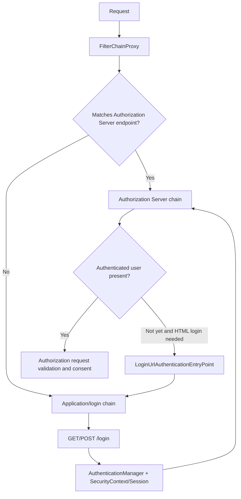

# Handling Unauthenticated Users and Redirecting to Login

## 1. Context

In the **Authorization Code Flow** of OAuth 2.0/OpenID Connect (OIDC), a client application redirects the browser to the **Authorization Endpoint**, typically `GET /oauth2/authorize`. Before issuing an authorization code, the server needs to know who the end user is, validate the client's request, and determine whether consent is required. However, the user might not be logged in yet, their session may have expired, or reauthentication may be requested.

In Spring Boot, **Spring Authorization Server** handles the authorization protocol, while **Spring Security** provides user authentication, the security context, sessions, login entry points, and form login. They must coordinate to send the browser to the login page, **preserve the OAuth transaction context**, and return to the Authorization Endpoint after successful authentication.

This lesson belongs to the **Authorization Endpoint** chapter of the `SPRING_SECURITY_OAUTH2_OIDC_AUTHORIZATION_SERVER` module. It is part of learning to design, configure, secure, test, and operate an OAuth 2.0/OIDC Authorization Server with Spring Security and Spring Authorization Server in Spring Boot.

### Learning Objectives

After this lesson, you will be able to:

1. Distinguish an unauthenticated user, an unrecognized OAuth client, a consent prompt, and the authorization code exchange step.
2. Explain the path through `SecurityFilterChain`, `AuthenticationEntryPoint`, `RequestCache`, `SecurityContext`, and the login success handler.
3. Configure two security filter chains so browsers receive a login redirect while the token endpoint still returns appropriate OAuth errors.
4. Protect the authorization request context across login using CSRF/session/cookies and redirect URL controls.
5. Test scenarios with/without an active session, multiple tabs, OIDC `prompt`, reverse proxies, 302/401/403 errors, and lost saved requests.

> **Version note:** Primary code uses Spring Authorization Server **1.x** with Spring Security **6.2+**: `OAuth2AuthorizationServerConfigurer.authorizationServer()` and `HttpSecurity.with(...)`. In Spring Security 7.x, the integrated Authorization Server DSL may use different syntax. Verify APIs/imports against your actual version before running.

## 2. Roles That Must Never Be Confused

| Question | Component | Example |
| --- | --- | --- |
| Is the user logged in yet? | Spring Security user authentication, `SecurityContext` | Whether the session holds a valid `Authentication` |
| Which client is requesting authorization? | Authorization Server, `RegisteredClientRepository` | `client_id=orders-web` |
| Is the client allowed to use the redirect URI, grant, and scopes? | Authorization Endpoint and related authentication providers | Callback URI must match registration |
| Has the user approved the scopes for the client? | Consent policy/`OAuth2AuthorizationConsentService` | Consent for `orders.read` |
| Can the code be exchanged for tokens? | Token Endpoint, client/grant authentication | Valid code, client authentication, PKCE |
| Does the API allow access to the data? | Resource Server | `iss`, `aud`, scopes, and business permissions |

**Login is not consent.** Entering the right password does not mean the user agrees to grant every scope. **Login is also not client authentication**: a confidential OAuth client may still need to authenticate with a client secret or private key at the token endpoint.

The Authorization Endpoint receives `client_id` via the browser to look up metadata; never send a backend client secret through the browser. The login form collects passwords directly on the Authorization Server's domain, not on the OAuth2 Client and not at `POST /oauth2/token`.

## 3. Standard Flow When the Browser Lacks an Authenticated Session

Suppose:

- OAuth2/OIDC Client: `https://orders.example.com`.
- Authorization Server: `https://auth.example.com`.
- Authorization Endpoint: `https://auth.example.com/oauth2/authorize`.
- Login page: `https://auth.example.com/login`.
- Registered callback: `https://orders.example.com/login/oauth2/code/orders-web`.

```mermaid
sequenceDiagram
    autonumber
    actor U as User
    participant B as Browser
    participant C as Orders Web
    participant AS as Authorization Server
    participant RC as RequestCache / Session
    participant L as Spring Security Login
    U->>C: Click login
    C->>C: Generate state, PKCE; nonce if OIDC
    C-->>B: Redirect to /oauth2/authorize
    B->>AS: GET /oauth2/authorize?... (session cookie if present)
    AS->>AS: No authenticated principal yet
    AS->>RC: Save request to restore
    AS-->>B: 302 Location: /login
    B->>L: GET /login
    L-->>B: HTML form + CSRF token
    U->>B: Enter username/password
    B->>L: POST /login + CSRF
    L->>L: AuthenticationManager authenticates user
    L->>RC: Save SecurityContext into session
    L-->>B: Redirect back to saved authorization request
    B->>AS: GET /oauth2/authorize?...
    AS->>AS: Validate client, redirect URI, grant, scope, PKCE
    opt Consent required
        AS-->>B: Display consent screen
        U->>AS: Approve or deny
    end
    AS-->>B: Redirect to client?code=...&state=...
    B->>C: Callback with code/state
    C->>C: Verify transaction state
    C->>AS: POST /oauth2/token with code, PKCE/client authentication
    AS-->>C: Token response if valid
```

This is the **typical flow** with a browser and form login. If a valid user session already exists, the Authorization Server may skip the login step. For OIDC requests demanding non-interactive processing or reauthentication, rules also depend on `prompt`, `max_age`, and implementation policy/version.

### 3.1. The Authorization Request Must Be Preserved Intact

The example request is wrapped across lines for readability; real HTTP uses a single valid percent-encoded URL/query:

```http
GET /oauth2/authorize?response_type=code&
    client_id=orders-web&
    redirect_uri=https%3A%2F%2Forders.example.com%2Flogin%2Foauth2%2Fcode%2Forders-web&
    scope=openid%20profile%20orders.read&
    state=RANDOM_STATE&
    code_challenge=BASE64URL_SHA256_CHALLENGE&
    code_challenge_method=S256&
    nonce=RANDOM_NONCE HTTP/1.1
Host: auth.example.com
Accept: text/html
```

After login, the system must resume **the exact same request** with its `client_id`, `redirect_uri`, `scope`, `state`, `code_challenge`, and `nonce`. Never redirect the user to a hand-crafted URL that drops or alters security parameters.

### 3.2. Why Return a Redirect Instead of Issuing a Code Immediately?

An authorization code is bound to **a validated client and an authenticated user**, along with a verified authorization request. Before authenticating the user, the server has no principal to associate with the authorization. It must initiate login rather than issuing a code to an anonymous user.

Illustrative redirect response:

```http
HTTP/1.1 302 Found
Location: /login
```

The `Location` value may be a context-relative path or an absolute URL, depending on the entry point and proxy setup. In production, the browser must reach the proper **public HTTPS login URL** without downgrading to HTTP or leaking an internal hostname.

## 4. How Does Spring Security Decide to Redirect?

### 4.1. FilterChainProxy and Two SecurityFilterChains

Spring Security selects **the first SecurityFilterChain whose matcher matches the request**. An Authorization Server typically separates:

| Filter chain | Typical requests | Role |
| --- | --- | --- |
| **Higher-priority chain `@Order(1)`** | `/oauth2/authorize`, `/oauth2/token`, and protocol endpoints | OAuth2/OIDC filters, validating protocol requests |
| **Application chain `@Order(2)`** | `/login`, `/logout`, MVC pages, UI assets | Form login, user authentication, session/CSRF |



`securityMatcher(...)` defines **chain scope**, whereas `requestMatchers(...)` inside `authorizeHttpRequests` determines **access rules once a chain is chosen**. If the first chain uses an overly broad matcher, it can swallow `/login` and trigger redirect loops or 404 errors.

### 4.2. AuthenticationEntryPoint

When a protected request requires an authenticated user but no valid `Authentication` exists, Spring Security's exception handling selects an **`AuthenticationEntryPoint`**. For HTML-accepting requests, `LoginUrlAuthenticationEntryPoint("/login")` sends the browser to the login page.

**`ExceptionTranslationFilter`** is the central component translating unauthenticated/access-denied exceptions into responses; when initiating authentication, it coordinates with `RequestCache` to save the request before invoking the entry point.

Spring Authorization Server's protocol filters and providers remain responsible for protocol validation. Never build a custom `/oauth2/authorize` controller that redirects manually on `session == null` to replace the framework, as doing so easily skips `redirect_uri`, grant, and standard error-response validation.

### 4.3. Why Restrict Login Redirects to HTML?

Interactive browsers typically send `Accept: text/html` and need a login UI. However, a backend calling `POST /oauth2/token` does not want HTML; invalid client authentication or bad code/PKCE needs proper OAuth2 errors like `invalid_client` or `invalid_grant`.

Therefore, configure `LoginUrlAuthenticationEntryPoint` specifically for **HTML browser requests** via `MediaTypeRequestMatcher(MediaType.TEXT_HTML)`, rather than unconditionally redirecting every request to `/login`. Requests with other `Accept` headers or clients sending custom headers must be verified via integration tests rather than assuming every caller sends browser-like headers.

## 5. Configuring Two Security Chains in Spring Authorization Server 1.x

```java
import org.springframework.context.annotation.Bean;
import org.springframework.context.annotation.Configuration;
import org.springframework.core.annotation.Order;
import org.springframework.http.MediaType;
import org.springframework.security.config.Customizer;
import org.springframework.security.config.annotation.web.builders.HttpSecurity;
import org.springframework.security.config.annotation.web.configuration.EnableWebSecurity;
import org.springframework.security.oauth2.server.authorization.config.annotation.web.configurers.OAuth2AuthorizationServerConfigurer;
import org.springframework.security.web.SecurityFilterChain;
import org.springframework.security.web.authentication.LoginUrlAuthenticationEntryPoint;
import org.springframework.security.web.util.matcher.MediaTypeRequestMatcher;

@Configuration
@EnableWebSecurity
public class SecurityConfig {

    @Bean
    @Order(1)
    SecurityFilterChain authorizationServerSecurityFilterChain(HttpSecurity http)
            throws Exception {

        OAuth2AuthorizationServerConfigurer authorizationServer =
                OAuth2AuthorizationServerConfigurer.authorizationServer();

        http
            .securityMatcher(authorizationServer.getEndpointsMatcher())
            .with(authorizationServer, configurer ->
                configurer.oidc(Customizer.withDefaults()))
            .authorizeHttpRequests(authorize ->
                authorize.anyRequest().authenticated())
            .exceptionHandling(exceptions -> exceptions
                .defaultAuthenticationEntryPointFor(
                    new LoginUrlAuthenticationEntryPoint("/login"),
                    new MediaTypeRequestMatcher(MediaType.TEXT_HTML)))
            // OIDC UserInfo and endpoints requiring Bearer JWT.
            .oauth2ResourceServer(resourceServer ->
                resourceServer.jwt(Customizer.withDefaults()));

        return http.build();
    }

    @Bean
    @Order(2)
    SecurityFilterChain applicationSecurityFilterChain(HttpSecurity http)
            throws Exception {

        http
            .authorizeHttpRequests(authorize ->
                authorize.anyRequest().authenticated())
            .formLogin(Customizer.withDefaults());

        return http.build();
    }
}
```

**Scope:** This illustrates the filter chains only, not a complete Spring Boot application. To run, you also need a user source, `RegisteredClientRepository`, `OAuth2AuthorizationService`, `AuthorizationServerSettings`, and the signing key/`JwtDecoder` beans required when enabling OIDC/JWT. `oauth2ResourceServer().jwt()` also needs an appropriate decoder to serve OIDC endpoints that accept Bearer JWTs.

Explanation of key points governing redirect behavior:

1. `@Order(1)` ensures authorization requests enter the protocol chain.
2. `getEndpointsMatcher()` bounds chain 1 so it does not capture `/login`.
3. `LoginUrlAuthenticationEntryPoint("/login")` points to **the Authorization Server's login page**, not the OAuth client's `redirect_uri`.
4. The `text/html` matcher routes interactive requests to login.
5. `formLogin(Customizer.withDefaults())` provides the default GET login page and handles POST login on the application chain.
6. After login, session/saved-request handling returns the browser to the Authorization Endpoint with its prior transaction context.

Never change chain 1's `securityMatcher` to `/**` and never enable global login redirects for token/introspection requests. Verify via HTTP/browser tests rather than inferring solely from code.

## 6. RequestCache, SecurityContext, and Login Success Handler

### 6.1. RequestCache Preserves the Return Destination

In the standard flow, `GET /oauth2/authorize` is saved before redirecting to login, typically via `HttpSessionRequestCache`. After login succeeds, a handler like `SavedRequestAwareAuthenticationSuccessHandler` redirects the browser back to the **SavedRequest**.

Redirect sequence:

```text
GET /oauth2/authorize?...  (no authenticated session)
    -> 302 /login
GET /login
POST /login             (password + CSRF token)
    -> 302 /oauth2/authorize?...  (saved request)
GET /oauth2/authorize?... (authenticated session now present)
    -> proceed to authorization/consent
    -> 302 https://orders.example.com/login/oauth2/code/orders-web?code=...&state=...
```

**SavedRequest is not OAuth2AuthorizationService.** RequestCache helps return to the original path; `OAuth2AuthorizationService` manages authorization code/token state; `OAuth2AuthorizationConsentService` stores consent per policy.

If you write a custom login success handler, preserve support for valid SavedRequests, and never redirect based on an unchecked `returnUrl` parameter due to **open redirect** risks.

### 6.2. Do Not Force Successful Logins to a Fixed Dashboard

The following configuration breaks the flow:

```java
// Avoid forcing every login to a fixed page:
.formLogin(form -> form.defaultSuccessUrl("/dashboard", true))
```

Setting `alwaysUse` to `true` forces the handler to go to `/dashboard`, discarding the SavedRequest. Users can log in, yet the OAuth Client never receives an authorization code. If you want a default landing page for direct logins, configure the success handler so it still prioritizes **the pending saved request** whenever present.

### 6.3. SecurityContext and User Sessions

`UsernamePasswordAuthenticationFilter` reads the form, invokes `AuthenticationManager`/`AuthenticationProvider`, and Spring Security persists the resulting `Authentication` in `SecurityContext` via the configured session/persistence mechanism.

When the browser returns to `/oauth2/authorize`, the session cookie lets the server recognize the authenticated principal. If the cookie is not sent back (wrong `Secure`, `SameSite`, `Path`, domain, or timeout), the request can loop back to login indefinitely.

Never apply `SessionCreationPolicy.STATELESS` across the entire browser authorization flow if your system relies on sessions for login, CSRF, and RequestCache. In multi-node clusters, use a shared session store or proper consistency strategy; the authorization request before login and after login may hit different instances.

### 6.4. Two Tabs, Two Authorization Requests

Example:

```text
Tab A: /oauth2/authorize?client_id=orders-web&state=A...
Tab B: /oauth2/authorize?client_id=reports-web&state=B...
```

A session's RequestCache is not necessarily a queue supporting unlimited concurrent independent transactions. When a user logs in from one tab, verify which request gets restored instead of assuming both tabs' URLs are retained separately. On the OAuth Client side, you **must** maintain per-transaction `state` and PKCE to detect out-of-context callbacks.

If implementing a custom RequestCache, enforce request age limits, session binding, ownership, valid redirect destinations, and permitted parameters; never store a shared static `redirect_uri`/`state` across users.

## 7. Default Login Form and User Accounts

Spring Security typically provides these steps:

1. Browser requests `GET /login`: HTML form (when using the default page).
2. Browser submits `POST /login` with `username`, `password`, and CSRF token.
3. `CsrfFilter` validates the token per configuration.
4. `UsernamePasswordAuthenticationFilter` builds an authentication request.
5. `AuthenticationManager` invokes a provider, such as `DaoAuthenticationProvider` backed by `UserDetailsService` and `PasswordEncoder`.
6. On success, `SecurityContext` is saved and the success handler redirects.
7. On failure, no authenticated session is created; the browser is sent to the login error view.

**Do not write a custom `POST /login` controller handling passwords yourself** when using default form login. If you need MFA, account lockout, or LDAP/IdP integration, use the appropriate authentication provider/extension flow.

### 7.1. A Test User Source

```java
@Bean
PasswordEncoder passwordEncoder() {
    return PasswordEncoderFactories.createDelegatingPasswordEncoder();
}

@Bean
UserDetailsService userDetailsService(PasswordEncoder encoder) {
    UserDetails learner = User.withUsername("learner")
            .password(encoder.encode("test-password-only"))
            .roles("USER")
            .build();
    return new InMemoryUserDetailsManager(learner);
}
```

This snippet is suitable **for demos/tests only**; never use hard-coded accounts/passwords in production. Real deployments manage credentials via an identity store, strong password hashing parameters, MFA, rate limiting, and audit logs free of sensitive data.

## 8. Switching to a Custom Login Page Without Breaking the Flow

Suppose the product uses `/signin`. You must update **both** the protocol chain's entry point and the application chain's login configuration.

In the Authorization Server chain:

```java
.exceptionHandling(exceptions -> exceptions
    .defaultAuthenticationEntryPointFor(
        new LoginUrlAuthenticationEntryPoint("/signin"),
        new MediaTypeRequestMatcher(MediaType.TEXT_HTML)))
```

In the application chain:

```java
.authorizeHttpRequests(authorize -> authorize
    .requestMatchers("/signin", "/assets/**").permitAll()
    .anyRequest().authenticated())
.formLogin(form -> form
    .loginPage("/signin")
    .loginProcessingUrl("/signin")
    .failureUrl("/signin?error")
    .permitAll())
```

These are **abbreviated configuration snippets** to substitute into each chain, not two new beans. You must provide a GET controller and view for `/signin`; once you customize the login page, Spring Security no longer generates default HTML for it.

```java
@Controller
class SigninController {
    @GetMapping("/signin")
    String signin() {
        return "signin"; // Thymeleaf view signin.html
    }
}
```

Example form with a CSRF token:

```html
<form th:action="@{/signin}" method="post">
  <label for="username">Username</label>
  <input id="username" name="username" autocomplete="username" required>

  <label for="password">Password</label>
  <input id="password" type="password" name="password"
         autocomplete="current-password" required>

  <input type="hidden"
         th:name="${_csrf.parameterName}"
         th:value="${_csrf.token}">
  <button type="submit">Sign in</button>
</form>
```

The example includes the CSRF field **explicitly**; some Thymeleaf/Spring MVC setups auto-inject it on POST forms. Pick one approach consistently to avoid duplicate hidden fields. `th:action="@{/signin}"` builds context-path-aware URLs when components are configured properly.

`GET /signin` must be permitted for unauthenticated access; otherwise, the browser enters an infinite 302 loop. CSS/JS assets genuinely needed by the login page may be granted `permitAll` narrowly—never open all endpoints.

### 8.1. Form CSRF and OAuth state Are Two Separate Mechanisms

**The CSRF token on POST login/consent** protects browser state-changing submissions. **OAuth `state`** lets the OAuth Client verify that a callback belongs to the exact authorization request it initiated. Neither replaces the other.

Never disable CSRF application-wide to work around 403 errors on the login page, and never treat form passwords as a `password` token grant.

## 9. Existing Sessions and OIDC Parameters Requiring Interaction

### 9.1. Already Logged In: Form May Be Skipped

If `SecurityContext` already holds a valid principal, the Authorization Endpoint can usually proceed to validate the request/consent. However, **having an existing session** does not always allow skipping every fresh authentication check. Certain transactions require reauthentication/step-up or a specific authentication level.

### 9.2. OIDC `prompt=none`

Under OIDC, `prompt=none` instructs the Authorization Server **not to display any user interface**. If the browser lacks a suitable session or the server cannot satisfy the request silently without interaction, it must return an **appropriate OIDC error response**, such as `login_required` or `interaction_required` depending on the situation, instead of sending the user to a login form.

Full support for `prompt` depends on version/configuration. Always test this branch against your running implementation rather than assuming a generic `LoginUrlAuthenticationEntryPoint` covers all OIDC authentication requests.

### 9.3. OIDC `prompt=login`

`prompt=login` requires the user to reauthenticate, even when a session already exists. If the server merely checks `isAuthenticated()` and skips login, it may fail to honor the OIDC Client's requirement. Verify whether your framework version enforces this policy and implement reauthentication when required.

### 9.4. `max_age` and `auth_time`

`max_age` limits the maximum age of authentication, while `auth_time` records when the user actually authenticated. Never equate session cookie creation time with authentication time; when step-up or reauthentication is needed, record and validate the appropriate timestamp.

### 9.5. Consent Does Not Mean Login

If an authorization request is valid yet requires consent, the Authorization Server may show the consent screen **after the user has logged in**. For `prompt=consent`, interaction policy must be tested per OIDC rules. A custom consent screen must display the exact client and registered scopes, enforce CSRF protection, and never auto-approve arbitrary scopes.

## 10. Error Branches That Must Be Kept Separate

### 10.1. Invalid Client ID or Redirect URI

The Authorization Server must never use an unregistered `redirect_uri` as the redirect target for errors or authorization codes. An unauthenticated request carrying a malicious URI **does not become valid just because the user enters the right password**. Endpoint filters/providers must enforce protocol checks and never redirect the browser to arbitrary query-string URLs.

### 10.2. The Token Endpoint Is Not a Login Page

If a confidential client sends a wrong secret to `POST /oauth2/token` or uses an expired code, the response should be an OAuth error such as `invalid_client` or `invalid_grant` depending on context. Never return an HTML login redirect to machine-to-machine requests.

If the token endpoint unexpectedly returns `302 Location: /login`, inspect:

- Whether `@Order` and `securityMatcher` select the Authorization Server chain properly.
- Which entry point handles non-HTML requests.
- Whether client authentication/grant validation runs before producing the response.
- Whether a reverse proxy rewrites the request so Spring sees the wrong endpoint.

### 10.3. Login Failure

| Cause | Expected behavior |
| --- | --- |
| Wrong username/password | Do not authenticate; show generic login error without revealing account existence |
| Missing or invalid CSRF token | Reject POST login; never disable CSRF to bypass the error |
| Session expires mid-flow | Do not issue codes from stale context; restart flow safely |
| Locked account or incomplete MFA | Do not treat authentication as complete |
| User cancels consent | Return denial per protocol; never auto-grant scopes |
| Lost SavedRequest | Fall back to a safe destination or ask the client to restart the flow |

Never log passwords, CSRF tokens, session cookies, authorization codes, access/refresh tokens, or `code_verifier` when investigating errors.

## 11. Securing Redirects and Sessions

### 11.1. Prevent Open Redirects

The `redirect_uri` declared by an OAuth2 Client **must match client registration**. Meanwhile, post-form-login redirects must use **the server's validated SavedRequest**, never an unchecked `returnUrl` or `next` parameter from the user. These two redirects serve different roles, and neither may target arbitrary destinations.

### 11.2. Prevent Session Fixation

After successful login, Spring Security applies **session fixation protection** per configuration. RequestCache/SecurityContext must continue working seamlessly when the session ID rotates. Configure appropriate timeouts and invalidation policies; across multiple instances, ensure a synchronized session store or carefully designed affinity.

### 11.3. Cookies, HTTPS, and Reverse Proxies

When TLS terminates at a reverse proxy, Spring Boot may see internal HTTP connections while the browser uses HTTPS exclusively. Example:

```yaml
server:
  forward-headers-strategy: framework
  servlet:
    session:
      cookie:
        secure: true
        http-only: true
        same-site: lax
```

`forward-headers-strategy=framework` should only be used when the proxy **strips/overwrites** untrusted `Forwarded`/`X-Forwarded-*` headers and direct backend access is restricted. It does not automatically verify that headers from external Internet clients are trustworthy.

With a context path `/auth`, login may be public at `https://login.example.com/auth/login`. If the proxy preserves the prefix and the servlet context is also `/auth`, do not prepend `/auth` a second time; if the proxy strips the prefix, handle `X-Forwarded-Prefix` and custom paths consistently.

`SameSite=Lax` fits many top-level redirects, while flows involving cross-site POSTs or other response modes may require different cookie settings. Verify `Location` and `Set-Cookie` **through the public URL**, not only against localhost.

## 12. Test Matrix for Unauthenticated Authorization Endpoint Requests

| Test case | Condition | Expected outcome |
| --- | --- | --- |
| Unauthenticated browser | Valid authorization request, Accept HTML | Redirects to login; no code issued prior to authentication |
| Authenticated browser | Valid user session | Proceeds to validation/consent unless reauthentication is required |
| Default login page | GET `/login` without session | Page accessible, no redirect loop |
| Successful login | POST `/login` with valid credentials and CSRF | Returns to saved authorization request |
| Failed login | Invalid password | No code issued; safe error displayed |
| Login missing CSRF | POST without valid CSRF token | Rejected; no authenticated session created |
| Custom login page | Entry point `/signin`, matching GET and POST | Does not fall back to `/login` or 404 |
| SavedRequest ignored | Success handler forces another target | Test catches that client never receives code |
| Expired SavedRequest | Cookie/session expires before login | Stale context not reused; flow restarts safely |
| Concurrent authorization requests | Two tabs with distinct clients/states | Transactions do not mix; code not issued to wrong client |
| OIDC `prompt=none` when logged out | Cannot complete silently | No UI shown; returns appropriate OIDC error if supported |
| OIDC `prompt=login` when logged in | Client demands reauthentication | Enforces/verifies reauthentication policy |
| Invalid redirect URI | URI does not match registration | Does not redirect code or info to wrong URI |
| Token request failure | Invalid secret/code/PKCE | OAuth error, never HTML login |
| Reverse proxy with prefix | Public URL `/auth`, proxy keeps/strips prefix | Login and authorize neither drop nor duplicate prefix |
| Wrong Cookie Path or Secure flag | Browser omits cookie | Test detects lost session / redirect loop |
| Multiple nodes | Authorize/login steps hit different nodes | Session and authorization state remain consistent |

### 12.1. Choosing the Right Test Layer

**MockMvc/Spring Security Test:** verify `@Order`/matchers, 302 to login, GET login, POST login with/without CSRF, and request cache. `@WithMockUser` only mocks an already-authenticated principal and **does not** test the password authentication path.

**End-to-end:** use a browser or HTTP client that retains cookies. Start a valid authorization request for a `RegisteredClient`, follow the login redirect, submit the form with CSRF, restore the saved request, complete consent, receive the authorization code at the client, and exchange it using PKCE/client authentication. Verify token issuer/claims and Resource Server permissions.

**Operational observability:** log correlation IDs, endpoints, selected chains, error categories, and latencies while redacting sensitive queries/tokens/credentials. Clearly distinguish user authentication errors, client authentication errors, authorization validation errors, and token exchange errors.

## 13. Troubleshooting by Symptom

| Symptom | What to inspect |
| --- | --- |
| `GET /oauth2/authorize` returns 401/403 instead of 302 | HTML entry point/Accept matcher, security matcher, and session |
| Browser loops `/login` <-> `/oauth2/authorize` | Login URL accidentally protected, cookie not returned, request cache, or success handler |
| `GET /signin` returns 404 | Missing controller/view or request matched the wrong filter chain |
| `POST /signin` returns 403 | Missing/wrong CSRF token or mismatched session cookie |
| Lands on `/dashboard` after login | `defaultSuccessUrl(..., true)` or handler ignoring SavedRequest |
| Authorization Endpoint still sees anonymous after login | `SecurityContext` persistence, session policy, cookie/path, multi-node state |
| `/auth/auth/login` or `http://localhost/login` | Context path, proxy rewrite, forwarded proto/host/prefix |
| `POST /oauth2/token` returns 302 HTML login | Token endpoint hit the wrong chain or entry point applied too broadly |
| `prompt=none` still opens login form | OIDC interaction logic not supported or configured properly |
| Consent prompt repeats endlessly | Consent service, scope/client settings, and session/transaction state |

Diagnose in order: **URL and filter chain -> Authentication in SecurityContext -> RequestCache -> cookie/session -> auth endpoint validation -> consent -> token exchange**. This avoids tweaking the token endpoint when the real cause is a login redirect loop.

## 14. End-to-End Scenario: Orders Web and Authorization Server

The system comprises Orders Web, the Authorization Server, and the Orders API. Orders Web is a confidential OIDC Client using Authorization Code + PKCE. The Authorization Server authenticates employees via form login and requires consent for certain scopes.

1. Orders Web generates `state`, `nonce`, and `code_verifier`/`code_challenge` per transaction.
2. The browser hits `/oauth2/authorize`. The Authorization Server chain sees no authenticated user and invokes the HTML login entry point.
3. RequestCache preserves the authorization request; the application chain serves GET/POST login, validating CSRF and credentials.
4. After login, Spring Security persists `SecurityContext`/session and redirects the browser back to the saved authorization request.
5. The Authorization Server validates client, redirect URI, scopes, PKCE, and consent; issues a code to Orders Web's registered callback.
6. Orders Web verifies `state`, exchanges the code with PKCE/client authentication, validates the ID token/nonce, and establishes **its own client-side session**.
7. Orders API accepts only access tokens with matching issuer/audience/scopes and order-level permissions.

If the user is already logged in, the system may skip the form for ordinary requests; if an OIDC request sends `prompt=none`, verify the non-interactive branch; if `prompt=login`, verify reauthentication. Never treat every existing-session case as identical.

## 15. Pre-Production Checklist

- Authorization Server chain matches only protocol endpoints; login UI resides in the application chain.
- Unauthenticated HTML requests have the right entry point; token/introspection endpoints are never forced into HTML redirects.
- RequestCache and login success handler preserve valid authorization requests; no open redirects exist.
- Login form enforces CSRF, secure user store/password hashing, MFA/rate limiting, and session fixation protection.
- Cookies set `Secure`, `HttpOnly`, `SameSite`, and `Path` compatible with HTTPS, proxies, context paths, and OIDC flows.
- `RegisteredClient`, redirect URIs, PKCE, scopes, consent, issuer, and client/API validations are each tested.
- OIDC `prompt`, `max_age`, and reauthentication behavior are verified against your exact framework version if used.
- End-to-end tests cover `/oauth2/authorize` -> login -> callback/code -> token exchange, not just form login returning HTTP 200.
- Logging/auditing never records passwords, session cookies, authorization codes, client secrets, or tokens.

## 16. Summary

**Redirecting unauthenticated users from the Authorization Endpoint is a coordinated responsibility between Spring Authorization Server and Spring Security.** The Authorization Server receives the authorization request; Spring Security detects that authentication is required, sends the browser to login, maintains the session, and restores the pending request. Successful login **does not automatically issue tokens**: client, redirect URI, grant, PKCE, consent, and permissions must still be verified.

Remember four questions:

1. **Who initiates `/oauth2/authorize`?** — The OAuth2/OIDC Client.
2. **Who redirects unauthenticated browsers to login?** — The security chain, entry point, and exception-handling mechanism.
3. **Who saves and restores the authorization request?** — RequestCache/session together with the login success handler.
4. **Who issues the authorization code?** — The Authorization Endpoint once all protocol and permission requirements are met.

### Reference Documentation

- [Spring Authorization Server — Getting Started](https://docs.spring.io/spring-authorization-server/reference/getting-started.html)
- [Spring Authorization Server — Configuration Model](https://docs.spring.io/spring-authorization-server/reference/configuration-model.html)
- [Spring Authorization Server — Protocol Endpoints](https://docs.spring.io/spring-authorization-server/reference/protocol-endpoints.html)
- [Spring Security — Form Login](https://docs.spring.io/spring-security/reference/servlet/authentication/passwords/form.html)
- [Spring Security — Java Configuration and Filter Chains](https://docs.spring.io/spring-security/reference/servlet/configuration/java.html)
- [Spring Security — CSRF](https://docs.spring.io/spring-security/reference/servlet/exploits/csrf.html)
- [Spring Security — Session Management](https://docs.spring.io/spring-security/reference/servlet/authentication/session-management.html)
- [RFC 6749 — OAuth 2.0 Authorization Framework](https://www.rfc-editor.org/rfc/rfc6749)
- [RFC 9700 — OAuth 2.0 Security Best Current Practice](https://www.rfc-editor.org/rfc/rfc9700)
- [OpenID Connect Core 1.0](https://openid.net/specs/openid-connect-core-1_0.html)
