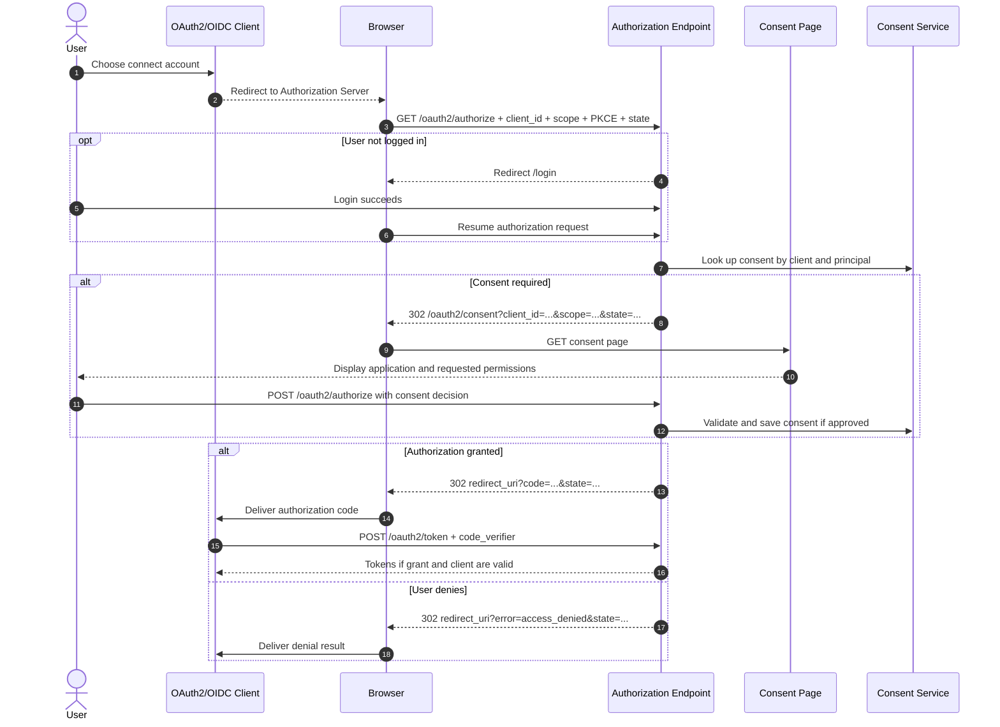
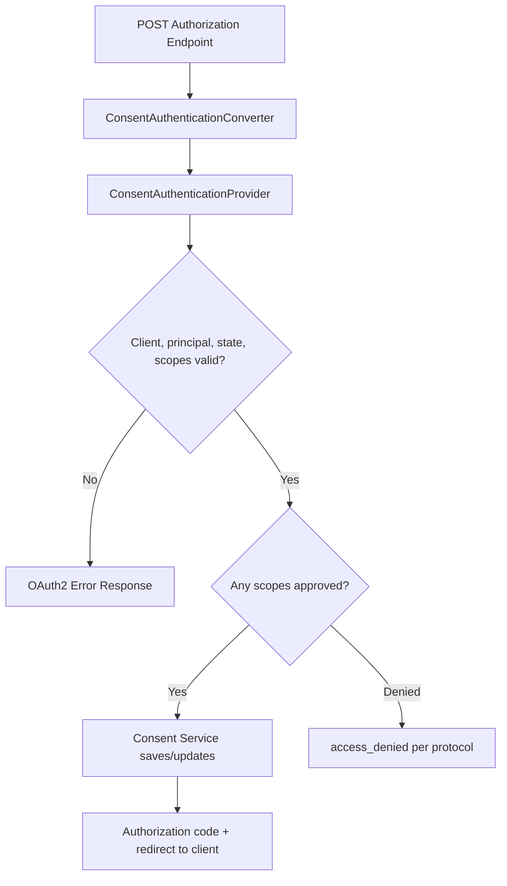

# Forwarding to Consent and Handling User Choices

## Lesson Objectives

In the **Authorization Endpoint** chapter, this lesson of the **SPRING_SECURITY_OAUTH2_OIDC_AUTHORIZATION_SERVER** module guides you through designing and implementing the **authorization consent** flow using **Spring Security**, **Spring Authorization Server**, and a **Spring Boot** application. We will trace how the Authorization Endpoint redirects the browser to the consent page, how the user chooses **Approve** or **Deny**, how the framework receives the decision, persists approved permissions, and returns a compliant OAuth 2.0/OpenID Connect (OIDC) response.

After completing this lesson, you will be able to:

- Describe the transition to consent in the Authorization Code + PKCE flow and distinguish consent from login.
- Understand when consent is displayed, the effect of `ClientSettings.requireAuthorizationConsent(true)`, and previously saved consent.
- Distinguish `state` in the client's authorization request from the `state` sent by the Authorization Server to the consent page.
- Configure `OAuth2AuthorizationServerConfigurer.authorizationEndpoint(...).consentPage(...)` while keeping the `SecurityFilterChain` structure right.
- Build a secure consent controller and form; submit a `POST` to the Authorization Endpoint containing `client_id`, `state`, and the selected `scope` values.
- Explain how full approval, partial approval, denial, replay, expired sessions, invalid scopes, and consent revocation are handled.
- Perform browser, HTTP, persistence, and security testing aligned with deployment policies.

> **Core principle:** The consent page only helps users review and submit their decision. Validating the authorization request, client, principal, scopes, state, and issuing the authorization code must belong to **Spring Authorization Server's protocol handlers**.

## 1. Where Does Consent Sit in the Authorization Code Flow?

An OAuth2 Client wanting to access an API on a user's behalf directs the browser to the Authorization Endpoint, `/oauth2/authorize` by default. The request carries parameters such as `client_id`, `response_type=code`, `redirect_uri`, `scope`, `state`, and `code_challenge` with `code_challenge_method=S256` when using PKCE.

The Authorization Server validates the request and login status. If the user is not authenticated, the server sends them to login and then restores the authorization request. If the client/policy requires consent and unapproved permissions remain, the server redirects the browser to the consent page.



The diagram above depicts an authorization request with a valid `redirect_uri`. If the redirect URI cannot be verified, the server **must not** redirect to an attacker-supplied URI merely to deliver an error message.

### 1.1. Login, Consent, and API Authorization Are Three Separate Tasks

| Step | Goal | Who performs it? |
|---|---|---|
| User authentication | Identify who the current user is. | Spring Security and the identity system. |
| Consent | User approves the scope of permissions the client is requesting. | Authorization Server and consent UI. |
| API authorization | Which resources the token and principal may act upon. | Resource Server and business policies. |

For example, a user has logged in successfully, yet a partner application requests `orders.read` and `orders.write`. The user may approve read access while denying write access. Even if they consent to `orders.write`, the Resource Server must still verify whether the user is permitted to modify **a specific order**; consent does not grant new business permissions.

## 2. When Does the Authorization Server Redirect to Consent?

Spring Authorization Server stores this policy in `RegisteredClient.clientSettings`. Example:

```java
RegisteredClient client = RegisteredClient.withId("partner-console-v1")
        .clientId("partner-console")
        .clientName("Partner Application")
        .clientSecret(passwordEncoder.encode(
                environment.getRequiredProperty("PARTNER_CLIENT_SECRET")))
        .clientAuthenticationMethod(ClientAuthenticationMethod.CLIENT_SECRET_BASIC)
        .authorizationGrantType(AuthorizationGrantType.AUTHORIZATION_CODE)
        .authorizationGrantType(AuthorizationGrantType.REFRESH_TOKEN)
        .redirectUri("https://partner.example.com/login/oauth2/code/partner")
        .scope(OidcScopes.OPENID)
        .scope("orders.read")
        .scope("orders.write")
        .clientSettings(ClientSettings.builder()
                .requireProofKey(true)
                .requireAuthorizationConsent(true)
                .build())
        .build();
```

This snippet is an **illustrative client configuration**, assuming `passwordEncoder` and `environment` are injected alongside a repository, Authorization Server beans, and a secure secret source. Never store real secrets in source code, logs, or committed files.

- `requireAuthorizationConsent(true)` makes consent a gating condition according to the client's policy.
- `requireProofKey(true)` enforces PKCE in the Authorization Code flow, mitigating a different threat than consent.
- Requested scopes can never exceed the client's registered scopes, even if a UI displays a matching checkbox.
- `clientName` shown to the user must come from the managed repository, never from a query parameter.

### 2.1. Not Every Login Shows the Screen

| State before request | Scopes this time | Expected behavior |
|---|---|---|
| No prior consent | `orders.read` | Prompts the user to review permissions if client requires consent. |
| Already approved `orders.read` | `orders.read` | Typically skips the screen when allowed by policy. |
| Already approved `orders.read` | `orders.read orders.write` | Requires consent for the newly requested `orders.write`. |
| Client only has `orders.read` | `orders.admin` | Invalid scope request is rejected; UI must never "validate" it. |
| Login session expired, consent still saved | `orders.read` | User may need to log in again, then reuse existing consent. |
| `client_credentials` grant | Service scopes | No user consent step as in the Authorization Code flow. |

OIDC has specific rules for certain scopes/claims and parameters like `prompt`. Verify behavior against your actual version and configuration; never assume every scope (including `openid`) always renders as a checkbox, or that `prompt=consent` behaves identically across all releases.

## 3. Distinguishing the OAuth2 Client's state from Consent state

This is a very common source of bugs when building a custom consent page.

**The OAuth2 Client's `state`** appears in the initial authorization request to bind the final response to the transaction the client started. **The `state` on the redirect to the consent page** is supplied by Spring Authorization Server to the form to bind the decision to **the pending authorization request on the server**. These two values can differ.

Illustrative example:

```text
1. Client sends:
   GET /oauth2/authorize?...&state=client-state-123

2. Authorization Server redirects:
   Location: /oauth2/consent?client_id=partner-console
            &scope=orders.read%20orders.write
            &state=server-consent-state-456

3. Form POSTs back to Authorization Endpoint:
   client_id=partner-console
   state=server-consent-state-456
   scope=orders.read

4. Framework redirects back to client callback:
   Location: https://partner.example.com/callback
            ?code=AUTHORIZATION_CODE&state=client-state-123
```

URL lines are wrapped for readability, not literal raw HTTP requests. **The consent page must preserve the state received in step 2 when submitting step 3**, never replacing it with the client's original state or generating a different state. Using the wrong value prevents the framework from finding the pending transaction, causing rejection or consent loops.

| Value | Source | Destination | What does it protect? |
|---|---|---|---|
| Client state | OAuth2 Client | Authorization request and final callback | Lets the client match the response to the right transaction, preventing request/response mix-up. |
| Consent state | Authorization Server | Redirect to consent UI, then POST to Authorization Endpoint | Binds the user's decision to the pending transaction at the AS. |
| Spring Security CSRF token | Spring Security CSRF infrastructure (if enabled) | Application form POST per filter chain | Protects against cross-site request forgery on endpoints enforcing CSRF validation. |

Consent state and `_csrf` **are not implicitly the same**. A form may need both depending on filter chain configuration. Never disable CSRF protection entirely just because the Authorization Server has its own state.

## 4. Configuring the Consent Page in SecurityFilterChain

### 4.1. Configuring the Redirect Path

Spring Authorization Server can render a **default consent page**. When you want a custom UI, configure `consentPage("/oauth2/consent")` on `OAuth2AuthorizationEndpointConfigurer` and serve that GET URI yourself.

Example using Spring Authorization Server 1.x / Spring Security 6.2+ APIs:

```java
package com.example.authserver.config;

import org.springframework.context.annotation.Bean;
import org.springframework.context.annotation.Configuration;
import org.springframework.core.annotation.Order;
import org.springframework.http.MediaType;
import org.springframework.security.config.Customizer;
import org.springframework.security.config.annotation.web.builders.HttpSecurity;
import org.springframework.security.oauth2.server.authorization.config.annotation.web.configurers.OAuth2AuthorizationServerConfigurer;
import org.springframework.security.web.SecurityFilterChain;
import org.springframework.security.web.authentication.LoginUrlAuthenticationEntryPoint;
import org.springframework.security.web.util.matcher.MediaTypeRequestMatcher;

@Configuration(proxyBeanMethods = false)
class AuthorizationServerSecurityConfig {

    @Bean
    @Order(1)
    SecurityFilterChain authorizationServerChain(HttpSecurity http)
            throws Exception {

        var authorizationServer =
                OAuth2AuthorizationServerConfigurer.authorizationServer();

        http.securityMatcher(authorizationServer.getEndpointsMatcher())
            .with(authorizationServer, configurer -> configurer
                .authorizationEndpoint(endpoint ->
                    endpoint.consentPage("/oauth2/consent"))
                .oidc(Customizer.withDefaults()))
            .authorizeHttpRequests(authorize ->
                authorize.anyRequest().authenticated())
            .exceptionHandling(exceptions -> exceptions
                .defaultAuthenticationEntryPointFor(
                    new LoginUrlAuthenticationEntryPoint("/login"),
                    new MediaTypeRequestMatcher(MediaType.TEXT_HTML)));

        return http.build();
    }

    @Bean
    @Order(2)
    SecurityFilterChain applicationChain(HttpSecurity http)
            throws Exception {

        http.authorizeHttpRequests(authorize -> authorize
                .requestMatchers("/assets/**").permitAll()
                .requestMatchers("/oauth2/consent").authenticated()
                .anyRequest().authenticated())
            .formLogin(Customizer.withDefaults());

        return http.build();
    }
}
```

The example focuses on the filter chains. A complete application still needs `RegisteredClientRepository`, `OAuth2AuthorizationService`, a consent service if used, user/authentication setup, issuer configuration, signing keys/JWKS, and other beans. If using another framework version, verify API names and activation styles.

GET `/oauth2/consent` is handled in the application MVC chain; `/oauth2/authorize` belongs to the Authorization Server chain. Never craft a filter matcher that accidentally intercepts the consent page or lets unauthenticated users access sensitive data.

### 4.2. Consent Page and Authorization Endpoint Are Two Distinct URLs

By the contract of `OAuth2AuthorizationEndpointConfigurer.consentPage(...)`, Spring Authorization Server redirects the browser to the consent page with query parameters:

- `client_id`: the client requesting permissions.
- `scope`: space-delimited list of requested scopes.
- `state`: the framework's consent transaction state.

**The form must execute an HTTP POST to the Authorization Endpoint**, `/oauth2/authorize` by default, rather than POSTing back to `/oauth2/consent`. The form carries `client_id`, the `state` received from the redirect, and one `scope` parameter for each approved permission.

If you changed the Authorization Endpoint path to `/identity/oauth2/authorize` via `AuthorizationServerSettings`, the form must POST to that path as well. You can obtain the path directly via `AuthorizationServerSettings.getAuthorizationEndpoint()`.

## 5. Implementing a Controller for the Consent Page

A proper MVC controller only assembles the display model. It retrieves the client name from the trusted registration source, the principal from the authenticated session, and prior consent from the service. The controller **neither saves consent nor issues codes/tokens**.

### 5.1. Spring MVC Example

```java
package com.example.authserver.consent;

import java.security.Principal;
import java.util.Arrays;
import java.util.LinkedHashSet;
import java.util.Set;
import java.util.stream.Collectors;

import org.springframework.http.HttpStatus;
import org.springframework.security.oauth2.core.endpoint.OAuth2ParameterNames;
import org.springframework.security.oauth2.server.authorization.client.RegisteredClient;
import org.springframework.security.oauth2.server.authorization.client.RegisteredClientRepository;
import org.springframework.security.oauth2.server.authorization.consent.OAuth2AuthorizationConsent;
import org.springframework.security.oauth2.server.authorization.consent.OAuth2AuthorizationConsentService;
import org.springframework.security.oauth2.server.authorization.settings.AuthorizationServerSettings;
import org.springframework.stereotype.Controller;
import org.springframework.ui.Model;
import org.springframework.web.bind.annotation.GetMapping;
import org.springframework.web.bind.annotation.RequestParam;
import org.springframework.web.server.ResponseStatusException;

@Controller
class ConsentPageController {
    private final RegisteredClientRepository clients;
    private final OAuth2AuthorizationConsentService consents;
    private final AuthorizationServerSettings settings;

    ConsentPageController(
            RegisteredClientRepository clients,
            OAuth2AuthorizationConsentService consents,
            AuthorizationServerSettings settings) {
        this.clients = clients;
        this.consents = consents;
        this.settings = settings;
    }

    @GetMapping("/oauth2/consent")
    String consent(
            @RequestParam(OAuth2ParameterNames.CLIENT_ID) String clientId,
            @RequestParam(OAuth2ParameterNames.SCOPE) String scope,
            @RequestParam(OAuth2ParameterNames.STATE) String state,
            Principal principal,
            Model model) {

        RegisteredClient client = clients.findByClientId(clientId);
        if (client == null || principal == null) {
            throw new ResponseStatusException(HttpStatus.BAD_REQUEST);
        }

        Set<String> requested = Arrays.stream(scope.trim().split("\\s+"))
                .filter(s -> !s.isBlank())
                .collect(Collectors.toCollection(LinkedHashSet::new));

        // Defensive check for the view; the provider must still verify
        // the transaction and granted scopes on POST.
        if (!client.getScopes().containsAll(requested)) {
            throw new ResponseStatusException(HttpStatus.BAD_REQUEST);
        }

        OAuth2AuthorizationConsent previous =
                consents.findById(client.getId(), principal.getName());

        Set<String> approved = previous == null
                ? Set.of()
                : previous.getAuthorities().stream()
                    .map(a -> a.getAuthority())
                    .filter(a -> a.startsWith("SCOPE_"))
                    .map(a -> a.substring("SCOPE_".length()))
                    .collect(Collectors.toSet());

        Set<String> toApprove = requested.stream()
                .filter(s -> !approved.contains(s))
                .collect(Collectors.toCollection(LinkedHashSet::new));

        model.addAttribute("clientName", client.getClientName());
        model.addAttribute("clientId", client.getClientId());
        model.addAttribute("state", state);
        model.addAttribute("scopesToApprove", toApprove);
        model.addAttribute("previouslyApprovedScopes", approved);
        model.addAttribute("authorizationEndpoint",
                settings.getAuthorizationEndpoint());

        return "oauth2/consent";
    }
}
```

Explanation:

- `RegisteredClientRepository.findByClientId` retrieves the actual registered client and its `clientName` for display.
- `Principal` is the currently authenticated user; never accept a `principalName` from a query string.
- `OAuth2AuthorizationConsentService.findById` uses `RegisteredClient`'s internal ID and the principal name; do not confuse it with the public `client_id`.
- Authorities prefixed with `SCOPE_` are interpreted as approved scopes in the standard model; custom extension authorities require dedicated handling.
- The controller reads `scope` from the query solely to build the UI. **That is not proof of a valid transaction**. On POST, the provider must validate scopes, principal, client, and state against the pending request.
- `AuthorizationServerSettings.getAuthorizationEndpoint()` keeps the form from hardcoding an outdated endpoint path.
- The example assumes a standard Authorization Code flow; OIDC cases with special scopes, PAR, or Device Authorization must be checked and tested against your version.

Never return an error like "client ID does not exist" with internal details to the browser. Never render secrets, tokens, authorization codes, or unnecessary personal details on the consent page.

### 5.2. Presenting Permissions in User-Friendly Language

Users need to understand the real impact of permissions:

| Scope | Suggested display text |
|---|---|
| `orders.read` | Allow the application to view orders you have access to. |
| `orders.write` | Allow the application to create or update orders within your permissions. |
| `profile` | Allow the application to receive profile details permitted under OIDC configuration. |
| `email` | Allow the application to receive shareable email information. |

Do not turn every scope into a checkbox with only a technical identifier or vague labels like "Allow all". For sensitive scopes, provide clear explanations. Client/scope text in the view must be **HTML-escaped to prevent XSS**; unclear labels should be reviewed before allowing clients to request that scope.

## 6. Approve and Deny Forms: Sending the Right Method and Parameters

### 6.1. Illustrative Thymeleaf Template

You can place a template at `templates/oauth2/consent.html`. The snippet below demonstrates the form submission contract in an HTML page; it is not a complete production UI.

```html
<!DOCTYPE html>
<html xmlns:th="http://www.thymeleaf.org" lang="en">
<head>
    <meta charset="UTF-8">
    <title>Authorization Consent</title>
</head>
<body>
<h1>Review Permissions</h1>
<p>
    Application <strong th:text="${clientName}">Application Name</strong>
    is requesting the following permissions:
</p>

<!-- Approve: POST TO THE AUTHORIZATION ENDPOINT -->
<form method="post" th:action="${authorizationEndpoint}">
    <input type="hidden" name="client_id" th:value="${clientId}">
    <input type="hidden" name="state" th:value="${state}">

    <!-- Thymeleaf/Spring Security integration with th:action may
         automatically add the CSRF field via RequestDataValueProcessor. -->

    <label th:each="scope : ${scopesToApprove}">
        <input type="checkbox" name="scope" th:value="${scope}">
        <span th:text="${scope}">Scope</span>
    </label>

    <p>Previously approved:</p>
    <ul>
        <li th:each="item : ${previouslyApprovedScopes}"
            th:text="${item}">Approved permission</li>
    </ul>
    <button type="submit">Allow selected permissions</button>
</form>

<!-- Deny: same client_id/state without sending selected scopes -->
<form method="post" th:action="${authorizationEndpoint}">
    <input type="hidden" name="client_id" th:value="${clientId}">
    <input type="hidden" name="state" th:value="${state}">
    <button type="submit">Deny</button>
</form>
</body>
</html>
```

`${...}` expressions reference model attributes populated by the controller. When Spring MVC, Thymeleaf, and Spring Security integrate via `RequestDataValueProcessor`, `th:action` typically injects the hidden CSRF field automatically on POST forms. Avoid inserting a duplicate CSRF field; if using a different view engine or custom setup, inspect actual wire requests and add the token explicitly when needed. For production:

- Use a template engine with automatic HTML escaping; render friendly scope descriptions rather than raw codes alone.
- POST to the exact Authorization Endpoint, never to `/oauth2/consent`.
- Preserve the consent `state` forwarded by the Authorization Server.
- Emit **one `scope` parameter for each newly approved permission**; do not submit unchecked scopes.
- Maintain CSRF protection per your security chain; test missing/invalid token cases.
- Provide an explicit Deny submission rather than a button that merely closes the tab or runs JavaScript without submitting the decision to the framework.

In standard consent flows, submitting a POST with the same `client_id`/`state` and no approved `scope` parameters can be treated by the framework as a denial; **verify `access_denied` behavior in your specific Spring Authorization Server version and scope combinations**, especially when prior consent already exists. Never include approved scopes in the Deny form.

### 6.2. Why Not POST to `/oauth2/consent`?

`/oauth2/consent` in the example is purely **a GET controller rendering the UI**. Both the Auth Code request and the consent submission belong to `OAuth2AuthorizationEndpointFilter` at `/oauth2/authorize` (or the configured Authorization Endpoint path). POSTing back to the view path can yield 404, 405, 403, or a redirect loop because the provider never receives the decision.

### 6.3. Partial Scope Approval

If a client requests `orders.read orders.write` and only `orders.read` is approved, the framework may grant authorization within the approved subset depending on grant capabilities/policies. The OAuth2 Client must inspect **the actually granted scopes**, never assuming every requested scope was automatically granted.

Never trust browser-submitted checkboxes blindly: an attacker can inject `orders.admin` into the POST body. Server-side handlers must reject permissions outside registration, the original request, and valid consent.

### 6.4. Are Previously Approved Permissions Removed If Not Re-Selected?

Typically, the consent service retains previously approved scopes/authorities. When a screen prompts only for newly requested scopes, leaving **previously approved** permissions unselected does not implicitly revoke them. If your product needs a "Disconnect / Revoke permissions" feature, build a dedicated revocation workflow with authentication, owner checks, and token policies. Never mutate durable consent solely from checkboxes on an incremental consent form.

## 7. How Does Spring Authorization Server Process the User's Choice?

`OAuth2AuthorizationEndpointConfigurer` wires `OAuth2AuthorizationEndpointFilter` with converters and providers. In Spring Authorization Server 1.x, key components typically include:

- `OAuth2AuthorizationCodeRequestAuthenticationConverter`: converts the authorization request into an authentication token.
- `OAuth2AuthorizationConsentAuthenticationConverter`: converts the HTTP consent POST into a token representing the user's choice.
- `OAuth2AuthorizationCodeRequestAuthenticationProvider`: validates the initial request.
- `OAuth2AuthorizationConsentAuthenticationProvider`: processes the consent decision against the pending transaction.
- `OAuth2AuthorizationConsentService`: retrieves/persists user-approved permissions.
- `OAuth2AuthorizationService`: manages authorization, code, and token state.



This is a conceptual functional model, not a guarantee of internal method ordering across every version. The framework must verify the binding across **current principal, client, state, redirect URI, scopes, and pending authorization**. A controller/view cannot verify those invariants from query parameters alone.

### 7.1. Approve Outcome

When the authorization request is valid and the user approves permitted scopes, the server issues an authorization code and redirects to the registered client:

```http
HTTP/1.1 302 Found
Location: https://partner.example.com/callback?code=AUTH_CODE&state=CLIENT_STATE
Cache-Control: no-store
```

This is an abbreviated example, not a full response template. `CLIENT_STATE` in the callback is the state generated by the OAuth2 Client in the original request, **not the consent form's state**. The client proceeds to exchange the code at the Token Endpoint, sending the matching `code_verifier` if PKCE is required. Consent never delivers access tokens directly in the browser under the Authorization Code flow.

### 7.2. Deny Outcome

For a valid authorization request with a verified redirect URI, denial typically results in:

```http
HTTP/1.1 302 Found
Location: https://partner.example.com/callback?error=access_denied&state=CLIENT_STATE
```

`access_denied` differs from `invalid_client` and `invalid_grant`. The client should treat it as a user denial while still checking `state` to prevent spoofed error responses. The server issues no code/token for denied requests, leaks no user details in query strings, and never redirects to an unverified URI.

### 7.3. User Closes Tab, Loses Session, or Submits Multiple Times

- **Closing the tab** means neither approval nor denial under the protocol; the pending transaction can simply expire.
- **Lost/changed session** between GET consent and POST approve: must reject or restart the flow safely, preventing consent from being saved under another principal.
- **Double submit / replay**: stale requests must never issue extra codes or tokens for the wrong transaction.
- **Two concurrent tabs**: each authorization request needs its own transaction/state without swapping states across tabs.
- **Switching replicas**: if the Authorization Server runs multiple instances, session/authorization state and consent persistence must remain consistent across nodes.

Never fix redirect loops by disabling state validation or permitting arbitrary unauthenticated POSTs.

## 8. Persisting Consent Durably and Revoking Permissions

### 8.1. Distinguishing the Services

| Abstraction | Owns | Example |
|---|---|---|
| `OAuth2AuthorizationConsentService` | Permissions approved per registered client and principal. | `SCOPE_orders.read` approved by the user. |
| `OAuth2AuthorizationService` | Authorization codes, access/refresh tokens, grant state. | Pending code, active refresh token. |
| `RegisteredClientRepository` | Client, redirect URIs, scopes, auth methods, consent policy. | `partner-console` allowed to request `orders.read`. |

Spring Authorization Server provides `InMemoryOAuth2AuthorizationConsentService` for development/testing and `JdbcOAuth2AuthorizationConsentService` to persist consent in a database. Production deployments running multiple replicas should use a durable backend when consent must survive restarts.

```java
import org.springframework.context.annotation.Bean;
import org.springframework.context.annotation.Configuration;
import org.springframework.jdbc.core.JdbcTemplate;
import org.springframework.security.oauth2.server.authorization.client.RegisteredClientRepository;
import org.springframework.security.oauth2.server.authorization.consent.JdbcOAuth2AuthorizationConsentService;
import org.springframework.security.oauth2.server.authorization.consent.OAuth2AuthorizationConsentService;

@Configuration(proxyBeanMethods = false)
class ConsentPersistenceConfig {

    @Bean
    OAuth2AuthorizationConsentService authorizationConsentService(
            JdbcTemplate jdbcTemplate,
            RegisteredClientRepository clients) {

        return new JdbcOAuth2AuthorizationConsentService(jdbcTemplate, clients);
    }
}
```

Apply version-appropriate schema/migrations, indexes, database permissions, retention, backups, and restore testing. `RegisteredClient.id` must remain stable; changing internal IDs on every restart can orphan existing consent records. Multi-tenant systems must design principal IDs and client partitioning carefully so two users sharing a username never collide on consent.

### 8.2. Revoking Consent Does Not Revoke Existing Access Tokens

A "Disconnect App" feature must authenticate the owner and can invoke:

```java
OAuth2AuthorizationConsent consent =
        consentService.findById(registeredClient.getId(), principal.getName());

if (consent != null) {
    consentService.removeAuthorizationConsent(consent);
}
```

This is internal logic executed after verifying principal/tenant ownership, not a standalone public endpoint. Removing consent forces re-approval on the next authorization request, but **does not immediately invalidate already-issued JWT access tokens** validated offline at Resource Servers. If immediate revocation is required, combine it with revoking authorizations/refresh tokens, short token TTLs, introspection, or token blocklisting per policy.

## 9. Securing the Consent Page

| Threat | Mitigation |
|---|---|
| Client name/label spoofing | Load `clientName` from the governed repository; control name/logo updates. |
| XSS via scope names/descriptions | Escape HTML; never render untrusted content as raw HTML. |
| CSRF or replay | Preserve transaction state; enforce CSRF tokens per filter chain; test duplicate submissions. |
| Wrong-user approval | Read principal from the authenticated session; protect against session fixation and account switching. |
| Scope escalation | Provider checks requested scopes, registered scopes, and consent; never trust checkboxes alone. |
| Open redirect | Framework validates `redirect_uri`; never redirect based on user query parameters. |
| Clickjacking / coercive UI | Use frame policies/CSP, clear Deny button, and plain permission explanations. |
| Data leakage in logs | Never log codes, client secrets, refresh/access tokens, PKCE verifiers, or session cookies. |
| Cross-tenant consent | Scope principal and client IDs strictly within tenant/issuer boundaries. |

If building the UI in JavaScript, watch out for CSRF/XSS and data sources: never push tokens/secrets to the client just to render consent. Avoid "pre-checking all boxes by default" for sensitive permissions. Low-risk permissions and write/delete permissions should be clearly differentiated.

## 10. Test Matrix for Consent Forwarding and Choice Handling

| Scenario | Expected outcome |
|---|---|
| Client requires consent, no prior record | Browser redirects to consent once other authorization conditions pass. |
| All requested scopes previously approved | Consent UI may be skipped per active policy. |
| Client requests additional scope | Prompts approval for the newly requested scope. |
| No active login session | Logs in first, then resumes authorization. |
| GET consent missing client ID/scope/state | Not rendered as a valid transaction. |
| POST consent sent to wrong path | No authorization code issued; form targets Authorization Endpoint. |
| POST state differs from consent redirect state | Rejected; cannot approve another transaction's permissions. |
| POST scope exceeds request/registration | Unauthorized scope is never granted. |
| Click Approve with partial scope selection | Processed per approved subset and grant policy. |
| Click Deny | No code/token issued; OAuth2 error per version, typically `access_denied`. |
| Omit CSRF token when filter requires it | Rejected by CSRF validation. |
| Invalid redirect URI | Never redirects to attacker's address. |
| Re-submit form after request completes | No code/token issued for stale transaction. |
| User switches or session expires before submit | Rejected or restarts the flow safely. |
| Restart / switch replica | Consent persists durably and pending state behaves consistently. |
| Revoke consent, request scopes again | Re-prompts approval; existing tokens follow separate revocation policy. |

### 10.1. Testing Configuration with JUnit/AssertJ

```java
@Test
void registeredClientMustRequireConsentAndPkce() {
    RegisteredClient client =
            registeredClientRepository.findByClientId("partner-console");

    assertThat(client).isNotNull();
    assertThat(client.getClientSettings()
            .isRequireAuthorizationConsent()).isTrue();
    assertThat(client.getClientSettings().isRequireProofKey()).isTrue();
    assertThat(client.getScopes())
            .contains("orders.read", "orders.write");
}
```

This snippet requires JUnit/AssertJ and a `RegisteredClient` test fixture. It tests only **client configuration**, not runtime approval or denial. You need true E2E tests maintaining browser sessions across GET authorize -> login -> consent -> POST authorize -> callback.

### 10.2. Repeatable E2E Verification Workflow

1. Use a test OAuth2 Client to generate a random `state`, `code_verifier`, and `S256` challenge.
2. Send an authorize request to the Authorization Server and log in with a test account.
3. Inspect the `Location` redirect to consent. Capture `client_id`, `scope`, and **the consent state issued by the server**.
4. Select one scope and POST the form using the same session and consent state; verify the callback contains `code` and **the client's original state**.
5. Exchange the code with the matching verifier; verify tokens and granted scopes.
6. Repeat the request with already-consented scopes; verify skipping/prompting behavior per policy.
7. Add a new scope and verify the UI displays the new permission.
8. Click Deny; verify no code is issued and `access_denied` is returned.
9. Tamper with `state` or inject an unregistered scope using test tools; verify rejection.
10. Restart/switch nodes and verify consent persistence, session behavior, auditing, and log redaction.

Do not just call `GET /oauth2/consent` and treat HTTP 200 as passing: **tests must exercise a pending authorization request and the decision POST**.

## 11. Common Issues and Diagnostics

| Symptom | Common cause | Resolution |
|---|---|---|
| Consent never appears | Client does not require consent, scopes already approved, or request failed earlier validation. | Check `ClientSettings`, consent records, scopes, and session. |
| GET consent returns 404 | Configured `consentPage(...)` without a matching controller/view. | Provide the MVC GET route and template. |
| POST consent returns 404/405 | Form POSTs to the consent UI instead of the Authorization Endpoint. | Use `settings.getAuthorizationEndpoint()`. |
| Infinite consent loop | Wrong `state` submitted, session dropped, or form missing scopes. | Compare consent redirect state vs. POST state; inspect cookies/session. |
| Form submit returns 403 | Wrong CSRF token or filter chain mismatch. | Inspect CSRF config and actual endpoint matchers. |
| Consent saved under wrong user | Principal read from query string or wrong session/tenant. | Read authenticated principal; verify tenant isolation. |
| Token missing expected scope | Only a subset of scopes was approved. | Inspect saved consent and token's actual scopes. |
| Consent page grants unknown scope | Custom POST handler skipped validation or bad registration. | Keep standard provider and test out-of-registration scopes. |
| Denied yet code still issued | Deny form submitted checked scopes/old inputs, or buggy custom logic. | Inspect POST body and test against your version. |
| Consent disappears after restart | In-memory storage or regenerated RegisteredClient IDs. | Use JDBC, migrations, and stable IDs. |
| Form action URL wrong behind proxy | Authorization Endpoint path changed or gateway rewrite mismatch. | Align settings, routes, and public URLs. |

When debugging, never enable logs containing authorization codes, refresh tokens, code verifiers, session cookies, passwords, or client secrets. Use controlled request IDs, event types, and error categories.

## 12. Hands-On Exercise

**Scenario:** Client `invoice-portal` uses Authorization Code + PKCE, requesting `invoices.read` and `invoices.write` with `requireAuthorizationConsent(true)`. The user previously approved `invoices.read`, and today the app additionally requests `invoices.write`.

Requirements:

1. Configure `RegisteredClient` with appropriate redirect URI, scopes, and client settings.
2. Configure a custom consent page at `/oauth2/consent`, while keeping `POST /oauth2/authorize` as the decision handler.
3. Build a controller reading `client_id`, `scope`, and `state`, looking up `RegisteredClient` and prior consent.
4. Design a UI showing previously approved permissions and new permissions, with clear Approve and Deny buttons.
5. Explain the two `state` values and specify which one goes into the form's hidden field.
6. Try approving only `invoices.write` on the new consent screen; verify saved consent and granted scopes afterward.
7. Try clicking Deny; confirm no new code/token is issued.
8. Tamper with the POST body to send `invoices.admin` or a wrong state; confirm the framework rejects it.
9. Restart the server, test across a second node, and verify consent/authorization state.
10. Describe how to revoke saved consent and how that differs from revoking existing JWT/access tokens.

**Completion criteria:** users can choose permissions, the Authorization Server issues codes only after valid request and consent, state is never swapped, new permissions are never auto-granted, and consent data persists durably where required.

## 13. Implementation Checklist

- [ ] Client registration has appropriate `requireAuthorizationConsent`, redirect URIs, grants, scopes, and PKCE.
- [ ] Consent triggers at the right moment after login and authorization validation.
- [ ] Consent page loads client name from the repository and principal from the authenticated session.
- [ ] Form **POSTs to the Authorization Endpoint** with `client_id`, consent `state`, and each selected `scope`.
- [ ] Client state is never mistakenly placed in the consent form's hidden field.
- [ ] Approve/partial/deny paths are tested; no code/token is created for denied requests.
- [ ] Scopes never exceed registered scopes or the original authorization request.
- [ ] Escaping, CSRF, TLS, cookie/session security, clickjacking defense, and log redaction are in place.
- [ ] Previously approved consent is separated from new scopes; unchecking in an incremental form does not silently revoke old permissions.
- [ ] `OAuth2AuthorizationConsentService` uses appropriate persistence with stable client/principal IDs.
- [ ] Consent revocation workflow exists alongside a separate policy for still-valid tokens.
- [ ] Wrong state, replay, invalid redirect URI, expired session, and multi-replica behavior have been tested.

## Summary

In Spring Authorization Server, the **Authorization Endpoint** validates the authorization request, authenticates the user, and forwards to consent only when needed. A custom consent page must submit the decision via **HTTP POST to the Authorization Endpoint**; validating state, client, principal, and scopes remains the framework's responsibility. The easiest mistake involves the consent page's state: **always submit back the exact state provided by the Authorization Server when redirecting to consent**, letting the server return the client's original state in the final callback.

The consent service persists user-approved permissions for future authorization requests. When designing revocation, separate consent from issued authorizations and tokens so you never promise that deleting consent immediately invalidates every JWT.

## References

1. [Spring Authorization Server — Protocol Endpoints](https://docs.spring.io/spring-authorization-server/reference/protocol-endpoints.html): `OAuth2AuthorizationEndpointConfigurer`, `consentPage`, and Authorization Endpoint converters/providers.
2. [Spring Authorization Server — OAuth2AuthorizationEndpointConfigurer API](https://docs.spring.io/spring-authorization-server/reference/api/java/org/springframework/security/oauth2/server/authorization/config/annotation/web/configurers/OAuth2AuthorizationEndpointConfigurer.html): `client_id`, `scope`, `state` contract and form POST target.
3. [Spring Authorization Server — Core Model / Components](https://docs.spring.io/spring-authorization-server/reference/core-model-components.html): `RegisteredClient`, `OAuth2AuthorizationConsent`, and consent service/JDBC.
4. [Spring Authorization Server — Authenticate a Single-Page Application using PKCE](https://docs.spring.io/spring-authorization-server/reference/guides/how-to-pkce.html): authorize, login, consent, code, and token sequence.
5. [RFC 6749 — OAuth 2.0 Authorization Framework](https://www.rfc-editor.org/rfc/rfc6749.html): Authorization Code flow, `state`, redirect URI, and `access_denied`.
6. [RFC 7636 — Proof Key for Code Exchange](https://www.rfc-editor.org/rfc/rfc7636.html): `code_verifier`, `code_challenge`, and PKCE flow.
7. [RFC 9700 — OAuth 2.0 Security Best Current Practice](https://www.rfc-editor.org/rfc/rfc9700.html): securing authorization requests and redirects.
8. [OpenID Connect Core 1.0](https://openid.net/specs/openid-connect-core-1_0.html): scopes, authentication, and OIDC responses.
