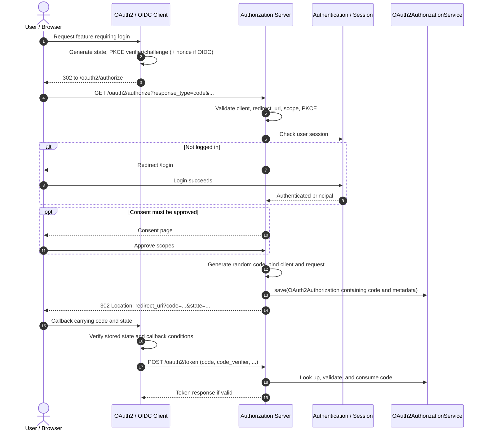
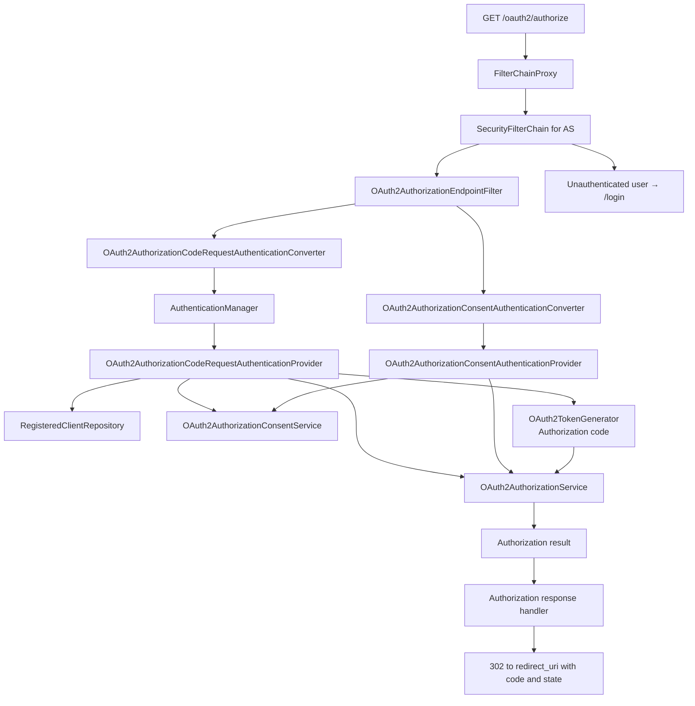
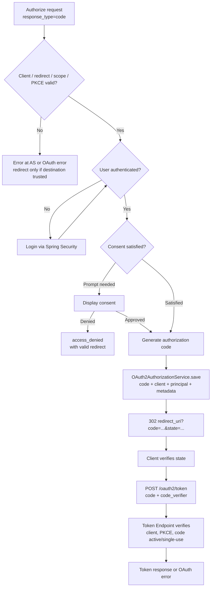

# Issuing the Authorization Code and Returning the Response to the Client

## 1. Lesson Objectives and Position

In the **Authorization Endpoint** chapter of the **SPRING_SECURITY_OAUTH2_OIDC_AUTHORIZATION_SERVER** module, the core responsibility of `/oauth2/authorize` in the **Authorization Code Flow** is to verify that the authorization request is valid, the user is authenticated, and required permissions are approved; from there, it **issues an authorization code** and **redirects the browser back to the client**.

This lesson belongs to the track on designing, configuring, securing, testing, and operating an OAuth 2.0/OpenID Connect (OIDC) Authorization Server with **Spring Security** and **Spring Authorization Server (SAS)** in a **Spring Boot** application.

After this lesson, you will be able to:

- Describe the prerequisites before an Authorization Server (AS) may issue an authorization code.
- Distinguish **authorization request**, **authorization code**, **authorization response**, **token request**, and **token response**.
- Understand how SAS uses `OAuth2AuthorizationEndpointFilter`, authentication providers, `OAuth2AuthorizationService`, and `OAuth2TokenGenerator` to generate, persist, and deliver codes.
- Explain `code`, `state`, `redirect_uri`, and PKCE bindings when completing the authorization response.
- Distinguish errors **safe to redirect back to the client** from errors **that must not redirect**, preventing open redirects and code leakage.
- Design lifetimes, single-use policies, system observability, and success/failure test cases.

**Scope:** This lesson focuses on the **code issuance and response delivery** phase of the Authorization Code Grant. Exchanging the code for access tokens, ID tokens, and refresh tokens at `/oauth2/token` is outlined to clarify the boundary, not to replace dedicated Token Endpoint documentation. Code examples use common APIs from Spring Authorization Server 1.x / Spring Security 6.x / Spring Boot 3.x; cross-check your project's framework version when applying.

## 2. From Authorize Request to Authorization Response

In the Authorization Code Flow, the client does not call `/oauth2/authorize` directly to receive tokens in a backend HTTP response. The client directs **the user's browser** to the AS. The AS may require login and consent, then sends the browser back to a validated `redirect_uri`.



At the **authorization response** stage, the standard success result of this grant is an **authorization code**, not an access token. When using OIDC with the `openid` scope, an **ID token** is issued later once the client successfully exchanges the code at the Token Endpoint per OIDC rules.

### 2.1. Four Distinct Responsibility Layers

| Stage | Who performs it? | Key inputs | Output |
| --- | --- | --- | --- |
| Client builds authorization request | OAuth2/OIDC Client | `client_id`, `redirect_uri`, `scope`, `state`, PKCE; `nonce` if needed | Authorize URL passed to browser |
| AS decides to issue code | Authorization Endpoint and providers | Registered client, user session, consent, grant policy | Authorization code generated and persisted |
| AS returns authorization response | Authorization Endpoint | Code, valid `redirect_uri`, original `state` if present | Redirect browser to client |
| Client exchanges code for tokens | Token Endpoint | Code, client authentication if required, redirect URI, PKCE `code_verifier` | Access token, possibly ID/refresh tokens |

If a code is issued yet the callback never reaches the client because the browser closed or the network failed, **that does not mean tokens were issued**. Codes are short-lived and simply expire if unredeemed.

## 3. Prerequisites Before Issuing an Authorization Code

The Authorization Endpoint should issue a code only after all relevant conditions are satisfied:

1. **Client exists:** `client_id` is found in `RegisteredClientRepository`.
2. **Grant permitted:** client has `AuthorizationGrantType.AUTHORIZATION_CODE` registered.
3. **Valid response type:** Authorization Code Flow request specifies `response_type=code`; never silently upgrade an unsupported response type to code.
4. **Valid redirect:** `redirect_uri` is verified against the client's registered URIs according to rules for the client/flow type.
5. **Valid scopes:** requested scopes are registered and approved per policy. If consent applies, required scopes are approved by the user.
6. **Valid PKCE:** if the client requires PKCE, the authorization request includes `code_challenge` and an accepted method, preferably `S256`.
7. **User authenticated:** for interactive flows, a valid resource owner `Authentication` exists in the security context.
8. **Not denied by consent or policy:** if the user or policy denies access, the AS must issue no code.
9. **Authorization data persisted:** the authorization code must be bound to authorization state so the Token Endpoint can look it up and verify constraints during code exchange.

Never look solely at "user is logged in" and issue a code; an authenticated user at the AS may still not have authorized the requesting client.

### 3.1. Example Authorize Request

Suppose backend client `portal-web` registered the callback:

```text
https://portal.example.com/login/oauth2/code/portal-web
```

The client builds the request (line-wrapped for readability; real HTTP uses a single query string):

```http
GET /oauth2/authorize?
    response_type=code&
    client_id=portal-web&
    redirect_uri=https%3A%2F%2Fportal.example.com%2Flogin%2Foauth2%2Fcode%2Fportal-web&
    scope=openid%20profile&
    state=RANDOM_UNPREDICTABLE_STATE&
    nonce=RANDOM_OIDC_NONCE&
    code_challenge=BASE64URL_SHA256_OF_VERIFIER&
    code_challenge_method=S256 HTTP/1.1
Host: auth.example.com
```

In this request:

- `response_type=code` requests an authorization response containing a code.
- `client_id` is the client's public identifier, not a secret.
- `redirect_uri` identifies the expected callback; it must match registered configuration.
- `state` is generated and stored by the client tied to the request session, used to prevent CSRF/mix-up on callback.
- `nonce` is an OIDC value binding the ID token to the login request, verified later.
- `code_challenge`/`code_challenge_method` belong to PKCE; `code_verifier` is **never** sent in the authorization request.

**Note:** When multiple redirect URIs exist or rules mandate passing the URI, the client must send `redirect_uri` explicitly. In every case, the AS redirects only to a valid URI verified from registration and the request—never to an arbitrary caller-supplied URL.

## 4. How Does Spring Authorization Server Process It Internally?

### 4.1. Diagram of Involved Components



The diagram illustrates **general responsibilities** and the consent branch; it does not prescribe a rigid internal call order for every request or every SAS version. In standard deployments, Spring Security handles user authentication via its chain/login; SAS uses protocol providers for authorize requests and consent decisions.

| Component | Responsibility |
| --- | --- |
| `OAuth2AuthorizationEndpointFilter` | Receives requests to the Authorization Endpoint, converts them into authentication requests, and writes responses/errors. |
| `OAuth2AuthorizationCodeRequestAuthenticationConverter` | Parses authorization request parameters into an authentication token for the manager/provider. |
| `OAuth2AuthorizationCodeRequestAuthenticationProvider` | Validates client/grant, redirect/scopes, and code-issuance conditions; coordinates required services. |
| `OAuth2AuthorizationConsentAuthenticationConverter` | Parses consent submission payloads appropriate for the endpoint. |
| `OAuth2AuthorizationConsentAuthenticationProvider` | Validates the consent decision and continues authorization issuance. |
| `RegisteredClientRepository` | Reads registered clients, redirect URIs, grant types, scopes, client settings, and token settings. |
| `OAuth2AuthorizationConsentService` | Reads and writes approved consent for principal/client pairs. |
| `OAuth2AuthorizationService` | Persists `OAuth2Authorization` holding the code, principal, client, and related metadata; Token Endpoint later retrieves the code from here. |
| `OAuth2TokenGenerator<?>` | Generates the authorization code when given an appropriate `OAuth2TokenContext`; lifetime policy typically comes from token settings. |
| Authorization response handler | Produces the success or error redirect in compliance with protocol and security rules. |

**Easily confused provider names:** `OAuth2AuthorizationCodeRequestAuthenticationProvider` handles **the authorization request** at `/oauth2/authorize`. Meanwhile, `OAuth2AuthorizationCodeAuthenticationProvider` (without "Request") handles **code exchange** at `/oauth2/token`. The two steps have different duties and security checks.

### 4.2. Why Persist the Authorization Before Redirecting?

An authorization code must carry state so that when the client exchanges it, the Token Endpoint knows:

- Whether this AS actually issued the code and whether it is still valid.
- Which registered client and principal the code belongs to.
- Which scopes were approved.
- What `redirect_uri` and PKCE challenge correspond to the original request.
- Whether the code has already been redeemed or invalidated.

SAS persists an `OAuth2Authorization` object via `OAuth2AuthorizationService`. Sending only a random string in a redirect without backing state would leave the Token Endpoint with no trusted source to verify required bindings.

In multi-instance deployments, a code issued by instance A must be discoverable when the token request hits instance B. Thus a shared authorization store is essential; an in-memory store fits only demos or topologies accepting that limitation.

## 5. Issuing the Code: Shape, Entropy, Lifetime, and Single-Use

### 5.1. What Is an Authorization Code?

An authorization code is a **temporary, opaque credential from the client's perspective**. The client does not need to inspect its internal format; it simply forwards the code to the Token Endpoint to exchange for tokens under matching bindings.

A properly designed authorization code must:

- Be unpredictable even after observing other codes; generators use a cryptographically secure random source.
- Have a **short lifetime**, minimizing the window an attacker has if a code leaks.
- Be **single-use** to prevent replay attacks.
- Be bound to the **registered client**, principal, redirect URI/PKCE, and authorized scopes per protocol.
- Be stored in authorization state in a form the Token Endpoint can verify.
- Never appear in logs, metric tags, error messages, or arbitrary shared links.

Because the code can be observed on the callback URL in a browser, never treat the code alone as sufficient proof to issue tokens. **PKCE + client binding + redirect URI validation + single-use** are essential layers of control.

### 5.2. Configuring Code Lifetime with `TokenSettings`

On a registered client, you can set the code lifetime explicitly:

```java
RegisteredClient client = RegisteredClient.withId(
                UUID.randomUUID().toString())
        .clientId("portal-web")
        .clientSecret(passwordEncoder.encode(rawClientSecret))
        .clientAuthenticationMethod(
                ClientAuthenticationMethod.CLIENT_SECRET_BASIC)
        .authorizationGrantType(
                AuthorizationGrantType.AUTHORIZATION_CODE)
        .authorizationGrantType(
                AuthorizationGrantType.REFRESH_TOKEN)
        .redirectUri(
                "https://portal.example.com/login/oauth2/code/portal-web")
        .scope(OidcScopes.OPENID)
        .scope(OidcScopes.PROFILE)
        .clientSettings(ClientSettings.builder()
                .requireProofKey(true)
                .requireAuthorizationConsent(true)
                .build())
        .tokenSettings(TokenSettings.builder()
                .authorizationCodeTimeToLive(Duration.ofMinutes(2))
                .build())
        .build();
```

This snippet builds a `RegisteredClient` for `RegisteredClientRepository`, not a complete Java source file. `passwordEncoder` and `rawClientSecret` must come from a secure client registration workflow. `rawClientSecret` must never be committed in source or written to logs.

`authorizationCodeTimeToLive(Duration.ofMinutes(2))` illustrates a 2-minute TTL. There is no universal "2-minute" mandate for every product; balance login/consent latency, retries, user experience, and risk. The lifetime of an **authorization code** is distinct from **access token**, **refresh token**, and **login session** lifetimes.

### 5.3. Key Lifecycle Moments

| Event | Code state | Required behavior |
| --- | --- | --- |
| Before user login/consent | No successful code yet for the flow | Never redirect with `code`. |
| After authorization conditions pass | Freshly generated, short-lived code | Persist authorization and issue redirect. |
| Client receives callback | Code not necessarily consumed yet | Client verifies `state`, then immediately submits token request. |
| First valid code exchange | Code consumed/invalidated per server handling | Issue tokens and persist updated state. |
| Re-exchanging the same code | Code already used | Reject with appropriate error; issue no additional tokens. |
| Code expires before exchange | Code no longer active | Reject; client must initiate a new authorization flow. |
| User denies consent | No code issued | Return authorization error per valid redirect rules. |

`OAuth2AuthorizationService.findByToken(codeValue, new OAuth2TokenType(OAuth2ParameterNames.CODE))` is one way to look up code state inside the AS; **finding a record** does not by itself prove the code is still active or matches the client/PKCE.

### 5.4. Why Does PKCE Still Matter for Confidential Clients?

A backend client authenticates at `/oauth2/token` using `client_secret_basic`. However, holding a secret does not automatically make browser-carried authorization codes immune to interception or injection. PKCE binds code redemption to the `code_verifier` generated originally by the client. Modern best practice uses `S256` for both public and confidential clients when supported.

For public clients (SPAs/mobile apps), never ship a shared client secret inside the bundle/app and treat it as confidential. Public clients use `ClientAuthenticationMethod.NONE` with Authorization Code + PKCE and appropriate complementary controls.

## 6. Successful Authorization Response

### 6.1. 302 Redirect with `code` and `state`

After the AS validates all conditions and persists the code, a typical response is:

```http
HTTP/1.1 302 Found
Location: https://portal.example.com/login/oauth2/code/portal-web?code=CODE_VALUE&state=RANDOM_UNPREDICTABLE_STATE
Cache-Control: no-store
```

`Location` is the client's verified callback URI. The `code` and `state` parameters are **URL-encoded** appropriately. If the original `redirect_uri` had an allowed query component, the AS must append response parameters properly rather than naively concatenating strings in a way that breaks URLs or introduces vulnerabilities.

`state` is the value **sent by the client** in the authorization request and **echoed unchanged** by the AS if present in the request. The client must compare it against the value stored for the current request, treating mismatches as security errors.

### 6.2. Why Only a Code?

With `response_type=code`:

- The browser returns to the client carrying **the code**, and `state` if present.
- The client performs `POST /oauth2/token` over the appropriate channel to exchange the code.
- The **Access token** is returned in the token endpoint response, not the standard authorize response.
- If the client uses OIDC with `scope=openid`, an **ID token** is issued per OIDC rules at the token endpoint upon successful code exchange.
- A **Refresh token** is issued only if allowed by grant, client type, and policy; it never appears in a standard code redirect.

This distinguishes the Authorization Code Flow from Implicit/Hybrid flows, which have different response shapes and should not be chosen by default for new designs.

### 6.3. How Does the Authorization Response Reach the Client via the Browser?

The AS usually does not push an HTTP request directly to the client backend via a server-to-server callback. The AS returns a **redirect to the browser**, and the browser requests `Location`. Consequently:

1. **The client must expose a callback endpoint** to receive the redirect.
2. **The browser may navigate away or close** before reaching the callback; the code may never be redeemed.
3. The callback must verify `state` and originating request conditions.
4. Backend clients should exchange codes via the backend channel; public clients use PKCE and token storage suitable for their client type.
5. The callback should strip sensitive parameters from the URL after handling (e.g., redirect to a clean URL) and avoid leaking codes to analytics, `Referer` headers, or logs.

Never read `code` from an arbitrary callback URL and accept it blindly. The client must bind the callback to **the exact login/request session**, its predefined redirect URI, and `state`.

## 7. Error Responses: When to Redirect and When to Stop

SAS must handle errors at the Authorization Endpoint **without becoming an open redirector**.

### 7.1. Two Important Error Groups

**Group A — Client and redirect URI are verified valid:** The AS may return protocol errors to the callback under OAuth 2.0 rules. For example:

```http
HTTP/1.1 302 Found
Location: https://portal.example.com/login/oauth2/code/portal-web?error=access_denied&state=RANDOM_UNPREDICTABLE_STATE
Cache-Control: no-store
```

Here, `access_denied` may indicate the user denied consent or a policy rejected access. If the request carried `state`, that value must be returned in the error response per protocol rules. The client checks `state` before attributing the error to its session.

**Group B — Client or redirect URI cannot be trusted:** For example, `client_id` is unknown or `redirect_uri` does not match registration. The AS **must not redirect the browser to an unverified URL** to "report the error", as doing so can send data to an attacker or turn the AS into an open redirector. The AS renders/returns the error locally at the AS, such as an HTTP error page or direct error response, without following arbitrary request redirects.

### 7.2. Common Error Codes

| Error code | Typical situation | Notes |
| --- | --- | --- |
| `invalid_request` | Missing required parameter, invalid duplicate parameters, malformed request | Never expose raw credentials or sensitive data in error descriptions. |
| `unauthorized_client` | Client is not permitted to use the flow/grant per registration | Check `RegisteredClient` and `authorizationGrantTypes`. |
| `unsupported_response_type` | AS does not support the requested `response_type` | Do not silently switch flows just to "make it work". |
| `invalid_scope` | Disallowed or invalid scope | Compare against registered scopes and policy. |
| `access_denied` | User denied consent or rejected by policy | Issue no code. |
| `server_error` | AS failed to complete processing due to internal failure | Log sanitized diagnostics internally; never leak stack traces in redirects. |
| `temporarily_unavailable` | AS temporarily overloaded or under maintenance | Client may display an error or retry per policy. |

Not every error may be redirected; redirecting depends on **having verified the client and response destination**. Never populate `error_description` with stack traces, account details, secrets, or codes.

### 7.3. Why Is `redirect_uri` a Security Boundary?

Suppose a request contains:

```text
client_id=portal-web
redirect_uri=https://attacker.example/collect
response_type=code
```

If client `portal-web` only registered `https://portal.example.com/login/oauth2/code/portal-web`, the AS must reject mismatched `redirect_uri` values. Never be "flexible" by:

- Accepting arbitrary subdomains.
- Using starts-with prefix matching when the URI has arbitrary path/query parts.
- Relying on an untrusted `Host` header to infer the callback.
- Allowing wildcard redirect URIs for confidential web clients.
- Sending errors with `state` or request metadata to an attacker-specified URL.

Exceptions such as native/loopback redirect URIs, if supported by profile/framework, must be configured and tested strictly per specification—never generalized into a broad rule.

## 8. Relationship with PKCE, `state`, and OIDC `nonce`

These values serve distinct purposes:

| Value | Who creates it? | When is it sent? | Protection goal |
| --- | --- | --- | --- |
| `state` | Client | Authorization request; echoed in authorization response if sent | Binds callback to initiated request; mitigates CSRF/code injection when verified by client. |
| `code_verifier` | Client | **Token request**, never sent at authorize | Proves the client holds the verifier generated at the start. |
| `code_challenge` | Client, derived from verifier | Authorization request | AS stores PKCE binding to verify the verifier at code exchange. |
| `nonce` | OIDC Client | Authorization request; verified against ID token when applicable | Binds ID token to OIDC request session, mitigating replay/mix-up. |

With method `S256`:

```text
code_challenge =
    BASE64URL( SHA256( ASCII(code_verifier) ) )
```

At the Authorization Endpoint, the AS checks `code_challenge` and method per client policy, then saves the necessary metadata with the authorization. At the Token Endpoint, the AS recomputes/compares the verifier against the saved challenge. Never swap `code_challenge` into `code_verifier` or attempt to verify the verifier at the authorization endpoint, since the client has not sent it yet.

**`state` does not replace PKCE.** A request with a valid `state` can still suffer code theft without proper PKCE protection. Conversely, PKCE does not relieve the client from validating `state` on callback. For OIDC, `nonce` validation applies to the ID token once received by the client.

## 9. Minimal Spring Boot / Spring Authorization Server Configuration

This example wires the Authorization Endpoint with security chains, consent, and state storage. It is a skeleton suitable for lab use; you must add user authentication, signing keys/JWK, client registration, token generators, and any other beans required for your actual flow.

### 9.1. Registering the AS Filter Chain

```java
@Configuration(proxyBeanMethods = false)
@EnableWebSecurity
public class AuthorizationServerSecurityConfig {

    @Bean
    @Order(1)
    SecurityFilterChain authorizationServerChain(HttpSecurity http)
            throws Exception {

        OAuth2AuthorizationServerConfigurer as =
                OAuth2AuthorizationServerConfigurer.authorizationServer();

        http
            .securityMatcher(as.getEndpointsMatcher())
            .with(as, configurer ->
                    configurer.oidc(Customizer.withDefaults()))
            .authorizeHttpRequests(authorize ->
                    authorize.anyRequest().authenticated())
            .exceptionHandling(exceptions ->
                    exceptions.defaultAuthenticationEntryPointFor(
                            new LoginUrlAuthenticationEntryPoint("/login"),
                            new MediaTypeRequestMatcher(MediaType.TEXT_HTML)))
            .oauth2ResourceServer(resourceServer ->
                    resourceServer.jwt(Customizer.withDefaults()));

        return http.build();
    }

    @Bean
    @Order(2)
    SecurityFilterChain applicationChain(HttpSecurity http)
            throws Exception {

        http
            .authorizeHttpRequests(authorize ->
                    authorize.anyRequest().authenticated())
            .formLogin(Customizer.withDefaults());

        return http.build();
    }

    @Bean
    AuthorizationServerSettings authorizationServerSettings() {
        return AuthorizationServerSettings.builder()
                .issuer("http://localhost:9000")
                .build();
    }
}
```

`as.getEndpointsMatcher()` routes OAuth2/OIDC requests into the SAS filter chain. `/login` is handled by the application chain. The example uses local issuer `http://localhost:9000`, while the client's redirect URI is registered separately. Production requires a consistent HTTPS issuer aligned with discovery/tokens and reverse proxies.

**Note:** Enabling OIDC typically requires a `JWKSource<SecurityContext>`, an appropriate `JwtDecoder`, and core AS infrastructure. This snippet illustrates the Authorization Endpoint entry point; these three beans alone do not assemble a full user/registered-client system.

### 9.2. Registering a Client Requiring PKCE and Consent

```java
@Bean
RegisteredClientRepository registeredClientRepository(
        PasswordEncoder encoder,
        @Value("${LOCAL_CLIENT_SECRET}") String rawSecret) {

    RegisteredClient client = RegisteredClient
            .withId(UUID.randomUUID().toString())
            .clientId("portal-web")
            .clientSecret(encoder.encode(rawSecret))
            .clientAuthenticationMethod(
                    ClientAuthenticationMethod.CLIENT_SECRET_BASIC)
            .authorizationGrantType(
                    AuthorizationGrantType.AUTHORIZATION_CODE)
            .authorizationGrantType(
                    AuthorizationGrantType.REFRESH_TOKEN)
            .redirectUri(
                    "http://127.0.0.1:8080/login/oauth2/code/portal-web")
            .scope(OidcScopes.OPENID)
            .scope(OidcScopes.PROFILE)
            .clientSettings(ClientSettings.builder()
                    .requireProofKey(true)
                    .requireAuthorizationConsent(true)
                    .build())
            .tokenSettings(TokenSettings.builder()
                    .authorizationCodeTimeToLive(Duration.ofMinutes(2))
                    .build())
            .build();

    return new InMemoryRegisteredClientRepository(client);
}

@Bean
PasswordEncoder passwordEncoder() {
    return new BCryptPasswordEncoder();
}

@Bean
OAuth2AuthorizationService authorizationService() {
    return new InMemoryOAuth2AuthorizationService();
}

@Bean
OAuth2AuthorizationConsentService authorizationConsentService() {
    return new InMemoryOAuth2AuthorizationConsentService();
}
```

Place these beans in an appropriate `@Configuration` class (avoid duplicate bean definitions if Boot/SAS already auto-registers an implementation).

- `requireProofKey(true)` ensures requests missing PKCE are rejected per configuration.
- `requireAuthorizationConsent(true)` requires user scope approval via the consent flow.
- `authorizationCodeTimeToLive` governs code expiration, not access token lifetime.
- `InMemoryOAuth2AuthorizationService` keeps code/token metadata in memory. Data is lost across restarts or instances; production needs a persistent store such as JDBC.
- `client_secret_basic` is for **confidential clients**; public clients use `none` and PKCE rather than embedding secrets in SPAs/mobile apps.
- The example uses local redirect URI `127.0.0.1:8080` and issuer `localhost:9000` for two distinct roles. Real clients must use their exact registered URIs.

Never commit raw secrets in source code. The `LOCAL_CLIENT_SECRET` environment variable is for local/testing only; production should use a secret manager, least privilege, and secret rotation.

### 9.3. Configuring a Custom Consent Page When Needed

SAS can use a default consent UI or integrate a custom page. Example customization on the Authorization Endpoint:

```java
OAuth2AuthorizationServerConfigurer as =
        OAuth2AuthorizationServerConfigurer.authorizationServer();

http
    .securityMatcher(as.getEndpointsMatcher())
    .with(as, server -> server.authorizationEndpoint(
            endpoint -> endpoint.consentPage("/oauth2/consent")));
```

This snippet **illustrates selecting the consent page URL only**; integrate it with your filter chain, login, authorization rules, and dedicated controller/template if implementing a custom page.

A custom consent page must:

- Display only AS-verified scopes and client details; never trust browser-tampered parameters.
- Bind form submission to the authenticated user and pending authorization request.
- Enforce CSRF protection on POST submissions.
- Let the user distinguish approval from denial; never silently grant extra scopes.
- Never generate codes inside the controller; let SAS continue protocol processing.

## 10. Inspecting the Authorization Code in `OAuth2AuthorizationService`

To understand the relationship between the issued code and server-side state, you can inspect it in a **protected internal test/admin utility**:

```java
OAuth2Authorization authorization = authorizationService.findByToken(
        codeValue,
        new OAuth2TokenType(OAuth2ParameterNames.CODE));

if (authorization != null) {
    OAuth2Authorization.Token<OAuth2AuthorizationCode> code =
            authorization.getToken(OAuth2AuthorizationCode.class);

    if (code != null && code.isActive()) {
        // The code is still active per authorization metadata.
        // This alone is not the decision to allow code exchange.
    }
}
```

`findByToken` merely returns the authorization containing the matching token. Finding a record or seeing `code.isActive() == true` **does not replace** full Token Endpoint validation: client binding, redirect URI, PKCE verifier, grant, replay state, and protocol checks must still run in the provider.

In production, never build a public `GET /debug/code?code=...` endpoint to inspect authorizations by code. A code is a credential that can leak in access logs or query strings; never serialize `OAuth2Authorization` directly to JSON because it holds sensitive tokens and metadata.

### 10.1. Data Pieces That Must Stay Consistent

| Object | Where managed | Purpose |
| --- | --- | --- |
| `RegisteredClient` | `RegisteredClientRepository` | Client/grant/scope/redirect URI/PKCE settings. |
| Principal and login session | Spring Security `Authentication`, session/IdP | Which user is granting authorization. |
| `OAuth2AuthorizationConsent` | `OAuth2AuthorizationConsentService` | Which scopes the user has approved. |
| `OAuth2Authorization` | `OAuth2AuthorizationService` | Code, client ID, principal, scopes, attributes, and token metadata. |
| `OAuth2AuthorizationCode` | Token inside `OAuth2Authorization` | Code value and issued/expires state; looked up and consumed at the Token Endpoint. |
| `TokenSettings` | `RegisteredClient` | Code lifetime and other token policies. |

Never use `RegisteredClient`'s ID as the authorization ID, or use the raw code as the sole primary key of the entire authorization model. A single authorization spans multiple stages and holds multiple token types.

## 11. Returning Responses Safely: URLs, Browsers, and Logs

### 11.1. Risks of Code Exposure in Callback URLs

The code travels in a redirect URL query parameter; depending on system setup, it may appear in:

- Browser history or a callback URL copied by the user.
- Reverse proxy/access logs of the **client callback**.
- Tracking/analytics scripts that record full URLs.
- `Referer` headers if the callback page loads external third-party resources before stripping the code from the URL.
- Request observability tools configured to capture query strings.

Protect both the AS and client sides:

1. Permit only registered callbacks and require HTTPS outside local loopback testing.
2. Keep codes short-lived, single-use, and bound to the client and PKCE.
3. Have the client process the callback promptly and redirect to a clean URL, avoiding keeping `code` in the address bar longer than necessary.
4. Set `Referrer-Policy: no-referrer` or an equivalent policy on the callback page to reduce referrer leakage.
5. Never put codes, states, secrets, or tokens into metric tags, trace attributes, or full URL logs.
6. Never embed unnecessary third-party scripts on the callback page.

`Referrer-Policy` does not replace PKCE or single-use, and does not erase browser history entries; combine multiple controls.

### 11.2. Protecting Responses from Caching

Login/consent pages, callbacks, and token endpoints should enforce appropriate cache headers, especially for responses carrying credentials or user data. Headers like `Cache-Control: no-store` help prevent accidental caching of sensitive responses, though which endpoints emit which headers depends on framework/proxy configuration.

Never return `code` in a JSON HTTP response body just because it is "easier to parse" for a backend client when implementing the standard Authorization Code Flow. Authorize responses travel via browser redirect; the backend exchanges the code at the Token Endpoint.

### 11.3. Guarding Against Open Redirects and URL Injection

If writing a custom authorization response handler, strictly enforce:

- Destination URI comes from a **verified redirect URI**, never an arbitrary browser `returnUrl`/`next` parameter.
- `code`, `state`, and errors are percent-encoded using a proper URI builder.
- Query parameters are appended using a parser/builder, never raw string concatenation.
- Never allow CRLF injection into the `Location` header.
- If the destination URI is invalid, stop at the AS and return a safe local error.
- Never emit tokens, client secrets, or private keys in the authorization response.

Customize the handler only when there is a clear protocol/UX requirement. SAS's default handler keeps these rules consistent.

## 12. Testing the Authorization Endpoint Across Every Boundary

### 12.1. End-to-End Happy Path Scenario

Run the AS at `http://localhost:9000` and the client at `http://127.0.0.1:8080` per the demo setup. Use an OAuth2 client library capable of managing `state`, PKCE, and callbacks.

1. Client generates random `state`, `code_verifier`, and `code_challenge=S256`; for OIDC, also adds `nonce` per policy.
2. Client directs browser to `/oauth2/authorize` with `client_id=portal-web`, `response_type=code`, registered redirect URI, and registered scopes.
3. If unauthenticated, browser navigates to `/login`. Login succeeds and resumes authorize.
4. If consent is required, user approves appropriate scopes.
5. AS issues code, persists authorization, and redirects browser to the registered callback.
6. Callback carries `code` and matching `state`; **no access token appears in the URL**.
7. Client verifies `state`, exchanges the code with the matching `code_verifier` and client authentication method if required.
8. Token Endpoint issues valid tokens; retrying the old code must fail.
9. Test code expiration with a fresh flow and shortened test TTL; AS rejects the exchange.

When a user closes the browser before the callback or a token request fails due to network issues, the client should initiate a fresh authorization flow if the code is unusable. Never ask the AS to "re-send the old code" from the database.

### 12.2. Success/Failure Test Matrix

| Scenario | Expected at Authorization Endpoint | What to verify |
| --- | --- | --- |
| Valid client, login/consent complete | Redirect to callback with `code` and `state` (if sent) | Authorization state exists; code is active immediately after issuance. |
| Unauthenticated user | Redirect to login, resume flow after authentication | No code issued based solely on client ID. |
| User denies consent | Error such as `access_denied` when redirect is valid | No code issued; scopes never silently granted. |
| Unsupported `response_type` | Corresponding OAuth2 error | No code/token issued for wrong flow. |
| Non-existent client | Error at AS; never redirect to untrusted URI | No open redirect. |
| Invalid `redirect_uri` | Reject request; never use attacker-supplied callback | Never leak `state`/code to wrong destination. |
| `authorization_code` grant unregistered | `unauthorized_client` per response rules | Repository/policy enforced. |
| Unregistered scope | `invalid_scope` or appropriate error | No unauthorized scope granted. |
| Missing PKCE when `requireProofKey(true)` | Request rejected | No code issued. |
| Disallowed PKCE method | Request rejected | Never silently fall back to `plain`. |
| `state` supplied | Response echoes matching value | Client detects out-of-session callbacks. |
| Wrong secret at token endpoint | Does not alter prior authorize outcome; token request rejected | Distinguishes client auth from code issuance. |
| Wrong `code_verifier` at token endpoint | Token exchange fails | Code cannot bypass PKCE. |
| Expired/reused code | Token endpoint rejects | Code enforces TTL and single-use. |
| Multiple AS instances | Code created on A, token request to B succeeds if configured properly | Shared authorization store; consistent signing keys/issuer. |

### 12.3. Testing HTTP Redirects with Spring Security Test

You can use `MockMvc` to verify successful callbacks, though a complete authorize request requires **a registered client, an authenticated principal, valid PKCE, and satisfied consent**. A test skeleton:

```java
@Test
void successfulAuthorizeRedirectContainsCodeAndState() throws Exception {
    // Client and consent are prepared in the test fixture.
    String state = "test-state-from-secure-test-fixture";

    mockMvc.perform(get("/oauth2/authorize")
            .param("response_type", "code")
            .param("client_id", "portal-web")
            .param("redirect_uri",
                    "http://127.0.0.1:8080/login/oauth2/code/portal-web")
            .param("scope", "openid")
            .param("state", state)
            .param("code_challenge", validS256Challenge)
            .param("code_challenge_method", "S256")
            .with(user("alice")))
        .andExpect(status().is3xxRedirection())
        .andExpect(header().string(
                "Location", containsString("code=")))
        .andExpect(header().string(
                "Location", containsString("state=" + state)));
}
```

This is an illustrative skeleton, **not a standalone runnable test**: you must set up the test context and fixtures, ensure consent is granted or exercised, and supply a valid `validS256Challenge`. In real tests, parse `Location` into a `URI` to assert **the exact target host/path** and query parameters rather than merely substring-matching `"code="` as in the skeleton.

**Write separate tests for invalid redirect URIs:** do not merely assert that some error status is returned and assume safety; verify the response **contains no `Location` pointing to the attacker domain**. For errors occurring after a valid redirect is established, assert the proper `error` and `state` query parameters.

### 12.4. Testing Persistence and Concurrency

- After code issuance, query `OAuth2AuthorizationService` by code value in a privileged test harness; verify matching client/principal/authorized scopes.
- Restart the AS with in-memory storage: old codes disappear, failing as expected for the demo limitation.
- With JDBC, authorize on node A and exchange the code on node B within the valid window.
- Issue two nearly concurrent token requests using the same code; the security requirement is never issuing valid tokens multiple times due to a race. Depending on provider and persistence, evaluate transaction/locking behavior and add concurrency tests.
- When the database fails before saving the authorization, never return an authorization response containing an unusable code. Verify safe server error handling and flow retry behavior.
- When the AS restarts mid-consent, request/session handling must be well-defined; never reuse stale consent/challenges across contexts.

## 13. Observability and Production Troubleshooting

### 13.1. Useful Metrics and What Never to Log

| Observation point | Useful metrics/fields | What never to record |
| --- | --- | --- |
| `/oauth2/authorize` | Request count, latency, normalized error groups by client/grant | Full URLs containing `state`/`nonce`/`code_challenge` unnecessarily. |
| Login / session | Success rate, redirect loops, session expirations | Session IDs, passwords, raw cookies. |
| Consent | Approve/deny counts, processing latency | PII or sensitive scopes in uncontrolled logs. |
| Code generation/storage | Generator/store failures, persistence latency | Raw authorization codes or serialized `OAuth2Authorization`. |
| Client callback | State mismatch rate, code exchange failures, response time | Full callback URLs, raw codes, tokens. |
| Token endpoint | `invalid_grant`, `invalid_client`, latency, PKCE errors | `code_verifier`, client secrets, access/refresh tokens. |

Use a dedicated correlation ID to link logs across authorization request, consent, redirect, and token request while **never using raw codes or states as correlation IDs**. Separate protocol error codes shown to clients from access-controlled internal diagnostics.

### 13.2. Common Errors and Root Causes

| Symptom | Possible cause | Resolution |
| --- | --- | --- |
| Browser visits `/oauth2/authorize` and loops back to `/login` | Misconfigured session/`SecurityFilterChain`, cookies, or request cache | Inspect AS chain, login chain, session cookies, and saved requests. |
| User approved consent yet no code issued | Client/scope policy, authorization persistence error, or invalid consent state | Inspect error response, consent form, and store. |
| AS redirects to wrong callback path | Wrong registered `redirect_uri` or client request; reverse proxy mismatch | Compare exact URI, scheme, host, port, path, and query. |
| Authorization Endpoint returns 404 | `SecurityFilterChain` matcher or endpoint path mismatch | Check `AuthorizationServerSettings` and security chains. |
| Requests with wrong client still redirect to supplied URL | Custom response handler lacks validation | Remove open redirect, restore registered redirect URIs and standard handler. |
| Token Endpoint returns `invalid_grant` right after callback | Code already used/expired, wrong client, PKCE/redirect URI mismatch, or unshared store | Inspect token exchange bindings, clocks, and persistence. |
| Client receives callback but reports `state mismatch` | Lost client session, mixed flows, or injected response | Keep state validation enabled; inspect client session/cookies. |
| Code TTL too short | Slow login/consent navigation or clock skew | Measure latency; tune TTL while keeping it short and preventing replay. |
| Code leaked in logs | Proxy/client callback logs full URL query strings | Redact queries, strip codes from URLs after callback, and enforce PKCE. |
| Code issued on node A fails to exchange on node B | In-memory authorization store or misconfigured multi-instance setup | Use shared persistence; verify consistent sessions, issuer, and signing keys. |

## 14. Key Design Decisions to Master

### 14.1. Should You Write a Custom Controller to Issue Codes?

With standard Spring Authorization Server, you **do not need** to write a custom `GET /oauth2/authorize` controller to generate codes and redirect. The framework already provides converters/providers, persistence integration, and protocol error handling. Customize only through official extension points when requirements genuinely demand it.

Writing your own code-issuing controller easily misses **client registration, exact redirect validation, PKCE, consent, code expiry, single-use enforcement, and error-redirect boundaries**. Rather than duplicating that logic, configure `OAuth2AuthorizationServerConfigurer`, `RegisteredClientRepository`, services, and filter chains properly.

### 14.2. Should Access Tokens Be Returned Immediately Upon User Consent?

**No** in standard Authorization Code Flow. Consent is a prerequisite for **issuing a code**; issuing access tokens is the Token Endpoint's responsibility after validating the code and client/PKCE. Placing tokens in callback queries increases exposure and alters the protocol flow.

### 14.3. Should Codes Be Stored in the Browser Session Instead of an Authorization Store?

Never treat the browser session as the sole state store for codes. The browser session supports interactive authentication; `OAuth2AuthorizationService` persists authorization state so the Token Endpoint can process client back-channel requests. Across multiple instances, those two state stores may reside in different backends and must be designed consistently.

### 14.4. Should a Code Be Reused When a Token Request Fails?

Authorization codes are designed to be **single-use**; marking a code used/invalidated and handling failed token exchanges must follow provider and security rules. Clients should never retry an already-consumed code or build a "code renewal" mechanism. Whenever a code's usability is in doubt, initiate a fresh authorization flow.

## 15. Pre-Production Checklist for the Authorization Endpoint

- [ ] `RegisteredClientRepository` has valid clients, `authorization_code` grant, exact scopes, and exact redirect URIs.
- [ ] `SecurityFilterChain` routes `/oauth2/authorize` cleanly to SAS while `/login` and consent operate securely.
- [ ] User authentication and authorization consent are verified before issuing codes.
- [ ] Authorization Code Flow configures PKCE `S256`, especially for public clients; `requireProofKey(true)` set per policy.
- [ ] Client `state` is echoed properly when present; the client validates `state` bound to its request before exchanging the code.
- [ ] Codes are generated with secure randomness, have short TTLs, are persisted in `OAuth2AuthorizationService`, and are single-use.
- [ ] Callbacks target only valid `redirect_uri` values; no wildcards or arbitrary URLs.
- [ ] Errors redirect only when the destination is verified; invalid client/redirect errors stay at the AS.
- [ ] Successful authorization responses carry only code and state per flow; tokens are issued at the Token Endpoint.
- [ ] Raw codes, `code_verifier`, session cookies, client secrets, and tokens are never logged.
- [ ] Client callbacks are protected by HTTPS outside local testing, clean URL handling, and an appropriate `Referrer-Policy`.
- [ ] Tests cover success, consent denied, invalid client/redirect/scope, missing PKCE, expired code, and code reuse.
- [ ] Multi-instance deployments share an authorization store; issuer, sessions, and signing keys match the topology.
- [ ] Monitoring tracks `invalid_grant`/`invalid_client` errors and latencies without exposing credentials in traces.

## 16. Memory Map



**Issuing an authorization code is a controlled, stateful authorization decision, and the redirect is merely the browser transport returning the outcome to the exact registered client.** Spring Authorization Server orchestrates this flow via Authorization Endpoint filters/providers, repositories, and the authorization service, while Spring Security supplies user identity and protects interactive sessions. When codes are short-lived, single-use, bound to PKCE/client, and delivered only to validated redirect URIs, the Authorization Code Flow establishes a solid foundation for safely exchanging codes for tokens in the next step.
